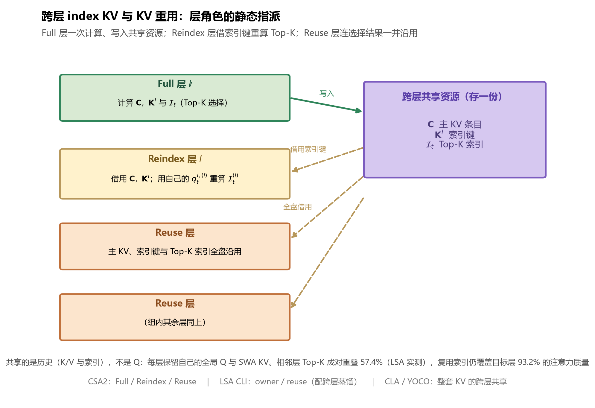
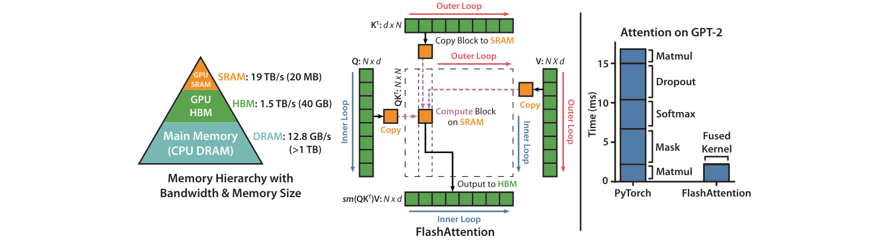

> 人事有代谢，往来成古今。
>
> ——孟浩然《与诸子登岘山》

# 1. 概述

自 2017 年提出至 2026 年，Transformer 已近十年。本文考察这十年间各组件的演化：哪些设计被反复修改，哪些保持稳定，以及推动改动的实际约束。预测未来模型的具体发展方向是个艰巨的任务，但是通过回顾过去的历史，可以把握全局大的方向。

按组件划分，本文讨论以下六个方面的改进：

- 注意力机制
- 归一化方法
- 位置编码
- 前馈网络
- 激活函数
- 残差结构

第 2 章回到 2017 年的奠基论文；第 3 至 8 章依次讨论注意力、归一化、位置编码、前馈网络、激活函数与残差连接；第 9 章从整机视角考察模型结构的异构化；第 10 章汇总十年间的变与不变。


> 图 1.1　Transformer 原始架构（Vaswani et al., 2017, Figure 1）。十年间，图中几乎每个模块都经历过改动，但“堆叠的残差子层 + 注意力 + FFN”这一整体骨架保持不变。

# 2. Attention is All You Need

2017 年，Ashish Vaswani 等人发表《Attention Is All You Need》，提出完全基于注意力机制的 Transformer 架构，不再依赖循环神经网络（RNN）或卷积神经网络（CNN）。

Transformer 由编码器（Encoder）与解码器（Decoder）组成，各含 6 层。编码器每层包括自注意力子层与前馈网络子层；解码器在此基础上另有掩码自注意力与编码器-解码器交叉注意力子层。自注意力使每个位置能够聚合序列中全部位置的信息，前馈网络则对每个位置的表示做逐点非线性变换。多头注意力把输入沿特征维度分成若干子空间，在各子空间内并行计算注意力。由于注意力本身对位置置换等变，论文另引入位置编码，向模型提供各 token 在序列中的次序信息。


> 图 2.1　Transformer 模型架构（Vaswani et al., 2017, Figure 1）

在标准的自注意力机制中，每个词元（token）通过一套查询（Query）、键（Key）、值（Value）矩阵来捕捉与序列中所有 token 的关系。单头注意力只有一组投影，难以同时刻画不同类型的依赖关系。


> 图 2.2　缩放点积注意力（左）与多头注意力（右）（Vaswani et al., 2017, Figure 2）

缩放点积注意力（Scaled Dot-Product Attention）的公式为：

$$\text{Attention}(Q, K, V) = \text{softmax}\left(\frac{QK^T}{\sqrt{d_k}}\right)V \tag{2.1}$$

其中 $Q, K, V \in \mathbb{R}^{n \times d_k}$，$d_k$ 是键向量的维度。除以 $\sqrt{d_k}$ 是为了抵消点积方差随 $d_k$ 线性增长带来的影响：若不缩放，softmax 会进入梯度很小的饱和区。

多头注意力将输入序列的嵌入表示（原论文为 512 维）沿特征维度分割成多个子空间（即“头”），每个头在低维空间（如 64 维）中独立、并行地计算自注意力。多头注意力（Multi-Head Attention）的计算公式为：

$$\text{MultiHead}(Q, K, V) = \text{Concat}(\text{head}_1, \dots, \text{head}_h)W^O \tag{2.2}$$

$$\text{where } \text{head}_i = \text{Attention}(QW_i^Q, KW_i^K, VW_i^V)$$

其中投影矩阵 $W_i^Q \in \mathbb{R}^{d_{\text{model}} \times d_k}$，$W_i^K \in \mathbb{R}^{d_{\text{model}} \times d_k}$，$W_i^V \in \mathbb{R}^{d_{\text{model}} \times d_v}$，$W^O \in \mathbb{R}^{hd_v \times d_{\text{model}}}$。原论文取 $h=8$，$d_k = d_v = d_{\text{model}}/h = 64$。

多头注意力的计算可分为四步：
1. **线性投影与分割**：输入序列 $X$ 经三组可学习权重矩阵 $W_q, W_k, W_v$ 线性变换得到 Q、K、V，再经重塑与转置，形状从 $(\text{batch}, \text{seq}, d_{\text{model}})$ 变为 $(\text{batch}, h, \text{seq}, d_k)$，其中 $d_k = d_{\text{model}}/h$。
2. **并行注意力计算**：每个头独立计算缩放点积注意力。
3. **拼接（Concat）**：将 $h$ 个头的输出沿特征维度拼接，形状由 $(\text{batch}, h, \text{seq}, d_k)$ 恢复为 $(\text{batch}, \text{seq}, hd_k)$。
4. **最终线性投影（融合）**：拼接后的结果通过最终的可学习权重矩阵 $W_o$ 进行线性变换。这一步将维度恢复为 $d_{\text{model}}$ 以对接残差连接，同时融合各头的信息。

实现一个多头注意力层：

```python
import torch
import torch.nn as nn
import torch.nn.functional as F
import math

class MultiHeadAttention(nn.Module):
    """原始论文中的多头注意力 (Vaswani et al., 2017)"""
    def __init__(self, d_model, num_heads, dropout=0.0):
        super().__init__()
        assert d_model % num_heads == 0
        self.num_heads = num_heads
        self.d_k = d_model // num_heads  # 例如 d_model=512, h=8 -> d_k=64

        self.W_q = nn.Linear(d_model, d_model)
        self.W_k = nn.Linear(d_model, d_model)
        self.W_v = nn.Linear(d_model, d_model)
        self.W_o = nn.Linear(d_model, d_model)
        self.dropout = nn.Dropout(dropout)

    def forward(self, x, mask=None):
        B, L, _ = x.shape

        # 1. 线性投影 + 切分多头: (B, L, d_model) -> (B, h, L, d_k)
        q = self.W_q(x).view(B, L, self.num_heads, self.d_k).transpose(1, 2)
        k = self.W_k(x).view(B, L, self.num_heads, self.d_k).transpose(1, 2)
        v = self.W_v(x).view(B, L, self.num_heads, self.d_k).transpose(1, 2)

        # 2. 并行缩放点积注意力
        scores = (q @ k.transpose(-2, -1)) / math.sqrt(self.d_k)  # (B, h, L, L)
        if mask is not None:
            scores = scores.masked_fill(mask, float("-inf"))
        attn = self.dropout(F.softmax(scores, dim=-1))
        out = attn @ v                                    # (B, h, L, d_k)

        # 3. 拼接所有头 + 4. 输出投影
        out = out.transpose(1, 2).contiguous().view(B, L, -1)  # (B, L, d_model)
        return self.W_o(out)
```

# 3. Attention的改进

注意力机制的改进大体围绕一个矛盾展开：全局建模能力伴随 $O(N^2)$ 的计算与存储开销，而模型规模与序列长度仍在增长。本章按推理缓存、计算与 IO、稀疏化三条线索梳理这些工作，最后讨论线性注意力与门控注意力。

随着模型规模与序列长度增长，标准 MHA 的二次复杂度与 **KV Cache**（解码时缓存的键值对）成为主要瓶颈：

标准自注意力的计算复杂度为 $O(n^2 \cdot d)$（序列长度 $n$，特征维度 $d$），推理时 KV Cache 显存占用为 $O(n \cdot h \cdot d_k)$。相应的改进沿三条主线展开：

表 3.1　注意力效率优化的三条主线

| 主线 | 目标 | 代表工作 |
|---|---|---|
| 减少 KV Cache | 降低推理显存/带宽压力 | MQA → GQA → MLA |
| 减少计算量 | 打破 $O(n^2)$ | 滑窗注意力、线性注意力、稀疏注意力 |
| 优化 IO 与调度 | 让算子贴合硬件 | FlashAttention 1→4 |

**1. 优化 KV Cache，提升推理效率**

目标是缓解自回归解码时的显存带宽压力。

- **效率优化变体**：为减小推理时的 KV Cache，**多查询注意力（MQA）** 让所有查询头共享一组 K/V；**分组查询注意力（GQA）** 把查询头分组，组内共享 K/V，在 MHA 与 MQA 之间折中。

**2. 优化计算与 IO：FlashAttention**

KV Cache 减小之后，训练与预填充阶段的 $O(n^2)$ 注意力矩阵仍是瓶颈。FlashAttention（Tri Dao et al., 2022）保持数学形式不变，只改变数据搬运方式：利用 GPU 存储层级（SRAM 快而小，HBM 大而慢）做 tiling 与 online softmax 分块计算，IO 复杂度从 $O(N^2 + Nd^2)$ 降至 $O(N^2 d^2 / M)$，结果与标准注意力数值等价。核心机制与 FA1 至 FA4 的演进见附录。

## 3.1 Multi-query attention

多查询注意力（Multi-Query Attention, MQA）由 Noam Shazeer 在 2019 年《Fast Transformer Decoding: One Write-Head is All You Need》中提出。做法是保留 $h$ 个查询头，但所有头共享同一组 Key 和 Value 投影。


> 图 3.1　从 Multi-Head 到 Multi-Query 的转换——把 $h$ 个 Key 投影做 Mean Pool 合并为单头（GQA 论文 Figure 1）。

对输入序列 $X$，MQA 的投影形状为：

- 查询（Q）：$[b, n, h, d_k]$（$h$ 个头）
- 键（K）：$[b, n, 1, d_k]$（1 个头）
- 值（V）：$[b, n, 1, d_k]$（1 个头）

KV Cache 从 $O(n \cdot h \cdot d_k)$ 降到 $O(n \cdot d_k)$，解码阶段的内存带宽压力随之下降（解码阶段主要受显存带宽限制，KV 读取量决定吞吐）。代价是表达能力下降：所有查询头只能从同一套 K/V 里取信息，部分长尾任务上有质量损失。

```python
# MQA 是 GQA 的特例：num_kv_groups = 1

mqa = GroupedQueryAttention(d_in=2048, num_heads=32, num_kv_groups=1)
```

## 3.2 Grouped query attention

分组查询注意力（Grouped Query Attention, GQA，Ainslie et al., 2023）在 MHA 与 MQA 之间折中：把查询头分为若干组，每组共享一组键、值投影，键值头数因此由 $h$ 降为 $g$，长序列下缓存与访存开销随之下降。


> 图 3.2　Multi-head / Grouped-query / Multi-query 三种结构对比（GQA 论文 Figure 2）。GQA 是 MHA 与 MQA 的折中：查询头分组，组内共享 K/V。

具体而言，GQA 把 $h$ 个查询头划为 $g$ 组（$g < h$），每组 $h/g$ 个头共享一组键值投影。标准 MHA 为每个查询头维护独立键值头，MQA 则全部共享，GQA 介于二者之间。论文报告，在模型质量与 MHA 接近的前提下，处理速度约为 MHA 的 3 倍，接近 MQA。

输入序列 $X$ 经线性变换后得到：

- 查询（Q）：形状为 `[batch_size, seq_len, h, head_dim]`  
- 键（K）：形状为 `[batch_size, seq_len, g, head_dim]`  
- 值（V）：形状为 `[batch_size, seq_len, g, head_dim]`  
    
其中 $h$ 是查询头总数，$g$ 是分组数（即键值头数），且 $h/g$ 为整数。

表 3.2　MHA、GQA 与 MQA 的结构对比

| 特性   | MHA（多头注意力） | GQA（分组查询注意力） | MQA（多查询注意力） |
| -------- | -------------- | ---------------- | --------------- |
| 查询头数 | h              | h                | h               |
| 键值头数 | h              | g（1 < g < h）     | 1               |
| 参数数量 | 多              | 中等               | 少               |
| 表达能力 | 强              | 中等               | 相对较弱            |
| 内存使用 | 高              | 中等               | 低               |
| 计算速度 | 慢              | 较快               | 快               |

GQA 的计算过程分五步：

1. **投影操作**：将输入序列线性变换为查询、键和值张量。查询的投影维度为 $h \times$ head_dim，键和值的投影维度为 $g \times$ head_dim。  
2. **查询分组**：把查询张量沿头维度分为 $g$ 组，每组 $h/g$ 个查询头。  
3. **键值复制**：把键和值张量沿头维度复制 $h/g$ 次，使其形状与查询张量匹配。  
4. **注意力计算**：各组分别计算注意力分数。先算查询组与键的点积，经 softmax 归一化得到权重，再对值加权求和。  
5. **输出拼接**：把各组的注意力输出拼接为最终输出。  

```python
class GroupedQueryAttention(nn.Module):
    """
    分组查询注意力 (Grouped Query Attention, GQA) 实现。
    
    核心思想：
    - 分组查询注意力(GQA): Q 有 num_heads 个头，K、V 有 num_kv_groups 个头（折中方案）
    
    参数说明：
    - d_in: 输入特征维度
    - num_heads: Query 的头数（总头数）
    - num_kv_groups: Key/Value 的组数（KV 头数）
    - head_dim: 每个头的维度（如果不指定则自动计算）
    - qk_norm: 是否对 Q 和 K 应用 RMSNorm（提高训练稳定性）
    - dtype: 参数数据类型
    
    示例配置（Qwen3 风格）：
    - num_heads=32, num_kv_groups=8 -> group_size=4
    - 意味着每 4 个 Query 头共享 1 组 Key-Value 头
    """
    def __init__(
        self, d_in, num_heads, num_kv_groups, head_dim=None, qk_norm=False, dtype=None
    ):
        super().__init__()
        # 检查 Q 头数必须能被 KV 组数整除
        assert num_heads % num_kv_groups == 0, "num_heads must be divisible by num_kv_groups"

        self.num_heads = num_heads  # Query 头数（例如 32）
        self.num_kv_groups = num_kv_groups  # KV 组数（例如 8）
        self.group_size = num_heads // num_kv_groups  # 每组大小（例如 4）

        # 计算每个头的维度
        if head_dim is None:
            assert d_in % num_heads == 0, "`d_in` must be divisible by `num_heads` if `head_dim` is not set"
            head_dim = d_in // num_heads  # 例如：d_in=2048, num_heads=32 -> head_dim=64

        self.head_dim = head_dim
        self.d_out = num_heads * head_dim  # 输出维度

        # 投影层：注意 K、V 的输出维度是 num_kv_groups * head_dim
        # 示例：num_heads=32, num_kv_groups=8, head_dim=64
        # Q: d_in -> 32*64 = 2048
        # K: d_in -> 8*64 = 512（只有 Q 的 1/4）
        # V: d_in -> 8*64 = 512
        self.W_query = nn.Linear(d_in, self.d_out, bias=False, dtype=dtype)
        self.W_key = nn.Linear(d_in, num_kv_groups * head_dim, bias=False, dtype=dtype)
        self.W_value = nn.Linear(d_in, num_kv_groups * head_dim, bias=False, dtype=dtype)

        self.out_proj = nn.Linear(self.d_out, d_in, bias=False, dtype=dtype)

        # 可选的 QK 归一化（Qwen3 使用此技术提高稳定性）
        if qk_norm:
            self.q_norm = RMSNorm(head_dim, eps=1e-6)
            self.k_norm = RMSNorm(head_dim, eps=1e-6)
        else:
            self.q_norm = self.k_norm = None

    def forward(self, x, mask, cos, sin, start_pos=0, cache=None):
        """
        前向传播详解：
        
        输入：
        - x: (batch, num_tokens, d_in) 输入序列
        - mask: 注意力掩码，防止看到未来 token
        - cos, sin: RoPE 旋转位置编码的预计算值
        - start_pos: KV cache 的起始位置（推理时使用）
        - cache: 之前的 (keys, values) 缓存
        
        输出：
        - context: (batch, num_tokens, d_in) 注意力输出
        - next_cache: 更新后的 (keys, values) 缓存
        
        处理流程（以 num_heads=32, num_kv_groups=8 为例）：
        1. Q 投影: (B, L, 2048) -> (B, 32, L, 64)
        2. K 投影: (B, L, 2048) -> (B, 8, L, 64)
        3. V 投影: (B, L, 2048) -> (B, 8, L, 64)
        4. K/V 扩展: (B, 8, L, 64) -> (B, 32, L, 64) 通过 repeat_interleave
        5. 注意力计算: Q @ K^T -> softmax -> @ V
        """
        b, num_tokens, _ = x.shape

        # ========== 步骤 1: 应用线性投影 ==========
        queries = self.W_query(x)  # (b, num_tokens, num_heads * head_dim)
        keys = self.W_key(x)       # (b, num_tokens, num_kv_groups * head_dim)
        values = self.W_value(x)   # (b, num_tokens, num_kv_groups * head_dim)

        # ========== 步骤 2: 重塑为多头格式 ==========
        # Query: (B, L, num_heads*head_dim) -> (B, L, num_heads, head_dim) -> (B, num_heads, L, head_dim)
        queries = queries.view(b, num_tokens, self.num_heads, self.head_dim).transpose(1, 2)
        
        # Key/Value: (B, L, num_kv_groups*head_dim) -> (B, L, num_kv_groups, head_dim) -> (B, num_kv_groups, L, head_dim)
        keys_new = keys.view(b, num_tokens, self.num_kv_groups, self.head_dim).transpose(1, 2)
        values_new = values.view(b, num_tokens, self.num_kv_groups, self.head_dim).transpose(1, 2)

        # ========== 步骤 3: 可选的 QK 归一化 ==========
        # 对每个头的特征维度进行归一化，提高训练稳定性
        # 这是 Qwen3 的一个关键技术点
        if self.q_norm:
            queries = self.q_norm(queries)
        if self.k_norm:
            keys_new = self.k_norm(keys_new)

        # ========== 步骤 4: 应用旋转位置编码 (RoPE) ==========
        # RoPE 通过旋转嵌入注入位置信息，不增加额外参数
        # offset=start_pos 用于 KV cache 场景，确保位置编码连续
        queries = apply_rope(queries, cos, sin, offset=start_pos)
        keys_new = apply_rope(keys_new, cos, sin, offset=start_pos)

        # ========== 步骤 5: KV Cache 处理（推理优化）==========
        # 推理时复用之前计算的 K、V，避免重复计算
        # 训练时 cache=None，每次计算完整序列
        if cache is not None:
            prev_k, prev_v = cache
            # 将新的 K、V 拼接到缓存后面
            # 例如：prev_k (B, 8, 100, 64) + keys_new (B, 8, 1, 64) -> (B, 8, 101, 64)
            keys = torch.cat([prev_k, keys_new], dim=2)
            values = torch.cat([prev_v, values_new], dim=2)
            next_cache = (keys, values)
        else:
            start_pos = 0  # 训练模式，重置位置
            keys, values = keys_new, values_new
            next_cache = (keys, values)

        # ========== 步骤 6: 扩展 K、V 以匹配 Q 的头数 ==========
        # 关键操作：将 num_kv_groups 个 KV 头扩展为 num_heads 个
        # repeat_interleave 确保每组连续重复，而不是整体重复
        # 例如：[K0, K1] -> [K0, K0, K0, K0, K1, K1, K1, K1]（group_size=4）
        # 形状变化：(B, 8, L, 64) -> (B, 32, L, 64)
        keys = keys.repeat_interleave(self.group_size, dim=1)
        values = values.repeat_interleave(self.group_size, dim=1)

        # ========== 步骤 7: 计算注意力分数 ==========
        # Q @ K^T: (B, 32, L, 64) @ (B, 32, 64, L) -> (B, 32, L, L)
        attn_scores = queries @ keys.transpose(2, 3)
        
        # 应用掩码：将不应该看到的位置设为 -inf（softmax 后变为 0）
        # 例如：因果掩码防止看到未来 token
        attn_scores = attn_scores.masked_fill(mask, -torch.inf)
        
        # 缩放 + softmax：除以 sqrt(head_dim) 防止梯度消失
        # 例如：head_dim=64 -> 除以 8
        attn_weights = torch.softmax(attn_scores / self.head_dim**0.5, dim=-1)

        # ========== 步骤 8: 应用注意力权重 ==========
        # (B, 32, L, L) @ (B, 32, L, 64) -> (B, 32, L, 64)
        # 然后转置回 (B, L, 32, 64) 并合并头维度为 (B, L, 2048)
        context = (attn_weights @ values).transpose(1, 2).reshape(b, num_tokens, self.d_out)
        
        # ========== 步骤 9: 输出投影 ==========
        # 将多头输出投影回原始维度
        return self.out_proj(context), next_cache
```

> 注：GQA 的后续演进还包括 DeepSeek 的 **MLA（Multi-head Latent Attention）**，后者把 KV 压缩到低秩潜变量，推理时只缓存潜变量，进一步压缩 KV Cache；以及在 GQA 基础上加 QK-RMSNorm（如 Qwen3）提升训练稳定性。两者延续了同一目标：在“每头独立”与“全部共享”之间取得平衡。

## 3.3 MLA

GQA 把 KV 按头分组共享，缓存量仍为 $O(L \cdot n_h \cdot d_h)$，头数较多时 KV Cache 仍是主要开销。MLA（Multi-head Latent Attention，DeepSeek-V2 提出、V3 沿用）改为沿特征维度压缩：把 KV 联合投影到低维潜变量，推理时只缓存这个潜变量。


> 图 3.3　DeepSeek-V2 架构与 MLA 细节（DeepSeek-V2 论文 Figure 2）。注意 “Cached During Inference” 标记的只有潜变量 $c_t^{KV}$ 和解耦的 $k_t^R$。

给定第 $t$ 个 token 的输入 $h_t \in \mathbb{R}^d$，MLA 的四步：

$$c_t^{KV} = W^{DKV} h_t, \qquad c_t^{KV} \in \mathbb{R}^{d_c}, \quad d_c \ll d_h n_h \tag{3.1}$$

$$k_t^C = W^{UK} c_t^{KV}, \qquad v_t^C = W^{UV} c_t^{KV} \tag{3.2}$$

$$k_t^R = \mathrm{RoPE}(W^{KR} h_t) \tag{3.3}$$

$$k_{t,i} = [\,k_{t,i}^C \,;\, k_t^R\,], \qquad q_{t,i} = [\,q_{t,i}^C \,;\, q_{t,i}^R\,] \tag{3.4}$$

其中 $W^{DKV} \in \mathbb{R}^{d_c \times d}$ 是下投影，$W^{UK}, W^{UV} \in \mathbb{R}^{d_h n_h \times d_c}$ 是上投影。

**RoPE 的解耦**。RoPE 需作用在 K 上，而 K 由潜变量解压得到；若把旋转并入 $W^{UK}$，潜变量便携带了位置信息，内容压缩不再纯粹。DeepSeek 另设一路共享的 $k^R$ 专门携带位置信息，内容部分 $k^C$ 保持无位置，两者拼接后再计算注意力。

**矩阵吸收**：推理时无需显式还原 $k^C$。因为

$$QK^T = (h W^Q)(W^{UK} c^{KV})^T = h \underbrace{(W^Q (W^{UK})^T)}_{\text{可预折叠}} (c^{KV})^T \tag{3.5}$$

把 $W^Q (W^{UK})^T$ 预计算成一个矩阵，就可以在潜变量上直接算注意力分数，$K$ 自始至终无需显式生成。同理 $W^{UV}$ 可以吸收进输出投影。

**每层每 token 的缓存量**：

表 3.3　MHA、GQA 与 MLA 的每层每 token 缓存量对比

| 方案 | 缓存元素 | 相对 MHA |
|---|---|---|
| MHA | $2 \cdot d_h n_h$ | 基准 |
| GQA | $2 \cdot d_h n_g$ | 随 KV 头数线性下降 |
| **MLA** | $d_c + d_h^R$ | **约 1/20** |

DeepSeek-V2 取 $d_c = 512$、$d_{model} = 5120$，报告 KV Cache 相比 MHA 减少 93.3%。

```python
import math
import torch
import torch.nn as nn

class MultiHeadLatentAttention(nn.Module):
    """MLA (DeepSeek-V2/V3)：KV 低秩联合压缩，推理时只缓存潜变量 c^{KV}。"""

    def __init__(self, d_model, n_heads, d_head, kv_lora_rank=512, rope_head_dim=64,
                 q_lora_rank=0, dtype=None, bias=False):
        super().__init__()
        self.n_heads, self.d_head = n_heads, d_head
        self.kv_lora_rank, self.q_lora_rank = kv_lora_rank, q_lora_rank
        self.rope_head_dim = rope_head_dim
        d_nope = d_head - rope_head_dim          # 不带位置信息的部分

        # 1) KV 联合下投影：d_model -> kv_lora_rank（推理时唯一缓存的东西）
        self.wkv = nn.Linear(d_model, kv_lora_rank, bias=False, dtype=dtype)
        # 2) 解压回各头
        self.wuk = nn.Linear(kv_lora_rank, n_heads * d_nope, bias=False, dtype=dtype)
        self.wuv = nn.Linear(kv_lora_rank, n_heads * d_head, bias=False, dtype=dtype)
        # 3) 解耦 RoPE 分支：k^R 全头共享，q^R 每头独立
        self.wkr = nn.Linear(d_model, rope_head_dim, bias=False, dtype=dtype)
        self.wqr = nn.Linear(d_model, n_heads * rope_head_dim, bias=False, dtype=dtype)
        # 4) Query 内容部分（可用低秩压缩省训练显存）
        if q_lora_rank > 0:
            self.wq_a = nn.Linear(d_model, q_lora_rank, bias=False, dtype=dtype)
            self.wq_b = nn.Linear(q_lora_rank, n_heads * d_nope, bias=False, dtype=dtype)
        else:
            self.wq_a = nn.Linear(d_model, n_heads * d_nope, bias=False, dtype=dtype)
        self.wo = nn.Linear(n_heads * d_head, d_model, bias=False, dtype=dtype)

    def forward(self, x, cos, sin, cache=None):
        B, L, _ = x.shape
        h, dh, rd = self.n_heads, self.d_head, self.rope_head_dim
        d_nope = dh - rd

        # --- 压缩：整个网络里只有这一步的输出需要进 KV Cache ---
        c_kv = self.wkv(x)                                   # (B, L, kv_lora_rank)
        if cache is not None:
            c_kv = torch.cat([cache[0], c_kv], dim=1)         # 追加新 token
        next_cache = (c_kv,)

        # --- 解压 ---
        k_c = self.wuk(c_kv).view(B, -1, h, d_nope).transpose(1, 2)   # (B,h,L,d_nope)
        v = self.wuv(c_kv).view(B, -1, h, dh).transpose(1, 2)        # (B,h,L,d_head)

        # --- Query ---
        if self.q_lora_rank > 0:
            q_c = self.wq_b(self.wq_a(x)).view(B, L, h, d_nope).transpose(1, 2)
        else:
            q_c = self.wq_a(x).view(B, L, h, d_nope).transpose(1, 2)
        q_r = self.wqr(x).view(B, L, h, rd).transpose(1, 2)           # (B,h,L,rd)

        # --- 解耦 RoPE：只作用在 k^R / q^R 上 ---
        k_r = apply_rope(self.wkr(x).view(B, L, 1, rd).transpose(1, 2), cos, sin)
        q_r = apply_rope(q_r, cos, sin)

        # --- 拼接内容与位置 ---
        q = torch.cat([q_c, q_r], dim=-1)                   # (B,h,L,d_head)
        k = torch.cat([k_c, k_r.expand(-1, h, -1, -1)], dim=-1)   # (B,h,L,d_head)

        scores = (q @ k.transpose(-2, -1)) / math.sqrt(dh)
        out = torch.softmax(scores, dim=-1) @ v
        out = out.transpose(1, 2).reshape(B, L, h * dh)
        return self.wo(out), next_cache
```

MLA 以压缩 KV 取代共享 KV，用训练期多一次投影换取推理期显存下降；质量则取决于低秩瓶颈的容量。DeepSeek 取 $d_c = 512$，并用解耦 RoPE 把位置信息单独留出一路。

## 3.4 SWA

SWA（Sliding Window Attention，滑动窗口注意力）是最简单的稀疏化做法：每个 token 只看最近 $w$ 个 token，而不是全部历史。


> 图 3.4　Vanilla Attention 与 Sliding Window Attention 的掩码对比，以及“有效上下文长度”（Mistral 7B 论文 Figure 1）。

形式化地，注意力只在窗口内计算：

$$M_{sw,ij} = \begin{cases} 0, & j \le i \ \text{且}\ i - j < w \\ -\infty, & \text{其他} \end{cases}, \qquad \text{Attention} = \mathrm{softmax}\!\left(\frac{QK^T}{\sqrt{d_k}} + M_{sw}\right) V \tag{3.6}$$

复杂度从 $O(n^2)$ 降到 $O(n \cdot w)$，当 $w \ll n$ 时近似线性；KV Cache 也从 $O(n)$ 降到 $O(w)$。

Mistral 7B 是第一个大规模验证 SWA 的开源模型，窗口 $w = 4096$，并配套**滚动缓冲缓存（Rolling Buffer Cache）**：固定大小 $W=4$ 的环形缓冲，位置超出后覆盖旧 K/V，32k 序列下缓存显存降到 1/8。窗口之外的信息只能经中间层逐层传递。

后续演化：

- **Gemma 2**：全局注意力与 SWA 交替（1:1），窗口 4096
- **Gemma 3**：改成 5:1（每 5 层滑窗 + 1 层全局），窗口从 4096 缩到 1024

$$\text{Memory}_{\text{Gemma3}} = \frac{5 \cdot 1024 + 1 \cdot L}{1 \cdot 4096 + 1 \cdot L} \approx 0.26 \quad (L = 32K) \tag{3.7}$$

消融显示每 6 层设置一个全局层便足以捕捉长程依赖：Gemma 3 技术报告在验证集上测得，局部层与全局层之比从 1:1 改为 5:1 时，PPL 相对基线仅变化 $-0.05$（2B）与 $-0.02$（9B），放宽到 7:1 后影响同样很小。此处 PPL 为困惑度（perplexity）的原文缩写，定义是 token 平均负对数似然的指数，$\mathrm{PPL}=\exp(\bar{\mathcal L})$，数值越低越好；下文统一使用 PPL。

- **gpt-oss** 在交替层中使用；
- **小米 MiMo-V2-Flash** 用 $w=128$ 的极端窗口
- Mistral 3.1 Small 则放弃 SWA：统一的注意力模式更便于 FlashAttention-3 一类 kernel 优化

```python
import torch
import torch.nn as nn

class SlidingWindowAttention(nn.Module):
    """SWA：每个 query 只看最近 window_size 个 key。"""

    def __init__(self, d_model, n_heads, window_size=4096, dtype=None):
        super().__init__()
        self.n_heads = n_heads
        self.d_head = d_model // n_heads
        self.window = window_size
        self.wq = nn.Linear(d_model, d_model, bias=False, dtype=dtype)
        self.wk = nn.Linear(d_model, d_model, bias=False, dtype=dtype)
        self.wv = nn.Linear(d_model, d_model, bias=False, dtype=dtype)
        self.wo = nn.Linear(d_model, d_model, bias=False, dtype=dtype)

    def forward(self, x, cache=None):
        B, L, _ = x.shape
        h, dh = self.n_heads, self.d_head
        q = self.wq(x).view(B, L, h, dh).transpose(1, 2)
        k = self.wk(x).view(B, L, h, dh).transpose(1, 2)
        v = self.wv(x).view(B, L, h, dh).transpose(1, 2)

        if cache is not None:
            k = torch.cat([cache[0], k], dim=2)      # (B,h,L_total,dh)
            v = torch.cat([cache[1], v], dim=2)
            start = cache[0].shape[2]
        else:
            start = 0
        next_cache = (k, v)

        scores = (q @ k.transpose(-2, -1)) / dh**0.5   # (B,h,L,L_total)
        # 滑动窗口掩码：只允许看到 [i-window+1, i]
        qpos = torch.arange(start, start + L, device=x.device).view(-1, 1)
        kpos = torch.arange(0, k.shape[2], device=x.device).view(1, -1)
        mask = (kpos <= qpos) & (kpos > qpos - self.window)
        scores = scores.masked_fill(~mask, float("-inf"))

        out = torch.softmax(scores, dim=-1) @ v
        out = out.transpose(1, 2).reshape(B, L, -1)
        return self.wo(out), next_cache
```

SWA 是纯局部的稀疏化，依靠层数堆叠获得长程能力。滑动窗口这一局部分支被后续工作普遍保留：NSA、DSA、CSA、QSA 均设有相应分支。

## 3.5 Sparse Attention

与 FlashAttention 保持全部计算不同，稀疏注意力减少参与计算的 token 数。

两条路线的差别在于：

表 3.4　FlashAttention 与稀疏注意力的技术路线对比

| | FlashAttention | 稀疏注意力 |
|---|---|---|
| 交互次数 | 全部 $n^2$ 对，一个不少 | 只保留 $n \cdot k$ 对 |
| $n \times n$ 矩阵 | 不写入 HBM，但仍然要算 | 根本不构造大部分 |
| 精确性 | **数值上完全等价** | 近似，有质量损失 |
| 省的是 | 显存带宽 | 算力 + 带宽 + KV 读取量 |

稀疏注意力的一般框架是：用一个**低成本选择器**（indexer / scorer）判断哪些历史 token 值得看，然后只在这些 token 上跑精确注意力。关键在选择器的召回率：一旦漏掉重要 token，模型质量就会下降。

2025 年之后，这一分支密集产出了 DeepSeek 的 NSA / DSA / V4 的 CSA-HCA / V4.1 的 CSA2、Qwen 的 QSA、MiniMax 的 MSA、美团 LongCat 的 LSA 等工作。它们在三个维度上分化：

1. **选择粒度**：token 级（NSA / DSA）→ block 级（MSA / CSA）→ micro-block 级（QSA）
2. **选择器是否可训练**：原生端到端训练（NSA）→ 用 KL 对齐蒸馏（MSA）→ 轻量索引器（QSA）
3. **是否保留全局分支**：多数方案保留滑窗、稀疏与全局三者的叠加

2026 年的 CSA2 与 LSA 又开辟了第四个维度：沿层维度摊销索引与 KV：一次压缩、多层共享，一次选择、多层复用。

### 3.5.1 Native Sparse Attention

NSA（Native Sparse Attention，由 DeepSeek 与北京大学张铭团队合作完成，获 ACL 2025 最佳论文）针对稀疏注意力长期难以落地的三个原因：选择器自身的开销、GPU 访存的不规则性，以及选择操作不可导而无法端到端训练。这些因素使理论上的复杂度优势难以转化为实际加速。


> 图 3.5　NSA 架构总览（NSA 论文 Figure 2）。三条并行分支——压缩注意力、选择注意力、滑动注意力——最后经 Gated Output 融合。

为此，NSA 在设计上同时保证硬件对齐与端到端可训练。

**三条并行分支**：

1. **压缩注意力（Compressed）**：把连续的 token 分组压缩成代表 token，用低维向量近似整段历史，提供粗粒度的全局信息
2. **选择注意力（Selected）**：由**可训练的 indexer** 对每个 query 打分，选出 top-k 个重要块，提供细粒度的精确检索
3. **滑动注意力（Sliding）**：保留最近 $w$ 个 token 的原始 KV，提供局部细节

三条分支各自把原始 KV 重映射为更紧凑的表示。**压缩分支**把连续 $l$ 个 token 的块用可学习 MLP $\varphi$（带块内位置编码）压成一个压缩 key（$d$ 为相邻块步幅）：

$$\tilde{K}^{cmp}_t = f^K_{cmp}(k_{:t}) = \left\{\varphi\big(k_{id+1:id+l}\big) \;\middle|\; 0 \le i \le \left\lfloor\frac{t-l}{d}\right\rfloor\right\} \tag{3.8}$$

**选择分支**先由压缩分支的注意力分数导出块重要性（压缩块与选择块同尺寸时 $p^{slc}_t = p^{cmp}_t$ 直接复用），再按排名取 top-$n$ 块拼接出选中 KV：

$$p^{cmp}_t = \mathrm{Softmax}\!\left(q_t^\top \tilde{K}^{cmp}_t\right), \qquad I_t = \left\{i \;\middle|\; \mathrm{rank}\big(p^{slc}_t[i]\big) \le n\right\} \tag{3.9}$$

$$\tilde{K}^{slc}_t = \mathrm{Cat}\Big[\big\{k_{il'+1:(i+1)l'} \;\big|\; i \in I_t\big\}\Big] \tag{3.10}$$

**滑窗分支**直接保留最近 $w$ 个 token 的原始 KV：

$$\tilde{K}^{win}_t = k_{t-w:t}, \qquad \tilde{V}^{win}_t = v_{t-w:t} \tag{3.11}$$

**门控融合**：三条分支各自产生 $o_c, o_s, o_w$，由 query 决定门控权重：

$$o = g_c \odot o_c + g_s \odot o_s + g_w \odot o_w \tag{3.12}$$

门控权重由模型学习，而非固定比例。

**硬件对齐**：NSA 的三个分支共享同一套 tile 布局，并配套专门的 CUDA kernel，将选择器开销降至可忽略。所谓硬件对齐，即算法设计阶段就确定 kernel 的实现方式。

效果上，在 64k 序列长度下，相比 FlashAttention：前向最高 9× 加速、反向 6× 加速，且序列越长加速越明显；在通用基准、长文本任务与指令推理上均持平或超越全注意力模型。

```python
import torch
import torch.nn as nn

class NativeSparseAttention(nn.Module):
    """
    NSA 的三分支骨架（省略 tile 级 kernel 优化）。
    三条分支共享同一套 Q/K/V 投影，这是硬件对齐的关键。
    """

    def __init__(self, d_model, n_heads, n_groups=16, n_selected=16, window_size=512,
                 compressor_size=64, dtype=None):
        super().__init__()
        self.h = n_heads
        self.dh = d_model // n_heads
        self.g = n_groups            # 压缩后的代表 token 数
        self.k_sel = n_selected      # 选择分支保留的块数
        self.w = window_size
        self.dc = compressor_size    # 压缩分支维度

        self.wq = nn.Linear(d_model, d_model, bias=False, dtype=dtype)
        self.wk = nn.Linear(d_model, d_model, bias=False, dtype=dtype)
        self.wv = nn.Linear(d_model, d_model, bias=False, dtype=dtype)
        # 压缩分支：把 token 分组聚合成 g 个代表
        self.compressor = nn.Linear(d_model, self.dc, bias=False, dtype=dtype)
        # 选择分支的 indexer（可训练）
        self.indexer = nn.Linear(d_model, d_model, bias=False, dtype=dtype)
        self.gate = nn.Linear(d_model, 3 * self.h, bias=False, dtype=dtype)  # 三分支门控
        self.wo = nn.Linear(d_model, d_model, bias=False, dtype=dtype)

    def forward(self, x):
        B, L, _ = x.shape
        h, dh = self.h, self.dh
        q = self.wq(x).view(B, L, h, dh).transpose(1, 2)
        k = self.wk(x).view(B, L, h, dh).transpose(1, 2)
        v = self.wv(x).view(B, L, h, dh).transpose(1, 2)

        # ---- 分支 1：压缩注意力（粗粒度全局）----
        groups = L // self.g if L >= self.g else 1
        pooled = x.view(B, groups, -1).mean(dim=2)                 # (B, G, d)
        c = self.compressor(pooled)                                  # (B, G, dc)
        ck = c.unsqueeze(2).expand(-1, -1, h, -1).reshape(B, groups, h, self.dc).transpose(1, 2)
        cv = ck
        o_c = torch.softmax((q @ ck.transpose(-2, -1)) / self.dc**0.5, dim=-1) @ cv

        # ---- 分支 2：选择注意力（细粒度检索，indexer 打分 + top-k）----
        idx_scores = (self.indexer(q) @ self.indexer(k).transpose(-2, -1)) / self.dh**0.5
        idx_scores = idx_scores.masked_fill(torch.ones_like(idx_scores, dtype=torch.bool)
                                            .triu(1), float("-inf"))
        _, topk = torch.topk(idx_scores, k=min(self.k_sel, L), dim=-1)     # (B,h,L,k)
        sel_k = torch.gather(k, 2, topk.unsqueeze(-1).expand(-1, -1, -1, dh))
        sel_v = torch.gather(v, 2, topk.unsqueeze(-1).expand(-1, -1, -1, dh))
        o_s = torch.softmax((q @ sel_k.transpose(-2, -1)) / dh**0.5, dim=-1) @ sel_v

        # ---- 分支 3：滑动注意力（局部细节）----
        qpos = torch.arange(L, device=x.device).view(-1, 1)
        kpos = torch.arange(L, device=x.device).view(1, -1)
        win = (kpos <= qpos) & (kpos > qpos - self.w)
        sc = (q @ k.transpose(-2, -1)) / dh**0.5
        sc = sc.masked_fill(~win, float("-inf"))
        o_w = torch.softmax(sc, dim=-1) @ v

        # ---- 门控融合 ----
        g = self.gate(x).view(B, L, 3, h).permute(2, 0, 3, 1).unsqueeze(-1)  # (3,B,h,L,1)
        g = torch.sigmoid(g)
        o = g[0] * o_c + g[1] * o_s + g[2] * o_w
        o = o.transpose(1, 2).reshape(B, L, -1)
        return self.wo(o)
```

NSA 的意义在于把稀疏注意力做到了原生可训练且与硬件对齐；此后 DeepSeek、华为、字节等团队均有实现或复现。

### 3.5.2 Deepseek Sparse Attention

DSA（DeepSeek Sparse Attention）是 NSA 的工程化继任者，搭载于 2025 年 9 月发布的 DeepSeek-V3.2-Exp；稀疏注意力由此首次进入开源生产模型。

DSA 的核心是两个新组件：

**闪电索引器（Lightning Indexer）**：一个轻量模块，为当前 query 与每个候选历史 token 计算相关性分数。该模块不进入主注意力路径，只做一次粗略筛选，计算量很小。

**Top-k 选择器**：按分数取 top-$k$ 个 token（默认 2048）做精细注意力，其余全部跳过。

核心注意力复杂度由此从 $O(L^2)$ 降到 $O(L \cdot k)$。
两个组件的形式化定义如下。**闪电索引器**对每个候选历史 token $s$ 计算相关性分数：

$$I_{t,s} = \sum_{j=1}^{n_h} w^I_{t,j} \cdot \mathrm{ReLU}\!\left(q^I_{t,j} \cdot k^I_s\right) \tag{3.13}$$

其中 $q^I_{t,j}$、$k^I_s$ 是对隐状态的低秩投影，$w^I_{t,j} \in \mathbb{R}$ 为第 $j$ 个索引头的可学习权重。**Top-k 稀疏注意力**只对分数最高的 $k$ 个条目做核心注意力：

$$u_t = \mathrm{Attn}\!\left(h_t,\ \{c_s \mid I_{t,s} \in \mathrm{Top\text{-}k}(I_{t,:})\}\right) \tag{3.14}$$

其中 $c_s$ 为 MLA 的压缩潜变量 KV 条目，$h_t$ 为查询隐状态。

DSA 叠加在 MLA 之上而非替代它：索引器用各层隐状态的小投影打分，选中的是 MLA 的压缩潜变量 KV 条目，再走标准 MLA 注意力路径。MLA 减小单个条目的体积，DSA 减少需要读取的条目数，两者作用在不同维度。

训练采用三阶段：先用短期的“密集预热”让索引器拟合原模型的注意力分布，再进入“稀疏训练”阶段让整个模型适应新稀疏模式，最后沿用与前代完全相同的后训练流程（专家蒸馏 + GRPO）。实验中只改动注意力机制，其余设置对齐，因而性能差异可归因于这一处改动。

DeepSeek 同时开源了 TileLang 和 CUDA 两版算子，并建议研究性实验优先用 TileLang 版本以便调试。结果上，V3.2-Exp 在与 V3.1-Terminus 严格对齐的设置下，各公开基准表现基本持平，同时把 API 价格下调了 50% 以上。

**代码实现**（闪电索引器 + Top-k 稀疏注意力的简化骨架）：

```python
import torch
import torch.nn as nn
import torch.nn.functional as F

class DeepSeekSparseAttention(nn.Module):
    """DSA：闪电索引器打分 + Top-k 稀疏注意力（叠加在 MLA 之上，此处以共享 KV 示意）。"""

    def __init__(self, d_model, n_heads, k=2048, idx_dim=64, n_idx_heads=4):
        super().__init__()
        self.n_heads = n_heads
        self.head_dim = d_model // n_heads
        self.k = k
        self.n_idx_heads = n_idx_heads

        self.wq = nn.Linear(d_model, d_model, bias=False)
        self.w_kv = nn.Linear(d_model, self.head_dim, bias=False)  # 压缩条目，K=V 共享
        self.wo = nn.Linear(d_model, d_model, bias=False)
        # 闪电索引器：低秩 q/k 投影 + 逐头权重
        self.w_iq = nn.Linear(d_model, idx_dim * n_idx_heads, bias=False)
        self.w_ik = nn.Linear(d_model, idx_dim, bias=False)
        self.w_w = nn.Linear(d_model, n_idx_heads, bias=False)

    def forward(self, x):
        B, L, _ = x.shape
        h = self.head_dim
        q = self.wq(x).view(B, L, self.n_heads, h).transpose(1, 2)   # (B,H,L,h)
        c = self.w_kv(x)                                             # (B,L,h)

        # ---- 闪电索引器：ReLU 打分 + 逐头加权求和 ----
        q_i = self.w_iq(x).view(B, L, self.n_idx_heads, -1)           # (B,L,J,d)
        k_i = self.w_ik(x)                                           # (B,L,d)
        s = F.relu(torch.einsum("bljd,bmd->bljm", q_i, k_i))
        w = self.w_w(x)                                              # (B,L,J)
        idx = (w.unsqueeze(2) * s).sum(-1)                           # (B,L,L)
        idx = idx.masked_fill(torch.ones(L, L, dtype=torch.bool,
                                      device=x.device).triu(1), float("-inf"))

        # ---- Top-k 稀疏注意力（选中条目同时充当 K 与 V）----
        topk = idx.topk(min(self.k, L), dim=-1).indices              # (B,L,k)
        c_sel = torch.gather(c.unsqueeze(1).expand(-1, L, -1, -1), 2,
                             topk.unsqueeze(-1).expand(-1, -1, -1, h))
        sc = torch.einsum("bhld,blmd->bhlm", q, c_sel) / h ** 0.5
        o = torch.einsum("bhlm,blmd->bhld", torch.softmax(sc, dim=-1), c_sel)
        return self.wo(o.transpose(1, 2).reshape(B, L, -1))
```

### 3.5.3 CSA、HCA 与 CSA2

2026 年 4 月的 DeepSeek-V4 把压缩从特征维度移到序列维度：MLA 沿头维度压缩 KV，V4 的 Compressed Attention 则压缩序列长度。百万上下文下 KV 显存主要由序列长度决定，压缩序列因此更为直接。


> 图 3.6　DeepSeek-V4 整体架构（DeepSeek-V4 技术报告 Figure 2）。Transformer Block 内是 CSA / HCA 交替，残差部分换成了 mHC 的 Pre-Block / Post-Block Mixing。


> 图 3.7　CSA 核心架构（DeepSeek-V4 技术报告 Figure 3）：Token-Level Compressor 做门控池化压缩，Lightning Indexer 打分、Top-k Selector 筛选后走 Shared-KV MQA 核心注意力。

**CSA（Compressed Sparse Attention）** 是细粒度的“精读”路径，流水线是“压缩 → 索引选择 → 核心注意力”：

1. **Token 级压缩器**：把连续 $m$ 个 token（DeepSeek-V4 为 4）的 K/V 用 **softmax 门控池化 + 可学习位置偏置**合并成 1 个 KV 条目，且相邻分组**重叠** $m$ 个 token，避免硬边界切断相邻信息
2. **闪电索引器（FP4 实现）**：给压缩块打分时用 **ReLU 而非 Softmax**：它只关心“哪些块足够相关”，不需要概率分布
3. **Top-1024 选择**：选出最相关的 1024 个压缩块（对应原始 4096 个 token）做完整注意力
4. **滑动窗口**：额外保留最近 $n_{win}$ 个**未压缩**的原始 KV，保留最近上下文的原始分辨率

CSA 的关键公式如下（记号沿用 V4 报告：$H \in \mathbb{R}^{n \times d}$ 为隐状态序列，$C_a, C_b$ 为两组 KV 条目，$Z_a, Z_b$ 为压缩权重，$m$ 为压缩率）。两组 KV 条目与压缩权重由低秩投影得到：

$$C_a = H \cdot W^{KV}_a,\ \ C_b = H \cdot W^{KV}_b, \qquad Z_a = H \cdot W^{Z}_a,\ \ Z_b = H \cdot W^{Z}_b \tag{3.15}$$

相邻分组**重叠**的门控池化压缩（$B_a, B_b \in \mathbb{R}^{m \times c}$ 为可学习位置偏置，$\mathrm{Softmax}_{row}$ 沿行归一化，$\odot$ 为逐元素乘）：

$$S = \mathrm{Softmax}_{row}\big([Z_a + B_a;\ Z_b + B_b]\big), \qquad C^{Comp}_i = \sum_{j} S_{a,j} \odot C_{a,j} + \sum_{j} S_{b,j} \odot C_{b,j} \tag{3.16}$$

闪电索引器用 ReLU 打分（而非 Softmax）并做 Top-k 筛选，选中条目进入核心注意力：

$$I_{t,s} = \sum_{h} w^I_{t,h} \cdot \mathrm{ReLU}\!\left(q^I_{t,h} \cdot K^{IComp}_s\right), \qquad C^{SprsComp}_t = \big\{C^{Comp}_s \mid I_{t,s} \in \mathrm{Top\text{-}k}(I_{t,:})\big\} \tag{3.17}$$

最后对选中条目做共享 KV 的 MQA 核心注意力（查询由共享的压缩向量 $c^Q_t = h_t \cdot W_{DQ}$ 上投影得到，压缩条目同时充当 key 与 value）：

$$o_{t,i} = \mathrm{CoreAttn}\!\left(q_{t,i},\ C^{SprsComp}_t,\ C^{SprsComp}_t\right) \tag{3.18}$$

**HCA（Heavily Compressed Attention）** 是粗粒度的“泛读”路径：

1. 把连续 $m'$ 个 token（128 倍压缩）合并成 1 个 KV 条目，作为整个序列的全局摘要
2. **不做稀疏筛选**，直接对所有压缩条目做稠密注意力

HCA 不做筛选，是因为 128 倍压缩后条目数已足够少（1M token 约合 8000 条），全量注意力的成本可以接受，也避免了选择器漏检的风险。

HCA 的公式更为简洁：压缩率 $m' \gg m$、不重叠、无选择器，直接对全部压缩条目做稠密注意力：

$$S = \mathrm{Softmax}_{row}(Z + B), \qquad C^{Comp}_i = \sum_{j=m\'i}^{m\'(i+1)-1} S_j \odot C_j \tag{3.19}$$

其中 $C = H \cdot W^{KV}$、$Z = H \cdot W^{Z}$，$B \in \mathbb{R}^{m' \times c}$ 为位置偏置；核心注意力与 CSA 相同，只是对象换成了全部压缩条目：

$$o_{t,i} = \mathrm{CoreAttn}\!\left(q_{t,i},\ C^{Comp},\ C^{Comp}\right) \tag{3.20}$$

**层间堆叠策略**（V4-Pro 的 61 层）：

表 3.5　DeepSeek-V4-Pro 的层间注意力堆叠策略

| 层 | 注意力类型 | 意图 |
|---|---|---|
| 0 — 1 | 仅 HCA | 极廉价的全局摘要 |
| 2 — 60 | CSA / HCA 交替 | 局部精细 + 全局骨架兼顾 |
| 最后一层 MTP | 仅滑动窗口 | 最高精度输出 |


> 图 3.8　HCA 核心架构（DeepSeek-V4 技术报告 Figure 4）。重度压缩的 KV 条目 + 滑动窗口，**没有 Top-k 选择器**。

效果：DeepSeek-V4-Pro 的单 token 推理 FLOPs 仅为 V3.2 的 27%、KV Cache 为 10%；V4-Flash 更低至 10% / 7%。相对标准 GQA-8 基线，KV Cache 约为其 2%。

**代码实现**（CSA 的“压缩 → 索引 → 选择 → 注意力”四步，对应 V4 报告式(9)—(19)）：

```python
import torch
import torch.nn as nn
import torch.nn.functional as F

class TokenLevelCompressor(nn.Module):
    """CSA 的 token 级压缩器：两路重叠分组 + softmax 门控池化。

    关键：C^a 覆盖 [m*i, m*(i+1))，C^b 覆盖 [m*(i-1), m*i)，两者重叠 m 个 token，
    使相邻压缩条目在边界处信息连续（硬边界不切断语义）。
    """

    def __init__(self, d_model, c, m):
        super().__init__()
        self.m = m
        self.c = c
        self.w_kv_a = nn.Linear(d_model, c, bias=False)
        self.w_kv_b = nn.Linear(d_model, c, bias=False)
        self.w_z_a = nn.Linear(d_model, c, bias=False)
        self.w_z_b = nn.Linear(d_model, c, bias=False)
        # 可学习位置偏置（每个组内位置一个）
        self.bias_a = nn.Parameter(torch.zeros(m, c))
        self.bias_b = nn.Parameter(torch.zeros(m, c))

    def forward(self, h):
        # h: (B, L, d) -> c: (B, n_blk, c)
        B, L, d = h.shape
        m = self.m
        n_blk = L // m

        ca = self.w_kv_a(h).view(B, n_blk, m, self.c)     # (B,n,m,c) 无重叠
        cb = self.w_kv_b(h).view(B, n_blk, m, self.c)     # (B,n,m,c) 同上
        za = self.w_z_a(h).view(B, n_blk, m, self.c) + self.bias_a
        zb = self.w_z_b(h).view(B, n_blk, m, self.c) + self.bias_b

        # 简化示意：ca 与 cb 各自做组内 softmax 门控池化（真实实现中 cb 右移 m 个 token 形成重叠）
        sa = torch.softmax(za, dim=2)                     # Softmax_row
        sb = torch.softmax(zb, dim=2)
        comp = (sa * ca).sum(2) + (sb * cb).sum(2)        # (B, n_blk, c)
        return comp

class LightningIndexer(nn.Module):
    """闪电索引器：低秩 query + ReLU 评分 + head 加权求和（公式 13–16）。"""

    def __init__(self, d_model, d_c, c_i, n_head):
        super().__init__()
        self.n_head = n_head
        self.c_i = c_i
        self.w_dq = nn.Linear(d_model, d_c, bias=False)     # 降维
        self.w_iuq = nn.Linear(d_c, n_head * c_i, bias=False)  # 升维切头
        self.w_w = nn.Linear(d_model, n_head, bias=False)    # head 权重

    def forward(self, h, k_comp):
        # h: (B, L, d) query 隐状态；k_comp: (B, n_blk, c_i) 压缩索引键
        B, L, d = h.shape
        c_q = self.w_dq(h)                                  # (B, L, d_c)
        q_i = self.w_iuq(c_q).view(B, L, self.n_head, self.c_i)  # (B,L,h,c_i)
        w_i = self.w_w(h)                                    # (B, L, h)

        # 索引分数：I = Σ_h w_h · ReLU(q_h · k_h^T)，只看已完整观察的块（block-causal）
        logits = F.relu(torch.einsum("blhc,bnc->blnh", q_i, k_comp))  # (B,L,n,h)
        scores = (w_i.unsqueeze(2) * logits).sum(-1)          # (B, L, n_blk)
        return scores

class CompressedSparseAttention(nn.Module):
    """CSA 主体：压缩 → 索引 → Top-k 选择 → Shared-KV MQA → 分组输出投影。"""

    def __init__(self, d_model, c, m=4, k=1024, n_head=8, n_idx_head=4):
        super().__init__()
        self.k = k
        self.compressor = TokenLevelCompressor(d_model, c, m)
        self.indexer = LightningIndexer(d_model, d_c=c // 2, c_i=c // 2, n_head=n_idx_head)
        self.w_dq = nn.Linear(d_model, c, bias=False)
        self.w_uq = nn.Linear(c, n_head * c, bias=False)
        self.n_head = n_head
        self.norm_q = nn.RMSNorm(c)
        self.norm_kv = nn.RMSNorm(c)
        self.out_proj = nn.Linear(n_head * c, d_model, bias=False)

    def forward(self, h, sliding_kv=None):
        B, L, d = h.shape
        c_comp = self.compressor(h)                          # (B, n_blk, c) 既当 K 又当 V

        # 1) 索引打分（压缩版索引键）
        scores = self.indexer(h, c_comp)                     # (B, L, n_blk)

        # 2) Top-k 选择（block-causal：只允许选已完整观察的块）
        n_blk = c_comp.size(1)
        causal = torch.tril(torch.ones(L, n_blk, device=h.device, dtype=torch.bool),
                            diagonal=0)                       # p_b+m-1 <= i
        scores = scores.masked_fill(~causal, float("-inf"))
        topk_idx = scores.topk(min(self.k, n_blk), dim=-1).indices  # (B, L, k)

        # 3) Shared-KV MQA：压缩条目同时是 key 与 value
        c_q = self.w_dq(h)
        q = self.w_uq(c_q).view(B, L, self.n_head, -1)       # (B,L,nh,c)
        q = self.norm_q(q)
        kv = self.norm_kv(c_comp)                             # (B, n_blk, c)

        # 按 topk 索引收集（示意：真实实现用 gather + FlashAttention 变体）
        sel = torch.gather(kv, 1, topk_idx.unsqueeze(-1).expand(-1, -1, -1, kv.size(-1)))
        # 4) 核心注意力：q 与选中的压缩 KV 条目
        attn = torch.einsum("blhc,blkc->blhk", q, sel)
        o = torch.softmax(attn, dim=-1)

        # 5) 分组输出投影（n_head 很大时分组降维，节省开销）
        o = self.out_proj(o.reshape(B, L, -1))
        return o

class HeavilyCompressedAttention(nn.Module):
    """HCA：128× 重压缩 + 稠密注意力（无 Top-k），对应公式 20–26。"""

    def __init__(self, d_model, c, m_prime=128, n_head=8):
        super().__init__()
        self.m_prime = m_prime
        self.w_kv = nn.Linear(d_model, c, bias=False)
        self.w_z = nn.Linear(d_model, c, bias=False)
        self.bias = nn.Parameter(torch.zeros(m_prime, c))
        self.w_dq = nn.Linear(d_model, c, bias=False)
        self.w_uq = nn.Linear(c, n_head * c, bias=False)
        self.n_head = n_head
        self.out_proj = nn.Linear(n_head * c, d_model, bias=False)

    def forward(self, h):
        B, L, d = h.shape
        mp = self.m_prime
        n_blk = L // mp
        C = self.w_kv(h).view(B, n_blk, mp, -1)              # (B,n,mp,c)
        Z = self.w_z(h).view(B, n_blk, mp, -1) + self.bias
        S = torch.softmax(Z, dim=2)                           # Softmax_row
        comp = (S * C).sum(2)                                 # (B, n, c) 全局摘要

        q = self.w_uq(self.w_dq(h)).view(B, L, self.n_head, -1)
        # 稠密注意力：对所有压缩条目全量计算（条目少，天然不用稀疏筛选）
        attn = torch.einsum("blhc,bnc->blnh", q, comp)
        o = torch.softmax(attn, dim=-2)
        return self.out_proj(o.reshape(B, L, -1))
```

三个组件各承担一部分压缩：压缩器把 KV 条目数降到 1/m，索引器从中选出相关条目，MQA 通过共享 KV 减少显存。HCA 不设索引器，以高压缩率配合全量注意力换取召回的稳定性。

**CSA2（Compressed Sparse Attention 2）**。V4.1-Flash（arXiv:2609.19969）把压缩推进到层维度。前两个维度分别压缩条目体积与序列长度；进一步观察到相邻层选中的 Top-K 块高度重合，且主 KV 源自同一份隐藏状态，逐层各存一份便成为冗余。CSA2 让多层共享主 KV 与索引键，必要时也沿用 Top-K 选择结果。


> 图 3.9　CSA2 的三种运行模式（DeepSeek-V4.1-Flash 技术报告 Figure 4）。绿色张量由本层计算，黄色张量从前序层借用。Full 模式自带主 KV、索引 K 与 Top-K 索引；Reindex 模式借用主 KV 与索引 K、用自己的索引 Q 重新选择 Top-K；Reuse 模式连 Top-K 索引也直接复用。

每个注意力层被静态指派三种模式之一，差别仅在主 KV、索引 K、Top-K 索引三项资源的来源：

$$
(\mathbf{C}_l,\ \mathbf{K}^I_l,\ \mathcal{I}_l) =
\begin{cases}
\big(\mathrm{Compress}(H_l),\ \mathrm{Proj}(\mathbf{C}_l),\ \mathrm{TopK}(Q^I_l, \mathbf{K}^I_l)\big), & l \in \mathcal{F} \\
\big(\mathbf{C}_{l'},\ \mathbf{K}^I_{l'},\ \mathrm{TopK}(Q^I_l, \mathbf{K}^I_{l'})\big), & l \in \mathcal{R}_{\mathrm{idx}} \\
\big(\mathbf{C}_{l'},\ \mathbf{K}^I_{l'},\ \mathcal{I}_{l'}\big), & l \in \mathcal{R}_{\mathrm{use}}
\end{cases}
\tag{3.21}
$$

其中 $l'$ 为 $l$ 之前最近的 Full 层，$\mathbf{C}$ 为主 KV 条目，$\mathbf{K}^I$ 为索引键，$\mathcal{I}$ 为选出的 Top-K 索引。三种模式下每层仍保留自己的全局 Q 与 SWA KV；跨层共享的只是历史 KV。

表 3.6　CSA2 三种层模式的资源来源与本层计算量

| 模式 | 主 KV / 索引 K | Top-K 索引 | 本层计算 |
|---|---|---|---|
| Full | 本层压缩生成 | 本层选择 | 压缩 + 索引 + 选择 |
| Reindex | 借用前序 Full 层 | 本层重新选择 | 索引 Q 打分 + 选择 |
| Reuse | 借用前序 Full 层 | 直接复用 | 无（仅核心注意力） |

V4.1-Flash 的 40 层 CED 布局里，encoder 的 2—19 层按“1 Full + 5 Reuse”分三组，decoder 的 20—23 层为“1 Full + 3 Reuse”，24—39 层按“1 Reindex + 3 Reuse”分四组。38 个全局注意力层里只有 4 个 Full、4 个 Reindex，其余 30 个全部 Reuse。Reuse 层因而很轻：prefill 只需 15 个 kernel，decode 只需 11 个。

**层级稀疏索引器（Hierarchical Sparse Indexer）**。即便有了 Reuse，剩下的索引层仍要对整个可见上下文打分，成本随长度线性增长。解码器把选择拆成两级：第一个 Full 层在完成自己的 Top-512 之外，按每 8 个位置一个子块、取块内索引分数最大值做块级粗排，保留最优的 2048 个块（16384 个位置）作为共享候选池；后续 Reindex 层只在池内精排：

$$
\mathcal{P}_t = \mathrm{arg\,topK}\big(\{I^{\mathrm{blk}}_{t,p}\},\ 2048\big), \qquad
\mathcal{I}_t = \mathrm{arg\,topK}\big(\{I_{t,s}\}_{s \in \mathcal{P}_t},\ 512\big)
\tag{3.22}
$$

候选池大小固定，深层索引器的单查询成本因此与上下文长度无关。该机制在后训练阶段引入，训练与推理采用同一候选池限制，深层索引器在训练阶段即适应这一分布。

**压缩器也随之简化**：V4 的 CSA 用 $2m$ 个重叠源条目加绝对位置偏置构造压缩条目，CSA2 去掉重叠与位置偏置，索引 K 直接由主 KV 投影得到，结构更简单，训练更快。压缩率上 encoder 取 $m = 2$（两个 token 合一），decoder 因逐 token 生成取 $m = 1$；选择粒度也从 V4 的 Top-1024 收紧到 Top-512。整个架构放弃了 CSA / HCA 混合，改为纯 CSA2。

**SWA Bounded Replay**。滑窗分支的 KV 在 V4 中必须逐层持久化，长上下文下 SSD 压力可观。V4.1-Flash 不再持久化 SWA KV：需要时只把最近 $n_{\mathrm{win}} = 128$ 个 token 重新回放一遍来近似重建，并在后训练阶段模拟回放误差，使模型适应这一近似。持久化 KV Cache 由此降到 V4-Flash 的约 1/8。

**效果**：CSA2 与 FP4 主 KV（E2M1 格式，每 16 个通道共享一个 E4M3 缩放因子）叠加后，全局 KV Cache 降至每 token 890 字节，约为 V4-Flash 的 1/4；配合 CED 的非对称激活（prefill 8B / decode 16B），上下文从 4K 扩到 1M（256 倍），单 token 解码 FLOPs 只增加约四分之一。

**代码实现**（简化压缩器 + 层级索引器 + 三种模式路由）：

```python
import torch
import torch.nn as nn
import torch.nn.functional as F

class Compressor(nn.Module):
    """CSA2 简化压缩器：无重叠分组、无位置偏置，softmax 门控池化。"""

    def __init__(self, d_model, c, m=2):
        super().__init__()
        self.m = m
        self.w_kv = nn.Linear(d_model, c, bias=False)
        self.w_z = nn.Linear(d_model, c, bias=False)

    def forward(self, h):
        B, L, d = h.shape
        n_blk = L // self.m
        C = self.w_kv(h).view(B, n_blk, self.m, -1)      # (B, n, m, c)
        Z = self.w_z(h).view(B, n_blk, self.m, -1)
        S = torch.softmax(Z, dim=2)                      # 组内门控
        return (S * C).sum(2)                            # (B, n, c) 主 KV

class HierarchicalSparseIndexer(nn.Module):
    """层级稀疏索引器：块级粗排构造候选池，池内 token 级精排 Top-512。"""

    def __init__(self, d_model, d_c, n_head=4, block=8, pool_blocks=2048, topk=512):
        super().__init__()
        self.block, self.pool_blocks, self.topk = block, pool_blocks, topk
        self.w_q = nn.Linear(d_model, n_head * d_c, bias=False)
        self.w_w = nn.Linear(d_model, n_head, bias=False)

    def forward(self, h, k_idx):
        # h: (B, L, d)；k_idx: (B, n_blk, d_c) 由主 KV 投影得到的索引键
        B, L, _ = h.shape
        q = self.w_q(h).view(B, L, -1, k_idx.size(-1))
        w = self.w_w(h)
        logits = F.relu(torch.einsum("blhc,bnc->blnh", q, k_idx))
        scores = (w.unsqueeze(2) * logits).sum(-1)       # (B, L, n_blk)

        # 块级粗排：每 block 个位置取最大分，保留 pool_blocks 个候选块
        n_blk = scores.size(-1)
        nb = (n_blk + self.block - 1) // self.block
        pad = nb * self.block - n_blk
        blk_score = F.pad(scores, (0, pad), value=-1e30).view(B, L, nb, self.block).amax(-1)
        pool = blk_score.topk(min(self.pool_blocks, nb), dim=-1).indices
        mask = torch.zeros(B, L, n_blk, dtype=torch.bool, device=h.device)
        mask.scatter_(-1, pool, True)

        # 池内 token 级精排
        scores = scores.masked_fill(~mask, float("-inf"))
        return scores.topk(min(self.topk, n_blk), dim=-1).indices  # (B, L, topk)

class CSA2Layer(nn.Module):
    """CSA2 注意力层：mode ∈ {full, reindex, reuse}，静态指派。

    三种模式都保留本层自己的全局 Q 与 SWA KV；共享的只是主 KV、
    索引 K 与（Reuse 时的）Top-K 索引。
    """

    def __init__(self, d_model, c, mode="full", m=2, topk=512, n_head=8):
        super().__init__()
        self.mode = mode
        self.compressor = Compressor(d_model, c, m) if mode == "full" else None
        self.proj_idx = nn.Linear(c, c, bias=False)      # 索引 K = Proj(主 KV)
        self.indexer = HierarchicalSparseIndexer(d_model, c // 2, topk=topk)
        self.w_dq = nn.Linear(d_model, c, bias=False)
        self.w_uq = nn.Linear(c, n_head * c, bias=False)
        self.w_sw = nn.Linear(d_model, c, bias=False)    # 每层自己的 SWA KV
        self.out_proj = nn.Linear(n_head * c, d_model, bias=False)

    def forward(self, h, shared=None):
        # shared: 前序 Full 层的 (main_kv, idx_k, topk_idx)
        if self.mode == "full":
            main_kv = self.compressor(h)                 # 本层压缩
            idx_k = self.proj_idx(main_kv)               # 索引 K 由主 KV 投影
            topk_idx = self.indexer(h, idx_k)            # 本层选择
            shared = (main_kv, idx_k, topk_idx)
        elif self.mode == "reindex":
            main_kv, idx_k, _ = shared                   # 借 KV，重选择
            topk_idx = self.indexer(h, idx_k)
        else:                                            # reuse：全盘复用
            main_kv, idx_k, topk_idx = shared

        B, L, _ = h.shape
        q = self.w_uq(self.w_dq(h)).view(B, L, -1, main_kv.size(-1))
        kv = torch.gather(main_kv, 1,
                          topk_idx.unsqueeze(-1).expand(-1, -1, -1, main_kv.size(-1)))
        attn = torch.softmax(torch.einsum("blhc,blkc->blhk", q, kv), dim=-1)
        return self.out_proj(attn.reshape(B, L, -1))
```

从 MLA 到 CSA/HCA 再到 CSA2，KV 压缩依次作用于条目体积、序列长度与层数：前两者决定每条缓存的体积与序列上的条目数，第三者决定同一内容存几份。MLA 的低秩分解是精确的，后两者引入近似；也正因允许近似，KV Cache 才得以降到基线的个位数百分比，直至每 token 百字节量级。

### 3.5.4 Qwen Sparse Attention

QSA（Qwen Sparse Attention）出自 Qwen3.8-Flash-Next 的架构论文（arXiv:2608.30320），针对 token 级稀疏注意力中索引器开销随上下文线性增长的问题：上下文足够长时，索引器本身成为瓶颈。


> 图 3.10　QSA 架构（Qwen3.8-Next 架构论文 Figure 3）。左侧是压缩的轻量索引器（Partial RoPE + Zero-Centered RMSNorm + AvgPool），右侧是 micro-block 粒度的稀疏注意力。

QSA 的两级压缩策略：

1. **压缩的轻量索引器**：先用 AvgPool 把序列聚合成 micro-block，再用极小的投影计算块级分数，索引开销随上下文增长被摊薄
2. **micro-block 粒度选择**：Top-k 选择器选出的不是 token 而是 micro-block，注意力核在块级访问下保持连续的 KV 读取

与 DSA 的两点关键差异：

- **粒度**：DSA 是 token 级，QSA 是 micro-block 级
- **索引器开销**：QSA 的索引器自带压缩，DSA 的索引器随长度线性变贵

QSA 还在**每层独立做序列压缩**，不跨层共享索引，因而不依赖层间注意力相似性。这使它适用于 GDN 层与全局注意力层交错的 hybrid 架构，其中 GDN 层并没有可共享的注意力分布。

QSA 的关键公式（论文式 12—16）如下。索引器采用 MQA：每个 query 头做独立轻量投影并归一化，key 全组共享一个头：

$$\hat q^h_i = \mathrm{RMSNorm}(W^h_Q x_i), \qquad k_i = W_K x_i \tag{3.23}$$

key 按 $r$ 个 token 一块做平均池化压缩（块起始位置 $p_b = br$），压缩后再施加 partial RoPE，避免平均不同旋转相位的表示：

$$\hat k_b = \mathrm{RMSNorm}\big(\mathrm{AvgPool}(k_{p_b:p_b+r-1})\big), \qquad \bar k_b = \mathrm{PRoPE}(\hat k_b, p_b) \tag{3.24}$$

块级重要性分数由 ReLU 查询–键相似度在各索引头上求和，且只给**已完整观测**的块打分（block-causal）：

$$I_{ib} = \begin{cases} \sum_{h=1}^{H} \mathrm{ReLU}\big(\langle q^h_i, \bar k_b \rangle\big), & p_b + r - 1 \le i \\ -\infty, & \text{otherwise} \end{cases} \tag{3.25}$$

给定 token 预算 $K$，按块预算 $K_B = \lceil K/r \rceil$ 取分数最高的块（末尾未满的块始终保留）：

$$B_i = \mathrm{TopK}_{K_B}\big(\{I_{ib}\}_b\big), \qquad K_B = \left\lceil \frac{K}{r} \right\rceil \tag{3.26}$$

**代码实现**（压缩轻量索引器 + micro-block Top-k，对应论文式(12)—(16)）：

```python
import torch
import torch.nn as nn
import torch.nn.functional as F

class CompressedLightweightIndexer(nn.Module):
    """QSA 索引器：MQA 形式，key 先 AvgPool 压成 micro-block，再 RMSNorm + partial RoPE。"""

    def __init__(self, d_model, head_dim=128, n_head=4, r=32):
        super().__init__()
        self.n_head = n_head
        self.head_dim = head_dim
        self.r = r                                    # micro-block 大小（ratio）
        self.w_q = nn.Linear(d_model, n_head * head_dim, bias=False)
        self.w_k = nn.Linear(d_model, head_dim, bias=False)   # 单共享 key 头（MQA）
        self.norm_q = nn.RMSNorm(head_dim)
        self.norm_k = nn.RMSNorm(head_dim)

    def forward(self, x, rope_fn):
        B, L, d = x.shape
        r = self.r
        n_blk = L // r

        # 1) 独立轻量投影（公式 12）
        q_raw = self.w_q(x).view(B, L, self.n_head, self.head_dim)
        k = self.w_k(x)                                # (B, L, hd)

        # 2) key 走 AvgPool 压成 micro-block，再 RMSNorm（公式 13）
        #    注意顺序：先内容压缩、后位置编码，避免把不同旋转相位平均掉
        k_blk = k.view(B, n_blk, r, self.head_dim).mean(2)   # (B, n_blk, hd)
        k_blk = self.norm_k(k_blk)

        # 3) partial RoPE：只对 64/128 维施加旋转（公式 14）
        q = self.norm_q(q_raw)
        pos_q = torch.arange(L, device=x.device)
        pos_k = torch.arange(n_blk, device=x.device) * r      # 每块取起始位置 p_b = b·r
        q = rope_fn(q, pos_q)
        k_blk = rope_fn(k_blk, pos_k)

        # 4) block-causal ReLU 评分（公式 15）
        logits = F.relu(torch.einsum("blhc,bnc->blnh", q, k_blk))  # (B,L,n,h)
        scores = logits.sum(-1)                                   # (B, L, n_blk)
        # 只允许给"已完整观察"的块打分：p_b + r - 1 <= i
        causal = torch.arange(n_blk, device=x.device).view(1, 1, -1) * r + (r - 1)
        causal = causal <= torch.arange(L, device=x.device).view(1, -1, 1)
        scores = scores.masked_fill(~causal, float("-inf"))
        return scores

class QwenSparseAttention(nn.Module):
    """QSA：索引器选 micro-block，块内 token 全展开，最后不完整块恒保留。"""

    def __init__(self, d_model, n_head=8, head_dim=128, r=32, token_budget=2048):
        super().__init__()
        self.indexer = CompressedLightweightIndexer(d_model, head_dim // 2, n_head=4, r=r)
        self.r = r
        self.token_budget = token_budget
        self.n_head = n_head
        self.head_dim = head_dim
        self.w_q = nn.Linear(d_model, n_head * head_dim, bias=False)
        self.w_k = nn.Linear(d_model, n_head * head_dim, bias=False)
        self.w_v = nn.Linear(d_model, n_head * head_dim, bias=False)
        self.norm_q = nn.RMSNorm(head_dim)
        self.norm_k = nn.RMSNorm(head_dim)
        self.out_proj = nn.Linear(n_head * head_dim, d_model, bias=False)

    def forward(self, x, rope_fn):
        B, L, d = x.shape
        r = self.r
        # 1) 索引打分
        scores = self.indexer(x, rope_fn)                # (B, L, n_blk)
        n_blk = scores.size(-1)

        # 2) Top-K 选块（块预算 K_B = ⌈K/r⌉），再展开到 token 预算 K
        k_blk_budget = -(-self.token_budget // r)
        blk_idx = scores.topk(min(k_blk_budget, n_blk), dim=-1).indices   # (B,L,kb)
        # 展开成 token 索引（示意）
        tok = (blk_idx.unsqueeze(-1) * r + torch.arange(r, device=x.device))  # (B,L,kb,r)
        tok = tok.reshape(B, L, -1)[:, :, :self.token_budget]                 # 截到预算

        # 3) 最后一个不完整块恒保留（保证当前 chunk 信息不丢）
        last_blk = torch.full((B, L, 1), L - (L % r) - r, device=x.device,
                              dtype=tok.dtype)
        tok = torch.cat([last_blk.clamp(min=0), tok], dim=-1)

        # 4) 核心注意力（Q/K 同样走 RMSNorm + partial RoPE，保持稳定）
        q = self.norm_q(self.w_q(x).view(B, L, self.n_head, self.head_dim))
        k = self.norm_k(self.w_k(x).view(B, L, self.n_head, self.head_dim))
        v = self.w_v(x).view(B, L, self.n_head, self.head_dim)
        q = rope_fn(q, torch.arange(L, device=x.device))

        # 按 tok 收集 K/V（示意 gather）
        idx = tok.unsqueeze(-1).expand(-1, -1, -1, self.n_head * self.head_dim)
        k_sel = torch.gather(k.reshape(B, L, -1), 1, idx).view(
            B, L, -1, self.n_head, self.head_dim)
        v_sel = torch.gather(v.reshape(B, L, -1), 1, idx).view(
            B, L, -1, self.n_head, self.head_dim)

        attn = torch.einsum("blhc,blkhc->blhkc", q, k_sel) / self.head_dim ** 0.5
        o = torch.softmax(attn, dim=3)
        o = torch.einsum("blhkc,blkhc->blhc", o, v_sel)
        return self.out_proj(o.reshape(B, L, -1))
```

**复杂度与访存**。索引器开销为 $O(L \cdot n_{\mathrm{blk}})$ 而非 $O(L^2)$；micro-block 粒度使 KV 读取保持连续，便于 Tensor Core 批量处理。两部分配合，把长上下文下的索引成本与访存成本一并压低。

效果：1M token 下 QSA 的注意力 kernel 在 prefill 加速 7.6×、decode 加速 4.9×；在 90% Prefix Cache 命中率的线上场景实验中，1M 上下文下 prefill 吞吐达到 Qwen3.7-Plus 的 8.6×。

### 3.5.5 MiniMax Sparse Attention

MSA（MiniMax Sparse Attention，arXiv:2606.13392）已开源推理 kernel，并用于生产模型 MiniMax-M3。


> 图 3.11　MSA 总览（MSA 论文 Figure 1）。左半是 Index Branch（打分 → Block Max Pooling → Top-K Index），右半是 Main Branch（Top-K KV Block 上的精确稀疏注意力）。右侧热力图展示了两个 GQA 组各自选中的不同块。

MSA 的核心设计是**两分支 + 每组独立选择**：

**Index Branch**：只增加两个投影矩阵。每个 GQA 组有一个 index query 头、一个共享的 index key 头；对可见的 key token 打分后做 **block max pooling** 得到块级分数，再做 Top-k 选择。包含 query 自身的局部块强制保留，以免遗漏邻近上下文。

**Main Branch**：在选中的块上做**精确的块稀疏 softmax 注意力**。每个 query 头有自己的 query 投影，但共享所在组的块集合。

关键参数：块大小 $B_k = 128$，每组保留 $k = 16$ 个块，即每个 query 固定只看 $2048$ 个 KV token。于是单 query 成本从 $O(N)$ 变成 $O(kB_k)$，与上下文长度无关。

选择发生在 GQA 组内共享、组间独立：一个 KV 头服务多个 query 头，它们共享同一组块；不同组则可以关注不同的长程区域。

两分支的公式如下。**Index Branch** 每个 GQA 组一个索引 query 头、全组共享一个索引 key 头：

$$Q_{idx} = X W^{idx}_q \in \mathbb{R}^{N \times H_{kv} \times d_{idx}}, \qquad K_{idx} = X W^{idx}_k \in \mathbb{R}^{N \times 1 \times d_{idx}} \tag{3.27}$$

token 级分数经 **block max pooling** 聚合成块分数（$B_b$ 为第 $b$ 个块的下标集合，空块记 $-\infty$），再取 Top-k 块：

$$S^{idx,(r)}_{i,j} = \frac{(Q^{idx})^{(r)}_i (K^{idx})^\top_j}{\sqrt{d_{idx}}}, \qquad M^{idx,(r)}_{i,b} = \max_{j \in B_b,\ j \le i} S^{idx,(r)}_{i,j} \tag{3.28}$$

$$I^{(r)}_i = \mathrm{TopK}_{b}\big(M^{idx,(r)}_{i,\cdot},\ k\big) \tag{3.29}$$

**Main Branch** 在选中块的可见 token 上做精确的块稀疏 softmax 注意力（组 $r$ 内所有 query 头共享 $I^{(r)}_i$）：

$$O^{(h)}_i = \mathrm{softmax}\!\left(\frac{Q^{(h)}_i \big(K^{(r)}[I^{(r)}_i]\big)^\top}{\sqrt{d_h}}\right) V^{(r)}\big[I^{(r)}_i\big] \tag{3.30}$$

**训练方法**。Top-k 不可导，语言建模损失无法训练索引投影。MSA 用 **KL 对齐损失**解决：让 Index Branch 的分布去匹配 Main Branch 在被选 token 上的（组平均的）注意力分布，充当 teacher。三个稳定化机制：

- **Gradient Detach**：对 Index Branch 的输入做 stop-gradient，把 KL 损失限制在索引投影内，避免梯度打回主干引起 loss 发散
- **Indexer Warmup**：前若干步两分支都跑全注意力，先让索引器收敛到可用的路由
- **强制 Local Block**：保留一个名额给邻近上下文

KL 对齐损失把 Main Branch 的组平均分布作为 teacher，蒸馏进 Index Branch 的分数分布（$P^{idx,(r)}_{i,\cdot}$ 为索引分支在选中 token 上的 softmax 分布）：

$$\mathcal{L}_{KL} = \frac{1}{N H_{kv}} \sum_{i=1}^{N} \sum_{r=1}^{H_{kv}} D_{KL}\!\left(\mathrm{stopgrad}\big(P^{(r)}_{i,\cdot}\big) \,\big\|\, P^{idx,(r)}_{i,\cdot}\right) \tag{3.31}$$

**算子协同设计**：

- **exp-free Top-k**：softmax 保持序关系，所以对原始分数排序即可得到相同索引，内核跳过 max / exp / sum；128K 上下文、$k=16$ 时比 `torch.topk` 快 5.1×，比 TileLang 的 radix-select 还快 3.7×
- **KV-outer 稀疏注意力 + query gather**：遍历 KV 块比遍历 query 算术强度更高，把 $\lceil 128/G \rceil$ 个 query 位置打包进一个 $128 \times 128$ 的 score MMA

效果（109B 参数原生多模态模型，3T token 预算）：与 GQA 持平的同时，1M 上下文下每 token 注意力计算量减少 28.4×；配合协同设计的 kernel，在 H800 上取得 14.2× prefill / 7.6× decode 的墙钟加速。

```python
import torch
import torch.nn as nn

class MiniMaxSparseAttention(nn.Module):
    """MSA：Index Branch 打分选块，Main Branch 在选中块上做精确稀疏注意力。"""

    def __init__(self, d_model, n_heads, n_kv_groups, block_size=128, topk_blocks=16, dtype=None):
        super().__init__()
        self.h, self.g = n_heads, n_kv_groups
        self.dh = d_model // n_heads
        self.Bk, self.k = block_size, topk_blocks
        self.wq = nn.Linear(d_model, d_model, bias=False, dtype=dtype)
        self.wk = nn.Linear(d_model, n_kv_groups * self.dh, bias=False, dtype=dtype)
        self.wv = nn.Linear(d_model, n_kv_groups * self.dh, bias=False, dtype=dtype)
        # Index Branch 只多两个投影
        self.q_idx = nn.Linear(d_model, n_kv_groups * self.dh, bias=False, dtype=dtype)
        self.k_idx = nn.Linear(d_model, self.dh, bias=False, dtype=dtype)
        self.wo = nn.Linear(d_model, d_model, bias=False, dtype=dtype)

    def forward(self, x):
        B, L, _ = x.shape
        h, g, dh = self.h, self.g, self.dh
        q = self.wq(x).view(B, L, h, dh).transpose(1, 2)
        k = self.wk(x).view(B, L, g, dh).transpose(1, 2)
        v = self.wv(x).view(B, L, g, dh).transpose(1, 2)

        # ---- Index Branch：组级打分 -> block max pooling -> Top-k 块 ----
        qi = self.q_idx(x).view(B, L, g, dh).transpose(1, 2)      # (B,g,L,dh)
        ki = self.k_idx(x).view(B, L, dh)                          # (B,L,dh) 共享 index key
        scores = (qi @ ki.transpose(-2, -1)) / dh**0.5             # (B,g,L,L)

        n_blocks = (L + self.Bk - 1) // self.Bk
        pad = n_blocks * self.Bk - L
        s = torch.nn.functional.pad(scores, (0, pad), value=-1e30)
        s = s.view(B, g, n_blocks, self.Bk).amax(dim=-1)           # block max pooling

        # 强制保留 query 所在局部块
        blk = torch.arange(n_blocks, device=x.device)
        qblk = torch.arange(L, device=x.device) // self.Bk
        local = (blk.view(1, -1) == qblk.view(-1, 1))            # (L, n_blocks)
        s = s.masked_fill(local.view(1, 1, L, n_blocks), 1e30)
        _, sel = torch.topk(s, k=min(self.k, n_blocks), dim=-1)    # (B,g,L,k)

        # ---- Main Branch：gather 选中的块，做精确稀疏注意力 ----
        blk_idx = (sel.unsqueeze(-1) * self.Bk
                   + torch.arange(self.Bk, device=x.device).view(1, 1, 1, -1)).clamp(max=L)
        blk_idx = blk_idx.view(B, g, L, self.k * self.Bk)          # (B,g,L,k*Bk)
        sel_k = torch.gather(k, 2, blk_idx.unsqueeze(-1).expand(-1, -1, -1, dh))
        sel_v = torch.gather(v, 2, blk_idx.unsqueeze(-1).expand(-1, -1, -1, dh))

        qg = q.view(B, L, g, h // g, dh).permute(0, 2, 4, 1, 3).reshape(B, g, h // g, L, dh)
        att = torch.softmax((qg @ sel_k.transpose(-2, -1)) / dh**0.5, dim=-1)
        o = (att @ sel_v).view(B, g, h // g, L, dh).permute(0, 3, 1, 2, 4).reshape(B, L, h * dh)
        return self.wo(o)
```

MSA 的结构相对简单：没有 NSA 的三分支，也没有 QSA 的层级压缩，只保留两分支与组级 Top-k，并把块大小定在适配 Tensor Core 的粒度上。

### 3.5.6 LongCat Sparse Attention

LSA（LongCat Sparse Attention，arXiv:2608.01662，美团 LongCat-2.0 采用）以 DSA 为基线，重点在选中 token 之后的访存与索引开销。论文对 DSA 的实测给出两个瓶颈。


> 图 3.12　LSA 架构（LSA 论文 Figure 1）。左为 owner 层：Block Indexer 块级粗排 + Token Indexer 精排，预算对半分给连续的流式区域与动态选择的非连续区域；右为 reuse 层：直接复用 owner 层的 Top-K 索引。两层共享索引参数。

LSA 用三项互补机制分别对应两个瓶颈：SI 解决访存连续性，CLI 与 HI 解决索引开销。SI 与 CLI 参与训练，HI 是训练无关的即插即用模块。

表 3.7　LSA 三项索引机制对比

| 机制 | 针对瓶颈 | 做法 | 训练/推理 | 关键超参 |
|---|---|---|---|---|
| SI（流式感知索引） | 输出非连续 | 预算对半分给固定连续区与动态稀疏区 | 训练 + 推理 | $K_{\mathrm{sink}}=16$、$K_{\mathrm{swa}}=1024$ |
| CLI（跨层索引） | 索引重复计算 | owner 层选择、reuse 层复用，跨层蒸馏 | 训练 + 推理 | 组大小 $N=2$（MTP 为 3） |
| HI（层级索引） | 单次打分 $O(L)$ | 块级粗排候选页 + 页内精排 | 仅推理 | $P=128$、$B=8$、$M=1024$ |

**Streaming-Aware Indexing（SI）**。稀疏预算不再全部交给动态选择，而是固定分配给可预测的连续区域，即开头的注意力汇聚（sink）与最近的滑动窗口：

$$
\mathcal{S}_t = \underbrace{\{1, \dots, K_{\mathrm{sink}}\}}_{\text{sink}} \cup \underbrace{\{t - K_{\mathrm{swa}} + 1, \dots, t\}}_{\text{SWA}} \cup \underbrace{\mathrm{arg\,topK}\big(\{I_{t,s}\},\ K_{\mathrm{sparse}}\big)}_{\text{sparse}}
\tag{3.32}
$$

总预算 $K = K_{\mathrm{sink}} + K_{\mathrm{swa}} + K_{\mathrm{sparse}} = 2048$，其中 $K_{\mathrm{sink}} = 16$、$K_{\mathrm{swa}} = K_{\mathrm{sparse}} = 1024$。这个 50 : 50 的划分有实测依据：在全注意力模型上，流式区域（sink + 滑窗）平均捕获约 83% 的注意力质量，75% 以上的固定预算则开始损害长程检索。内核侧把核心注意力拆成稀疏与滑窗两个算子，分发到不同硬件流重叠执行，再以 online-softmax 合并；选中 KV 的跨步 chunk 重叠率从 65% 提升到 82%，单层 reload 延迟从 53.9 μs 降到 30.5 μs。

**Cross-Layer Indexing（CLI）**。相邻层的 Top-K 集合高度一致：实测成对重叠 57.4%，复用相邻层索引仍能覆盖目标层 93.2% 的注意力质量。CLI 把连续 $N$ 层编成一组：组内第一层（owner）执行索引器，其余层（reuse）直接沿用其选中的 token 集合，索引计算降到 $1/N$。朴素复用有质量损失，解决办法是让 owner 的索引器为整组服务——用跨层蒸馏让共享索引器去匹配组内每一层的注意力分布：

$$
\mathcal{L}_{\mathrm{CLI}} = \sum_{i=0}^{N-1} \mathcal{L}_I^{(l+i)}
\tag{3.33}
$$

其中 $l$ 为组首层，$\mathcal{L}_I^{(l+i)}$ 是共享索引器输出与第 $l+i$ 层注意力分布之间的蒸馏损失。没有这项蒸馏，$N = 2$ 时 128K 针检索准确率降到 70%；加上蒸馏后回到 96%，甚至优于无蒸馏的 $N = 4$（82%）。实验中主模型取 $N = 2$，$N = 4$ 在长上下文上有可测损失；MTP 的 3 个预测步共享一组索引（$N = 3$），draft 由主模型验证，不影响最终生成质量。

**Hierarchical Indexing（HI）**。HI 把单次打分拆成粗排与精排两步：先把序列切成大小 $P = 128$ 的页、每页再切成 $B = 8$ 的子块，用子块索引键均值 $\mathbf{k}^{\mathrm{mean}}_n$ 做块级显著性粗排，取 Top-$M$（$M = 1024$）个候选页；token 级精排只在候选页内进行：

$$
I^{\mathrm{page}}_{t,p} = \sum_{j=1}^{H^I} w^I_{t,j} \sum_{n \in \mathrm{page}_p} \mathrm{ReLU}\big(\mathbf{q}^I_{t,j} \cdot \mathbf{k}^{\mathrm{mean}}_n\big), \qquad \mathcal{P}_t = \mathrm{arg\,topK}\big(\{I^{\mathrm{page}}_{t,p}\},\ M\big)
\tag{3.34}
$$

两次 Top-K 的成本从 $O(L)$ 降为 $O(L/P + MP)$。HI 不参与训练，推理期直接启用：1024K 上下文的 prefill 索引选择加速 4.11 倍；128K 以下反而略慢，论文在 256K 以上才开启（约 200K 处出现收益拐点）。

**效果**。在 LongCat-Flash-Lite（69B-A3B）与 LongCat-Flash（560B-A27B）两个规模上，LSA 与全注意力在通用、推理、代码与长文本基准上全面持平（HELMET 59.02 对 MLA 的 58.50）；注意力层训练延迟加速 1.53—1.61 倍，prefill TTFT 加速 1.42—3.60 倍，decode TPOT 加速 1.25—1.40 倍。训练效率的提升使上下文预算得以扩大：LongCat-2.0（1.6T-A48B）在有限算力下把原生上下文做到 100 万 token，开源的 LongCat-Flash-Lite-Sparse 同样以 LSA 支撑 1M 上下文。

**代码实现**（HI 两级选择 + SI 流式预算拼接 + CLI 组调度）：

```python
import torch
import torch.nn as nn
import torch.nn.functional as F

class LSAIndexer(nn.Module):
    """LSA 索引器：HI 块级粗排 -> 页内精排，SI 流式预算拼接。

    CLI 的组调度在模型外层完成：owner 层调用 forward，
    reuse 层直接沿用返回的索引；跨层蒸馏损失 L_CLI 叠加到主损失上。
    """

    def __init__(self, d_c, n_head=16,
                 k_sink=16, k_swa=1024, k_sparse=1024,
                 page=128, sub=8, top_m=1024):
        super().__init__()
        self.k_sink, self.k_swa, self.k_sparse = k_sink, k_swa, k_sparse
        self.page, self.sub, self.top_m = page, sub, top_m
        self.n_head = n_head

    def score(self, q, k):
        """DSA 式打分：I = Σ_h w_h · ReLU(q_h · k_h^T)。"""
        return F.relu(torch.einsum("blhc,bnc->blnh", q, k))       # (B,L,n,h)

    def forward(self, q, k_idx, k_sub, seq_len, use_hi=False):
        # q: (B,L,h,d_c)；k_idx: (B,n,d_c) token 级索引键；k_sub: (B,n_sub,d_c) 子块均值键
        B, L = q.shape[:2]
        n = k_idx.size(1)

        if use_hi:
            # HI 粗排：子块均值键 -> 页分 -> Top-M 页 -> 候选 token 集
            sub_s = self.score(q, k_sub).amax(-1)                  # (B,L,n_sub)
            per = self.page // self.sub                            # 每页子块数
            n_pages = (n + self.page - 1) // self.page
            page_s = F.pad(sub_s, (0, n_pages * per - sub_s.size(-1)), value=-1e30)
            page_s = page_s.view(B, L, n_pages, per).sum(-1)
            pages = page_s.topk(min(self.top_m, n_pages), -1).indices
            tok = (pages.unsqueeze(-1) * self.page
                   + torch.arange(self.page, device=q.device)).clamp(max=n - 1)
            cand = torch.zeros(B, L, n, dtype=torch.bool, device=q.device)
            cand.scatter_(-1, tok.flatten(-2), True)
        else:
            cand = torch.ones(B, L, n, dtype=torch.bool, device=q.device)

        # HI 精排 / 平铺打分：token 级索引
        tok_s = self.score(q, k_idx).amax(-1)                      # (B,L,n)
        tok_s = tok_s.masked_fill(~cand, float("-inf"))
        dyn = tok_s.topk(min(self.k_sparse, n), -1).indices        # 动态稀疏区

        # ---- SI：sink + 滑窗 + 动态稀疏，连续区占一半预算 ----
        t = torch.arange(seq_len, device=q.device).view(1, -1, 1)
        sink = torch.arange(self.k_sink, device=q.device).view(1, 1, -1)
        off = torch.arange(self.k_swa, device=q.device).view(1, 1, -1)
        swa = (t - self.k_swa + 1 + off).clamp(min=0)              # 最近 k_swa 个位置
        return torch.cat([sink.expand(B, L, -1), swa.expand(B, L, -1), dyn], dim=-1)

class CrossLayerGroup(nn.Module):
    """CLI：连续 n 层一组，owner 层执行索引，reuse 层共享 token 集合。"""

    def __init__(self, indexer, n=2):
        super().__init__()
        self.indexer = indexer
        self.n = n

    def forward(self, q, k_idx, k_sub, seq_len, use_hi=False):
        sel = self.indexer(q, k_idx, k_sub, seq_len, use_hi)       # owner 选择
        return [sel] * self.n                                      # 组内共享
```

LSA 与 CSA2 都把层维度作为继续降低稀疏注意力成本的切入点，但着力点不同：CSA2 把复用固定进架构与缓存格式（含 FP4 主 KV 与滑窗回放重建），LSA 则侧重选中 token 在 HBM 中的访存连续性。至此，稀疏注意力的优化对象从减少计算量扩展到减少缓存份数与访存次数。

## 3.6 Linear Attention

线性注意力属于另一条路线：它不改变参与计算的 token 集合，而改变矩阵乘法的结合顺序。


> 图 3.13　Softmax 注意力与线性注意力的计算方式对比（MiniMax-01 论文 Figure 5）。

Softmax 注意力必须先算出 $QK^T$（$N \times N$）再 softmax：

$$O = \mathrm{softmax}\!\left(\frac{QK^T}{\sqrt{d}}\right) V \quad \Rightarrow \quad O(N^2 d) \tag{3.35}$$

线性注意力利用矩阵乘法的结合律，换一个顺序，先算 $K^TV$（$d \times d$，很小）：

$$O = Q\left(\phi(K)^T V\right) \quad \Rightarrow \quad O(N d^2) \tag{3.36}$$

其中 $\phi$ 是核函数（如 $\phi(x) = \mathrm{elu}(x)+1$），替代 softmax 的指数。

复杂度从 $O(N^2 d)$ 变为 $O(Nd^2)$，当 $N \gg d$ 时收益明显。推理状态为固定大小（每个 head 维护一个 $d_k \times d_v$ 矩阵），不再有 token 级 KV Cache：prefill 为 $O(n)$，decode 每步 $O(1)$。

**早期工作的局限**。2020—2023 年的尝试（Katharopoulos et al., “Transformers are RNNs” 等）用简单核函数替换 softmax，推理复杂度降为线性，但语言建模质量始终落后。Zhang et al.（Hedgehog，NeurIPS 2023）在从头训练的对照实验中测得，早期线性注意力在 WikiText-103 上的 PPL 比 softmax 注意力高出 4—6 个点，相当于 125M 与 255M 参数 Transformer 之间的差距；这一质量代价使其未能进入生产模型。

**门控 delta rule**。2025 年的改进集中在状态更新规则：纯加性更新 $S_t = S_{t-1} + k_t v_t^T$ 使状态无界增长，且无法修正已写入的关联，而 softmax 通过归一化引入竞争。**delta rule** 用预测误差项把更新改为“擦除旧关联、写入新关联”，再叠加可学习的衰减门控制遗忘，线性注意力的质量由此接近 softmax。

### 3.6.1 演进过程：从核替换到门控 delta rule

这一脉络按状态更新规则的演变整理如下：

表 3.8　线性注意力的十年演进脉络

| 年份   | 代表工作                                     | 状态更新                                                                                                            | 关键改进                                                 | 遗留问题                           |
| ---- | ---------------------------------------- | --------------------------------------------------------------------------------------------------------------- | ---------------------------------------------------- | ------------------------------ |
| 2020 | Linear Transformer（Katharopoulos et al.） | $S_t = S_{t-1} + k_t v_t^T$                                                                                     | 核函数 $\phi(x)=\mathrm{elu}(x)+1$ 替代 softmax，首次 $O(N)$ | 质量差，PPL 高出 4—6 点（WikiText-103） |
| 2020 | Performer（Choromanski et al.）            | $S_t = S_{t-1} + \phi(k_t) v_t^T$（FAVOR+ 随机特征 $\phi$）                                                           | 无偏近似 softmax，理论性质清晰                                  | 随机特征方差大，长上下文不稳                 |
| 2023 | RetNet（Sun et al.）                       | $S_t = \gamma\, S_{t-1} + k_t v_t^T$                                                                            | 引入**多尺度衰减** $\gamma$，chunkwise 并行起步                  | $\gamma$ 与输入无关，记忆寿命固定          |
| 2023 | Mamba（Gu & Dao）                          | 选择性 SSM：$x_t = A_t x_{t-1} + B_t u_t$                                                                           | 数据依赖的输入门，硬件高效扫描                                      | 与注意力殊途，理论不统一                   |
| 2024 | Mamba2 / SSD（Dao & Gu）                   | $S_t = \alpha_t\, S_{t-1} + k_t v_t^T$，标量 $\alpha_t = \exp(\Delta_t A)$ 数据相关                                    | **状态空间对偶性**：证明 SSM ⊂ 线性注意力                           | 仍是加性更新，无纠错能力                   |
| 2024 | GLA（Yang et al.）                         | $S_t = \mathrm{diag}(\alpha_t) S_{t-1} + k_t v_t^T$                                                             | **数据依赖的门控衰减** $\alpha_t$                             | 加性更新仍会累积错误关联                   |
| 2024 | DeltaNet（Yang et al.）                    | $S_t = (I-\beta_t k_t k_t^T) S_{t-1} + \beta_t k_t v_t^T$                                                       | **delta rule**：擦除旧关联 + 写入残差误差                        | 无遗忘门，长上下文衰减不足                  |
| 2024 | Gated DeltaNet                           | $S_t = \alpha_t (I-\beta_t k_t k_t^T) S_{t-1} + \beta_t k_t v_t^T$                                              | delta rule + 门控衰减，两者兼得                               | 标量 $\alpha_t$，chunk 内对角块算不动    |
| 2025 | Kimi Linear / KDA                        | $S_t = \mathrm{Diag}(\alpha_t)(I-\beta_t k_t k_t^T) S_{t-1} + \beta_t k_t v_t^T$，逐通道 $\alpha_t \in (0,1)^{d_k}$ | 下界衰减（scaled sigmoid）→ 全部上 Tensor Core                | 工程成熟，进入生产                      |

这些改动可归为三条线索：

1. **衰减机制**：从无衰减（2020）→ 标量固定衰减（RetNet）→ 标量数据相关衰减（GLA/GDN）→ 逐通道数据相关衰减（KDA），遗忘粒度逐步细化
2. **更新规则**：从纯加性（Hebbian 式累积）→ delta rule（预测误差 + 定点擦写），由只记新信息转为可修正旧关联
3. **硬件适配**：从不实用（2020—2023）→ chunkwise 并行（RetNet/GLA）→ 对角块走 Tensor Core（KDA），工程实现决定了能否实际训练

> 线性注意力属于“以递归状态换显存”的路线，与 FlashAttention 的“用 IO 优化换带宽”是两条正交的路线，最终被合并到 hybrid 架构里。

### 3.6.2 Gated Delta Net

Gated DeltaNet（arXiv:2412.06464，Yang et al., 2024）把 delta rule 与 Mamba2 的门控机制结合起来，是这一方向的代表性工作。


> 图 3.14　Gated DeltaNet 的（混合）架构与 block 设计（Gated DeltaNet 论文 Figure 1）。右侧是单个 Gated DeltaNet block：短卷积 → Q/K L2 归一化 → Gated Delta Rule → 输出门。

**Gated Delta Rule 的递推**：设每个 head 维护状态矩阵 $S_t \in \mathbb{R}^{d_k \times d_v}$，

$$\tilde{S}_{t-1} = \alpha_t S_{t-1} \qquad \text{（先衰减）} \tag{3.37}$$

$$e_t = v_t - \tilde{S}_{t-1}^\top k_t \qquad \text{（预测误差）} \tag{3.38}$$

$$S_t = \tilde{S}_{t-1} + \beta_t k_t e_t^\top \qquad \text{（delta 更新）} \tag{3.39}$$

$$y_t = S_t^\top q_t \qquad \text{（读出）} \tag{3.40}$$

等价地写成一式：

$$S_t = \alpha_t\left(I - \beta_t k_t k_t^\top\right) S_{t-1} + \beta_t k_t v_t^\top \tag{3.41}$$

两个门的作用是互补的：$\alpha_t \in (0,1)$ 是**数据相关的衰减**，控制已有状态的寿命；$\beta_t \in (0,1)$ 控制 delta 更新的写入强度。delta 项先估计“当前 $k_t$ 已经关联了什么值”，只写入残差误差：重复或相似的 key 会更新已有关联，而不是让外积无界累积。这一“定点擦除—写入”机制是 GDN 与纯加性线性注意力的主要区别。

**并行计算推导（Chunkwise Parallel Form）**。上面的递推式逐 token 串行，无法在 GPU 上高效执行。GDN 把它改写为**块内并行、块间串行**的形式：把序列切成长度 $C$ 的 chunk，记 $S[t]$ 为进入第 $t$ 个 chunk 的状态。

**第一步：把递推展开成“累计转移 × 初始状态 + 局部贡献”**。对 chunk 内第 $r$ 个位置，部分展开：

$$S_r[t] = S[t] \prod_{i=1}^{r}\Big(\alpha_i[t]\,\big(I - \beta_i k_i k_i^\top\big)\Big) + \sum_{i=1}^{r} \beta_i v_i k_i^\top \prod_{j=i+1}^{r}\Big(\alpha_j\,\big(I - \beta_j k_j k_j^\top\big)\Big) \tag{3.42}$$

记 $F_r[t]$ 为累积转移（含衰减与 Householder），$G_r[t]$ 为局部写入项，则 $S_r[t] = F_r[t] + G_r[t]$，输出为 $o_r = S_r[t]^\top q_r$。

**第二步：Householder 连乘用 WY 表示化简**。直接算 $\prod (I-\beta_i k_i k_i^\top)$ 是 $O(C^2)$ 次矩阵乘，代价过高。经典 WY 表示（Bischof & Loan, 1985）把它化为低秩形式：

$$P_r[t] = I - \sum_{i=1}^{r} w_i[t]\, k_i[t]^\top, \qquad w_r[t] = \beta_r\Big(k_r - \sum_{i<r} w_i (k_i^\top k_r)\Big) \tag{3.43}$$

这样 $F_r[t] = \gamma_r[t]\, P_r[t]$（$\gamma_r$ 为累计衰减），$G_r[t] = \sum_{i=1}^{r} \frac{\gamma_r}{\gamma_i}\, \tilde u_i k_i^\top$，其中 $\tilde u_r$ 同理用 WY 递推算出。

**第三步：写成纯矩阵乘的形式**。定义衰减掩码 $\Gamma \in \mathbb{R}^{C\times C}$，$(\Gamma)_{ij} = \gamma_i / \gamma_j$（$i \ge j$，否则 0），并把向量“衰减到 chunk 首”或“衰减到 chunk 尾”：

$$\overleftarrow{q}_r = \gamma_r\, q_r \quad\text{（衰减到 chunk 起点）}, \qquad \overrightarrow{k}_r = \frac{\gamma_C}{\gamma_r}\, k_r \quad\text{（衰减到 chunk 终点）} \tag{3.44}$$

则 chunk 内输出为：

$$O[t] = \underbrace{\overleftarrow{Q}[t]\, S[t]^\top}_{\text{跨块贡献}} + \underbrace{\big(Q[t]K[t]^\top \odot \Gamma[t]\big) V[t]}_{\text{块内贡献}} \tag{3.45}$$

块内输出全部可写成矩阵乘，适合 Tensor Core；跨块部分只依赖上一 chunk 的状态，串行但代价低，块内部分完全并行。这就是 GDN 论文所称的 hardware-efficient：复杂度仍为 $O(Nd^2)$，但常数项足够小，可以实际训练。

> 推广：当 $\gamma_t$ 与输入无关时，上式退化为 RetNet 的 retention；当 $\beta_t=0$ 时退化为带衰减的纯线性注意力（GLA）。GDN 可视为这族“递归状态 + 门控”算法的一般形式。

**block 组成**：短因果卷积（注入局部上下文）→ Q/K 做 L2 归一化 → 门控 delta 递推 → sigmoid 输出门 + 零中心 RMSNorm。

**与全局注意力的混合**。纯线性注意力在精确检索（needle-in-a-haystack 类任务）上弱于全注意力，因此生产模型普遍采用 3:1 混合：3 层 Gated DeltaNet 配 1 层全局注意力。Qwen3-Next 首次将该组合用于生产模型，MiniMax-01 的 lightning attention 与 Kimi 的 KDA 同属这一族。

```python
import torch
import torch.nn as nn
import torch.nn.functional as F

class GatedDeltaNet(nn.Module):
    """Gated DeltaNet 递推的最小实现（逐步递推版，便于理解；实际训练用 chunkwise 形式）。"""

    def __init__(self, d_model, n_heads, d_state=64, dtype=None):
        super().__init__()
        self.h = n_heads
        self.dh = d_model // n_heads
        self.dv = d_model // n_heads
        self.wq = nn.Linear(d_model, n_heads * self.dh, bias=False, dtype=dtype)
        self.wk = nn.Linear(d_model, n_heads * self.dh, bias=False, dtype=dtype)
        self.wv = nn.Linear(d_model, n_heads * self.dv, bias=False, dtype=dtype)
        self.w_beta = nn.Linear(d_model, n_heads, bias=False, dtype=dtype)   # 写入门
        self.w_alpha = nn.Linear(d_model, n_heads, bias=False, dtype=dtype) # 衰减门
        self.w_gate = nn.Linear(d_model, n_heads * self.dv, bias=False, dtype=dtype)
        self.wo = nn.Linear(n_heads * self.dv, d_model, bias=False, dtype=dtype)

    def forward(self, x):
        B, L, _ = x.shape
        h, dh, dv = self.h, self.dh, self.dv
        q = F.normalize(self.wq(x).view(B, L, h, dh), dim=-1)
        k = F.normalize(self.wk(x).view(B, L, h, dh), dim=-1)
        v = self.wv(x).view(B, L, h, dv)
        beta = torch.sigmoid(self.w_beta(x)).unsqueeze(-1)      # (B,L,h,1)
        alpha = torch.sigmoid(self.w_alpha(x)).unsqueeze(-1)    # (B,L,h,1)
        gate = torch.sigmoid(self.w_gate(x).view(B, L, h, dv))

        S = torch.zeros(B, h, dh, dv, device=x.device, dtype=x.dtype)  # 固定大小状态
        outs = []
        for t in range(L):
            S = alpha[:, t] * S                                    # (1) 衰减
            kt = k[:, t].unsqueeze(-1)                            # (B,h,dh,1)
            vt = v[:, t].unsqueeze(-1)                            # (B,h,dv,1)
            e = vt - S.transpose(-1, -2) @ kt                      # (2) 预测误差 (B,h,dv,1)
            S = S + beta[:, t] * kt @ e.transpose(-1, -2)         # (3) delta 更新
            y = S.transpose(-1, -2) @ q[:, t].unsqueeze(-1)       # (4) 读出 (B,h,dv,1)
            outs.append(y.squeeze(-1))
        o = torch.stack(outs, dim=1) * gate
        return self.wo(o.reshape(B, L, h * dv))
```

上面是逐步递推版，便于理解递推逻辑；实际训练用 chunkwise 并行版，把“块内并行 + 块间串行”拆开后全部计算都是矩阵乘：

```python
import torch

def gdn_chunkwise(q, k, v, alpha, beta, chunk_size=64):
    """Gated DeltaNet 的 chunkwise 并行实现。

    块内：解一次下三角系统得到"写入向量" Ē，把 delta rule 的误差修正
          吸收进伪值，随后用衰减掩码做纯矩阵乘；
    块间：串行传递固定大小的状态 S ∈ R^{d_k×d_v}。
    所有重计算都是矩阵乘，可充分利用 Tensor Core。

    参数
    ----
    q, k  : (B,H,L,d_k)  已做 L2 归一化的 query / key
    v     : (B,H,L,d_v)  value
    alpha : (B,H,L,1)    衰减门 ∈ (0,1)
    beta  : (B,H,L,1)    写入门 ∈ (0,1)
    """
    B, H, L, d_k = q.shape
    d_v = v.shape[-1]
    C = chunk_size
    o = torch.zeros(B, H, L, d_v, device=q.device, dtype=q.dtype)
    S = torch.zeros(B, H, d_k, d_v, device=q.device, dtype=q.dtype)

    for s in range(0, L, C):
        e = min(s + C, L)
        c = e - s
        qc, kc, vc = q[:, :, s:e], k[:, :, s:e], v[:, :, s:e]
        ac, bc = alpha[:, :, s:e], beta[:, :, s:e]            # (B,H,c,1)

        # 1) 块内累计衰减 γ_r = ∏_{i≤r} α_i
        gamma = torch.cumprod(ac, dim=2)                       # (B,H,c,1)

        # 2) 解下三角系统求写入向量 Ē
        #    (I + diag(β)·A) Ē = diag(β)·(V̄ − K·S)，A = tril(KKᵀ, −1)
        #    V̄ = V/γ 是吸收衰减后的等效写入值；Ē 同时编码 delta rule 的误差修正
        KKt = kc @ kc.transpose(-1, -2)                        # (B,H,c,c)
        A = torch.tril(KKt, diagonal=-1)                       # 严格下三角
        M = torch.eye(c, device=q.device, dtype=q.dtype) + A * bc
        v_bar = vc / gamma.clamp_min(1e-6)                     # (B,H,c,d_v)
        rhs = bc * (v_bar - kc @ S)                            # diag(β)·(V̄ − K·S)
        E_bar = torch.linalg.solve_triangular(M, rhs, upper=False)

        # 3) 块内并行输出：O = diag(γ)·[Q·S + (QKᵀ ⊙ Causal)·Ē]
        causal = torch.tril(torch.ones(c, c, device=q.device, dtype=q.dtype))
        A_intra = (qc @ kc.transpose(-1, -2)) * causal         # (B,H,c,c)
        o[:, :, s:e] = gamma * (qc @ S + A_intra @ E_bar)

        # 4) 块尾状态：S ← γ_C·(S + Kᵀ Ē)
        gamma_last = gamma[:, :, -1:, :]                       # (B,H,1,1)
        S = gamma_last * (S + kc.transpose(-1, -2) @ E_bar)

    return o
```

与逐步递推版的对应关系：递推版第 (1)(2)(3) 步的“衰减 → 误差 → 写入”被压缩成一次三角求解（第 2 步），第 (4) 步的逐 token 读出变成第 3 步的批量矩阵乘。串行部分只剩“块间状态传递”（第 4 步），代价是常数级的。

Gated DeltaNet 使线性注意力同时具备固定大小的状态与接近 softmax 的质量，但它并未取代全局注意力，而是在 hybrid 架构中承担长程信息的压缩。

### 3.6.3 Kimi Delta Attention

KDA（Kimi Delta Attention）在 Gated DeltaNet 基础上改动了衰减门的参数化，目标是让 delta rule 的 chunkwise 计算在 GPU 上高效执行。


> 图 3.15　Kimi K3 架构（Kimi K3 技术报告 Figure 2）。左下角是 KDA 的内部结构（q/k 走 L2 + Conv，α/β 走独立线性），右侧是 3×KDA + 1×Gated MLA 的混合堆叠，红色细线是 Block Attention Residual。

KDA 的递推把 delta rule 与**逐通道的遗忘门**结合：

$$S_t = \left(I - \beta_t k_t k_t^\top\right) \mathrm{Diag}(\alpha_t) S_{t-1} + \beta_t k_t v_t^\top, \qquad \tilde{o}_t = S_t^\top q_t \tag{3.46}$$

GDN 的 $\alpha_t$ 是**每个 head 一个标量**，KDA 则改为**逐通道（channel-wise）**形式，不同特征维度可以有各自的记忆寿命。

**下界衰减（Lower-bounded decay）** 是其中的关键改动。chunkwise 计算时，chunk 内需要除以累计衰减的倒数 $1/\Gamma$，而 $\Gamma$ 是 $(0,1)$ 上保留因子的连乘，倒数会无界增长、在 BF16 下溢出。Kimi Linear 采用 negative-Softplus 映射，对角块使用显式的 position-pair 计算，开销较大。

Kimi K3 改用 **scaled sigmoid** 给 log-decay 一个下限：

$$g_t^h = g_{\min} \cdot \mathrm{Sigmoid}\left(e^{A_h} z_t^h\right), \qquad g_{\min} = -5 \tag{3.47}$$

于是每个保留因子都满足 $\alpha_t > e^{-5} \approx 6.7 \times 10^{-3}$，16-token 块的累计 log-decay 落在 $(-80, 0)$，对应的倒数缩放因子小于 $e^{80}$，落在 BF16 的动态范围内。对角块因此可用 Tensor Core 的稠密矩阵乘，不必再走 position-pair 路径。

KDA 还把输出门从低秩参数化改成了**全秩**投影：

$$y_t = W_o\left[\mathrm{Sigmoid}(W_g x_t) \odot \mathrm{RMSNorm}(\tilde{o}_t)\right] \tag{3.48}$$

input-dependent 的全秩门让每个 token 能精细调控从循环状态读出的通道，而不是所有 token 共享一个低秩方向。

**并行计算推导（Chunkwise Form + Context Parallelism）**。KDA 沿用 GDN 的 chunkwise 框架，并把整条计算路径对齐 Tensor Core。记进入 chunk 的状态为 $S[t]$，$\gamma_{i\to j}[t] = \prod_{r=i}^{j}\alpha_r[t]$（逐通道累计衰减）。

**Chunkwise 并行形式**：KDA 的 UT 变换产出 $U[t], W[t]$，定义伪值项 $\tilde V[t] = U[t] - W[t] S[t]$（把“状态修正项”吸收进一个伪值矩阵），则 chunk 内所有输出一次性并行算出：

$$A[t] = \mathrm{Tril}\Big[\big(Q[t]\odot \Gamma_{1\to C}[t]\big)\big(K[t] / \Gamma_{1\to C}[t]\big)^\top\Big], \qquad O[t] = \underbrace{\big(\Gamma_{1\to C}[t]\odot Q[t]\big) S[t]}_{\text{跨块贡献}} + \underbrace{A[t]\,\tilde V[t]}_{\text{块内贡献}} \tag{3.49}$$

其中 $\mathrm{Tril}(\cdot)$ 保留对角线（因为每个输出读的是**当前 token 更新后**的状态），$\Gamma_{1\to C}[t] \in \mathbb{R}^{C\times d_k}$ 把累计衰减逐行堆叠。关键在于 $A[t]$ 与两处贡献**全部是矩阵乘**：配合下界衰减（对角块不再需要 position-pair 慢路径），整条计算路径都能走 Tensor Core。

**FlashKDA 内核**：chunk 内并行、chunk 间串行的两阶段若朴素交替，SM 会在串行传播时空闲。Kimi 用 CUTLASS 写了 **FlashKDA**，把工作拆成 token-parallel 阶段与 head-parallel 递推，各自独立调度，让 chunk 内计算与跨 chunk 状态传播重叠执行，吞吐明显高于 Triton 参考实现。

**Context Parallelism（跨设备并行）**。KDA 的跨设备并行与普通线性注意力不同。softmax 注意力做 context parallel 要交换随序列长度增长的 KV 块；线性注意力只携带固定大小的状态 $S \in \mathbb{R}^{d_k\times d_v}$，通信量是常数。但 KDA 不能像 vanilla 线性注意力那样“各 rank 算从零开始的局部状态再求和”——因为 delta rule 的更新是 $S_t = M_t S_{t-1} + \beta_t k_t v_t^\top$，其中 $M_t = (I-\beta_t k_t k_t^\top)\mathrm{Diag}(\alpha_t)$ 是 **token 相关的矩阵**，它会作用在传入状态上。因此需要**累积转移矩阵**精确还原：

$$M_{t\leftarrow 1}[i+1] := \prod_{r\leftarrow 1}^{t} M_r, \qquad S_t[i+1] = \tilde S_t[i+1] + M_{t\leftarrow 1}[i+1]\, S_T[i] \tag{3.50}$$

其中 $\tilde S_t[i+1]$ 是“从 $S=0$ 出发”的本地状态，$S_T[i]$ 是上一个 rank 传出的末状态。展开后：

$$S_t[i+1] = \tilde S_t[i+1] + M_{t\leftarrow 1}[i+1] \sum_{j=1}^{i}\Big(\prod_{l\leftarrow j+1}^{i} M_{l\leftarrow 1}[l]^\top\Big)\, \tilde S_T[j] \tag{3.51}$$

含义是：每个 rank 的本地段效果与传入状态无关，可以独立算，之后用累积转移矩阵精确合成。这让 KDA 在多卡上仍能保持线性注意力的“常数通信量”优势，同时不牺牲 delta rule 的表达力。

**在 Kimi K3 中的位置**：KDA 与 Gated MLA 按 3:1 混合：KDA 负责高效的长上下文 token 混合，Gated MLA 负责无约束的全局内容交互（Gated MLA 用了 NoPE，位置感知完全交给 KDA，从而省去了百万上下文外推时重调 RoPE 频率的步骤）。

上面的推导给出 chunkwise 并行形式的骨架；与 GDN 不同，KDA 的衰减门是逐通道的，累计衰减 $\Gamma$ 因此是一个逐通道矩阵，不能像 GDN 那样用一个标量掩码概括。实现上将衰减掩码“吸收”进 $Q$、$K$ 的缩放：$\Gamma \odot Q$ 与 $K / \Gamma$ 的点积本身即携带 $\gamma_i / \gamma_j$ 衰减比：

```python
import torch

def kda_chunkwise(q, k, v, z, beta, w_log_a, chunk_size=64, g_min=-5.0):
    """Kimi Delta Attention 的 chunkwise 并行实现。

    与 GDN 版的三点差异：
    1. 衰减门是逐通道的（channel-wise），不同特征维度有各自的记忆寿命；
    2. log-decay 用 scaled sigmoid 给出下界 g_min = −5，保证 BF16 下倒数不溢出；
    3. 用"缩放 Q/K"（Γ⊙Q 与 K/Γ）代替显式衰减掩码，把累计衰减吸进点积。

    参数
    ----
    q, k    : (B,H,L,d_k)  已 L2 归一化
    v       : (B,H,L,d_v)
    z       : (B,H,L,d_k)  衰减 logits（scaled sigmoid 的输入）
    beta    : (B,H,L,1)    写入门
    w_log_a : (H,d_k)      逐 head、逐通道的温度参数 A_h
    """
    B, H, L, d_k = q.shape
    d_v = v.shape[-1]
    C = chunk_size
    o = torch.zeros(B, H, L, d_v, device=q.device, dtype=q.dtype)
    S = torch.zeros(B, H, d_k, d_v, device=q.device, dtype=q.dtype)

    for s in range(0, L, C):
        e = min(s + C, L)
        c = e - s
        qc, kc, vc = q[:, :, s:e], k[:, :, s:e], v[:, :, s:e]
        bc = beta[:, :, s:e]                                # (B,H,c,1)
        zc = z[:, :, s:e]                                   # (B,H,c,d_k)

        # 下界衰减：g = g_min·σ(A⊙z) ∈ (g_min, 0)，α = exp(g) ∈ (e^{g_min}, 1]
        g = g_min * torch.sigmoid(w_log_a.view(1, H, 1, d_k) * zc)
        alpha = torch.exp(g)                                 # (B,H,c,d_k)

        # 逐通道累计衰减 γ_r = ∏_{i≤r} α_i
        gamma = torch.cumprod(alpha, dim=2)                  # (B,H,c,d_k)

        # 把衰减掩码吸进点积：q̃ = Γ⊙Q，k̃ = K/Γ，有效 key = Γ⊙K
        q_sc = qc * gamma                                    # (B,H,c,d_k)
        k_sc = kc / gamma.clamp_min(1e-6)                    # (B,H,c,d_k)
        k_eff = kc * gamma                                   # (B,H,c,d_k) Γ⊙K

        # 解下三角系统求写入向量 Ē（编码 delta rule 的误差修正）
        # 误差方程里的内积是 ⟨Γ⊙k_r, k_i/Γ⟩，故 Gram 矩阵 = (Γ⊙K)(K/Γ)ᵀ
        A_mat = torch.tril(k_eff @ k_sc.transpose(-1, -2), diagonal=-1)
        M = torch.eye(c, device=q.device, dtype=q.dtype) + A_mat * bc
        rhs = bc * (vc - k_eff @ S)                          # diag(β)·(V − (Γ⊙K)·S)
        E_bar = torch.linalg.solve_triangular(M, rhs, upper=False)

        # 块内并行输出：O = (Γ⊙Q)·S + Tril[(Γ⊙Q)(K/Γ)ᵀ]·Ē
        A_intra = torch.tril(q_sc @ k_sc.transpose(-1, -2))  # 含对角的因果下三角
        o[:, :, s:e] = q_sc @ S + A_intra @ E_bar

        # 块尾状态：S ← Γ_C·S + [(Γ_C/Γ)⊙K]ᵀ Ē
        gamma_last = gamma[:, :, -1, :]                       # (B,H,d_k)
        S = (gamma_last.unsqueeze(-1) * S
             + (k_sc * gamma_last.unsqueeze(2)).transpose(-1, -2) @ E_bar)

    return o
```

与 GDN 版的结构完全对齐：第 2 步的三角求解替代逐步递推，第 3 步把输出变成纯矩阵乘，第 4 步串行传状态。差别集中在衰减进入点积的方式：GDN 的标量衰减用显式掩码 $\Gamma_{ij} = \gamma_i/\gamma_j$，KDA 的逐通道衰减则拆成 $\Gamma \odot Q$ 与 $K / \Gamma$ 两路缩放，让 Tensor Core 不必显式构造 $C \times C$ 掩码。FlashKDA 内核进一步把这两个阶段重叠调度，消除串行传播时的 SM 空闲。

从 Gated DeltaNet 到 KDA，状态更新规则基本未变，改动集中在怎样让 delta rule 的 chunkwise 形式落到 Tensor Core 上。其中下界衰减是关键一步：它移除了对角块中无法并行的 position-pair 计算，使这条路线得以用于训练与推理。

## 3.7 Gated Attention

前几节的改动都作用于注意力的计算路径：共享 KV、低秩压缩、稀疏化、线性化。Gated Attention 则在 softmax 注意力的输出上加一道门，改动很小。Qwen 团队在 3.5T token 上做了系统消融，该工作获 NeurIPS 2025 最佳论文。


> 图 3.16　Gated Attention 的门控位置、性能对比与训练曲线（Qiu et al., 2025, Figure 1）。左图是 G1—G5 五个候选门控位置，G1（SDPA 输出后）效果最好；中图是 15B MoE 模型的 PPL 与 MMLU 对比；右图是 1.7B dense 模型的训练损失：门控降低最终损失，并消除了 loss spike。

**机制**。在每个注意力头的 SDPA 输出 $H$ 上，乘一个由当前 token 隐藏状态产生的 sigmoid 门：

$$H' = H \odot \sigma(X W_\theta), \qquad O = H' W_O \tag{3.52}$$

其中 $X$ 是 pre-norm 后的隐藏状态，$W_\theta \in \mathbb{R}^{d_{model} \times d_k}$ 是每个头独立的门控投影，$\sigma$ 是 sigmoid。门是逐元素、逐头独立、乘性的。论文在位置（5 种）、粒度（elementwise / headwise）、参数共享（head-specific / head-shared）、激活函数（sigmoid / SiLU）、运算方式（乘性 / 加性）这几个维度上共训练了 30 余种变体，逐一消融后锁定了上述组合。

**五个门控位置**。论文对比了 G1（SDPA 输出后）、G2（Value 投影后）、G3（Key 投影后）、G4（Query 投影后）、G5（最终输出层后）五个插入点。G1 显著领先：15B MoE 上 PPL 从 6.026 降到 5.761，MMLU 从 58.79 升到 60.82。G2 也能消除隐状态离群值，但不消除 attention sink；G3、G4 保持底层映射的线性，收益几乎为零。这说明门必须插在 $W_V W_O$ 这条低秩线性映射的中间，才能引入有效的非线性。

**门控的作用机制**。论文给出两条解释：

1. **非线性**：$W_V W_O$ 是低秩线性映射，表达力受秩约束。在两者之间插一个 sigmoid 门，等价于在低秩映射中间引入一次非线性变换，打破了秩瓶颈。
2. **query 依赖的稀疏门控**：门分数 $\sigma(X W_\theta)$ 随 query 变化，天然呈稀疏分布：多数位置的门接近 0，只有少数相关位置被放行。这直接抑制了 attention sink：baseline 模型首 token 的注意力占比高达 46.7%，加门控后降到 4.8%（单层峰值从 83% 降到 4%），隐状态最大激活值从 1053 降到 94。

attention sink 的消除带来额外收益：长上下文外推能力显著提升：YaRN 扩展到 128k 时，64k 长度的 RULER 得分从 37.51 提到 66.60，128k 从 31.65 提到 58.82。训练稳定性也受益：baseline 在学习率 8e-3 时发散，门控模型正常训练且 PPL 更低；门控本身的开销不到 2% wall-time。

**与其他门控机制的关系**。FFN 的 SwiGLU、线性注意力的 $\alpha_t/\beta_t$ 门、NSA 的三分支门控、Switch Heads 的 sigmoid 门控与 Forgetting Transformer 的遗忘门都使用了门控，但此前工作把收益一并归因于稀疏选择或路由，没有单独度量门控本身的贡献。Gated Attention 把这道门单独隔离出来验证。Qwen3-Next 交替堆叠 Gated Attention（3.7 节）与 Gated DeltaNet（3.6.2 节），前者负责全局内容交互，后者负责长上下文压缩。

```python
import torch
import torch.nn as nn
import torch.nn.functional as F

class GatedAttention(nn.Module):
    """Gated Attention：SDPA 输出后乘一个 head-specific 的 sigmoid 门。"""

    def __init__(self, d_model, n_heads, head_dim=None):
        super().__init__()
        self.h = n_heads
        self.dh = head_dim or d_model // n_heads
        self.w_q = nn.Linear(d_model, n_heads * self.dh, bias=False)
        self.w_k = nn.Linear(d_model, n_heads * self.dh, bias=False)
        self.w_v = nn.Linear(d_model, n_heads * self.dh, bias=False)
        self.w_gate = nn.Linear(d_model, n_heads * self.dh, bias=False)  # 门控投影
        self.w_o = nn.Linear(n_heads * self.dh, d_model, bias=False)

    def forward(self, x, mask=None):
        B, L, _ = x.shape
        h, dh = self.h, self.dh
        q = self.w_q(x).view(B, L, h, dh).transpose(1, 2)   # (B,h,L,dh)
        k = self.w_k(x).view(B, L, h, dh).transpose(1, 2)
        v = self.w_v(x).view(B, L, h, dh).transpose(1, 2)

        attn = F.scaled_dot_product_attention(q, k, v, attn_mask=mask)

        # G1 门控：head-specific、elementwise、sigmoid、乘性
        gate = torch.sigmoid(
            self.w_gate(x).view(B, L, h, dh).transpose(1, 2)  # (B,h,L,dh)
        )
        attn = attn * gate                                     # Hadamard 乘

        out = attn.transpose(1, 2).reshape(B, L, h * dh)
        return self.w_o(out)
```

Gated Attention 的实验在固定算力预算下逐维度消融，把门控与其他机制隔离后单独度量。结论是：不引入新算子或新架构，只增加一个逐元素乘法，PPL 降低最多 0.2、MMLU 提升约 2 分，长上下文表现与训练稳定性同时改善。

# 4. 归一化的改进(Normalization)

残差连接（Add）与归一化（Norm）通常成对出现。残差连接让梯度可以在层与层之间直接回传，缓解梯度消失，同时使子层只需学习相对输入的特征增量，而不必从头重构表示；其代价是残差项逐层累加，层数增多后容易引起数值膨胀。归一化正是用来抑制这种膨胀：无论残差相加后的数值多大，归一化都将其除以方差或均方根，把特征向量的尺度拉回稳定范围（通常均值接近 0、方差接近 1），使传给下一层的表示保持可控。

2017 年的原始 Transformer 采用 Post-Norm，即先做残差、再做归一化；现代主流采用 Pre-Norm，即先做归一化、再做残差。调整之后，残差主干不再经过归一化，梯度路径更直接。

两种范式的公式对比：

**Post-Norm**（原始 Transformer）：

$$x_{l+1} = \text{LN}\big(x_l + \text{Sublayer}(x_l)\big) \tag{4.1}$$

**Pre-Norm**（现代主流，GPT-2 之后被广泛采用）：

$$x_{l+1} = x_l + \text{Sublayer}\big(\text{LN}(x_l)\big) \tag{4.2}$$


> 图 4.1　(a) Post-LN 与 (b) Pre-LN 的层结构对比（Xiong et al., 2020, Figure 1）。注意归一化在残差加法的哪一侧。

Pre-Norm 下主干梯度存在恒等路径，深层网络训练更稳定，通常可省去 warm-up；代价是同等参数量下效果可能略逊于 Post-Norm，因此现代模型多配合更精细的学习率调度与更深的堆叠。

以上讨论归一化在 block 中的位置。以下四节讨论归一化自身的计算形式，依次为 LayerNorm（4.1 节）、BatchNorm（4.2 节）、RMSNorm（4.3 节）与 L2Norm（4.4 节）。两条线索可以分开来看：计算形式由 BatchNorm（CV）到 LayerNorm，再到省去均值统计量的 RMSNorm 与注意力内部的 L2Norm；归一化的位置则由 Post-Norm 转向 Pre-Norm。改动多表现为删减——去掉均值统计量、去掉 $\beta$ 参数、把归一化移到残差之前，控制数值尺度这一目的始终未变。

## 4.1 LayerNorm

LayerNorm 对单个样本的全部特征做归一化，消除样本间的尺度差异，保留样本内各特征之间的相对大小。NLP 中输入尺寸为 $b \times l \times d$（批量大小 × 序列长度 × 嵌入维度），归一化逐 token 作用于其特征向量。

LayerNorm 把特征重新标定为均值 0、方差 1，再乘以可学习的缩放参数 $\gamma$ 并加上平移参数 $\beta$：

$$y = \frac{x - \mu}{\sigma} \odot \gamma + \beta \tag{4.3}$$

其中均值 $\mu$ 需要遍历全部特征求和，对几千至上万维的向量，这一步既增加计算量，也增加显存读取。

代码：

```python
import torch
import torch.nn as nn

class LayerNorm(nn.Module):
    """LayerNorm：对每个样本的最后一维特征做归一化，对应式(4.3)。"""

    def __init__(self, emb_dim, eps=1e-5):
        super().__init__()
        self.eps = eps  # 数值稳定项
        # 可学习的缩放与平移参数
        self.scale = nn.Parameter(torch.ones(emb_dim))
        self.shift = nn.Parameter(torch.zeros(emb_dim))

    def forward(self, x):
        # 沿特征维求均值与方差：均值需遍历全部特征，是主要开销
        mu = x.mean(dim=-1, keepdim=True)
        var = x.var(dim=-1, keepdim=True, unbiased=False)
        norm_x = (x - mu) / torch.sqrt(var + self.eps)
        return norm_x * self.scale + self.shift  # 仿射变换
```

## 4.2 BatchNorm

与 LayerNorm 的逐样本归一化不同，BatchNorm 对整个 batch 内每个特征维度做归一化，消除特征之间的尺度差异，保留样本之间的相对大小。它适用于 CV 输入 $b \times c \times h \times w$（批量大小 × 通道 × 高 × 宽）：把每个通道视作一个特征，将各通道特征图调整到相近的数量级，同时保持不同样本在同一通道上的相对大小。其计算式为：

$$y = \frac{x - \mu_{\mathcal{B}}}{\sqrt{\sigma_{\mathcal{B}}^2 + \epsilon}} \odot \gamma + \beta \tag{4.4}$$

其中 $\mu_{\mathcal{B}}$ 与 $\sigma_{\mathcal{B}}^2$ 是当前 mini-batch 内该特征维度的均值与方差，$\epsilon$ 为数值稳定项，$\gamma$、$\beta$ 是可学习的缩放与平移参数。

代码：

```python
import torch
import torch.nn as nn

class BatchNorm(nn.Module):
    """BatchNorm：对每个特征维度在整个 mini-batch 上归一化，对应式(4.4)。"""

    def __init__(self, num_features, eps=1e-5, momentum=0.1):
        super().__init__()
        self.eps = eps
        self.momentum = momentum  # 滑动统计量的更新系数
        # 可学习的缩放与平移参数
        self.scale = nn.Parameter(torch.ones(num_features))
        self.shift = nn.Parameter(torch.zeros(num_features))
        # 推理阶段使用的滑动均值与方差
        self.register_buffer('running_mean', torch.zeros(num_features))
        self.register_buffer('running_var', torch.ones(num_features))

    def forward(self, x):
        if self.training:
            # 训练：用当前 batch 的统计量归一化（batch 统计）
            mu = x.mean(dim=0)
            var = x.var(dim=0, unbiased=False)
            # 同步更新滑动统计量，供推理阶段使用
            with torch.no_grad():
                self.running_mean.mul_(1 - self.momentum).add_(mu, alpha=self.momentum)
                self.running_var.mul_(1 - self.momentum).add_(var, alpha=self.momentum)
        else:
            # 推理：batch 可能退化为单样本，改用累积的滑动统计量
            mu = self.running_mean
            var = self.running_var
        norm_x = (x - mu) / torch.sqrt(var + self.eps)
        return norm_x * self.scale + self.shift
```

BatchNorm 在 CNN 中效果良好，但不适合 Transformer 类架构：其一，NLP 序列长度不一，padding 位置会污染 batch 统计量；其二，小 batch 下统计量噪声大，训练不稳定；其三，自回归推理时 batch 常退化为单样本，batch 统计失真。因此 Transformer 从一开始就选择了 LayerNorm（4.1 节），并进一步演化出 RMSNorm（4.3 节）。

## 4.3 RMSNorm

RMSNorm（Root Mean Square Normalization，均方根归一化）由 Zhang 与 Sennrich 于 2019 年提出，是 LayerNorm 的简化替代方案，随后被 T5 与 LLaMA 等模型采用。其动机是 LayerNorm 的运算量偏大：在性能相当的前提下，RMSNorm 可节省 7% 至 64% 的运算。

他们的消融实验把 LayerNorm 拆成两步：先以 $x-\mu$ 令均值为 0，再除以标准差 $\sigma$ 令方差为 1，分别对应平移不变性与缩放不变性。结果表明起作用的主要是缩放：是否减去 $\mu$ 影响不大，除以 $\sigma$ 才能控制前向传播中的数值膨胀并平滑损失曲面。

LayerNorm 的方差 $\sigma$ 与 RMSNorm 的 $\mathrm{RMS}(x)$ 定义如下：

$$\sigma = \sqrt{\frac{1}{d} \sum_{i=1}^{d} (x_i - \mu)^2} \tag{4.5}$$

$$\text{RMS}(x) = \sqrt{\frac{1}{d} \sum_{i=1}^{d} x_i^2} \tag{4.6}$$

若 $\mu$ 接近 0，两者在数学上等价，这构成了 RMSNorm 的依据。省去均值计算后，单层前向与反向传播速度提升 10% 至 40%。


> 图 4.2　RMSNorm 的定义公式（Zhang & Sennrich, 2019）


> 图 4.3　RNNSearch 机器翻译任务上 LayerNorm 与 RMSNorm 的验证集 BLEU 曲线（RMSNorm 论文 Figure 4）。RMSNorm 以更少计算取得更好的收敛。

表 4.1　RMSNorm 的主要特性

| 特性 | 说明 |
| --- | --- |
| 核心思想 | 仅用输入特征的均方根（RMS）做缩放归一化，省略 LayerNorm 的均值中心化步骤。 |
| 关键公式 | $\mathrm{RMS}(x) = \sqrt{\frac{1}{n}\sum_i x_i^2}$，输出 $y = \frac{x}{\mathrm{RMS}(x)} \odot \gamma$。 |
| 主要优势 | 计算量减少约 30%，数值稳定性好；多数场景下与 LayerNorm 性能相当。 |
| 应用场景 | 广泛用于 Transformer 及其变体（如 LLaMA、Mamba），替代编码器/解码器中的 LayerNorm。 |

RMSNorm 的计算分三步：

1. **计算均方根（RMS）**：对输入向量 $x$，在最后一个维度（通常为特征维度）上计算元素平方的均值并开方，再加数值稳定常数 $\epsilon$（如 $10^{-8}$）防止除零。  
2. **执行归一化**：把 $x$ 的每个元素除以上一步的 RMS 值。各特征的尺度被统一，中心位置不变（不强制均值为 0）。  
3. **应用仿射变换**：引入可学习的缩放参数 $\gamma$（与输入同维的向量，初始化为 1），与归一化结果逐元素相乘。原始论文与多数实现**不设可学习的偏移参数 $\beta$**，这是与 LayerNorm 的另一处区别。

表 4.2 将其与常见归一化方法对比：

表 4.2　常见归一化方法对比

|方法|核心操作|主要特点|适用场景|
|---|---|---|---|
|RMSNorm|仅除以RMS，不减去均值。|计算高效，性能稳定，是许多现代架构的首选。|Transformer系列模型（如LLaMA ）、RNN、CNN。|
|LayerNorm|先减去均值，再除以标准差。|经典方法，具备平移和缩放不变性，但计算量稍大。|早期的Transformer模型（如原始BERT、GPT-2）。|
|BatchNorm（见 4.2 节）|对一个小批次（Batch）内所有样本的同一特征维度进行归一化。|依赖批量大小，对小批量效果不佳。|卷积神经网络（CNN）用于图像分类等任务。|

RMSNorm 相对 LayerNorm 的优势在计算效率：省去均值及其减法操作后计算量更小、训练更快，部分设置下训练稳定性也更好。

代码：

```python
class RMSNorm(nn.Module):
    """RMSNorm 层：通过均方根归一化最后一维，并可选与 Qwen3 保持 float32 计算兼容。"""
    def __init__(self, emb_dim, eps=1e-6, bias=False, qwen3_compatible=True):
        super().__init__()
        self.eps = eps
        self.qwen3_compatible = qwen3_compatible
        self.scale = nn.Parameter(torch.ones(emb_dim))
        self.shift = nn.Parameter(torch.zeros(emb_dim)) if bias else None

    def forward(self, x):
        # 保留输入的原始 dtype，最后再转换回来
        input_dtype = x.dtype

        # Qwen3 兼容模式下先转为 float32，避免精度损失
        if self.qwen3_compatible:
            x = x.to(torch.float32)

        # 计算最后一维的均方根并做归一化
        variance = x.pow(2).mean(dim=-1, keepdim=True)
        norm_x = x * torch.rsqrt(variance + self.eps)
        norm_x = norm_x * self.scale  # 乘以可训练缩放参数

        if self.shift is not None:
            norm_x = norm_x + self.shift  # 可选的偏置项

        return norm_x.to(input_dtype)  # 恢复到输入 dtype
```

## 4.4 L2Norm（QK-Norm）

在注意力算子内部对 Query 与 Key 分别做 L2 归一化后再计算点积，以此限制 logits 的量级，稳定超大模型训练。

**训练不稳定的来源**。模型规模与训练量增大时，注意力 logits（$QK^\top$）会明显增长；小模型上这一现象被其他训练动态掩盖，参数上百亿、训练几十万亿 token 后则会导致 softmax 饱和、损失尖峰乃至训练崩溃。ViT-22B（220 亿参数）在扩展视觉 Transformer 时观察到这一问题。

**L2Norm**。在 $Q$、$K$ 的投影输出后各做一次 L2 归一化，把每个 head 的向量约束到单位长度，logits 便有上界：

$$\hat{Q} = \frac{Q}{\|Q\|_2}, \qquad \hat{K} = \frac{K}{\|K\|_2}, \qquad \mathrm{Attn}(Q,K,V) = \mathrm{softmax}\!\left(\frac{\hat{Q}\hat{K}^\top}{\sqrt{d_k}}\right)V \tag{4.7}$$

单位向量的点积满足 $\hat q^\top \hat k \in [-1, 1]$，logits 天然有界；式中的 $1/\sqrt{d_k}$ 沿用标准缩放。**代价**：归一化抹去了向量模长所携带的相关性强度信息，个别工作报告 QK-Norm 会轻微降低长上下文检索的敏感度；在大模型上，这一代价通常小于训练稳定性的收益。

**起源与普及**。QK-Norm 由 ViT-22B（Dehghani et al., 2023, arXiv:2302.05442）提出并验证，随后被 Llama 3、Gemma 2/3、DeepSeek-V4 等模型采纳。

**在前述架构中的位置**。第 3 章若干线性注意力架构也在注意力内部使用 L2Norm：

表 4.3　采用 L2Norm 的架构与归一化位置

| 架构 | 归一化位置 | 形式 |
|---|---|---|
| Gated DeltaNet（3.6.2） | Q/K 投影后、递推前 | L2Norm（$\|q\|=\|k\|=1$） |
| Kimi Delta Attention（3.6.3） | $\mathrm{L2Norm}(\mathrm{Swish}(\mathrm{ShortConv}(W x)))$ | L2Norm |

```python
import torch
import torch.nn as nn
import torch.nn.functional as F

class QKNormAttention(nn.Module):
    """QK-Norm：算点积前分别对 Q、K 做 L2 归一化，限制 logits 量级。"""

    def __init__(self, d_model, n_head):
        super().__init__()
        self.n_head = n_head
        self.head_dim = d_model // n_head
        self.w_q = nn.Linear(d_model, d_model, bias=False)
        self.w_k = nn.Linear(d_model, d_model, bias=False)
        self.w_v = nn.Linear(d_model, d_model, bias=False)
        self.out = nn.Linear(d_model, d_model, bias=False)

    def forward(self, x, mask=None):
        B, L, D = x.shape
        q = self.w_q(x).view(B, L, self.n_head, self.head_dim)
        k = self.w_k(x).view(B, L, self.n_head, self.head_dim)
        v = self.w_v(x).view(B, L, self.n_head, self.head_dim)

        q = F.normalize(q, p=2, dim=-1)                # <-- QK-Norm 的核心
        k = F.normalize(k, p=2, dim=-1)

        attn = torch.einsum("blhc,bshc->blhs", q, k) / self.head_dim ** 0.5
        if mask is not None:
            attn = attn.masked_fill(~mask, float("-inf"))
        o = torch.softmax(attn, dim=-1)
        o = torch.einsum("blhs,bshc->blhc", o, v)
        return self.out(o.reshape(B, L, -1))
```

L2Norm 把归一化的位置从 block 级推进到 attention 内部的向量级：不改变注意力的表达形式，只约束参与点积的向量长度。

# 5. 位置编码的改进

注意力对位置置换等变（permutation equivariant）：不注入位置信息，模型无法区分词序不同、token 相同的序列。位置编码的作用在于向这一集合表示中引入次序，实现形式经历了**绝对 → 相对 → 旋转**三个阶段。

**绝对位置编码**按 token 的绝对位置生成编码向量，与 token 自身的表示相加后送入自注意力，相当于在输入层注入位置信息。实现方式分固定式与可学习式：固定式如原始 Transformer 的三角函数 sin-cos 编码，由无参公式直接推演；可学习式没有固定公式，位置向量初始化后随训练更新，BERT 与 GPT 采用这一方式。

原始论文的正弦-余弦位置编码：

$$PE_{(pos, 2i)} = \sin\left(\frac{pos}{10000^{2i/d_{\text{model}}}}\right) \tag{5.1}$$

$$PE_{(pos, 2i+1)} = \cos\left(\frac{pos}{10000^{2i/d_{\text{model}}}}\right) \tag{5.2}$$

不同维度 $i$ 对应不同频率的正弦波，构成多尺度的位置表征。固定式理论上可向训练长度之外外推，但实测 sin-cos 的外推能力有限，后续工作因此转向 RoPE 一类方案。

位置信息的改进沿两条线索展开：一条让注意力分数随序列长度自适应缩放，抑制长上下文下的注意力衰退（5.1 节）；另一条改造位置编码的实现形式，使模型在训练长度之外仍能分辨位置（5.2 节）。

## 5.1 SSMAX

Softmax 归一化存在**注意力衰退**（attention fading）问题：被归一化的向量越长，最大元素的输出权重越小。设向量长度为 $n$，最大与最小元素为 $z_{\max}$、$z_{\min}$，则最大输出权重满足

$$\frac{e^{z_{\max}}}{\sum_{j=1}^{n} e^{z_j}} \le \frac{1}{(n-1)\, e^{-(z_{\max}-z_{\min})}+1} \tag{5.3}$$

右端随 $n$ 增大趋于 0。作用到注意力上，上下文越长，分布越平，关键 token 越难胜出，长上下文检索与长度外推都受此制约。

**Scalable Softmax（SSMAX）** 让归一化基随长度增长。Nakanishi（2025）先做了一组实验，把注意力层的 Softmax 替换为带长度相关温度的形式：

$$z_i \mapsto \frac{e^{(s\,p_n + b)\,z_i}}{\sum_{j=1}^{n} e^{(s\,p_n + b)\,z_j}} \tag{5.4}$$

其中 $s$、$b$ 为逐层逐头的可学习标量，$p_n$ 由全体层与头共享、只依赖向量长度 $n$。训练结束后 $p_n$ 近似随 $\log n$ 线性变化，据此把 $p_n$ 替换为 $\log n$，得到 SSMAX：

$$z_i \mapsto \frac{e^{(s \log n + b)\,z_i}}{\sum_{j=1}^{n} e^{(s \log n + b)\,z_j}} = \frac{n^{s z_i}\, e^{b z_i}}{\sum_{j=1}^{n} n^{s z_j}\, e^{b z_j}} \tag{5.5}$$

指数的基由常数 $e$ 换成随长度增长的 $n^{s}$，分子分母同步缩放，最大权重不再摊薄：

$$\frac{n^{s z_{\max}}}{\sum_{j=1}^{n} n^{s z_j}} \le \frac{1}{(n-1)\, n^{-s(z_{\max}-z_{\min})}+1} \tag{5.6}$$

当 $s(z_{\max}-z_{\min})>1$ 时右端随 $n$ 增大趋于 1：最大 logit 只需超出其他位置约 $1/s$ 就能获得聚焦，阈值与长度无关。偏置 $b$ 通常省略：保留 $b$ 略微加快预训练损失的下降，去掉 $b$ 对长度泛化更有利。


> 图 5.1　Softmax 的注意力衰退与 SSMAX 的聚焦行为（依 Nakanishi, 2025, Figure 3 的设置重绘）。(a) 固定 logit 差 $\Delta$ 时，Softmax 的最大权重随 $n$ 衰减，SSMAX（$s=1$）保持不降；(b) SSMAX 的聚焦阈值在 $\Delta \approx 1/s$ 附近，与 $n$ 无关，Softmax 的阈值则随 $n$ 变大而右移。

SSMAX 不编码位置信息，它与位置编码的长度外推互补。论文实验把 RoPE 的基频放大 50 倍后，使用 SSMAX 的模型在 10 倍于训练长度（约一万 token）的文本上保持较低的测试损失，大海捞针测试在 10 倍上下文内稳定检出目标；注意力分数分析显示，长上下文下 SSMAX 仍把权重集中在关键 token 上。从预训练开始就使用 SSMAX 效果最好；已经开训的模型在训练中或训练后替换，也能获得部分长度泛化能力。后续的理论分析（Chen et al., 2025）证明注意力缩放因子存在 $\log n$ 量级的临界值，与 SSMAX 以及 Qwen、SWAN-GPT 的实践一致；Llama 4 在推理期对注意力做温度缩放，是同一思路的轻量版本。

代码：

```python
import math

import torch
import torch.nn as nn
import torch.nn.functional as F

class SSMAX(nn.Module):
    """Scalable Softmax：以 n^s 为基的注意力归一化，对应式(5.5)。"""

    def __init__(self, num_heads, use_bias=False):
        super().__init__()
        # 逐头可学习的缩放标量 s；偏置 b 可选，一般省略
        self.s = nn.Parameter(torch.ones(num_heads))
        self.b = nn.Parameter(torch.zeros(num_heads)) if use_bias else None

    def forward(self, logits):
        # logits: (B, h, L_q, L_k)；n 为被归一化向量的长度
        n = logits.shape[-1]
        scale = self.s.view(1, -1, 1, 1) * math.log(n)
        if self.b is not None:
            scale = scale + self.b.view(1, -1, 1, 1)
        return F.softmax(logits * scale, dim=-1)
```

## 5.2 RoPE（旋转位置编码）

RoPE 用绝对位置的形式实现相对位置的效果：对 Query、Key 向量的每一对相邻维度施加与位置相关的旋转，使二者内积只依赖相对位置差。实现上是绝对位置编码，作用上等价于相对位置编码，注意力计算无需改动。


> 图 5.2　RoPE 的实现示意——对 Q/K 向量按二维子空间施加 $m\theta$ 的旋转（Su et al., 2021, Figure 1）。

RoPE 的数学形式：设 token 位置为 $m$，Query/Key 向量为 $x$，RoPE 对 $x$ 的每对相邻维度 $(x_{2i}, x_{2i+1})$ 施加一个角度为 $m\theta_i$ 的二维旋转：

$$f(x_m, m) = R_{\Theta, m} x_m, \qquad \theta_i = 10000^{-2i/d} \tag{5.7}$$

在二维情况下，旋转矩阵写作：

$$R_{\Theta, m} = \begin{pmatrix} \cos m\theta & -\sin m\theta \\ \sin m\theta & \cos m\theta \end{pmatrix} \tag{5.8}$$

RoPE 的核心性质是旋转后内积只依赖相对位置差：

$$\langle f(q, m), f(k, n) \rangle = g(q, k, m - n) \tag{5.9}$$

对位置 $m$ 的 Q 与位置 $n$ 的 K 分别施加旋转后，点积只与 $m-n$ 有关；注意力计算本身不必修改。

**长度外推**。外推指模型处理超出训练长度的文本。RoPE 本身具备一定的外推能力，**NTK-aware 缩放**等技术进一步在少微调或不微调的条件下扩展上下文窗口，例如把 2048 token 的训练长度扩展到 8192 token 以上。

NTK-aware 缩放不对所有频率统一缩放，以免损失高频细节；它把 $\theta_i = 10000^{-2i/d}$ 中的基频 10000 调大：

$$\theta_i' = \left(b \cdot s\right)^{-2i/d} \tag{5.10}$$

其中 $s$ 为缩放因子，$b$ 为基频。高频维度几乎不变（保住局部位置分辨力），低频维度被“拉长”（提供更远的位置范围），从而实现免微调或少微调的上下文扩展（如 RoPE-NTK、YaRN、Dynamic NTK）。

```python
import torch

def precompute_rope_params(head_dim, max_len=4096, base=10000.0):
    """预计算 RoPE 的 cos/sin 表：inv_freq 形状 (head_dim//2,)"""
    inv_freq = base ** (-torch.arange(0, head_dim, 2).float() / head_dim)  # θ_i
    positions = torch.arange(max_len).float()                             # m
    angles = torch.outer(positions, inv_freq)                             # (max_len, head_dim//2)
    return torch.cos(angles), torch.sin(angles)                           # 各 (max_len, head_dim//2)

def apply_rope(x, cos, sin, offset=0):
    """
    对 Q 或 K 施加旋转位置编码。
    x:   (B, h, L, head_dim)
    cos: (max_len, head_dim//2)，由 precompute_rope_params 预计算
    """
    B, h, L, d = x.shape
    cos = cos[offset:offset + L].to(x.dtype)      # (L, head_dim//2)
    sin = sin[offset:offset + L].to(x.dtype)

    x1, x2 = x[..., 0::2], x[..., 1::2]           # 偶数维 / 奇数维，各 (B,h,L,d//2)
    cos = cos[None, None, :, :]                    # 广播到 (1,1,L,d//2)
    sin = sin[None, None, :, :]
    out = torch.empty_like(x)
    out[..., 0::2] = x1 * cos - x2 * sin           # 二维旋转的显式形式
    out[..., 1::2] = x1 * sin + x2 * cos
    return out

# 示例：d_model=2048, num_heads=32 -> head_dim=64

# head_dim=64 -> 32 个二维子空间，每个子空间一个频率 θ_i

cos, sin = precompute_rope_params(head_dim=64, max_len=8192)
q = torch.randn(2, 32, 128, 64)                    # (B, h, L, head_dim)
q_pos = apply_rope(q, cos, sin)                    # 注入位置信息
```

位置编码的演进为 sin-cos（2017，固定绝对）→ 可学习绝对（BERT/GPT）→ 相对位置偏置（T5/DeBERTa）→ RoPE（2021，旋转形式实现相对位置）→ RoPE 外推扩展（NTK/YaRN/LongRoPE）。注入次序信息的目标始终一致；注意力分数侧的 SSMAX 以随长度缩放的归一化基保持长上下文的聚焦，与位置编码的外推手段一起支撑更长的上下文。

# 6. 前馈神经网络 (Feed Forward)

注意力负责 token 之间的信息混合，FFN 对每个位置做逐点非线性变换，并承载了模型中的大部分参数。本章梳理这一组件的改动。


> 图 6.1　Transformer 中的 FFN 子层（Vaswani et al., 2017, Figure 1 局部）——Add & Norm 之后的两层线性变换。

原始 Transformer 的前馈网络是两层线性变换夹一个激活函数（位置逐点共享参数）：

$$\text{FFN}(x) = W_2 \, \sigma(W_1 x + b_1) + b_2 \tag{6.1}$$

其中 $W_1 \in \mathbb{R}^{d_{\text{model}} \times d_{ff}}$，$W_2 \in \mathbb{R}^{d_{ff} \times d_{\text{model}}}$，原始论文取 $d_{ff} = 2048 = 4 \times d_{\text{model}}$，$\sigma$ 为 ReLU。FFN 由两层大矩阵构成，占 Transformer 的大部分参数；研究发现，事实性知识大量存储于其权重之中。

FFN 的第一个重大变化来自 **GLU（Gated Linear Units）** 及其变体。Shazeer 在 2020 年《GLU Variants Improve Transformer》中把门控引入 FFN，用一个额外的门控分支控制信息流：

$$\text{GLU}(x) = (xW + b) \otimes \sigma(xV + c) \tag{6.2}$$

其中 $\otimes$ 是逐元素乘法，$\sigma$ 是 sigmoid 门。把激活函数换掉就得到现代主流的 SwiGLU 与 GeGLU：

$$\text{SwiGLU}(x) = \big(\text{Swish}_{\beta=1}(xW) \otimes xV\big) U \tag{6.3}$$

$$\text{GeGLU}(x) = \big(\text{GELU}(xW) \otimes xV\big) U \tag{6.4}$$

SwiGLU 把 FFN 从两个矩阵变成三个矩阵（$W, V, U$），PaLM、LLaMA、Qwen、Mistral 等几乎所有现代大模型都采用 SwiGLU。为了保持参数量不变，中间维度通常从 $4d$ 调整为 $\frac{8}{3}d$（再对齐到硬件友好的倍数）。

```python
class FeedForward(nn.Module):
    """
    FFN 十年演进一览：
    - 原始 Transformer (2017): Linear -> ReLU -> Linear
    - BERT/GPT 时代:          Linear -> GELU -> Linear
    - 现代 LLM (LLaMA/Qwen):   SwiGLU 门控 FFN
    """
    def __init__(self, d_in, d_hidden=None, variant="swiglu", bias=False):
        super().__init__()
        if d_hidden is None:
            # SwiGLU 惯例：8/3 * d_in，再取 256 的倍数对齐
            d_hidden = int((8 / 3) * d_in)
            d_hidden = ((d_hidden + 255) // 256) * 256

        self.variant = variant
        if variant == "original":
            self.fc1 = nn.Linear(d_in, 4 * d_in, bias=bias)
            self.fc2 = nn.Linear(4 * d_in, d_in, bias=bias)
            self.act = nn.ReLU()
        elif variant == "gelu":
            self.fc1 = nn.Linear(d_in, 4 * d_in, bias=bias)
            self.fc2 = nn.Linear(4 * d_in, d_in, bias=bias)
            self.act = nn.GELU()
        elif variant == "swiglu":
            # 三个投影：门控分支 W、值分支 V、输出投影 U
            self.w_gate = nn.Linear(d_in, d_hidden, bias=bias)  # W
            self.w_up   = nn.Linear(d_in, d_hidden, bias=bias)  # V
            self.w_down = nn.Linear(d_hidden, d_in, bias=bias)  # U
            self.act = nn.SiLU()                                # Swish(x) = x*σ(x)
        else:
            raise ValueError(f"unknown variant: {variant}")

    def forward(self, x):
        if self.variant == "swiglu":
            # SwiGLU(x) = ( SiLU(xW) ⊗ xV ) U
            return self.w_down(self.act(self.w_gate(x)) * self.w_up(x))
        return self.fc2(self.act(self.fc1(x)))
```

FFN 的演进路线：ReLU 两层（2017）→ GELU 两层（2018—2019，BERT/GPT-2）→ SwiGLU 三块门控（2020 至今）→ 变体搜索与 MoE-FFN（2022 至今）。MoE 把单个大 FFN 换成多个小专家加路由器，在保持激活参数量不变的前提下继续扩大参数容量，可视为 FFN 思路的延伸。逐位置、非线性、承载知识这三点未变，改动集中在门控、激活函数与是否稀疏化。

## 6.1 MoE

MoE（Mixture-of-Experts，混合专家）并非新提出的结构，但它改变了 FFN 的扩展方式：以多个小专家加一个路由器取代单个大 FFN，使参数容量与激活计算量解耦。


> 图 6.2　Switch Transformer 的 encoder block（Switch Transformer 论文 Figure 2）。稠密 FFN 被替换成“Router + 多个 FFN”，每个 token 走其中一条。

**Switch Transformer**（Fedus et al., 2021，arXiv:2101.03961）确立了现代 MoE 的两项关键设计：

1. **Top-1 路由**：每个 token 只送到得分最高的那个专家。论文证明 top-1 在负载均衡策略下质量不输 top-2，但计算量减半
2. **容量因子（Capacity Factor）**：每个专家最多接收 $\frac{c \cdot T}{E}$ 个 token（$T$ 是 batch 内 token 数，$E$ 是专家数，$c$ 是容量因子）。超出容量的 token 被**直接丢弃**并绕过后续 FFN，同时引入辅助损失来平衡专家负载

路由公式：

$$y = \sum_{i=1}^{E} \mathrm{Router}(x)_i \cdot \mathrm{FFN}_i(x), \qquad \mathrm{Router}(x) = \mathrm{Softmax}(W_r x) \tag{6.5}$$

**Mixtral**（2024）改用 top-2 路由，在激活参数不变的情况下提升质量。

**DeepSeekMoE**（DeepSeek-V2/V3）进一步引入两项机制，细化专家分工：

- **细粒度专家切分（Fine-grained Expert Segmentation）**：把 FFN 的隐藏维度切成更细的多个专家，总参数量不变而专家数量更多，每个专家的参数更少、专精程度更高
- **共享专家隔离（Shared Expert Isolation）**：指定若干**永远激活**的共享专家，负责捕获通用知识，避免通用知识被路由到不同专家而重复学习

DeepSeekMoE 的输出：

$$h_t' = u_t + \sum_{i=1}^{N_s} \mathrm{FFN}_i^{(s)}(u_t) + \sum_{i=1}^{N_r} g_{i,t}\,\mathrm{FFN}_i^{(r)}(u_t) \tag{6.6}$$

其中 $g_{i,t}$ 是路由权重（对选中专家做归一化），$N_s$ 与 $N_r$ 分别是共享专家与路由专家的数量。DeepSeek-V3 进一步改用**无辅助损失的负载均衡**（auxiliary-loss-free），用可学习的偏置项替代辅助损失，避免辅助损失对训练目标的干扰。

**规模对比**：

表 6.1　近年 MoE 模型的规模对比

| 模型 | 总参数 | 激活参数 | 专家数 | 每 token 激活 |
|---|---|---|---|---|
| Mixtral 8×7B | 46.7B | 12.9B | 8 | 2 |
| DeepSeek-V3 | 671B | 37B | 256 | 8 |
| Kimi K3 | 2.78T | 104B | 896 | 16 |
| Qwen3.8-Flash-Next | 125B (+51B n-gram) | 6B | 512 | 10 + 1 共享 |

Kimi K3 的 **Stable LatentMoE** 进一步把路由专家置于 3584 维的**潜空间**中以降低算力开销，并在专家聚合与上投影之间插入 **RMSNorm** 以稳定尺度，详见 6.2 节。

MoE 的路由带来的 all-to-all 通信是分布式训练的最大瓶颈之一；专家负载不均时，接收 token 过多的专家会拖慢整步；小 batch 下专家利用率偏低。DeepSeek 的无辅助损失均衡、Kimi K3 的 Quantile Balancing（用路由分数的 $(1-k/n)$ 分位数直接反推每个专家的偏置）、Qwen 的 10+1 路由配置，都是在解决同一类问题。

```python
import torch
import torch.nn as nn
import torch.nn.functional as F

class MoE(nn.Module):
    """Top-k 路由 MoE（Mixtral 风格），含负载均衡辅助损失。"""

    def __init__(self, d_model, d_ff, n_experts=8, top_k=2):
        super().__init__()
        self.n_experts, self.top_k = n_experts, top_k
        self.gate = nn.Linear(d_model, n_experts, bias=False)
        # 每个专家一个独立 FFN（SwiGLU）
        self.w_gate = nn.ModuleList([nn.Linear(d_model, d_ff, bias=False) for _ in range(n_experts)])
        self.w_up = nn.ModuleList([nn.Linear(d_model, d_ff, bias=False) for _ in range(n_experts)])
        self.w_down = nn.ModuleList([nn.Linear(d_ff, d_model, bias=False) for _ in range(n_experts)])

    def forward(self, x):
        B, L, D = x.shape
        logits = self.gate(x)                                  # (B,L,E)
        probs = F.softmax(logits, dim=-1)
        topk_w, topk_i = probs.topk(self.top_k, dim=-1)        # (B,L,k)
        topk_w = topk_w / topk_w.sum(dim=-1, keepdim=True)     # 归一化路由权重

        out = torch.zeros_like(x)
        for e in range(self.n_experts):
            # 找出路由到专家 e 的 (token, slot)
            mask = (topk_i == e)                                # (B,L,k)
            if not mask.any():
                continue
            tok_idx, slot_idx = mask.nonzero(as_tuple=True)
            xe = x[tok_idx]                                     # (N_e, D)
            ye = self.w_down[e](F.silu(self.w_gate[e](xe)) * self.w_up[e](xe))
            # 用累加技巧把同一 token 的多个专家输出按权重合并
            out.index_add_(0, tok_idx, ye * topk_w[tok_idx, slot_idx].unsqueeze(-1))

        # 负载均衡辅助损失：鼓励各专家被均匀选中
        density = probs.mean(dim=(0, 1))                        # (E,)
        routing = (topk_i == torch.arange(self.n_experts, device=x.device)).float().mean(dim=(0, 1))
        aux_loss = self.n_experts * (density * routing).sum()
        return out, aux_loss
```

MoE 把 FFN 的参数容量与激活计算量解耦，是大模型扩展参数规模的主要手段之一。每个 token 的逐位置非线性变换保持不变，改动只在于这一层使用单个大 FFN 还是多个小专家。

## 6.2 Latent MoE

6.1 节的 MoE 变体中，专家均工作在完整的隐藏维度 $d$ 上。Latent MoE 让路由专家工作在低维潜空间（latent space），共享专家仍留在原维度，从而支持更细的专家粒度与更多的专家数。

**以维度换专家数**。传统 MoE（如 Mixtral）的每个专家都是 $d \to d_{ff} \to d$ 的完整 FFN，参数成本高，专家数通常在 8 至 16 个。DeepSeekMoE 验证了“细粒度专家 + 共享专家”，但专家仍占完整宽度。Latent MoE 让路由专家在 $\ell \ll d$ 的潜空间中做变换，单个专家的参数成本随之下降，专家池可扩展到数百个。

**结构**（Kimi K3 的 Stable LatentMoE，对应论文公式 11）：

$$z = W^\downarrow x \in \mathbb{R}^{\ell}, \qquad u = \sum_{i \in T_k(x)} p_i\, E_i^{\mathrm{routed}}(z), \qquad y = \sum_{j=1}^{N_s} E_j^{\mathrm{shared}}(x) + W^\uparrow \mathrm{RMSNorm}(u) \tag{6.7}$$

计算分三步：

1. **降维**：$W^\downarrow: \mathbb{R}^d \to \mathbb{R}^\ell$ 把 token 隐状态投到潜空间（$\ell \ll d$）
2. **潜空间路由**：$z$ 被 dispatch 到选中的 $k$ 个路由专家（$E_i^{\mathrm{routed}}: \mathbb{R}^\ell \to \mathbb{R}^\ell$），加权聚合得 $u \in \mathbb{R}^\ell$
3. **升维 + 共享专家**：$W^\uparrow$ 把 $u$ 投回 $\mathbb{R}^d$，再与 $N_s$ 个**全宽度**共享专家（$E_j^{\mathrm{shared}}: \mathbb{R}^d \to \mathbb{R}^d$）的输出相加


> 图 6.3　标准 MoE 与 LatentMoE 的架构对比（Elango et al., 2026, Figure 1）。(a) 标准 MoE 中路由专家直接工作在完整隐藏维度 $d$ 上；(b) LatentMoE 先把 token 下投影到潜空间 $\ell$ 再做专家计算，最后上投影回 $d$。下投影省下的路由参数与 all-to-all 通信开销，被用于成倍扩大专家池与 top-k。

**共享专家保持全宽**。共享专家承担所有 token 都需要的基础变换，需直接作用于 $d$ 维隐状态；路由专家只处理特定 token 的专门变换，低维表示已足够。Kimi K3 在每层固定 $N_s = 2$ 个全宽共享专家。

**Stable LatentMoE 的稳定化组件**。专家数增至 896、每 token 激活 16 个（$k=16$）后，训练会出现两类问题：激活爆炸（$W^\uparrow$ 作用在尺度波动的 $u$ 上）与路由崩塌（负载严重不均）。Kimi K3 采用三项措施：

1. **Normalized LatentMoE**：在专家聚合 $u$ 与上投影 $W^\uparrow$ 之间插一个 $\mathrm{RMSNorm}$。这一步稳定了路由分支的尺度，使其与全宽共享分支相加时不致相互干扰，实测也降低了验证损失。
2. **SiTU-GLU**：路由专家内部的激活用 $\beta$-softcap 的 GLU（详见 7.5），把大值封顶在 $\beta_1\beta_2 = 100$，杜绝低精度下的溢出离群值。
3. **Quantile Balancing（QB）**：负载均衡不用固定的辅助损失，而是**按 router 分数的分位数**给每个专家设 bias。做法是 Top-$(k+1)$ 路由（第 $k+1$ 名的分数即进入 Top-$k$ 的门槛 $\alpha_i$），再反推每个专家要达到目标负载 $q = mk/n$ 所需的 bias $b_j$。这样一次前向就能算出下一 step 的 bias，负载均衡由附加惩罚项改为直接对齐目标负载。

```python
import torch
import torch.nn as nn
import torch.nn.functional as F

class LatentMoE(nn.Module):
    """Latent MoE：路由专家在潜空间工作，共享专家保持全宽度。"""

    def __init__(self, d_model, latent_dim, n_shared=2, n_routed=896,
                 k=16, n_iter_norm=0):
        super().__init__()
        self.k = k
        self.latent_dim = latent_dim
        self.w_down = nn.Linear(d_model, latent_dim, bias=False)     # 降维
        self.w_up = nn.Linear(latent_dim, d_model, bias=False)       # 升维
        self.norm_u = nn.RMSNorm(latent_dim)                          # Normalized LatentMoE

        # 共享专家：全宽度，每个 token 都过
        self.shared = nn.ModuleList([
            nn.Sequential(
                nn.Linear(d_model, 4 * d_model, bias=False),
                nn.SiLU(),
                nn.Linear(4 * d_model, d_model, bias=False),
            ) for _ in range(n_shared)
        ])
        # 路由专家：潜空间内，参数成本低
        self.routed = nn.ModuleList([
            nn.Sequential(
                nn.Linear(latent_dim, 4 * latent_dim, bias=False),
                nn.SiLU(),
                nn.Linear(4 * latent_dim, latent_dim, bias=False),
            ) for _ in range(n_routed)
        ])
        self.router = nn.Linear(d_model, n_routed, bias=False)
        self.bias = nn.Parameter(torch.zeros(n_routed))   # Quantile Balancing 的 bias

    def forward(self, x):
        B, L, d = x.shape

        # 1) 共享专家：全宽度直接处理
        shared_out = sum(expert(x) for expert in self.shared)         # (B,L,d)

        # 2) 降维 + 路由（Top-k 带 bias）
        z = self.w_down(x)                                            # (B,L,latent)
        scores = self.router(x) + self.bias
        topk_w, topk_i = torch.topk(torch.softmax(scores, dim=-1), self.k, dim=-1)

        # 3) 潜空间专家聚合（分组计算，同 token 多专家用 index_add 合并）
        u = torch.zeros(B, L, self.latent_dim, device=x.device, dtype=x.dtype)
        for e in range(len(self.routed)):
            mask = (topk_i == e)
            if not mask.any():
                continue
            tok_idx, slot_idx = mask.nonzero(as_tuple=True)
            flat = z.reshape(-1, self.latent_dim)[tok_idx]
            ye = self.routed[e](flat) * topk_w.reshape(-1, self.k)[tok_idx, slot_idx].unsqueeze(-1)
            u.reshape(-1, self.latent_dim).index_add_(0, tok_idx, ye)

        # 4) Normalized LatentMoE：先 RMSNorm 再升维（抑制 scale 波动）
        routed_out = self.w_up(self.norm_u(u))                        # (B,L,d)

        return shared_out + routed_out
```

**参数配置**（Kimi K3 实测）：896 个路由专家每 token 激活 16 个 + 2 个全宽共享专家，让激活专家数从传统 MoE 的 8 个扩到 18 个；路由专家工作在 $\ell$ 维潜空间，总参数量与激活参数量之比高于全宽度专家方案。QB 使负载趋于均衡，专家并行训练不再受最慢 rank 制约。

Latent MoE 把调整对象从专家数与激活数转到专家的工作空间。它与 MLA 压缩 KV、CSA 压缩序列采用相同的做法：先把高维表示投影到低维完成选择性计算，仅在必要处还原。

# 7. 激活函数

Transformer中的激活函数几经更替，ReLU、GELU、现代模型普遍采用的 SiLU/Swish，以及面向数值稳定性的 SiTU-GLU。本章先按这一主线介绍，并增加Sigmoid 门（7.2 节）、Softplus（7.3 节）与 softcap（7.4 节）；7.5 节说明后两者如何组合成 SiTU-GLU。


> 图 7.1　GELU、ReLU、ELU 曲线对比（Hendrycks & Gimpel, 2016, Figure 1）。

## 7.1 ReLU、GELU 与 SiLU

激活函数决定前馈网络在每个位置上引入怎样的非线性。原始 Transformer 的 FFN 采用 ReLU，BERT 与 GPT 时代改用 GELU，LLaMA、Qwen 等现代模型则普遍采用 SiLU（Swish 在 $\beta=1$ 时的特例）。三者的更替不是简单的性能排序：ReLU 以最低的计算成本换来稀疏激活，GELU 把随机正则化的思想写进激活形式，SiLU 则以自门控在平滑性与计算开销之间取得平衡。表 7.1 先给出三者的形式与性质对照，随后按提出顺序逐一讨论。

表 7.1　ReLU、GELU 与 SiLU 的特性对比

| 特性 | ReLU | GELU | SiLU / Swish |
| --- | --- | --- | --- |
| 公式 | $f(x)=\max(0,x)$ | $f(x)=x\,\Phi(x)$ | $f(x)=x\,\sigma(x)$ |
| 是否平滑 | 否（$x=0$ 处不可导） | 是 | 是 |
| 是否单调 | 是 | 是 | 是 |
| 输出范围 | $[0,+\infty)$ | $\approx(-0.17,+\infty)$ | $\approx(-0.28,+\infty)$ |
| 计算效率 | 高 | 较低（需计算 $\Phi(x)$） | 较高 |
| 主要思想 | 稀疏激活 | 基于随机正则化的平滑近似 | 平滑、自门控 |
| 常见应用 | CNN、早期模型 | Transformer（BERT、GPT） | 现代 LLM 主流 |

**ReLU**。定义为 $f(x)=\max(0,x)$；导数在正半轴恒为 1、负半轴恒为 0，$x=0$ 处不可导，实现中通常取 0 或 1。正区间梯度不随深度衰减，缓解了 Sigmoid 与 Tanh 在饱和区的梯度消失，计算上只需一次比较与赋值；负半轴输出恒为 0，激活因而天然稀疏。这些性质使它自 2012 年起成为卷积网络与早期深层网络的默认选择，2017 年的原始 Transformer 同样沿用。代价也来自这几条性质：若某神经元的大部分输入在训练后落入负半轴，其梯度恒为 0，参数不再更新，该神经元对任何输入都不再响应，即所谓的神经元死亡（Dying ReLU）；输出均值恒大于 0，非零中心会影响梯度下降的动态；原点处的折点亦不可导。

**GELU**。Hendrycks 与 Gimpel 于 2016 年提出 $f(x)=x\,\Phi(x)$，其中 $\Phi$ 为标准正态分布的累积分布函数。ReLU 按输入符号硬性决定是否激活，GELU 则按输入幅度软性加权：$\Phi(x)$ 可解释为 $x$ 被保留的概率，这一形式由此融合了 Dropout 与 Zoneout 的随机正则化思想。函数处处可导，负值区域保留平滑的非零输出，避开了 ReLU 的尖锐折角；BERT、GPT 等模型以其为默认激活，报告的性能通常优于 ReLU 与 ELU。精确计算 $\Phi$ 的代价较高，实际实现（如 Hugging Face Transformers、PyTorch、TensorFlow）多采用 tanh 近似 $\mathrm{GELU}(x)\approx 0.5x\left(1+\tanh\left[\sqrt{2/\pi}\left(x+0.044715x^3\right)\right]\right)$；即便如此，其计算量仍高于 ReLU 与 SiLU。

**SiLU / Swish**。这一形式由 Ramachandran 等人于 2017 年经自动搜索发现并命名为 Swish，SiLU（Sigmoid-Linear Unit）即 $\beta=1$ 时的称呼。其定义为 $f(x)=x\,\sigma(x)$，其中 $\sigma(x)=1/(1+e^{-x})$，导数为 $f'(x)=\sigma(x)+x\sigma(x)\bigl(1-\sigma(x)\bigr)$。$\sigma(x)$ 充当软开关，控制 $x$ 的通过比例，形式上与 LSTM、GRU 的门控相近，故称自门控。曲线平滑且非单调：正半轴较大取值处导数趋近 1，梯度可在深层网络中稳定回传；负半轴不像 ReLU 那样直接置零，而是平滑趋近约 $-0.28$ 的下界，既避免了神经元死亡，也保留了部分负区信息（图 7.2）。Swish 的原始论文报告其在多个视觉与语言任务上优于 ReLU，代价是需计算一次 Sigmoid，开销高于 ReLU。LLaMA、Qwen 等现代模型将其用作默认激活，尤其常见于 SwiGLU 结构的 FFN（见 6.1 节）。


> 图 7.2　Swish 激活函数及其一阶导数（Ramachandran et al., 2017, Figure 4 & 5）。负值区域呈平滑下探，导数非单调。

三者的 PyTorch 实现如下，便于对照其在负半轴的行为差异：

```python
import torch
import torch.nn as nn
import math

class ReLUOrig(nn.Module):
    """f(x) = max(0, x)：简单稀疏，存在 dying ReLU 问题"""
    def forward(self, x):
        return torch.clamp(x, min=0.0)

class GELU(nn.Module):
    """GELU: f(x) = x * Φ(x)，默认用 tanh 近似（与 HF/PyTorch 一致）"""
    def forward(self, x):
        return 0.5 * x * (1.0 + torch.tanh(
            math.sqrt(2.0 / math.pi) * (x + 0.044715 * torch.pow(x, 3.0))
        ))

class SiLU(nn.Module):
    """SiLU/Swish: f(x) = x * σ(x)，平滑自门控，负值区有微小负输出"""
    def forward(self, x):
        return x * torch.sigmoid(x)

# 对照实验：三种激活的输出差异

x = torch.linspace(-3, 3, 7)
print("ReLU:", ReLUOrig()(x))
print("GELU:", GELU()(x))
print("SiLU:", SiLU()(x))

# 现代模型中 SiLU 常用于 SwiGLU 的门控：

# out = (SiLU(x @ W) * (x @ V)) @ U

```

## 7.2 Sigmoid

Sigmoid 是最早用于深度学习的激活函数之一。在现代 Transformer 中，它很少作为逐元素激活使用，主要承担门控。

$$f(x) = \frac{1}{1+e^{-x}}, \qquad f'(x) = f(x)\left(1 - f(x)\right) \tag{7.1}$$


> 图 7.3　Sigmoid 的函数形状（左）与导数（右）。左图对照零中心的 tanh：sigmoid 输出恒在 $(0,1)$，均值大于 0（非零中心）；右图导数峰值仅 0.25，且两侧饱和区梯度趋近 0，正是深层网络梯度消失的数学来源。

**历史与局限**：RNN 时代（20 世纪 90 年代至 2015 年前后）Sigmoid 与 Tanh 是默认激活，用于 LSTM/GRU 的门控。作为逐元素激活，Sigmoid 有两处明显缺陷：

1. **梯度消失**：输入绝对值较大时 $f'(x) \to 0$，深层网络反向传播时梯度指数级衰减
2. **非零中心**：输出恒在 $(0,1)$ 且均值大于 0，会让下游层的梯度带偏

因此自 ReLU 起，Sigmoid 逐渐从激活函数转为门控函数。

**Sigmoid 在现代 Transformer 中的应用位置**：

表 7.2　Sigmoid 在 Transformer 中的典型应用位置

| 位置 | 形式 | 出处 |
|---|---|---|
| GLU 的门 | $\sigma(xW) \odot xV$ | Shazeer 2020 (GLU Variants) |
| SiTU-GLU 的门 | $\sigma(W_g x) \odot \beta_1\tanh(\cdot)$ | Kimi K3 |
| Gated DeltaNet 的衰减门 / 写入门 | $\alpha_t = \sigma(W_\alpha x_t)$，$\beta_t = \sigma(W_\beta x_t)$ | Yang et al. 2024 |
| Gated Attention 的输出门 | $\sigma(W_g x) \odot \mathrm{Attn}(x)$ | Qwen3-Next |
| MoE 路由 | $\mathrm{Softmax}(W_r x)$（softmax = 归一化的 sigmoid 家族） | Switch Transformer |
| 门控残差的读写门 | $\sigma(\cdot)$ | Qwen3.8-Flash-Next |
| mHC 的 Birkhoff 投影 | Sinkhorn-Knopp 内部用 $\exp$ 归一化 | DeepSeek mHC |

**适合门控的性质**：Sigmoid 把任意实数平滑映射到 $(0,1)$，可直接作为开关强度；输出有界，不会像 SwiGLU 的线性因子那样无界增长；梯度在饱和区虽小但有界，配合低秩投影不会引入离群值。Kimi K3 的 SiTU-GLU 因此采用“sigmoid 门 + tanh soft-cap”，而非纯 Swish 门（见 7.5 节）。

```python
import torch
import torch.nn as nn

class SigmoidGate(nn.Module):
    """GLU 形式的门控：sigmoid 门 * 线性值。"""

    def __init__(self, d_in, d_out, dtype=None):
        super().__init__()
        self.w_gate = nn.Linear(d_in, d_out, bias=False, dtype=dtype)
        self.w_up = nn.Linear(d_in, d_out, bias=False, dtype=dtype)

    def forward(self, x):
        return torch.sigmoid(self.w_gate(x)) * self.w_up(x)
```

Sigmoid 作为逐元素激活让位于 ReLU，作为 SwiGLU 的门因子则多被 SiLU 取代；但“用 sigmoid 控制信息通过比例”这一形式从 LSTM 延续到 Gated DeltaNet 与 Gated Residual。

## 7.3 Softplus

Softplus 是 ReLU 的光滑近似，定义为 $\mathrm{softplus}(x) = \ln(1 + e^x)$。其导数恰为 7.2 节的 Sigmoid，因此它同时也是 Sigmoid 的原函数。


> 图 7.4　Softplus 及其导数。左图对比 Softplus 与 ReLU，$x=0$ 处 Softplus 以 $\ln 2 \approx 0.693$ 平滑过渡、无折点；右图为 Softplus 的导数，即 Sigmoid，在 $[0,1]$ 内连续。

**定义与性质**。Softplus 的值域为 $(0, +\infty)$，处处可导：

$$\mathrm{softplus}(x) = \ln(1+e^x), \qquad \mathrm{softplus}'(x) = \sigma(x) = \frac{1}{1+e^{-x}} \tag{7.2}$$

当 $x \to +\infty$ 时 $\mathrm{softplus}(x) \approx x$，当 $x \to -\infty$ 时 $\mathrm{softplus}(x) \to 0$，两端渐近行为与 ReLU 一致，只在原点附近以圆滑过渡替代尖角。它由 Dugas et al. (2001) 为期权定价引入；与 ReLU 相比，其梯度连续、无“神经元死亡”问题，但代价是正向要算一个 $\exp$ 与一个 $\log$，反向还要再算一次 Sigmoid。

**数值稳定形式**。直接计算 $\ln(1+e^x)$ 在 $x$ 较大时会产生 $e^x$ 溢出，因此实现上改写为：

$$\mathrm{softplus}(x) = \max(x, 0) + \ln\!\big(1 + e^{-|x|}\big) \tag{7.3}$$

这个等价形式把指数项压到 $e^{-|x|}$ 上，任取 $x$ 都不溢出。PyTorch 的 `softplus` 自带 `threshold` 参数，当 $x$ 超过阈值时直接返回 $x$（导数近似为 1），在正半轴几乎等价于 ReLU。

**线性注意力中的衰减门**。Softplus 较少用作 FFN 的逐元素激活（该位置多由 SiLU/GELU 占据），主要用于线性注意力中衰减门的参数化。回顾 3.6.2 节的 Gated DeltaNet，状态更新需要每个 token 一个衰减因子 $\alpha_t \in (0,1]$。沿袭 Mamba-2 与 Gated DeltaNet 的约定，Kimi K3 报告中的 Kimi Linear 用负 Softplus 把衰减 logits 映射到 $(-\infty, 0)$，再取指数：

$$g_h^t = -e^{A_h}\,\mathrm{softplus}(z_h^t) \in (-\infty, 0)^{d_k}, \qquad \alpha_h^t = \exp(g_h^t) \in (0, 1)^{d_k} \tag{7.4}$$

选择 Softplus 而非其他正函数，是因为它输出严格为正、单调且处处光滑，取负后落在 $(-\infty, 0)$，使 $\alpha \in (0,1)$。但 Kimi K3 发现无下界的负 Softplus 会让部分位置的 $\alpha \to 0$，分块 KDA 的对角块因此无法用 Tensor Core 高效计算（详见 3.6.3 节），遂改用带下界的 scaled sigmoid。

```python
import torch
import torch.nn as nn

def stable_softplus(x):
    """数值稳定的 softplus：max(x,0) + log(1+exp(-|x|))，避免 exp 溢出。"""
    return torch.clamp(x, min=0) + torch.log1p(torch.exp(-torch.abs(x)))

class NegativeSoftplusDecay(nn.Module):
    """线性注意力（Mamba-2/GDN 风格）的衰减门：负 softplus -> exp 得到 (0,1] 衰减。"""

    def __init__(self, d):
        super().__init__()
        self.w_a = nn.Linear(d, d, bias=False)    # 衰减 logits z
        self.log_a = nn.Parameter(torch.zeros(d))  # 逐通道温度 A

    def forward(self, x):
        z = self.w_a(x)                            # 衰减 logits
        g = -torch.exp(self.log_a) * stable_softplus(z)  # (-inf, 0)
        alpha = torch.exp(g)                       # (0, 1]，即每步的状态衰减因子
        return alpha

# 作为逐元素激活时，softplus 的典型调用：
#   y = torch.nn.functional.softplus(x, beta=1.0, threshold=20)
#   # 超过 threshold 时直接返回 x，正半轴几乎等价于 ReLU
```

Softplus 与 SiLU、Sigmoid 的分工不同。它很少作为 FFN 的主激活，但“导数等于 Sigmoid、值域严格为正、处处光滑”这三条性质使它适用于需要平滑正输出的场合：概率模型的尺度参数、变分推断的方差项，以及线性注意力中把衰减压入 $(0,1]$ 的门。激活函数除了为 FFN 引入非线性，也用于为某个量提供合适的取值空间。

Softplus 保证平滑与正值，但不给幅值加上界。为幅值加一个有界且可导的上限，是下一节 softcap 的任务；两者在 7.5 节组合成 SiTU-GLU。

## 7.4 Softcap

前几节的激活函数都在调整曲线形状。softcap 处理另一端的问题：当激活值或 logits 的幅值没有上界时，如何给它一个有界且处处可导的上限。硬截断 $\mathrm{clip}(x,-c,c)$ 在边界之外梯度为零，被截断的单元不再更新；softcap 用饱和曲线把大值渐进压到 $(-c,c)$，在原点附近保持近似线性，在饱和区仍保留非零梯度。

**定义**。取双曲正切作饱和函数，给定上界 $\beta>0$：

$$\mathrm{softcap}(x;\beta) = \beta\tanh\!\Big(\frac{x}{\beta}\Big), \qquad \mathrm{softcap}'(x;\beta) = 1-\tanh^2\!\Big(\frac{x}{\beta}\Big) \tag{7.5}$$

由 $\tanh u = u + O(u^3)$ 可得 $\mathrm{softcap}(x;\beta) = x + O(x^3/\beta^2)$，小值区间几乎不改变原函数；由 $|\tanh u|<1$ 可得 $|\mathrm{softcap}(x;\beta)|<\beta$，且导数落在 $(0,1]$，处处可导。局部近似线性、全局有界、无梯度死区，这三条性质是它优于硬截断的原因。

**两种用法**。一是作用在 logits 上：Gemma 2 用 $\tanh$ 对注意力与最终输出的 logits 做软截断（logit soft-capping），防止 softmax 前的分数在训练中失控。二是作用在激活值上：Kimi K3 把 softcap 分别施加到 SwiGLU 的门线性因子与上分支（见 7.5 节），GPT-OSS 与 DeepSeek-V4 则采用 hard clip。K3 的消融显示，在上界取值相同时，softcap 的训练表现优于硬截断，差别正来自饱和区仍有梯度。

**与 Softplus 的关系**。两者都是对线性增长的平滑改写，方向却相反：Softplus 把 ReLU 的折角磨圆，输出 $(0,+\infty)$ 依旧无上界；softcap 保留线性段，而给两端加上有限上界。先由 Softplus 型函数提供平滑的正值增长，再由 softcap 封顶，就得到一类有界且可导的激活构件，7.5 节的 SiTU-GLU 即建立在这一组合之上。

```python
def softcap(x, beta):
    """beta*tanh(x/beta)：局部近似线性，全局有界。"""
    return beta * torch.tanh(x / beta)
```

## 7.5 SiTU-GLU

SiTU-GLU（Sigmoid Tanh Unit GLU）是 Kimi K3 提出的激活函数，用于解决 SwiGLU 在超大 MoE 规模下的**激活离群值与溢出**问题。其构造可看作 7.3 节 Softplus 与 7.4 节 softcap 两类元件的组合：Softplus 一支提供平滑且严格为正的增长，其导数正是 Sigmoid 门（$\sigma=\mathrm{softplus}'$），softcap 则把增长限制在有限上界之内。Kimi K3 的具体实现并未直接调用 Softplus，而是以 $\sigma(W_g x)$ 为门、以 $\beta\tanh(z/\beta)$ 为 softcap，两者相乘得到 SiTU（Sigmoid Tanh Unit）；再对上分支独立施加一次 softcap，即构成 SiTU-GLU。


> 图 7.5　GLU / SwiGLU / SiTU-GLU 的门与上分支对比及标量响应曲线（Kimi K3 技术报告 Figure 4）。SiTU-GLU 逼近上界 $\beta_1\beta_2 = 100$，而 SwiGLU 继续无界增长。

**SwiGLU 的溢出风险**：SwiGLU 的两个乘性因子均无上界：

$$\text{SwiGLU}(x) = \big(\underbrace{x \cdot \sigma(x)}_{\text{线性因子无界}} \odot \underbrace{xV}_{\text{上分支无界}}\big) \tag{7.6}$$

当两个因子同时取较大值时，乘积会被显著放大。在 2.8T 参数、896 个专家的规模下，这种激活离群值会导致低精度算术溢出，或迫使共享的量化 scale 牺牲普通数值的精度。Kimi K3 技术报告把这条链路描述为“近似四次连续矩阵乘”，条件数较差，内部激活可能溢出。

**原始 GLU 的取舍**：sigmoid 门避免了无界增长，却也失去了 Swish 在正半轴近似线性的响应。

**SiTU-GLU 的解法**：对 Swish 门里的线性因子、以及上分支，**各自独立**施加一次 7.4 节的 softcap：

$$\text{SiTU-GLU}(x) = \Big[\beta_1 \tanh\!\Big(\frac{W_g x}{\beta_1}\Big) \odot \sigma(W_g x)\Big] \odot \Big[\beta_2 \tanh\!\Big(\frac{W_u x}{\beta_2}\Big)\Big] \tag{7.7}$$

其中 Kimi K3 取 $\beta_1 = 4$、$\beta_2 = 25$。

三个设计要点：

1. scaled tanh 在原点附近近似线性（$\tanh(u) \approx u$），因此保留了 SwiGLU 的局部响应特性，不会像硬截断那样在小值区间损失梯度
2. **两个因子都被有界化**：门的线性因子 $|f| \le \beta_1 = 4$，上分支 $|f| \le \beta_2 = 25$，因此乘积的绝对值不超过 $\beta_1\beta_2 = 100$
3. **保留 sigmoid 门**：门仍表示 $[0,1]$ 的开合强度

对照来看：

表 7.3　SiTU-GLU 与 SwiGLU 的门控对照

| | 门分支 | 上分支 | 乘积上界 |
|---|---|---|---|
| GLU | $\sigma(x)$ | $x$ | 无界 |
| SwiGLU | $x\sigma(x)$ | $x$ | 无界 |
| **SiTU-GLU** | $\beta_1\tanh(x/\beta_1)\cdot\sigma(x)$ | $\beta_2\tanh(x/\beta_2)$ | $\beta_1\beta_2 = 100$ |

```python
import torch
import torch.nn as nn

class SiTUGLU(nn.Module):
    """Kimi K3 的 SiTU-GLU：对门线性因子与上分支分别施加 scaled-tanh soft-cap。"""

    def __init__(self, d_in, d_hidden, beta1=4.0, beta2=25.0, dtype=None):
        super().__init__()
        self.beta1, self.beta2 = beta1, beta2
        self.w_gate = nn.Linear(d_in, d_hidden, bias=False, dtype=dtype)  # 门
        self.w_up = nn.Linear(d_in, d_hidden, bias=False, dtype=dtype)    # 上分支
        self.w_down = nn.Linear(d_hidden, d_in, bias=False, dtype=dtype)

    def forward(self, x):
        g = self.w_gate(x)
        u = self.w_up(x)
        # 门分支：scaled tanh soft-cap 作用在 Swish 的线性因子上
        gate = self.beta1 * torch.tanh(g / self.beta1) * torch.sigmoid(g)
        # 上分支：独立 soft-cap
        up = self.beta2 * torch.tanh(u / self.beta2)
        return self.w_down(gate * up)
```

SiTU-GLU 针对数值稳定性重新设计了激活形式：不改动曲线形状，只在 Swish 的两个因子上各加一次 tanh 上界，以两次 tanh 的代价消除整条链路的溢出风险。激活函数的设计目标由此从表达能力扩展到数值鲁棒性。

激活函数的主线演进为 Tanh/Sigmoid（RNN 时代）→ ReLU（2012 年起，进入原始 Transformer）→ GELU（2016，BERT/GPT 时代）→ SiLU/Swish（2017 年由搜索发现，现代 LLM 的默认选择）。这条主线之外还有四类补充：退居门控的 Sigmoid、作为 Sigmoid 原函数而用于衰减门参数化的 Softplus、给幅值加上界的 softcap，以及由 Softplus 与 softcap 组合而成、同时处理门控与数值稳定性的 SiTU-GLU。曲线形状几经更替，引入非线性与控制梯度流这两项作用始终保留。

# 8. 残差

残差连接是 Transformer 中改动最少的组件，基本形式 $y = F(x) + x$ 自 ResNet 以来未变。但残差流的宽度、连接方式与信息流动方式仍有多次改造，包括流形约束超连接（mHC）、块注意力残差（Block Attention Residual）与门控残差（Gated Residual）。本章依次介绍。

## 8.1 Residual Add

残差连接（Residual Connection）源自 2015 年何恺明等人的 ResNet，形式只有一行：

$$y = F(x, \{W_i\}) + x \tag{8.1}$$

其中 $F(x, \{W_i\})$ 是子层（注意力或 FFN）的输出。原始 Transformer 论文中的 “Add & Norm” 里的 **Add** 就是这个残差连接。


> 图 8.1　ResNet 残差学习的 building block（He et al., 2015, Figure 2）——恒等映射 $x$ 与 $F(x)$ 相加。

残差的重要性首先体现在梯度流上。反向传播时：

$$\frac{\partial \mathcal{L}}{\partial x} = \frac{\partial \mathcal{L}}{\partial y} \left(1 + \frac{\partial F}{\partial x}\right) \tag{8.2}$$

括号中的 **1** 对应一条恒等梯度路径：即使 $\frac{\partial F}{\partial x}$ 很小（梯度消失）或很大（梯度爆炸），梯度仍可直达浅层，使上百层乃至上千层网络的训练成为可能。残差的另一重作用是**学习增量**：子层只需拟合 $F(x)$，即在输入基础上的改变量，不必从零重构整个表示。

在 Transformer 中，每个子层都包裹在残差里：

$$x_{l+1} = x_l + \text{Sublayer}(\text{Norm}(x_l)) \tag{8.3}$$

注意力子层与 FFN 子层各有一条残差路径，堆叠 $N$ 层后形成 $N$ 条并行恒等通路。残差逐层累加会引起数值膨胀，需由归一化控制，这正是 Add 与 Norm 成对出现的原因（见第 4 章）。

```python
import torch
import torch.nn as nn

class TransformerBlock(nn.Module):
    """残差 + 归一化的标准包装：Pre-Norm 形式（现代主流）"""
    def __init__(self, d_model, num_heads, d_ff, dropout=0.1):
        super().__init__()
        self.attn = MultiHeadAttention(d_model, num_heads, dropout)
        self.ffn = FeedForward(d_model, d_ff, variant="swiglu")
        self.norm1 = RMSNorm(d_model)   # 或 nn.LayerNorm(d_model)
        self.norm2 = RMSNorm(d_model)
        self.drop = nn.Dropout(dropout)

    def forward(self, x, mask=None):
        # 注意力子层：Pre-Norm + 残差  x + Attn(LN(x))
        h = self.norm1(x)
        x = x + self.drop(self.attn(h, mask))
        # FFN 子层：Pre-Norm + 残差  x + FFN(LN(x))
        h = self.norm2(x)
        x = x + self.drop(self.ffn(h))
        return x

# 残差的梯度直觉验证：恒等路径让梯度直达浅层

x = torch.randn(2, 8, 64, requires_grad=True)
block = TransformerBlock(d_model=64, num_heads=8, d_ff=172)
y = block(x)
y.sum().backward()
print("input grad norm:", x.grad.norm().item())  # 梯度不会消失为 0
```

在 2017 至 2025 年的多数模型中，残差的基本形式保持不变：从 ResNet 到原始 Transformer，再到更深的模型，$y = F(x) + x$ 始终是主干。与 Norm 的相对位置（Post-Norm → Pre-Norm）和少量缩放（如 DeepNet 对残差分支加 $\beta$ 缩放）属于局部调整。2025 年之后，残差流的宽度与信息流动方式也开始被重新设计。

## 8.2 mHC

mHC（Manifold-Constrained Hyper-Connections，流形约束超连接）是 DeepSeek 在 2025 年底发布的工作（arXiv:2512.24880），也是对残差连接改动最大的工作之一。


> 图 8.2　三种残差连接范式的对比（mHC 论文 Figure 1）。(a) 标准残差；(b) Hyper-Connections（HC），残差流加宽并加多个映射算子；(c) mHC，把这些映射算子约束到 Birkhoff 流形上。

**HC 拓宽残差流**。Hyper-Connections 把单一的残差状态 $x_l$ 扩展成 $n$ 条并行分支 $h_l^{res} \in \mathbb{R}^{n \times d}$，并用可学习的映射矩阵（Res Mapping / Pre Mapping / Post Mapping）在读写之间做重组。残差流宽度因此可扩展，模型容量随之提升。

**HC 削弱恒等映射**。自由形态的连接矩阵削弱了残差连接固有的恒等映射性质。实测中，27B 模型的 HC 在反向传播里使信号最大放大倍数逼近 3000 倍，出现信号爆炸与梯度异常，显存占用与通信带宽也明显上升。

**mHC 约束连接矩阵**。不再自由学习连接矩阵，而是把它**投影到 Birkhoff 多面体**（双随机矩阵构成的集合，满足行和列和均为 1）上：

$$\mathcal{P}_{\mathcal{M}}(A) = \arg\min_{P \in \mathcal{M}} \|A - P\|_F^2, \qquad \mathcal{M} = \{P \in \mathbb{R}^{n \times n} : P \ge 0,\ P\mathbf{1} = \mathbf{1},\ P^\top \mathbf{1} = \mathbf{1}\} \tag{8.4}$$

投影用 **Sinkhorn-Knopp 算法**实现，训练时最多迭代 20 次。

双随机矩阵的谱范数不超过 1，因此无论堆叠多少层，信号都不会被放大；恒等映射性质在拓扑意义下得到恢复，同时保留 HC 的连接表达能力。

**效果**：mHC 支持 3B 到 27B 规模的稳定训练，在 8 个下游任务上全面超越 HC 与 baseline：BBH 推理任务 +2.1%、DROP 阅读理解 +2.3%。当扩展率 $n = 4$ 时，仅带来约 6.7% 的额外训练时间开销。

**生产配置**：DeepSeek-V4 全面用 mHC 替换了标准残差连接，残差流宽度扩展因子 $n_{hc} = 4$，投影同样用 Sinkhorn-Knopp（训练时最多 20 次迭代）。

```python
import torch
import torch.nn as nn
import torch.nn.functional as F

def sinkhorn_knopp(A, n_iter=20, eps=1e-9):
    """把矩阵投影到 Birkhoff 多面体（双随机矩阵）。"""
    Q = A.abs().clamp_min(eps)
    Q = Q / Q.sum()
    for _ in range(n_iter):
        Q = Q / Q.sum(dim=1, keepdim=True)     # 行归一化
        Q = Q / Q.sum(dim=0, keepdim=True)     # 列归一化
    return Q

class ManifoldConstrainedHyperConnection(nn.Module):
    """mHC：残差流宽度 n，用投影到双随机矩阵的方式保证恒等映射性质。"""

    def __init__(self, d_model, n_branches=4, n_iter=20):
        super().__init__()
        self.n = n_branches
        self.n_iter = n_iter
        self.res_map = nn.Parameter(torch.eye(n_branches).unsqueeze(0).repeat(d_model, 1, 1))
        self.pre_map = nn.Parameter(torch.eye(n_branches).unsqueeze(0).repeat(d_model, 1, 1))
        self.post_map = nn.Parameter(torch.eye(n_branches).unsqueeze(0).repeat(d_model, 1, 1))
        self.norm = nn.RMSNorm(d_model) if hasattr(nn, "RMSNorm") else nn.LayerNorm(d_model)

    def forward(self, x, sublayer):
        # x: (B, L, n, d)  拓宽后的残差流
        B, L, n, d = x.shape
        res = self.res_map                                     # (d, n, n)
        pre = self.pre_map
        post = self.post_map
        # 流形约束：投影到双随机矩阵集合（谱范数 <= 1，杜绝信号放大）
        res_p = torch.stack([sinkhorn_knopp(res[i], self.n_iter) for i in range(d)])
        pre_p = torch.stack([sinkhorn_knopp(pre[i], self.n_iter) for i in range(d)])
        post_p = torch.stack([sinkhorn_knopp(post[i], self.n_iter) for i in range(d)])

        h_in = torch.einsum("blnd,dmn->blmd", x, pre_p)       # Pre Mapping
        h_out = sublayer(self.norm(h_in))                     # 子层计算
        h_out = torch.einsum("blnd,dmn->blmd", h_out, post_p)  # Post Mapping
        return x + torch.einsum("blnd,dmn->blmd", h_out, res_p)  # Res Mapping + 残差
```

HC 说明残差流可以加宽，代价是失去恒等映射；mHC 说明在双随机约束下，加宽与恒等映射可以同时保留。

## 8.3 Single-Pass mHC

DeepSeek-V4.1-Flash 对 mHC 做了工程层面的改造：数学形式不变，只调整内核融合方式。原始 mHC 把每个 token 的 $n$ 条残差流记为 $X_l \in \mathbb{R}^{n \times d}$（$l$ 为 block 序号，$d$ 为隐藏维度），更新式为

$$X_{l+1} = B_l X_l + C_l F_l(A_l X_l), \qquad (A_l, B_l, C_l) = H(X_l) \tag{8.5}$$

其中 $H$ 是含归一化与投影的系数预测器，$A_l \in \mathbb{R}^{1 \times n}$、$C_l \in \mathbb{R}^{n \times 1}$、$B_l \in \mathbb{R}^{n \times n}$ 为逐 token 预测的系数，$F_l$ 为第 $l$ 个 block 的子层。工程实现将该式拆成三个 kernel（Residual Update、Coefficient Prediction、Input Mixing），彼此存在数据依赖：输入混合系数 $A_l$ 必须等隐藏维度上的规约完成才能取得，三个 kernel 只能串行，残差流被反复读写，激活访存量（activation memory traffic）约为理论下限的**两倍**。

Single-Pass mHC 只改动一处：把 Input Mixing 使用的系数向前错开一个 Block，当前 Block 直接消费上一 Block 已算好的混合系数，内部依赖由此解除：

$$X_{l+1} = B_l X_l + C_l F_l(A_{l-1} X_l), \qquad (A_l, B_l, C_l) = H(X_l) \tag{8.6}$$

即输入混合改用 $A_{l-1}$，不再依赖当前 block 刚算出的系数，$X_l$ 的每个 tile 可立即同时用于输入混合与系数累积。激活访存正好减半：

$$\text{Activation Memory Traffic}:\quad (4n + 4)\,d \;\longrightarrow\; (2n + 2)\,d \tag{8.7}$$

其中 $n$ 为残差流宽度扩展因子，$d$ 为隐藏维度。


> 图 8.3　Single-Pass mHC 结构示意（依据 DeepSeek-V4.1-Flash 技术报告 2.4.1 节整理）。(a) 原始 mHC 的三个 kernel 因数据依赖串行执行，$X_l$ 被反复读写；(b) 系数错开一个 Block 后依赖解除，Mega-mHC 内核把 Residual Update、Input Mixing 与 Coefficient Prediction 融合为一次读、一次写。

部署侧再通过 **Mega-mHC Kernel** 把 Residual Update、Input Mixing、Coefficient Prediction 以及部分 Norm、FP8 转换全部融合进一个 memory-bound 内核，让 Residual Stream 接近“一次读取、一次写入”。DeepSeek 报告称系数错位带来的性能损失可以忽略。

## 8.4 Block Attention Residual

Block Attention Residual 是 Kimi K3 提出的跨层信息流机制（AttnRes 的分块实现），把残差的顺序累加改为**可学习的跨层检索**。


> 图 8.4　三种残差连接范式的结构对比（Attention Residuals 论文 Figure 1，arXiv:2603.15031）。(a) 标准残差：所有层输出以固定单位权重顺序累加；(b) Full AttnRes：每层通过可学习 pseudo-query $w$ 与注意力权重 $\alpha$ 检索全部前层输出；(c) Block AttnRes：层先分块、块内求和压缩，跨块再做注意力——显存从 $O(Ld)$ 降到 $O(Nd)$（$N$ 为块数）。

**AttnRes 的思路**。注意力让每个位置选择性访问所有前序位置；把同一机制用于深度维度，即可让每一层选择性访问此前各层的输出。标准残差把前序层的信息等权累加，深层网络中早期特征因而被反复混合、逐步稀释。

**机制**：给每一层一个可学习的 **pseudo-query** $w_l$，对前面所有层的输出做注意力：

$$\alpha_{i \to l} = \frac{\phi(q_l, k_i)}{\sum_j \phi(q_l, k_j)}, \qquad h_l = \sum_{i<l} \alpha_{i \to l} \cdot v_i \tag{8.8}$$

其中 $\phi(q, k) = \exp\left(q^\top \mathrm{RMSNorm}(k)\right)$；RMSNorm 防止大范数的层主导权重。

**分块版本**。全量形式需对 $L$ 个层的输出两两计算注意力，复杂度为 $O(L^2 d)$（$L$ 为层数，$d$ 为隐藏维度）；层数不到 100 时算术开销尚可接受，主要瓶颈在 $O(Ld)$ 的**显存**：每层都要保存此前所有层的输出以供检索。

Kimi K3 的 **Block AttnRes** 把 93 层分成 8 个 block：block 内的层输出先求和压缩成一个表示，跨 block 之间再做注意力：

$$\text{显存/通信}: O(Ld) \;\longrightarrow\; O(Nd) \tag{8.9}$$

其中 $N$ 为 block 数；分块结构还可配合 online softmax 降低推理开销。

**效果**：Kimi K3 相对 Kimi K2 的扩展效率提升约 2.5 倍，AttnRes 是四项架构改动之一（另三项为 KDA、Gated MLA、Stable LatentMoE）。mHC 加宽并约束残差流，AttnRes 则把残差流变为可检索的层索引，二者作用于同一对象。

残差连接的改动轨迹为：恒等映射（ResNet）→ 可学习映射（Hyper-Connections）→ 流形约束的可学习映射（mHC）→ 跨层注意力检索（AttnRes）。共同点是让深层信息流不再局限于顺序累加。

## 8.5 Gated Residual

Gated Residual（GR）是 Qwen3.8-Flash-Next 采用的门控残差设计，结合了 Hyper-Connections 的多分支加宽与 GatedNorm 的逐元素门控。


> 图 8.5　Qwen3.8-Flash-Next 架构（Qwen3.8-Next 架构论文 Figure 1）。左侧是 3×GDN + 1×QSA 的层堆叠，右侧展开显示每个子层如何通过 GR Read / GR Write 与加宽后的残差流交互。

**结构**：单一残差流扩展为 4 条并行分支，每条分支独立归一化，再由门控加权合并读取：

$$\text{Read}: \quad h = \sum_{i=1}^{n} w_i \odot \mathrm{RMSNorm}(h_i), \qquad w = \sigma\left(\text{LowRank}\big(\mathrm{RMSNorm}(h_{1..n})\big)\right) \tag{8.10}$$

**两个门**：

- **读门（Read Gate）**：逐元素、数据相关。在子层读取残差流之前，先用一个**低秩（rank 320）**投影算出逐通道的 sigmoid 门控值，决定该层从残差流中读取多少信息
- **写门（Write Gate）**：每个分支一个标量门（sigmoid），子层计算完成后决定这次结果以多大强度写回对应分支

官方模型卡里的配置参数：`hc_count = 4`（分支数）、`hc_lowrank = 320`（分支间混合的瓶颈秩）、`output_gate_type = sigmoid`。

**与 mHC 的差异**：Qwen 去掉了 HC 原有的 `Hres` 混合算子，因此每条分支成为一个纯粹的历史累加器，可以精确追踪各层信息的最终去向。分析发现：4 条分支里通常有**一条**专门负责跨越很多层传递早期信息（如第 0 层的输出被第 15、19 层大量读取），另外三条主要负责相邻层之间的短程传递。这一分工由训练得到，并非预先设定。

**两项消融结论**：

1. 数据依赖的读写机制只让训练损失多降了 0.002，但下游基准分数提升了 1.98 分。仅依据损失曲线评估架构改动，会低估这类设计的价值
2. 团队试过让每层**只读取门控值最高的两条分支**而非全部四条，以省下推理时的显存搬运。预训练阶段损失和基准分数几乎不受影响，但微调后生成质量明显下滑，最终未采用。这类优化的代价可能要到后期训练阶段才显现

去掉 `Hres` 也有工程理由：`Hres` 需要额外读一遍完整的残差状态，在参数量固定的推理场景下这是主导性的内存搬运开销。

Gated Residual 与 mHC 同属“加宽残差流 + 动态门控”，但 Qwen 用低秩门控（rank 320，远小于隐层维度）换取细粒度控制，并去掉分支混合以提高推理效率。残差结构在保留恒等映射之外，又增加了数据相关的阀门。

# 9. 模型结构

前几章按组件讨论注意力、归一化、位置编码、FFN、激活函数与残差连接。本章回到整机视角：现代大模型的结构变化集中在两处，一是**记忆的分离**（知识存储从计算通路剥离，成为与 MoE 互补的稀疏轴，9.2 节），二是**资源的跨层复用**（相邻层注意力分布相似，索引与 KV Cache 不必逐层各存一份，9.3、9.4 节）。两者都使层与层不再承担相同角色。

## 9.1 从同质堆叠到异构结构

2017 年的原始 Transformer 是同质堆叠的范本：$L$ 个结构相同的 block 首尾相接，每个 block 都完整地执行一遍“自注意力 + FFN”，层与层只有参数不同，没有角色之分。这一设计简洁、易于扩展，至今仍是主流骨架。

2024 年之后，层同质的假设在三个方面被打破：

1. **计算路径的分化**。线性注意力（如 GDN）与 softmax 注意力在深度维度交错排列，hybrid 架构让不同层使用不同的序列混合机制（见 3.6 节）。
2. **记忆的分化**。知识存储被移出计算通路：Engram 模块只插入少数层，用 O(1) 查表替代逐层的模式重构（见 9.2 节）。
3. **资源的分化**。稀疏注意力的索引与 KV Cache 按层划分角色：少数“全量层”负责计算索引与主 KV，其余层直接借用：CSA2 的 Full/Reindex/Reuse、LSA 的 owner/reuse 都是这一思路的实现（见 9.3、9.4 节）。

以 DeepSeek-V4.1-Flash 为例：40 层 CED 布局里，encoder 的 2—19 层按“1 Full + 5 Reuse”分三组，decoder 的 20—23 层为“1 Full + 3 Reuse”，24—39 层按“1 Reindex + 3 Reuse”分四组；Engram 的两个模块放在第 1、14 层。“层”的含义，从“同一结构的第 $l$ 次重复”变成了“资源的生产者或消费者”。以下分别讨论这两类异构化：记忆模块（9.2 节）与跨层复用（9.3、9.4 节）。

## 9.2 Engram：条件记忆

**记忆与计算分离**。语言模型的参数同时承担两项职责：存储事实性知识，以及执行推理计算。MoE 用条件计算解决了计算一侧的稀疏性（每个 token 只激活少数专家），记忆一侧则长期缺少对应机制：Transformer 没有原生的知识查找原语，只能以计算模拟检索。解析一个常见多词实体要消耗多层注意力与 FFN，相当于在运行时反复重建一张静态查找表。Engram 论文用实体识别的逐层表示分析支持了这一判断：基线模型到较深层才拼出完整实体指称，而实体、固定短语与句式模板属于可直接查得的局部静态模式。

Engram 给出的答案是**条件记忆（conditional memory）**，即与 MoE 的条件计算互补的第二根稀疏轴。它以局部上下文为键，从大规模可学习嵌入表中做 $O(1)$ 查找，把静态模式的重构改为取用，让骨干网络的深度更多用于推理计算。

**机制**。Engram 的流水线分四步：tokenizer 压缩、多头哈希查表、上下文门控、残差注入。

首先对 token ID 做规范化压缩（NFKC 归一、大小写折叠等，128k 词表上有效词表缩小约 23%），再取后缀 N-gram 作为查找键：

$$x'_t = P(x_t), \qquad g_{t,n} = (x'_{t-n+1},\ \ldots,\ x'_t) \tag{9.1}$$

所有 N-gram 的组合空间不可穷举，Engram 用多头哈希把它映射进固定大小的嵌入表：每个 N-gram 阶数 $n$ 配 $K$ 个独立哈希头，第 $k$ 个头用确定性函数 $\varphi_{n,k}$（乘法-XOR 哈希）把上下文映到规模为素数 $M_{n,k}$ 的表 $E_{n,k}$ 中：

$$z_{t,n,k} = \varphi_{n,k}(g_{t,n}), \qquad e_{t,n,k} = E_{n,k}[z_{t,n,k}] \tag{9.2}$$

各阶、各头查到的嵌入拼接成记忆向量（$\|$ 表示拼接）：

$$e_t = \mathop{\|}_{n=2}^{N} \mathop{\|}_{k=1}^{K} e_{t,n,k} \tag{9.3}$$

检索结果是上下文无关的先验，可能带哈希碰撞或多义噪声。Engram 用上下文门控决定取用比例：当前隐藏状态 $h_t$（已经过前置注意力层聚合全局上下文）充当查询，检索向量同时给出键与值：

$$k_t = W^K e_t, \qquad v_t = W^V e_t \tag{9.4}$$

$$\alpha_t = \sigma\left(\frac{\mathrm{RMSNorm}(h_t)^{\top}\ \mathrm{RMSNorm}(k_t)}{\sqrt{d}}\right) \tag{9.5}$$

门控输出 $\tilde{v}_t = \alpha_t \cdot v_t$：若检索到的记忆与当前语境矛盾，$\alpha_t$ 趋于 0，噪声被抑制。最后用一层短的深度因果卷积扩大感受野并增加非线性，经残差注入骨干，再进入标准的 Attention 与 MoE：

$$Y = \mathrm{SiLU}\big(\mathrm{Conv1D}(\mathrm{RMSNorm}(\tilde{V}))\big) + \tilde{V}, \qquad H^{(l)} \leftarrow H^{(l)} + Y \tag{9.6}$$

其中 $\tilde{V}$ 是逐位置门控值构成的序列。在多分支骨架（如 mHC，见 8.2、8.3 节）上，嵌入表与 $W^V$ 在所有分支间共享，每个分支用独立的 $W_K^{(m)}$ 计算自己的门：

$$\alpha_t^{(m)} = \sigma\left(\frac{\mathrm{RMSNorm}(h_t^{(m)})^{\top}\ \mathrm{RMSNorm}(W_K^{(m)} e_t)}{\sqrt{d}}\right) \tag{9.7}$$


> 图 9.1　Engram 条件记忆模块（依据 Engram 论文 Figure 1、Figure 2 重绘）。(a) 哈希 N-gram 查表与上下文门控的数据流；(b) 模块在骨干中的放置与系统实现——查找索引只依赖输入 token，预取与前置层计算可重叠。

**稀疏分配**。Engram 与 MoE 争夺同一份“非激活参数”预算。定义分配比 $\rho \in [0,1]$ 为划给 MoE 专家容量的比例：

$$P_{\mathrm{MoE}}^{(\mathrm{sparse})} = \rho\, P^{(\mathrm{sparse})}, \qquad P_{\mathrm{Engram}} = (1-\rho)\, P^{(\mathrm{sparse})} \tag{9.8}$$

其中 $P^{(\mathrm{sparse})} = P_{\mathrm{tot}} - P_{\mathrm{act}}$ 是不产生 FLOPs 的稀疏参数预算。实验呈 U 形曲线：纯 MoE（$\rho = 1$）与重记忆配置均劣于混合分配。两根稀疏轴各自承担一部分：记忆存静态知识，专家做动态推理。在放开记忆预算的设定下，验证损失随嵌入槽数量呈对数线性下降，说明这根轴还有相当的扩展余量。

**系统实现**。Engram 的查找索引只依赖输入 token 序列，前向开始前即可确定，这带来 MoE 路由所没有的系统自由度：训练期嵌入表按行分片到各 GPU，用 All-to-All 聚合活跃行；推理期表整体卸载到 Host DRAM，确定性寻址使后台 RDMA 预取与前置层计算重叠，GPU 无需等待。自然语言 N-gram 服从 Zipf 分布，高频条目可缓存在 HBM/DRAM，长尾条目落在 NVMe——记忆容量因此可以脱离 HBM 的约束独立扩展。DeepSeek-V4.1-Flash 配置 2 个 Engram 模块（共 196B 参数，表与投影均用 FP8），N-gram 阶数取 {2, 3, 4}，每阶 8 个哈希头、总嵌入维度 2048，每头约 16M 条目（各表规模取互异素数），置于第 1、14 层；推理栈省略了原始设计中的短因果卷积，训练改用动量更新加 Sinkhorn 行列均衡来稳定巨表的更新。

**效果**。在同参数、同算力（激活参数均为 3.8B、262B token）的对照下，Engram-27B 全面优于纯 MoE-27B：

表 9.1　Engram-27B 与 MoE-27B 的同参同算力对照（Engram 论文主结果表摘录）

| 基准 | MoE-27B | Engram-27B |
|---|---|---|
| Pile（loss） | 2.091 | 1.960 |
| 验证集（loss） | 1.768 | 1.634 |
| MMLU（5-shot） | 57.4 | 60.4 |
| CMMLU（5-shot） | 57.9 | 61.9 |
| C-Eval（5-shot） | 58.0 | 62.7 |
| ARC-Challenge（25-shot） | 70.1 | 73.8 |
| BBH（3-shot EM） | 50.9 | 55.9 |
| HumanEval（0-shot Pass@1） | 37.8 | 40.8 |
| GSM8K（8-shot EM） | 58.4 | 60.6 |

表中语言建模指标沿用原文的 loss（token 平均负对数似然），按 $\mathrm{PPL}=\exp(\mathcal L)$ 换算约为 8.09 → 7.10（Pile）与 5.86 → 5.12（验证集）。

收益不限于知识型任务：BBH、ARC-Challenge 等推理基准同样提升，长上下文检索的 needle-in-a-haystack 准确率从 84.2% 升至 97%。论文用 CKA 做层间对齐分析，发现 Engram 模型第 5 层的表示已接近基线第 12 层，即同等深度下每层承担了更多计算。参数代价集中在查找表：27B 配置中 5.7B Engram 参数贡献的 FLOPs 很少。

Engram 模块的示意实现如下：

```python
class Engram(nn.Module):
    """条件记忆：哈希 N-gram 查表 + 上下文门控（省略卷积与残差注入）。"""

    def __init__(self, d_model, n_range=(2, 3, 4), n_heads=8, dim_head=256):
        super().__init__()
        self.n_range, self.n_heads = n_range, n_heads
        # 每个 (阶数 n, 哈希头 k) 一张素数规模的嵌入表
        self.tables = nn.ParameterList([
            nn.Embedding(prime_size(n, k), dim_head)
            for n in n_range for k in range(n_heads)
        ])
        d_mem = len(n_range) * n_heads * dim_head
        self.w_k = nn.Linear(d_mem, d_model, bias=False)
        self.w_v = nn.Linear(d_mem, d_model, bias=False)

    def forward(self, token_ids, hidden):
        # 1) 规范化 + 后缀 N-gram 多头哈希查表：O(1)，与表规模无关
        emb = []
        for i, n in enumerate(self.n_range):
            g = suffix_ngrams(nfkc_normalize(token_ids), n)      # (B, L, n)
            for k in range(self.n_heads):
                tbl = self.tables[i * self.n_heads + k]
                z = mul_xor_hash(g, seed=(n, k)) % tbl.num_embeddings
                emb.append(tbl(z))                                # (B, L, dim_head)
        e_t = torch.cat(emb, dim=-1)                              # (B, L, d_mem)

        # 2) 上下文门控：hidden 为查询，检索向量为键/值
        q = rmsnorm(hidden)
        k = rmsnorm(self.w_k(e_t))
        alpha = torch.sigmoid((q * k).sum(-1) / math.sqrt(hidden.size(-1)))
        return alpha.unsqueeze(-1) * self.w_v(e_t)                # 注入前的记忆增量
```

**小结**。Engram 把知识查找从神经计算剥离为 $O(1)$ 表访问，用上下文门控处理碰撞与多义；确定性寻址带来的系统自由度使大表可以放在 HBM 之外。条件记忆与条件计算（MoE）由此构成稀疏性的两根轴。

## 9.3 跨层 index KV

**层间相似性**。3.5 节的稀疏注意力大多配一个索引器：先给可见上下文打分，再选 Top-K 做精确注意力。索引器虽轻，逐层计算的开销仍随层数线性累积。LSA 论文实测相邻层 Top-K 集合成对重叠 57.4%，沿用相邻层索引仍可覆盖目标层 93.2% 的注意力质量，逐层重算因此存在冗余。

跨层共享的思路早于稀疏注意力。2024 年的两项工作把它写入架构：CLA（Cross-Layer Attention）让相邻层共享整套 K/V 投影，KV Cache 在 MQA 之上再减一半；YOCO 让 self-decoder 产出全局 KV，上方 cross-decoder 全层复用，整个模型只需缓存一份。2026 年的 CSA2 与 LSA 把共享对象从“整套 KV”细化到“索引与压缩 KV”，并给出层角色的静态指派。

**CSA2 的三种层角色**。每个注意力层被静态指派为 Full、Reindex、Reuse 之一，差别在主 KV $\mathbf{C}$、索引键 $\mathbf{K}^I$、Top-K 索引 $\mathcal{I}_t$ 三项资源的来源（机制细节见 3.5.3 节）。Full 层三项全算；Reindex 层借前序 Full 层 $l'$ 的主 KV 与索引键，用自己的索引查询重算选择结果：

$$\mathcal{I}^{(l)}_t = \mathrm{TopK}\big( q^{I,(l)}_t\, (\mathbf{K}^{I,(l')})^{\top} \big) \tag{9.9}$$

Reuse 层连选择结果一并沿用：

$$\mathcal{I}^{(l)}_t = \mathcal{I}^{(l')}_t \tag{9.10}$$

静态指派使推理期无需运行时决策：借用关系在编译期确定，缓存格式与预取流水可据此优化。V4.1-Flash 的层级稀疏索引器进一步让第一个 Full 层在完成自己的 Top-512 之外，按块产出粗排分数下发给组内 Reuse 层，索引成本从“每层一份”摊薄到“每组一份”。

**LSA 的跨层索引（CLI）**。LSA 走的是“分组 + 蒸馏”路线：连续 $N$ 层编为一组，组首（owner）执行索引器，其余（reuse）层直接沿用选出的 token 集合（3.5.6 节）。缺少训练配合的纯复用会造成质量损失（$N = 2$ 时 128K 针检索准确率降到 70%），LSA 因而在训练时加入一项跨层蒸馏损失，把共享索引器的输出对齐到组内各层自己的注意力分布，准确率回到 96%，甚至优于无蒸馏的 $N = 4$。由此，跨层复用有两种实现：相邻层相似性足够强时可采用架构级的静态指派（CSA2）；相似性不足时，用蒸馏在训练中提高它（LSA）。



> 图 9.2　跨层 index KV 与 KV 重用的层角色指派（CSA2 式）。Full 层写入共享资源；Reindex 层借索引键、用自己的查询重算 Top-K；Reuse 层全盘沿用。共享的是历史（K/V 与索引），不是 Q——每层保留自己的全局 Q 与 SWA KV。

层角色与借用关系是静态的，可以直接写成一张配置表：

```python
# 层角色的静态指派：推理期不依赖任何运行时统计
ROLE = {2: 'full', 3: 'reuse', 4: 'reuse', 5: 'reuse',
        6: 'reuse', 7: 'reuse', 8: 'reindex', 9: 'reuse'}

def cross_layer_index(layer, cache):
    """返回第 layer 层使用的主 KV、索引键与 Top-K 索引。"""
    owner = nearest_full_layer(layer)            # l' 之前最近的 Full 层
    if ROLE[layer] == 'full':
        cache[layer] = compute_c_ki_topk(layer)  # 本层计算 C、K^I、I，写入共享区
        return cache[layer]
    if ROLE[layer] == 'reindex':
        C, K_I, _ = cache[owner]                 # 借用主 KV 与索引键
        I = topk(query_index(layer) @ K_I.T)     # 用自己的索引 Q 重算 Top-K
        return C, K_I, I
    return cache[owner]                          # reuse：全盘沿用
```

**小结**。索引开销的摊薄依赖层间注意力相似性。CSA2 把复用固定进架构与缓存格式（静态指派、无运行时决策），LSA 把相似性写入训练目标（跨层蒸馏）；前者省去运行时开销，后者保住质量，两者可以叠加。

## 9.4 跨层 KV 重用

索引共享减少“选谁”的计算，KV 重用减少“存什么”的显存。推理时 KV Cache 显存正比于层数与序列长度之积，跨层重用消去层数这一因子。按共享对象、计算归属与是否需要训练配合三个维度，可把几种方案对照如下：

表 9.2　跨层 index/KV 复用方案对比

| 方案 | 共享对象 | 计算方 | 训练配合 | 典型配置与效果 |
|---|---|---|---|---|
| CLA（2024） | 相邻层整套 K/V | 靠浅一侧 | 无 | CLA2：KV Cache 在 MQA 之上再减 2× |
| YOCO（2024） | 全局 KV | self-decoder | 无 | cross-decoder 全层复用，整个模型只缓存一份 |
| CSA2（2026） | 主 KV + 索引键 + Top-K | Full 层 | 无（静态指派） | 1 Full + 3~5 Reuse；FP4 主 KV 下每 token 890 字节 |
| LSA CLI（2026） | Top-K token 集合 | owner 层 | 跨层蒸馏 | $N = 2$：覆盖目标层 93.2% 的注意力质量 |

**CSA2 的主 KV 借用**。与索引键一样，压缩主 KV 也只由 Full 层生产：

$$(C^{(l)},\ K^{I,(l)}) = (C^{(l')},\ K^{I,(l')}) \tag{9.11}$$

配合 FP4 量化主 KV（每 16 个通道共享一个 E4M3 缩放因子），V4.1-Flash 的全局 KV Cache 降至每 token 890 字节，约为 V4-Flash 的四分之一。借用有明确边界：只发生在“向后看”的历史缓存上，每层仍保留自己的全局 Q 与 SWA KV，因此不影响各层查询的个性化表达。CSA2 的三种运行模式（Full / Reindex / Reuse）与这套借用规则的完整对照见 3.5.3 节。

**LSA 的访存视角**。LSA 除复用索引外，还让 owner 层选出的区域布局被 reuse 层原样沿用，以保持 HBM 读取的连续性。CSA2 侧则把缓存格式一并纳入设计（FP4 主 KV、回放重建）。跨层复用因此涉及缓存格式、指派策略与 kernel 三者的协同。

**与 Engram 的关系**。9.2 节与 9.3、9.4 节处理的是同一类冗余：Engram 避免逐层重构静态知识，跨层复用避免逐层重算索引、各存一份缓存。规模扩大之后，重复计算与重复存储都成为需要消除的开销。

各组件的变与不变汇总见第 10 章。

# 10. 十年变与不变

表 10.1　Transformer 十年演进的“变与不变”总览

| 组件 | 2017（原始 Transformer） | 2026（现代 LLM） | 变化程度 | 驱动因素 |
|---|---|---|---|---|
| 骨架 | 堆叠子层 + 残差 + Norm | 基本相同（Decoder-only） | 不变 | 结构已被验证为局部最优 |
| 注意力 | MHA，$O(n^2)$ | GQA/MLA + FlashAttention | 大变 | KV Cache 显存与推理带宽 |
| 归一化 | Post-Norm + LayerNorm | Pre-Norm + RMSNorm + QK-Norm | 大变 | 深层训练稳定性、去掉冗余计算 |
| 位置编码 | sin-cos 绝对 | RoPE + NTK/YaRN 外推 | 大变 | 长上下文需求 |
| FFN | 2 层 ReLU，$4d$ | SwiGLU 门控，$\frac{8}{3}d$（或 MoE） | 大变 | 参数效率与知识存储 |
| 激活函数 | ReLU | SiLU（Swish） | 中变 | 平滑性、自门控、搜索 |
| 残差连接 | $y = F(x)+x$，单行道累加 | 底座仍是 $y = F(x)+x$，但 HC/mHC、AttnRes、Gated Residual 等改造了残差流 | 有变 | 恒等映射之外，还要可控的深层信息流 |
| 训练目标 | 下一词预测 | 下一词预测（+多模态扩展） | 基本不变 | 简单有效 |

贯穿这十年改动的主线是规模：模型参数、序列长度与部署成本同时增长，多数结构调整都在回答同一个问题：如何让结构在更大尺度上仍然可训练、可推理、可容纳。相对稳定的部分是堆叠方式、注意力与 FFN 的交替，以及下一词预测目标；2017 年确立的骨架在这些约束下依然适用。残差连接是其中的例外：基本形式 $y=F(x)+x$ 保留至今，但 HC、mHC、AttnRes 与 Gated Residual 先后改造了残差流的宽度与信息流动方式。第 9 章讨论的模型结构异构化，则把改动从单个组件推进到层与层之间的分工。

# 附录 FlashAttention

FlashAttention（Dao et al., 2022）不改变注意力的数学形式，只调整数据搬运方式，同时降低 $O(n^2)$ 注意力的显存占用与运行时间，现已被主流训练与推理框架采用。第 3 章把“优化 IO 与调度”列为三条主线之一，本附录展开其核心机制与 FA1 到 FA4 的版本演进。

## A.1 IO 感知的 tiling 与 online softmax

FlashAttention 利用 GPU 的存储层级（SRAM 快但小，HBM 大但慢），用 tiling + online softmax 把注意力分块计算，避免将 $N \times N$ 的注意力矩阵写入 HBM。



> 图 A.1　GPU 存储层级与 FlashAttention 的 tiling 策略（FlashAttention 论文 Figure 1）。

IO 复杂度分析：标准注意力的 HBM 访问量为 $O(N^2 + Nd^2)$（必须写出并读回 $N \times N$ 的注意力矩阵）；FlashAttention 降至 $O(N^2 d^2 / M)$，其中 $M$ 为 SRAM 大小。当 $d \le M$ 时随 $N$ 仅线性增长。

online softmax 的关键恒等式（分块归一化）：

$$\ell = \sum_{j} e^{q \cdot k_j - m}, \qquad m = \max_j (q \cdot k_j) \tag{A.1}$$

在分块扫描时维护 running max $m$ 与 running sum $\ell$，每读入新块就更新并对旧输出做 rescale，结果与全局 softmax 严格等价，且无需看到完整行。

```python
# 工程实践中直接调用官方库，而非手写 CUDA

# pip install flash-attn

from flash_attn import flash_attn_func

# q, k, v: (batch, seqlen, nheads, headdim), fp16/bf16

out = flash_attn_func(q, k, v, causal=True)   # 因果掩码解码
```

## A.2 从 FA1 到 FA4

FA1 至 FA4 的演进体现了软硬件协同：FA1 指出 IO 是瓶颈，FA2 优化 warp 调度与寄存器分配，FA3 针对 Hopper 架构（TMA、WGMMA）重写，FA4 面向 Blackwell。数学形式始终未变，改动集中在如何把同一计算映射到新一代硬件。

# 参考文献

1. Vaswani, A., Shazeer, N., Parmar, N., et al. (2017). **Attention Is All You Need**. *NeurIPS 2017*. arXiv:1706.03762.
2. Shazeer, N. (2019). **Fast Transformer Decoding: One Write-Head is All You Need**. arXiv:1911.02150.（MQA）
3. Ainslie, J., Lee-Thorp, J., de Jong, M., et al. (2023). **GQA: Training Generalized Multi-Query Transformer Models from Multi-Head Checkpoints**. *EMNLP 2023*. arXiv:2305.13245.（GQA）
4. Dao, T., Fu, D. Y., Ermon, S., et al. (2022). **FlashAttention: Fast and Memory-Efficient Exact Attention with IO-Awareness**. *NeurIPS 2022*. arXiv:2205.14135.
5. Zhang, B., Sennrich, R. (2019). **Root Mean Square Layer Normalization**. *NeurIPS 2019*. arXiv:1910.07467.（RMSNorm）
6. Xiong, R., Yang, Y., He, D., et al. (2020). **On Layer Normalization in the Transformer Architecture**. *ICML 2020*. arXiv:2002.04745.（Pre-LN / Post-LN）
7. Su, J., Ahmed, M., Lu, Y., et al. (2021). **RoFormer: Enhanced Transformer with Rotary Position Embedding**. arXiv:2104.09864.（RoPE）
8. Ba, J. L., Kiros, J. R., Hinton, G. E. (2016). **Layer Normalization**. arXiv:1607.06450.
9. Shazeer, N. (2020). **GLU Variants Improve Transformer**. arXiv:2002.05202.（SwiGLU/GeGLU）
10. Hendrycks, D., Gimpel, K. (2016). **Gaussian Error Linear Units (GELUs)**. arXiv:1606.08415.
11. Ramachandran, P., Zoph, B., Le, Q. V. (2017). **Searching for Activation Functions**. arXiv:1710.05941.（Swish/SiLU）
12. He, K., Zhang, X., Ren, S., Sun, J. (2015). **Deep Residual Learning for Image Recognition**. *CVPR 2016*. arXiv:1512.03385.（ResNet/残差）
13. Nair, V., Hinton, G. E. (2010). **Rectified Linear Units Improve Restricted Boltzmann Machines**. *ICML 2010*.（ReLU）
14. Devlin, J., Chang, M. W., Lee, K., Toutanova, K. (2018). **BERT: Pre-training of Deep Bidirectional Transformers for Language Understanding**. arXiv:1810.04805.
15. Brown, T. B., et al. (2020). **Language Models are Few-Shot Learners**. *NeurIPS 2020*. arXiv:2005.14165.（GPT-3）
16. Liu, A., et al. (2024). **DeepSeek-V2: A Strong, Economical, and Efficient Mixture-of-Experts Language Model**. arXiv:2405.04434.（MLA）
17. DeepSeek-AI (2024). **DeepSeek-V3 Technical Report**. arXiv:2412.19437.（MLA / DeepSeekMoE）
18. Yuan, J., Gao, H., Dai, D., et al. (2025). **Native Sparse Attention: Hardware-Aligned and Natively Trainable Sparse Attention**. *ACL 2025 Best Paper*. arXiv:2502.11089.（NSA）
19. DeepSeek-AI (2025). **DeepSeek-V3.2-Exp: Boosting Long-Context Efficiency with DeepSeek Sparse Attention**. GitHub 技术报告（DeepSeek_V3_2.pdf）.（DSA）
20. DeepSeek-AI (2026). **DeepSeek-V4 Technical Report**. arXiv:2606.19348.（CSA / HCA / Compressed Attention）
21. Lai, X., Xu, W., Yang, Y., et al. (2026). **MiniMax Sparse Attention**. arXiv:2606.13392.（MSA）
22. Yang, N., et al. (2024). **Gated Delta Networks: Improving Mamba2 with Delta Rule**. arXiv:2412.06464.（Gated DeltaNet）
23. Kimi Team (2026). **Kimi K3: Open Frontier Intelligence**. arXiv:2607.24653.（KDA / AttnRes / SiTU-GLU / Stable LatentMoE）
24. Xie, Z., Wei, Y., Cao, H., et al. (2026). **mHC: Manifold-Constrained Hyper-Connections**. arXiv:2512.24880.（mHC）
25. Qwen Team (2026). **On the Design of Qwen3.8-Next Architecture: Evaluation, Efficiency, and Training Stability**. arXiv:2608.30320.（GDN / QSA / Gated Residual）
26. Mistral AI (2023). **Mistral 7B**. arXiv:2310.06825.（SWA / Rolling Buffer Cache）
27. Fedus, W., Zoph, B., Shazeer, N. (2021). **Switch Transformers: Scaling to Trillion Parameter Models with Simple and Efficient Sparsity**. *JMLR 2022*. arXiv:2101.03961.（Top-1 路由 MoE）
28. Jiang, A., et al. (2024). **Mixtral of Experts**. arXiv:2401.04088.（Top-2 路由 MoE）
29. MiniMax-AI (2025). **MiniMax-01: Scaling Foundation Models with Lightning Attention**. arXiv:2501.08313.（Lightning Attention / TransNormer）
30. Bai, S., et al. (2023). **Gemma 2: Improving Open Language Models at 2.6B Parameters**. arXiv:2408.00118.（SWA 交替）
31. Team, G. (2025). **Gemma 3 Technical Report**. arXiv:2503.19786.（SWA 5:1）
32. Kimi Team (2026). **Attention Residuals: Rethinking depth-wise aggregation**. arXiv:2603.15031.（AttnRes / Block AttnRes）
33. DeepSeek-AI (2026). **DeepSeek-V4.1-Flash: Pushing the Limits of KV Cache Compression**. arXiv:2609.19969.（CSA2 / Single-Pass mHC / SWA Bounded Replay / FP4 KV Cache）
34. Katharopoulos, A., Vyas, A., Pappas, N., Fleuret, F. (2020). **Transformers are RNNs: Fast Autoregressive Transformers with Linear Attention**. *ICML 2020*. arXiv:2006.16236.（Linear Transformer）
35. Choromanski, K., et al. (2021). **Rethinking Attention with Performers**. *ICLR 2021*. arXiv:2009.14794.（Performer / FAVOR+）
36. Sun, Y., et al. (2023). **Retentive Network: A Successor to Transformer for Large Language Models**. arXiv:2307.08621.（RetNet）
37. Gu, A., Dao, T. (2023). **Mamba: Linear-Time Sequence Modeling with Selective State Spaces**. arXiv:2312.00752.（Mamba）
38. Dao, T., Gu, A. (2024). **Transformers are SSMs: Generalized Models and Efficient Algorithms through Structured State Space Duality**. *ICML 2024*. arXiv:2405.21060.（Mamba2 / SSD）
39. Yang, S., et al. (2024). **Gated Linear Attention Transformers with Hardware-Efficient Training**. *ICML 2024*. arXiv:2312.06635.（GLA）
40. Dehghani, M., et al. (2023). **Scaling Vision Transformers to 22 Billion Parameters**. *ICML 2023*. arXiv:2302.05442.（QK-Norm / L2Norm）
41. Dai, D., et al. (2024). **DeepSeekMoE: Towards Ultimate Expert Specialization in Mixture-of-Experts Language Models**. *ACL 2024*. arXiv:2401.06066.（细粒度专家 / 共享专家）
42. Elango, V., Bhatia, N., Waleffe, R., et al. (2026). **LatentMoE: Toward Optimal Accuracy per FLOP and Parameter in Mixture of Experts**. arXiv:2601.18089.（潜空间路由专家 / LatentMoE 架构图）
43. Dugas, C., Bengio, Y., Bélisle, F., Nadeau, C., Garcia, R. (2001). **Incorporating Second-Order Functional Knowledge for Better Option Pricing**. *NIPS 2000*.（Softplus 激活函数）
44. Qiu, Z., Wang, Z., Zheng, B., et al. (2025). **Gated Attention for Large Language Models: Non-linearity, Sparsity, and Attention-Sink-Free**. *NeurIPS 2025 Best Paper*. arXiv:2505.06708.（SDPA 输出后 head-specific sigmoid 门）
45. Meituan LongCat Team (2026). **LongCat Sparse Attention: Taming the Lightning via Streaming-aware Hierarchical Cross-Layer Indexing**. arXiv:2608.01662.（LSA / SI / CLI / HI）
46. Ioffe, S., Szegedy, C. (2015). **Batch Normalization: Accelerating Deep Network Training by Reducing Internal Covariate Shift**. *ICML 2015*. arXiv:1502.03167.（BatchNorm）
47. Cheng, X., Zeng, W., Dai, D., et al. (2026). **Conditional Memory via Scalable Lookup: A New Axis of Sparsity for Large Language Models**. DeepSeek-AI & Peking University.（Engram / 条件记忆）
48. Brandon, W., Mishra, M., Nrusimha, A., Panda, R., Ragan-Kelley, J. (2024). **Reducing Transformer Key-Value Cache Size with Cross-Layer Attention**. arXiv:2405.12981.（CLA / 跨层注意力）
49. Sun, Y., Dong, L., Zhu, Y., et al. (2024). **You Only Cache Once: Decoder-Decoder Architectures for Language Models**. arXiv:2405.05254.（YOCO）
50. Zhang, M., et al. (2023). **The Hedgehog & the Porcupine: Expressive Linear Attentions with Softmax Mimicry**. *NeurIPS 2023*. arXiv:2402.04347.（早期线性注意力的 PPL 差距）
51. Nakanishi, K. M. (2025). **Scalable-Softmax Is Superior for Attention**. arXiv:2501.19399.（SSMAX）
52. Chen, S., Lin, Z., Polyanskiy, Y., Rigollet, P. (2025). **Critical Attention Scaling in Long-Context Transformers**. *ICLR 2026*. arXiv:2510.05554.（注意力缩放的临界阶 $\log n$）
