# 1. 概述

自 2017 年 Transformer 提出以来，到 2026 年已近十年。这十年间，Transformer 的哪些部分发生了变化，哪些保持不变？它如今是什么形态，又为何演化成现在的样子，背后的驱动力是什么？预测未来并不容易，梳理历史却有助于理解现状。本文是对 Transformer 十年演进的一次系统回顾。

针对 Transformer 的不同组成部分，研究者分别进行了大量改进：

- 注意力机制
- 归一化方法
- 位置编码
- 前馈网络
- 激活函数
- 残差结构

本文先从 2017 年的奠基论文引出背景，随后依次从注意力、归一化、位置编码、前馈网络、激活函数与残差连接六个方面，梳理各部分的演化脉络。

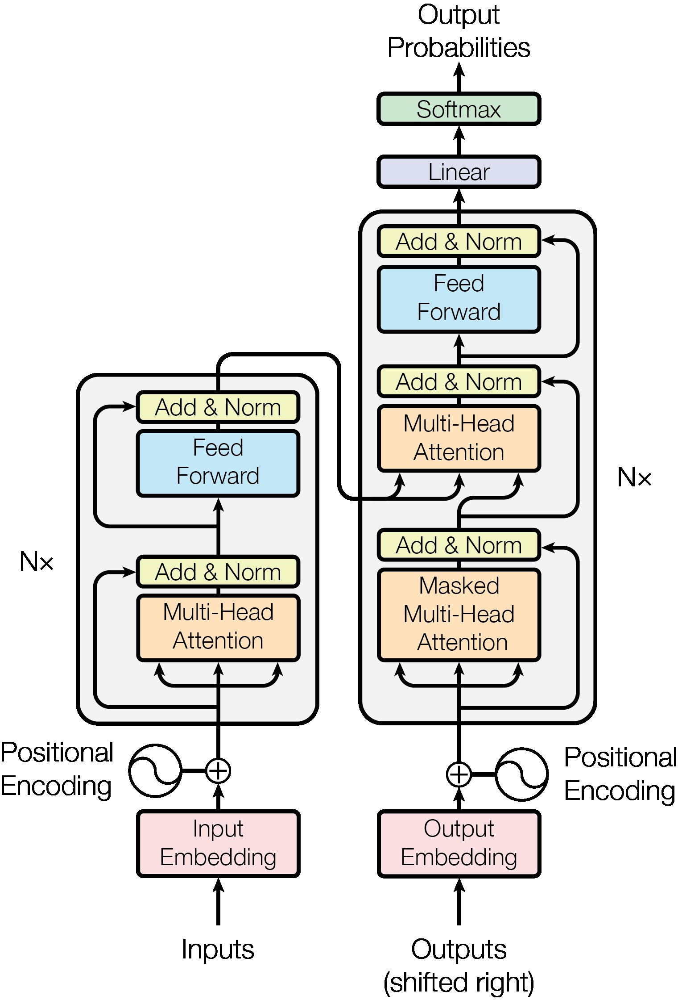

> 图 1.1　Transformer 原始架构（Vaswani et al., 2017, Figure 1）。十年间，图中几乎每个模块都经历过改动，但“堆叠的残差子层 + 注意力 + FFN”这一整体骨架保持不变。

# 2. Attention is All You Need

2017年， Ashish Vaswani等人发表了一篇具有里程碑意义的论文《Attention Is All You Need》，该论文提出了Transformer架构，其核心观点是仅使用注意力机制，而不依赖循环神经网络（RNN）或卷积神经网络（CNN），也可以构建出高效、强大的模型。

Transformer模型结构由编码器（Encoder）和解码器（Decoder）组成，每个编码器和解码器由6层“自注意力层”和“前馈网络层”堆叠而成。自注意力层可以让模型在生成每个单词的时候考虑到序列中其他所有单词的影响，而前馈网络层则对每个位置的表示进行进一步的非线性变换。论文引入了“多头注意力”机制，通过将输入序列分割成多个“头”来同时进行自注意力计算，增强了模型的表达能力。由于Transformer模型本身不具有捕捉序列顺序的能力，论文提出了位置编码方法，用来给模型提供关于单词在序列中位置的信息。

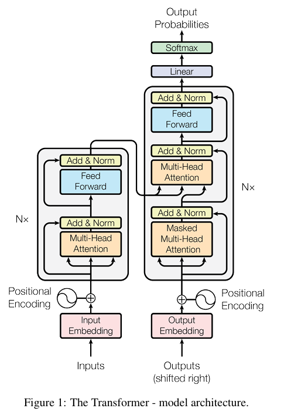

> 图 2.1　Transformer 模型架构（Vaswani et al., 2017, Figure 1）

在标准的自注意力机制中，每个词元（token）通过一套查询（Query）、键（Key）、值（Value）矩阵来捕捉与序列中所有词元的关系。然而，单头注意力存在局限：它可能过度关注自身位置，或者只能捕捉单一类型的依赖关系。
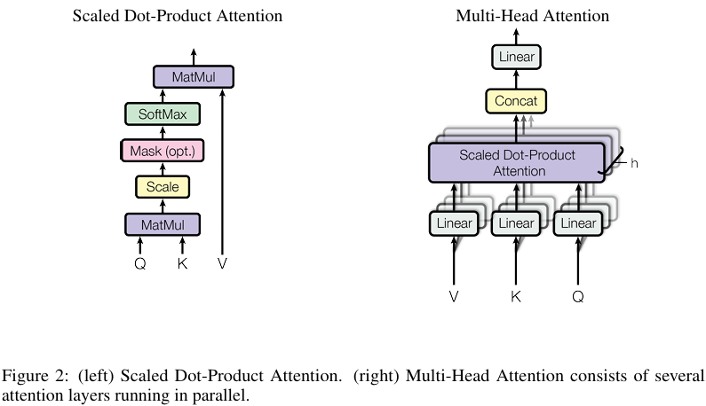

> 图 2.2　缩放点积注意力（左）与多头注意力（右）（Vaswani et al., 2017, Figure 2）

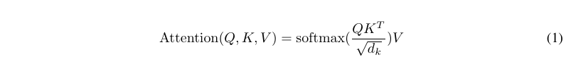

> 图 2.3　缩放点积注意力公式（Vaswani et al., 2017, 式 (1)）

缩放点积注意力（Scaled Dot-Product Attention）的公式为：

$$\text{Attention}(Q, K, V) = \text{softmax}\left(\frac{QK^T}{\sqrt{d_k}}\right)V \tag{2.1}$$

其中 $Q, K, V \in \mathbb{R}^{n \times d_k}$，$d_k$ 是键向量的维度。除以 $\sqrt{d_k}$ 的原因：当 $d_k$ 较大时，点积结果的方差会随 $d_k$ 线性增长，softmax 容易被推向梯度极小的饱和区，缩放可以稳定训练。

多头注意力将输入序列的嵌入表示（通常是 512 维等高维向量）沿特征维度分割成多个子空间（即“头”），每个头在低维空间（如 64 维）中独立、并行地计算自注意力。


> 图 2.4　多头注意力公式（Vaswani et al., 2017, 式 (2)）

多头注意力（Multi-Head Attention）公式：

$$\text{MultiHead}(Q, K, V) = \text{Concat}(\text{head}_1, \dots, \text{head}_h)W^O \tag{2.2}$$

$$\text{where } \text{head}_i = \text{Attention}(QW_i^Q, KW_i^K, VW_i^V)$$

其中投影矩阵 $W_i^Q \in \mathbb{R}^{d_{\text{model}} \times d_k}$，$W_i^K \in \mathbb{R}^{d_{\text{model}} \times d_k}$，$W_i^V \in \mathbb{R}^{d_{\text{model}} \times d_v}$，$W^O \in \mathbb{R}^{hd_v \times d_{\text{model}}}$。原论文取 $h=8$，$d_k = d_v = d_{\text{model}}/h = 64$。

多头注意力的计算是一个标准化的四步流程：
1. **线性投影与分割（切分）**： 输入序列 X 首先分别通过三组不同的可学习权重矩阵 W_q, W_k, W_v 进行线性变换，得到初始的 Q、K、V 矩阵。然后，这些矩阵被重塑（reshape）和转置（transpose），从形状 (batch_size, seq_len, d_model) 变为 (batch_size, num_heads, seq_len, d_k)。这里 d_k = d_model / num_heads，即完成了将高维特征分割到多个头的过程。
2. **并行注意力计算**： 每个头独立进行缩放点积注意力（Scaled Dot-Product Attention）计算。
3. **拼接（Concat）**： 将 num_heads 个头的输出（每个形状为 (batch_size, seq_len, d_k)）在最后一个维度（特征维度）上拼接起来，恢复为 (batch_size, seq_len, d_model) 的形状
4. **最终线性投影（融合）**：拼接后的结果通过最终的可学习权重矩阵 $W_o$ 进行线性变换。这一步既把维度适配回原始输入大小以支持残差连接，又融合了来自不同头的信息，而非简单拼接。该融合过程由模型在训练中自动学习，会为更重要的头分配更高的权重。

实现一个多头注意力层：

```python
import torch
import torch.nn as nn
import torch.nn.functional as F
import math


class MultiHeadAttention(nn.Module):
    """原始论文中的多头注意力 (Vaswani et al., 2017)"""
    def __init__(self, d_model, num_heads, dropout=0.0):
        super().__init__()
        assert d_model % num_heads == 0
        self.num_heads = num_heads
        self.d_k = d_model // num_heads  # 例如 d_model=512, h=8 -> d_k=64

        self.W_q = nn.Linear(d_model, d_model)
        self.W_k = nn.Linear(d_model, d_model)
        self.W_v = nn.Linear(d_model, d_model)
        self.W_o = nn.Linear(d_model, d_model)
        self.dropout = nn.Dropout(dropout)

    def forward(self, x, mask=None):
        B, L, _ = x.shape

        # 1. 线性投影 + 切分多头: (B, L, d_model) -> (B, h, L, d_k)
        q = self.W_q(x).view(B, L, self.num_heads, self.d_k).transpose(1, 2)
        k = self.W_k(x).view(B, L, self.num_heads, self.d_k).transpose(1, 2)
        v = self.W_v(x).view(B, L, self.num_heads, self.d_k).transpose(1, 2)

        # 2. 并行缩放点积注意力
        scores = (q @ k.transpose(-2, -1)) / math.sqrt(self.d_k)  # (B, h, L, L)
        if mask is not None:
            scores = scores.masked_fill(mask, float("-inf"))
        attn = self.dropout(F.softmax(scores, dim=-1))
        out = attn @ v                                    # (B, h, L, d_k)

        # 3. 拼接所有头 + 4. 输出投影
        out = out.transpose(1, 2).contiguous().view(B, L, -1)  # (B, L, d_model)
        return self.W_o(out)
```

# 3. Attention的改进

注意力机制的演进是深度学习领域过去十年间最核心的发展主线之一。它并非一蹴而就，而是一场在理论表达能力、计算效率与硬件资源三者之间持续博弈与突破的螺旋式上升过程。整个演进史始终围绕一个核心矛盾展开：注意力机制强大的全局建模能力（$O(N^2)$ 复杂度）与随之而来的巨大计算和内存开销之间的冲突。

随着模型规模和应用场景（尤其是长序列处理）的增长，标准 MHA 的二次方复杂度和巨大的 **KV Cache**（推理时存储的键值对）开销成为主要瓶颈，演进也主要围绕几个方向展开：

标准自注意力的计算复杂度为 $O(n^2 \cdot d)$（序列长度 $n$，特征维度 $d$），推理时 KV Cache 显存占用为 $O(n \cdot h \cdot d_k)$。十年改进基本沿着三条主线：

表 3.1　注意力效率优化的三条主线

| 主线 | 目标 | 代表工作 |
|---|---|---|
| 减少 KV Cache | 降低推理显存/带宽压力 | MQA → GQA → MLA |
| 减少计算量 | 打破 $O(n^2)$ | 滑窗注意力、线性注意力、稀疏注意力 |
| 优化 IO 与调度 | 让算子贴合硬件 | FlashAttention 1→4 |

**1. 优化KV Cache，提升推理效率**

这是为了缓解自回归解码时显存带宽的极端压力。


- **效率优化变体**：为了减少推理时缓存的键值对（KV Cache）大小，提升推理速度，出现了**多查询注意力（MQA）** 和**分组查询注意力（GQA）**。MQA让所有头共享一套K和V，极大减小缓存；GQA是MHA和MQA的折中，将头分组，组内共享K/V，在效率和效果间取得更好平衡

**2. 优化计算与IO：FlashAttention**

即使 KV Cache 降下来了，训练和预填充阶段的 $O(n^2)$ 注意力矩阵仍是主要瓶颈。FlashAttention（Tri Dao et al., 2022）则另辟蹊径：**不改数学，改数据搬运**。它利用 GPU 的存储层级（SRAM 快但小，HBM 大但慢），用 tiling + online softmax 把注意力分块计算，避免把 $N \times N$ 的注意力矩阵物化到 HBM 中。


> 图 3.1　GPU 存储层级与 FlashAttention 的 tiling 策略（FlashAttention 论文 Figure 1）。

IO 复杂度分析：标准注意力的 HBM 访问量为 $O(N^2 + Nd^2)$（必须写出并读回 $N \times N$ 的注意力矩阵）；FlashAttention 降至 $O(N^2 d^2 / M)$，其中 $M$ 为 SRAM 大小。当 $d \le M$ 时随 $N$ 仅线性增长。

online softmax 的关键恒等式（分块归一化）：

$$\ell = \sum_{j} e^{q \cdot k_j - m}, \qquad m = \max_j (q \cdot k_j) \tag{3.1}$$

在分块扫描时维护 running max $m$ 与 running sum $\ell$，每读入新块就更新并对旧输出做 rescale，数学上严格等价于全局 softmax，却无需看到完整行。

```python
# 工程实践中直接调用官方库，而非手写 CUDA

# pip install flash-attn

from flash_attn import flash_attn_func

# q, k, v: (batch, seqlen, nheads, headdim), fp16/bf16

out = flash_attn_func(q, k, v, causal=True)   # 因果掩码解码
```

FlashAttention 1→4 的演进本质上是**软硬件协同**的十年缩影：FA1 证明 IO 是瓶颈；FA2 优化 warp 调度与寄存器分配；FA3 针对 Hopper 架构（TMA、WGMMA）重写；FA4 进一步面向 Blackwell。数学从未变过，变的是怎么把同样的数学映射到下一代硬件上。

## 3.1 Multi-query attention

多查询注意力（Multi-Query Attention, MQA）由 Noam Shazeer 在 2019 年《Fast Transformer Decoding: One Write-Head is All You Need》中提出。其做法十分直接：保留 $h$ 个查询头，但所有头共享同一组 Key 和 Value 投影。


> 图 3.2　从 Multi-Head 到 Multi-Query 的转换——把 $h$ 个 Key 投影做 Mean Pool 合并为单头（GQA 论文 Figure 1）。

对输入序列 $X$，MQA 的投影形状为：

- 查询（Q）：$[b, n, h, d_k]$（$h$ 个头）
- 键（K）：$[b, n, 1, d_k]$（1 个头）
- 值（V）：$[b, n, 1, d_k]$（1 个头）

KV Cache 从 $O(n \cdot h \cdot d_k)$ 降到 $O(n \cdot d_k)$，推理时内存带宽压力大幅下降（解码阶段本质是 memory-bound，KV 读取量决定吞吐）。代价是表达能力下降——所有查询头只能从同一套 K/V 里取信息，长尾任务上质量有可感知的损失。

```python
# MQA 是 GQA 的特例：num_kv_groups = 1

mqa = GroupedQueryAttention(d_in=2048, num_heads=32, num_kv_groups=1)
```

## 3.2 Grouped query attention

分组查询注意力（Grouped Query Attention, GQA，Ainslie et al., 2023）在多头注意力（MHA）与多查询注意力（MQA）之间取得折中：将查询头分为若干组，每组共享同一组键、值投影。这样既保留了 MHA 的表达能力，又显著降低了推理时的 KV Cache 与内存占用，在长序列场景下收益尤为明显。

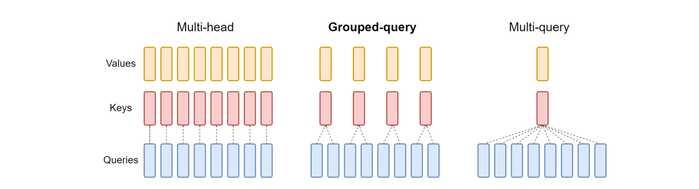

> 图 3.3　Multi-head / Grouped-query / Multi-query 三种结构对比（GQA 论文 Figure 2）。GQA 是 MHA 与 MQA 的折中：查询头分组，组内共享 K/V。

具体而言，GQA 将 $h$ 个查询头划分为 $g$ 个组（$g < h$），每组包含 $h/g$ 个查询头，同一组内的查询头共享一组键、值投影，不同组之间相互独立。相比之下，标准 MHA 为每个查询头维护独立的键头与值头，MQA 则让所有头共享一组键、值。GQA 因此兼顾两者：既保持了一定的表达多样性，又将键值头数从 $h$ 降到 $g$。论文实验表明，GQA 在保持与 MHA 相近模型质量的同时，可将处理速度提高约 3 倍，接近 MQA 的水平。

具体来说，对于输入序列X，经过线性变换后得到：

- 查询（Q）：形状为[batch_size, seq_len, h, head_dim]  
    
- 键（K）：形状为[batch_size, seq_len, g, head_dim]  
    
- 值（V）：形状为[batch_size, seq_len, g, head_dim]  
    
其中h是查询头的总数，g是分组的数量（键值头的数量），且h/g为整数。

表 3.2　MHA、GQA 与 MQA 的结构对比

| 特性   | MHA（多头注意力） | GQA（分组查询注意力） | MQA（多查询注意力） |
| -------- | -------------- | ---------------- | --------------- |
| 查询头数 | h              | h                | h               |
| 键值头数 | h              | g（1 < g < h）     | 1               |
| 参数数量 | 多              | 中等               | 少               |
| 表达能力 | 强              | 中等               | 相对较弱            |
| 内存使用 | 高              | 中等               | 低               |
| 计算速度 | 慢              | 较快               | 快               |

GQA的计算过程可以分解为以下几个步骤：

1. **投影操作**：将输入序列通过线性变换得到查询、键和值张量。需要注意的是，查询的投影维度为h×head_dim，而键和值的投影维度仅为g×head_dim。  
2. **查询分组**：将查询张量沿头维度分割为g个组，每个组包含h/g个查询头。  
3. **键值复制**：为了便于计算，将键和值张量沿着头维度复制h/g次，使其形状与查询张量匹配。  
4. **注意力计算**：对每个组分别计算注意力分数。首先计算查询组和键的点积，然后通过softmax函数归一化得到注意力权重，最后使用这些权重对值进行加权求和。  
5. **输出拼接**：将所有组的注意力输出拼接起来，形成最终的注意力输出。  
    

```python
class GroupedQueryAttention(nn.Module):
    """
    分组查询注意力 (Grouped Query Attention, GQA) 实现。
    
    核心思想：
    - 分组查询注意力(GQA): Q 有 num_heads 个头，K、V 有 num_kv_groups 个头（折中方案）
    
    参数说明：
    - d_in: 输入特征维度
    - num_heads: Query 的头数（总头数）
    - num_kv_groups: Key/Value 的组数（KV 头数）
    - head_dim: 每个头的维度（如果不指定则自动计算）
    - qk_norm: 是否对 Q 和 K 应用 RMSNorm（提高训练稳定性）
    - dtype: 参数数据类型
    
    示例配置（Qwen3 风格）：
    - num_heads=32, num_kv_groups=8 -> group_size=4
    - 意味着每 4 个 Query 头共享 1 组 Key-Value 头
    """
    def __init__(
        self, d_in, num_heads, num_kv_groups, head_dim=None, qk_norm=False, dtype=None
    ):
        super().__init__()
        # 检查 Q 头数必须能被 KV 组数整除
        assert num_heads % num_kv_groups == 0, "num_heads must be divisible by num_kv_groups"

        self.num_heads = num_heads  # Query 头数（例如 32）
        self.num_kv_groups = num_kv_groups  # KV 组数（例如 8）
        self.group_size = num_heads // num_kv_groups  # 每组大小（例如 4）

        # 计算每个头的维度
        if head_dim is None:
            assert d_in % num_heads == 0, "`d_in` must be divisible by `num_heads` if `head_dim` is not set"
            head_dim = d_in // num_heads  # 例如：d_in=2048, num_heads=32 -> head_dim=64

        self.head_dim = head_dim
        self.d_out = num_heads * head_dim  # 输出维度

        # 投影层：注意 K、V 的输出维度是 num_kv_groups * head_dim
        # 示例：num_heads=32, num_kv_groups=8, head_dim=64
        # Q: d_in -> 32*64 = 2048
        # K: d_in -> 8*64 = 512（只有 Q 的 1/4）
        # V: d_in -> 8*64 = 512
        self.W_query = nn.Linear(d_in, self.d_out, bias=False, dtype=dtype)
        self.W_key = nn.Linear(d_in, num_kv_groups * head_dim, bias=False, dtype=dtype)
        self.W_value = nn.Linear(d_in, num_kv_groups * head_dim, bias=False, dtype=dtype)

        self.out_proj = nn.Linear(self.d_out, d_in, bias=False, dtype=dtype)

        # 可选的 QK 归一化（Qwen3 使用此技术提高稳定性）
        if qk_norm:
            self.q_norm = RMSNorm(head_dim, eps=1e-6)
            self.k_norm = RMSNorm(head_dim, eps=1e-6)
        else:
            self.q_norm = self.k_norm = None

    def forward(self, x, mask, cos, sin, start_pos=0, cache=None):
        """
        前向传播详解：
        
        输入：
        - x: (batch, num_tokens, d_in) 输入序列
        - mask: 注意力掩码，防止看到未来 token
        - cos, sin: RoPE 旋转位置编码的预计算值
        - start_pos: KV cache 的起始位置（推理时使用）
        - cache: 之前的 (keys, values) 缓存
        
        输出：
        - context: (batch, num_tokens, d_in) 注意力输出
        - next_cache: 更新后的 (keys, values) 缓存
        
        处理流程（以 num_heads=32, num_kv_groups=8 为例）：
        1. Q 投影: (B, L, 2048) -> (B, 32, L, 64)
        2. K 投影: (B, L, 2048) -> (B, 8, L, 64)
        3. V 投影: (B, L, 2048) -> (B, 8, L, 64)
        4. K/V 扩展: (B, 8, L, 64) -> (B, 32, L, 64) 通过 repeat_interleave
        5. 注意力计算: Q @ K^T -> softmax -> @ V
        """
        b, num_tokens, _ = x.shape

        # ========== 步骤 1: 应用线性投影 ==========
        queries = self.W_query(x)  # (b, num_tokens, num_heads * head_dim)
        keys = self.W_key(x)       # (b, num_tokens, num_kv_groups * head_dim)
        values = self.W_value(x)   # (b, num_tokens, num_kv_groups * head_dim)

        # ========== 步骤 2: 重塑为多头格式 ==========
        # Query: (B, L, num_heads*head_dim) -> (B, L, num_heads, head_dim) -> (B, num_heads, L, head_dim)
        queries = queries.view(b, num_tokens, self.num_heads, self.head_dim).transpose(1, 2)
        
        # Key/Value: (B, L, num_kv_groups*head_dim) -> (B, L, num_kv_groups, head_dim) -> (B, num_kv_groups, L, head_dim)
        keys_new = keys.view(b, num_tokens, self.num_kv_groups, self.head_dim).transpose(1, 2)
        values_new = values.view(b, num_tokens, self.num_kv_groups, self.head_dim).transpose(1, 2)

        # ========== 步骤 3: 可选的 QK 归一化 ==========
        # 对每个头的特征维度进行归一化，提高训练稳定性
        # 这是 Qwen3 的一个关键技术点
        if self.q_norm:
            queries = self.q_norm(queries)
        if self.k_norm:
            keys_new = self.k_norm(keys_new)

        # ========== 步骤 4: 应用旋转位置编码 (RoPE) ==========
        # RoPE 通过旋转嵌入注入位置信息，不增加额外参数
        # offset=start_pos 用于 KV cache 场景，确保位置编码连续
        queries = apply_rope(queries, cos, sin, offset=start_pos)
        keys_new = apply_rope(keys_new, cos, sin, offset=start_pos)

        # ========== 步骤 5: KV Cache 处理（推理优化）==========
        # 推理时复用之前计算的 K、V，避免重复计算
        # 训练时 cache=None，每次计算完整序列
        if cache is not None:
            prev_k, prev_v = cache
            # 将新的 K、V 拼接到缓存后面
            # 例如：prev_k (B, 8, 100, 64) + keys_new (B, 8, 1, 64) -> (B, 8, 101, 64)
            keys = torch.cat([prev_k, keys_new], dim=2)
            values = torch.cat([prev_v, values_new], dim=2)
            next_cache = (keys, values)
        else:
            start_pos = 0  # 训练模式，重置位置
            keys, values = keys_new, values_new
            next_cache = (keys, values)

        # ========== 步骤 6: 扩展 K、V 以匹配 Q 的头数 ==========
        # 关键操作：将 num_kv_groups 个 KV 头扩展为 num_heads 个
        # repeat_interleave 确保每组连续重复，而不是整体重复
        # 例如：[K0, K1] -> [K0, K0, K0, K0, K1, K1, K1, K1]（group_size=4）
        # 形状变化：(B, 8, L, 64) -> (B, 32, L, 64)
        keys = keys.repeat_interleave(self.group_size, dim=1)
        values = values.repeat_interleave(self.group_size, dim=1)

        # ========== 步骤 7: 计算注意力分数 ==========
        # Q @ K^T: (B, 32, L, 64) @ (B, 32, 64, L) -> (B, 32, L, L)
        attn_scores = queries @ keys.transpose(2, 3)
        
        # 应用掩码：将不应该看到的位置设为 -inf（softmax 后变为 0）
        # 例如：因果掩码防止看到未来 token
        attn_scores = attn_scores.masked_fill(mask, -torch.inf)
        
        # 缩放 + softmax：除以 sqrt(head_dim) 防止梯度消失
        # 例如：head_dim=64 -> 除以 8
        attn_weights = torch.softmax(attn_scores / self.head_dim**0.5, dim=-1)

        # ========== 步骤 8: 应用注意力权重 ==========
        # (B, 32, L, L) @ (B, 32, L, 64) -> (B, 32, L, 64)
        # 然后转置回 (B, L, 32, 64) 并合并头维度为 (B, L, 2048)
        context = (attn_weights @ values).transpose(1, 2).reshape(b, num_tokens, self.d_out)
        
        # ========== 步骤 9: 输出投影 ==========
        # 将多头输出投影回原始维度
        return self.out_proj(context), next_cache
```

> 注：GQA 的后续演进还包括 DeepSeek 的 **MLA（Multi-head Latent Attention）**——把 KV 压缩到低秩潜变量，推理时只缓存潜变量，进一步压缩 KV Cache；以及在 GQA 基础上加 QK-RMSNorm（如 Qwen3）提升训练稳定性。思路一脉相承：在“每个头独立”和“全部共享”之间找最优点。

## 3.3 MLA

GQA 把 KV 按头分组共享，缓存量仍是 $O(L \cdot n_h \cdot d_h)$——头数一多，KV Cache 仍是主要开销。MLA（Multi-head Latent Attention，DeepSeek-V2 提出、V3 沿用）则从另一个维度入手：不共享，而是把 KV 联合投影到一个低维潜变量，推理时只缓存这个潜变量。

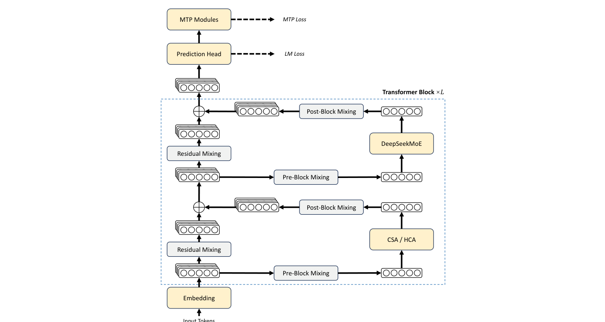

> 图 3.4　DeepSeek-V2 架构与 MLA 细节（DeepSeek-V2 论文 Figure 2）。注意 “Cached During Inference” 标记的只有潜变量 $c_t^{KV}$ 和解耦的 $k_t^R$。

给定第 $t$ 个 token 的输入 $h_t \in \mathbb{R}^d$，MLA 的四步：

$$c_t^{KV} = W^{DKV} h_t, \qquad c_t^{KV} \in \mathbb{R}^{d_c}, \quad d_c \ll d_h n_h \tag{3.2}$$

$$k_t^C = W^{UK} c_t^{KV}, \qquad v_t^C = W^{UV} c_t^{KV} \tag{3.3}$$

$$k_t^R = \mathrm{RoPE}(W^{KR} h_t) \tag{3.4}$$

$$k_{t,i} = [\,k_{t,i}^C \,;\, k_t^R\,], \qquad q_{t,i} = [\,q_{t,i}^C \,;\, q_{t,i}^R\,] \tag{3.5}$$

其中 $W^{DKV} \in \mathbb{R}^{d_c \times d}$ 是下投影，$W^{UK}, W^{UV} \in \mathbb{R}^{d_h n_h \times d_c}$ 是上投影。

**为什么必须“解耦 RoPE”**：RoPE 要作用在 K 上，但 K 是从潜变量解压出来的——一旦把旋转乘进 $W^{UK}$，就会破坏“潜变量不含位置信息”这一前提，位置信息会污染内容压缩。DeepSeek 的解法是**另开一路**共享的 $k^R$ 专门携带位置信息，内容部分 $k^C$ 保持“无位置”，两者拼接后再算注意力。这样压缩与解耦互不干扰。

**矩阵吸收**：推理时无需显式还原 $k^C$。因为

$$QK^T = (h W^Q)(W^{UK} c^{KV})^T = h \underbrace{(W^Q (W^{UK})^T)}_{\text{可预折叠}} (c^{KV})^T \tag{3.6}$$

把 $W^Q (W^{UK})^T$ 预计算成一个矩阵，就可以在潜变量上直接算注意力分数，$K$ 从头到尾不被物化。同理 $W^{UV}$ 可以吸收进输出投影。

**缓存账本**（每层每 token）：

表 3.3　MHA、GQA 与 MLA 的每层每 token 缓存量对比

| 方案 | 缓存元素 | 相对 MHA |
|---|---|---|
| MHA | $2 \cdot d_h n_h$ | 基准 |
| GQA | $2 \cdot d_h n_g$ | 随 KV 头数线性下降 |
| **MLA** | $d_c + d_h^R$ | **约 1/20** |

DeepSeek-V2 取 $d_c = 512$、$d_{model} = 5120$，报告 KV Cache 相比 MHA 减少 **93.3%**。

```python
import math
import torch
import torch.nn as nn


class MultiHeadLatentAttention(nn.Module):
    """MLA (DeepSeek-V2/V3)：KV 低秩联合压缩，推理时只缓存潜变量 c^{KV}。"""

    def __init__(self, d_model, n_heads, d_head, kv_lora_rank=512, rope_head_dim=64,
                 q_lora_rank=0, dtype=None, bias=False):
        super().__init__()
        self.n_heads, self.d_head = n_heads, d_head
        self.kv_lora_rank, self.q_lora_rank = kv_lora_rank, q_lora_rank
        self.rope_head_dim = rope_head_dim
        d_nope = d_head - rope_head_dim          # 不带位置信息的部分

        # 1) KV 联合下投影：d_model -> kv_lora_rank（推理时唯一缓存的东西）
        self.wkv = nn.Linear(d_model, kv_lora_rank, bias=False, dtype=dtype)
        # 2) 解压回各头
        self.wuk = nn.Linear(kv_lora_rank, n_heads * d_nope, bias=False, dtype=dtype)
        self.wuv = nn.Linear(kv_lora_rank, n_heads * d_head, bias=False, dtype=dtype)
        # 3) 解耦 RoPE 分支：k^R 全头共享，q^R 每头独立
        self.wkr = nn.Linear(d_model, rope_head_dim, bias=False, dtype=dtype)
        self.wqr = nn.Linear(d_model, n_heads * rope_head_dim, bias=False, dtype=dtype)
        # 4) Query 内容部分（可用低秩压缩省训练显存）
        if q_lora_rank > 0:
            self.wq_a = nn.Linear(d_model, q_lora_rank, bias=False, dtype=dtype)
            self.wq_b = nn.Linear(q_lora_rank, n_heads * d_nope, bias=False, dtype=dtype)
        else:
            self.wq_a = nn.Linear(d_model, n_heads * d_nope, bias=False, dtype=dtype)
        self.wo = nn.Linear(n_heads * d_head, d_model, bias=False, dtype=dtype)

    def forward(self, x, cos, sin, cache=None):
        B, L, _ = x.shape
        h, dh, rd = self.n_heads, self.d_head, self.rope_head_dim
        d_nope = dh - rd

        # --- 压缩：整个网络里只有这一步的输出需要进 KV Cache ---
        c_kv = self.wkv(x)                                   # (B, L, kv_lora_rank)
        if cache is not None:
            c_kv = torch.cat([cache[0], c_kv], dim=1)         # 追加新 token
        next_cache = (c_kv,)

        # --- 解压 ---
        k_c = self.wuk(c_kv).view(B, -1, h, d_nope).transpose(1, 2)   # (B,h,L,d_nope)
        v = self.wuv(c_kv).view(B, -1, h, dh).transpose(1, 2)        # (B,h,L,d_head)

        # --- Query ---
        if self.q_lora_rank > 0:
            q_c = self.wq_b(self.wq_a(x)).view(B, L, h, d_nope).transpose(1, 2)
        else:
            q_c = self.wq_a(x).view(B, L, h, d_nope).transpose(1, 2)
        q_r = self.wqr(x).view(B, L, h, rd).transpose(1, 2)           # (B,h,L,rd)

        # --- 解耦 RoPE：只作用在 k^R / q^R 上 ---
        k_r = apply_rope(self.wkr(x).view(B, L, 1, rd).transpose(1, 2), cos, sin)
        q_r = apply_rope(q_r, cos, sin)

        # --- 拼接内容与位置 ---
        q = torch.cat([q_c, q_r], dim=-1)                   # (B,h,L,d_head)
        k = torch.cat([k_c, k_r.expand(-1, h, -1, -1)], dim=-1)   # (B,h,L,d_head)

        scores = (q @ k.transpose(-2, -1)) / math.sqrt(dh)
        out = torch.softmax(scores, dim=-1) @ v
        out = out.transpose(1, 2).reshape(B, L, h * dh)
        return self.wo(out), next_cache
```

MLA 把“共享 KV”换成了“压缩 KV”，本质是**用训练期算力换推理期显存**。代价是训练时多了一次投影，且质量依赖低秩瓶颈的容量——所以 DeepSeek 把 $d_c$ 设得并不激进（512），并用解耦 RoPE 把位置信息的自由度独立出来。

## 3.4 SWA

SWA（Sliding Window Attention，滑动窗口注意力）是最早也最直觉的稀疏化尝试：每个 token 只看最近 $w$ 个 token，而不是全部历史。

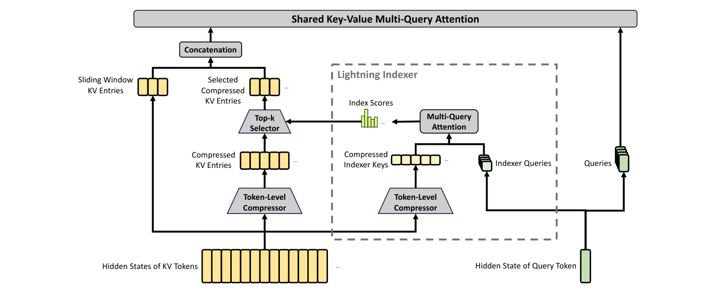

> 图 3.5　Vanilla Attention 与 Sliding Window Attention 的掩码对比，以及“有效上下文长度”（Mistral 7B 论文 Figure 1）。

形式化地，注意力只在窗口内计算：

$$M_{sw,ij} = \begin{cases} 0, & j \le i \ \text{且}\ i - j < w \\ -\infty, & \text{其他} \end{cases}, \qquad \text{Attention} = \mathrm{softmax}\!\left(\frac{QK^T}{\sqrt{d_k}} + M_{sw}\right) V \tag{3.7}$$

复杂度从 $O(n^2)$ 降到 $O(n \cdot w)$，当 $w \ll n$ 时近似线性；KV Cache 也从 $O(n)$ 降到 $O(w)$。

Mistral 7B 是第一个大规模验证 SWA 的开源模型，窗口 $w = 4096$，并配套了**滚动缓冲缓存（Rolling Buffer Cache）**：缓存固定大小 $W=4$ 的环形缓冲，位置超出后旧的 K/V 被覆盖，在 32k 序列上把缓存显存降到 1/8。代价是跨窗口的信息**只能靠层数逐层传递**——SWA 层看不见远处，远处的信息必须靠中间层搬运。

后续演化：

- **Gemma 2**：全局注意力与 SWA 交替（1:1），窗口 4096
- **Gemma 3**：改成 5:1（每 5 层滑窗 + 1 层全局），窗口从 4096 缩到 1024

$$\text{Memory}_{\text{Gemma3}} = \frac{5 \cdot 1024 + 1 \cdot L}{1 \cdot 4096 + 1 \cdot L} \approx 0.26 \quad (L = 32K) \tag{3.8}$$

消融显示每 6 层放一个全局层就足以捕捉长程依赖，困惑度几乎不掉。

- **gpt-oss** 在交替层中使用；**小米 MiMo-V2-Flash** 用 $w=128$ 的极端窗口
- Mistral 3.1 Small 却放弃了 SWA：统一注意力模式对 FlashAttention-3 这类优化 kernel 更友好——这是“算法最优 vs 硬件最优”的经典权衡

```python
import torch
import torch.nn as nn


class SlidingWindowAttention(nn.Module):
    """SWA：每个 query 只看最近 window_size 个 key。"""

    def __init__(self, d_model, n_heads, window_size=4096, dtype=None):
        super().__init__()
        self.n_heads = n_heads
        self.d_head = d_model // n_heads
        self.window = window_size
        self.wq = nn.Linear(d_model, d_model, bias=False, dtype=dtype)
        self.wk = nn.Linear(d_model, d_model, bias=False, dtype=dtype)
        self.wv = nn.Linear(d_model, d_model, bias=False, dtype=dtype)
        self.wo = nn.Linear(d_model, d_model, bias=False, dtype=dtype)

    def forward(self, x, cache=None):
        B, L, _ = x.shape
        h, dh = self.n_heads, self.d_head
        q = self.wq(x).view(B, L, h, dh).transpose(1, 2)
        k = self.wk(x).view(B, L, h, dh).transpose(1, 2)
        v = self.wv(x).view(B, L, h, dh).transpose(1, 2)

        if cache is not None:
            k = torch.cat([cache[0], k], dim=2)      # (B,h,L_total,dh)
            v = torch.cat([cache[1], v], dim=2)
            start = cache[0].shape[2]
        else:
            start = 0
        next_cache = (k, v)

        scores = (q @ k.transpose(-2, -1)) / dh**0.5   # (B,h,L,L_total)
        # 滑动窗口掩码：只允许看到 [i-window+1, i]
        qpos = torch.arange(start, start + L, device=x.device).view(-1, 1)
        kpos = torch.arange(0, k.shape[2], device=x.device).view(1, -1)
        mask = (kpos <= qpos) & (kpos > qpos - self.window)
        scores = scores.masked_fill(~mask, float("-inf"))

        out = torch.softmax(scores, dim=-1) @ v
        out = out.transpose(1, 2).reshape(B, L, -1)
        return self.wo(out), next_cache
```

SWA 是“纯局部”的稀疏化，靠层数堆叠换取长程能力。它给后世稀疏注意力留下的最重要遗产是**滑动窗口几乎成了标配**——NSA、DSA、CSA、QSA 全都保留了滑动窗口分支。

## 3.5 Sparse Attention

如果说 FlashAttention 是“把同样的数学算得更快”，那稀疏注意力就是“**少算一部分**”。

两者的区别是根本性的：

表 3.4　FlashAttention 与稀疏注意力的技术路线对比

| | FlashAttention | 稀疏注意力 |
|---|---|---|
| 交互次数 | 全部 $n^2$ 对，一个不少 | 只保留 $n \cdot k$ 对 |
| $n \times n$ 矩阵 | 不物化到 HBM，但仍然要算 | 根本不构造大部分 |
| 精确性 | **数值上完全等价** | 近似，有质量损失 |
| 省的是 | 显存带宽 | 算力 + 带宽 + KV 读取量 |

稀疏注意力的一般框架是：用一个**廉价的选择器**（indexer / scorer）判断“哪些历史 token 值得看”，然后只在这些 token 上跑精确注意力。难点从来不是“怎么少看”，而是“**怎么在不看错的前提下少看**”——选择器一旦漏掉关键信息，模型就会退化。

2025 年之后，这一分支密集产出了 DeepSeek 的 NSA / DSA / V4 的 CSA-HCA / V4.1 的 CSA2、Qwen 的 QSA、MiniMax 的 MSA、美团 LongCat 的 LSA 等工作。它们在三个维度上分化：

1. **选择粒度**：token 级（NSA / DSA）→ block 级（MSA / CSA）→ micro-block 级（QSA）
2. **选择器是否可训练**：原生端到端训练（NSA）→ 用 KL 对齐蒸馏（MSA）→ 轻量索引器（QSA）
3. **是否保留全局分支**：几乎都保留——滑窗 + 稀疏 + 全局，三者叠加

2026 年的 CSA2 与 LSA 又开辟了第四个维度：沿层维度摊销索引与 KV——一次压缩、多层共享，一次选择、多层复用。

### 3.5.1 Native Sparse Attention

NSA（Native Sparse Attention，DeepSeek 与北大张铭团队合作，ACL 2025 最佳论文）要解决的是稀疏注意力最突出的现实问题：理论上的复杂度优势，历史上一直换不成实际加速——选择器本身的开销、GPU 访存的不规则性、以及“选择不可导导致没法端到端训练”，让稀疏注意力长期停留在论文里。


> 图 3.6　NSA 架构总览（NSA 论文 Figure 2）。三条并行分支——压缩注意力、选择注意力、滑动注意力——最后经 Gated Output 融合。

NSA 的解法是“硬件对齐 + 原生可训练”两件事一起做。

**三条并行分支**：

1. **压缩注意力（Compressed）**：把连续的 token 分组压缩成代表 token，用低维向量近似整段历史，提供**粗粒度的全局模式**
2. **选择注意力（Selected）**：由**可训练的 indexer** 对每个 query 打分，选出 top-k 个重要块，提供**细粒度的精确检索**
3. **滑动注意力（Sliding）**：保留最近 $w$ 个 token 的原始 KV，提供**局部细节**

**门控融合**：三条分支各自产生 $o_c, o_s, o_w$，由 query 决定门控权重：

$$o = g_c \odot o_c + g_s \odot o_s + g_w \odot o_w \tag{3.9}$$

这让模型自己学“当前这层该侧重哪种信息”，而不是固定比例。

**硬件对齐**：NSA 的三个分支共享同一套 tile 布局，并配套专门的 CUDA kernel，把选择器的开销压到可忽略——这正是“硬件对齐”四个字的含义：算法设计时就考虑好了 kernel 怎么写。

效果上，在 64k 序列长度下，相比 FlashAttention：前向最高 9× 加速、反向 6× 加速，且呈“越长越优”趋势；在通用基准、长文本任务与指令推理上均持平或超越全注意力模型。

```python
import torch
import torch.nn as nn


class NativeSparseAttention(nn.Module):
    """
    NSA 的三分支骨架（省略 tile 级 kernel 优化）。
    三条分支共享同一套 Q/K/V 投影，这是硬件对齐的关键。
    """

    def __init__(self, d_model, n_heads, n_groups=16, n_selected=16, window_size=512,
                 compressor_size=64, dtype=None):
        super().__init__()
        self.h = n_heads
        self.dh = d_model // n_heads
        self.g = n_groups            # 压缩后的代表 token 数
        self.k_sel = n_selected      # 选择分支保留的块数
        self.w = window_size
        self.dc = compressor_size    # 压缩分支维度

        self.wq = nn.Linear(d_model, d_model, bias=False, dtype=dtype)
        self.wk = nn.Linear(d_model, d_model, bias=False, dtype=dtype)
        self.wv = nn.Linear(d_model, d_model, bias=False, dtype=dtype)
        # 压缩分支：把 token 分组聚合成 g 个代表
        self.compressor = nn.Linear(d_model, self.dc, bias=False, dtype=dtype)
        # 选择分支的 indexer（可训练）
        self.indexer = nn.Linear(d_model, d_model, bias=False, dtype=dtype)
        self.gate = nn.Linear(d_model, 3 * self.h, bias=False, dtype=dtype)  # 三分支门控
        self.wo = nn.Linear(d_model, d_model, bias=False, dtype=dtype)

    def forward(self, x):
        B, L, _ = x.shape
        h, dh = self.h, self.dh
        q = self.wq(x).view(B, L, h, dh).transpose(1, 2)
        k = self.wk(x).view(B, L, h, dh).transpose(1, 2)
        v = self.wv(x).view(B, L, h, dh).transpose(1, 2)

        # ---- 分支 1：压缩注意力（粗粒度全局）----
        groups = L // self.g if L >= self.g else 1
        pooled = x.view(B, groups, -1).mean(dim=2)                 # (B, G, d)
        c = self.compressor(pooled)                                  # (B, G, dc)
        ck = c.unsqueeze(2).expand(-1, -1, h, -1).reshape(B, groups, h, self.dc).transpose(1, 2)
        cv = ck
        o_c = torch.softmax((q @ ck.transpose(-2, -1)) / self.dc**0.5, dim=-1) @ cv

        # ---- 分支 2：选择注意力（细粒度检索，indexer 打分 + top-k）----
        idx_scores = (self.indexer(q) @ self.indexer(k).transpose(-2, -1)) / self.dh**0.5
        idx_scores = idx_scores.masked_fill(torch.ones_like(idx_scores, dtype=torch.bool)
                                            .triu(1), float("-inf"))
        _, topk = torch.topk(idx_scores, k=min(self.k_sel, L), dim=-1)     # (B,h,L,k)
        sel_k = torch.gather(k, 2, topk.unsqueeze(-1).expand(-1, -1, -1, dh))
        sel_v = torch.gather(v, 2, topk.unsqueeze(-1).expand(-1, -1, -1, dh))
        o_s = torch.softmax((q @ sel_k.transpose(-2, -1)) / dh**0.5, dim=-1) @ sel_v

        # ---- 分支 3：滑动注意力（局部细节）----
        qpos = torch.arange(L, device=x.device).view(-1, 1)
        kpos = torch.arange(L, device=x.device).view(1, -1)
        win = (kpos <= qpos) & (kpos > qpos - self.w)
        sc = (q @ k.transpose(-2, -1)) / dh**0.5
        sc = sc.masked_fill(~win, float("-inf"))
        o_w = torch.softmax(sc, dim=-1) @ v

        # ---- 门控融合 ----
        g = self.gate(x).view(B, L, 3, h).permute(2, 0, 3, 1).unsqueeze(-1)  # (3,B,h,L,1)
        g = torch.sigmoid(g)
        o = g[0] * o_c + g[1] * o_s + g[2] * o_w
        o = o.transpose(1, 2).reshape(B, L, -1)
        return self.wo(o)
```

NSA 的真正贡献不是“稀疏”本身，而是证明了稀疏注意力可以同时做到原生可训练和硬件对齐。论文发表后已被 DeepSeek、华为、字节等多家团队实现或复现。

### 3.5.2 Deepseek Sparse Attention

DSA（DeepSeek Sparse Attention）是 NSA 的工程化继任者，搭载在 2025 年 9 月发布的 DeepSeek-V3.2-Exp 上——这是稀疏注意力机制**第一次真正进入开源生产模型**（业界原本普遍预期 V4 会采用 NSA，结果 DSA 抢先登场）。


> 图 3.7　DSA 的核心机制（DeepSeek-V4 技术报告 Figure 3）。闪电索引器给压缩块打分，Top-k Selector 选出重要块，滑窗分支保留最近的原始 KV。

DSA 的核心是两个新组件：

**闪电索引器（Lightning Indexer）**：一个轻量模块，为当前 query 与每个候选历史 token 计算相关性分数。关键是它足够便宜——不进入主注意力路径，仅作一次粗略筛选。

**Top-k 选择器**：按分数取 top-$k$ 个 token（默认 2048）做精细注意力，其余全部跳过。

于是核心注意力复杂度从 $O(L^2)$ 降到 $O(L \cdot k)$。

关键设计是 DSA 叠加在 MLA 之上而不是替代 MLA：索引器打分用的是各层隐状态的小投影，选中的正是 MLA 的**压缩潜变量 KV 条目**，再走标准 MLA 注意力路径。两者天然可组合——MLA 让每个条目变小，DSA 让触碰的条目变少。

训练采用三阶段：先用短期的“密集预热”让索引器学会模仿原模型的注意力分布，再进入“稀疏训练”阶段让整个模型适应新稀疏模式，最后沿用与前代完全相同的后训练流程（专家蒸馏 + GRPO）。这种“只改一处、其余全部对齐”的实验设计，让性能差异可以干净地归因到注意力机制本身。

DeepSeek 同时开源了 TileLang 和 CUDA 两版算子，并建议研究性实验优先用 TileLang 版本以便调试。结果上，V3.2-Exp 在与 V3.1-Terminus 严格对齐的设置下，各公开基准表现基本持平，同时把 API 价格下调了 50% 以上。

### 3.5.3 CSA、HCA 与 CSA2

2026 年 4 月的 DeepSeek-V4 把稀疏化推到了新维度：不再压缩“头”，而是压缩“序列”。MLA 是沿头维度压缩 KV，而 V4 的 Compressed Attention 沿序列维度压缩——后者才是百万上下文下 KV 显存爆炸的真正来源（增长的主导因素是序列长度，不是头数）。


> 图 3.8　DeepSeek-V4 整体架构（DeepSeek-V4 技术报告 Figure 2）。Transformer Block 内是 CSA / HCA 交替，残差部分换成了 mHC 的 Pre-Block / Post-Block Mixing。

**CSA（Compressed Sparse Attention）** 是细粒度的“精读”路径，流水线是“压缩 → 索引选择 → 核心注意力”：

1. **Token 级压缩器**：把连续 $m$ 个 token（DeepSeek-V4 为 4）的 K/V 用 **softmax 门控池化 + 可学习位置偏置**合并成 1 个 KV 条目，且相邻分组**重叠** $m$ 个 token，避免硬边界切断相邻信息
2. **闪电索引器（FP4 实现）**：给压缩块打分时用 **ReLU 而非 Softmax**——它只关心“哪些块足够相关”，不需要概率分布
3. **Top-1024 选择**：选出最相关的 1024 个压缩块（对应原始 4096 个 token）做完整注意力
4. **滑动窗口**：额外保留最近 $n_{win}$ 个**未压缩**的原始 KV，保证“刚才说过的话”依然清晰

**HCA（Heavily Compressed Attention）** 是粗粒度的“泛读”路径：

1. 把连续 $m'$ 个 token（128 倍压缩）合并成 1 个 KV 条目，作为整个序列的**全局摘要**
2. **不做稀疏筛选**，直接对所有压缩条目做稠密注意力

HCA 不做筛选的原因在于成本结构：128 倍压缩后条目数已经少到全量注意力完全算得动（1M token → 约 8000 条），而全量注意力**天然不会漏掉重要信息**——这正是稀疏选择器最大的风险点。

**层间堆叠策略**（V4-Pro 的 61 层）：

表 3.5　DeepSeek-V4-Pro 的层间注意力堆叠策略

| 层 | 注意力类型 | 意图 |
|---|---|---|
| 0 — 1 | 仅 HCA | 极廉价的全局摘要 |
| 2 — 60 | CSA / HCA 交替 | 局部精细 + 全局骨架兼顾 |
| 最后一层 MTP | 仅滑动窗口 | 最高精度输出 |

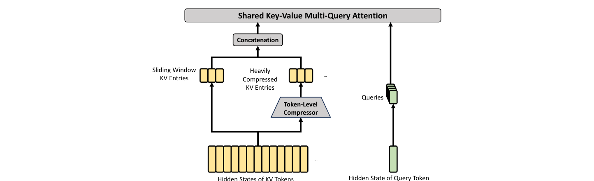

> 图 3.9　HCA 核心架构（DeepSeek-V4 技术报告 Figure 4）。重度压缩的 KV 条目 + 滑动窗口，**没有 Top-k 选择器**。

效果：DeepSeek-V4-Pro 的单 token 推理 FLOPs 仅为 V3.2 的 **27%**、KV Cache 为 **10%**；V4-Flash 更低至 10% / 7%。相对标准 GQA-8 基线，KV Cache 约为其 **2%**。

**代码实现**（CSA 的“压缩 → 索引 → 选择 → 注意力”四步，对应论文公式 9—19）：

```python
import torch
import torch.nn as nn
import torch.nn.functional as F


class TokenLevelCompressor(nn.Module):
    """CSA 的 token 级压缩器：两路重叠分组 + softmax 门控池化。

    关键：C^a 覆盖 [m*i, m*(i+1))，C^b 覆盖 [m*(i-1), m*i)，两者重叠 m 个 token，
    使相邻压缩条目在边界处信息连续（硬边界不切断语义）。
    """

    def __init__(self, d_model, c, m):
        super().__init__()
        self.m = m
        self.c = c
        self.w_kv_a = nn.Linear(d_model, c, bias=False)
        self.w_kv_b = nn.Linear(d_model, c, bias=False)
        self.w_z_a = nn.Linear(d_model, c, bias=False)
        self.w_z_b = nn.Linear(d_model, c, bias=False)
        # 可学习位置偏置（每个组内位置一个）
        self.bias_a = nn.Parameter(torch.zeros(m, c))
        self.bias_b = nn.Parameter(torch.zeros(m, c))

    def forward(self, h):
        # h: (B, L, d) -> c: (B, n_blk, c)
        B, L, d = h.shape
        m = self.m
        n_blk = L // m

        ca = self.w_kv_a(h).view(B, n_blk, m, self.c)     # (B,n,m,c) 无重叠
        cb = self.w_kv_b(h).view(B, n_blk, m, self.c)     # (B,n,m,c) 同上
        za = self.w_z_a(h).view(B, n_blk, m, self.c) + self.bias_a
        zb = self.w_z_b(h).view(B, n_blk, m, self.c) + self.bias_b

        # 简化示意：ca 与 cb 各自做组内 softmax 门控池化（真实实现中 cb 右移 m 个 token 形成重叠）
        sa = torch.softmax(za, dim=2)                     # Softmax_row
        sb = torch.softmax(zb, dim=2)
        comp = (sa * ca).sum(2) + (sb * cb).sum(2)        # (B, n_blk, c)
        return comp


class LightningIndexer(nn.Module):
    """闪电索引器：低秩 query + ReLU 评分 + head 加权求和（公式 13–16）。"""

    def __init__(self, d_model, d_c, c_i, n_head):
        super().__init__()
        self.n_head = n_head
        self.c_i = c_i
        self.w_dq = nn.Linear(d_model, d_c, bias=False)     # 降维
        self.w_iuq = nn.Linear(d_c, n_head * c_i, bias=False)  # 升维切头
        self.w_w = nn.Linear(d_model, n_head, bias=False)    # head 权重

    def forward(self, h, k_comp):
        # h: (B, L, d) query 隐状态；k_comp: (B, n_blk, c_i) 压缩索引键
        B, L, d = h.shape
        c_q = self.w_dq(h)                                  # (B, L, d_c)
        q_i = self.w_iuq(c_q).view(B, L, self.n_head, self.c_i)  # (B,L,h,c_i)
        w_i = self.w_w(h)                                    # (B, L, h)

        # 索引分数：I = Σ_h w_h · ReLU(q_h · k_h^T)，只看已完整观察的块（block-causal）
        logits = F.relu(torch.einsum("blhc,bnc->blnh", q_i, k_comp))  # (B,L,n,h)
        scores = (w_i.unsqueeze(2) * logits).sum(-1)          # (B, L, n_blk)
        return scores


class CompressedSparseAttention(nn.Module):
    """CSA 主体：压缩 → 索引 → Top-k 选择 → Shared-KV MQA → 分组输出投影。"""

    def __init__(self, d_model, c, m=4, k=1024, n_head=8, n_idx_head=4):
        super().__init__()
        self.k = k
        self.compressor = TokenLevelCompressor(d_model, c, m)
        self.indexer = LightningIndexer(d_model, d_c=c // 2, c_i=c // 2, n_head=n_idx_head)
        self.w_dq = nn.Linear(d_model, c, bias=False)
        self.w_uq = nn.Linear(c, n_head * c, bias=False)
        self.n_head = n_head
        self.norm_q = nn.RMSNorm(c)
        self.norm_kv = nn.RMSNorm(c)
        self.out_proj = nn.Linear(n_head * c, d_model, bias=False)

    def forward(self, h, sliding_kv=None):
        B, L, d = h.shape
        c_comp = self.compressor(h)                          # (B, n_blk, c) 既当 K 又当 V

        # 1) 索引打分（压缩版索引键）
        scores = self.indexer(h, c_comp)                     # (B, L, n_blk)

        # 2) Top-k 选择（block-causal：只允许选已完整观察的块）
        n_blk = c_comp.size(1)
        causal = torch.tril(torch.ones(L, n_blk, device=h.device, dtype=torch.bool),
                            diagonal=0)                       # p_b+m-1 <= i
        scores = scores.masked_fill(~causal, float("-inf"))
        topk_idx = scores.topk(min(self.k, n_blk), dim=-1).indices  # (B, L, k)

        # 3) Shared-KV MQA：压缩条目同时是 key 与 value
        c_q = self.w_dq(h)
        q = self.w_uq(c_q).view(B, L, self.n_head, -1)       # (B,L,nh,c)
        q = self.norm_q(q)
        kv = self.norm_kv(c_comp)                             # (B, n_blk, c)

        # 按 topk 索引收集（示意：真实实现用 gather + FlashAttention 变体）
        sel = torch.gather(kv, 1, topk_idx.unsqueeze(-1).expand(-1, -1, -1, kv.size(-1)))
        # 4) 核心注意力：q 与选中的压缩 KV 条目
        attn = torch.einsum("blhc,blkc->blhk", q, sel)
        o = torch.softmax(attn, dim=-1)

        # 5) 分组输出投影（n_head 很大时分组降维，节省开销）
        o = self.out_proj(o.reshape(B, L, -1))
        return o


class HeavilyCompressedAttention(nn.Module):
    """HCA：128× 重压缩 + 稠密注意力（无 Top-k），对应公式 20–26。"""

    def __init__(self, d_model, c, m_prime=128, n_head=8):
        super().__init__()
        self.m_prime = m_prime
        self.w_kv = nn.Linear(d_model, c, bias=False)
        self.w_z = nn.Linear(d_model, c, bias=False)
        self.bias = nn.Parameter(torch.zeros(m_prime, c))
        self.w_dq = nn.Linear(d_model, c, bias=False)
        self.w_uq = nn.Linear(c, n_head * c, bias=False)
        self.n_head = n_head
        self.out_proj = nn.Linear(n_head * c, d_model, bias=False)

    def forward(self, h):
        B, L, d = h.shape
        mp = self.m_prime
        n_blk = L // mp
        C = self.w_kv(h).view(B, n_blk, mp, -1)              # (B,n,mp,c)
        Z = self.w_z(h).view(B, n_blk, mp, -1) + self.bias
        S = torch.softmax(Z, dim=2)                           # Softmax_row
        comp = (S * C).sum(2)                                 # (B, n, c) 全局摘要

        q = self.w_uq(self.w_dq(h)).view(B, L, self.n_head, -1)
        # 稠密注意力：对所有压缩条目全量计算（条目少，天然不用稀疏筛选）
        attn = torch.einsum("blhc,bnc->blnh", q, comp)
        o = torch.softmax(attn, dim=-2)
        return self.out_proj(o.reshape(B, L, -1))
```

要点回顾：压缩器负责把 KV 条目降到 1/m，索引器负责只挑相关条目，MQA 负责共享 KV 减少显存——三者分工明确，缺一不可。HCA 则直接放弃稀疏筛选，用“足够粗的压缩 + 全量注意力”换稳定性。

**CSA2（Compressed Sparse Attention 2）**。V4.1-Flash（arXiv:2609.19969）把 KV 压缩推进到第三个维度——层维度。条目大小与序列长度两个维度已经被充分挖掘，而相邻层选中的 Top-K 块高度重合、主 KV 又压缩自同一份隐藏状态，每层各存一份、各算一遍的冗余由此显形。CSA2 的答案是跨层复用：多层共享同一份主 KV 与索引 K，需要时连 Top-K 选择结果一并沿用。


> 图 3.10　CSA2 的三种运行模式（DeepSeek-V4.1-Flash 技术报告 Figure 4）。绿色张量由本层计算，黄色张量从前序层借用。Full 模式自带主 KV、索引 K 与 Top-K 索引；Reindex 模式借用主 KV 与索引 K、用自己的索引 Q 重新选择 Top-K；Reuse 模式连 Top-K 索引也直接复用。

每个注意力层被静态指派三种模式之一，差别仅在主 KV、索引 K、Top-K 索引三项资源的来源：

$$
(\mathbf{C}_l,\ \mathbf{K}^I_l,\ \mathcal{I}_l) =
\begin{cases}
\big(\mathrm{Compress}(H_l),\ \mathrm{Proj}(\mathbf{C}_l),\ \mathrm{TopK}(Q^I_l, \mathbf{K}^I_l)\big), & l \in \mathcal{F} \\
\big(\mathbf{C}_{l'},\ \mathbf{K}^I_{l'},\ \mathrm{TopK}(Q^I_l, \mathbf{K}^I_{l'})\big), & l \in \mathcal{R}_{\mathrm{idx}} \\
\big(\mathbf{C}_{l'},\ \mathbf{K}^I_{l'},\ \mathcal{I}_{l'}\big), & l \in \mathcal{R}_{\mathrm{use}}
\end{cases}
\tag{3.10}
$$

其中 $l'$ 为 $l$ 之前最近的 Full 层，$\mathbf{C}$ 为主 KV 条目，$\mathbf{K}^I$ 为索引键，$\mathcal{I}$ 为选出的 Top-K 索引。三种模式下每层都保留自己的全局 Q 与 SWA KV——层与层之间共享的只是历史，不是全部。

表 3.6　CSA2 三种层模式的资源来源与本层计算量

| 模式 | 主 KV / 索引 K | Top-K 索引 | 本层计算 |
|---|---|---|---|
| Full | 本层压缩生成 | 本层选择 | 压缩 + 索引 + 选择 |
| Reindex | 借用前序 Full 层 | 本层重新选择 | 索引 Q 打分 + 选择 |
| Reuse | 借用前序 Full 层 | 直接复用 | 无（仅核心注意力） |

V4.1-Flash 的 40 层 CED 布局里，encoder 的 2—19 层按“1 Full + 5 Reuse”分三组，decoder 的 20—23 层为“1 Full + 3 Reuse”，24—39 层按“1 Reindex + 3 Reuse”分四组。38 个全局注意力层里只有 4 个 Full、4 个 Reindex，其余 30 个全部 Reuse。Reuse 层的轻量化是极端的：prefill 只需 15 个 kernel，decode 只需 11 个。

**层级稀疏索引器（Hierarchical Sparse Indexer）**。即便有了 Reuse，剩下的索引层仍要对整个可见上下文打分，成本随长度线性增长。解码器把选择拆成两级：第一个 Full 层在完成自己的 Top-512 之外，按每 8 个位置一个子块、取块内索引分数最大值做块级粗排，保留最优的 2048 个块（16384 个位置）作为共享候选池；后续 Reindex 层只在池内精排：

$$
\mathcal{P}_t = \mathrm{arg\,topK}\big(\{I^{\mathrm{blk}}_{t,p}\},\ 2048\big), \qquad
\mathcal{I}_t = \mathrm{arg\,topK}\big(\{I_{t,s}\}_{s \in \mathcal{P}_t},\ 512\big)
\tag{3.11}
$$

候选池大小固定，深层索引器的单查询成本因此与上下文长度无关。该机制在后训练阶段引入，训练与推理使用同一限制——深层索引器从一开始就在自己将要服役的候选分布上学习。

**压缩器也随之简化**：V4 的 CSA 用 $2m$ 个重叠源条目加绝对位置偏置构造压缩条目，CSA2 去掉重叠与位置偏置，索引 K 直接由主 KV 投影得到，可动部件更少，训练更快。压缩率上 encoder 取 $m = 2$（两个 token 合一），decoder 因逐 token 生成取 $m = 1$；选择粒度也从 V4 的 Top-1024 收紧到 Top-512。整个架构放弃了 CSA / HCA 混合，改为纯 CSA2。

**SWA Bounded Replay**。滑窗分支的 KV 在 V4 中必须逐层持久化，长上下文下 SSD 压力可观。V4.1-Flash 不再持久化 SWA KV：需要时只把最近 $n_{\mathrm{win}} = 128$ 个 token 重新回放一遍来近似重建，回放误差在后训练中被模拟出来，让模型学会与之共存。持久化 KV Cache 由此降到 V4-Flash 的约 1/8。

**效果**：CSA2 与 FP4 主 KV（E2M1 格式，每 16 个通道共享一个 E4M3 缩放因子）叠加后，全局 KV Cache 落到每 token 890 字节，约为 V4-Flash 的 1/4；配合 CED 的非对称激活（prefill 8B / decode 16B），上下文从 4K 扩到 1M（256 倍），单 token 解码 FLOPs 只增加约四分之一。

**代码实现**（简化压缩器 + 层级索引器 + 三种模式路由）：

```python
import torch
import torch.nn as nn
import torch.nn.functional as F


class Compressor(nn.Module):
    """CSA2 简化压缩器：无重叠分组、无位置偏置，softmax 门控池化。"""

    def __init__(self, d_model, c, m=2):
        super().__init__()
        self.m = m
        self.w_kv = nn.Linear(d_model, c, bias=False)
        self.w_z = nn.Linear(d_model, c, bias=False)

    def forward(self, h):
        B, L, d = h.shape
        n_blk = L // self.m
        C = self.w_kv(h).view(B, n_blk, self.m, -1)      # (B, n, m, c)
        Z = self.w_z(h).view(B, n_blk, self.m, -1)
        S = torch.softmax(Z, dim=2)                      # 组内门控
        return (S * C).sum(2)                            # (B, n, c) 主 KV


class HierarchicalSparseIndexer(nn.Module):
    """层级稀疏索引器：块级粗排构造候选池，池内 token 级精排 Top-512。"""

    def __init__(self, d_model, d_c, n_head=4, block=8, pool_blocks=2048, topk=512):
        super().__init__()
        self.block, self.pool_blocks, self.topk = block, pool_blocks, topk
        self.w_q = nn.Linear(d_model, n_head * d_c, bias=False)
        self.w_w = nn.Linear(d_model, n_head, bias=False)

    def forward(self, h, k_idx):
        # h: (B, L, d)；k_idx: (B, n_blk, d_c) 由主 KV 投影得到的索引键
        B, L, _ = h.shape
        q = self.w_q(h).view(B, L, -1, k_idx.size(-1))
        w = self.w_w(h)
        logits = F.relu(torch.einsum("blhc,bnc->blnh", q, k_idx))
        scores = (w.unsqueeze(2) * logits).sum(-1)       # (B, L, n_blk)

        # 块级粗排：每 block 个位置取最大分，保留 pool_blocks 个候选块
        n_blk = scores.size(-1)
        nb = (n_blk + self.block - 1) // self.block
        pad = nb * self.block - n_blk
        blk_score = F.pad(scores, (0, pad), value=-1e30).view(B, L, nb, self.block).amax(-1)
        pool = blk_score.topk(min(self.pool_blocks, nb), dim=-1).indices
        mask = torch.zeros(B, L, n_blk, dtype=torch.bool, device=h.device)
        mask.scatter_(-1, pool, True)

        # 池内 token 级精排
        scores = scores.masked_fill(~mask, float("-inf"))
        return scores.topk(min(self.topk, n_blk), dim=-1).indices  # (B, L, topk)


class CSA2Layer(nn.Module):
    """CSA2 注意力层：mode ∈ {full, reindex, reuse}，静态指派。

    三种模式都保留本层自己的全局 Q 与 SWA KV；共享的只是主 KV、
    索引 K 与（Reuse 时的）Top-K 索引。
    """

    def __init__(self, d_model, c, mode="full", m=2, topk=512, n_head=8):
        super().__init__()
        self.mode = mode
        self.compressor = Compressor(d_model, c, m) if mode == "full" else None
        self.proj_idx = nn.Linear(c, c, bias=False)      # 索引 K = Proj(主 KV)
        self.indexer = HierarchicalSparseIndexer(d_model, c // 2, topk=topk)
        self.w_dq = nn.Linear(d_model, c, bias=False)
        self.w_uq = nn.Linear(c, n_head * c, bias=False)
        self.w_sw = nn.Linear(d_model, c, bias=False)    # 每层自己的 SWA KV
        self.out_proj = nn.Linear(n_head * c, d_model, bias=False)

    def forward(self, h, shared=None):
        # shared: 前序 Full 层的 (main_kv, idx_k, topk_idx)
        if self.mode == "full":
            main_kv = self.compressor(h)                 # 本层压缩
            idx_k = self.proj_idx(main_kv)               # 索引 K 由主 KV 投影
            topk_idx = self.indexer(h, idx_k)            # 本层选择
            shared = (main_kv, idx_k, topk_idx)
        elif self.mode == "reindex":
            main_kv, idx_k, _ = shared                   # 借 KV，重选择
            topk_idx = self.indexer(h, idx_k)
        else:                                            # reuse：全盘复用
            main_kv, idx_k, topk_idx = shared

        B, L, _ = h.shape
        q = self.w_uq(self.w_dq(h)).view(B, L, -1, main_kv.size(-1))
        kv = torch.gather(main_kv, 1,
                          topk_idx.unsqueeze(-1).expand(-1, -1, -1, main_kv.size(-1)))
        attn = torch.softmax(torch.einsum("blhc,blkc->blhk", q, kv), dim=-1)
        return self.out_proj(attn.reshape(B, L, -1))
```

从 MLA 到 CSA/HCA 再到 CSA2，KV 压缩的重心依次经过三个维度：条目大小（头维度上的矩阵分解）、序列长度（有损的语义摘要）、层数（跨层复用）。前两者决定每条缓存多大、序列上存多少条，第三者决定同样的内容存几份。MLA 的分解是精确的，后两者的压缩是近似的——但只有后者能把 KV Cache 压到个位数百分比、乃至每 token 百字节量级。

### 3.5.4 Qwen Sparse Attention

QSA（Qwen Sparse Attention）出自 Qwen3.8-Flash-Next 的架构论文（arXiv:2608.30320），针对的是 DSA 这类 token 级稀疏注意力的一个具体痛点：上下文越长，索引器本身越成为负担——索引器的复杂度本身就成了新的瓶颈。

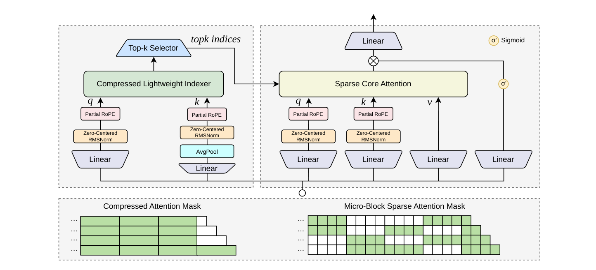

> 图 3.11　QSA 架构（Qwen3.8-Next 架构论文 Figure 3）。左侧是压缩的轻量索引器（Partial RoPE + Zero-Centered RMSNorm + AvgPool），右侧是 micro-block 粒度的稀疏注意力。

QSA 的两级压缩策略：

1. **压缩的轻量索引器**：先用 AvgPool 把序列聚合成 micro-block，再用极小的投影计算 block 级别的分数——索引开销随上下文增长被摊薄
2. **micro-block 粒度选择**：Top-k 选择器选出的不是 token 而是 micro-block，注意力核在块级访问下保持连续的 KV 读取

与 DSA 的两点关键差异：

- **粒度**：DSA 是 token 级，QSA 是 micro-block 级
- **索引器开销**：QSA 的索引器自带压缩，DSA 的索引器随长度线性变贵

另外 QSA **每层独立做序列压缩**，不跨层共享索引。这让它不依赖跨层注意力相似性——对于 GDN 层与全局注意力层交错的 hybrid 架构尤其重要（GDN 层没有“注意力相似性”可以共享）。

**代码实现**（压缩轻量索引器 + micro-block Top-k，对应论文公式 12—16）：

```python
import torch
import torch.nn as nn
import torch.nn.functional as F


class CompressedLightweightIndexer(nn.Module):
    """QSA 索引器：MQA 形式，key 先 AvgPool 压成 micro-block，再 RMSNorm + partial RoPE。"""

    def __init__(self, d_model, head_dim=128, n_head=4, r=32):
        super().__init__()
        self.n_head = n_head
        self.head_dim = head_dim
        self.r = r                                    # micro-block 大小（ratio）
        self.w_q = nn.Linear(d_model, n_head * head_dim, bias=False)
        self.w_k = nn.Linear(d_model, head_dim, bias=False)   # 单共享 key 头（MQA）
        self.norm_q = nn.RMSNorm(head_dim)
        self.norm_k = nn.RMSNorm(head_dim)

    def forward(self, x, rope_fn):
        B, L, d = x.shape
        r = self.r
        n_blk = L // r

        # 1) 独立轻量投影（公式 12）
        q_raw = self.w_q(x).view(B, L, self.n_head, self.head_dim)
        k = self.w_k(x)                                # (B, L, hd)

        # 2) key 走 AvgPool 压成 micro-block，再 RMSNorm（公式 13）
        #    注意顺序：先内容压缩、后位置编码，避免把不同旋转相位平均掉
        k_blk = k.view(B, n_blk, r, self.head_dim).mean(2)   # (B, n_blk, hd)
        k_blk = self.norm_k(k_blk)

        # 3) partial RoPE：只对 64/128 维施加旋转（公式 14）
        q = self.norm_q(q_raw)
        pos_q = torch.arange(L, device=x.device)
        pos_k = torch.arange(n_blk, device=x.device) * r      # 每块取起始位置 p_b = b·r
        q = rope_fn(q, pos_q)
        k_blk = rope_fn(k_blk, pos_k)

        # 4) block-causal ReLU 评分（公式 15）
        logits = F.relu(torch.einsum("blhc,bnc->blnh", q, k_blk))  # (B,L,n,h)
        scores = logits.sum(-1)                                   # (B, L, n_blk)
        # 只允许给"已完整观察"的块打分：p_b + r - 1 <= i
        causal = torch.arange(n_blk, device=x.device).view(1, 1, -1) * r + (r - 1)
        causal = causal <= torch.arange(L, device=x.device).view(1, -1, 1)
        scores = scores.masked_fill(~causal, float("-inf"))
        return scores


class QwenSparseAttention(nn.Module):
    """QSA：索引器选 micro-block，块内 token 全展开，最后不完整块恒保留。"""

    def __init__(self, d_model, n_head=8, head_dim=128, r=32, token_budget=2048):
        super().__init__()
        self.indexer = CompressedLightweightIndexer(d_model, head_dim // 2, n_head=4, r=r)
        self.r = r
        self.token_budget = token_budget
        self.n_head = n_head
        self.head_dim = head_dim
        self.w_q = nn.Linear(d_model, n_head * head_dim, bias=False)
        self.w_k = nn.Linear(d_model, n_head * head_dim, bias=False)
        self.w_v = nn.Linear(d_model, n_head * head_dim, bias=False)
        self.norm_q = nn.RMSNorm(head_dim)
        self.norm_k = nn.RMSNorm(head_dim)
        self.out_proj = nn.Linear(n_head * head_dim, d_model, bias=False)

    def forward(self, x, rope_fn):
        B, L, d = x.shape
        r = self.r
        # 1) 索引打分
        scores = self.indexer(x, rope_fn)                # (B, L, n_blk)
        n_blk = scores.size(-1)

        # 2) Top-K 选块（块预算 K_B = ⌈K/r⌉），再展开到 token 预算 K
        k_blk_budget = -(-self.token_budget // r)
        blk_idx = scores.topk(min(k_blk_budget, n_blk), dim=-1).indices   # (B,L,kb)
        # 展开成 token 索引（示意）
        tok = (blk_idx.unsqueeze(-1) * r + torch.arange(r, device=x.device))  # (B,L,kb,r)
        tok = tok.reshape(B, L, -1)[:, :, :self.token_budget]                 # 截到预算

        # 3) 最后一个不完整块恒保留（保证当前 chunk 信息不丢）
        last_blk = torch.full((B, L, 1), L - (L % r) - r, device=x.device,
                              dtype=tok.dtype)
        tok = torch.cat([last_blk.clamp(min=0), tok], dim=-1)

        # 4) 核心注意力（Q/K 同样走 RMSNorm + partial RoPE，保持稳定）
        q = self.norm_q(self.w_q(x).view(B, L, self.n_head, self.head_dim))
        k = self.norm_k(self.w_k(x).view(B, L, self.n_head, self.head_dim))
        v = self.w_v(x).view(B, L, self.n_head, self.head_dim)
        q = rope_fn(q, torch.arange(L, device=x.device))

        # 按 tok 收集 K/V（示意 gather）
        idx = tok.unsqueeze(-1).expand(-1, -1, -1, self.n_head * self.head_dim)
        k_sel = torch.gather(k.reshape(B, L, -1), 1, idx).view(
            B, L, -1, self.n_head, self.head_dim)
        v_sel = torch.gather(v.reshape(B, L, -1), 1, idx).view(
            B, L, -1, self.n_head, self.head_dim)

        attn = torch.einsum("blhc,blkhc->blhkc", q, k_sel) / self.head_dim ** 0.5
        o = torch.softmax(attn, dim=3)
        o = torch.einsum("blhkc,blkhc->blhc", o, v_sel)
        return self.out_proj(o.reshape(B, L, -1))
```

**为什么这样设计**：索引器开销是 O(L·n_blk) 而非 O(L²)，随上下文增长被摊薄；micro-block 粒度让 KV 读取保持连续、对 Tensor Core 友好；每层独立压缩则让它天然适配 hybrid 架构（GDN 层与注意力层交错时，不依赖跨层相似性）。

效果：1M token 下 QSA 的注意力 kernel 在 prefill 加速 **7.6×**、decode 加速 **4.9×**；在 90% Prefix Cache 命中率的线上场景实验中，1M 上下文下 prefill 吞吐达到 Qwen3.7-Plus 的 **8.6×**。

### 3.5.5 MiniMax Sparse Attention

MSA（MiniMax Sparse Attention，arXiv:2606.13392）是目前工程完成度最高的块级稀疏注意力之一——它同时开源了推理 kernel，并已用在生产模型 MiniMax-M3 上。

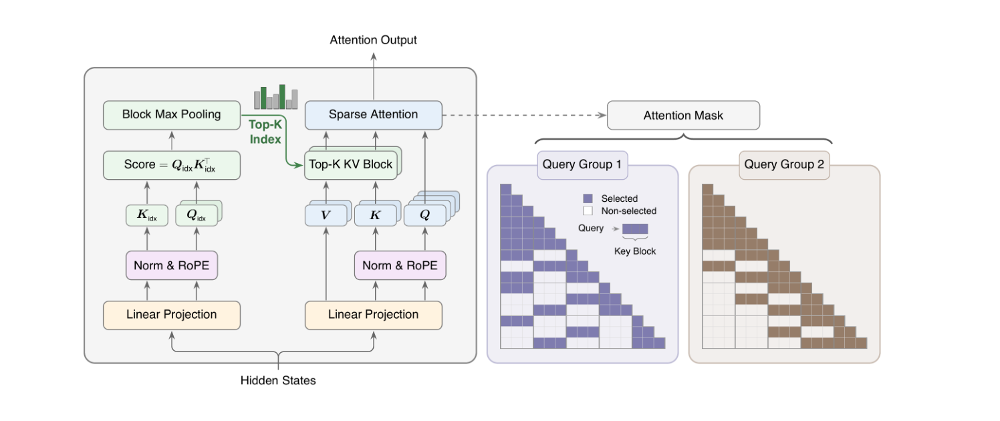

> 图 3.12　MSA 总览（MSA 论文 Figure 1）。左半是 Index Branch（打分 → Block Max Pooling → Top-K Index），右半是 Main Branch（Top-K KV Block 上的精确稀疏注意力）。右侧热力图展示了两个 GQA 组各自选中的不同块。

MSA 的核心设计是**两分支 + 每组独立选择**：

**Index Branch**：只增加两个投影矩阵。每个 GQA 组有一个 index query 头、一个共享的 index key 头；对可见的 key token 打分后做 **block max pooling** 得到块级分数，再做 Top-k 选择。包含 query 自身的局部块永远被强制保留，避免选择器把“眼前的上下文”丢掉。

**Main Branch**：在选中的块上做**精确的块稀疏 softmax 注意力**。每个 query 头有自己的 query 投影，但共享所在组的块集合。

关键参数：块大小 $B_k = 128$，每组保留 $k = 16$ 个块，即每个 query 固定只看 $2048$ 个 KV token。于是单 query 成本从 $O(N)$ 变成 $O(kB_k)$——**这是一个与上下文长度无关的常数**。

选择发生在 GQA 组内共享、组间独立：一个 KV 头服务多个 query 头，它们共享同一组块；不同组则可以关注不同的长程区域。

**训练方法**是 MSA 最有价值的部分。Top-k 不可导，语言建模损失无法训练索引投影。MSA 用 **KL 对齐损失**解决：让 Index Branch 的分布去匹配 Main Branch 在被选 token 上的（组平均的）注意力分布，充当 teacher。三个稳定化机制：

- **Gradient Detach**：对 Index Branch 的输入做 stop-gradient，把 KL 损失限制在索引投影内，避免梯度打回主干引起 loss 发散
- **Indexer Warmup**：前若干步两分支都跑全注意力，先让索引器学会路由
- **强制 Local Block**：保留一个名额给邻近上下文

**算子协同设计**：

- **exp-free Top-k**：softmax 保持序关系，所以对原始分数排序即可得到相同索引，内核跳过 max / exp / sum——128K 上下文、$k=16$ 时比 `torch.topk` 快 **5.1×**，比 TileLang 的 radix-select 还快 3.7×
- **KV-outer 稀疏注意力 + query gather**：遍历 KV 块比遍历 query 算术强度更高，把 $\lceil 128/G \rceil$ 个 query 位置打包进一个 $128 \times 128$ 的 score MMA

效果（109B 参数原生多模态模型，3T token 预算）：与 GQA 持平的同时，1M 上下文下每 token 注意力计算量减少 28.4×；配合协同设计的 kernel，在 H800 上取得 14.2× prefill / 7.6× decode 的墙钟加速。

```python
import torch
import torch.nn as nn


class MiniMaxSparseAttention(nn.Module):
    """MSA：Index Branch 打分选块，Main Branch 在选中块上做精确稀疏注意力。"""

    def __init__(self, d_model, n_heads, n_kv_groups, block_size=128, topk_blocks=16, dtype=None):
        super().__init__()
        self.h, self.g = n_heads, n_kv_groups
        self.dh = d_model // n_heads
        self.Bk, self.k = block_size, topk_blocks
        self.wq = nn.Linear(d_model, d_model, bias=False, dtype=dtype)
        self.wk = nn.Linear(d_model, n_kv_groups * self.dh, bias=False, dtype=dtype)
        self.wv = nn.Linear(d_model, n_kv_groups * self.dh, bias=False, dtype=dtype)
        # Index Branch 只多两个投影
        self.q_idx = nn.Linear(d_model, n_kv_groups * self.dh, bias=False, dtype=dtype)
        self.k_idx = nn.Linear(d_model, self.dh, bias=False, dtype=dtype)
        self.wo = nn.Linear(d_model, d_model, bias=False, dtype=dtype)

    def forward(self, x):
        B, L, _ = x.shape
        h, g, dh = self.h, self.g, self.dh
        q = self.wq(x).view(B, L, h, dh).transpose(1, 2)
        k = self.wk(x).view(B, L, g, dh).transpose(1, 2)
        v = self.wv(x).view(B, L, g, dh).transpose(1, 2)

        # ---- Index Branch：组级打分 -> block max pooling -> Top-k 块 ----
        qi = self.q_idx(x).view(B, L, g, dh).transpose(1, 2)      # (B,g,L,dh)
        ki = self.k_idx(x).view(B, L, dh)                          # (B,L,dh) 共享 index key
        scores = (qi @ ki.transpose(-2, -1)) / dh**0.5             # (B,g,L,L)

        n_blocks = (L + self.Bk - 1) // self.Bk
        pad = n_blocks * self.Bk - L
        s = torch.nn.functional.pad(scores, (0, pad), value=-1e30)
        s = s.view(B, g, n_blocks, self.Bk).amax(dim=-1)           # block max pooling

        # 强制保留 query 所在局部块
        blk = torch.arange(n_blocks, device=x.device)
        qblk = torch.arange(L, device=x.device) // self.Bk
        local = (blk.view(1, -1) == qblk.view(-1, 1))            # (L, n_blocks)
        s = s.masked_fill(local.view(1, 1, L, n_blocks), 1e30)
        _, sel = torch.topk(s, k=min(self.k, n_blocks), dim=-1)    # (B,g,L,k)

        # ---- Main Branch：gather 选中的块，做精确稀疏注意力 ----
        blk_idx = (sel.unsqueeze(-1) * self.Bk
                   + torch.arange(self.Bk, device=x.device).view(1, 1, 1, -1)).clamp(max=L)
        blk_idx = blk_idx.view(B, g, L, self.k * self.Bk)          # (B,g,L,k*Bk)
        sel_k = torch.gather(k, 2, blk_idx.unsqueeze(-1).expand(-1, -1, -1, dh))
        sel_v = torch.gather(v, 2, blk_idx.unsqueeze(-1).expand(-1, -1, -1, dh))

        qg = q.view(B, L, g, h // g, dh).permute(0, 2, 4, 1, 3).reshape(B, g, h // g, L, dh)
        att = torch.softmax((qg @ sel_k.transpose(-2, -1)) / dh**0.5, dim=-1)
        o = (att @ sel_v).view(B, g, h // g, L, dh).permute(0, 3, 1, 2, 4).reshape(B, L, h * dh)
        return self.wo(o)
```

MSA 的设计哲学是“**简单与可扩展**”——没有 NSA 那样的三分支，也没有 QSA 那样的层级压缩，就是干净的两分支 + 组级 Top-k，并且把选择粒度定在能吃到 Tensor Core 的块大小上。

### 3.5.6 LongCat Sparse Attention

LSA（LongCat Sparse Attention，arXiv:2608.01662，美团 LongCat-2.0 采用）以 DSA 为基线，关心的不是“选哪些”，而是“选完之后怎么办”。论文对 DSA 的实测画像给出两个瓶颈。其一是 Indexer Output Discontiguity：每个选中 token 独立 gather 一条 1152 字节的潜在 KV，只跨 3 条 cacheline，内存级并行度约 6%，净有效带宽只有峰值的约 4.5%，反向传播的 scatter_add 写冲突使访存进一步串行化。其二是 Indexer High Overhead：索引器延迟从 4K 上下文的 0.034 ms 涨到 1024K 的 0.930 ms（27 倍），而核心稀疏注意力恒定在 0.10 ms 左右——索引器在 1024K 时占单层解码延迟的 90%。


> 图 3.13　LSA 架构（LSA 论文 Figure 1）。左为 owner 层：Block Indexer 块级粗排 + Token Indexer 精排，预算对半分给连续的流式区域与动态选择的非连续区域；右为 reuse 层：直接复用 owner 层的 Top-K 索引。两层共享索引参数。

LSA 用三项互补机制分别对应两个瓶颈：SI 解决访存连续性，CLI 与 HI 解决索引开销。SI 与 CLI 参与训练，HI 是训练无关的即插即用模块。

表 3.7　LSA 三项索引机制对比

| 机制 | 针对瓶颈 | 做法 | 训练/推理 | 关键超参 |
|---|---|---|---|---|
| SI（流式感知索引） | 输出非连续 | 预算对半分给固定连续区与动态稀疏区 | 训练 + 推理 | $K_{\mathrm{sink}}=16$、$K_{\mathrm{swa}}=1024$ |
| CLI（跨层索引） | 索引重复计算 | owner 层选择、reuse 层复用，跨层蒸馏 | 训练 + 推理 | 组大小 $N=2$（MTP 为 3） |
| HI（层级索引） | 单次打分 $O(L)$ | 块级粗排候选页 + 页内精排 | 仅推理 | $P=128$、$B=8$、$M=1024$ |

**Streaming-Aware Indexing（SI）**。稀疏预算不再全部交给动态选择，而是划出固定的一半给“可预测的连续区域”——开头的注意力汇聚（sink）与最近的滑动窗口：

$$
\mathcal{S}_t = \underbrace{\{1, \dots, K_{\mathrm{sink}}\}}_{\text{sink}} \cup \underbrace{\{t - K_{\mathrm{swa}} + 1, \dots, t\}}_{\text{SWA}} \cup \underbrace{\mathrm{arg\,topK}\big(\{I_{t,s}\},\ K_{\mathrm{sparse}}\big)}_{\text{sparse}}
\tag{3.12}
$$

总预算 $K = K_{\mathrm{sink}} + K_{\mathrm{swa}} + K_{\mathrm{sparse}} = 2048$，其中 $K_{\mathrm{sink}} = 16$、$K_{\mathrm{swa}} = K_{\mathrm{sparse}} = 1024$。这个 50 : 50 的划分有实测依据：在全注意力模型上，流式区域（sink + 滑窗）平均捕获约 83% 的注意力质量，75% 以上的固定预算则开始损害长程检索。内核侧把核心注意力拆成稀疏与滑窗两个算子，分发到不同硬件流重叠执行，再以 online-softmax 合并；选中 KV 的跨步 chunk 重叠率从 65% 提升到 82%，单层 reload 延迟从 53.9 μs 降到 30.5 μs。

**Cross-Layer Indexing（CLI）**。相邻层的 Top-K 集合高度一致——实测成对重叠 57.4%，复用相邻层索引仍能覆盖目标层 93.2% 的注意力质量。CLI 把连续 $N$ 层编成一组：组内第一层（owner）执行索引器，其余层（reuse）直接沿用其选中的 token 集合，索引计算降到 $1/N$。朴素复用有质量损失，解决办法是让 owner 的索引器为整组服务——用跨层蒸馏让共享索引器去匹配组内每一层的注意力分布：

$$
\mathcal{L}_{\mathrm{CLI}} = \sum_{i=0}^{N-1} \mathcal{L}_I^{(l+i)}
\tag{3.13}
$$

其中 $l$ 为组首层，$\mathcal{L}_I^{(l+i)}$ 是共享索引器输出与第 $l+i$ 层注意力分布之间的蒸馏损失。没有这项蒸馏，$N = 2$ 时 128K 针检索准确率降到 70%；加上蒸馏后回到 96%，甚至优于无蒸馏的 $N = 4$（82%）。实验中主模型取 $N = 2$，$N = 4$ 在长上下文上有可测损失；MTP 的 3 个预测步共享一组索引（$N = 3$），draft 由主模型验证，不影响最终生成质量。

**Hierarchical Indexing（HI）**。HI 把单次打分拆成粗排与精排两步：先把序列切成大小 $P = 128$ 的页、每页再切成 $B = 8$ 的子块，用子块索引键均值 $\mathbf{k}^{\mathrm{mean}}_n$ 做块级显著性粗排，取 Top-$M$（$M = 1024$）个候选页；token 级精排只在候选页内进行：

$$
I^{\mathrm{page}}_{t,p} = \sum_{j=1}^{H^I} w^I_{t,j} \sum_{n \in \mathrm{page}_p} \mathrm{ReLU}\big(\mathbf{q}^I_{t,j} \cdot \mathbf{k}^{\mathrm{mean}}_n\big), \qquad \mathcal{P}_t = \mathrm{arg\,topK}\big(\{I^{\mathrm{page}}_{t,p}\},\ M\big)
\tag{3.14}
$$

两次 Top-K 的成本从 $O(L)$ 降为 $O(L/P + MP)$。HI 不参与训练，推理期直接启用：1024K 上下文的 prefill 索引选择加速 4.11 倍；128K 以下反而略慢，论文在 256K 以上才开启（约 200K 处出现收益拐点）。

**效果**。在 LongCat-Flash-Lite（69B-A3B）与 LongCat-Flash（560B-A27B）两个规模上，LSA 与全注意力在通用、推理、代码与长文本基准上全面持平（HELMET 59.02 对 MLA 的 58.50）；注意力层训练延迟加速 1.53—1.61 倍，prefill TTFT 加速 1.42—3.60 倍，decode TPOT 加速 1.25—1.40 倍。训练效率的提升直接转化成上下文预算：LongCat-2.0（1.6T-A48B）在有限算力下把原生上下文做到 100 万 token，开源的 LongCat-Flash-Lite-Sparse 同样以 LSA 支撑 1M 上下文。

**代码实现**（HI 两级选择 + SI 流式预算拼接 + CLI 组调度）：

```python
import torch
import torch.nn as nn
import torch.nn.functional as F


class LSAIndexer(nn.Module):
    """LSA 索引器：HI 块级粗排 -> 页内精排，SI 流式预算拼接。

    CLI 的组调度在模型外层完成：owner 层调用 forward，
    reuse 层直接沿用返回的索引；跨层蒸馏损失 L_CLI 叠加到主损失上。
    """

    def __init__(self, d_c, n_head=16,
                 k_sink=16, k_swa=1024, k_sparse=1024,
                 page=128, sub=8, top_m=1024):
        super().__init__()
        self.k_sink, self.k_swa, self.k_sparse = k_sink, k_swa, k_sparse
        self.page, self.sub, self.top_m = page, sub, top_m
        self.n_head = n_head

    def score(self, q, k):
        """DSA 式打分：I = Σ_h w_h · ReLU(q_h · k_h^T)。"""
        return F.relu(torch.einsum("blhc,bnc->blnh", q, k))       # (B,L,n,h)

    def forward(self, q, k_idx, k_sub, seq_len, use_hi=False):
        # q: (B,L,h,d_c)；k_idx: (B,n,d_c) token 级索引键；k_sub: (B,n_sub,d_c) 子块均值键
        B, L = q.shape[:2]
        n = k_idx.size(1)

        if use_hi:
            # HI 粗排：子块均值键 -> 页分 -> Top-M 页 -> 候选 token 集
            sub_s = self.score(q, k_sub).amax(-1)                  # (B,L,n_sub)
            per = self.page // self.sub                            # 每页子块数
            n_pages = (n + self.page - 1) // self.page
            page_s = F.pad(sub_s, (0, n_pages * per - sub_s.size(-1)), value=-1e30)
            page_s = page_s.view(B, L, n_pages, per).sum(-1)
            pages = page_s.topk(min(self.top_m, n_pages), -1).indices
            tok = (pages.unsqueeze(-1) * self.page
                   + torch.arange(self.page, device=q.device)).clamp(max=n - 1)
            cand = torch.zeros(B, L, n, dtype=torch.bool, device=q.device)
            cand.scatter_(-1, tok.flatten(-2), True)
        else:
            cand = torch.ones(B, L, n, dtype=torch.bool, device=q.device)

        # HI 精排 / 平铺打分：token 级索引
        tok_s = self.score(q, k_idx).amax(-1)                      # (B,L,n)
        tok_s = tok_s.masked_fill(~cand, float("-inf"))
        dyn = tok_s.topk(min(self.k_sparse, n), -1).indices        # 动态稀疏区

        # ---- SI：sink + 滑窗 + 动态稀疏，连续区占一半预算 ----
        t = torch.arange(seq_len, device=q.device).view(1, -1, 1)
        sink = torch.arange(self.k_sink, device=q.device).view(1, 1, -1)
        off = torch.arange(self.k_swa, device=q.device).view(1, 1, -1)
        swa = (t - self.k_swa + 1 + off).clamp(min=0)              # 最近 k_swa 个位置
        return torch.cat([sink.expand(B, L, -1), swa.expand(B, L, -1), dyn], dim=-1)


class CrossLayerGroup(nn.Module):
    """CLI：连续 n 层一组，owner 层执行索引，reuse 层共享 token 集合。"""

    def __init__(self, indexer, n=2):
        super().__init__()
        self.indexer = indexer
        self.n = n

    def forward(self, q, k_idx, k_sub, seq_len, use_hi=False):
        sel = self.indexer(q, k_idx, k_sub, seq_len, use_hi)       # owner 选择
        return [sel] * self.n                                      # 组内共享
```

LSA 与 CSA2 在 2026 年给出了同一个判断：索引与 KV 沿层维度摊销，是稀疏注意力继续降本的下一段路。两者的分工不同——CSA2 把复用做进架构与缓存格式（连 FP4 与回放重建一起算账），LSA 则把访存连续性当成一等公民，让选中的 token 在 HBM 里尽量连成片。稀疏注意力的“少算一部分”，至此同时包含了“少存几份”与“少跑几趟”。

## 3.6 Linear Attention

线性注意力不是“稀疏注意力”，而是**改变计算顺序**。


> 图 3.14　Softmax 注意力与线性注意力的计算方式对比（MiniMax-01 论文 Figure 5）。

Softmax 注意力必须先算出 $QK^T$（$N \times N$）再 softmax：

$$O = \mathrm{softmax}\!\left(\frac{QK^T}{\sqrt{d}}\right) V \quad \Rightarrow \quad O(N^2 d) \tag{3.15}$$

线性注意力利用矩阵乘法的结合律，换一个顺序，先算 $K^TV$（$d \times d$，很小）：

$$O = Q\left(\phi(K)^T V\right) \quad \Rightarrow \quad O(N d^2) \tag{3.16}$$

其中 $\phi$ 是核函数（如 $\phi(x) = \mathrm{elu}(x)+1$），替代 softmax 的指数。

复杂度从 $O(N^2 d)$ 变成 $O(Nd^2)$——当 $N \gg d$ 时是巨大的胜利。而且**推理时的状态是固定大小**（每个 head 维护一个 $d_k \times d_v$ 的矩阵），根本没有 token 级 KV Cache，prefill 是 $O(n)$、decode 每步 $O(1)$。

**线性注意力早期未能落地的原因。** 2020—2023 年的尝试（Katharopoulos et al., “Transformers are RNNs” 等）用简单核函数，质量代价是困惑度上升 10—15%，在真实语言建模上从未超越 softmax，也就从未进入生产模型。

**2025 年的转折点**：gated delta rule。核心洞察是——问题不在“线性”本身，而在“**怎么更新这个固定大小的状态**”。纯加性更新 $S_t = S_{t-1} + k_t v_t^T$ 会让状态无界增长，而且无法纠正已有错误关联；而 softmax 归一化的本质是“竞争”。**delta rule** 引入预测误差项，把状态更新变成“擦除旧关联 + 写入新关联”；再叠加一个**可学习的衰减门**控制遗忘，线性注意力才第一次在质量上接近 softmax。

### 3.6.1 演进过程：从核替换到门控 delta rule

线性注意力十年脉络，本质是“**状态怎么更新**”这一行代码被反复改写：

表 3.8　线性注意力的十年演进脉络

| 年份 | 代表工作 | 状态更新 | 关键改进 | 遗留问题 |
|---|---|---|---|---|
| 2020 | Linear Transformer（Katharopoulos et al.） | $S_t = S_{t-1} + k_t v_t^T$ | 核函数 $\phi(x)=\mathrm{elu}(x)+1$ 替代 softmax，首次 $O(N)$ | 质量差，困惑度 +10—15% |
| 2020 | Performer（Choromanski et al.） | 同上（FAVOR+ 随机特征） | 无偏近似 softmax，理论优雅 | 随机特征方差大，长上下文不稳 |
| 2023 | RetNet（Sun et al.） | $S_t = \gamma\, S_{t-1} + k_t v_t^T$ | 引入**多尺度衰减** $\gamma$，chunkwise 并行起步 | $\gamma$ 与输入无关，记忆寿命固定 |
| 2023 | Mamba（Gu & Dao） | 选择性 SSM：$x_t = A_t x_{t-1} + B_t u_t$ | 数据依赖的输入门，硬件高效扫描 | 与注意力殊途，理论不统一 |
| 2024 | Mamba2 / SSD（Dao & Gu） | 同上 | **状态空间对偶性**：证明 SSM ⊂ 线性注意力 | 仍是加性更新，无纠错能力 |
| 2024 | GLA（Yang et al.） | $S_t = \mathrm{diag}(\alpha_t) S_{t-1} + k_t v_t^T$ | **数据依赖的门控衰减** $\alpha_t$ | 加性更新仍会累积错误关联 |
| 2024 | DeltaNet（Yang et al.） | $S_t = (I-\beta_t k_t k_t^T) S_{t-1} + \beta_t k_t v_t^T$ | **delta rule**：擦除旧关联 + 写入残差误差 | 无遗忘门，长上下文衰减不足 |
| 2024 | Gated DeltaNet | 上式再乘 $\mathrm{Diag}(\alpha_t)$ | delta rule + 门控衰减，两者兼得 | 标量 $\alpha_t$，chunk 内对角块算不动 |
| 2025 | Kimi Linear / KDA | 逐通道 $\alpha_t \in (0,1)^{d_k}$ | 下界衰减（scaled sigmoid）→ 全部上 Tensor Core | 工程成熟，进入生产 |
| 2026 | Kimi K3 | 3×KDA + 1×Gated MLA | **hybrid 落地**，1M 上下文、2.5× 扩展效率 | — |

三条主线一目了然：

1. **衰减机制**：从无衰减（2020）→ 标量固定衰减（RetNet）→ 标量数据相关衰减（GLA/GDN）→ 逐通道数据相关衰减（KDA）——遗忘粒度越来越细
2. **更新规则**：从纯加性（Hebbian 式累积）→ delta rule（预测误差 + 定点擦写）——从“只记新东西”到“能改错”
3. **硬件适配**：从不实用（2020—2023）→ chunkwise 并行（RetNet/GLA）→ 对角块走 Tensor Core（KDA）——线性注意力的复兴本质是工程胜利

> 补充：MiniMax 的 lightning attention（MiniMax-01，2025）走的也是“数据依赖门控”路线，Qwen3-Next 的 GDN hybrid（3:1）与 Kimi K3 的 KDA hybrid（3:1）不约而同选择了同样的混合比例——这不是巧合，而是“线性层管长程、全局层管精确检索”这条分工在大量实验后收敛出的稳定解。

> 注：线性注意力属于“用递归状态换显存”的路子，与 FlashAttention 的“用 IO 优化换带宽”是两条正交的路线，最终被合并到 hybrid 架构里。

### 3.6.2 Gated Delta Net

Gated DeltaNet（arXiv:2412.06464，Yang et al., 2024）把 delta rule 与 Mamba2 的门控机制结合起来，是 2025 年线性注意力复兴的起点。


> 图 3.15　Gated DeltaNet 的（混合）架构与 block 设计（Gated DeltaNet 论文 Figure 1）。右侧是单个 Gated DeltaNet block：短卷积 → Q/K L2 归一化 → Gated Delta Rule → 输出门。

**Gated Delta Rule 的递推**：设每个 head 维护状态矩阵 $S_t \in \mathbb{R}^{d_k \times d_v}$，

$$\tilde{S}_{t-1} = \alpha_t S_{t-1} \qquad \text{（先衰减）} \tag{3.17}$$

$$e_t = v_t - \tilde{S}_{t-1}^\top k_t \qquad \text{（预测误差）} \tag{3.18}$$

$$S_t = \tilde{S}_{t-1} + \beta_t k_t e_t^\top \qquad \text{（delta 更新）} \tag{3.19}$$

$$y_t = S_t^\top q_t \qquad \text{（读出）} \tag{3.20}$$

等价地写成一式：

$$S_t = \alpha_t\left(I - \beta_t k_t k_t^\top\right) S_{t-1} + \beta_t k_t v_t^\top \tag{3.21}$$

两个门的作用是互补的：$\alpha_t \in (0,1)$ 是**数据相关的衰减**，控制已有状态的寿命；$\beta_t \in (0,1)$ 控制 delta 更新的写入强度。delta 项先估计“当前 $k_t$ 已经关联了什么值”，只写入残差误差——重复或相似的 key 会更新已有关联，而不是让外积无界累积。这种“定点擦除-写入”正是 GDN 与纯加性线性注意力的分水岭。

**并行计算推导（Chunkwise Parallel Form）**。递推式虽然优雅，但逐 token 串行在 GPU 上跑不动。GDN 的工程价值在于把它改写成**块内并行、块间串行**的形式——这才是它能训得动的原因。把序列切成长度 $C$ 的 chunk，记 $S[t]$ 为进入第 $t$ 个 chunk 的状态。

**第一步：把递推展开成“累计转移 × 初始状态 + 局部贡献”**。对 chunk 内第 $r$ 个位置，部分展开：

$$S_r[t] = S[t] \prod_{i=1}^{r}\Big(\alpha_i[t]\,\big(I - \beta_i k_i k_i^\top\big)\Big) + \sum_{i=1}^{r} \beta_i v_i k_i^\top \prod_{j=i+1}^{r}\Big(\alpha_j\,\big(I - \beta_j k_j k_j^\top\big)\Big) \tag{3.22}$$

记 $F_r[t]$ 为累积转移（含衰减与 Householder），$G_r[t]$ 为局部写入项，则 $S_r[t] = F_r[t] + G_r[t]$，输出为 $o_r = S_r[t]^\top q_r$。

**第二步：Householder 连乘用 WY 表示化简**。直接算 $\prod (I-\beta_i k_i k_i^\top)$ 是 $O(C^2)$ 次矩阵乘，太贵。经典 WY 表示（Bischof & Loan, 1985）把它化为低秩形式：

$$P_r[t] = I - \sum_{i=1}^{r} w_i[t]\, k_i[t]^\top, \qquad w_r[t] = \beta_r\Big(k_r - \sum_{i<r} w_i (k_i^\top k_r)\Big) \tag{3.23}$$

这样 $F_r[t] = \gamma_r[t]\, P_r[t]$（$\gamma_r$ 为累计衰减），$G_r[t] = \sum_{i=1}^{r} \frac{\gamma_r}{\gamma_i}\, \tilde u_i k_i^\top$，其中 $\tilde u_r$ 同理用 WY 递推算出。

**第三步：写成纯矩阵乘的形式**。定义衰减掩码 $\Gamma \in \mathbb{R}^{C\times C}$，$(\Gamma)_{ij} = \gamma_i / \gamma_j$（$i \ge j$，否则 0），并把向量“衰减到 chunk 首”或“衰减到 chunk 尾”：

$$\overleftarrow{q}_r = \gamma_r\, q_r \quad\text{（衰减到 chunk 起点）}, \qquad \overrightarrow{k}_r = \frac{\gamma_C}{\gamma_r}\, k_r \quad\text{（衰减到 chunk 终点）} \tag{3.24}$$

则 chunk 内输出为：

$$O[t] = \underbrace{\overleftarrow{Q}[t]\, S[t]^\top}_{\text{跨块贡献}} + \underbrace{\big(Q[t]K[t]^\top \odot \Gamma[t]\big) V[t]}_{\text{块内贡献}} \tag{3.25}$$

**全部都是矩阵乘**——可以吃满 Tensor Core。跨块部分只依赖上一 chunk 的状态（串行但便宜），块内部分完全并行。这就是 GDN 论文强调的 “hardware-efficient”：复杂度仍是 $O(Nd^2)$，但常数项小到可以实际训练。

> 推广：当 $\gamma_t$ 与输入无关时，上式退化为 RetNet 的 retention；当 $\beta_t=0$ 时退化为带衰减的纯线性注意力（GLA）。GDN 是这族“递归状态 + 门控”算法里最通用的一个特例。

**block 组成**：短因果卷积（注入局部上下文）→ Q/K 做 L2 归一化 → 门控 delta 递推 → sigmoid 输出门 + 零中心 RMSNorm。

**为什么必须 hybrid**：纯线性注意力的召回能力（大海捞针式精确检索）不如全注意力。主流做法是 **3:1 混合**——3 层 Gated DeltaNet + 1 层全局注意力。Qwen3-Next 首次把这个组合用在生产模型上，MiniMax-01 的 lightning attention、Kimi 的 KDA 都属于同一族。

```python
import torch
import torch.nn as nn
import torch.nn.functional as F


class GatedDeltaNet(nn.Module):
    """Gated DeltaNet 递推的最小实现（逐步递推版，便于理解；实际训练用 chunkwise 形式）。"""

    def __init__(self, d_model, n_heads, d_state=64, dtype=None):
        super().__init__()
        self.h = n_heads
        self.dh = d_model // n_heads
        self.dv = d_model // n_heads
        self.wq = nn.Linear(d_model, n_heads * self.dh, bias=False, dtype=dtype)
        self.wk = nn.Linear(d_model, n_heads * self.dh, bias=False, dtype=dtype)
        self.wv = nn.Linear(d_model, n_heads * self.dv, bias=False, dtype=dtype)
        self.w_beta = nn.Linear(d_model, n_heads, bias=False, dtype=dtype)   # 写入门
        self.w_alpha = nn.Linear(d_model, n_heads, bias=False, dtype=dtype) # 衰减门
        self.w_gate = nn.Linear(d_model, n_heads * self.dv, bias=False, dtype=dtype)
        self.wo = nn.Linear(n_heads * self.dv, d_model, bias=False, dtype=dtype)

    def forward(self, x):
        B, L, _ = x.shape
        h, dh, dv = self.h, self.dh, self.dv
        q = F.normalize(self.wq(x).view(B, L, h, dh), dim=-1)
        k = F.normalize(self.wk(x).view(B, L, h, dh), dim=-1)
        v = self.wv(x).view(B, L, h, dv)
        beta = torch.sigmoid(self.w_beta(x)).unsqueeze(-1)      # (B,L,h,1)
        alpha = torch.sigmoid(self.w_alpha(x)).unsqueeze(-1)    # (B,L,h,1)
        gate = torch.sigmoid(self.w_gate(x).view(B, L, h, dv))

        S = torch.zeros(B, h, dh, dv, device=x.device, dtype=x.dtype)  # 固定大小状态
        outs = []
        for t in range(L):
            S = alpha[:, t] * S                                    # (1) 衰减
            kt = k[:, t].unsqueeze(-1)                            # (B,h,dh,1)
            vt = v[:, t].unsqueeze(-1)                            # (B,h,dv,1)
            e = vt - S.transpose(-1, -2) @ kt                      # (2) 预测误差 (B,h,dv,1)
            S = S + beta[:, t] * kt @ e.transpose(-1, -2)         # (3) delta 更新
            y = S.transpose(-1, -2) @ q[:, t].unsqueeze(-1)       # (4) 读出 (B,h,dv,1)
            outs.append(y.squeeze(-1))
        o = torch.stack(outs, dim=1) * gate
        return self.wo(o.reshape(B, L, h * dv))
```

上面是逐步递推版，便于理解递推逻辑；实际训练用 chunkwise 并行版，把“块内并行 + 块间串行”拆开后全部计算都是矩阵乘：

```python
import torch


def gdn_chunkwise(q, k, v, alpha, beta, chunk_size=64):
    """Gated DeltaNet 的 chunkwise 并行实现。

    块内：解一次下三角系统得到"写入向量" Ē，把 delta rule 的误差修正
          吸收进伪值，随后用衰减掩码做纯矩阵乘；
    块间：串行传递固定大小的状态 S ∈ R^{d_k×d_v}。
    所有重计算都是矩阵乘，可吃满 Tensor Core。

    参数
    ----
    q, k  : (B,H,L,d_k)  已做 L2 归一化的 query / key
    v     : (B,H,L,d_v)  value
    alpha : (B,H,L,1)    衰减门 ∈ (0,1)
    beta  : (B,H,L,1)    写入门 ∈ (0,1)
    """
    B, H, L, d_k = q.shape
    d_v = v.shape[-1]
    C = chunk_size
    o = torch.zeros(B, H, L, d_v, device=q.device, dtype=q.dtype)
    S = torch.zeros(B, H, d_k, d_v, device=q.device, dtype=q.dtype)

    for s in range(0, L, C):
        e = min(s + C, L)
        c = e - s
        qc, kc, vc = q[:, :, s:e], k[:, :, s:e], v[:, :, s:e]
        ac, bc = alpha[:, :, s:e], beta[:, :, s:e]            # (B,H,c,1)

        # 1) 块内累计衰减 γ_r = ∏_{i≤r} α_i
        gamma = torch.cumprod(ac, dim=2)                       # (B,H,c,1)

        # 2) 解下三角系统求写入向量 Ē
        #    (I + diag(β)·A) Ē = diag(β)·(V̄ − K·S)，A = tril(KKᵀ, −1)
        #    V̄ = V/γ 是吸收衰减后的等效写入值；Ē 同时编码 delta rule 的误差修正
        KKt = kc @ kc.transpose(-1, -2)                        # (B,H,c,c)
        A = torch.tril(KKt, diagonal=-1)                       # 严格下三角
        M = torch.eye(c, device=q.device, dtype=q.dtype) + A * bc
        v_bar = vc / gamma.clamp_min(1e-6)                     # (B,H,c,d_v)
        rhs = bc * (v_bar - kc @ S)                            # diag(β)·(V̄ − K·S)
        E_bar = torch.linalg.solve_triangular(M, rhs, upper=False)

        # 3) 块内并行输出：O = diag(γ)·[Q·S + (QKᵀ ⊙ Causal)·Ē]
        causal = torch.tril(torch.ones(c, c, device=q.device, dtype=q.dtype))
        A_intra = (qc @ kc.transpose(-1, -2)) * causal         # (B,H,c,c)
        o[:, :, s:e] = gamma * (qc @ S + A_intra @ E_bar)

        # 4) 块尾状态：S ← γ_C·(S + Kᵀ Ē)
        gamma_last = gamma[:, :, -1:, :]                       # (B,H,1,1)
        S = gamma_last * (S + kc.transpose(-1, -2) @ E_bar)

    return o
```

与逐步递推版的对应关系：递推版第 (1)(2)(3) 步的“衰减 → 误差 → 写入”被压缩成一次三角求解（第 2 步），第 (4) 步的逐 token 读出变成第 3 步的批量矩阵乘。串行部分只剩“块间状态传递”（第 4 步），代价是常数级的。

Gated DeltaNet 让线性注意力第一次同时具备**固定大小状态**（显存恒定）与**接近 softmax 的质量**。它没有取代注意力，而是成为 hybrid 架构里负责“压缩记忆”的那一半。

### 3.6.3 Kimi Delta Attention

KDA（Kimi Delta Attention）是 Kimi K3 在 Gated DeltaNet 基础上的一次针对性升级，核心是解决 delta rule 在 GPU 上跑不动的工程问题。

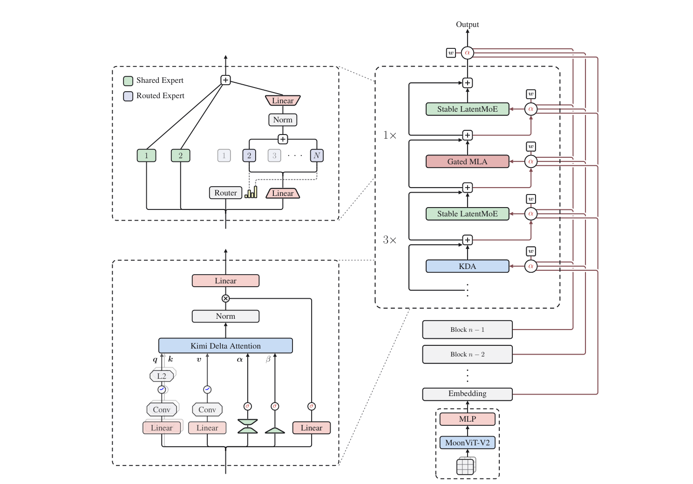

> 图 3.16　Kimi K3 架构（Kimi K3 技术报告 Figure 2）。左下角是 KDA 的内部结构（q/k 走 L2 + Conv，α/β 走独立线性），右侧是 3×KDA + 1×Gated MLA 的混合堆叠，红色细线是 Block Attention Residual。

KDA 的递推把 delta rule 与**逐通道的遗忘门**结合：

$$S_t = \left(I - \beta_t k_t k_t^\top\right) \mathrm{Diag}(\alpha_t) S_{t-1} + \beta_t k_t v_t^\top, \qquad \tilde{o}_t = S_t^\top q_t \tag{3.26}$$

与 GDN 的 $\alpha_t$ 是**每个 head 一个标量**不同，KDA 的 $\alpha_t$ 是**逐通道（channel-wise）**的——不同特征维度可以有各自的记忆寿命。

**下界衰减（Lower-bounded decay）** 是 KDA 最关键的工程创新。chunkwise 计算时，chunk 内需要除以累计衰减的倒数 $1/\Gamma$，而 $\Gamma$ 是 $(0,1)$ 上保留因子的连乘，倒数会无界增长、在 BF16 下溢出。Kimi Linear 用 negative-Softplus 映射并对角块用显式 position-pair 计算——这很慢。

Kimi K3 换了一个更聪明的参数化，用 **scaled sigmoid** 给 log-decay 一个下限：

$$g_t^h = g_{\min} \cdot \mathrm{Sigmoid}\left(e^{A_h} z_t^h\right), \qquad g_{\min} = -5 \tag{3.27}$$

于是每个保留因子都满足 $\alpha_t > e^{-5} \approx 6.7 \times 10^{-3}$，16-token 块的累计 log-decay 落在 $(-80, 0)$，对应的倒数缩放因子小于 $e^{80}$，**始终在 BF16 的动态范围内**。结果是对角块也能用 Tensor Core 的稠密矩阵乘法，彻底消除了 position-pair 这条慢路径。

KDA 还把输出门从低秩参数化改成了**全秩**投影：

$$y_t = W_o\left[\mathrm{Sigmoid}(W_g x_t) \odot \mathrm{RMSNorm}(\tilde{o}_t)\right] \tag{3.28}$$

input-dependent 的全秩门让每个 token 能精细调控从循环状态读出的通道，而不是所有 token 共享一个低秩方向。

**并行计算推导（Chunkwise Form + Context Parallelism）**。KDA 在 GDN 的 chunkwise 思路上更进一步，彻底对齐 Tensor Core。记进入 chunk 的状态为 $S[t]$，$\gamma_{i\to j}[t] = \prod_{r=i}^{j}\alpha_r[t]$（逐通道累计衰减）。

**Chunkwise 并行形式**：KDA 的 UT 变换产出 $U[t], W[t]$，定义伪值项 $\tilde V[t] = U[t] - W[t] S[t]$（把“状态修正项”吸收进一个伪值矩阵），则 chunk 内所有输出一次性并行算出：

$$A[t] = \mathrm{Tril}\Big[\big(Q[t]\odot \Gamma_{1\to C}[t]\big)\big(K[t] / \Gamma_{1\to C}[t]\big)^\top\Big], \qquad O[t] = \underbrace{\big(\Gamma_{1\to C}[t]\odot Q[t]\big) S[t]}_{\text{跨块贡献}} + \underbrace{A[t]\,\tilde V[t]}_{\text{块内贡献}} \tag{3.29}$$

其中 $\mathrm{Tril}(\cdot)$ 保留对角线（因为每个输出读的是**当前 token 更新后**的状态），$\Gamma_{1\to C}[t] \in \mathbb{R}^{C\times d_k}$ 把累计衰减逐行堆叠。关键在于 $A[t]$ 与两处贡献**全部是矩阵乘**——配合下界衰减（对角块不再需要 position-pair 慢路径），整条计算路径都能走 Tensor Core。

**FlashKDA 内核**：chunk 内并行、chunk 间串行的两阶段若朴素交替，SM 会在串行传播时空闲。Kimi 用 CUTLASS 写了 **FlashKDA**，把工作拆成 token-parallel 阶段与 head-parallel 递推，各自独立调度，让 chunk 内计算与跨 chunk 状态传播重叠，大幅超越 Triton 参考实现。

**Context Parallelism（跨设备并行）**。这是 KDA 与 vanilla 线性注意力最不同的地方。softmax 注意力做 context parallel 要交换随序列长度增长的 KV 块；线性注意力只携带固定大小的状态 $S \in \mathbb{R}^{d_k\times d_v}$，通信量是常数。但 KDA 不能像 vanilla 线性注意力那样“各 rank 算从零开始的局部状态再求和”——因为 delta rule 的更新是 $S_t = M_t S_{t-1} + \beta_t k_t v_t^\top$，其中 $M_t = (I-\beta_t k_t k_t^\top)\mathrm{Diag}(\alpha_t)$ 是 **token 相关的矩阵**，它会作用在传入状态上。因此需要**累积转移矩阵**精确还原：

$$M_{t\leftarrow 1}[i+1] := \prod_{r\leftarrow 1}^{t} M_r, \qquad S_t[i+1] = \tilde S_t[i+1] + M_{t\leftarrow 1}[i+1]\, S_T[i] \tag{3.30}$$

其中 $\tilde S_t[i+1]$ 是“从 $S=0$ 出发”的本地状态，$S_T[i]$ 是上一个 rank 传出的末状态。展开后：

$$S_t[i+1] = \tilde S_t[i+1] + M_{t\leftarrow 1}[i+1] \sum_{j=1}^{i}\Big(\prod_{l\leftarrow j+1}^{i} M_{l\leftarrow 1}[l]^\top\Big)\, \tilde S_T[j] \tag{3.31}$$

含义是：每个 rank 的本地段效果与传入状态无关，可以独立算，之后用累积转移矩阵精确合成。这让 KDA 在多卡上仍能保持线性注意力的“常数通信量”优势，同时不牺牲 delta rule 的表达力。

**在 Kimi K3 中的位置**：KDA 不是替代全局注意力，而是与 Gated MLA 按 **3:1** 混合——KDA 负责高效的长上下文 token 混合，Gated MLA 负责无约束的全局内容交互（Gated MLA 用了 NoPE，位置感知完全交给 KDA，从而为百万上下文外推免除了重调 RoPE 频率的麻烦）。

上面的推导给出 chunkwise 并行形式的骨架；与 GDN 不同，KDA 的衰减门是逐通道的，累计衰减 $\Gamma$ 因此是一个逐通道矩阵，不能像 GDN 那样用一个标量掩码概括。实现上把衰减掩码“吸收”进 $Q$、$K$ 的缩放里——$\Gamma \odot Q$ 与 $K / \Gamma$ 的点积天然携带 $\gamma_i / \gamma_j$ 衰减比：

```python
import torch


def kda_chunkwise(q, k, v, z, beta, w_log_a, chunk_size=64, g_min=-5.0):
    """Kimi Delta Attention 的 chunkwise 并行实现。

    与 GDN 版的三点差异：
    1. 衰减门是逐通道的（channel-wise），不同特征维度有各自的记忆寿命；
    2. log-decay 用 scaled sigmoid 给出下界 g_min = −5，保证 BF16 下倒数不溢出；
    3. 用"缩放 Q/K"（Γ⊙Q 与 K/Γ）代替显式衰减掩码，把累计衰减吸进点积。

    参数
    ----
    q, k    : (B,H,L,d_k)  已 L2 归一化
    v       : (B,H,L,d_v)
    z       : (B,H,L,d_k)  衰减 logits（scaled sigmoid 的输入）
    beta    : (B,H,L,1)    写入门
    w_log_a : (H,d_k)      逐 head、逐通道的温度参数 A_h
    """
    B, H, L, d_k = q.shape
    d_v = v.shape[-1]
    C = chunk_size
    o = torch.zeros(B, H, L, d_v, device=q.device, dtype=q.dtype)
    S = torch.zeros(B, H, d_k, d_v, device=q.device, dtype=q.dtype)

    for s in range(0, L, C):
        e = min(s + C, L)
        c = e - s
        qc, kc, vc = q[:, :, s:e], k[:, :, s:e], v[:, :, s:e]
        bc = beta[:, :, s:e]                                # (B,H,c,1)
        zc = z[:, :, s:e]                                   # (B,H,c,d_k)

        # 下界衰减：g = g_min·σ(A⊙z) ∈ (g_min, 0)，α = exp(g) ∈ (e^{g_min}, 1]
        g = g_min * torch.sigmoid(w_log_a.view(1, H, 1, d_k) * zc)
        alpha = torch.exp(g)                                 # (B,H,c,d_k)

        # 逐通道累计衰减 γ_r = ∏_{i≤r} α_i
        gamma = torch.cumprod(alpha, dim=2)                  # (B,H,c,d_k)

        # 把衰减掩码吸进点积：q̃ = Γ⊙Q，k̃ = K/Γ，有效 key = Γ⊙K
        q_sc = qc * gamma                                    # (B,H,c,d_k)
        k_sc = kc / gamma.clamp_min(1e-6)                    # (B,H,c,d_k)
        k_eff = kc * gamma                                   # (B,H,c,d_k) Γ⊙K

        # 解下三角系统求写入向量 Ē（编码 delta rule 的误差修正）
        # 误差方程里的内积是 ⟨Γ⊙k_r, k_i/Γ⟩，故 Gram 矩阵 = (Γ⊙K)(K/Γ)ᵀ
        A_mat = torch.tril(k_eff @ k_sc.transpose(-1, -2), diagonal=-1)
        M = torch.eye(c, device=q.device, dtype=q.dtype) + A_mat * bc
        rhs = bc * (vc - k_eff @ S)                          # diag(β)·(V − (Γ⊙K)·S)
        E_bar = torch.linalg.solve_triangular(M, rhs, upper=False)

        # 块内并行输出：O = (Γ⊙Q)·S + Tril[(Γ⊙Q)(K/Γ)ᵀ]·Ē
        A_intra = torch.tril(q_sc @ k_sc.transpose(-1, -2))  # 含对角的因果下三角
        o[:, :, s:e] = q_sc @ S + A_intra @ E_bar

        # 块尾状态：S ← Γ_C·S + [(Γ_C/Γ)⊙K]ᵀ Ē
        gamma_last = gamma[:, :, -1, :]                       # (B,H,d_k)
        S = (gamma_last.unsqueeze(-1) * S
             + (k_sc * gamma_last.unsqueeze(2)).transpose(-1, -2) @ E_bar)

    return o
```

与 GDN 版的结构完全对齐：第 2 步的三角求解替代逐步递推，第 3 步把输出变成纯矩阵乘，第 4 步串行传状态。差别全在“衰减怎么进点积”——GDN 的标量衰减用显式掩码 $\Gamma_{ij} = \gamma_i/\gamma_j$，KDA 的逐通道衰减则拆成 $\Gamma \odot Q$ 与 $K / \Gamma$ 两路缩放，让 Tensor Core 不必显式构造 $C \times C$ 掩码。FlashKDA 内核进一步把这两个阶段重叠调度，消除串行传播时的 SM 空闲。

从 Gated DeltaNet 到 KDA，线性注意力这十年的主线是“把 delta rule 搬上 Tensor Core”。数学没变多少，但下界衰减这一个参数化技巧，就把线性注意力从“能跑但慢”变成了“能训能推”。

## 3.7 Gated Attention

前面各节的改进大多落在注意力的计算路径上：共享 KV、低秩压缩、稀疏化、线性化。Gated Attention 换了一个切入角——在 softmax 注意力的输出上加一道门。改动只有十来行代码，却被 Qwen 团队在 3.5T token 的系统消融中验证为显著有效，获 NeurIPS 2025 最佳论文。


> 图 3.17　Gated Attention 的门控位置、性能对比与训练曲线（Qiu et al., 2025, Figure 1）。左图是 G1—G5 五个候选门控位置，G1（SDPA 输出后）效果最好；中图是 15B MoE 模型的 PPL 与 MMLU 对比；右图是 1.7B dense 模型的训练损失——门控不仅降低最终损失，还消除了 loss spike。

**机制**。在每个注意力头的 SDPA 输出 $H$ 上，乘一个由当前 token 隐藏状态产生的 sigmoid 门：

$$H' = H \odot \sigma(X W_\theta), \qquad O = H' W_O \tag{3.32}$$

其中 $X$ 是 pre-norm 后的隐藏状态，$W_\theta \in \mathbb{R}^{d_{model} \times d_k}$ 是每个头独立的门控投影，$\sigma$ 是 sigmoid。门是逐元素、逐头独立、乘性的。论文在位置（5 种）、粒度（elementwise / headwise）、参数共享（head-specific / head-shared）、激活函数（sigmoid / SiLU）、运算方式（乘性 / 加性）这几个维度上共训练了 30 余种变体，逐一消融后锁定了上述组合。

**五个门控位置**。论文对比了 G1（SDPA 输出后）、G2（Value 投影后）、G3（Key 投影后）、G4（Query 投影后）、G5（最终输出层后）五个插入点。G1 显著领先：15B MoE 上 PPL 从 6.026 降到 5.761，MMLU 从 58.79 升到 60.82。G2 也能消除隐状态离群值，但不消除 attention sink；G3、G4 保持底层映射的线性，收益几乎为零。这说明门必须插在 $W_V W_O$ 这条低秩线性映射的中间，才能引入有效的非线性。

**为什么门控有效**。论文归结为两个机制：

1. **非线性**：$W_V W_O$ 是低秩线性映射，表达力受秩约束。在两者之间插一个 sigmoid 门，等价于在低秩映射中间引入一次非线性变换，打破了秩瓶颈。
2. **query 依赖的稀疏门控**：门分数 $\sigma(X W_\theta)$ 随 query 变化，天然呈稀疏分布——多数位置的门接近 0，只有少数相关位置被放行。这直接抑制了 attention sink：baseline 模型首 token 的注意力占比高达 46.7%，加门控后降到 4.8%（单层峰值从 83% 降到 4%），隐状态最大激活值从 1053 降到 94。

attention sink 的消除带来额外收益：长上下文外推能力显著提升——YaRN 扩展到 128k 时，64k 长度的 RULER 得分从 37.51 提到 66.60，128k 从 31.65 提到 58.82。训练稳定性也受益：baseline 在学习率 8e-3 时发散，门控模型正常训练且 PPL 更低；门控本身的开销不到 2% wall-time。

**与前文的呼应**。Gated Attention 把“门控”这条线索从 FFN（SwiGLU）和线性注意力（$\alpha_t/\beta_t$ 门）延伸到了 softmax 注意力内部。NSA 的三分支门控输出、Switch Heads 的 sigmoid 门控、Forgetting Transformer 的遗忘门都属于同一家族，但此前的论文各自把收益归因到稀疏选择或路由上，没有单独量化门控的贡献——Gated Attention 的价值恰恰是把“门”从其他机制里剥离出来单独验证。该技术已用于 Qwen3-Next：它把 Gated Attention（3.7 节）与 Gated DeltaNet（3.6.2 节）交替堆叠，前者负责全局内容交互，后者负责长上下文压缩记忆。

```python
import torch
import torch.nn as nn
import torch.nn.functional as F


class GatedAttention(nn.Module):
    """Gated Attention：SDPA 输出后乘一个 head-specific 的 sigmoid 门。"""

    def __init__(self, d_model, n_heads, head_dim=None):
        super().__init__()
        self.h = n_heads
        self.dh = head_dim or d_model // n_heads
        self.w_q = nn.Linear(d_model, n_heads * self.dh, bias=False)
        self.w_k = nn.Linear(d_model, n_heads * self.dh, bias=False)
        self.w_v = nn.Linear(d_model, n_heads * self.dh, bias=False)
        self.w_gate = nn.Linear(d_model, n_heads * self.dh, bias=False)  # 门控投影
        self.w_o = nn.Linear(n_heads * self.dh, d_model, bias=False)

    def forward(self, x, mask=None):
        B, L, _ = x.shape
        h, dh = self.h, self.dh
        q = self.w_q(x).view(B, L, h, dh).transpose(1, 2)   # (B,h,L,dh)
        k = self.w_k(x).view(B, L, h, dh).transpose(1, 2)
        v = self.w_v(x).view(B, L, h, dh).transpose(1, 2)

        attn = F.scaled_dot_product_attention(q, k, v, attn_mask=mask)

        # G1 门控：head-specific、elementwise、sigmoid、乘性
        gate = torch.sigmoid(
            self.w_gate(x).view(B, L, h, dh).transpose(1, 2)  # (B,h,L,dh)
        )
        attn = attn * gate                                     # Hadamard 乘

        out = attn.transpose(1, 2).reshape(B, L, h * dh)
        return self.w_o(out)
```

Gated Attention 的实验方法值得记一笔：在固定算力预算下逐维度消融、把门控从其他机制里隔离出来单独度量，这种“控制变量”的做法在架构研究里并不多见。它的结论也朴素——不需要新算子或新架构，只加一个逐元素乘法，PPL、长上下文、训练稳定性就同时获益。

# 4. 归一化的改进(Normalization)

残差连接（Add）与归一化（Norm）通常成对出现。残差连接的优点是让梯度在层与层之间可以直接回传，从而避免梯度消失，同时使网络能够更有效地学习“特征增量”，而非从头重构表示。但它也有一个缺点：残差项每经过一层就累加一次，层数一多就容易引起数值膨胀。这一缺点恰好是归一化的作用所在。归一化的核心作用是防止数值爆炸、稳定前向传播：无论 Add 之后的数值有多大，归一化都会统一地把数值除以方差（或均方根），将特征向量的尺度拉回到一个稳定的范围内（通常均值接近 0，方差接近 1），从而保证传给下一层的数据始终是温和且可控的。

2017 年的原始 Transformer 采用的是 Post-Norm 架构，即先做残差、再做归一化；而现代主流则是 Pre-Norm 架构，即先做归一化、再做残差。这一看似简单的调整，使得残差连接能够更好地发挥作用。

两种范式的公式对比：

**Post-Norm**（原始 Transformer）：

$$x_{l+1} = \text{LN}\big(x_l + \text{Sublayer}(x_l)\big) \tag{4.1}$$

**Pre-Norm**（现代主流，GPT-2 之后被广泛采用）：

$$x_{l+1} = x_l + \text{Sublayer}\big(\text{LN}(x_l)\big) \tag{4.2}$$


> 图 4.1　(a) Post-LN 与 (b) Pre-LN 的层结构对比（Xiong et al., 2020, Figure 1）。注意归一化在残差加法的哪一侧。

Pre-Norm 的好处是主干梯度有一条“无障碍通道”（恒等路径），深层网络训练更稳、可以不用 warm-up；代价是同等参数量下效果可能略逊 Post-Norm（表示能力被主干稀释），所以现代模型常配合更好的学习率调度与更深的堆叠。

RMSNorm（Root Mean Square Normalization，均方根归一化）是深度学习领域中，特别是Transformer等现代架构中广泛使用的一种归一化技术。它作为传统层归一化（LayerNorm）的简化且高效的替代方案，旨在稳定训练过程、加速收敛，同时减少计算开销。

先粗略看一下 Batch Norm 和 Layer Norm 的区别
BatchNorm是对整个 batch 样本内的每个特征做归一化，这消除了不同特征之间的大小关系，但是保留了不同样本间的大小关系。BatchNorm 适用于 CV 领域，这时输入尺寸为 b × c × h × w (批量大小x通道x长x宽)，图像的每个通道 c 看作一个特征，BN 可以把各通道特征图的数量级调整到差不多，同时保持不同图片相同通道特征图间的相对大小关系

LayerNorm是对每个样本的所有特征做归一化，这消除了不同样本间的大小关系，但是保留了一个样本内不同特征之间的大小关系。LayerNorm 适用于 NLP 领域，这时输入尺寸为 b × l × d (批量大小x序列长度x嵌入维度)，
LayerNorm 的目的是把输出的特征数据重新拉回到“均值为 0，方差为 1”的标准分布，然后再乘以一个可学习的缩放参数 $\gamma$ 和平移参数 $\beta$。这个标准公式是这样的：

$$y = \frac{x - \mu}{\sigma} \odot \gamma + \beta \tag{4.3}$$
其中最耗时的是计算这个均值 $μ$，计算它需要遍历一遍当前的所有特征，把它们加起来求一个平均数。对于动辄几千维、上万维的超长向量来说，这一步计算既费算力又拖慢硬件的显存读取速度。
  
2019年，Biao Zhang 和 Rico Sennrich做了一系列消融实验，LayerNorm的完整操作利用了平移不变性和缩放不变性，先通过$x−μ$，强制让这一层激活值的均值变成 0，再通过除以标准差$\sigma$，强制让激活值的方差变成 1。他们发现，对于归一化而言，最有效的是缩放操作而不是平移。$μ$ 减与不减并不关键，真正起决定性作用的是“除以方差”这个缩放动作，它能有效控制前向传播时数值的膨胀，并平滑损失函数的地形。


LayerNorm主要用于 NLP 领域，它对每个 token 的特征向量进行归一化计算。
我们再来看一下LayerNorm 中的方差 $\sigma$ 和 RMSNorm 中的 RMS(x) 的底层公式：

$$\sigma = \sqrt{\frac{1}{d} \sum_{i=1}^{d} (x_i - \mu)^2} \tag{4.4}$$

$$\text{RMS}(x) = \sqrt{\frac{1}{d} \sum_{i=1}^{d} x_i^2} \tag{4.5}$$

如果数据的均值 $μ$ 本身就接近于 0，那么 $\sigma$ 和 $\text{RMS}(x)$ 在数学上是完全等价的。所以RMSNorm出现了，这个改进直接让一层的前向和反向传播速度提升 10% 到 40%。


RMSNorm 是 LayerNorm 的一个简单变体，来自 2019 年的论文 Root Mean Square Layer Normalization，被 T5 和当前流行的 LLaMA 模型所使用。其提出的动机是 LayerNorm 运算量比较大，所提出的RMSNorm 性能和 LayerNorm 相当，但是可以节省7%到64%的运算。


> 图 4.2　RMSNorm 的定义公式（Zhang & Sennrich, 2019）

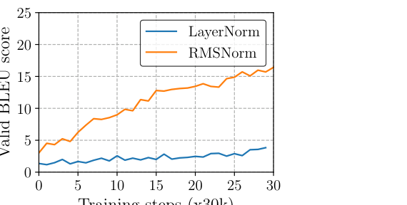

> 图 4.3　RNNSearch 机器翻译任务上 LayerNorm 与 RMSNorm 的验证集 BLEU 曲线（RMSNorm 论文 Figure 4）。RMSNorm 以更少计算取得更好的收敛。

表 4.1　RMSNorm 的主要特性

|特性|说明|
|---|---|
|核心思想|仅使用输入特征的均方根（RMS） 进行缩放归一化，省略了LayerNorm中的均值中心化（去均值）步骤。|
|关键公式|RMS(x) = √( (1/n) * Σ(x_i²) )，归一化输出：y = (x / RMS(x)) * γ。|
|主要优势|计算效率更高（计算量减少约30% ）、数值稳定性好、在多数场景下性能与LayerNorm相当甚至更优。|
|应用场景|广泛应用于Transformer及其变体模型（如LLaMA、Mamba ），替代编码器/解码器中的LayerNorm。|
RMSNorm的工作流程可以清晰地分为三个步骤：

1. **计算均方根（RMS）**：对于输入向量 x，首先计算其最后一个维度（通常是特征维度）上所有元素平方的均值，然后开平方根，并加上一个为了数值稳定的小常数 ϵ（如1e-8）防止除零错误。  
    
2. **执行归一化**：将输入向量 x的每个元素除以上一步计算出的RMS值。这一步将所有特征的尺度统一到一个相对稳定的范围内，但不改变它们的中心位置（即不强制均值为0）。  
    
3. **应用仿射变换**：引入一个可学习的缩放参数 γ（通常是与输入维度相同的向量，初始化为1），与归一化后的结果进行元素级乘法。这一步为模型提供了灵活性，允许它决定每个特征需要被恢复或调整到何种程度。RMSNorm 的原始论文和许多实现中**不包含可学习的偏移参数 β**，这是它与LayerNorm的另一个区别。

与常见的归一化方法进行对比：

表 4.2　常见归一化方法对比

|方法|核心操作|主要特点|适用场景|
|---|---|---|---|
|RMSNorm|仅除以RMS，不减去均值。|计算高效，性能稳定，是许多现代架构的首选。|Transformer系列模型（如LLaMA ）、RNN、CNN。|
|LayerNorm|先减去均值，再除以标准差。|经典方法，具备平移和缩放不变性，但计算量稍大。|早期的Transformer模型（如原始BERT、GPT-2）。|
|BatchNorm|对一个小批次（Batch）内所有样本的同一特征维度进行归一化。|依赖批量大小，对小批量效果不佳。|卷积神经网络（CNN）用于图像分类等任务。|

RMSNorm相对于LayerNorm最显著的优势在于**计算效率**。由于省略了计算均值以及相应的减法操作，RMSNorm的计算量更小，训练速度更快，并且在某些情况下显示出更好的训练稳定性。

代码：

```python
class RMSNorm(nn.Module):
    """RMSNorm 层：通过均方根归一化最后一维，并可选与 Qwen3 保持 float32 计算兼容。"""
    def __init__(self, emb_dim, eps=1e-6, bias=False, qwen3_compatible=True):
        super().__init__()
        self.eps = eps
        self.qwen3_compatible = qwen3_compatible
        self.scale = nn.Parameter(torch.ones(emb_dim))
        self.shift = nn.Parameter(torch.zeros(emb_dim)) if bias else None

    def forward(self, x):
        # 保留输入的原始 dtype，最后再转换回来
        input_dtype = x.dtype

        # Qwen3 兼容模式下先转为 float32，避免精度损失
        if self.qwen3_compatible:
            x = x.to(torch.float32)

        # 计算最后一维的均方根并做归一化
        variance = x.pow(2).mean(dim=-1, keepdim=True)
        norm_x = x * torch.rsqrt(variance + self.eps)
        norm_x = norm_x * self.scale  # 乘以可训练缩放参数

        if self.shift is not None:
            norm_x = norm_x + self.shift  # 可选的偏置项

        return norm_x.to(input_dtype)  # 恢复到输入 dtype
```

## 4.1 L2Norm（QK-Norm）

最后一个改进藏在注意力算子**内部**：对 Query 和 Key 各做一次归一化再算点积。它不改变注意力的表达能力，只掐住 logits 的量级——是超大模型训练的稳定机制。

**问题是什么**。随着模型变大、训练变长，注意力 logits（$QK^\top$ 的输出）会**指数级增长**。小模型时这个增长被其他训练动态掩盖；一旦参数上百亿、训练几十万亿 token，logits 膨胀会导致 softmax 饱和、损失尖峰、训练直接崩溃（training instability spike）。这是 ViT-22B（220 亿参数）在扩展视觉 Transformer 时踩到的坑。

**解法出人意料地简单**：在 $Q$、$K$ 各自的投影输出上，各加一个归一化（L2 归一化或 RMSNorm），把向量范数钉住，logits 就有了上界：

$$\hat{Q} = \frac{Q}{\|Q\|_2}\ (\text{或 } \mathrm{RMSNorm}(Q)), \qquad \hat{K} = \frac{K}{\|K\|_2}, \qquad \mathrm{Attn}(Q,K,V) = \mathrm{softmax}\!\left(\frac{\hat{Q}\hat{K}^\top}{\sqrt{d_k}}\right)V \tag{4.6}$$

用 L2 归一化时，$\hat q^\top \hat k \in [-1, 1]$（两个单位向量的点积），logits 天然有界；再乘 $\sqrt{d_k}$ 只是恢复尺度。**代价**：归一化把“向量模长”这一路信息抹掉了，而模长有时携带相关性强度——因此有个别工作发现 QK-Norm 会轻微削弱长上下文检索的敏感度，但换来的训练稳定性收益在大模型上压倒性地划算。

**起源与普及**：QK-Norm 由 **ViT-22B**（Dehghani et al., 2023, arXiv:2302.05442）系统性提出并验证，随后被 Llama 3、Gemma 2/3、DeepSeek-V4 等大模型采纳为默认配置。原始实现用 LayerNorm（沿 ViT 惯例），Llama 3 换成 RMSNorm 效果相当——因为目的只是限制幅度，哪种归一化都能做到。

**在本文档各处的体现**：QK-Norm 并非孤立的小技巧，前面见过的多个架构都在用它：

表 4.3　QK-Norm 在各架构中的归一化位置

| 架构 | 归一化位置 | 形式 |
|---|---|---|
| Gated DeltaNet（3.6.2） | Q/K 投影后、递推前 | L2Norm（$\|q\|=\|k\|=1$） |
| Kimi Delta Attention（3.6.3） | $\mathrm{L2Norm}(\mathrm{Swish}(\mathrm{ShortConv}(W x)))$ | L2Norm |
| CSA / HCA（3.5.3） | 核心注意力前对 query 与压缩 KV 条目 | RMSNorm |
| Qwen Sparse Attention（3.5.4） | 索引器与核心注意力的 q/k | RMSNorm |

```python
import torch
import torch.nn as nn
import torch.nn.functional as F


class QKNormAttention(nn.Module):
    """QK-Norm：算点积前分别归一化 Q、K，掐住 logits 量级。"""

    def __init__(self, d_model, n_head, use_rms=False):
        super().__init__()
        self.n_head = n_head
        self.head_dim = d_model // n_head
        self.use_rms = use_rms
        self.w_q = nn.Linear(d_model, d_model, bias=False)
        self.w_k = nn.Linear(d_model, d_model, bias=False)
        self.w_v = nn.Linear(d_model, d_model, bias=False)
        self.out = nn.Linear(d_model, d_model, bias=False)
        self.rms = nn.RMSNorm(self.head_dim)

    def _norm(self, x):
        if self.use_rms:
            return self.rms(x)
        # L2 归一化（沿 head_dim 维度）
        return F.normalize(x, p=2, dim=-1)

    def forward(self, x, mask=None):
        B, L, D = x.shape
        q = self.w_q(x).view(B, L, self.n_head, self.head_dim)
        k = self.w_k(x).view(B, L, self.n_head, self.head_dim)
        v = self.w_v(x).view(B, L, self.n_head, self.head_dim)

        q = self._norm(q)                                 # <-- QK-Norm 的核心
        k = self._norm(k)

        attn = torch.einsum("blhc,bshc->blhs", q, k) / self.head_dim ** 0.5
        if mask is not None:
            attn = attn.masked_fill(~mask, float("-inf"))
        o = torch.softmax(attn, dim=-1)
        o = torch.einsum("blhs,bshc->blhc", o, v)
        return self.out(o.reshape(B, L, -1))
```

QK-Norm 是“归一化放哪里”这条线的细化——从 block 级（Pre-Norm/Post-Norm，见本章开头）深入到 attention **内部的向量级**。它与 logit soft-capping（Gemma 2 用 $\tanh$ 软截断）、z-loss（PaLM）是同一族稳定化手段：不牺牲表达，只把激活/分数的量级关进可控区间。

归一化这十年的演进路线可以概括为：BatchNorm（CV）→ LayerNorm（NLP/Transformer）→ Post-Norm → Pre-Norm → RMSNorm + QK-Norm。每一步都在做减法：去掉不必要的统计量（均值）、去掉不必要的位置（挪到残差前）、去掉不必要的参数（β）。不变的是“控制数值尺度”这一使命。

# 5. 位置编码的改进

Transformer 的注意力是置换等变的（permutation equivariant）——不显式注入位置信息，模型就分不清 “猫追狗” 和 “狗追猫”。十年来位置编码经历了 **绝对 → 相对 → 旋转** 三代演进，但目标从未变过：把「序」注入到「集」里。

**绝对位置编码**根据单个单词的绝对位置来定义位置编码，每个位置都会分配一个位置编码，将位置编码的表征和单词本身的表征进行融合，再输入给Self Attention，相当于在输入层就把位置信息给弥补上去。绝对位置编码从实现方式上又分为固定式和可学习式，固定式形如原生的Transformer所采用的三角sin-cos位置编码，所谓固定指的是根据一个无参的固定公式就可以推演出位置编码，而可学习式没有固定的位置编码公式，通过初始化位置向量让模型根据上下文数据自适应地学习出来，Bert和GPT采用的可学习式。

原始论文的正弦-余弦位置编码：

$$PE_{(pos, 2i)} = \sin\left(\frac{pos}{10000^{2i/d_{\text{model}}}}\right) \tag{5.1}$$

$$PE_{(pos, 2i+1)} = \cos\left(\frac{pos}{10000^{2i/d_{\text{model}}}}\right) \tag{5.2}$$

不同维度 $i$ 对应不同频率的正弦波，形成从高频到低频的“尺子”。论文选择固定式而非可学习式，是因为固定式在训练长度之外有外推潜力——但实践证明 sin-cos 的外推能力有限，这为后来的 RoPE 埋下伏笔。

**旋转位置编码**RoPE是一种**固定式的绝对位置编码策略**，但是它的绝对位置编码配合Transformer的Attention内积注意力机制能达到相对位置编码的效果。RoPE的本质是对两个token形成的Query和Key向量做一个变换，使得变换后的Query和Key带有位置信息，进一步使得Attention的内积操作不需要做任何更改就能自动感知到相对位置信息。RoPE 的出发点与策略采用的是相对位置编码思想，实现方式却是绝对位置编码。

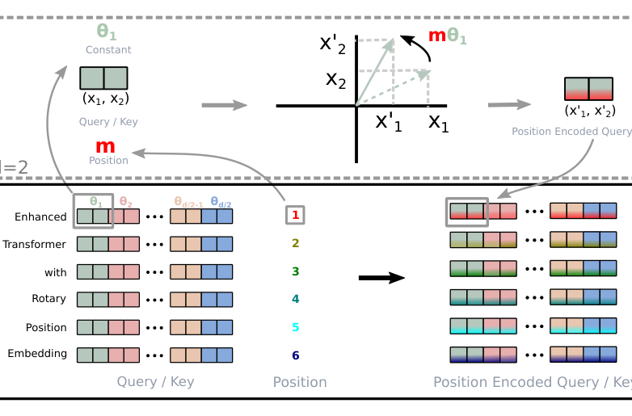

> 图 5.1　RoPE 的实现示意——对 Q/K 向量按二维子空间施加 $m\theta$ 的旋转（Su et al., 2021, Figure 1）。

RoPE 的数学形式：设 token 位置为 $m$，Query/Key 向量为 $x$，RoPE 对 $x$ 的每对相邻维度 $(x_{2i}, x_{2i+1})$ 施加一个角度为 $m\theta_i$ 的二维旋转：

$$f(x_m, m) = R_{\Theta, m} x_m, \qquad \theta_i = 10000^{-2i/d} \tag{5.3}$$

在二维情况下，旋转矩阵写作：

$$R_{\Theta, m} = \begin{pmatrix} \cos m\theta & -\sin m\theta \\ \sin m\theta & \cos m\theta \end{pmatrix} \tag{5.4}$$

RoPE 的巧妙之处在于：通过旋转操作编码绝对位置，同时在内积中自然体现相对位置。其核心性质是内积只依赖相对位置差：

$$\langle f(q, m), f(k, n) \rangle = g(q, k, m - n) \tag{5.5}$$

也就是说，对 Q 在位置 $m$、K 在位置 $n$ 施加旋转后，二者的点积只与 $m-n$ 有关——用绝对编码的方式实现了相对编码的效果，而且不需要修改注意力计算本身。

**强大的长度外推性**：外推性是指模型处理比训练时所见文本更长的文本的能力。RoPE本身具有良好的外推性质，而且研究者们还开发了像**NTK-aware缩放**这样的技术，可以进一步通过微调甚至不微调的方式，有效扩展模型的上下文处理窗口。例如，让一个原本只能处理2048个token的模型，能够有效处理8192个token甚至更长的文本。

NTK-aware 缩放的核心直觉：不要均匀缩放所有频率（那样高频细节会被破坏），而是把 $\theta_i = 10000^{-2i/d}$ 中的基频 10000 调大：

$$\theta_i' = \left(b \cdot s\right)^{-2i/d} \tag{5.6}$$

其中 $s$ 为缩放因子，$b$ 为基频。高频维度几乎不变（保住局部位置分辨力），低频维度被“拉长”（提供更远的位置范围），从而实现免微调或少微调的上下文扩展（如 RoPE-NTK、YaRN、Dynamic NTK）。

```python
import torch


def precompute_rope_params(head_dim, max_len=4096, base=10000.0):
    """预计算 RoPE 的 cos/sin 表：inv_freq 形状 (head_dim//2,)"""
    inv_freq = base ** (-torch.arange(0, head_dim, 2).float() / head_dim)  # θ_i
    positions = torch.arange(max_len).float()                             # m
    angles = torch.outer(positions, inv_freq)                             # (max_len, head_dim//2)
    return torch.cos(angles), torch.sin(angles)                           # 各 (max_len, head_dim//2)


def apply_rope(x, cos, sin, offset=0):
    """
    对 Q 或 K 施加旋转位置编码。
    x:   (B, h, L, head_dim)
    cos: (max_len, head_dim//2)，由 precompute_rope_params 预计算
    """
    B, h, L, d = x.shape
    cos = cos[offset:offset + L].to(x.dtype)      # (L, head_dim//2)
    sin = sin[offset:offset + L].to(x.dtype)

    x1, x2 = x[..., 0::2], x[..., 1::2]           # 偶数维 / 奇数维，各 (B,h,L,d//2)
    cos = cos[None, None, :, :]                    # 广播到 (1,1,L,d//2)
    sin = sin[None, None, :, :]
    out = torch.empty_like(x)
    out[..., 0::2] = x1 * cos - x2 * sin           # 二维旋转的显式形式
    out[..., 1::2] = x1 * sin + x2 * cos
    return out


# 示例：d_model=2048, num_heads=32 -> head_dim=64

# head_dim=64 -> 32 个二维子空间，每个子空间一个频率 θ_i

cos, sin = precompute_rope_params(head_dim=64, max_len=8192)
q = torch.randn(2, 32, 128, 64)                    # (B, h, L, head_dim)
q_pos = apply_rope(q, cos, sin)                    # 注入位置信息
```

位置编码十年演进：sin-cos（2017，固定绝对）→ 可学习绝对（BERT/GPT）→ 相对位置偏置（T5/DeBERTa）→ RoPE（2021，旋转绝对=相对）→ RoPE 外推扩展（NTK/YaRN/LongRoPE）。不变的是“注入序信息”；变的是“用绝对、相对还是旋转实现”以及“能不能外推到更长上下文”。

# 6. 前馈神经网络 (Feed Forward)

注意力机制负责在词与词之间找关系，而 FFN 负责在每个词内部进行特征的深度加工和记忆存储。现代大模型在这个部分，也发生了深刻的变化。


> 图 6.1　Transformer 中的 FFN 子层（Vaswani et al., 2017, Figure 1 局部）——Add & Norm 之后的两层线性变换。

原始 Transformer 的前馈网络是两层线性变换夹一个激活函数（位置逐点共享参数）：

$$\text{FFN}(x) = W_2 \, \sigma(W_1 x + b_1) + b_2 \tag{6.1}$$

其中 $W_1 \in \mathbb{R}^{d_{\text{model}} \times d_{ff}}$，$W_2 \in \mathbb{R}^{d_{ff} \times d_{\text{model}}}$，原始论文取 $d_{ff} = 2048 = 4 \times d_{\text{model}}$，$\sigma$ 为 ReLU。FFN 占了 Transformer 的大部分参数（两层大矩阵），这也是为什么它是“记忆存储”的主要载体——研究发现事实性知识大量存在 FFN 的权重里。

FFN 的第一个重大变化来自 **GLU（Gated Linear Units）** 及其变体。Shazeer 在 2020 年《GLU Variants Improve Transformer》中把门控引入 FFN，用一个额外的门控分支控制信息流：

$$\text{GLU}(x) = (xW + b) \otimes \sigma(xV + c) \tag{6.2}$$

其中 $\otimes$ 是逐元素乘法，$\sigma$ 是 sigmoid 门。把激活函数换掉就得到现代主流的 SwiGLU 与 GeGLU：

$$\text{SwiGLU}(x) = \big(\text{Swish}_{\beta=1}(xW) \otimes xV\big) U \tag{6.3}$$

$$\text{GeGLU}(x) = \big(\text{GELU}(xW) \otimes xV\big) U \tag{6.4}$$

SwiGLU 把 FFN 从“两层矩阵”变成“三块矩阵”（$W, V, U$），PaLM、LLaMA、Qwen、Mistral 等几乎所有现代大模型都采用 SwiGLU。为了保持参数量不变，中间维度通常从 $4d$ 调整为 $\frac{8}{3}d$（再对齐到硬件友好的倍数）。

```python
class FeedForward(nn.Module):
    """
    FFN 十年演进一览：
    - 原始 Transformer (2017): Linear -> ReLU -> Linear
    - BERT/GPT 时代:          Linear -> GELU -> Linear
    - 现代 LLM (LLaMA/Qwen):   SwiGLU 门控 FFN
    """
    def __init__(self, d_in, d_hidden=None, variant="swiglu", bias=False):
        super().__init__()
        if d_hidden is None:
            # SwiGLU 惯例：8/3 * d_in，再取 256 的倍数对齐
            d_hidden = int((8 / 3) * d_in)
            d_hidden = ((d_hidden + 255) // 256) * 256

        self.variant = variant
        if variant == "original":
            self.fc1 = nn.Linear(d_in, 4 * d_in, bias=bias)
            self.fc2 = nn.Linear(4 * d_in, d_in, bias=bias)
            self.act = nn.ReLU()
        elif variant == "gelu":
            self.fc1 = nn.Linear(d_in, 4 * d_in, bias=bias)
            self.fc2 = nn.Linear(4 * d_in, d_in, bias=bias)
            self.act = nn.GELU()
        elif variant == "swiglu":
            # 三个投影：门控分支 W、值分支 V、输出投影 U
            self.w_gate = nn.Linear(d_in, d_hidden, bias=bias)  # W
            self.w_up   = nn.Linear(d_in, d_hidden, bias=bias)  # V
            self.w_down = nn.Linear(d_hidden, d_in, bias=bias)  # U
            self.act = nn.SiLU()                                # Swish(x) = x*σ(x)
        else:
            raise ValueError(f"unknown variant: {variant}")

    def forward(self, x):
        if self.variant == "swiglu":
            # SwiGLU(x) = ( SiLU(xW) ⊗ xV ) U
            return self.w_down(self.act(self.w_gate(x)) * self.w_up(x))
        return self.fc2(self.act(self.fc1(x)))
```

FFN 的演进路线：ReLU 两层（2017）→ GELU 两层（2018-2019，BERT/GPT-2）→ SwiGLU 三块门控（2020 至今）→ 变体搜索/MoE-FFN（2022 至今）。MoE（Mixture-of-Experts）把 FFN 的“一个大网”换成“多个小专家 + 路由”，本质是把 FFN 的参数容量继续放大，同时保持激活参数量不变——这可以看作 FFN 思路的延伸。不变的是“逐位置、非线性、存知识”；变的是“要不要门控、激活函数用什么、要不要稀疏化”。

## 6.1 MoE

MoE（Mixture-of-Experts，混合专家）不是新东西，但它重新定义了 FFN 的扩展方式：把 FFN 从“一个大网”换成“多个小专家 + 一个路由器”，参数容量与激活计算量解耦。


> 图 6.2　Switch Transformer 的 encoder block（Switch Transformer 论文 Figure 2）。稠密 FFN 被替换成“Router + 多个 FFN”，每个 token 走其中一条。

**Switch Transformer**（Fedus et al., 2021，arXiv:2101.03961）是现代 MoE 的分水岭。它的两个关键设计：

1. **Top-1 路由**：每个 token 只送到得分最高的那个专家。论文证明 top-1 在负载均衡策略下质量不输 top-2，但计算量减半
2. **容量因子（Capacity Factor）**：每个专家最多接收 $\frac{c \cdot T}{E}$ 个 token（$T$ 是 batch 内 token 数，$E$ 是专家数，$c$ 是容量因子）。超出容量的 token 被**直接丢弃**并绕过后续 FFN，同时引入辅助损失来平衡专家负载

路由公式：

$$y = \sum_{i=1}^{E} \mathrm{Router}(x)_i \cdot \mathrm{FFN}_i(x), \qquad \mathrm{Router}(x) = \mathrm{Softmax}(W_r x) \tag{6.5}$$

**Mixtral**（2024）改用 top-2 路由，在激活参数不变的情况下提升质量。

**DeepSeekMoE**（DeepSeek-V2/V3）则引入了两个更精细的机制，把 MoE 从“大而全”推向“专而精”：

- **细粒度专家切分（Fine-grained Expert Segmentation）**：把 FFN 的隐藏维度切成更细的多个专家，总参数量不变但专家数量更多 → 每个专家的参数更少、专精程度更高
- **共享专家隔离（Shared Expert Isolation）**：指定若干**永远激活**的共享专家，负责捕获通用知识，避免通用知识被路由到不同专家而重复学习

DeepSeekMoE 的输出：

$$h_t' = u_t + \sum_{i=1}^{N_s} \mathrm{FFN}_i^{(s)}(u_t) + \sum_{i=1}^{N_r} g_{i,t}\,\mathrm{FFN}_i^{(r)}(u_t) \tag{6.6}$$

其中 $g_{i,t}$ 是路由权重（对选中专家做归一化），$N_s$ 与 $N_r$ 分别是共享专家与路由专家的数量。DeepSeek-V3 进一步改用**无辅助损失的负载均衡**（auxiliary-loss-free），用可学习的偏置项替代辅助损失，避免辅助损失对训练目标的干扰。

**近两年的规模竞赛**：

表 6.1　近年 MoE 模型的规模对比

| 模型 | 总参数 | 激活参数 | 专家数 | 每 token 激活 |
|---|---|---|---|---|
| Mixtral 8×7B | 46.7B | 12.9B | 8 | 2 |
| DeepSeek-V3 | 671B | 37B | 256 | 8 |
| Kimi K3 | 2.78T | 104B | 896 | 16 |
| Qwen3.8-Flash-Next | 125B (+51B n-gram) | 6B | 512 | 10 + 1 共享 |

Kimi K3 的 **Stable LatentMoE** 还加了两个稳定化手段：一是把路由专家的作用空间压到 3584 维的**潜空间**再送进专家（省算力），二是在专家聚合与上投影之间插入 **RMSNorm**，降低路由分支对尺度变化的敏感度。

**MoE 的代价**：路由带来的 all-to-all 通信是分布式训练的最大瓶颈之一；专家负载不均会导致“热专家”拖慢整步；小 batch 场景下专家利用率低下。DeepSeek 的无辅助损失均衡、Kimi K3 的 Quantile Balancing（用路由分数的 $(1-k/n)$ 分位数直接反推每个专家的偏置）、Qwen 的 10+1 路由配置，都是在解决同一类问题。

```python
import torch
import torch.nn as nn
import torch.nn.functional as F


class MoE(nn.Module):
    """Top-k 路由 MoE（Mixtral 风格），含负载均衡辅助损失。"""

    def __init__(self, d_model, d_ff, n_experts=8, top_k=2):
        super().__init__()
        self.n_experts, self.top_k = n_experts, top_k
        self.gate = nn.Linear(d_model, n_experts, bias=False)
        # 每个专家一个独立 FFN（SwiGLU）
        self.w_gate = nn.ModuleList([nn.Linear(d_model, d_ff, bias=False) for _ in range(n_experts)])
        self.w_up = nn.ModuleList([nn.Linear(d_model, d_ff, bias=False) for _ in range(n_experts)])
        self.w_down = nn.ModuleList([nn.Linear(d_ff, d_model, bias=False) for _ in range(n_experts)])

    def forward(self, x):
        B, L, D = x.shape
        logits = self.gate(x)                                  # (B,L,E)
        probs = F.softmax(logits, dim=-1)
        topk_w, topk_i = probs.topk(self.top_k, dim=-1)        # (B,L,k)
        topk_w = topk_w / topk_w.sum(dim=-1, keepdim=True)     # 归一化路由权重

        out = torch.zeros_like(x)
        for e in range(self.n_experts):
            # 找出路由到专家 e 的 (token, slot)
            mask = (topk_i == e)                                # (B,L,k)
            if not mask.any():
                continue
            tok_idx, slot_idx = mask.nonzero(as_tuple=True)
            xe = x[tok_idx]                                     # (N_e, D)
            ye = self.w_down[e](F.silu(self.w_gate[e](xe)) * self.w_up[e](xe))
            # 用累加技巧把同一 token 的多个专家输出按权重合并
            out.index_add_(0, tok_idx, ye * topk_w[tok_idx, slot_idx].unsqueeze(-1))

        # 负载均衡辅助损失：鼓励各专家被均匀选中
        density = probs.mean(dim=(0, 1))                        # (E,)
        routing = (topk_i == torch.arange(self.n_experts, device=x.device)).float().mean(dim=(0, 1))
        aux_loss = self.n_experts * (density * routing).sum()
        return out, aux_loss
```

MoE 把 FFN 的“参数效率”和“计算效率”解耦，是大模型规模化的主要推手之一。它十年不变的仍是每个 token 逐位置非线性变换这个本质，变的只是“这一层用一个大 FFN 还是多个小专家”。

## 6.2 Latent MoE

6.1 节介绍的所有 MoE 变体中，专家都工作在完整的隐藏维度 $d$ 上。Latent MoE 则另辟蹊径：让路由专家在一个低维潜空间（latent space）里工作，只把共享专家留在原维度。这一改动直接解锁了“极细粒度、超多专家”的配置。

**动机：维度换专家数**。传统 MoE（如 Mixtral）的每个专家都是 $d \to d_{ff} \to d$ 的完整 FFN，参数成本高，专家数只能开到 8 个、16 个量级。DeepSeekMoE 证明“细粒度专家 + 共享专家”更好，但专家仍占完整宽度。Latent MoE 的洞察是：路由专家真正需要的是“变换能力”，不是“输出宽度”。让路由专家在 $\ell \ll d$ 的潜空间里做变换，单个专家就便宜得多，于是可以把专家池开到数百个，让每个 token 激活的专家更“专”。

**结构**（Kimi K3 的 Stable LatentMoE，对应论文公式 11）：

$$z = W^\downarrow x \in \mathbb{R}^{\ell}, \qquad u = \sum_{i \in T_k(x)} p_i\, E_i^{\mathrm{routed}}(z), \qquad y = \sum_{j=1}^{N_s} E_j^{\mathrm{shared}}(x) + W^\uparrow \mathrm{RMSNorm}(u) \tag{6.7}$$

三步走：

1. **降维**：$W^\downarrow: \mathbb{R}^d \to \mathbb{R}^\ell$ 把 token 隐状态投到潜空间（$\ell \ll d$）
2. **潜空间路由**：$z$ 被 dispatch 到选中的 $k$ 个路由专家（$E_i^{\mathrm{routed}}: \mathbb{R}^\ell \to \mathbb{R}^\ell$），加权聚合得 $u \in \mathbb{R}^\ell$
3. **升维 + 共享专家**：$W^\uparrow$ 把 $u$ 投回 $\mathbb{R}^d$，再与 $N_s$ 个**全宽度**共享专家（$E_j^{\mathrm{shared}}: \mathbb{R}^d \to \mathbb{R}^d$）的输出相加


> 图 6.3　标准 MoE 与 LatentMoE 的架构对比（Elango et al., 2026, Figure 1）。(a) 标准 MoE 中路由专家直接工作在完整隐藏维度 $d$ 上；(b) LatentMoE 先把 token 下投影到潜空间 $\ell$ 再做专家计算，最后上投影回 $d$。下投影省下的路由参数与 all-to-all 通信开销，被用于成倍扩大专家池与 top-k。

**为什么共享专家要全宽**：共享专家负责“所有 token 都需要的基础变换”，它必须能直接作用在 $d$ 维隐状态上、保持表达力；而路由专家负责“特定 token 的专门变换”，潜空间里的低维表示足够。两者分工后，Kimi K3 把 $N_s = 2$ 个全宽共享专家固定在每一层。

**Stable LatentMoE 的三个稳定组件**。LatentMoE 开到 896 个路由专家、每 token 只激活 16 个（$k=16$，稀疏度极高）时，训练会遇到两个典型失败模式：激活爆炸（$W^\uparrow$ 直接作用在 scale 会剧烈波动的 $u$ 上）与路由崩塌（负载严重不均）。Kimi K3 用三招治：

1. **Normalized LatentMoE**：在专家聚合 $u$ 与上投影 $W^\uparrow$ 之间插一个 $\mathrm{RMSNorm}$。这一步稳定了路由分支的 scale，让它与全宽共享分支相加时不会互相干扰——而且实测还**稳定地降低了验证损失**。
2. **SiTU-GLU**：路由专家内部的激活用 $\beta$-softcap 的 GLU（详见 7.3），把大值封顶在 $\beta_1\beta_2 = 100$，杜绝低精度下的溢出离群值。
3. **Quantile Balancing（QB）**：负载均衡不用固定的辅助损失，而是**按 router 分数的分位数**给每个专家设 bias。做法是 Top-$(k+1)$ 路由（第 $k+1$ 名的分数即进入 Top-$k$ 的门槛 $\alpha_i$），再反推每个专家要达到目标负载 $q = mk/n$ 所需的 bias $b_j$。这样一次前向就能算出下一 step 的 bias，负载均衡从“加惩罚项”变成“精确对齐目标”。

```python
import torch
import torch.nn as nn
import torch.nn.functional as F


class LatentMoE(nn.Module):
    """Latent MoE：路由专家在潜空间工作，共享专家保持全宽度。"""

    def __init__(self, d_model, latent_dim, n_shared=2, n_routed=896,
                 k=16, n_iter_norm=0):
        super().__init__()
        self.k = k
        self.latent_dim = latent_dim
        self.w_down = nn.Linear(d_model, latent_dim, bias=False)     # 降维
        self.w_up = nn.Linear(latent_dim, d_model, bias=False)       # 升维
        self.norm_u = nn.RMSNorm(latent_dim)                          # Normalized LatentMoE

        # 共享专家：全宽度，每个 token 都过
        self.shared = nn.ModuleList([
            nn.Sequential(
                nn.Linear(d_model, 4 * d_model, bias=False),
                nn.SiLU(),
                nn.Linear(4 * d_model, d_model, bias=False),
            ) for _ in range(n_shared)
        ])
        # 路由专家：潜空间内，参数成本低
        self.routed = nn.ModuleList([
            nn.Sequential(
                nn.Linear(latent_dim, 4 * latent_dim, bias=False),
                nn.SiLU(),
                nn.Linear(4 * latent_dim, latent_dim, bias=False),
            ) for _ in range(n_routed)
        ])
        self.router = nn.Linear(d_model, n_routed, bias=False)
        self.bias = nn.Parameter(torch.zeros(n_routed))   # Quantile Balancing 的 bias

    def forward(self, x):
        B, L, d = x.shape

        # 1) 共享专家：全宽度直接处理
        shared_out = sum(expert(x) for expert in self.shared)         # (B,L,d)

        # 2) 降维 + 路由（Top-k 带 bias）
        z = self.w_down(x)                                            # (B,L,latent)
        scores = self.router(x) + self.bias
        topk_w, topk_i = torch.topk(torch.softmax(scores, dim=-1), self.k, dim=-1)

        # 3) 潜空间专家聚合（分组计算，同 token 多专家用 index_add 合并）
        u = torch.zeros(B, L, self.latent_dim, device=x.device, dtype=x.dtype)
        for e in range(len(self.routed)):
            mask = (topk_i == e)
            if not mask.any():
                continue
            tok_idx, slot_idx = mask.nonzero(as_tuple=True)
            flat = z.reshape(-1, self.latent_dim)[tok_idx]
            ye = self.routed[e](flat) * topk_w.reshape(-1, self.k)[tok_idx, slot_idx].unsqueeze(-1)
            u.reshape(-1, self.latent_dim).index_add_(0, tok_idx, ye)

        # 4) Normalized LatentMoE：先 RMSNorm 再升维（抑制 scale 波动）
        routed_out = self.w_up(self.norm_u(u))                        # (B,L,d)

        return shared_out + routed_out
```

**参数账本**（Kimi K3 实测）：896 个路由专家每 token 激活 16 个 + 2 个全宽共享专家，让“激活专家数”从传统 MoE 的 8 个扩到 18 个，同时因为路由专家在 $\ell$ 维潜空间工作，**总参数量与激活参数量的比值**远高于全宽度专家的方案。加上 QB 把负载打到完美均衡，专家并行训练不再被最慢的 rank 拖累。

Latent MoE 是 MoE 这条线的一个有趣的转向——不再只调“专家数/激活数”，而是**改专家工作的空间**。它与 MLA 压缩 KV、CSA 压缩序列是同一哲学的三次应用：在不损失表达力的前提下，把高维的东西投到低维去做选择性计算，只在必要处还原到高维。

# 7. 激活函数

激活函数是 Transformer 前馈网络中的非线性来源。原始 Transformer 的 FFN 由两层全连接线性层组成，中间夹着一个 ReLU 激活函数。此后，激活函数经历了几轮更替——从 ReLU 到 GELU，再到现代模型普遍采用的 SiLU/Swish，以及面向数值稳定性的 SiTU-GLU。本章逐一介绍这些变化。


> 图 7.1　GELU、ReLU、ELU 曲线对比（Hendrycks & Gimpel, 2016, Figure 1）。

## 7.1 SiLU

SiLU（Sigmoid-Linear Unit），也就是 Swish 激活函数（$\beta=1$ 时），由 Google 在 2017 年通过自动搜索发现，如今已成为 LLaMA、Qwen 等现代模型的默认选择（尤其在 SwiGLU FFN 中）。

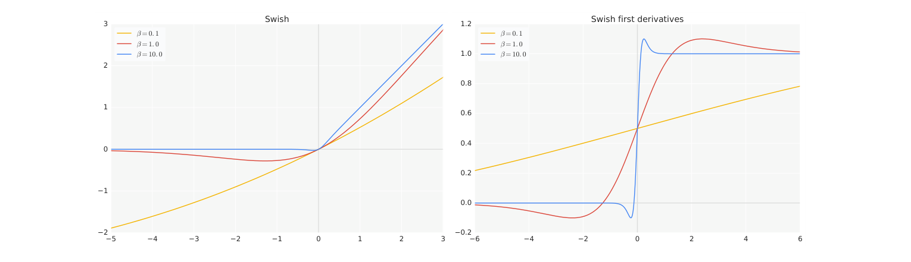

> 图 7.2　Swish 激活函数及其一阶导数（Ramachandran et al., 2017, Figure 4 & 5）。注意负值区域的平滑“下垂”与导数的非单调性。

  
表 7.1　ReLU、SiLU 与 GELU 的特性对比

| 特性   | ReLU             | SiLU / Swish    | GELU                    |
| ---- | ---------------- | --------------- | ----------------------- |
| 公式   | f(x) = max(0, x) | f(x) = x * σ(x) | f(x) = x * Φ(x)         |
| 是否平滑 | 否 (在 x=0 处不可导)   | 是               | 是                       |
| 是否单调 | 是                | 是               | 是                       |
| 输出范围 | [0, +∞)          | ≈ (-0.28, +∞)   | ≈ (-0.17, +∞)           |
| 计算效率 | 非常高              | 较高              | 较低 (因需计算Φ(x))           |
| 主要思想 | 稀疏激活             | 平滑、自门控          | 基于随机正则化的平滑近似            |
| 常见应用 | CNN， 早期模型        | 逐渐成为主流          | Transformer (BERT, GPT) |

1. ReLU

- **公式**: $f(x) = max(0, x)$
- **导数**:  $f'(x) = \begin{cases} 1 & x > 0 \\ 0 & x < 0 \end{cases}$(在 x=0 处未定义，通常设为 0 或 1)

**优点：**

- **缓解梯度消失**: 对于正区间的输入，梯度恒为 1，彻底解决了饱和区梯度消失的问题（与 Sigmoid/Tanh 相比）。
- **计算高效**: 仅需比较和赋值操作，速度极快。
- **稀疏性**: 负半轴输出为 0，使得网络具有稀疏激活性，更接近生物神经元，可能带来更好的表征能力。

**缺点：**

- **Dying ReLU（神经元死亡）**: 如果一个神经元的大部分输入在训练后都落入负半轴，那么其梯度将恒为 0。这意味着该神经元将永久“死亡”，不再对任何数据做出响应，参数也无法更新。
- **非零中心**: 输出均值恒大于 0，可能影响梯度下降的动态。
- **非平滑**: 在 x=0 处存在一个尖锐的转折点，这在数学上不够优雅。

2. SiLU / Swish

- **公式**: $SiLU(x) = x*\sigma(x)$
- 其中  $\sigma(x)$是 Sigmoid 函数： $\sigma(x) = \frac{1}{1+e^{-x}}$

- **导数**: $f'(x) = \sigma(x) + x*\sigma(x)*(1-\sigma(x))$

**优点：**

- **平滑且非单调下界**: 曲线平滑，没有不可导点。在负值区域，它不会直接变为 0，而是有一个平滑的过渡，并有一个小小的负值下界（约 -0.28）。这避免了“神经元死亡”问题，同时保留了负值区域的一些信息。
- **自门控**: 公式 `x * σ(x)` 可以看作一个“门”，Sigmoid 的输出 σ(x) 作为一个软开关，控制有多少 x 可以通过。这种门控机制与 LSTM/GRU 中的门类似，被认为有助于捕获更复杂的信息流。
- **性能卓越**: 在 Google 的原始研究中，Swish 在多个视觉和语言任务上一致优于 ReLU。

**缺点：**

- **计算成本稍高**: 需要计算 Sigmoid 函数，比 ReLU 慢。


在正半轴，SiLU 继承了 ReLU 的优良性质：其导数接近于 1，正区间输入的梯度得以在深层网络中稳定回传。当 $x$ 为负时，它不像 ReLU 那样直接置零（由此导致神经元死亡），而是保留一个平滑的、微小的负值。


3. GELU

- **公式**: $GELU(x) = x * \Phi(x)$

- 其中$\Phi(x)$  是标准高斯分布的累积分布函数。

- **近似公式**: $GELU(x) \approx 0.5 * x * (1 + \tanh\left[\sqrt{\frac{2}{\pi}} \left(x + 0.044715 * x^3\right)\right])$

- 在实际实现（如 Hugging Face Transformers, PyTorch, TensorFlow）中通常使用这个近似公式以保证效率。

**优点：**

- **基于概率的平滑激活**: GELU 的设计融合了 Dropout 和 Zoneout 的思想。它不再是像 ReLU 那样根据输入的“符号”来硬性决定是否激活，而是根据输入的“幅度”来软性决定。可以理解为：`x * Φ(x)` 中的 `Φ(x)` 是“x 被保留（即不被 Dropout）的概率”。
- 在 Transformer 中表现优异： 由于其平滑性和概率解释，GELU 在 BERT、GPT 等最先进的 Transformer 模型中成为默认选择，通常能带来比 ReLU 和 ELU 更好的性能。
- **处处平滑**: 避免了 ReLU 的尖锐转折点。
- **在负区域有界**: 与 SiLU 类似，在负值区域有平滑的曲线和非零输出。

**缺点：**

- **计算最复杂**: 即使使用近似公式，其计算量也显著高于 ReLU 和 SiLU。

三种激活函数的 PyTorch 实现与对照：

```python
import torch
import torch.nn as nn
import math


class ReLUOrig(nn.Module):
    """f(x) = max(0, x) —— 简单、稀疏，但有 dying ReLU 问题"""
    def forward(self, x):
        return torch.clamp(x, min=0.0)


class SiLU(nn.Module):
    """SiLU/Swish: f(x) = x * σ(x)，平滑自门控，负值区有微小负输出"""
    def forward(self, x):
        return x * torch.sigmoid(x)


class GELU(nn.Module):
    """GELU: f(x) = x * Φ(x)，默认用 tanh 近似（与 HF/PyTorch 一致）"""
    def forward(self, x):
        return 0.5 * x * (1.0 + torch.tanh(
            math.sqrt(2.0 / math.pi) * (x + 0.044715 * torch.pow(x, 3.0))
        ))


# 对照实验：三种激活的输出差异

x = torch.linspace(-3, 3, 7)
print("ReLU:", ReLUOrig()(x))
print("SiLU:", SiLU()(x))
print("GELU:", GELU()(x))

# 现代模型中 SiLU 的典型用法就是 SwiGLU 的门控：

# out = (SiLU(x @ W) * (x @ V)) @ U

```

激活函数十年演进：Tanh/Sigmoid（RNN 时代）→ ReLU（2012 深度学习复兴，进原始 Transformer）→ GELU（2016，BERT/GPT 时代）→ SiLU/Swish（2017 搜索发现，现代 LLM 默认）。激活函数的“最优解”一直在被重新发现——ReLU 便宜，GELU 优雅，SiLU 折中；现代模型几乎统一到了 SiLU 上。变的是曲线的形状，不变的是“引入非线性、控制梯度流”这一使命。

## 7.2 Sigmoid

Sigmoid 是深度学习最早的一批激活函数，也是今天 Transformer 里几乎不作为“激活”、却处处作为“门”的那个函数。

$$f(x) = \frac{1}{1+e^{-x}}, \qquad f'(x) = f(x)\left(1 - f(x)\right) \tag{7.1}$$


> 图 7.3　Sigmoid 的函数形状（左）与导数（右）。左图对照零中心的 tanh——sigmoid 输出恒在 $(0,1)$，均值大于 0（非零中心）；右图导数峰值仅 0.25，且两侧饱和区梯度趋近 0，正是深层网络梯度消失的数学来源。

**它的历史地位**：RNN 时代（1990s—2015）Sigmoid 与 Tanh 是默认激活函数，用于 LSTM/GRU 的门控。但作为逐元素激活函数，它有两个致命缺陷：

1. **梯度消失**：输入绝对值较大时 $f'(x) \to 0$，深层网络反向传播时梯度指数级衰减
2. **非零中心**：输出恒在 $(0,1)$ 且均值大于 0，会让下游层的梯度带偏

正因为如此，从 ReLU 开始，sigmoid 就从“激活函数”的位置退到了“门控函数”的位置。

**Sigmoid 在现代 Transformer 中的应用位置**：

表 7.2　Sigmoid 在 Transformer 中的典型应用位置

| 位置 | 形式 | 出处 |
|---|---|---|
| GLU 的门 | $\sigma(xW) \odot xV$ | Shazeer 2020 (GLU Variants) |
| SiTU-GLU 的门 | $\sigma(W_g x) \odot \beta_1\tanh(\cdot)$ | Kimi K3 |
| Gated DeltaNet 的衰减门 / 写入门 | $\alpha_t = \sigma(W_\alpha x_t)$，$\beta_t = \sigma(W_\beta x_t)$ | Yang et al. 2024 |
| Gated Attention 的输出门 | $\sigma(W_g x) \odot \mathrm{Attn}(x)$ | Qwen3-Next |
| MoE 路由 | $\mathrm{Softmax}(W_r x)$（softmax = 归一化的 sigmoid 家族） | Switch Transformer |
| 门控残差的读写门 | $\sigma(\cdot)$ | Qwen3.8-Flash-Next |
| mHC 的 Birkhoff 投影 | Sinkhorn-Knopp 内部用 $\exp$ 归一化 | DeepSeek mHC |

**Sigmoid 适合作为门控的原因**：它把任意实数平滑地映射到 $(0,1)$，天然是一个“开关强度”。输出有界（不会像 SwiGLU 的线性因子那样无界增长），梯度在饱和区虽然小但**有界**——配合低秩投影做门，不会引入离群值。这也是 Kimi K3 的 SiTU-GLU 选择“sigmoid 门 + tanh soft-cap”而不是纯 Swish 门的原因。

```python
import torch
import torch.nn as nn


class SigmoidGate(nn.Module):
    """GLU 形式的门控：sigmoid 门 * 线性值。"""

    def __init__(self, d_in, d_out, dtype=None):
        super().__init__()
        self.w_gate = nn.Linear(d_in, d_out, bias=False, dtype=dtype)
        self.w_up = nn.Linear(d_in, d_out, bias=False, dtype=dtype)

    def forward(self, x):
        return torch.sigmoid(self.w_gate(x)) * self.w_up(x)
```

Sigmoid 作为“激活函数”输给了 ReLU，作为“门”却输给了 SiLU。十年里激活函数的形态一直在变，但“用 sigmoid 控制信息通过多少”这个思想，从 LSTM 一直活到今天的 Gated DeltaNet 和 Gated Residual。

## 7.3 Situ-GLU

SiTU-GLU（Sigmoid Tanh Unit GLU）是 Kimi K3 提出的新激活函数，专门解决 SwiGLU 在超大 MoE 规模下的**激活离群值与溢出**问题。


> 图 7.4　GLU / SwiGLU / SiTU-GLU 的门与上分支对比及标量响应曲线（Kimi K3 技术报告 Figure 4）。SiTU-GLU 逼近上界 $\beta_1\beta_2 = 100$，而 SwiGLU 继续无界增长。

**问题出在哪**：SwiGLU 的两个乘性因子都是无界的——

$$\text{SwiGLU}(x) = \big(\underbrace{x \cdot \sigma(x)}_{\text{线性因子无界}} \odot \underbrace{xV}_{\text{上分支无界}}\big) \tag{7.2}$$

当两个大坐标恰好相遇，就会产生巨大的乘积。在 2.8T 参数、896 个专家的规模下，这种激活离群值会导致低精度算术溢出，或迫使共享的量化 scale 牺牲普通数值的精度。Kimi K3 的原话是：这条链路上“近似四次连续矩阵乘”，条件数很差，内部激活会爆炸。

**GLU 的老问题**：原始 GLU 的 sigmoid 门避免了无界门增长，但也失去了 Swish 在正半轴近似线性的优良响应。

**SiTU-GLU 的解法**：对 Swish 门里的线性因子、以及上分支，**各自独立**施加一个平滑 soft-cap：

$$\text{SiTU-GLU}(x) = \Big[\beta_1 \tanh\!\Big(\frac{W_g x}{\beta_1}\Big) \odot \sigma(W_g x)\Big] \odot \Big[\beta_2 \tanh\!\Big(\frac{W_u x}{\beta_2}\Big)\Big] \tag{7.3}$$

其中 Kimi K3 取 $\beta_1 = 4$、$\beta_2 = 25$。

三个设计要点：

1. scaled tanh 在原点附近近似线性（$\tanh(u) \approx u$），因此保留了 SwiGLU 的局部响应特性，不会像硬截断那样在小值区间损失梯度
2. **两个因子都被有界化**：门的线性因子 $|f| \le \beta_1 = 4$，上分支 $|f| \le \beta_2 = 25$，因此乘积的绝对值不超过 $\beta_1\beta_2 = 100$
3. **保留 sigmoid 门**：门的“软开关”语义不变，仍是 $[0,1]$ 的开合强度

对照来看：

表 7.3　SiTU-GLU 与 SwiGLU 的门控对照

| | 门分支 | 上分支 | 乘积上界 |
|---|---|---|---|
| GLU | $\sigma(x)$ | $x$ | 无界 |
| SwiGLU | $x\sigma(x)$ | $x$ | 无界 |
| **SiTU-GLU** | $\beta_1\tanh(x/\beta_1)\cdot\sigma(x)$ | $\beta_2\tanh(x/\beta_2)$ | $\beta_1\beta_2 = 100$ |

```python
import torch
import torch.nn as nn


class SiTUGLU(nn.Module):
    """Kimi K3 的 SiTU-GLU：对门线性因子与上分支分别施加 scaled-tanh soft-cap。"""

    def __init__(self, d_in, d_hidden, beta1=4.0, beta2=25.0, dtype=None):
        super().__init__()
        self.beta1, self.beta2 = beta1, beta2
        self.w_gate = nn.Linear(d_in, d_hidden, bias=False, dtype=dtype)  # 门
        self.w_up = nn.Linear(d_in, d_hidden, bias=False, dtype=dtype)    # 上分支
        self.w_down = nn.Linear(d_hidden, d_in, bias=False, dtype=dtype)

    def forward(self, x):
        g = self.w_gate(x)
        u = self.w_up(x)
        # 门分支：scaled tanh soft-cap 作用在 Swish 的线性因子上
        gate = self.beta1 * torch.tanh(g / self.beta1) * torch.sigmoid(g)
        # 上分支：独立 soft-cap
        up = self.beta2 * torch.tanh(u / self.beta2)
        return self.w_down(gate * up)
```

SiTU-GLU 是一次**面向数值稳定性的激活函数再设计**。它的思路很有代表性——不是发明新的曲线形状，而是在已有曲线（Swish）上“加一个天花板”，用极小的代价（两次 tanh）换掉整条链路上的溢出风险。这也说明激活函数的竞争维度已经从“表达能力”扩展到了“数值鲁棒性”。

## 7.4 Softplus

Softplus 是“平滑版 ReLU”，定义为 $\mathrm{softplus}(x) = \ln(1 + e^x)$。它与前文几个激活函数的关系耐人寻味：其导数恰好是 7.2 节的 Sigmoid，曲线则逼近 ReLU——因此它既是 Sigmoid 的原函数，又是 ReLU 的光滑近似。


> 图 7.5　Softplus 及其导数。左图对比 Softplus 与 ReLU，注意 $x=0$ 处 Softplus 以 $\ln 2 \approx 0.693$ 平滑过渡、无折点；右图为 Softplus 的导数——正是 Sigmoid，在 $[0,1]$ 内连续。

**定义与性质**。Softplus 的值域为 $(0, +\infty)$，处处可导：

$$\mathrm{softplus}(x) = \ln(1+e^x), \qquad \mathrm{softplus}'(x) = \sigma(x) = \frac{1}{1+e^{-x}} \tag{7.4}$$

当 $x \to +\infty$ 时 $\mathrm{softplus}(x) \approx x$，当 $x \to -\infty$ 时 $\mathrm{softplus}(x) \to 0$，两端渐近行为与 ReLU 一致，只是在原点附近把“尖角”换成了圆滑的过渡。它由 Dugas et al. (2001) 为期权定价引入；与 ReLU 相比，其梯度连续、无“神经元死亡”问题，但代价是正向要算一个 $\exp$ 与一个 $\log$，反向还要再算一次 Sigmoid。

**数值稳定形式**。直接计算 $\ln(1+e^x)$ 在 $x$ 较大时会产生 $e^x$ 溢出，因此实现上改写为：

$$\mathrm{softplus}(x) = \max(x, 0) + \ln\!\big(1 + e^{-|x|}\big) \tag{7.5}$$

这个等价形式把指数项压到 $e^{-|x|}$ 上，任取 $x$ 都不溢出。PyTorch 的 `softplus` 自带 `threshold` 参数，当 $x$ 超过阈值时直接返回 $x$（导数近似为 1），在正半轴几乎等价于 ReLU。

**在现代架构中的角色：线性注意力的衰减门**。Softplus 作为逐元素激活函数并不常用于 FFN（那里被 SiLU/GELU 占据），但它在线性注意力里找到了关键位置——衰减门的参数化。回顾 3.6.2 的 Gated DeltaNet，状态更新需要每个 token 一个衰减因子 $\alpha_t \in (0,1]$。沿袭 Mamba-2 与 Gated DeltaNet 的约定，Kimi K3 报告中的 Kimi Linear 用负 Softplus 把衰减 logits 映射到 $(-\infty, 0)$，再取指数：

$$g_h^t = -e^{A_h}\,\mathrm{softplus}(z_h^t) \in (-\infty, 0)^{d_k}, \qquad \alpha_h^t = \exp(g_h^t) \in (0, 1)^{d_k} \tag{7.6}$$

之所以选 Softplus 而非别的正函数：它输出严格为正、单调、处处光滑，取负后天然落在 $(-\infty, 0)$，正好让 $\alpha$ 落入 $(0,1)$。但 Kimi K3 发现这个“无下界”的负 Softplus 会让某些位置的 $\alpha \to 0$，进而使分块 KDA 的对角块无法用 Tensor Core 高效计算（详见 3.6.3），于是改用带下界的 scaled sigmoid 替代它。这正是 Softplus 在最新一代架构中“被替换”的现场。

```python
import torch
import torch.nn as nn


def stable_softplus(x):
    """数值稳定的 softplus：max(x,0) + log(1+exp(-|x|))，避免 exp 溢出。"""
    return torch.clamp(x, min=0) + torch.log1p(torch.exp(-torch.abs(x)))


class NegativeSoftplusDecay(nn.Module):
    """线性注意力（Mamba-2/GDN 风格）的衰减门：负 softplus -> exp 得到 (0,1] 衰减。"""

    def __init__(self, d):
        super().__init__()
        self.w_a = nn.Linear(d, d, bias=False)    # 衰减 logits z
        self.log_a = nn.Parameter(torch.zeros(d))  # 逐通道温度 A

    def forward(self, x):
        z = self.w_a(x)                            # 衰减 logits
        g = -torch.exp(self.log_a) * stable_softplus(z)  # (-inf, 0)
        alpha = torch.exp(g)                       # (0, 1]，即每步的状态衰减因子
        return alpha


# 作为逐元素激活时，softplus 的典型调用：
#   y = torch.nn.functional.softplus(x, beta=1.0, threshold=20)
#   # 超过 threshold 时直接返回 x，正半轴几乎等价于 ReLU
```

Softplus 的定位与 SiLU、Sigmoid 不同：它几乎没有作为“FFN 主激活”登场的时刻，却凭借“导数等于 Sigmoid、值域严格为正、处处光滑”这三个性质，长期驻扎在需要平滑正输出的地方——概率模型的尺度参数、变分推断的方差项，以及线性注意力里那个把衰减压进 $(0,1]$ 的门。它提醒我们，激活函数的价值不只在“给 FFN 引入非线性”，也在于“为某个量提供合适的取值空间”。

# 8. 残差

残差连接是 Transformer 中最稳定的组件，其基本形式 $y = F(x) + x$ 自 ResNet 提出以来几乎未曾改变。但这十年间，围绕残差流的宽度、连接方式与信息流动，仍出现了一系列新的探索——从标准残差，到流形约束超连接（mHC）、块注意力残差（Block Attention Residual）与门控残差（Gated Residual）。本章依次介绍这些演进。

## 8.1 Residual Add

残差连接（Residual Connection）源自 2015 年何恺明等人的 ResNet，是深度学习历史上最重要的结构创新之一。它的形式简单到只有一行：

$$y = F(x, \{W_i\}) + x \tag{8.1}$$

其中 $F(x, \{W_i\})$ 是子层（注意力或 FFN）的输出。原始 Transformer 论文中的 “Add & Norm” 里的 **Add** 就是这个残差连接。

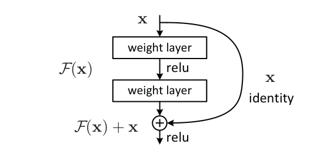

> 图 8.1　ResNet 残差学习的 building block（He et al., 2015, Figure 2）——恒等映射 $x$ 与 $F(x)$ 相加。

残差的重要性首先体现在梯度流上。反向传播时：

$$\frac{\partial \mathcal{L}}{\partial x} = \frac{\partial \mathcal{L}}{\partial y} \left(1 + \frac{\partial F}{\partial x}\right) \tag{8.2}$$

括号里的 **1** 提供了一条“梯度高速公路”：即使 $\frac{\partial F}{\partial x}$ 很小（梯度消失）或很大（梯度爆炸），梯度都能沿着恒等路径直达浅层。这使得训练上百层甚至上千层的网络成为可能。残差的第二重意义是**学习增量**：子层只需要学“在输入基础上改什么”（$F(x)$ 是残差增量），而不需要从零重构整个表示，这降低了学习难度。

在 Transformer 中，每个子层都包裹在残差里：

$$x_{l+1} = x_l + \text{Sublayer}(\text{Norm}(x_l)) \tag{8.3}$$

注意力子层和 FFN 子层各自一条残差路径，堆 $N$ 层后形成 $N$ 条并行的恒等通路。正因如此，前面归一化一节才会说“残差叠加导致数值膨胀”——残差的缺点（数值累加）恰好要靠 Norm 来治，这就是 Add & Norm 要绑在一起的原因。

```python
import torch
import torch.nn as nn


class TransformerBlock(nn.Module):
    """残差 + 归一化的标准包装：Pre-Norm 形式（现代主流）"""
    def __init__(self, d_model, num_heads, d_ff, dropout=0.1):
        super().__init__()
        self.attn = MultiHeadAttention(d_model, num_heads, dropout)
        self.ffn = FeedForward(d_model, d_ff, variant="swiglu")
        self.norm1 = RMSNorm(d_model)   # 或 nn.LayerNorm(d_model)
        self.norm2 = RMSNorm(d_model)
        self.drop = nn.Dropout(dropout)

    def forward(self, x, mask=None):
        # 注意力子层：Pre-Norm + 残差  x + Attn(LN(x))
        h = self.norm1(x)
        x = x + self.drop(self.attn(h, mask))
        # FFN 子层：Pre-Norm + 残差  x + FFN(LN(x))
        h = self.norm2(x)
        x = x + self.drop(self.ffn(h))
        return x


# 残差的梯度直觉验证：恒等路径让梯度直达浅层

x = torch.randn(2, 8, 64, requires_grad=True)
block = TransformerBlock(d_model=64, num_heads=8, d_ff=172)
y = block(x)
y.sum().backward()
print("input grad norm:", x.grad.norm().item())  # 梯度不会消失为 0
```

残差这十年基本**没有变过**——这是 Transformer 里最“保守”的组件。从 ResNet 到原始 Transformer，再到 GPT-5 时代的万层模型，$y = F(x) + x$ 一行公式始终是骨干。唯一的微调是与 Norm 的相对位置（Post-Norm → Pre-Norm）以及偶尔的缩放（如 DeepNet 的 $\beta$ 缩放残差分支，用于稳定超深网络）。不变的是恒等映射，变的只是它的“伴生品”归一化放在哪。

## 8.2 mHC

mHC（Manifold-Constrained Hyper-Connections，流形约束超连接）是 DeepSeek 在 2025 年底发布的工作（arXiv:2512.24880），也是这十年里对残差连接最激进的一次改造。

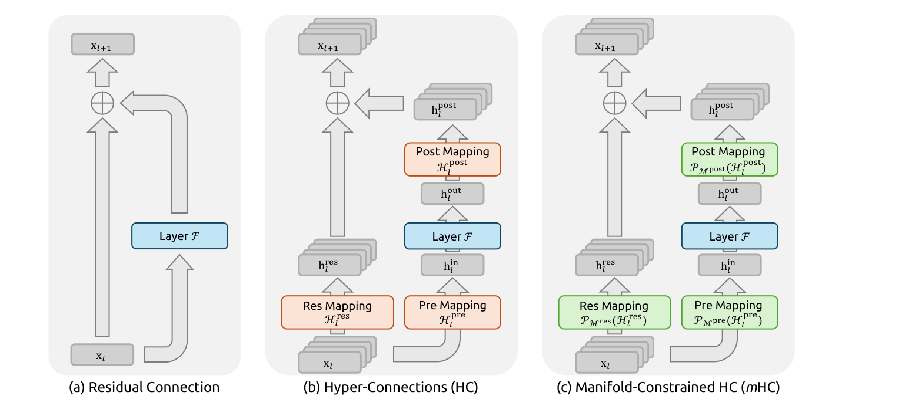

> 图 8.2　三种残差连接范式的对比（mHC 论文 Figure 1）。(a) 标准残差；(b) Hyper-Connections（HC），残差流加宽并加多个映射算子；(c) mHC，把这些映射算子约束到 Birkhoff 流形上。

**第一步：HC 拓宽了残差流**。Hyper-Connections 把单一的残差状态 $x_l$ 扩展成 $n$ 条并行分支 $h_l^{res} \in \mathbb{R}^{n \times d}$，并用可学习的映射矩阵（Res Mapping / Pre Mapping / Post Mapping）在读写之间做重组。残差流的宽度可扩展了，模型容量随之提升。

**第二步：HC 打破了恒等映射**。这正是问题所在——HC 的自由形态连接矩阵从根本上削弱了残差连接固有的恒等映射特性。实测后果是：在 27B 模型中，HC 的多层残差映射在反向传播中导致信号最大放大倍数**逼近 3000 倍**，训练出现严重的信号爆炸与梯度异常，同时 GPU 显存占用和通信带宽显著上升。

**第三步：mHC 把连接矩阵投影回受约束的流形**。核心思想是——不要自由地学连接矩阵，而是把它**投影到 Birkhoff 多面体**（双随机矩阵构成的集合，满足行和列和均为 1）上：

$$\mathcal{P}_{\mathcal{M}}(A) = \arg\min_{P \in \mathcal{M}} \|A - P\|_F^2, \qquad \mathcal{M} = \{P \in \mathbb{R}^{n \times n} : P \ge 0,\ P\mathbf{1} = \mathbf{1},\ P^\top \mathbf{1} = \mathbf{1}\} \tag{8.4}$$

投影用 **Sinkhorn-Knopp 算法**实现，训练时最多迭代 20 次。

这一约束之所以有效，在于双随机矩阵的谱范数被约束在 1 以内——无论深层堆叠多少层，信号都不可能被放大。恒等映射性质在拓扑意义下被恢复了，同时保留了 HC 的连接表达能力。

**效果**：mHC 支持 3B 到 27B 规模的稳定训练，在 8 个下游任务上全面超越 HC 与 baseline——BBH 推理任务 +2.1%、DROP 阅读理解 +2.3%。当扩展率 $n = 4$ 时，仅带来约 **6.7% 的额外训练时间开销**。

**已经是生产架构**：DeepSeek-V4 全面用 mHC 替换了标准残差连接，残差流宽度扩展因子 $n_{hc} = 4$，投影同样用 Sinkhorn-Knopp（训练时最多 20 次迭代）。

**DeepSeek V4.1 Flash：Single-Pass mHC**。V4.1 对 mHC 做了一次纯工程化的改造，把数学不变、内核融合做到极致。原始 mHC 的三步——Residual Update、Coefficient Prediction、Input Mixing——彼此存在数据依赖：输入混合系数 $A$ 必须等隐藏维度上的规约完成才能拿到，三个 kernel 只能串行，Residual Stream 被反复读写，激活访存量（Activation Memory Traffic）约为理论下限的**两倍**。

Single-Pass mHC 的改动只有一处，却很关键：把 Input Mixing 使用的系数向前错开一个 Block——当前 Block 直接消费上一 Block 已经算好的混合系数，内部依赖就此解除：

$$\text{Activation Memory Traffic}:\quad (4n + 4)\,d \;\longrightarrow\; (2n + 2)\,d \tag{8.5}$$

（$n$ 为残差流宽度扩展因子，$d$ 为隐藏维度）正好减半。部署侧再通过 **Mega-mHC Kernel** 把 Residual Update、Input Mixing、Coefficient Prediction 以及部分 Norm、FP8 转换全部融合进一个 memory-bound 内核，让 Residual Stream 接近“一次读取、一次写入”。DeepSeek 报告称系数错位带来的性能损失可以忽略。

```python
import torch
import torch.nn as nn
import torch.nn.functional as F


def sinkhorn_knopp(A, n_iter=20, eps=1e-9):
    """把矩阵投影到 Birkhoff 多面体（双随机矩阵）。"""
    Q = A.abs().clamp_min(eps)
    Q = Q / Q.sum()
    for _ in range(n_iter):
        Q = Q / Q.sum(dim=1, keepdim=True)     # 行归一化
        Q = Q / Q.sum(dim=0, keepdim=True)     # 列归一化
    return Q


class ManifoldConstrainedHyperConnection(nn.Module):
    """mHC：残差流宽度 n，用投影到双随机矩阵的方式保证恒等映射性质。"""

    def __init__(self, d_model, n_branches=4, n_iter=20):
        super().__init__()
        self.n = n_branches
        self.n_iter = n_iter
        self.res_map = nn.Parameter(torch.eye(n_branches).unsqueeze(0).repeat(d_model, 1, 1))
        self.pre_map = nn.Parameter(torch.eye(n_branches).unsqueeze(0).repeat(d_model, 1, 1))
        self.post_map = nn.Parameter(torch.eye(n_branches).unsqueeze(0).repeat(d_model, 1, 1))
        self.norm = nn.RMSNorm(d_model) if hasattr(nn, "RMSNorm") else nn.LayerNorm(d_model)

    def forward(self, x, sublayer):
        # x: (B, L, n, d)  拓宽后的残差流
        B, L, n, d = x.shape
        res = self.res_map                                     # (d, n, n)
        pre = self.pre_map
        post = self.post_map
        # 流形约束：投影到双随机矩阵集合（谱范数 <= 1，杜绝信号放大）
        res_p = torch.stack([sinkhorn_knopp(res[i], self.n_iter) for i in range(d)])
        pre_p = torch.stack([sinkhorn_knopp(pre[i], self.n_iter) for i in range(d)])
        post_p = torch.stack([sinkhorn_knopp(post[i], self.n_iter) for i in range(d)])

        h_in = torch.einsum("blnd,dmn->blmd", x, pre_p)       # Pre Mapping
        h_out = sublayer(self.norm(h_in))                     # 子层计算
        h_out = torch.einsum("blnd,dmn->blmd", h_out, post_p)  # Post Mapping
        return x + torch.einsum("blnd,dmn->blmd", h_out, res_p)  # Res Mapping + 残差
```

mHC 是这十年残差故事里最具启发性的一次——十年来残差连接几乎没变，但“不变”这件事本身被重新论证了一遍。HC 证明了残差流可以加宽，mHC 证明了加宽的同时还能守住恒等映射这个底线。

## 8.3 Block Attention Residual

Block Attention Residual 是 Kimi K3 提出的跨层信息流机制（AttnRes 的分块实现），它把残差连接从“顺序累加”改成了“**可学习的跨层检索**”。


> 图 8.3　三种残差连接范式的结构对比（Attention Residuals 论文 Figure 1，arXiv:2603.15031）。(a) 标准残差：所有层输出以固定单位权重顺序累加；(b) Full AttnRes：每层通过可学习 pseudo-query $w$ 与注意力权重 $\alpha$ 检索全部前层输出；(c) Block AttnRes：层先分块、块内求和压缩，跨块再做注意力——显存从 $O(Ld)$ 降到 $O(Nd)$（$N$ 为块数）。

**AttnRes 的核心洞察**：既然 Transformer 用注意力让每个位置去选择性访问所有前序位置，那为什么不用同样的方法，让每一层去选择性访问所有前层？传统残差是“所有层的信息一股脑累加到我身上”，而深层网络里，早期的特征会被反复混合、逐步稀释。

**机制**：给每一层一个可学习的 **pseudo-query** $w_l$，对前面所有层的输出做注意力：

$$\alpha_{i \to l} = \frac{\phi(q_l, k_i)}{\sum_j \phi(q_l, k_j)}, \qquad h_l = \sum_{i<l} \alpha_{i \to l} \cdot v_i \tag{8.6}$$

其中 $\phi(q, k) = \exp\left(q^\top \mathrm{RMSNorm}(k)\right)$——RMSNorm 防止大范数的层主导权重，这是这个公式能稳定工作的关键。

**Block 版本解决什么问题**：全量形式的复杂度是 $O(L^2 d)$（$L$ 是序列长度），层数不到 100 时算术开销尚可接受，但真正的瓶颈是 $O(Ld)$ 的**显存**——每一层都要保存前面所有层的输出用于检索。

Kimi K3 的 **Block AttnRes** 把 93 层分成 8 个 block：block 内的层输出先求和压缩成一个表示，跨 block 之间再做注意力：

$$\text{显存/通信}: O(Ld) \;\longrightarrow\; O(Nd) \tag{8.7}$$

其中 $N$ 是 block 数。同时 block 结构还能配合 online softmax 进一步减少推理时间成本。

**效果**：Kimi K3 相对 Kimi K2 获得约 **2.5 倍**的扩展效率提升，AttnRes 是四大架构创新之一（另外三个是 KDA、Gated MLA、Stable LatentMoE）。它与 mHC 是同一类思路的两种形态——mHC 把残差流“加宽并约束”，AttnRes 把残差流“变成可检索的层索引”。

残差连接的十年，从“恒等映射”（ResNet）到“可学习映射”（Hyper-Connections）到“流形约束的可学习映射”（mHC）再到“跨层注意力检索”（AttnRes），本质是同一条主线：让深层网络的信息流不再是一条只能累加的单行道。

## 8.4 Gated Residual

Gated Residual（GR）是 Qwen3.8-Flash-Next 采用的门控残差设计，可以看作Hyper-Connections 的加宽 + GatedNorm 的逐元素门控两者的合体。


> 图 8.4　Qwen3.8-Flash-Next 架构（Qwen3.8-Next 架构论文 Figure 1）。左侧是 3×GDN + 1×QSA 的层堆叠，右侧展开显示每个子层如何通过 GR Read / GR Write 与加宽后的残差流交互。

**结构**：原始的单一残差流被扩展成 **4 条并行分支**，每条分支独立归一化，再由门控加权合并读取：

$$\text{Read}: \quad h = \sum_{i=1}^{n} w_i \odot \mathrm{RMSNorm}(h_i), \qquad w = \sigma\left(\text{LowRank}\big(\mathrm{RMSNorm}(h_{1..n})\big)\right) \tag{8.8}$$

**两个门**：

- **读门（Read Gate）**：逐元素、数据相关。在子层读取残差流之前，先用一个**低秩（rank 320）**投影算出逐通道的 sigmoid 门控值，决定这一层能从残差流里“读取”多少信息，而不是无差别全盘接收
- **写门（Write Gate）**：每个分支一个标量门（sigmoid），子层计算完成后决定这次结果以多大强度写回对应分支

官方模型卡里的配置参数：`hc_count = 4`（分支数）、`hc_lowrank = 320`（分支间混合的瓶颈秩）、`output_gate_type = sigmoid`。

**和 mHC 的关键差异**：Qwen 去掉了 HC 原有的 `Hres` 混合算子，因此每条分支成为一个纯粹的历史累加器，可以精确追踪每层信息最终流向了哪里。分析发现：4 条分支里通常有**一条**专门负责跨越很多层传递早期信息（如第 0 层的输出被第 15、19 层大量读取），另外三条主要负责相邻层之间的短程传递。这种“一条专线负责长途、其余专线负责市内”的分工是模型自己学出来的，并非人为设定。

**两个反直觉的消融结论**：

1. 数据依赖的读写机制只让训练损失多降了 0.002，但下游基准分数提升了 1.98 分——损失端和下游端的表现完全倒过来。只盯损失曲线做架构决策，会严重低估这类改动的真实价值
2. 团队试过让每层**只读取门控值最高的两条分支**而非全部四条，以省下推理时的显存搬运。预训练阶段损失和基准分数几乎不受影响，看起来是无代价的优化——但**微调后生成质量明显下滑**，最终放弃。这是一个重要的教训：预训练阶段看起来免费的优化，可能要到更后期的训练阶段才会显现

去掉 `Hres` 也有工程理由：`Hres` 需要额外读一遍完整的残差状态，在参数量固定的推理场景下这是主导性的内存搬运开销。

Gated Residual 与 mHC 同属“残差流加宽 + 动态门控”这一脉，但 Qwen 的选择更激进也更实用——用低秩门控（rank 320，远小于隐层维度）换取细粒度控制，用去掉分支混合换取推理效率。十年残差故事的落点，从“恒等映射”变成了“恒等映射 + 数据相关的阀门”。

# 9. 十年变与不变

表 9.1　Transformer 十年演进的“变与不变”总览

| 组件 | 2017（原始 Transformer） | 2026（现代 LLM） | 变了吗？ | 驱动原力 |
|---|---|---|---|---|
| 骨架 | 堆叠子层 + 残差 + Norm | 基本相同（Decoder-only） | **不变** | 结构已被验证为局部最优 |
| 注意力 | MHA，$O(n^2)$ | GQA/MLA + FlashAttention | **大变** | KV Cache 显存与推理带宽 |
| 归一化 | Post-Norm + LayerNorm | Pre-Norm + RMSNorm + QK-Norm | **大变** | 深层训练稳定性、去掉冗余计算 |
| 位置编码 | sin-cos 绝对 | RoPE + NTK/YaRN 外推 | **大变** | 长上下文需求 |
| FFN | 2 层 ReLU，$4d$ | SwiGLU 门控，$\frac{8}{3}d$（或 MoE） | **大变** | 参数效率与知识存储 |
| 激活函数 | ReLU | SiLU（Swish） | **中变** | 平滑性、自门控、搜索 |
| 残差连接 | $y = F(x)+x$ | $y = F(x)+x$ | **不变** | 梯度高速公路，无替代品 |
| 训练目标 | 下一词预测 | 下一词预测（+多模态扩展） | **基本不变** | 简单有效 |

回看这十年的原动力，可以归结为两个字：**规模**。模型变大、序列变长、部署成本变敏感——每一次结构改动，几乎都是在回答“如何让这个结构在更大的规模上还能训得动、推得快、装得下”。而那些没变的部分（残差、堆叠、注意力+FFN 的交替、下一词预测），恰恰证明了 2017 年那次设计的先见之明：骨架已经够好，剩下的全是工程与效率的精雕细琢。

# 参考文献

1. Vaswani, A., Shazeer, N., Parmar, N., et al. (2017). **Attention Is All You Need**. *NeurIPS 2017*. arXiv:1706.03762.
2. Shazeer, N. (2019). **Fast Transformer Decoding: One Write-Head is All You Need**. arXiv:1911.02150.（MQA）
3. Ainslie, J., Lee-Thorp, J., de Jong, M., et al. (2023). **GQA: Training Generalized Multi-Query Transformer Models from Multi-Head Checkpoints**. *EMNLP 2023*. arXiv:2305.13245.（GQA）
4. Dao, T., Fu, D. Y., Ermon, S., et al. (2022). **FlashAttention: Fast and Memory-Efficient Exact Attention with IO-Awareness**. *NeurIPS 2022*. arXiv:2205.14135.
5. Zhang, B., Sennrich, R. (2019). **Root Mean Square Layer Normalization**. *NeurIPS 2019*. arXiv:1910.07467.（RMSNorm）
6. Xiong, R., Yang, Y., He, D., et al. (2020). **On Layer Normalization in the Transformer Architecture**. *ICML 2020*. arXiv:2002.04745.（Pre-LN / Post-LN）
7. Su, J., Ahmed, M., Lu, Y., et al. (2021). **RoFormer: Enhanced Transformer with Rotary Position Embedding**. arXiv:2104.09864.（RoPE）
8. Ba, J. L., Kiros, J. R., Hinton, G. E. (2016). **Layer Normalization**. arXiv:1607.06450.
9. Shazeer, N. (2020). **GLU Variants Improve Transformer**. arXiv:2002.05202.（SwiGLU/GeGLU）
10. Hendrycks, D., Gimpel, K. (2016). **Gaussian Error Linear Units (GELUs)**. arXiv:1606.08415.
11. Ramachandran, P., Zoph, B., Le, Q. V. (2017). **Searching for Activation Functions**. arXiv:1710.05941.（Swish/SiLU）
12. He, K., Zhang, X., Ren, S., Sun, J. (2015). **Deep Residual Learning for Image Recognition**. *CVPR 2016*. arXiv:1512.03385.（ResNet/残差）
13. Nair, V., Hinton, G. E. (2010). **Rectified Linear Units Improve Restricted Boltzmann Machines**. *ICML 2010*.（ReLU）
14. Devlin, J., Chang, M. W., Lee, K., Toutanova, K. (2018). **BERT: Pre-training of Deep Bidirectional Transformers for Language Understanding**. arXiv:1810.04805.
15. Brown, T. B., et al. (2020). **Language Models are Few-Shot Learners**. *NeurIPS 2020*. arXiv:2005.14165.（GPT-3）
16. Liu, A., et al. (2024). **DeepSeek-V2: A Strong, Economical, and Efficient Mixture-of-Experts Language Model**. arXiv:2405.04434.（MLA）
17. DeepSeek-AI (2024). **DeepSeek-V3 Technical Report**. arXiv:2412.19437.（MLA / DeepSeekMoE）
18. Yuan, J., Gao, H., Dai, D., et al. (2025). **Native Sparse Attention: Hardware-Aligned and Natively Trainable Sparse Attention**. *ACL 2025 Best Paper*. arXiv:2502.11089.（NSA）
19. DeepSeek-AI (2025). **DeepSeek-V3.2-Exp: Boosting Long-Context Efficiency with DeepSeek Sparse Attention**. arXiv:2505.09388 / GitHub 技术报告.（DSA）
20. DeepSeek-AI (2026). **DeepSeek-V4 Technical Report**. arXiv:2606.19348.（CSA / HCA / Compressed Attention）
21. Lai, X., Xu, W., Yang, Y., et al. (2026). **MiniMax Sparse Attention**. arXiv:2606.13392.（MSA）
22. Yang, N., et al. (2024). **Gated Delta Networks: Improving Mamba2 with Delta Rule**. arXiv:2412.06464.（Gated DeltaNet）
23. Kimi Team (2026). **Kimi K3: Open Frontier Intelligence**. arXiv:2607.24653.（KDA / AttnRes / SiTU-GLU / Stable LatentMoE）
24. Xie, Z., Wei, Y., Cao, H., et al. (2026). **mHC: Manifold-Constrained Hyper-Connections**. arXiv:2512.24880.（mHC）
25. **On the Design of Qwen3.8-Next Architecture: Evaluation, Efficiency, and Training Stability**. arXiv:2608.30320.（GDN / QSA / Gated Residual）
26. Mistral AI (2023). **Mistral 7B**. arXiv:2310.06825.（SWA / Rolling Buffer Cache）
27. Fedus, W., Zoph, B., Shazeer, N. (2021). **Switch Transformers: Scaling to Trillion Parameter Models with Simple and Efficient Sparsity**. *JMLR 2022*. arXiv:2101.03961.（Top-1 路由 MoE）
28. Jiang, A., et al. (2024). **Mixtral of Experts**. arXiv:2401.0408.（Top-2 路由 MoE）
29. MiniMax-AI (2025). **MiniMax-01: Scaling Foundation Models with Lightning Attention**. arXiv:2501.08313.（Lightning Attention / TransNormer）
30. Katharopoulos, A., et al. (2020). **Transformers are RNNs: Fast Autoregressive Transformers with Linear Attention**. ICML 2020.（线性注意力开山）
31. Zhu, B., et al. (2023). **Transformers are SSMs: Generalized Models and Efficient Algorithms Through Structured State Space Duality**. ICML 2024.（Mamba-2 / gated SSM）
32. Bai, S., et al. (2023). **Gemma 2: Improving Open Language Models at 2.6B Parameters**. arXiv:2408.00118.（SWA 交替）
33. Team, G. (2025). **Gemma 3 Technical Report**. arXiv:2503.19786.（SWA 5:1）
34. Kimi Team (2026). **Attention Residuals: Rethinking depth-wise aggregation**. arXiv:2603.15031.（AttnRes / Block AttnRes）
35. DeepSeek-AI (2026). **DeepSeek-V4.1-Flash: Pushing the Limits of KV Cache Compression**. arXiv:2609.19969.（CSA2 / Single-Pass mHC / SWA Bounded Replay / FP4 KV Cache）
36. Katharopoulos, A., Vyas, A., Pappas, N., Fleuret, F. (2020). **Transformers are RNNs: Fast Autoregressive Transformers with Linear Attention**. *ICML 2020*. arXiv:2006.16236.（Linear Transformer）
37. Choromanski, K., et al. (2021). **Rethinking Attention with Performers**. *ICLR 2021*. arXiv:2009.14794.（Performer / FAVOR+）
38. Sun, Y., et al. (2023). **Retentive Network: A Successor to Transformer for Large Language Models**. arXiv:2307.08621.（RetNet）
39. Gu, A., Dao, T. (2023). **Mamba: Linear-Time Sequence Modeling with Selective State Spaces**. arXiv:2312.00752.（Mamba）
40. Dao, T., Gu, A. (2024). **Transformers are SSMs: Generalized Models and Efficient Algorithms through Structured State Space Duality**. *ICML 2024*. arXiv:2405.21060.（Mamba2 / SSD）
41. Yang, S., et al. (2024). **Gated Linear Attention Transformers with Hardware-Efficient Training**. *ICML 2024*. arXiv:2312.06635.（GLA）
42. Dehghani, M., et al. (2023). **Scaling Vision Transformers to 22 Billion Parameters**. *ICML 2023*. arXiv:2302.05442.（QK-Norm / L2Norm）
43. Dai, D., et al. (2024). **DeepSeekMoE: Towards Ultimate Expert Specialization in Mixture-of-Experts Language Models**. *ACL 2024*. arXiv:2401.06066.（细粒度专家 / 共享专家）
44. Elango, V., Bhatia, N., Waleffe, R., et al. (2026). **LatentMoE: Toward Optimal Accuracy per FLOP and Parameter in Mixture of Experts**. arXiv:2601.18089.（潜空间路由专家 / LatentMoE 架构图）
45. Dugas, C., Bengio, Y., Bélisle, F., Nadeau, C., Garcia, R. (2001). **Incorporating Second-Order Functional Knowledge for Better Option Pricing**. *NIPS 2000*.（Softplus 激活函数）
46. Qiu, Z., Wang, Z., Zheng, B., et al. (2025). **Gated Attention for Large Language Models: Non-linearity, Sparsity, and Attention-Sink-Free**. *NeurIPS 2025 Best Paper*. arXiv:2505.06708.（SDPA 输出后 head-specific sigmoid 门）
47. Meituan LongCat Team (2026). **LongCat Sparse Attention: Taming the Lightning via Streaming-aware Hierarchical Cross-Layer Indexing**. arXiv:2608.01662.（LSA / SI / CLI / HI）
