# DeepSeek 大模型推理系统综述：从 V3 到 DeepInfer

## 摘要

DeepSeek 系列模型以低于同代前沿模型的单位 token 成本提供服务，其竞争力来自模型结构与推理系统的协同设计。本文以 DeepSeek-V3、V3.2、V4、V4.1-Flash 及开源推理引擎 DeepInfer 为对象，梳理四代系统的并行方案、缓存分层与调度机制，并汇总官方披露的时延与吞吐数据。效率提升集中在四个方向：键值缓存（KV cache）的表达逐代压缩，多头潜在注意力（MLA）将其压至约 70 KB/token，稀疏注意力（DSA）把注意力复杂度由 $O(L^2)$ 降至 $O(Lk)$，压缩稀疏注意力（CSA）与重度压缩注意力（HCA）在 token 维实现 4×–128× 压缩，V4.1 进一步降至 890 B/token；计算稀疏化由专家稀疏扩展到位置稀疏；部署由 Prefill/Decode 分离演进为三级分离与跨超节点的宽专家并行（Wide-EP）；存储由单机 HBM 扩展至约 100 PiB 的共享缓存集群。1M 上下文下，V4 单 token 推理 FLOPs 较 V3.2 降至 27%，KV cache 降至 10%。本文以帕累托前沿刻画吞吐与单用户速度的取舍，并讨论硬件可移植性、确定性推理代价与评测口径统一三个未解决问题。

## 1 引言

大模型推理的成本结构由两个不对称性决定。第一个是参数总量与激活参数量之间的不对称：DeepSeek-V3 的 671B 参数中每个 token 仅激活 37B，计算量按激活参数量计，但显存须容纳全部专家权重 [1]。第二个是两类阶段之间的负载不对称：Prefill 阶段一次性处理全部输入 token，属计算密集型任务，决定首 token 时延（time to first token，TTFT）；Decode 阶段逐 token 生成，每步需读取完整 KV cache，属显存带宽密集型任务，决定吐字间隔（time per output token，TPOT）[2]。

围绕这两组不对称，DeepSeek 的推理系统形成了相对稳定的设计范式：以专家并行（expert parallelism，EP）换取批量规模与显存占用，以阶段分离让两类负载各自匹配硬件，以缓存分层把重复计算移出关键路径。四代系统之间的差异，主要体现为注意力压缩程度、并行域宽度、缓存层级深度三个维度上推进幅度的不同。

本文以公开的技术报告、模型卡、官方仓库与第三方基准为依据，对上述四个维度做统一口径的梳理。第 2 节给出硬件基座、存储层级与评测指标；第 3–6 节依次分析 V3、V3.2、V4、V4.1-Flash 的架构、集群与性能；第 7 节介绍 DeepInfer 的组成与基准；第 8 节作横向比较并讨论开放问题；第 9 节为结论。附录 A 汇总四代模型的结构超参数。

## 2 硬件基座、存储层级与评测指标

### 2.1 关键加速器与互联

推理系统的形态取决于芯片的算力、显存容量、显存带宽与互联能力四项参数。表 1 汇总本文涉及的主要加速器。从 Hopper 到 Blackwell Ultra，单卡显存容量由 80 GB 增至 288 GB（3.6×），显存带宽由 3.35 TB/s 增至 8 TB/s（2.4×），FP8 稠密算力由 1.98 PFLOPS 提升至 5 PFLOPS（2.5×），并新增 FP4 计算路径（B300 达 15 PFLOPS）。互联侧，GB300 NVL72 将 72 颗 GPU 置于单一 NVLink 域（聚合带宽 130 TB/s），专家并行的 all-to-all 通信得以完全留在机架内 [3]。

**表 1　主要加速器关键参数**

| 芯片 | 架构 | 低精度算力（稠密） | 显存容量 | 显存带宽 | 卡间互联 | 节点间互联 | 典型功耗 |
| --- | --- | --- | --- | --- | --- | --- | --- |
| NVIDIA H800 SXM | Hopper | FP8 1.98 PFLOPS；BF16 0.99 PFLOPS | 80 GB HBM3 | 3.35 TB/s | NVLink 400 GB/s | IB 400 Gb/s | 700 W |
| NVIDIA H100 SXM | Hopper | FP8 1.98 PFLOPS；BF16 0.99 PFLOPS | 80 GB HBM3 | 3.35 TB/s | NVLink 900 GB/s | IB 400 Gb/s | 700 W |
| NVIDIA H20 | Hopper | FP8 296 TFLOPS；BF16 148 TFLOPS | 96 GB HBM3 | 4.0 TB/s | NVLink 900 GB/s | IB 400 Gb/s | 400 W |
| NVIDIA B200 | Blackwell | FP4 9 PFLOPS；FP8 4.5 PFLOPS；BF16 2.25 PFLOPS | 192 GB HBM3e | 8 TB/s | NVLink 5，1.8 TB/s | IB 400/800 Gb/s | ≈1 000 W |
| NVIDIA B300（GB300 NVL72） | Blackwell Ultra | FP4 15 PFLOPS；FP8 5 PFLOPS | 288 GB HBM3e | 8 TB/s | NVLink 5，1.8 TB/s（NVL72 单域 130 TB/s） | CX-8 800 Gb/s | ≤1 400 W |
| 昇腾 950PR | 达芬奇 | FP8 1 PFLOPS；MXFP4 2 PFLOPS | 128 GB 自研 HBM（Atlas 350 实配 112 GB） | 1.6 TB/s（实配 1.4 TB/s） | 灵衢 UB，2 TB/s（卡级 424 GB/s） | UB-Mesh | 600 W |
| 昇腾 950DT | 达芬奇 | FP8 2 PFLOPS；FP4 4 PFLOPS | 144 GB 自研 HBM | 4 TB/s | 灵衢 UB，2 TB/s | UB-Mesh | — |

注：算力均为稠密（dense）口径。昇腾 950 为芯片级标称值，量产卡 Atlas 350 因分档存在差异 [4]。H800 相对 H100 的主要差异在于 NVLink 带宽由 900 GB/s 降至 400 GB/s、FP64 算力大幅削减，该限制直接影响 V3 的并行策略选择 [1][5]。

昇腾 950 系列采用"一芯双构"设计：同一颗 950 Die 分别与低成本高容量的 HiBL 1.0、高带宽的 HiZQ 2.0 合封，形成面向 Prefill（算力受限）的 950PR 与面向 Decode（带宽受限）的 950DT，阶段分离的思路由此下沉到芯片选型层面 [4]。

### 2.2 存储层级与集群规模

推理系统的存储不止 HBM 一级。以 V4.1-Flash 为例，线上系统形成三层结构（表 2）：运行中的 Block/State KVCache 驻留推理卡显存；滑动窗口注意力（sliding window attention，SWA）状态保存在产生它的 Prefill/Decode 机器的主机内存；持久化的 Block KVCache 写入独立的 3FS 存储集群，容量约 100 PiB 全固态，峰值聚合读 10 TiB/s、写约 850 GiB/s，并针对约 112 KiB 粒度的 Block 随机读写作了专门优化 [6][7]。计算节点与存储节点独立扩缩容，计算侧故障不会导致持久缓存丢失，这是把 KV 缓存从单机缓存扩展为集群级共享数据层的前提。

**表 2　推理系统的典型存储层级（以 V4.1-Flash 线上系统为例）**

| 层级 | 介质 | 容量口径 | 带宽/时延特征 | 存放内容 |
| --- | --- | --- | --- | --- |
| L1 显存 | HBM3e / 自研 HBM | 80–288 GB/卡 | 3.35–8 TB/s | 权重、运行中 Block/State KVCache |
| L2 主机内存 | DDR5 | 单机 TB 级 | 百 GB/s 量级 | SWA KVCache（134 token ring × 20 层，单副本） |
| L3 集群存储 | 3FS + SSD | ≈100 PiB | 读 10 TiB/s、写 850 GiB/s | 持久化 Block KVCache（128 token/block） |

集群规模上，V3 时代的训练集群为 2 048 张 H800 [1]，推理侧以 4 节点（32 卡）与 18 节点（144 卡）为部署单元 [2]；V4.1-Flash 时代则由 8 卡服务器承担 Prefill、64–128 卡超节点承担 Decode，官方给出的最小高效配置为 64 卡 Prefill + 64 卡 Decode，单集群日吞吐达 155 万亿 token [8][6]。

### 2.3 评测指标定义

为避免跨代比较时的口径差异，本文统一采用如下定义。TTFT 为请求发出至首个输出 token 返回的时间，受排队、调度与 Prefill 共同影响；TPOT 为相邻输出 token 的间隔，满足 TPOT ≈ 1/TPS；TPS 既可用于单请求输出速度（tok/s/user），也可用于单卡或集群吞吐（tok/s/GPU）；吞吐–时延帕累托前沿指在不牺牲一项指标的前提下无法改进另一项的配置集合，是评价推理系统综合效率的常用口径 [8]。

## 3 DeepSeek-V3 推理系统

### 3.1 模型架构

DeepSeek-V3 为 671B 总参、37B 激活的 MoE 模型，共 61 层：第 0–2 层为稠密前馈网络（feed-forward network，FFN）（中间维 18 432），第 3–60 层为 MoE，每层 1 个共享专家加 256 个路由专家、每 token 激活 8 个（专家中间维 2 048），词表 129 280 [1]。其结构可拆为三个部件（图 1(a)）。

- MLA：hidden 为 7 168，128 个注意力头。查询经 1 536 维低秩路径（`W_DQ`）升维后拆为 128 维 Nope 与 64 维旋转位置编码（rotary positional encoding，RoPE）两部分；键值方向先由 `W_DKV` 压成 512 维潜在向量 `c_KV`，再由 `W_UKV` 上投影为各头 128 维的 k、v，位置信息由独立的 `W_KR` 逐头生成 64 维 RoPE 键。解码时每 token 只需保存 `c_KV`（512）与 `k_R`（64），合计约 70 KB/token（61 层），相对 LLaMA-3.1-405B 减少约 7.28 倍。
- DeepSeekMoE：门控先算 `s_i,t = Sigmoid(u_tᵀe_i)` 并归一化，取 top-8。无辅助损失的均衡通过仅用于选择的偏置 `b_i` 实现，`b_i` 每步按专家负载以步长 γ 增减，损失函数中不含均衡项。
- 多 token 预测（multi-token prediction，MTP）：主干之后接 1 个深度的多 token 预测模块，与主干共享 embedding 与输出头，官方口径下带来约 1.8× 的 TPS 提升。

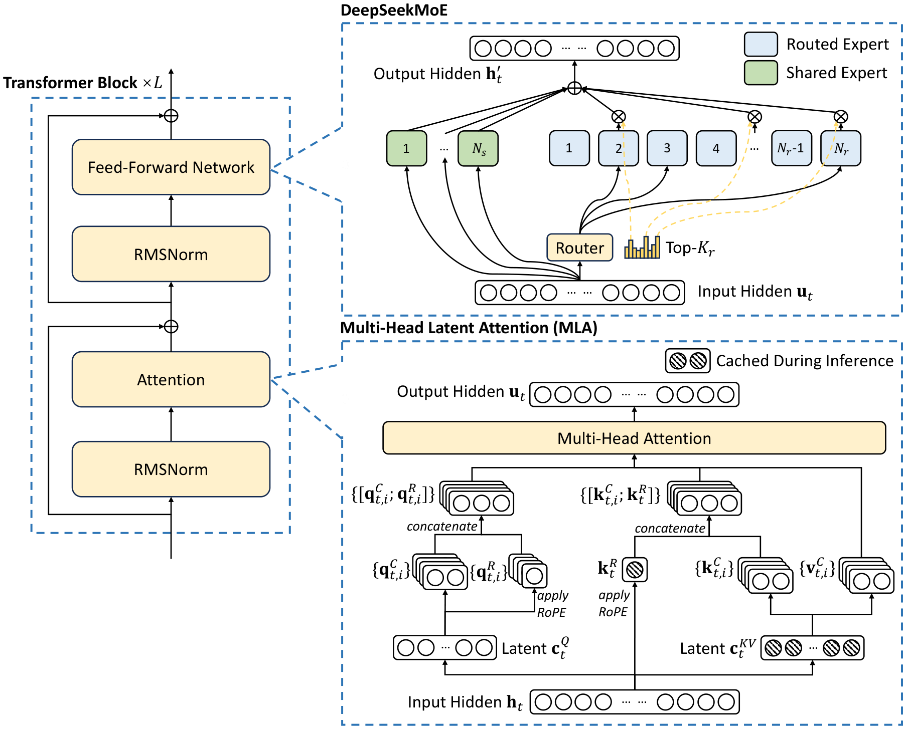

**图 1(a)　DeepSeek-V3 的基本架构：Transformer 块、DeepSeekMoE 与多头潜在注意力（引自 DeepSeek-V3 技术报告 Fig. 2）**

### 3.2 服务拓扑：Prefill/Decode 分离与跨节点专家并行

V3 的线上系统采用 Prefill/Decode 分离架构，两阶段使用不同并行度（表 3、图 1(b)）。Prefill 以 4 节点 32 卡为部署单元，路由专家 EP32、MLA 与共享专家 DP32，含 32 个冗余路由专家，每卡承担 9 个路由专家与 1 个共享专家；Decode 以 18 节点 144 卡为单元，EP144/DP144，每卡仅 2 个路由专家与 1 个共享专家 [2]。每层 256 选 8 的稀疏比意味着单个专家需累积足够批量才能使矩阵计算效率与显存访问效率同时达到可接受水平，跨节点 EP 的动机源于此。

**表 3　V3 线上系统的部署形态与并行配置**

| 项目 | Prefill 阶段 | Decode 阶段 |
| --- | --- | --- |
| 部署单元 | 4 节点 / 32 GPU | 18 节点 / 144 GPU |
| 路由专家并行 | EP32（含 32 个冗余专家） | EP144（含 32 个冗余专家） |
| MLA / 共享专家并行 | DP32 | DP144 |
| 单卡专家负载 | 9 路由专家 + 1 共享专家 | 2 路由专家 + 1 共享专家 |
| 计算精度 | 矩阵乘/dispatch：FP8；MLA 核心/combine：BF16 | 同左 |
| 通信优化 | 双 microbatch 交替，隐藏 all-to-all | attention 拆两步，5 级流水线重叠 |

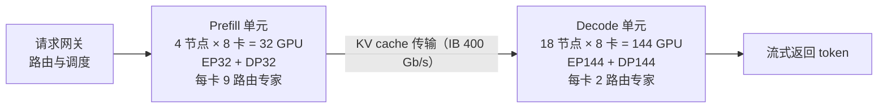

**图 1(b)　V3 的 Prefill/Decode 分离服务拓扑**

### 3.3 通信–计算重叠与三级负载均衡

跨节点 EP 的主要代价是 all-to-all 通信。V3 采用两种重叠策略：Prefill 阶段把请求批次拆为两个 microbatch 交替执行，用一个的计算隐藏另一个的通信；Decode 阶段各子阶段耗时不均，遂将 attention 拆为两步并用 5 级流水线实现重叠。此外，每 token 最多分发至 4 个节点（node-limited routing），把跨节点 IB 流量约束在可控范围，节点内则走 NVLink；配套的 DeepEP 通信库实现单卡 all-to-all 带宽超过 40 GB/s，接近打满 400 Gb/s 网卡 [1][2]。

负载均衡被拆为三个相互独立的问题：Prefill 侧均衡各 DP 实例的 core-attention 计算量与 dispatch 发送量；Decode 侧均衡 KV cache 占用与请求数；专家并行侧为高负载专家设置冗余副本，并按线上统计周期性重排专家放置（约每 10 分钟一次），以最小化单卡最大接收负载 [2]。

### 3.4 线上性能

表 4 给出官方披露的 24 小时统计。按 $2/GPU·h 的租价测算，理论日收入约 56.2 万美元、成本利润率约 545%，实际值受定价策略、夜间折扣与免费流量影响而低于该数 [2][9]。生成速度方面，V3 相较 V2.5 由约 20 TPS 提升至 60 TPS。

**表 4　V3 线上服务 24 小时统计与性能指标**

| 指标 | 数值 |
| --- | --- |
| 输入 token | 608B / 天（其中 342B 命中 KV cache，命中率约 56%） |
| 输出 token | 168B / 天 |
| 单节点 Prefill 吞吐 | ≈73.7k input tok/s（8×H800） |
| 单节点 Decode 吞吐 | ≈14.8k output tok/s（8×H800） |
| 单请求平均输出速度 | 20–22 TPS |

## 4 DeepSeek-V3.2：稀疏注意力驱动的成本下探

### 4.1 DSA 架构

V3.2-Exp（2025-09-29）与正式版 V3.2（2025-12-01）在架构上仅有一处改动，即通过持续训练引入 DeepSeek 稀疏注意力（DSA），参数规模与 MoE 配置保持不变（671B/37B，256 路由 + 1 共享专家，激活 8），上下文 128K [10][11]。DSA 是"轻量索引器 + 稀疏 MLA"的两段式结构（图 2）。

- Lightning Indexer：查询由 1 536 维 query 潜向量经 `W_qI` 映射为 64 个头 × 128 维，并施加与主 MLA 不同的非交错 RoPE；键由 `W_kI` 压成单头 128 维，经 LayerNorm 与 Hadamard 旋转后以 FP8 缓存。全部 64 个头共享同一键（multi-query attention，MQA 模式），每 token 每层仅 128 B，加 4 B 缩放共 132 B，约为主 MLA 缓存的 1/5。打分采用 $I(t,s) = \Sigma_j w_{t,j}\cdot\mathrm{ReLU}(q_{t,j}\cdot k_s)$，以 ReLU 替代 softmax 换取低精度下的吞吐。
- 细粒度选择：每个 query 取 $I(t,\cdot)$ 最大的 k = 2 048 个位置，在 128K 上下文下只访问约 1.6% 的键；复杂度由 $O(L^2)$ 降至 $O(Lk)$，128K 下单层注意力 FLOPs 降约 80%。
- 稀疏 MLA：仅对选中位置加载完整潜在向量（`c_KV` 512 + `k_R` 64 = 656 B/token/层）执行 192 维注意力，未选中位置在 softmax 前置 −inf 归零。每层各带独立索引器，不做跨层 top-k 共享。

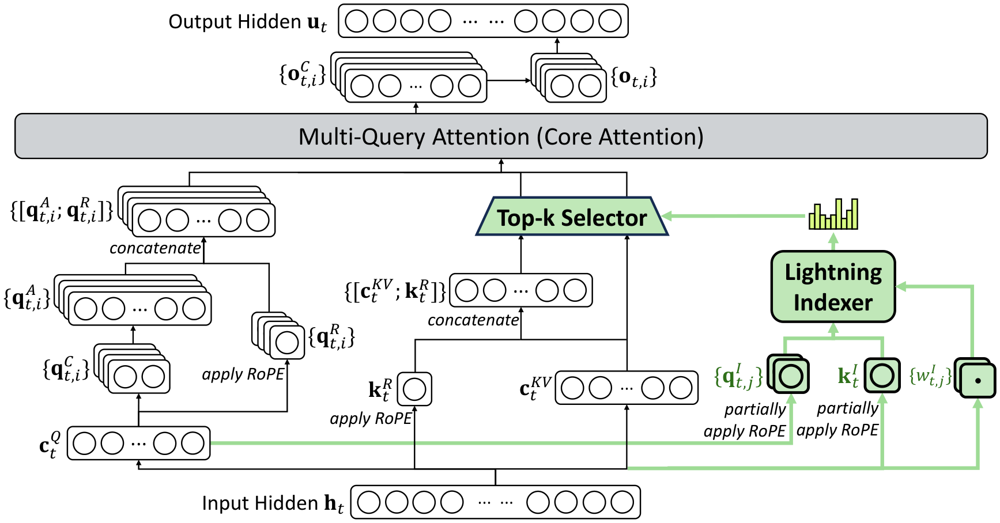

**图 2　DeepSeek-V3.2 的注意力架构：DSA 在 MLA 之下实例化，绿色部分为 Lightning Indexer 选出 top-k 键值条目的路径（引自 DeepSeek-V3.2 技术报告 Fig. 2）**

### 4.2 工程实现与部署

DSA 的落地伴随算子重写：DeepSeek 同时开源了 TileLang 与 CUDA 两版 GPU 算子，TileLang 版作为精度基线与快速迭代载体，CUDA 版作为高效实现 [10]。部署侧沿用 V3 的 PD 分离与跨节点 EP 架构，变化体现在负载结构上：core-attention 的计算与访存压力随上下文长度近似线性化，同等显存可容纳更长上下文与更大并发。主流引擎（SGLang、vLLM）提供 day-0 支持，典型配置为 DSA attention backend + topk 2048 + indexer FP8 + KV cache FP8（e4m3）+ page size 64 [12]。

### 4.3 性能与成本

DSA 的直接经济效果是 API 价格下调超过 50% [10]。能力侧，V3.2 在推理类基准上达到 GPT-5 水平（略低于 Gemini-3.0-Pro），输出长度较同代长思考模型明显缩短，等效降低了用户等待时间与单位任务成本；长思考增强版 V3.2-Speciale 在 IMO 2025、CMO 2025、ICPC World Finals 2025、IOI 2025 均获金牌，但 token 消耗显著更高 [10][11]。结合 V3 时期以单 token 成本核算的定价方式（表 4）可以观察到，推理系统的优化目标已从单 token 成本转向单任务成本。

## 5 DeepSeek-V4：百万上下文下的混合注意力

### 5.1 架构

V4（2026-04-24 预览并开源，MIT 许可）包含两个规格：V4-Pro（1.6T 总参 / 49B 激活）与 V4-Flash（约 285B / 13B），上下文 1M（1 048 576 token，按 95% 可用），最大输出 384K [13][14]。其架构改动可归纳为四点。

1. 混合注意力 CSA + HCA。系列整体架构见图 3(a)。config 以逐层的 `compress_ratios` 列表声明每个注意力层的类型：4 表示 CSA、128 表示 HCA、0 表示纯滑动窗口。CSA 先用带学习位置偏置的 softmax 门控池化把连续 m = 4 个 token 压成 1 个 KV 条目（序列维 4× 压缩），再用 FP4 的 Lightning Indexer（64 头 × 128 维）选出 top-k = 1 024 个压缩块做稀疏注意力，单元内部结构见图 3(b)；HCA 把 m′ = 128 个 token 压成 1 条后做稠密注意力，以较低成本获得全程视角，见图 3(c)。两类层均附带 128 token 的滑动窗口分支。V4-Pro 的 61 层按"层 0–1 仅 HCA → 层 2–60 的 CSA/HCA 交替（30 层 CSA + 31 层 HCA）→ MTP 块仅滑动窗口"排布；V4-Flash 为 43 层，前两层为纯滑动窗口，其后 21 层 CSA 与 20 层 HCA 交替。系列的整体架构见图 3(a)。
2. 流形约束超连接（manifold-constrained hyper-connections，mHC）。残差流宽度扩为 4 路（`hc_mult = 4`），残差混合矩阵约束在 Birkhoff 多面体（双随机矩阵）上，训练时用 Sinkhorn-Knopp 迭代（不超过 20 次）投影，使谱范数不超过 1，抑制深层信号放大。
3. Muon 优化器与 FP4 量化感知训练。主体参数采用 Newton-Schulz 正交化的 Muon（8 次收敛 + 2 次稳定），embedding、预测头、偏置与 RMSNorm 保留 AdamW；MoE 专家权重降为 MXFP4，其余保持 FP8。
4. 其余继承与微调。注意力形状为 128 头、KV 头 1、head_dim 512、q_lora 1 536、o_lora 1 024、qk_rope 64，hidden 7 168；MoE 扩为 384 路由 + 1 共享、每 token 激活 6 个、专家中间维 3 072，门控由 Sigmoid 改为 Softplus；层 0–2 使用哈希路由；上下文 1M 由 65 536 的原始训练长度经 YaRN（16×）外推得到。

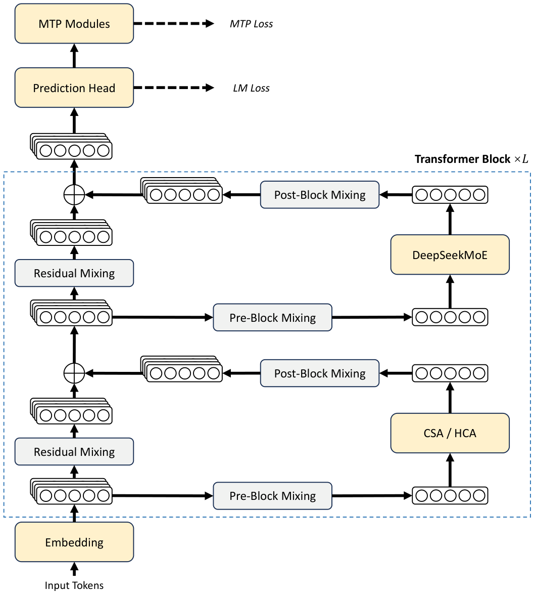

**图 3(a)　DeepSeek-V4 系列的整体架构：混合 CSA/HCA 注意力、Pre-Block 与 Post-Block 混合及 MTP 模块（引自 DeepSeek-V4 技术报告 Fig. 2）**

**图 3(b)　CSA 的核心结构：token 级压缩器、Lightning Indexer 与 top-k 选择器（引自 DeepSeek-V4 技术报告 Fig. 3）**

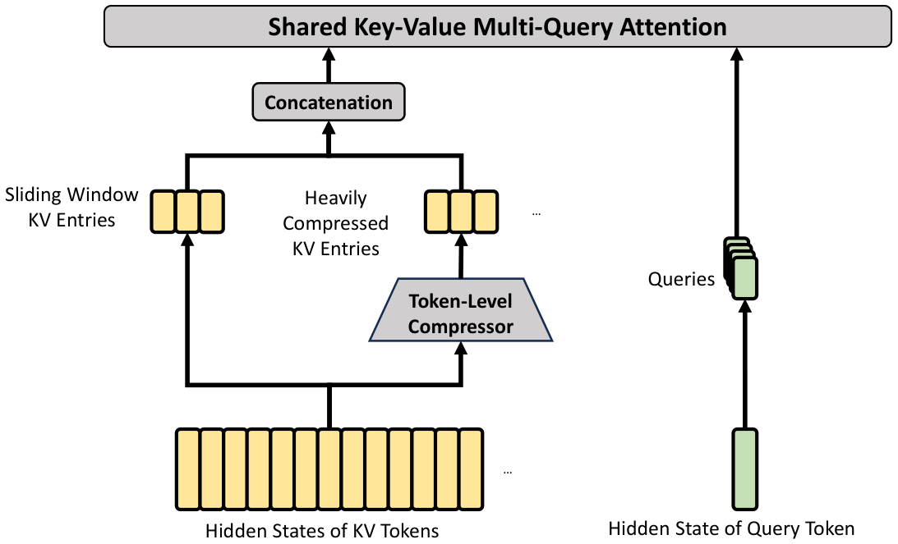

**图 3(c)　HCA 的核心结构：重度压缩键值与稠密注意力（引自 DeepSeek-V4 技术报告 Fig. 4）**

### 5.2 推理效率

1M 上下文下的效率提升见表 5。以 V3.2 为基准，V4-Pro 的单 token 推理 FLOPs 降至 27%、KV cache 降至 10%；V4-Flash 进一步降至 10% 与 7%。对比 GQA-8 基线，V4 的 KV cache 约为其 2%。同为 100 万 token 上下文，Llama-3.1 需约 274 GB、GLM-5 约 60 GB，而 V4 仅约 5.48 GB；各代模型的 KV 占用对比见图 4。

**表 5　V4 系列模型规格与 1M 上下文下的推理效率**

| 模型 | 总参/激活 | 单 token FLOPs（vs V3.2） | KV cache（vs V3.2） | 1M 上下文 KV | 权重落盘 |
| --- | --- | --- | --- | --- | --- |
| V4-Pro | 1.6T / 49B | 27% | 10% | ≈5.48 GB | ≈865 GB（MXFP4 专家 + FP8） |
| V4-Flash | 约 285B / 13B | 10% | 7% | ≈3.8 GB（按比例推算） | ≈160 GB |

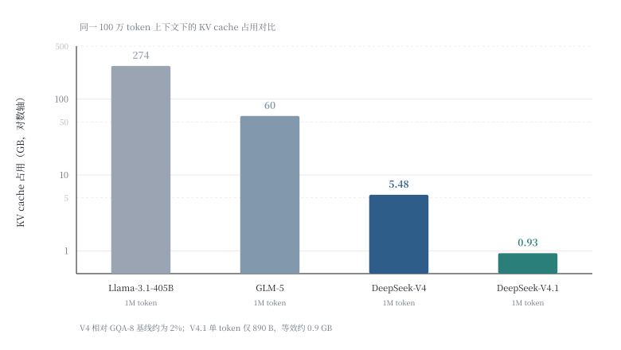

**图 4　同一 1M token 上下文下各代模型 KV cache 占用的对比**

### 5.3 部署形态与性能

V4 提供 Non-think、Think High、Think Max 三种推理模式（后者需 ≥384K 上下文），API 同时兼容 OpenAI 与 Anthropic 协议。由于权重与注意力结构发生改变，社区部署普遍以 Wide-EP 为核心：GB300 NVL72 上把 Decode 扩至 EP16、并发推到 21 504，配合 W4A4（MXFP4）MegaMoE kernel 与 MTP，使 MoE 的 dispatch/combine 全部留在 72 卡 NVLink 域内，50 tok/s/用户、8K 输入/1K 输出下成本约 $0.156/百万输出 token [15]。B200 + vLLM 的单位供电吞吐由约 30 万 tok/s/MW 提升至约 50 万 tok/s/MW [15]。在算力更受限的 H20 上，场景化配置（Prefill 按上下文长度在 PP2/PP4 间切换，Decode 低时延用 PP2-TP8、高吞吐用 DP32-EP32）使 4K/32 并发下吞吐由 319.9 提升至 703.2 tok/s/GPU（2.2×），1M 单请求由 27.1 提升至 66.8 tok/s/GPU [16]。这些部署结果的差异表明，同一模型的最优部署剖面随上下文长度与并发目标变化，拓扑需按此选择。

## 6 DeepSeek-V4.1-Flash：非对称结构与集群级缓存

### 6.1 架构

V4.1-Flash（2026-09-10，API 名 `deepseek-flash`）是全新结构族中尺寸最小的模型（主干 552B，检查点约 511 GB），也是首个原生支持视觉理解的版本 [17][6]。其结构要点见图 5(a) 与图 5(b)。

- 因果编码器–解码器（causal encoder–decoder，CED）非对称主干：40 层 Transformer 拆成 20 层因果编码器 + 20 层解码器，hidden 5 120；编码器带因果掩码、前两层仅滑动窗口、其后为 CSA2，Prefill 阶段每 token 激活 8B；解码器自回归生成、每 token 激活 16B。解码器的全局 KV 由编码器最终隐态投影而来，而非由每个解码层各自维护，这是激活量能够非对称的根本原因，也是 KV 体积下降的主要来源。
- CSA2 跨层共享：每个注意力层被静态指派为 Full、Reindex、Reuse 三种模式之一，共享主 KV 与索引器键；分层稀疏索引器先把候选压缩块限定在前一个 Full 层建立的候选池（2 048 块 × 8 token），每个 query 只保留 512 块，使深层索引成本与上下文长度解耦。
- MoE 与 Engram：每层 384 路由 + 1 共享专家、每 token 激活 6 个；另挂载约 196B 参数的 Engram 条件记忆，在第 1、14 层以两张哈希表按 token 组合稀疏查表，只占存储、不进入前向计算。
- 视觉通路：自研 DeepSeek-ViT（32 层、hidden 1 024、patch 14、2D-RoPE、3×3 像素下采样）加 2 层 MLP 投影，图像以 span 形式进入提示，并在路由时对 span 内 token 施加单独偏置。
- KV 与投机解码：主 KV 以 FP4 存储，单 token 全局 KV 压至 890 B，HBM 需求为上一代的 1/4、SSD 为 1/8，相对初代模型累计缩小 437 倍；生成侧由 DSpark 草稿头做定长 5 的投机解码。

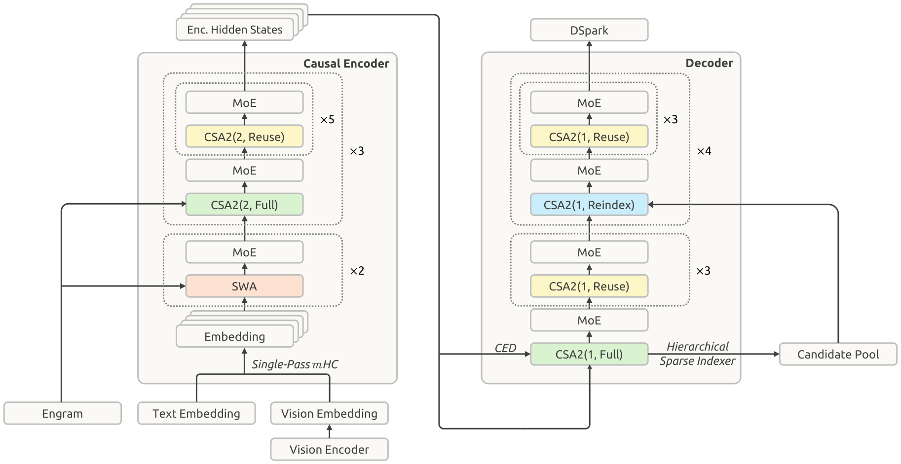

**图 5(a)　DeepSeek-V4.1-Flash 的整体架构：因果编码器与解码器分离、全局 KV 由编码器末层投影、Engram 条件记忆与 DSpark 草稿头（引自 DeepSeek-V4.1-Flash 技术报告 Fig. 3）**

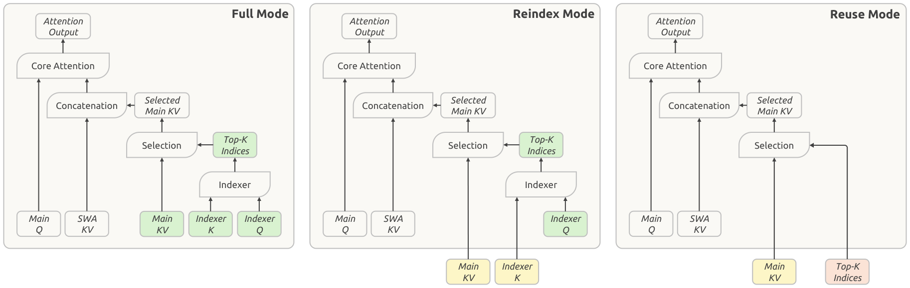

**图 5(b)　CSA2 的三种运行模式：Full、Reindex 与 Reuse（引自 DeepSeek-V4.1-Flash 技术报告 Fig. 4）**

### 6.2 部署形态：E/P/D 三级分离与自动扩缩容

V4.1-Flash 的线上系统在设计之初确立了三个目标：兼容不同厂商芯片、围绕常见硬件组织两阶段负载、让 KVCache 保留 72 小时以上以减少重复计算。部署上把视觉编码器（vision encoder，VE）、Prefill、Decode 三级分离，各自独立扩缩容并分别优化 TTFT 与吐字间隔（表 6）。Prefill 使用常规 8 卡服务器，MoE 采用 EP2–8 / DP2–8；Decode 使用 64–128 卡超节点，Wide-EP 扩至 EP64–128 / DP64–128，当前生产配置不使用张量并行与上下文并行 [8][6]。

**表 6　V4.1-Flash 线上系统的部署与缓存参数**

| 项目 | 配置 |
| --- | --- |
| 阶段划分 | 视觉编码器 / Prefill / Decode 三级分离 |
| Prefill | 8 卡服务器，EP2–8 + DP2–8；按输入长度分四档（<16K、16K–64K、64K–256K、>256K）调度 |
| Decode | 64–128 卡超节点，EP64–128 + DP64–128（Wide-EP），不使用 TP/CP |
| 最小高效配置 | 64 卡 Prefill + 64 卡 Decode |
| 持久缓存 | 3FS 集群约 100 PiB；Block KVCache 128 token/block |
| 缓存 TTL | Agent 流量 3 天；Chatbot 流量 7 天 |
| KVCache 粒度 | 890 B/token；SWA 状态为 134 token ring × 20 层（128 窗口 + 6 投机回退余量） |
| 扩缩容 | Prefill 依据未命中 token 数、Decode 依据活跃计算请求数；配额占用 >0.8 禁止缩容；下线 1 分钟宽限期并转移请求与 KV |

PD 分离后两类资源的需求比例随流量实时变化，固定配比会在部分时段出现一侧排队、另一侧空转。系统因此按未命中 token 数与活跃请求数分别估算实例需求，并设置上下界与调整速率限制；Decode 实例收到下线通知后进入 1 分钟宽限期，未完成请求连同其 KVCache 一次性转交其他实例；同时保留冗余配额以吸收突发，配额占用率高于 0.8 时禁止缩容。容错方面并未把重启时间压到分钟级以下，而是依靠冗余配额与请求级重路由的组合实现 [6]。

### 6.3 缓存命中路径与 SWA 有界重放

持久 Block KVCache 由独立 3FS 集群承载，任何 Prefill 机器都能命中任意前缀，因而不需要前缀亲和路由，也避免了缓存路由与负载均衡之间的冲突。命中路径分为三段，只有第一段位于请求关键路径：匹配阶段，入口在本机 kvcache-store 中以哈希链做前缀匹配，只查元数据，但命中长度必须在路由前获知，无法被掩盖；取 KV 阶段，独立进程异步地把数据从 3FS 搬入主机共享内存；换入阶段，引擎线程再把数据从共享内存搬入 HBM，并逐层与前向计算重叠。由于 CUDA Copy Engine 处理细粒度 Block 拷贝效率不佳，改用 GDR 让 RDMA 网卡跑满 PCIe 带宽且不占用流多处理单元（streaming multiprocessor，SM）[6]。

V4 时代曾把 SWA KVCache 一并持久化以便精确恢复，实测表明这类缓存通常只在单次会话的数分钟内被复用，与可跨天复用的 Block KVCache 性质不同，长期保存会占据近一半持久容量却难以带来命中收益。V4.1 因此改用 SWA 有界重放（bounded replay）：不再持久化 SWA 状态，缺失时仅重算最近 128 个 token（部署配置保留后缀 140 token，覆盖窗口与投机回退余量），并把重算时的注意力范围截断在窗口内。重算成本不再随上下文长度与层数增长，而成为近似固定开销，官方给出的量级是 Decoder 路径的 Prefill 计算量接近减半 [8][6]。

### 6.4 调度与投机解码

DSpark 把推测解码的验证长度做成动态决策：每轮生成 5 个草稿 token，置信度头（confidence head）预测各位置的接受率，再结合预先测得的硬件吞吐曲线，选择"预期有效 token 数 / 预计执行时间"最高的连续前缀送交主模型验证。线上 EP64/DP64、每 rank 60 并发条件下，平均验证长度由 5 降至 3.58，平均接受长度由 3.30 变为 3.21，吞吐由 13 730 升至 14 466 tok/s/rank（+5.4%）；16 并发时为 −1.5%，96 并发时为 +11.0%，收益依赖工作点 [8]。调度侧则让 GPU 执行第 N 步前向与采样时，CPU 并行完成第 N+1 步调度并回收上一轮结果，把调度开销移出关键等待路径。

### 6.5 线上性能

表 7 汇总官方披露的线上实测。平均输入长度 77K 与缓存命中率 96% 的组合，使每卡吞吐（含缓存命中）达到 1.5M tok/s；在此条件下，Agent 类负载的成本主要由缓存命中率而非算力决定。图 6 与图 7 分别给出 Decode 与 Prefill 阶段的帕累托前沿。

**表 7　V4.1-Flash 线上实测指标**

| 指标 | 数值 |
| --- | --- |
| TTFT 平均 / P99 | 400 ms / 1 000 ms |
| 平均输入长度 | 77K token |
| 平均输入缓存命中率 | 96% |
| Decode 吐字速度 | 230 TPS（代码场景 300 TPS） |
| 单卡吞吐（不含缓存命中 / 含命中） | 60K tok/s / 1.5M tok/s |
| 单集群日吞吐 | 155 万亿 token/天 |
| 谷时单位算力收入 | $38 / GPU·h |
| 推测解码收益 | 变长验证较固定 5 个草稿 +6% 吞吐 |
| 缓存收益 | Bounded Replay 使 Decoder Prefill 计算量 ≈ 减半 |

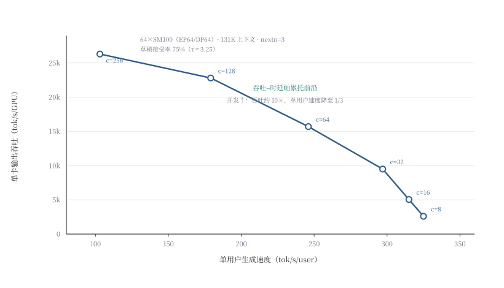

**图 6　Decode 阶段吞吐–时延帕累托前沿（64×SM100，EP64/DP64，131K 上下文，nextn=3，接受率 75%）**

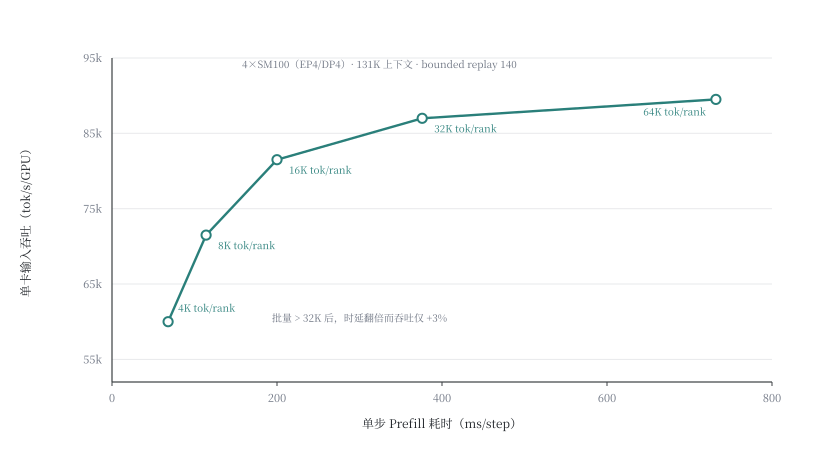

**图 7　Prefill 阶段吞吐–时延帕累托前沿（4×SM100，EP4/DP4，131K 上下文，bounded replay 140 token）**

## 7 DeepInfer：生产级推理引擎的开源

### 7.1 系统结构

2026-10-20，DeepSeek 以 Apache-2.0 协议开源其线上生产级推理引擎 DeepInfer，同步开源 token 编解码组件 deepseek-recipe [18]。首发版本面向 DeepSeek-V4.1-Flash-1017 单模型，提供离线批处理推理能力 [8][6][19]。其结构自上而下分为接入层、调度层、并行层、算子层与硬件层（图 8）：算子层整合 FlashMLA（MLA 注意力核）、DeepGEMM（矩阵乘）、DeepEP（MoE all-to-all）、TileKernels/TileLang（分块与自定义核）与 DeepSelect；硬件层原生适配 NVIDIA Blackwell SM100 与华为昇腾 950 [8]。

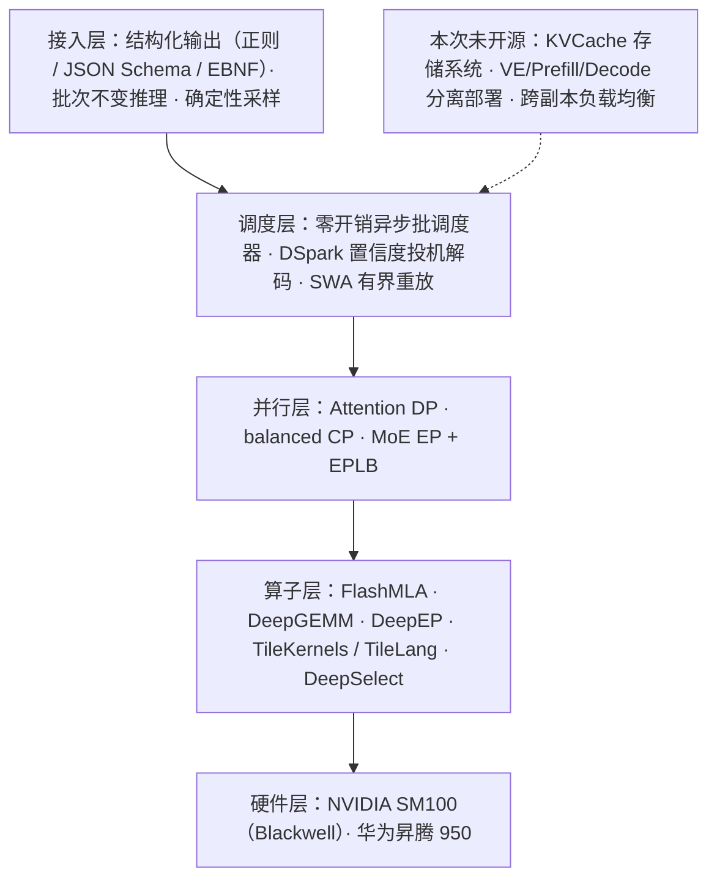

**图 8　DeepInfer 的系统分层**

### 7.2 并行与负载均衡

DeepInfer 支持三种并行：Attention DP（注意力按请求切分）、balanced CP（均衡上下文并行，面向长输入）与 MoE EP + EPLB（专家并行与专家负载均衡）。生产布局为 Prefill EP2–8/DP2–8、Decode EP64–128/DP64–128。Wide-EP 的收益来自两个方面：单卡承担的专家权重减少，MoE 每步的显存流量随之下降；更多请求的 token 汇入同一专家，矩阵计算的批规模得以改善。EPLB 为热点专家保留冗余副本，依据最近 1 000 步的负载统计、每 10 000 步重排专家放置 [8]。

### 7.3 关键优化

除并行外，引擎层面有三项优化直接影响体验指标。异步批调度使 CPU 在设备执行当前批次时准备下一批次，把调度移出关键路径。DSpark 投机解码采用变长验证，官方口径下单 token 生成延迟下降 40% 以上。批不变与确定性采样固定 batch 组合下的浮点结果，使相同输入在相同参数下产生完全相同的输出，为回归测试与可复现评测提供基础；该能力当前仅覆盖 NVIDIA 路径，且需配合固定 `seq_seed` 并关闭变长 MTP [8]。

### 7.4 基准与帕累托前沿

官方给出两条吞吐–时延前沿（表 8，对应图 6、图 7）。Prefill 侧，批量由 4K 增至 64K token/rank/step，单卡吞吐由约 60K 升至约 89.5K tok/s，单步时延由 68 ms 增至 732 ms；超过 32K 后时延近似翻倍而吞吐仅增约 3%，拐点位于 16K–32K。Decode 侧，并发由 8 增至 256，单卡吞吐由约 2.6K 升至约 26.3K tok/s（约 10×），单用户速度由 325 降至 103 tok/s（约 1/3）。

**表 8　DeepInfer 官方基准（SM100）**

| 阶段 | 配置 | 扫描变量 | 时延 | 单卡吞吐 |
| --- | --- | --- | --- | --- |
| Prefill | EP4/DP4，4 卡，131K | 4 096 token/rank | 68 ms/step | ≈60.0K tok/s |
| Prefill | 同上 | 16 384 token/rank | 200 ms/step | ≈81.5K tok/s |
| Prefill | 同上 | 65 536 token/rank | 732 ms/step | ≈89.5K tok/s |
| Decode | EP64/DP64，64 卡，131K，nextn=3 | 8 并发/rank | 3.1 ms/token（325 tok/s/user） | ≈2.6K tok/s |
| Decode | 同上 | 64 并发/rank | 4.1 ms/token（246 tok/s/user） | ≈15.7K tok/s |
| Decode | 同上 | 256 并发/rank | 9.7 ms/token（103 tok/s/user） | ≈26.3K tok/s |

### 7.5 能力边界

开源版本不是线上系统的完整复刻。仓库标注了三项缺失：KVCache 存储系统（如 3FS 集群与 kvcache-store）、VE/Prefill/Decode 分离部署、跨数据并行副本的负载均衡；在线 HTTP 服务网关也需自行封装 [8][6]。硬件门槛同样不低：仅支持 SM100 与昇腾 950，软件栈要求 Linux、GCC 13 以上、Python 3.12、CUDA 13 或 CANN 9.2，需从源码构建 [8]。

## 8 讨论

### 8.1 四条演进主线

综合四代系统，效率提升集中在四个方向（表 9）。KV 表达的压缩幅度最大：MLA 把 KV 压为低秩潜在向量，DSA 稀疏化访问范围，CSA/HCA 在 token 维做 4×–128× 压缩，V4.1 将单 token 缓存压到 890 B，同一 1M 上下文下 KV 占用由数十 GB 级降至 GB 级（图 4）。计算的稀疏化贯穿四代：MoE 的专家稀疏（37B/671B）与注意力的位置稀疏（top-2048）使稀疏度成为可调的系统参数。部署形态的解耦从 PD 分离扩展到 E/P/D 三级分离，并行域由节点内扩展到超节点内（Wide-EP），代价是通信与负载均衡复杂度上升，收益是两类负载各自匹配硬件。缓存与调度的分层则由单机 KV 缓存发展为 100 PiB 集群共享缓存，投机解码由固定验证长度变为置信度调度的变长验证，调度由同步改为异步流水。

**表 9　四代推理系统的横向对比**

| 维度 | V3（2024-12） | V3.2（2025-12） | V4（2026-04） | V4.1-Flash（2026-09） |
| --- | --- | --- | --- | --- |
| 总参/激活 | 671B / 37B | 671B / 37B | 1.6T / 49B（Pro）；285B / 13B（Flash） | 552B / 8B（输入）+16B（输出） |
| 注意力 | MLA | MLA + DSA | CSA + HCA | CSA2 + CED |
| KV 粒度 | ≈70 KB/token | ≈15–23 KB/token（128K 下降 3–5×） | ≈5.5 KB/token（1M 时 5.48 GB） | 890 B/token（1M 约 0.9 GB） |
| 上下文 | 128K | 128K | 1M | 1M 输入 / 384K 输出 |
| 部署形态 | PD 分离 | PD 分离（继承） | Wide-EP（第三方引擎为主） | VE/P/D 三级分离 |
| 集群缓存 | 单机 HBM | 单机 HBM | 显存 + 主机内存 | 显存 + 主机内存 + 3FS 100 PiB |
| 代表性指标 | 73.7k in / 14.8k out tok/s·节点；20–22 TPS | API 价格 −50% 以上 | 1M 下单卡 66.8 tok/s（H20） | TTFT 400 ms；230 TPS；155 万亿 token/天 |

### 8.2 开放问题

公开指标之外仍有三个问题有待研究。异构与可移植性方面，DeepInfer 同时支持 SM100 与昇腾 950，但两者在算子指令集、互联协议与 HBM 规格上差异明显，跨平台性能是否可比尚无公开的第三方基准；文献 [15][16] 显示，同一模型在 GB300 NVL72、B200、H20 上的最优拓扑相差较大。确定性推理的代价方面，批不变性与变长投机解码在实现上互斥（前者要求关闭 varlen MTP），在生产环境中同时获得可复现性与加速仍需工程折中。缓存的经济学边界方面，96% 的命中率建立在 Agent 长会话与工具调用复用的流量特征上，若负载以一次性长文本为主，100 PiB 存储层的投入产出比将明显下降。此外，不同来源对吞吐的定义（是否计入缓存命中、是否含草稿 token、按卡还是按节点）差异很大，跨系统比较时须对齐口径 [8][15]。

## 9 结论

本文梳理了 DeepSeek-V3 至 V4.1-Flash 及 DeepInfer 的硬件基座、并行方案、缓存分层与性能表现。四代系统的成本下降不是单点突破的结果，而是模型结构、并行策略、存储层级与调度机制四层共同作用的结果：MLA、DSA 与 CSA 逐级压缩 KV 表达，长上下文由难以服务变为可负担；PD 分离与 Wide-EP 使两类负载分别匹配到适合的硬件；集群级共享缓存与有界重放把重复计算移出关键路径。DeepInfer 以 Apache-2.0 协议开源后，这套工程方法首次以可复现的形式对外公开，但其 KV 存储系统、分离部署与跨副本负载均衡未随源码发布，完整复现仍需较多自研工作。

## 声明

### 致谢

【待补：非作者贡献但需致谢的人员、机构与项目支持】

### 资助

【待补：资助机构全称与项目编号；若无资助，填"本研究未获得任何公共、商业或非营利机构的资助。"】

### 作者贡献

【待补：按 CRediT 分类填写，例如"甲：概念化、方法设计、初稿撰写与修订；乙：文献调研、数据整理、图表制作。"所有作者均已审阅并同意稿件最终版本。】

### 利益冲突

【待补：如无冲突，填"作者声明不存在利益冲突。"】

### 数据可得性

本文引用的全部数据来自公开发布的技术报告、模型卡、官方仓库与第三方基准，正文与附录已逐条标注来源。图表对应的原始数据可向通讯作者索取。

## 附录 A　模型结构超参数对照

表 A1 汇总四代模型的结构超参数。两代之间的差异值得注意。V3 到 V3.2 的 MoE 配置完全未动，唯一增量是 DSA 的索引器（多出 685B − 671B ≈ 14B 参数）；V4 起注意力形状与 MoE 配置同时改写（KV 头数降为 1、专家数增至 384、门控换为 Softplus），注意力压缩与专家扩容在此处一并设计，压缩释放的显存与带宽被用于换取更大的专家池。

**表 A1　四代模型的结构超参数（据各代技术报告、模型卡与官方 config）**

| 项目 | V3 | V3.2 | V4-Pro | V4.1-Flash |
| --- | --- | --- | --- | --- |
| 层数 | 61（3 稠密 + 58 MoE） | 61（同 V3） | 61 + 1 MTP | 40（20 编码器 + 20 解码器） |
| hidden | 7 168 | 7 168 | 7 168 | 5 120 |
| 注意力 | MLA | MLA + DSA | 逐层 CSA(4×)/HCA(128×)/SWA(128) | CSA2（Full/Reindex/Reuse）+ SWA |
| 头数 / KV 头 | 128 / 128 | 128 / 128 | 128 / 1 | 未公开 |
| head_dim | 128（Nope）+ 64（RoPE） | 同左 | 512（qk_rope 64） | 未公开 |
| 低秩维度 | q 1 536 / kv 512 | q 1 536 / kv 512 | q 1 536 / o 1 024 | 未公开 |
| 索引器 | — | 64 头 × 128 维，FP8，k = 2 048 | 64 头 × 128 维，FP4，k = 1 024 块 | 分层索引器：候选 2 048 块 × 8 → 保留 512 |
| 路由 / 共享专家 | 256 / 1 | 256 / 1 | 384 / 1 | 384 / 1 |
| 每 token 激活专家 | 8 | 8 | 6 | 6 |
| 专家中间维 | 2 048 | 2 048 | 3 072 | 未公开 |
| 门控 | Sigmoid + 选择偏置 b_i | 同左 | Softplus + noaux_tc | 未公开 |
| 词表 | 129 280 | 129 280 | 129 280 | 未公开 |
| 上下文 | 128K | 128K | 1M | 1M / 输出 384K |
| 权重精度 | FP8 | FP8 | 专家 FP4 + 其余 FP8 | 主 KV FP4 |
| 结构附加件 | MTP 深度 1 | DSA 索引器 | mHC 4×、层 0–2 哈希路由 | Engram 196B、ViT 32 层、DSpark |

注：V4.1-Flash 的部分超参官方尚未在模型卡中逐项披露，表中以"未公开"标注；V4-Pro 的 1.7T 参数口径见 0813 模型卡，本文正文采用技术报告的 1.6T。

## 参考文献

[1] DeepSeek-AI, DeepSeek-V3 technical report, arXiv:2412.19437, 2024.

[2] DeepSeek-AI, DeepSeek-V3/R1 inference system overview (open-source week, day 6), 2025. Available from: https://github.com/deepseek-ai/profile-data

[3] NVIDIA, GB300 NVL72 and Blackwell Ultra platform specifications, 2026. Available from: https://www.nvidia.com/en-eu/data-center/gb300-nvl72/

[4] 华为, 昇腾 950PR/950DT 芯片规划与 Atlas 350 加速卡规格, 2025-09/2026-03. Available from: https://www.hiascend.com/hardware/accelerator-card

[5] NVIDIA, H100/H800 Tensor Core GPU specifications and architecture whitepaper, 2022–2023.

[6] 褚杏娟, 刚刚，DeepSeek 开源最新推理框架：单集群日吞吐 155 万亿 Token，KVCache 可保存 7 天, InfoQ, 2026-10.

[7] DeepSeek-AI, 3FS (Fire-Flyer File System): a high-performance distributed file system for AI training and inference, 2025.

[8] DeepSeek-AI, DeepInfer: high-performance large-scale inference framework (repository, Q&A and configuration documentation), 2026-10. Available from: https://github.com/deepseek-ai/DeepInfer

[9] 中泰证券, DeepSeek 开启盈利新时代：545% 成本利润率测算, 2025-03.

[10] DeepSeek-AI, DeepSeek-V3.2: pushing the frontier of open large language models, arXiv:2512.02556, 2025. Available from: https://api-docs.deepseek.com/zh-cn/news/news251201

[11] DeepSeek-AI, DeepSeek-V3.2 model card, 2026-01. Available from: https://fe-static.deepseek.com/chat/transparency/deepseek-v3.2-model-card-0414-CN.pdf

[12] vLLM/SGLang, DeepSeek-V3, V3.2 and V4 deployment documentation (MoE, DeepEP, EPLB, PD separation), 2026.

[13] DeepSeek-AI, DeepSeek-V4: towards highly efficient million-token context intelligence, arXiv:2606.19348, 2026.

[14] DeepSeek-AI, DeepSeek-V4 model card, 2026-04. Available from: https://fe-static.deepseek.com/chat/transparency/deepSeek-V4-model-card-CN_3c2bd9.pdf

[15] SemiAnalysis, DeepSeek V4 1.6T: day 0 to day 43 performance over time (GB300 NVL72, B200, MI355X), 2026-06.

[16] Ant Group SCT and SGLang Community, Pushing the limits of serving DeepSeek-V4-Pro (H20 scenario deployment), 2026.

[17] DeepSeek-AI, DeepSeek-V4.1-Flash technical report (DeepSeek_V41_Tech_Report.pdf) and release announcement, 2026-09. Available from: https://huggingface.co/deepseek-ai/DeepSeek-V4.1-Flash

[18] DeepSeek-AI, deepseek-recipe: production-grade token encoding and decoding component, 2026-10. Available from: https://github.com/deepseek-ai/deepseek-recipe

[19] DeepSeek-AI, API changelog (V4.1-Flash-1017 etc.), 2026-10. Available from: https://api-docs.deepseek.com/zh-cn/updates/
