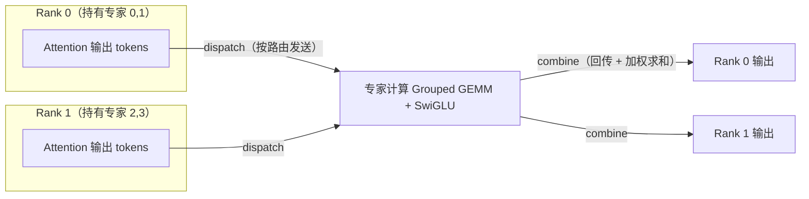

> 百川异源，而皆归于海。
>
> ——《淮南子·氾论训》

# 1. 概述

现代大语言模型通常采用稀疏的 MLP，即 MoE 设计来降低激活参数，减少计算量。对于 MoE，一般采用 EP 的并行方案。为了提高 EP 并行的通信和计算性能，涌现出了各色 EP 通信库，比较出名的有 DeepSeek V3 开源的 DeepEP。本文考察目前多种 EP 通信库，总结其共性，从而给加速器的通信设计提供优化方案。

按通信库划分，本文讨论以下八种方案：

- DeepEP V1
- DeepEP V2
- HybridEP
- SwiftEP
- MoonEP
- MoK
- TensorRT-LLM NVLink OneSide
- MegaMoE

第 1 章给出 MoE 与专家并行通信的背景；第 2 至 9 章依次考察上述八个通信库，每个库均先梳理设计动机，再给出总体执行流程与具体代码分析；第 10 章从横向视角汇总八库的"变与不变"，归纳对加速器通信设计的启示。

## 1.1 MoE 与专家并行通信

在 MoE 架构中，Transformer 的稠密 FFN 被替换为一组并行的专家网络。每个 MoE 层由一个门控（router/gating）网络将每个 token 路由到得分最高的 $top\text{-}k$ 个专家，专家并行处理后按门控概率加权聚合输出。以 DeepSeek-V3 为例，其总参数量 685B、路由专家 256 个，但每个 token 仅激活 8 个专家，从而在保持能力的同时将推理成本降低 60% 以上 [2]。

记 $x \in \mathbb{R}^{D}$ 为输入 token，$\mathcal{E}$ 为路由选中的专家集合，$s$ 为路由权重，$W_{up}, W_{gate}, W_{down}$ 为专家投影，共享专家为 $E_{shared}$，则 MoE 层计算为：

$$MoE(x, s) = E_{shared}(x) + \sum_{i \in \mathcal{E}} g_i \, E_i(x) \tag{1.1}$$

$$E_i(x) = W_{down}^{(i)}\big(\text{SiLU}(W_{gate}^{(i)} x) \odot W_{up}^{(i)} x\big), \qquad g_i = \frac{s_i}{\sum_{j \in \mathcal{E}} s_j}$$

专家并行将路由专家的权重切分到多个 GPU（rank）上。设 EP 规模为 $E$（参与 EP 的 rank 数），每个 rank 持有 $E_{local}$ 个专家。由于一个 token 的路由专家可能分布在其他 rank 上，token 必须在专家计算前后进行跨设备传输，形成两个核心通信原语：

- **dispatch（分发）**：将 attention 输出的 token 按路由结果发送到持有其目标专家的 rank；
- **combine（聚合）**：专家计算完成后，将输出 token 送回其原始 rank 并按门控权重求和。

这一 all-to-all 通信模式在大规模 MoE 训练与推理中往往是首要瓶颈。以 Cursor 的生产负载为例，MoE 层可占据端到端训练时间的一半以上 [6]。

## 1.2 两种通信范式：AllGather+ReduceScatter 与 AlltoAll

在 attention 采用数据并行（DP）、MoE 采用 EP 的混合并行下，存在两种等价但成本不同的通信方案 [7]：

1. **AllGather + ReduceScatter**：attention 后将所有 token 聚合到每个 rank，各 rank 用本地专家计算全部 token，MoE 后再 ReduceScatter 汇总回各 rank。其缺点是冗余——若某 token 未被路由到某 rank 的任何专家，则无需发送到该 rank。通信量随 $ep\_size \times tokens \times hidden$ 线性增长。
2. **AlltoAll（dispatch + combine）**：每个 token 仅发送到持有其路由专家的 rank，通信量随 $top\text{-}k \times tokens \times hidden$ 增长。当 $ep\_size > top\text{-}k$ 时，AlltoAll 严格传输更少的数据。

因此，所有现代 EP 通信库均围绕 **dispatch/combine 的 AlltoAll 原语**进行深度优化。其总体数据流如图 1.1 所示：



> 图 1.1　MoE 专家并行的 dispatch/combine 数据流。token 先按路由分发到持有目标专家的 rank，专家计算后再聚合回原始 rank 并加权求和。

# 2. DeepEP V1

DeepEP 是 DeepSeek 于 2025 年开源的、专为 MoE 与 EP 设计的高性能通信库 [1]。它是 DeepSeek-V3/R1 训练与推理基础设施的关键组件，底层基于 NVSHMEM 实现跨节点 RDMA 通信。DeepEP 提供两类内核：

表 2.1　DeepEP V1 的两类内核

| 内核类别 | 适用场景 | 通信路径 | 关键特性 |
| --- | --- | --- | --- |
| **Normal kernels**（高吞吐） | 训练、推理 prefill | 节点内 NVLink + 节点间 RDMA（经 NVLink 转发） | FP8 dispatch + BF16 combine、SM 数量可控、非对称域带宽转发 |
| **Low-latency kernels**（低延迟） | 推理解码（decode） | 纯 RDMA（IBGDA） | 基于 hook 的通信-计算重叠、零 SM 占用、CUDA Graph 兼容 |

Normal kernel 针对吞吐优化，需同时处理节点内（NVLink，约 153 GB/s）与节点间（RDMA，43–58 GB/s）两条带宽不对称的通信域，并支持 FP8 低精度。Low-latency kernel 则面向解码场景的微秒级延迟需求，采用纯 RDMA 路径 [1][4]。

## 2.1 总体执行流程

DeepEP V1 的完整 MoE 层前向流程（以训练/prefill 为例）分五步：

1. **缓冲初始化**：每个 EP group 创建一个 `Buffer`，通过 `set_num_sms` 控制通信内核占用的 SM 数量；缓冲在运行时按 `get_buffer_size_hint` 计算的空间分配。
2. **路由布局计算**：调用 `get_dispatch_layout`，根据 `topk_idx` 计算每个 rank 需发送/接收的 token 数（`num_tokens_per_rank`、`num_tokens_per_rdma_rank`）、每个专家的 token 数（`num_tokens_per_expert`）以及 token 是否位于本 rank（`is_token_in_rank`）。
3. **dispatch**：执行 dispatch 内核，将本地 token（`x`）连同 `topk_idx`、`topk_weights` 发送到持有目标专家的 rank，返回接收缓冲 `recv_x` 及各专家 token 数。
4. **专家计算**：用 `recv_x` 执行分组 GEMM（如 DeepGEMM）完成 up/gate/down 投影与 SwiGLU。
5. **combine**：执行 combine 内核，按 `handle` 中的路由元数据将专家输出回传并加权求和，得到 `combined_x`。

解码场景则使用独立的低延迟接口 `low_latency_dispatch` / `low_latency_combine`，其 `hook()` 机制可在不占用 SM 的前提下后台发起 RDMA 接收，实现 double-batch 重叠。

## 2.2 具体代码分析

前向 dispatch/combine 的核心 API 与用法如下（源自 DeepEP README [1]）：

```python
import torch.distributed as dist
from deep_ep import Buffer

_buffer: Buffer = None
_num_comm_sms: int = 0

def get_buffer(group: dist.ProcessGroup, num_max_tokens_per_rank: int,
               hidden: int, num_topk: int, num_experts: int,
               use_fp8_dispatch: bool = False) -> Buffer:
    """
    初始化或复用 EP 通信缓冲。

    核心思想：
    - 每个 EP group 维护一个通信 Buffer，缓冲区大小由 num_max_tokens_per_rank
      与 hidden 决定；若已有缓冲容量足够则直接复用，避免重复分配。

    返回：
    - 复用或新建的 Buffer，并同步更新通信 SM 数 _num_comm_sms。
    """
    global _buffer, _num_comm_sms
    required_bytes = Buffer.get_buffer_size_hint(
        group, num_max_tokens_per_rank, hidden,
        num_topk=num_topk, use_fp8_dispatch=use_fp8_dispatch)
    if _buffer is not None and _buffer.group == group and _buffer.num_bytes >= required_bytes:
        _num_comm_sms = _buffer.get_theoretical_num_sms(num_experts, num_topk)
        return _buffer
    _buffer = Buffer(group, num_max_tokens_per_rank=num_max_tokens_per_rank,
                     hidden=hidden, num_topk=num_topk,
                     use_fp8_dispatch=use_fp8_dispatch)
    _num_comm_sms = _buffer.get_theoretical_num_sms(num_experts, num_topk)
    return _buffer

def dispatch_forward(x, topk_idx, topk_weights, num_experts, previous_event=None):
    """MoE dispatch：将 token 路由到持有其目标专家的 rank。"""
    # ========== 步骤 1: 计算分发布局 ==========
    # 得到每个 rank 的发送/接收 token 数、每个专家的 token 数、token 归属
    num_tokens_per_rank, num_tokens_per_rdma_rank, num_tokens_per_expert, \
        is_token_in_rank, previous_event = _buffer.get_dispatch_layout(
            topk_idx, num_experts, previous_event=previous_event,
            async_finish=True, allocate_on_comm_stream=previous_event is not None)
    # ========== 步骤 2: 执行 dispatch 内核 ==========
    recv_x, recv_topk_idx, recv_topk_weights, num_recv_tokens_per_expert_list, \
        handle, event = _buffer.dispatch(
            x, topk_idx=topk_idx, topk_weights=topk_weights,
            num_tokens_per_rank=num_tokens_per_rank,
            num_tokens_per_rdma_rank=num_tokens_per_rdma_rank,
            is_token_in_rank=is_token_in_rank,
            num_tokens_per_expert=num_tokens_per_expert,
            previous_event=previous_event, async_finish=True,
            allocate_on_comm_stream=True)
    return recv_x, recv_topk_idx, recv_topk_weights, num_recv_tokens_per_expert_list, handle, event

def combine_forward(x, handle, previous_event=None):
    """MoE combine：按 handle 中的路由元数据回传并加权求和。"""
    combined_x, _, event = _buffer.combine(
        x, handle, async_finish=True, previous_event=previous_event,
        allocate_on_comm_stream=previous_event is not None)
    return combined_x, event
```

低延迟内核（解码）的 hook 式接口：

```python
def low_latency_dispatch(hidden_states, topk_idx, num_max_dispatch_tokens_per_rank, num_experts):
    recv_hidden_states, recv_expert_count, handle, event, hook = _buffer.low_latency_dispatch(
        hidden_states, topk_idx, num_max_dispatch_tokens_per_rank, num_experts,
        async_finish=False, return_recv_hook=True)
    # hook() 触发后台 RDMA 接收，不占用任何 SM；用于 double-batch 重叠
    return recv_hidden_states, recv_expert_count, handle, event, hook
```

节点间 dispatch 内核的 warp 特化。跨节点路径（`csrc/kernels/internode.cu`）采用多角色 warp 分工，是实现 RDMA-NVLink 混合转发、隐藏带宽不对称的关键 [4]：

```cpp
enum class WarpRole {
    kRDMASender,             // 将本地数据经 RDMA 发送到远程节点
    kRDMASenderCoordinator,  // 管理 RDMA 发送进度与同步
    kRDMAAndNVLForwarder,    // 将 RDMA 接收的数据转发到本地 NVLink 缓冲区
    kForwarderCoordinator,   // 全局协调转发任务
    kNVLReceivers            // 从 NVLink 缓冲区读取数据并写入最终接收数组
};
```

- **kRDMASender**：获取自身 channel 的 token 范围，将发送计数以"负值编码"（$-num\_tokens-1$）写入对端，以区分"零 token"与"未初始化"；随后通过 `nvshmemi_ibgda_put_nbi_warp` 分批将打包消息（hidden 数据 + FP8 scale + 源信息）写入对端 RDMA 环形缓冲，并用 `nvshmemi_ibgda_amo_nonfetch_add` 更新远程尾指针。
- **kRDMAAndNVLForwarder / kNVLReceivers**：接收端轮询到达、解码元数据、经节点内 NVLink 环形缓冲将 token 转发至各本地 GPU 槽位，最终写入输出张量。
- **环形缓冲 + 信用机制**：发送方通过远程头/尾计数器获得"信用"（credit）以控制流量，避免缓冲溢出。

这一"RDMA 发送 → NVLink 转发 → 本地接收"的多级流水线，使 DeepEP 能同时榨取节点内与节点间两条不对称带宽域的吞吐。

## 2.3 性能

在 H800 + CX7 InfiniBand（400 Gb/s）上，按 DeepSeek-V3/R1 预训练配置（batch 4096、hidden 7168、top-4 groups/top-8 experts、FP8 dispatch + BF16 combine）测得 [1]：

表 2.2　DeepEP V1 带宽与延迟

| 场景 | EP 规模 | Dispatch 带宽 | Combine 带宽 |
| --- | --- | --- | --- |
| 节点内（NVLink） | 8 | 153 GB/s | 158 GB/s |
| 节点间（RDMA） | 16 / 32 / 64 | 43 / 58 / 51 GB/s | 43 / 57 / 50 GB/s |
| 低延迟（解码） | 8–256 | 77–194 µs | 114–369 µs |

# 3. DeepEP V2

DeepEP V2（2026 年）对 EP 通信做了一次彻底重构 [1][3]。其核心变化有三点：

1. **后端替换**：底层由 NVSHMEM 切换为 **NCCL Gin** 后端——header-only、轻量，可直接复用已有的 NCCL communicator；NVSHMEM 仅保留用于旧版 API。
2. **统一接口**：V1 中"高吞吐 `Buffer`"与"低延迟 API"两套接口合并为单个 **`ElasticBuffer`** 接口，同时覆盖训练、prefill 与解码。
3. **解析式资源分配**：SM 数与 QP 数不再需要手动调优，改由 `get_theoretical_num_sms` / `get_theoretical_num_qps` 依据硬件带宽模型（`sm_read_gbs`、`rdma_gbs`、`nvlink_gbs`）解析计算，找到"恰好饱和瓶颈"的最少资源。

此外，V2 全部内核改为**运行时 JIT 编译**（安装阶段无需 CUDA 编译），支持最高 EP2048、混合（hybrid）与直接（direct）两种通信模式，并新增 0 SM 的 Engram（配合 RDMA）、流水线并行（PP）、上下文并行（CP）实验性原语。代价是缓冲区占用较 V1 更大，且不再支持 0 SM 的 RDMA 低延迟 EP [3]。

## 3.1 总体执行流程

1. **缓冲创建**：实例化 `ElasticBuffer`，仅传入 EP group、`num_max_tokens_per_rank`、`hidden`、`num_topk` 与 `use_fp8_dispatch`；构造器内部按硬件拓扑分配内存。
2. **解析式资源估算**：调用 `get_theoretical_num_sms(num_experts, num_topk)` 与 `get_theoretical_num_qps()`，由带宽模型直接得出最优 SM/QP 数，供后续 dispatch/combine 使用。
3. **dispatch → 计算 → combine**：与 V1 同构，但 dispatch 支持 BF16 与 FP8 双输入（FP8 时 `x` 为 `(data, scale_factors)` 元组），并返回 `EPHandle` 路由句柄；解码场景由 `do_cpu_sync=False` 走 GPU 侧接收计数。
4. **混合模式**：当 `allow_hybrid_mode=True` 时，通信分层为 NVLink（scale-up 域）与 RDMA（scale-out 域）两段，`get_logical_domain_size` 返回 `(scaleout_ranks, scaleup_ranks)` 供框架感知拓扑。

## 3.2 具体代码分析

```python
from deep_ep import ElasticBuffer, EPHandle, EventHandle, EventOverlap

_buffer = ElasticBuffer(
    group,
    num_max_tokens_per_rank=num_max_tokens_per_rank,
    hidden=hidden,
    num_topk=num_topk,
    use_fp8_dispatch=use_fp8_dispatch,   # FP8 时 x 传 (data, scale) 元组
)
# V2 解析式计算最优 SM 数，无需再手动调优
_num_comm_sms = _buffer.get_theoretical_num_sms(num_experts, num_topk)

def dispatch_forward(x, topk_idx, topk_weights, num_experts,
                     num_max_tokens_per_rank, expert_alignment=1,
                     do_cpu_sync=True, previous_event=None) -> EventOverlap:
    return _buffer.dispatch(
        x, topk_idx=topk_idx, topk_weights=topk_weights,
        num_experts=num_experts,
        num_max_tokens_per_rank=num_max_tokens_per_rank,
        expert_alignment=expert_alignment,   # 与 DeepGEMM 的对齐保持一致
        num_sms=_num_comm_sms,
        previous_event=previous_event,
        async_with_compute_stream=True,
        allocate_on_comm_stream=previous_event is not None,
        do_cpu_sync=do_cpu_sync,             # 解码设为 False，走 GPU 侧计数
        do_expand=True, do_zero_padding=True,
        use_tma_aligned_col_major_sf=True,
        defer_epilogue=True,                 # 延迟 epilogue 以与计算重叠
    )

def dispatch_backward(grad_recv_x, grad_recv_topk_weights, handle, bias=None):
    # MoE dispatch 的反向即 combine
    combined_grad_x, combined_grad_topk_weights, event = _buffer.combine(
        grad_recv_x, handle=handle, bias=bias,
        topk_weights=grad_recv_topk_weights,
        num_sms=_num_comm_sms, async_with_compute_stream=True)
    return combined_grad_x, combined_grad_topk_weights, event
```

解析式资源模型的核心在于把"SM 数 ↔ 可达带宽"的关系建模出来，确定当前配置的瓶颈（显存、NVLink 或 RDMA），再分配恰好饱和该瓶颈的 SM 数：

```python
# deep_ep/buffers/elastic.py 中的核心逻辑（示意）
def get_theoretical_num_sms(self, num_experts, num_topk):
    sm_read_gbs, sm_write_gbs = get_sm_bw()     # 每 SM 的显存读写带宽
    rdma_gbs = get_rdma_gbs()                   # CX7 等 NIC 峰值带宽
    nvlink_gbs = get_nvlink_gbs()               # NVLink 峰值带宽
    # 以瓶颈带宽为目标，反推所需的 SM 数（受 prefer_overlap_with_compute 约束）
    return ceil(min(bottleneck_gbs, ...) / sm_bw)
```

当 `prefer_overlap_with_compute=True` 时，解析公式会趋于保守（更少 SM/通道），为并发 GEMM 计算留出余量，从而最大化通信-计算重叠。

## 3.3 性能

相对 V1，V2 峰值性能最高提升 1.3 倍、SM 占用最多节省 4 倍——V3 风格训练场景的通信 SM 从 24 降到 4–6 个而性能持平或更优 [3]：

表 3.1　DeepEP V2 带宽与 SM 占用

| 架构 | NIC/拓扑 | EP 配置 | Dispatch | Combine | SM 数 |
| --- | --- | --- | --- | --- | --- |
| SM90（Hopper） | CX7 | 8×2 / 8×4 | 90 / 61 GB/s | 81 / 61 GB/s | 12 / 6 |
| SM100（Blackwell Ultra） | CX7 | 8×2 | 90 GB/s | 91 GB/s | 12 |
| SM100 | 无（纯 NVLink） | 8 | 726 GB/s | 740 GB/s | 64（最大）/ 24（最少） |

# 4. HybridEP

HybridEP 是 NVIDIA 面向 Megatron-Core 全新设计的 MoE EP 通信库，目标是在 **RDMA + NVLink 混合网络**下逼近硬件极限带宽，同时最小化 GPU 资源占用 [5]。其核心优化方向包括：采用 NVLink scale-up 域的 **TMA** 指令与 RDMA 网络的底层 **IBGDA** 技术；结合节点内 NVLink 与节点间 RDMA 的混合通信，最大化跨域带宽；将数据切分为细粒度块，经多级通信数据流流式传输，掩盖通信延迟与动态路由开销；以更少 SM 达到峰值带宽，释放更多 SM 给计算；原生支持 FP8/BF16 dispatch 与 BF16 combine。

HybridEP 已作为 Megatron-Core `FlexDispatcher` 的 `hybridep` 后端集成，并可与基于 MoonEP 算法的虚拟专家负载均衡（virtual-expert load balancing）叠加使用 [8]。

## 4.1 总体执行流程

HybridEP 将每个 CUDA block 设计为一个**独立数据通道**，占用单个 SM 运行完整的数据流水线；block 内的不同 warp 组分工处理不同流水线阶段，各 block 并行处理不同数据块且块间无需同步与通信 [5]：

1. **RDMA warp 组**：负责用 IBGDA 将网络流量推送至 RDMA 网卡（NIC），完成机架内/节点间 GPU 的 token 传输；
2. **G2S（global-to-shared）warp 组**：将本 GPU 及同机架其他 GPU 传来的 token 数据读入 SM 内共享内存的 FIFO 队列；
3. **计算阶段**：从共享内存 FIFO 取出 token 执行分组 GEMM；
4. **combine 阶段**：反向流式回传并聚合结果。

通过细粒度 chunk 化与多级流水线，dispatch/combine 的通信延迟被计算充分掩盖，使 EP 带宽接近高度优化的静态多对多通信。

## 4.2 具体代码分析

HybridEP 未完全开源内核源码，但其架构可抽象为如下"每块一通道、多 warp 组流水"的编程模型（伪代码，反映 NVIDIA 技术博客描述的机制 [5]）：

```cpp
// 每个 block = 一个数据通道，占用一个 SM
__global__ void hybrid_ep_dispatch_kernel(
    const T* local_tokens, const int* topk, const float* topk_weights,
    /* IBGDA / TMA 远程缓冲 */ RemoteBuffer rdma_buf, RemoteBuffer nvlink_buf,
    int* send_counts, int num_channels) {

    int channel = blockIdx.x;                 // 本 block 负责的通道
    // warp 组划分：RDMA 组 / G2S 组 / 转发组
    const int warp_id = threadIdx.x / 32;
    int role = classify_warp_role(warp_id);   // kRDMA / kG2S / kForward

    if (role == kRDMA) {
        // 用 IBGDA 将需跨节点的 token 推送到对端 NIC
        ibgda_put_nbi_warp(rdma_buf.ptr(peer_rank), staged_tokens,
                           num_bytes_per_msg, peer_rank);
    } else if (role == kG2S) {
        // 将本 GPU 与同机架对端 GPU 的 token 读入共享内存 FIFO
        load_to_smem_fifo(nvlink_buf.read_head(), smem_fifo, chunk_size);
    } else if (role == kForward) {
        // 将共享内存中排好序的 token 经 TMA 批量写出到最终接收布局
        tma_store_1d(final_recv.ptr(channel), smem_fifo, chunk_bytes);
    }
}
```

关键设计取舍：

- **TMA（Tensor Memory Accelerator）**：在节点内 NVLink 域用 TMA 异步拷贝替代显式 load/store，既降低寄存器压力，又释放 SM 指令槽，使单 SM 能同时驱动通信与计算。
- **IBGDA（InfiniBand GPU Direct Async）**：让 GPU 线程直接发起 RDMA PUT 与原子操作，绕过 CPU，将跨节点通信延迟压至亚微秒级（见 2.2 节中 DeepEP 低延迟内核对 IBGDA 的用法）。
- **细粒度流水线**：chunk 化使"下一个 chunk 的通信"与"当前 chunk 的计算"并发，掩盖动态路由带来的不确定延迟。

据 NVIDIA 博客 [5]，HybridEP 以显著更少的 SM 达到与 DeepEP 相当或更优的通信带宽，并在 Megatron-Core 训练中释放了更多 SM 给 GEMM 计算。其作为 `FlexDispatcher` 后端的定位，使其在 GB200 NVL72、多节点 NVLink（MNNVL）等 Blackwell 平台上成为推荐路径 [8]。

# 5. SwiftEP

SwiftEP（NSDI '26）是面向 MoE **prefill** 阶段的全对全通信库 [9]。作者指出，现有库（如 DeepEP）在 prefill 上存在两大根本问题：**冗余缓冲拷贝**（redundant buffer copies）与**节点内 NVLink 传输低效**。由此提出两项互补机制：

- **Buffer fusion（缓冲融合）**：消除冗余的 staging 拷贝，实现真正的零拷贝；
- **TMA offloading（TMA 卸载）**：将传输卸载至 Hopper TMA，最大化 NVLink 利用率，并支持高效的 multicast/reduce。

为应对融合缓冲带来的新挑战，SwiftEP 进一步引入 **RDMA scatter-gather list（SGL）** 以削减小数据段所需 WQE 数量、**QP 传输并行化**以隐藏大融合缓冲的多级地址翻译延迟、以及 **CUDA IPC** 授予 TMA 跨 GPU 直访权限；并重设计 notify 操作以广播完整 token 分布，使发送端可直接写入接收端的最终位置 [9]。

## 5.1 总体执行流程

1. **缓冲融合**：将计算缓冲与通信缓冲合并为单一融合缓冲，发送端把 token 直接写入对端最终布局，省去"通信缓冲 → 用户缓冲"的 epilogue 拷贝。
2. **跨 GPU TMA**：经 CUDA IPC 授权，TMA 引擎可直访对端 GPU 内存，负责节点内 NVLink 的数据搬运（含 multicast 与 reduce）。
3. **RDMA SGL + QP 并行化**：跨节点时，小而散的数据段经 scatter-gather list 合并为少量 WQE，多个 QP 并行传输以掩盖地址翻译延迟。
4. **notify 广播**：将完整 token 分布广播至本机所有 GPU，使各发送端预先获知最终写入位置。
5. **pull-based combine**：combine 阶段采用拉取式，由接收端主动读取专家输出，减少同步与拷贝。

## 5.2 具体代码分析

SwiftEP 扩展了 DeepEP 的接口，融合缓冲的元数据（基地址、内存布局）由推理框架暴露。其核心抽象可表示为：

```python
class FusedBuffer:
    """融合计算与通信缓冲，消除 staging 拷贝。"""
    base: int          # 融合缓冲基地址（跨 rank 对称）
    layout: Layout     # token 到最终槽位的映射描述
    handles: list[int] # 经 CUDA IPC 导出的跨 GPU 可访问句柄

class SwiftEPComm:
    def dispatch(self, tokens, topk_idx, topk_weights, fused: FusedBuffer):
        # ========== 步骤 1: 本机内广播完整 token 分布 ==========
        slot_map = self.broadcast_layout(topk_idx, fused.layout)
        # ========== 步骤 2: TMA 卸载（节点内 NVLink 直写对端） ==========
        self.tma_store_remote(fused, tokens, slot_map)         # multicast/reduce 语义
        # ========== 步骤 3: 跨节点 RDMA SGL + 多 QP 并行 ==========
        self.rdma_sgl_put(fused, tokens, slot_map, num_qps=4)
        return self.recv_view(fused)

    def combine(self, expert_out, fused: FusedBuffer):
        # pull-based：接收端主动读取专家输出并按路由归约
        return self.pull_and_reduce(expert_out, fused)
```

零拷贝关键点：传统库在接收端需将通信缓冲中的 token 重排（permute）到最终布局，SwiftEP 通过"发送端直接写入最终位置 + notify 广播分布"省去了这一步重排；再配合融合缓冲，彻底消除 comm-buffer → user-buffer 的拷贝 [9]。

在 16/32 GPU 集群（EP=16/32）上，相对 DeepEP：

表 5.1　SwiftEP 相对 DeepEP 的提升

| 指标 | EP=16 | EP=32 |
| --- | --- | --- |
| 算法带宽提升 | +93.8% | +119.7% |
| 通信占用 SM 数下降 | 50% | 66.7% |
| 请求服务容量提升 | +21.2% | — |

# 6. MoonEP

MoonEP（Moonshot AI）的核心目标是让 EP 通信在**路由高度倾斜**时仍保持完美负载均衡 [10]。传统 EP 中，动态路由使"热专家"接收的 token 远高于均值，最热 rank 决定了通信延迟上限，且不断变化的激活形状导致显存碎片化、极端情况下 OOM。MoonEP 通过**动态冗余专家**（dynamic redundant experts）保证每个 rank 恰好接收 $S \times K$ 个 token（$S$ 为每 rank 输入 token 数，$K$ 为 top-k），无论路由如何倾斜。

## 6.1 总体执行流程

记 $S$ = 每 rank 输入 token 数，$K$ = top-k，$E$ = EP group 内路由专家总数，$R$ = EP rank 数，$epn = E/R$ = 每 rank 本地专家数。路由失衡度定义为：

$$\text{maxvio} = \max_e \left( \frac{T_e}{\bar{T}} \right) - 1 \tag{6.1}$$

其中 $T_e$ 为路由到专家 $e$ 的 token 数，$\bar{T}$ 为完美均衡下每专家的期望 token 数（maxvio = 0 表示完全均衡）。执行流程如下：

1. **在线规划（online planning）**：一个近似最优的 GPU 规划内核根据当前 router 输出，决定将哪些"热专家"冗余复制到哪些 rank 的空闲槽位（每 rank 有 $epn$ 个 prefetch 槽位），并给出重映射后的运行时专家 ID 与 `cu_seqlens`。
2. **权重预取（weight prefetch）**：`prefetch_weight` 将选中的远端专家权重异步搬运到本地 prefetch 槽位（NVLink 直访）。
3. **零拷贝 dispatch**：token 直接写入远端 rank 的"专家分组后的最终位置"（fused permute），返回通信缓冲视图 `hidden_nvsh`，无需 permute-in/permute-out。
4. **VM group GEMM**：框架以 `[2*epn, H, H']` 的紧凑行序（本地专家 + prefetch 槽位）执行分组 GEMM，`cu_seqlens[2*epn]` 选中有效行。
5. **combine / 反向**：`combine` 回传并按路由权重归约；反向中 `reduce_grad` 把冗余专家的梯度从各 rank 读回其 home rank 并累加。

由于每个 rank 每层固定计算 $S \times K$ 个 token，形状全程静态，无需逐层 host 同步，内存也不会碎片化 [10]。

## 6.2 具体代码分析

```python
from moonep import Buffer

buffer = Buffer(S=4096, H=7168, K=8, E=256, num_ep_ranks=8,
                num_sms=32, token_padding=128)   # epn = E // num_ep_ranks 内部推导

# dispatch：token 直接落到专家分组后的最终位置（零拷贝）
hidden_nvsh, route_weights_nvs, cu_seqlens, plan = buffer.dispatch(
    hidden_sh,           # [S, H] bf16
    route_weights_sk,    # [S, K] fp32
    topk_experts_sk,     # [S, K] int32
    tokens_per_expert,   # [E] int32，本地计数
)
# hidden_nvsh:        [NvS, H] —— 物理 VM group 顺序下的已分发 token
# route_weights_nvs:  [NvS]
# cu_seqlens:         [2*epn] —— 每个 VM group 行的 padding 后 token 结束偏移
# plan:               MoonEPCommPlan —— 供 prefetch/combine 与双向反向复用

# 权重预取：将远端热专家权重搬入本地 prefetch 槽位
buffer.prefetch_weight(plan=plan, ...)

# combine：按路由权重归约回原 token 顺序
combined = buffer.combine(hidden_out_nvsh, route_weights_nvs, plan=plan)

# 反向：把冗余专家的梯度读回其 home rank 并累加
buffer.reduce_grad(grad_local, plan=plan)
```

权重/梯度缓冲布局：对每个专家投影（gate/up/down），框架维护两个视图——通信视图 `[R, epn, H, H']`（映射所有 rank 的 prefetch 池）与计算视图 `[2*epn, H, H']`（行 `[0, epn)` 别名本地参数，行 `[epn, 2*epn)` 别名本地 prefetch 槽位）。VM group GEMM 与 `cu_seqlens` 即按此紧凑行序执行，无需映射其他 rank 的参数权重 [10]。

在 H20、EP=8 上，以 `maxvio` 扫描：

- **零拷贝**使原始通信快于 DeepEP v2（token 直写最终位置，省去 permute 与 comm→user 拷贝）；
- **完美均衡**使通信时间随 `maxvio` 增长几乎不变，而 DeepEP v2（延迟由最热 rank 决定）持续恶化；
- **端到端训练**：DeepEP 在失衡下迭代时间攀升直至 OOM，MoonEP 保持恒定且内存静态无碎片 [10]。

# 7. MoK（Mixture-of-Kittens）

MoK 是 Cursor 开源的、面向 **GB200/GB300 NVL72** 机柜的确定性 MoE 训练 mega-kernel [6]。其出发点是：在 NVL72 单 NVLink 域内，互联足够快，通信与计算应被融合进**单个持久内核**中重叠执行，而非作为独立的 CUDA 任务交替调度；同时 GB300 集成的 Grace CPU 相对 GPU 较慢，必须彻底消除 CPU-GPU 同步。MoK 将全部 MoE 通信与计算融合进一个内核，支持 BF16/MXFP8，覆盖前向与反向，并支撑 Composer 的万卡级训练。

## 7.1 总体执行流程

MoK 围绕三个机制设计 [6]：

1. **非对称网络：拉取式 dispatch + 推送式 combine**。传统集体通信（NCCL/DeepEP）是 push-based，路由倾斜时会形成目的地热点；MoK 改为**接收端 SM 主动从源 rank 拉取** token，用本地内存计数器追踪到达，消除了跨 GPU 内存栅栏——信令延迟从 103 µs 降至 18 µs（5.8 倍）。
2. **宏批环形缓冲（macrobatch ring buffer）**：在对称内存中静态分配数百 MB 的环形缓冲，minibatch 循环复用，无动态分配、无 host-device 同步、无 token 丢弃；反向时反转环形遍历顺序，使前向最先被反向需要的激活保持可用，避免重算。
3. **流水线启停隐藏**：初始 dispatch 阶段让计算 SM 先执行共享专家 FFN，通信 SM 同时拉取第一个 routed minibatch；反向则将 wgrad 延后到所有 dgrad 完成后，与最后的反向 dispatch 通信轮次重叠，并在 token 维一次性累加以保证位级可复现。

调度表仅含两列 `{src_rank, src_idx}`，可在设备侧 <3% 层时延内算完，一张表复用于前向与反向的四个阶段。

## 7.2 具体代码分析

MoK 提供 ops（底层）与 functional（高层）两层 API [6]：

```python
from dataclasses import dataclass
from mok import functional as F

@dataclass
class MoKConfig:
    fwd_num_comm_sms: int = 16      # 前向通信 SM 数（建议 4–52）
    bwd_num_comm_sms: int = 16      # 反向通信 SM 数
    minibatch_size: int = 8192      # 计算-通信重叠粒度（建议 2048–16384）
    macrobatch_size: int = 131072   # token 环形缓冲大小（尽量占满显存）
    schedule_capacity_multiplier: float = 0.5  # 单 rank 最坏路由占比

cfg = MoKConfig()
# 对称内存工作区：EP group 内所有 GPU 相同大小的分配
workspace = F.get_workspace(ep_group, device, model_shapes, cfg)

# 一次性构建 dispatch/combine 调度表（确定性：路由在 kernel 运行前已物化）
schedule = F.schedule(workspace, topk_idx, topk_weights, cfg)

# 前向/反向复用同一 schedule
y = F.forward(workspace, x, schedule, cfg)
# ... loss 反向 ...
grad_x = F.backward(workspace, grad_y, schedule, cfg)
```

内核内部的 warp 特化（反映其论文与源码 [6]）：

```cpp
// MoK 内核：通信 warp 与计算 warp 在同一持久内核中共存
__global__ void mok_forward_kernel(..., RingBuffer ring, Schedule sched) {
    int sm_id = blockIdx.x;
    bool is_comm_sm = sm_id < cfg.fwd_num_comm_sms;
    if (is_comm_sm) {
        // 拉取式 dispatch：接收端 SM 直接从源 rank 经 NVLink load
        for (auto& [src_rank, src_idx] : sched.pull_list(my_rank)) {
            tokens = nvlink_load(ring[src_rank] + src_idx);   // 本地计数追踪到达
            signal_arrival(src_rank);                          // 无跨 GPU 栅栏
        }
    } else {
        // 计算 SM：共享专家 FFN + 已到达 minibatch 的分组 GEMM（MXFP8）
        dense_ffn(local_tokens);                               // 隐藏 dispatch 启动延迟
        grouped_gemm(ring.ready_minibatches());
    }
}
```

确定性保证：路由决策在 `schedule()` 中被物化，内核内部不做动态解析，因此相同输入产生完全相同的分发模式；调度表按最坏情况（`schedule_capacity_multiplier`）定尺寸，配合静态环形缓冲，全程无 CPU 干预 [6]。

在 GB300 NVL72 上，相对最快公开基线（HybridEP + Megatron）：

表 7.1　MoK 加速比

| 场景 | 加速比 |
| --- | --- |
| MXFP8 前向 | 最高 2.37× |
| MXFP8 反向 | 1.78× |
| BF16 前向 / 反向 | 1.92× / 1.58× |
| 端到端训练（512 GPU） | tokens/sec/GPU 由 760.9 → 1070.2（**1.41×**） |

# 8. TensorRT-LLM NVLink OneSide

TensorRT-LLM 的 **NVLinkOneSided AlltoAll** 是面向 NVLink 互联系统（DGX B200、GB200 NVL72）的 MoE 通信内核 [7]。其三大设计支柱为：

1. **单边数据移动（one-sided）**：每个内核只读或只写对端内存，消除协作式 send/recv 及其隐含的额外拷贝；
2. **rank-major 接收缓冲**：槽位按源 rank 索引、不做 top-k 复制，缩小缓冲并省去冗余通信；
3. **量化无关接口**：数据通路传输"不透明字节"，量化在 dispatch 之前完成（post-quant dispatch），同一套内核支持 BF16/FP8/MXFP8/NVFP4。

## 8.1 总体执行流程

1. **对称内存建立**：各 GPU 用 CUDA VMM API（`cuMemCreate`）分配物理内存并导出可共享句柄（`cuMemExportToShareableHandle`），经全交换后各 GPU 用 `cuMemImportFromShareableHandle` + `cuMemMap` 将对端内存映射进本地虚拟地址空间。结果：域内任一 GPU 可用普通指针经 NVLink 读写其他 GPU 的内存。
2. **dispatch（推送）**：每个 CTA 处理一个 token，对每个 top-k 专家计算 `target_rank = expert_id / experts_per_rank`，用 `atomicAdd` 在 `send_counters` 上抢占唯一槽位，向量化（128-bit）写对端 rank-major 缓冲；多专家映射同 rank 时去重只发一次。
3. **combine（拉取）**：复用 dispatch 记录的 `(target_rank, target_index)` 对，从最多 top-k 个对端槽位向量化加载到寄存器，做 pairwise tree reduction 后一次写回。
4. **同步**：dispatch 尾与 combine 头各设一个 producer-consumer barrier，用 release/acquire 内存栅栏保证数据可见性。

## 8.2 具体代码分析

对称内存建立（VMM API 流程）：

```python
def setup_symmetric_memory(gpus):
    handles = []
    for gpu in gpus:                        # 1. 各 GPU 分配并导出句柄
        with cuda_device(gpu):
            alloc = cuMemCreate(size)
            handles.append(cuMemExportToShareableHandle(alloc, POSIX_FD))
    all_handles = all_gather(handles)       # 2. 全交换句柄
    for gpu, remote in enumerate(all_handles):   # 3. 导入并映射
        with cuda_device(gpu):
            for src, h in enumerate(remote):
                if src != gpu:
                    cuMemMap(cuMemImportFromShareableHandle(h), local_va)
```

dispatch 内核（推送 + 去重 + 原子槽位分配）：

```cpp
__global__ void dispatch_kernel(
    float* local_hidden, int* token_selected_experts, float* token_final_scales,
    RemotePtr recv_buffer /* [ep_size, max_tokens_per_rank, ...] */,
    int* send_counters, ...) {
    int token_idx = blockIdx.x;
    int my_rank = blockIdx.y;
    #pragma unroll
    for (int k = 0; k < TOP_K; k++) {
        int expert_id = token_selected_experts[token_idx * TOP_K + k];
        int target_rank = expert_id / experts_per_rank;
        if (already_sent_to(target_rank)) continue;      // 去重：同 rank 只发一次
        int slot = atomicAdd(&send_counters[target_rank], 1);  // 抢占唯一槽位
        vectorized_store(recv_buffer[my_rank][slot],      // 128-bit 向量化写对端
                         vectorized_load(local_hidden[token_idx]));
    }
}
```

combine 内核（拉取 + tree reduction）：

```cpp
__global__ void combine_kernel(
    RemotePtr recv_buffer, int* recorded_ranks, int* recorded_indices,
    float* local_output, ...) {
    int token_idx = blockIdx.x;
    float4 acc[VEC];
    #pragma unroll
    for (int k = 0; k < TOP_K; k++) {
        int src = recorded_ranks[token_idx * TOP_K + k];      // 复用 dispatch 记录
        if (src == -1) continue;
        acc = tree_reduce(acc, load_vec(recv_buffer[src][recorded_indices[...]]));
    }
    vectorized_store(local_output[token_idx], acc);           // 一次写回
}
```

flag-based barrier（release/acquire 栅栏）：

```cpp
// dispatch 尾 barrier：写 flag 前 __threadfence_system()（release）
//   保证所有 peer-bound store 先全局可见
// combine 头 barrier：轮询完成后 __threadfence_system()（acquire）
//   保证后续 load 能观测到对端 release 之前写入的数据
```

在 GB200 NVL72（单向 NVLink 900 GB/s）上，DeepSeek-V3 profile（hidden 7168、top-8、256 experts）、EP=8、BF16：

表 8.1　NVLinkOneSided 带宽

| Batch | Dispatch 带宽 | Combine 带宽 |
| --- | --- | --- |
| 1024 | 706 GB/s | 669 GB/s |
| 2048 | **753 GB/s**（约 84% 峰值） | **728 GB/s** |

post-quant dispatch（bsz=2048）：MXFP8 1.81×、NVFP4 **3.06×** 加速——量化几乎直接转化为更快的 dispatch [7]。

# 9. MegaMoE

MegaMoE 是 DeepSeek 基础设施团队开源的融合 MoE 计算内核，作为 DeepGEMM 的组件发布 [11]。它将原本割裂的流水线——**EP dispatch、两层线性（Linear1/Linear2）、SwiGLU 激活、EP combine**——全部融合进**单个 mega-kernel**，在 Tensor Core 运算的同时经 NVLink 传输数据，把"算一会儿、等一会儿"的节奏"焊死"成一条连续流水线。MegaMoE 面向 Blackwell（SM100），采用 FP8 激活 + FP4 权重的混合精度。

## 9.1 总体执行流程

1. **对称内存（SymBuffer）**：分配 EP group 内跨 GPU 可直访的对称内存，含 workspace、输入 token、scale factor（SF）、top-k 索引/权重及中间激活等区域；SF 池按 SM100 的 128 元素对齐要求（UTCCP）定尺寸。
2. **权重预处理**：`transform_weights_for_mega_moe` 将 Linear1 的 gate/up 权重按粒度 8 交错、转置 SF 以匹配 UTCCP 布局。
3. **按波次（wave）调度**：将专家分组为多个 wave，实现"前一 wave 计算、下一 wave 通信、已完成 wave 结果回传"的流水线并发。
4. **融合执行**：dispatch warp 用单边 NVLink 从远端拉取本地专家的 token → MMA warp 执行 Linear1（FP8×FP4）→ epilogue warp 做 SwiGLU + FP8 重量化 → Linear2 → 以 BF16 完成 combine 归约。

## 9.2 具体代码分析

MegaMoE 采用三类 warp 特化（`mega_moe.cuh` 调度器）[11]：

```cpp
// warp 特化三类角色
//   dispatch warps           : 处理远端 token 拉取与元数据管理
//   MMA non-epilogue warps   : 执行 Linear1/Linear2 的 UMMA 矩阵乘
//   epilogue warp groups     : 管理 SwiGLU、FP8 重量化与最终累加/combine

__global__ void sm100_fp8_fp4_mega_moe_impl(
    SymBuffer sym, Workspace ws, const FP4* l1_w, const FP4* l2_w, ...) {
    if (is_dispatch_warp()) {
        // 单边 NVLink 拉取本 rank 本地专家被分配的 token
        pull_tokens(sym, ws, num_dispatch_threads);
    } else if (is_mma_warp()) {
        // Linear1: X(FP8) × W1(FP4, gate/up 交错) → SwiGLU → 重量化 FP8
        // Linear2: Activated × W2(FP4)
        umma_linear1_linear2(ws, l1_w, l2_w, num_non_epilogue_threads);
    } else {
        // epilogue: SwiGLU + FP8 requant + BF16 combine 归约
        swiglu_requant_combine(ws, num_epilogue_threads);
    }
}
```

Python 侧入口：

```python
import deep_gemm.mega as mega
sym = mega.get_symm_buffer_for_mega_moe(...)        # 分配对称内存
l1_w = mega.transform_weights_for_mega_moe(w1, w3)  # gate/up 交错 + SF 转置
l2_w = mega.transform_weights_for_mega_moe(w2)
mega.fp8_fp4_mega_moe(y, l1_weights=(l1_w, sf1), l2_weights=(l2_w, sf2), ...)
```

硬件协同设计思想：通信能否被计算完全覆盖，本质取决于**计算峰值与互联带宽之比（C/B 比）**，而非单纯追求更高带宽。对 DeepSeek-V4 Pro 级别的模型，当 $C/B \le 6144\ \text{FLOPs/Byte}$ 时通信即可被计算完全覆盖 [11]。

在通用推理任务中，MegaMoE 相比强基线实现 1.50–1.73× 加速，延迟敏感场景最高 1.96×；已在 NVIDIA GPU 与华为昇腾 NPU 上验证 [11]。

# 10. 通信库的变与不变

表 10.1　八个 EP 通信库的横向对比

| 库 | 单边/对称内存 | 零拷贝/融合 | 通信-计算重叠 | 负载均衡 | 后端/硬件 | 主要定位 |
| --- | --- | --- | --- | --- | --- | --- |
| DeepEP V1 | NVSHMEM RDMA | 环形缓冲 | hook 重叠、SM 控制 | — | NVSHMEM + IBGDA | 训练/prefill/解码 |
| DeepEP V2 | NCCL Gin | ElasticBuffer | 解析式 SM 分配、hybrid | — | NCCL Gin + JIT | 统一接口、EP2048 |
| HybridEP | TMA + IBGDA | 流式 FIFO | 细粒度 chunk 流水线 | 可选虚拟专家 | Megatron-Core | Blackwell 训练 |
| SwiftEP | TMA + CUDA IPC | **缓冲融合（真零拷贝）** | TMA 卸载、QP 并行 | — | DeepEP 扩展 | prefill 推理 |
| MoonEP | NVSHMEM/NVLink | **零拷贝 + 静态形状** | 规划/预取隐藏延迟 | **完美均衡** | MoonshotAI | 高倾斜路由 |
| MoK | 对称内存环形缓冲 | 静态 ring buffer | 持久内核全融合、拉取式 | 拉取式抗倾斜 | ThunderKittens | NVL72 训练 |
| TRT-LLM OneSide | **VMM 对称内存** | 单边直写 | rank-major + 去重 | — | CUDA VMM | NVLink 推理 |
| MegaMoE | SymBuffer | 全融合 mega-kernel | 通信计算同时进行 | — | DeepGEMM | SM100 推理 |

贯穿这八个库的主线是**单边通信与通信-计算重叠**。从 NVSHMEM（DeepEP）、CUDA VMM（TRT-LLM）、TMA + CUDA IPC（HybridEP/SwiftEP）到自定义 SymBuffer（MegaMoE），都在向"对端内存直访、免 send/recv 协作"收敛，以消除中间拷贝与同步开销。零拷贝是同一目标的另一面：SwiftEP 的 buffer fusion 与 MoonEP 的 fused permute/unpermute 都致力于让 token 直达最终布局，省去 staging/permute 拷贝。

通信与计算的重叠则沿着一条清晰的演化路径：从 DeepEP 的 hook 重叠，到 MoK/MegaMoE 将通信与 GEMM 熔入单个持久内核，重叠粒度不断细化。与之配套的是**资源解析式分配**——DeepEP V2 的带宽建模与 MoK 的 SM 划分都表明，按瓶颈反推最优 SM/QP 数、以最少资源饱和互联，是释放计算 SM 的关键。

相对稳定的部分是通信的数学语义：dispatch/combine 这一 all-to-all 原语在八个库中保持不变，改动集中在如何把同一通信映射到新一代硬件（NVLink、RDMA、TMA、Blackwell）。负载均衡是其中的例外：MoonEP 的冗余专家与 TRT-LLM 生态中的 EPLB，把注意力从"通信更快"转向"负载更均衡"，说明在路由倾斜下维持恒定 token 负载对通信延迟与内存稳定同样重要。低精度与通信的协同则是另一条新线索：FP8/NVFP4/MXFP8 的 dispatch 显著降低通信字节数（TRT-LLM 的 NVFP4 达 3× 加速），通信通路需与量化格式解耦。这些共性为加速器的通信子系统设计提供了明确的优化方向。

# 参考文献

1. Zhao, C., Zhou, S., Zhang, L., et al. (2025). **DeepEP: an efficient expert-parallel communication library**. GitHub. https://github.com/deepseek-ai/DeepEP.（DeepEP V1/V2）
2. DeepSeek-AI (2024). **DeepSeek-V3 Technical Report**. arXiv:2412.19437.（MoE 架构背景）
3. DeepSeek-AI (2026). **DeepEP V2: ElasticBuffer 与解析式资源分配**. DeepWiki. https://deepwiki.com/deepseek-ai/DeepEP.（V2 重构）
4. 极术社区 & DeepWiki (2025). **DeepEP 节点间/节点内通信内核分析（internode.cu / intranode.cu / internode_ll.cu）**. 技术拆解.（warp 特化与 IBGDA）
5. NVIDIA (2025). **Optimizing Communication for Mixture-of-Experts Training with Hybrid Expert Parallelism**. NVIDIA Developer Blog.（HybridEP）
6. Cursor (2026). **Mixture-of-Kittens: a deterministic MoE megakernel for NVL72 racks**. GitHub. https://github.com/cursor/mixture-of-kittens.（MoK）
7. NVIDIA (2025). **Optimizing MoE Communication with One-Sided AlltoAll Over NVLink**. TensorRT-LLM Technical Blog.（NVLinkOneSided）
8. NVIDIA (2026). **Megatron-Core MoE: token dispatcher 与 hybridep/deepepv2/moonep 后端**. GitHub. https://github.com/NVIDIA/Megatron-LM.（FlexDispatcher）
9. Li, X., Liu, Y., Huang, X., et al. (2026). **SwiftEP: Accelerating MoE Inference with Buffer Fusion and TMA Offloading**. *NSDI '26*.（SwiftEP）
10. Moonshot AI (2025). **MoonEP: an Expert Parallelism communication library with dynamic redundant experts**. GitHub. https://github.com/MoonshotAI/MoonEP.（MoonEP）
11. DeepSeek-AI (2026). **DeepGEMM Mega MoE: a fused mega-kernel for Blackwell**. GitHub. https://github.com/deepseek-ai/DeepGEMM.（MegaMoE）
