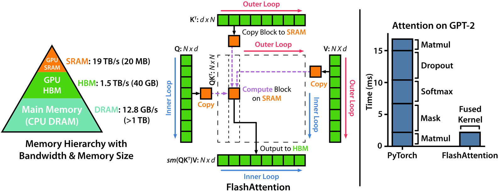
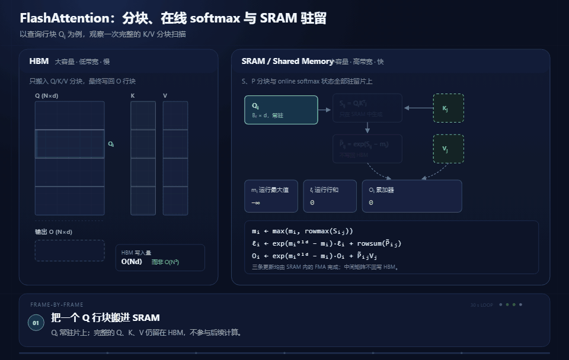
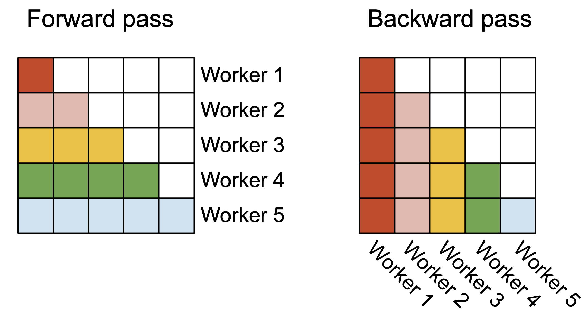
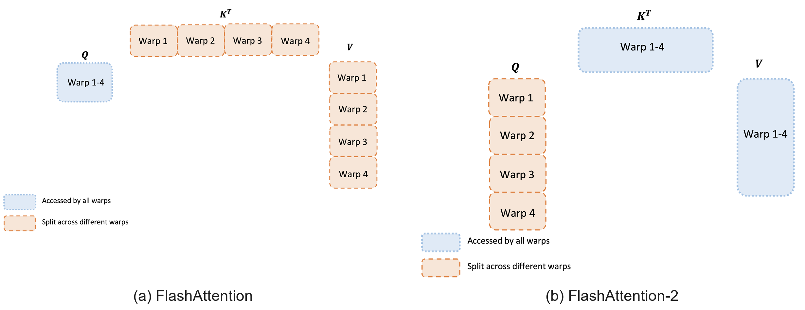
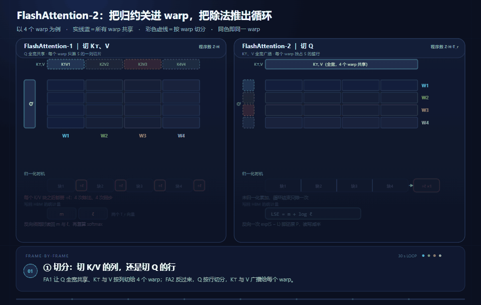
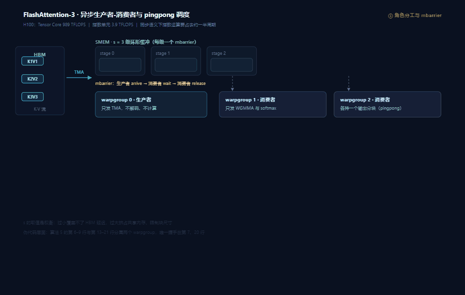
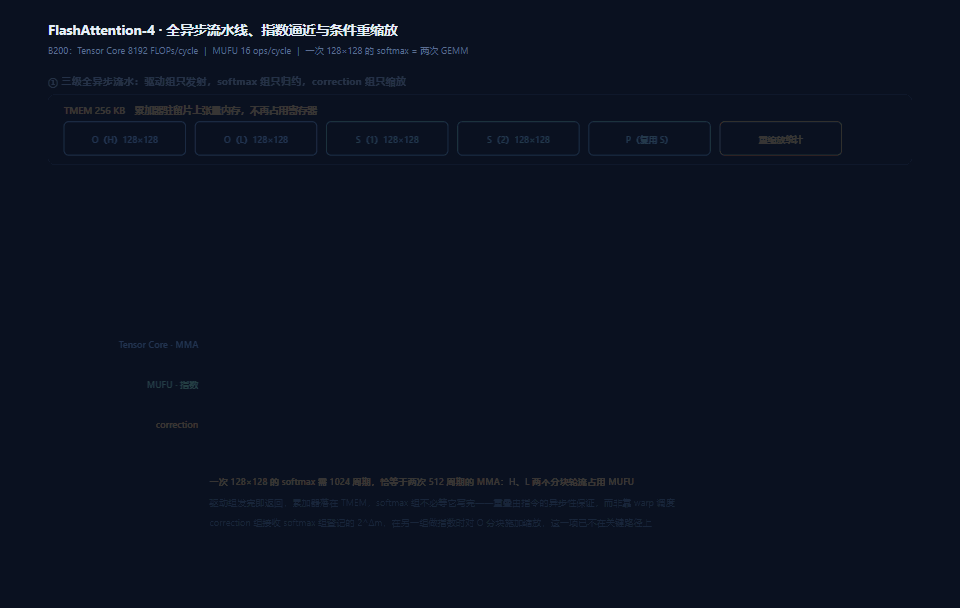
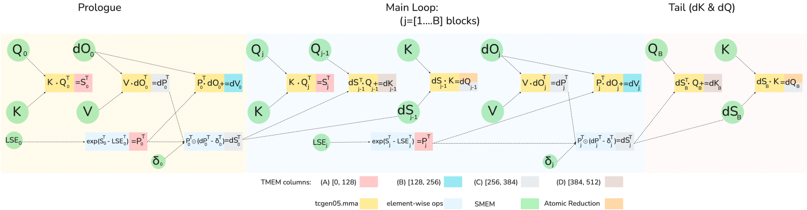

# 从 FlashAttention-1 到 FlashAttention-4：注意力算法的软硬件协同演进

> 工欲善其事，必先利其器。  
> ——《论语·卫灵公》


## 1 引言

自注意力是 Transformer 的核心运算。标准实现需要构造 $N\times N$ 的分数矩阵和概率矩阵，计算量与中间结果规模均随序列长度 $N$ 二次增长。对实际内核而言，浮点运算量并不能单独决定运行时间：HBM 带宽、SRAM 容量、Tensor Core 吞吐以及指数等专用功能单元的性能，共同构成执行约束。

FlashAttention 系列围绕这些约束展开了连续优化。
* FlashAttention-1[1] 以分块和在线 softmax 避免将完整注意力矩阵写入 HBM；
* FlashAttention-2[2] 改进序列维并行与 warp 间工作划分，减少同步和非矩阵乘运算；
* FlashAttention-3[3] 利用 Hopper 的 TMA 与 WGMMA 组织异步流水线，并引入 FP8 计算；
* FlashAttention-4[4] 则面向 Blackwell 的 TMEM 与全异步 MMA，进一步处理指数吞吐和 softmax 重缩放开销。除 FP8 等显式低精度路径外，这些优化均保持注意力数学定义不变。

四代工作的变化表明，注意力内核的瓶颈会随硬件演进由 HBM 数据移动转向片上通信和非矩阵乘运算，算法设计也必须随之调整。展示了算法和硬件是如何协同并互相影响的，软件算法在现有硬件的约束下进行优化，同时硬件根据软件算法的反馈的瓶颈进行提升，从而达到性能的螺旋式增长。

本文第 2 节分析标准实现的 IO 瓶颈，第 3—6 节依次讨论四代算法，第 7 节归纳其演进脉络。文中的性能数字均取自相应论文，仅用于说明特定硬件与实验设置下的结果，不作为跨平台的一般性结论。

## 2 注意力计算与内存瓶颈

### 2.1 注意力的标准形式

设查询、键、值矩阵分别为 $Q,K,V\in\mathbb{R}^{N\times d}$，其中 $N$ 为序列长度，$d$ 为头维度。缩放点积注意力定义为

$$\operatorname{Attention}(Q,K,V)=\operatorname{softmax}\!\left(\frac{QK^{\top}}{\sqrt{d}}\right)V, \tag{1}$$

记缩放后的分数矩阵为 $S=QK^{\top}/\sqrt{d}\in\mathbb{R}^{N\times N}$，概率矩阵为 $P=\operatorname{softmax}(S)\in\mathbb{R}^{N\times N}$。二者的元素数均为 $N^2$，是标准实现中间激活存储与读写的主要来源。下文伪代码中的 $S$ 均包含 $1/\sqrt{d}$ 缩放。

为保证数值稳定性，softmax 通常采用“减最大值”的安全形式，先计算行最大值 $m$，再归一化，即

$$m=\operatorname{rowmax}(S),\qquad \ell=\operatorname{rowsum}\!\big(\exp(S-m)\big),\qquad P=\frac{\exp(S-m)}{\ell}. \tag{2}$$

### 2.2 标准实现的 IO 瓶颈

标准实现依次执行 $QK^{\top}$、softmax 与 $PV$。在未融合的实现中，中间结果 $S$、$P$ 需要写回 HBM，再由后续算子读取。以下 PyTorch 代码对应式 (1)，保留了这两个完整中间张量。

```python
import torch
import torch.nn.functional as F

def standard_attention(Q: torch.Tensor, K: torch.Tensor, V: torch.Tensor) -> torch.Tensor:
    """标准缩放点积注意力；Q、K、V 的形状为 (..., N, d)。"""
    d = Q.size(-1)
    S = torch.matmul(Q, K.transpose(-2, -1)) / (d ** 0.5)
    P = F.softmax(S, dim=-1)
    O = torch.matmul(P, V)
    return O
```

上述实现对应的显存读写与性能瓶颈如表 1 所示。

表 1　标准注意力实现的显存读写与瓶颈分析

| 步骤 | 操作 | HBM 读取 | 核心计算 | HBM 写入 | 矩阵规模 | 性能瓶颈 |
|---|---|---|---|---|---|---|
| 1 | QK GEMM | $Q,K$ | $S=QK^{\top}/\sqrt{d}$ | $S$ | $N\times N$ | 计算受限（算术强度较高） |
| 2 | Softmax | $S$ | $P=\operatorname{softmax}(S)$ | $P$ | $N\times N$ | 内存受限（算术强度极低） |
| 3 | PV GEMM | $P,V$ | $O=PV$ | $O$ | $P$ 为 $N\times N$ | 计算受限（算术强度较高） |

因此，该实现的 HBM 访问量为 $\Theta(N^{2}+Nd)$，其中二次项来自 $S$、$P$ 的写出与读回。softmax 的算术强度较低，容易受显存带宽限制；FlashAttention-1 首先消除的正是这部分数据移动。

## 3 FlashAttention-1：IO 感知的精确注意力

FlashAttention-1[1] 的出发点是 GPU 存储层级的不对称性：片上 SRAM 带宽高但容量有限，HBM 容量较大而带宽相对较低。算法将 $S$、$P$ 的生成与消费限制在 SRAM 分块内，避免完整中间矩阵写回 HBM，同时保持注意力输出不变。图 1 概括了这一设计。



> 图 1　FlashAttention 总体设计。左：GPU 存储层级（SRAM 快而小，HBM 大而慢）；中：通过分块（tiling）与在线 softmax 将 $N\times N$ 注意力矩阵的计算限制在 SRAM 内，仅输入输出经 HBM 搬运；右：GPT-2 上标准实现与 FlashAttention 的算子耗时对比（引自文献[1]图 1）。

在 $d\le M\le Nd$ 的理论分析设定下，该算法的 HBM 访问量为 $\Theta(N^{2}d^{2}/M)$，其中 $M$ 为 SRAM 容量；相比标准实现，二次中间矩阵的往返读写显著减少。实现依赖四项相互配合的设计：

（1）**分块计算（tiling）**。查询与键/值分别按 $B_r$、$B_c$ 分块，两次矩阵乘和 softmax 在同一内核中完成，$S$、$P$ 不离开片上存储。

（2）**在线 softmax（online softmax）**。扫描键/值块时维护运行最大值 $m$ 和运行和 $\ell$；若 $m$ 增大，则以 $\exp(m^{\mathrm{old}}-m^{\mathrm{new}})$ 重缩放既有累加量。遍历全部块后所得结果与全局稳定 softmax 等价。

（3）**反向重计算（recomputation）**。前向不保存 $S$、$P$，反向根据输入和缓存统计量重新构造局部分数与概率，以额外计算换取更低的激活存储。

（4）**统计量复用**。前向保存的 $m$、$\ell$ 供反向重建概率，避免重复执行全局归约。

图 2 展示了单个查询行块的处理过程。$Q_i$ 常驻 SRAM，$K_j$、$V_j$ 依次载入；$S_{ij}$、$\tilde P_{ij}$ 仅在片上生成，$m_i$、$\ell_i$ 与未归一化输出 $O_i$ 随块更新。全部键/值块处理完毕后，才将归一化的 $O_i$ 写回 HBM。



> 图 2　FlashAttention 的分块调度与 online softmax 数据流（动画，30 秒循环播放）。蓝色为查询行块 $Q_i$，绿色为键/值分块 $K_j,V_j$，琥珀色为片上状态 $m_i,\ell_i,O_i$；$N\times N$ 中间矩阵始终不写入 HBM。

### 3.1 前向算法

设 $T_r=\lceil N/B_r\rceil$、$T_c=\lceil N/B_c\rceil$。前向外层遍历查询块，内层遍历键/值块；为简洁起见，伪代码省略末块边界处理。

算法 1　FlashAttention 前向计算

```c
输入：Q, K, V ∈ R^{N×d}；块大小 Br, Bc
输出：O ∈ R^{N×d}；缓存 m、ℓ 供反向使用
1  将 Q 分为 Q1..Q_Tr，K 分为 K1..K_Tc，V 分为 V1..V_Tc
2  将 O 分为 O1..O_Tr，m、ℓ 分为 Tr 个向量；分块载入 SRAM
3  for i = 1 .. Tr do
4      载入 Qi；初始化 Oi = 0，ℓi = 0，mi = -∞
5      for j = 1 .. Tc do
6          载入 Kj, Vj；计算 Sij = Qi Kjᵀ / √d
7          mij = rowmax(Sij)；mi_new = max(mi, mij)
8          P̃ij = exp(Sij - mi_new)                // 用更新后的最大值保证数值稳定
9          ℓi_new = e^{mi - mi_new}·ℓi + rowsum(P̃ij)
10         Oi ← Oi·e^{mi - mi_new} + P̃ij Vj        // 先重缩放旧累加，再累加新块
11         mi ← mi_new；ℓi ← ℓi_new
12     end for
13     Oi ← Oi / ℓi；将 Oi、mi、ℓi 写回 HBM
14 end for
15 return O
```

### 3.2 反向算法

反向不保存完整的 $S$、$P$，而是利用前向缓存的 $m$、$\ell$ 与输出 $O$ 逐块重建。令 $D_i=\operatorname{rowsum}(dO_i\odot O_i)$，则缩放分数的梯度为 $dS_{ij}=P_{ij}\odot(dP_{ij}-D_i)$；计算 $dQ$、$dK$ 时还需乘回 $1/\sqrt{d}$。算法 2 按文献[1]的循环次序书写。

算法 2　FlashAttention 反向计算

```c
输入：Q, K, V, O, dO 及前向缓存的 m、ℓ
输出：dQ, dK, dV
1  将 Q、O、dO、dQ 分为 Tr 块，K、V、dK、dV 分为 Tc 块
2  对全部 i 预计算 Di = rowsum(dOi ⊙ Oi)；dQ 初始化为 0
3  for j = 1 .. Tc do
4      载入 Kj, Vj；dKj ← 0，dVj ← 0
5      for i = 1 .. Tr do
6          载入 Qi、Oi、dOi、mi、ℓi、dQi
7          Sij ← Qi Kjᵀ / √d；Pij ← exp(Sij - mi) / ℓi
8          dVj ← dVj + Pijᵀ dOi
9          dPij ← dOi Vjᵀ
10         dSij ← Pij ⊙ (dPij - Di) / √d
11         dQi ← dQi + dSij Kj；写回 dQi
12         dKj ← dKj + dSijᵀ Qi
13     end for
14     将 dKj、dVj 写回 HBM
15 end for
```

## 4 FlashAttention-2：改进的并行度与工作划分

FlashAttention-2[2] 保持 FlashAttention-1 的 IO 复杂度，转而优化并行划分和循环内的非矩阵乘运算。前向将查询块提升为独立并行任务，使 batch、注意力头和序列长度三个维度均可用于填充 GPU；反向以键/值块组织独立任务，使 $dK_j$、$dV_j$ 在局部累加后一次写回。输出在内层循环中保持未归一化，$1/\ell$ 仅在末尾施加一次。前向还以 $L=m+\log\ell$ 保存对数和指数（log-sum-exp，LSE），使反向可直接用 $P=\exp(S-L)$ 重建概率。

图 3、图 4 分别说明前向分块与前/反向的线程块划分，图 5 和图 6 进一步比较 warp 级的数据归属。


> 图 3　FlashAttention-2 前向分块示意：键、值矩阵各分为两块，中间结果只在 SRAM 中生成，不写回 HBM（引自文献[2]图 1）。

图 3 以两个键/值块为例。蓝色实线框表示 HBM 中的张量，橙色虚线框表示只在 SRAM 中生成的中间量。每处理一块，局部概率与行和并入既有统计量，输出随之校正。图中将归一化写入每次更新；若同时维护运行最大值，则旧输出的校正因子为 $\exp(m^{\mathrm{old}}-m^{\mathrm{new}})\ell^{\mathrm{old}}/\ell^{\mathrm{new}}$。算法 1 和算法 3 采用等价的未归一化累加形式，将 $1/\ell$ 推迟到循环末尾，因而无需在每次迭代中执行该除法。



> 图 4　并行划分：前向沿注意力矩阵的行方向（左），反向沿列方向（右）；同色块由同一 worker 处理（引自文献[2]图 2）。

左图中，每个前向 worker 负责一个查询行块，并顺序处理其全部键/值列块；不同行块相互独立，$O$、$m$、$\ell$ 无需跨 worker 合并。右图的反向 worker 按列划分，使 $dK_j$、$dV_j$ 可在本地完整累加，但同一 $dQ_i$ 会分散到多个 worker，需要原子加或额外归约。因果掩码使任务量呈三角形分布，实际调度还需处理由此产生的负载不均衡。



> 图 5　前向计算中 warp 间的工作划分：(a) FlashAttention；(b) FlashAttention-2。蓝色实线框为被所有 warp 访问的块，橙色虚线框为切分给不同 warp 的块（引自文献[2]图 3）。

图 5(a) 中，4 个 warp 共享 $Q$，分别处理 $K^{\top}$ 与 $V$ 的列切片。由于 softmax 的行最大值和行和需要整行信息，各 warp 必须通过共享内存交换部分结果并同步。图 5(b) 改为沿行切分 $Q$，每个 warp 独占若干查询行，softmax 归约和输出累加均可在 warp 内完成。$K^{\top}$、$V$ 因此需要广播读取，但省去了跨 warp 的中间结果写回与屏障同步。文献[2]的实验表明，后者在目标配置上具有更高的执行效率。

算法 3、算法 4 给出相应的前向与反向过程，Δ 标记主要改动。需要区分伪代码与原始文献的基线：本文算法 1 已采用未归一化累加和末尾一次归一化，因此这一写法与算法 3 相同；文献[2]所强调的“减少每次迭代的归一化”是相对于文献[1]原始更新式的改进，并非本文算法 1 与算法 3 之间的新增差异。

### 4.1 前向算法

算法 3　FlashAttention-2 前向计算

```c
输入：Q, K, V ∈ R^{Z×H×N×d}；块大小 Br, Bc
输出：O ∈ R^{Z×H×N×d}；LSE ∈ R^{Z×H×N}
1  将 Q 分为 Q1..Q_Tr，K、V 分为 K1..K_Tc
2  forall (z, h, i) ∈ {1..Z} × {1..H} × {1..Tr} 并行 do   // Δ1 查询块成为并行维
3      载入 Qi；Oi ← 0，ℓi ← 0，mi ← -∞
4      for j = 1 .. Tc do
5          if 因果掩码 且 (j-1)·Bc > i·Br - 1 then break   // Δ2 整块被屏蔽，跳出
6          载入 Kj, Vj；Sij ← Qi Kjᵀ / √d；对对角块施加因果掩码
7          mi_new ← max(mi, rowmax(Sij))
8          P̃ij ← exp(Sij - mi_new)
9          ℓi ← e^{mi - mi_new}·ℓi + rowsum(P̃ij)
10         Oi ← Oi·e^{mi - mi_new} + P̃ij Vj
11         mi ← mi_new
12     end for
13     Oi ← Oi / ℓi                                       // 归一化仅此一次
14     LSEi ← mi + log ℓi                                 // Δ3 一个向量替代 (m, ℓ)
15     写回 Oi、LSEi
16 end forall
```

Δ1 将可独立调度的任务数由 $ZH$ 增至 $ZH T_r$，在长序列、小 batch 场景中提供更多线程块以填充 SM。每个查询块的 $O_i$、$m_i$、$\ell_i$ 均由同一任务持有，避免跨任务合并。

Δ2 跳过完全位于因果掩码内的块。若最小列号 $(j-1)B_c$ 大于当前行块的最大行号 $iB_r-1$，即可终止内层循环；对角块仍须逐元素施加掩码。当 $B_r=B_c$ 时，计算区域由完整矩阵变为下三角矩阵，渐近意义上约减少一半矩阵乘，但也造成任务间工作量不均。

Δ3 将每个注意力头长度为 $N$ 的 $(m,\ell)$ 两组统计量合并为 $L=m+\log\ell$。除减少存储与读写外，反向可直接计算 $P_{ij}=\exp(S_{ij}-L_i)$，无需分别读取两个向量并重复归一化。

这些改动均不改变精确注意力的数学输出，前向为反向保留的统计量仍为 $O(N)$。

伪代码尚未覆盖 warp 级分工。图 6 以 4 个 warp 为例，将两代实现的差别展开为数据切分、行归约、归一化、广播读、统计量与并行维六个环节。



> 图 6　FlashAttention-1 与 FlashAttention-2 的 warp 级实现对比（动画，30 秒循环播放）。左：$Q$ 由全部 warp 共享，$K^{\top}$、$V$ 按列切给 4 个 warp，行归约须跨 warp 交换部分结果；右：$Q$ 按行切分，$K^{\top}$、$V$ 广播给每个 warp，行归约在寄存器内闭合。蓝色实线为所有 warp 共享的块，彩色虚线为切分给单个 warp 的块，同色即同一 warp。

左侧的 split-K 方案中，每个 warp 只持有一行的部分列，必须交换部分输出和归约统计量。右侧每个 warp 独占 $\lceil B_r/4\rceil$ 个查询行，行归约在 warp 内完成；$K^{\top}$、$V$ 的广播读增加了共享内存读取量，但避免了部分结果写回和跨 warp 屏障。warp 内部还可将查询行分配到线程，并通过寄存器与 shuffle 完成归约。

动画左侧沿用文献[1]的逐块归一化形式，右侧则累加未归一化输出，仅在循环末尾除以 $\ell$。配合 LSE 统计量和 $(z,h,i)$ 三维任务划分，循环内的同步、除法与统计量读写均得到简化。这里的性能收益来自工作划分与指令开销的共同变化，不能仅归因于广播读或并行任务数的增加。

### 4.2 反向算法

算法 4　FlashAttention-2 反向计算

```c
输入：Q, K, V, O, dO，前向缓存的 LSE ∈ R^{Z×H×N}；块大小 Br, Bc
输出：dQ, dK, dV
1  将 Q、O、dO、dQ 分为 Tr 块，K、V、dK、dV 分为 Tc 块；dQ 初始化为 0
2  Di ← rowsum(dOi ⊙ Oi)，对全部 i 一次性算出并缓存
3  forall (z, h, j) ∈ {1..Z} × {1..H} × {1..Tc} 并行 do  // Δ1 键/值块成为独立任务
4      载入 Kj, Vj；dKj ← 0，dVj ← 0
5      for i = imin(j) .. Tr do                          // imin(j)=⌈((j-1)Bc+1)/Br⌉
6          载入 Qi、dOi、LSEi、Di；Sij ← Qi Kjᵀ / √d；因果模式下对对角块施加掩码
7          Pij ← exp(Sij - LSEi)                         // Δ2 一次指数取代 softmax
8          dVj ← dVj + Pijᵀ dOi
9          dPij ← dOi Vjᵀ；dSij ← Pij ⊙ (dPij - Di) / √d
10         dKj ← dKj + dSijᵀ Qi
11         dQi ← dQi + dSij Kj                           // Δ3 跨 j 累加，需原子加
12     end for
13     写回 dKj、dVj                                      // 独占写回，无需原子
14 end forall
```

Δ1 将算法 2 的串行外层 $j$ 循环改为独立并行任务。两种写法都以键/值块组织局部累加，但算法 4 可让多个 $(z,h,j)$ 任务同时驻留 SM；$dK_j$、$dV_j$ 仍只在任务末尾写回一次。相应的跨任务归约集中在 $dQ$：可采用原子加，也可写回部分和后再归约，具体选择取决于确定性和额外存储要求。

Δ2 用一次 $\exp(S_{ij}-L_i)$ 重建概率，省去对 $m$、$\ell$ 的分别读取以及逐元素除法。若硬件指数单元以 2 为底，则需将 $S$ 与 LSE 一致地转换到 base-2 对数域，不能在自然对数与 base-2 指数之间直接混用。

Δ3 标出了 $dQ$ 的跨任务累加位置，是这一并行划分需要额外同步的原因。因果掩码下，第 $j$ 个键/值块只与对角线及其下方的查询块交互，循环下界为 $i_{\min}(j)=\lceil((j-1)B_c+1)/B_r\rceil$；对角块同样需要逐元素掩码。

实际内核通常以 FP32 保存 softmax 统计量和矩阵乘累加器，低精度输入并不意味梯度累加也使用同一精度。

在文献[2]的 A100 实验中，FlashAttention-2 达到约 225 TFLOPs/s（约 72% 的模型 FLOP 利用率），吞吐约为 FlashAttention-1 的两倍。

## 5 FlashAttention-3：面向 Hopper 的异步执行与低精度

FlashAttention-3[3] 面向 Hopper H100。H100 的 FP16 矩阵乘吞吐约为 A100 的三倍，而显存带宽并未同比增长；文献[3]报告，FlashAttention-2 在 H100 上的算力利用率约为 35%。仅减少 HBM 流量已不足以充分利用新架构，数据搬运、矩阵乘和 softmax 之间还需建立更细粒度的重叠。

为此，FlashAttention-3 引入三项内核技术。其一，采用基于 warp 专用化（warp specialization）的生产者—消费者模式：生产者发出 TMA 搬运，消费者执行 WGMMA 与 softmax，二者通过多级 SMEM 环形缓冲和 mbarrier 协调。其二，以 pingpong 调度让两个消费者 warpgroup 的矩阵乘与 softmax 交错执行，并在组内组织两级软件流水。其三，提供 FP8 块量化路径，配合 FP32 累加和非相干处理降低量化误差。前两项保持精确注意力的数学定义，FP8 路径则属于显式的近似计算。

这些设计依赖 Hopper 的 TMA、异步 WGMMA、线程块集群、DSMEM 以及按 warpgroup 调整寄存器配额的 `setmaxnreg`。由于 Hopper 的 Tensor Core 与其他计算单元尚未完全解耦，softmax 与矩阵乘的重叠仍需要 warp 调度和显式同步；Blackwell 的全异步 MMA 为下一节的重构提供了不同条件。

图 7 以四条资源轨道展示 TMA 搬运、$QK^{\top}$、指数运算与 $PV$ 的时间关系，四段依次对应 warp 专用化、异步流水、pingpong 调度和组内两级流水。



> 图 7　FlashAttention-3 的执行模型（动画，30 秒循环播放）。第一段：生产者 warpgroup 只发 TMA、消费者 warpgroup 只发 WGMMA 与 softmax，二者经 $s=3$ 级 SMEM 环形缓冲的 mbarrier 握手（`arrive`／`wait`／`release`）。第二段：同步语义与异步语义的时间线对比，前者 Tensor Core 在搬运与 softmax 期间空转，后者 TMA、$QK^{\top}$、指数、$PV$ 同时在途。第三段：pingpong 调度，两个 warpgroup 各持一个输出分块，交替处于矩阵乘与 softmax 状态。第四段：组内两级流水，第 $j$ 块的 $PV$ 与第 $j+1$ 块的 softmax 重叠。

生产者与消费者分离后，寄存器配额可按角色重新分配，将更多空间留给消费者的输出累加器和分数块。多级缓冲允许后续数据在计算期间预取，pingpong 则进一步用一个 warpgroup 的矩阵乘覆盖另一个 warpgroup 的 softmax。三者分别处理搬运与计算、不同计算单元以及相邻迭代之间的空闲时间。

### 5.1 异步生产者—消费者与 warp 专用化

算法 3 将“载入 $K_j,V_j$”表示为同步操作，即数据就绪后才继续矩阵乘。TMA 则由独立的 DMA 引擎执行，发射后立即返回，并通过 mbarrier 报告完成状态。内核因此可按**生产者—消费者**结构组织，算法 5 给出其 CTA 视角（对应文献[3]算法 1）。

算法 5　FlashAttention-3 前向计算（CTA 视角：warp 专用化与异步流水）

```c
输入：Q, K, V ∈ R^{N×d}；块大小 Br, Bc；环形缓冲级数 s
输出：O ∈ R^{N×d}；LSE ∈ R^{N}
1  初始化流水线对象：s 级 SMEM 环形缓冲，每级配一个 mbarrier
2  按职责划分 CTA 内的 warpgroup：生产者与消费者              // Δ1 warp 专用化
3  if 本 warpgroup 是生产者 then
4      释放部分寄存器，把配额让给消费者（setmaxnreg）
5      发 TMA：Qi 载入 SMEM；完成后 arrive 通知消费者
6      for j = 1 .. Tc do
7          wait 第 (j mod s) 级缓冲已被消费
8          发 TMA：Kj、Vj 载入第 (j mod s) 级；完成后 arrive    // Δ2 发射即返回
9      end for
10 else
11     领取寄存器配额；Oi ← 0，ℓi ← 0，mi ← -∞
12     wait Qi 就绪
13     for j = 1 .. Tc do
14         wait Kj 就绪（mbarrier）                            // Δ3 只等数据，不等计算
15         Sij ← Qi Kjᵀ / √d（WGMMA，commit 后 wait）
16         mi_old ← mi；mi ← max(mi_old, rowmax(Sij))
17         P̃ij ← exp(Sij - mi)；ℓi ← e^{mi_old-mi}·ℓi + rowsum(P̃ij)
18         wait Vj 就绪
19         Oi ← e^{mi_old-mi}·Oi + P̃ij Vj（WGMMA，commit 后 wait）
20         release 第 (j mod s) 级缓冲                         // Δ4 消费完即归还
21     end for
22     Oi ← Oi / ℓi；LSEi ← mi + log ℓi；写回 Oi、LSEi
23 end if
```

Δ1 将搬运和计算分配到不同 warpgroup，避免同一指令流因交替等待两类操作而停顿。`setmaxnreg` 将生产者闲置的寄存器配额转让给消费者，以容纳 $B_r\times d$ 累加器和局部分数块。

Δ2 中的 TMA 发射后立即返回，在途请求由 $s$ 级环形缓冲容纳。级数过少难以覆盖内存延迟，过多则会挤占 SMEM 并限制块尺寸。生产者只有在对应缓冲被消费后才能复用该级。

Δ3、Δ4 构成双向握手：`arrive`/`wait` 表示数据就绪，`release`/`wait` 表示缓冲可复用。WGMMA 的 commit/wait 仍负责维持 $QK^{\top}$、softmax 和 $PV$ 之间的数据依赖，因此“异步”并不等于取消所有等待。

算法 5 的数值更新与算法 3 相同：输出保持未归一化，末尾统一除以 $\ell$，并保存 LSE。变化发生在指令发射和等待的位置，而非注意力的递推公式。

### 5.2 Pingpong 调度

warp 专用化主要重叠搬运与计算，不能自动消除 softmax 与矩阵乘之间的串行等待。以文献[3]采用的 H100 SXM5 参数为例，FP16 矩阵乘峰值约为 989 TFLOPS，指数等特殊函数吞吐折算约为 3.9 TFLOPS。头维 $d=128$ 时，每个分数元素对应约 512 次矩阵乘浮点运算；结合两类单元的吞吐差异，指数时间约为矩阵乘时间的一半。FP8 提高矩阵乘吞吐后，这一失衡更加明显。

pingpong 调度让两个消费者 warpgroup 各持一个输出分块，并通过 `bar.sync` 约束发射次序：一组执行 softmax 时，另一组执行矩阵乘，下一轮交换角色。图 8 给出了对应时间线。


> 图 8　Pingpong 调度：两个 warpgroup 交替执行 softmax 与矩阵乘，使一组的指数运算落在另一组的矩阵乘阴影中；同色表示同一次迭代（引自文献[3]图 1）。

在文献[3]的 FP16、$d=128$、$N=8192$ 前向实验中，该调度将吞吐由 570 TFLOPs/s 提升至 620–640 TFLOPs/s。两个输出分块增加了寄存器与 SMEM 占用；调度还要求编译器保持预期的指令次序，作者通过检查 SASS 验证重叠。两个 warpgroup 的指数段需适当互斥，以避免同时争用 SFU。

### 5.3 warpgroup 内的两级流水线

pingpong 利用不同 warpgroup 之间的并行；单个 warpgroup 内仍受 $QK^{\top}\rightarrow\mathrm{softmax}\rightarrow PV$ 的依赖约束。两级软件流水将下一块的 $QK^{\top}$ 提前发射，使其与当前块的 softmax 和 $PV$ 重叠。算法 6 给出消费者分支的简化写法，省略边界处理与因果掩码。

算法 6　FlashAttention-3 消费者 warpgroup 的两级软件流水线

```c
输入：Qi、Kj、Vj 已由生产者预取入 SMEM
输出：Oi、LSEi
1  Oi ← 0，ℓi ← 0，mi ← -∞
2  wait Qi、K1 就绪
3  S_cur ← Qi K1ᵀ / √d（WGMMA，commit 并 wait）
4  for j = 1 .. Tc do
5      if j < Tc then
6          wait K_(j+1) 就绪
7          S_next ← Qi K_(j+1)ᵀ / √d（WGMMA，commit 不 wait）  // Δ1 提前发射
8      end if
9      mi_old ← mi；mi ← max(mi_old, rowmax(S_cur))
10     P̃_cur ← exp(S_cur - mi)
11     ℓi ← e^{mi_old-mi}·ℓi + rowsum(P̃_cur)
12     wait Vj 就绪，且上一块 PV 已完成；释放上一块 V 缓冲      // Δ2 保护旧累加器
13     Oi ← e^{mi_old-mi}·Oi + P̃_cur Vj（WGMMA，commit 不 wait）
14     release 已消费的 Kj 缓冲                                  // Vj 待 PV 完成后释放
15     if j < Tc then wait S_next 完成；S_cur ← S_next           // Δ3 双份分数块
16 end for
17 wait 末块 PV 完成
18 Oi ← Oi / ℓi；LSEi ← mi + log ℓi；写回
```

Δ1 将 $S_{\mathrm{next}}$ 的发射移到当前 softmax 之前，使 Tensor Core 与 softmax 所用单元能够并行工作。等待 $S_{\mathrm{next}}$ 被推迟到第 15 行，不能在结果就绪前读取它。

Δ2 表明异步执行并不改变在线 softmax 的更新语义：重缩放旧输出之前，必须等待上一块 $PV$ 完成。流水化改变的是不同块之间的重叠方式，而不是同一块内的数据依赖。

Δ3 需要额外保留一份 $S$ 或 $\tilde P$。增加的寄存器占用会限制块尺寸；若引发寄存器溢出，流水重叠的收益可能被局部内存访问抵消。文献[3]还讨论了三级流水，其潜在重叠更多，资源压力也更高。


> 图 9　两级 WGMMA-softmax 流水线：第 $j$ 块的 $PV$ 与第 $j+1$ 块的 softmax 重叠（引自文献[3]图 2）。

图 9 的三条轨道分别对应 $QK^{\top}$（WGMMA0）、softmax 和 $PV$（WGMMA1）。单块内部仍遵循 $QK^{\top}\rightarrow\mathrm{softmax}\rightarrow PV$，相邻块则错开执行：第 $j+1$ 块的 $QK^{\top}$ 可覆盖第 $j$ 块的 softmax，第 $j$ 块的 $PV$ 也可与后续计算重叠。图中的阶梯来自算法 6 的延迟等待；若每次 WGMMA 发射后立即等待，时间线将退回串行形式。实际重叠程度还受寄存器容量、指令依赖和编译器调度限制。


> 图 10　三级流水线：在第 $j$ 块的 $PV$ 与第 $j+1$ 块的 softmax 之外，再让第 $j+1$ 块的 $PV$ 与之重叠（引自文献[3]图 8）。

图 10 进一步错开相邻块的 $QK^{\top}$ 与 $PV$，使更多矩阵乘填入 softmax 的时间窗口。与两级方案相比，它需要保留更多中间分块，并对指令发射次序提出更高要求。三级流水是否优于两级方案，取决于块尺寸、寄存器压力及实际调度结果，不能仅按流水级数判断。

### 5.4 FP8 块量化

FP8 的收益来自矩阵乘吞吐相对 FP16 翻倍，难点有二：精度与布局。

精度方面采用**块量化**：以块（如 $B_r\times d$ 的查询块与 $B_c\times d$ 的键块）为单位求缩放因子 $s_Q$、$s_K$，块内元素除以该因子后量化为 FP8，矩阵乘在 FP32 中累加，结果再乘回 $s_Qs_K$。注意力分数中的离群值会扩大块内动态范围，集中量化误差。文献[3]因此引入**非相干处理**（incoherent processing）：对 $Q$、$K$ 施加相同的正交 Hadamard 变换。由 $QK^{\top}=(QH)(KH)^{\top}$ 可知变换前后分数不变，而离群值被分散到不同维度。论文报告，该组合将 FP8 注意力的数值误差降至基线 FP8 实现的约 $1/2.6$。

布局方面，FP8 的 WGMMA 要求第二个矩阵乘的操作数满足 k-major，而 $V$ 在 HBM 中通常按头维连续存放，需在载入共享内存后用 `ldmatrix`／`stmatrix` 做块内转置；转置可安排在上一块两次 WGMMA 的阴影里，以减少对关键路径的影响。此外，FP8 矩阵乘的 FP32 累加器在寄存器中的布局与 FP8 操作数 $A$ 的布局并不一致，须显式搬运，这也是 FP8 版本额外的指令开销来源。

在论文给定的 H100 测试配置下，FlashAttention-3 的 FP16 前向达到约 740 TFLOPs/s（75% 利用率），FP8 前向接近 1.2 PFLOPS。

## 6 FlashAttention-4：面向 Blackwell 的流水线协同设计

FlashAttention-4[4] 面向 Blackwell。B200 的 BF16 Tensor Core 峰值约为 2.25 PFLOPS，而 SMEM 带宽与指数单元吞吐相较 Hopper 基本不变，非矩阵乘资源因而更容易限制内核性能。文献[4]以每 SM 每周期 8192 次矩阵乘浮点运算、128 字节 SMEM 读取和 16 次指数运算为参数，对 $M=N=d=128$ 的前向分块作出简化估算：两次 MMA 需要 $4MNd/8192=1024$ 周期，SMEM 读取需要 $3MNd/8192=768$ 周期，$MN$ 次指数需要 $MN/16=1024$ 周期。MMA 与指数单元构成主要瓶颈，SMEM 也处于同一量级。该模型未计入寄存器带宽等全部资源，其作用是识别瓶颈，而非预测完整内核时间。

针对这些约束，算法采用四项设计：利用全异步 MMA 和 TMEM 重构前向流水；在反向使用 2-CTA MMA，减少部分 SMEM 操作数流量和 $dQ$ 全局原子归约；以 FMA 多项式模拟部分 $2^x$，补充 MUFU 的指数吞吐；仅在运行最大值增长超过阈值时重缩放输出累加器。

Blackwell 的 $128\times128$ MMA 分块、每 SM 256 KB TMEM、全异步 Tensor Core 以及基于 DSMEM 的 CTA 对协作，是这些设计的硬件基础。图 11 展示前向流水、指数模拟和条件重缩放之间的关系。



> 图 11　FlashAttention-4 的执行模型（动画，30 秒循环播放）。第一段：三级全异步流水，驱动组只发 TMA 与 MMA，两个 softmax 组各持一个 128 token 的查询分块（对应 TMEM 中的一份 $O$ 与 $S$），correction 组独立施加重缩放，$QK^{\top}$、softmax 与 $PV$ 在时间上重叠。第二段：指数函数的多项式逼近，一次输入依次经过钳位与取整、小数部分多项式求值、指数位拼接，与硬件 MUFU 通路并行。第三段：条件重缩放，$m^{\text{new}}-m^{\text{old}}>\tau$ 时缩放、否则跳过，两个分支沿用各自的指数参考值，末尾统一归一化。

Blackwell 仍将两个查询分块交错执行，但累加器位于 TMEM，MMA 又可全异步发射，因而不再沿用 Hopper 的寄存器累加器组织方式。驱动组、softmax 组和 correction 组分别负责指令发射、行归约与输出重缩放。

### 6.1 全异步流水线与条件重缩放

Blackwell 将 MMA 累加器由寄存器移至 TMEM，单个累积分块由 $64\times128$ 增至 $128\times128$，并支持全异步 MMA。为与硬件 `EX2` 一致，本节令 $\bar S=S\log_2e$，运行最大值 $m$ 也在 base-2 对数域中维护；自然对数域的 LSE 仅在写回前转换。

对于 $128\times128$ 分块，128 线程的 softmax warpgroup 可让每线程处理完整一行，行最大值与行和无需跨线程 shuffle。CTA 内设置 1 个驱动组、2 个 softmax 组和 1 个 correction 组；两个 softmax 组各处理一个查询分块，并错开指数计算临界区。算法 7 给出这一分工的简化过程。

算法 7　FlashAttention-4 前向计算（全异步流水线，CTA 视角）

```c
输入：Q, K, V ∈ R^{N×d}；分块 Br = 128、Bc；重缩放阈值 τ
输出：O；LSE
1  TMEM 分区：2 份 O 分块、2 份 S 分块（P 与 S 复用同一区域）   // Δ1 累加器入 TMEM
2  角色划分：驱动组 ×1、softmax 组 ×2、correction 组 ×1         // Δ2 四类 warpgroup
3  if 驱动组 then
4      for j = 1 .. Tc do
5          wait 第 (j mod 2) 份 S 分块已空闲
6          发 MMA：S(j) ← Qi Kjᵀ / √d（SS，commit 不 wait）    // 两份 S 轮转
7          if j > 1 then
8              wait 第 j-1 块的 P 已写回 TMEM
9              发 MMA：O ← O + P̃(j-1) Vj-1（TS，累加进 TMEM，不 wait）
10         end if
11     end for
12     wait 末块 P 就绪；发末块 PV；等待全部 MMA 完成
13 else if softmax 组 then
14     认领一个查询分块；mi ← -∞，ℓi ← 0
15     for j = 1 .. Tc do
16         wait S(j) 就绪；把整行 128 个元素载入寄存器
17         mi_new ← max(mi, rowmax(S(j)·log2e))                 // m 位于 base-2 域
18         if mi_new - mi > τ then                              // Δ3 条件重缩放
19             P̃ ← exp2_emu(S(j)·log2e - mi_new)                // 见算法 8
20             ℓi ← 2^{mi-mi_new}·ℓi + rowsum(P̃)
21             向 correction 组登记因子 2^{mi-mi_new}             // Δ4 移出关键路径
22             mi ← mi_new
23         else
24             P̃ ← exp2_emu(S(j)·log2e - mi)；ℓi ← ℓi + rowsum(P̃) // 不更新 mi
25         end if
26         分四次把 P̃ 写回 TMEM，通知驱动组                      // 降低寄存器压力
27     end for
28     wait 该分块 PV 与 correction 完成
29     Oi ← Oi / ℓi；LSEi ← (mi + log2 ℓi) / log2e             // 转回自然对数域
30 else  // correction 组
31     按登记顺序对 TMEM 中的 O 分块施加 2^{Δm} 缩放             // 与 softmax 并行
32 end if
33 写回 O、LSE
```

Δ1 为两个查询分块预留输出，并让两份 $S$ 与 $P$ 复用 TMEM。这样可在启动时连续计算两个分数块，并为后续 MMA 与 softmax 的重叠提供缓冲；少量 TMEM 还用于传递重缩放统计量。

Δ2、Δ4 将输出重缩放交给 correction 组。由于 $P$ 经 TMEM 传递，softmax 组无需同时修改输出累加器，correction 组可独立执行 $2^{\Delta m}$ 缩放。两个 softmax 组仍需错开指数临界区，以避免争用 MUFU。

Δ3 减少不必要的重缩放。只有当候选最大值相对当前参考值的增量超过 $\tau$ 时，才更新参考值并缩放旧输出：

$$O^{(j)}=\begin{cases}2^{m^{\text{old}}-m^{\text{new}}}O^{(j-1)}+2^{\bar S^{(j)}-m^{\text{new}}}V^{(j)}, & m^{\text{new}}-m^{\text{old}}>\tau,\\[2pt] O^{(j-1)}+2^{\bar S^{(j)}-m^{\text{old}}}V^{(j)}, & \text{否则}.\end{cases} \tag{3}$$

在跳过分支中，$m$ 保持不变，新旧块因而仍使用同一指数参考值；$\ell$ 与 $O$ 继续在该参考值下累加，末尾执行 $O/\ell$ 即可得到正确输出。这里不是用末尾归一化“修正误差”，而是避免一次本可推迟的坐标变换。文献[4]取 $\tau=8$，跳过缩放时新增指数项相对当前参考值至多放大 $2^8=256$ 倍。为避免 warp 分歧，只要组内任一线程触发条件，整组便执行重缩放。


> 图 12　FlashAttention-4 前向流水线。上标 H／L 分别对应“高／低”查询分块，每个查询分块对应 128 个查询 token（引自文献[4]图 1）。

图 12 左侧展示 CTA 对查询行块和键/值列块的遍历，右侧将计算映射到 MMA 与 MUFU 时间轨道。上标 H、L 区分两个 128 token 查询分块；$S^{H}$、$S^{L}$ 与 $O^{H}$ 等方片对应驱动组发射的异步矩阵乘。

在图示参数下，一次 $128\times128\times128$ MMA 约需 512 周期，一个 $128\times128$ 分数块的指数约需 1024 周期。一个查询分块执行 softmax 时，另一个分块可执行两次 MMA，从而填补 Tensor Core 的时间窗口。轨道下方的 $512/1024/512$ 等数字正是这一理想化周期估算；实际内核仍受依赖、同步和资源争用影响。

### 6.2 指数函数的多项式逼近

软件模拟的目标是让部分指数运算改用 FMA 单元，从而与 MUFU 并行。文献[4]采用 Cody–Waite 区间规约和相对误差意义下的极小极大多项式逼近。

首先利用换底公式将输入映射至固定小区间。由 $e^{x}=2^{x\log_{2}e}$，令

$$y=x\cdot\log_{2}e, \tag{4}$$

并将其拆分为整数部分 $n$ 与小数部分 $f$：

$$y=n+f,\qquad n=\lfloor y\rfloor,\qquad f=y-n\in[0,1), \tag{5}$$

于是原式转化为

$$e^{x}=2^{y}=2^{n}\cdot 2^{f}. \tag{6}$$

$2^{n}$ 可通过调整 IEEE 754 浮点数的指数位实现；对 $f\in[0,1)$ 的 $2^f$ 则用低阶多项式逼近，例如

$$2^{f}\approx c_{0}+c_{1}f+c_{2}f^{2}, \tag{7}$$

系数由极小极大准则预先确定。文献[4]取 $p_0=1$，其余系数由 Sollya 按区间内的相对误差优化，并采用 Horner 形式求值。算法 8 以 $r$ 阶多项式表示这一过程。

算法 8　$2^{x}$ 的软件模拟（区间规约 + Horner 多项式）

```c
输入：x（已含 log2e 因子）；r 阶多项式系数 p0..pr
输出：2^x
1  x ← max(x, -127)                                     // 钳位，防下溢
2  k ← x + (2^23 + 2^22)                                 // 把小数位挤入尾数
3  k ← k - (2^23 + 2^22)，向下取整模式                    // 得 ⌊x⌋，两条浮点指令完成取整
4  f ← x - k                                             // f ∈ [0,1)
5  p ← pr
6  for i = r-1 downto 0 do
7      p ← fma(p, f, pi)                                 // Horner，全部为 FMA，无分支
8  end for
9  return 将 k 移入指数位，再与 p 的尾数相加               // 位拼接，一条整数加法
```

第 2、3 行借助 $2^{23}+2^{22}$ 的浮点对齐和向下取整模式获得 $\lfloor x\rfloor$，避免显式分支。第 6—8 行全部使用 FMA，因而可与 `MUFU.EX2` 并行，而不是简单以较慢的软件序列替换硬件指令。

多项式模拟也会增加寄存器占用、寄存器带宽和指令延迟。文献[4]只对每行 10%–25% 的元素进行软件模拟，其余仍由 MUFU 计算，具体比例按分块配置调优。表 2 列出论文在 $[0,1)$ 上 400 万个随机输入的误差结果。

表 2　$2^x$ 多项式模拟的相对误差（引自文献[4]表 2）

| 方法 | FP32 最大相对误差 | FP32 平均相对误差 | 转 BF16 后最大相对误差 | 转 BF16 后平均相对误差 |
|---|---:|---:|---:|---:|
| 硬件 MUFU.EX2 | $1.41\times10^{-7}$ | $3.04\times10^{-8}$ | $3.89\times10^{-3}$ | $1.41\times10^{-3}$ |
| 三阶多项式 | $8.77\times10^{-5}$ | $5.43\times10^{-5}$ | $3.90\times10^{-3}$ | $1.41\times10^{-3}$ |
| 四阶多项式 | $3.05\times10^{-6}$ | $1.84\times10^{-6}$ | $3.89\times10^{-3}$ | $1.41\times10^{-3}$ |
| 五阶多项式 | $1.44\times10^{-7}$ | $5.48\times10^{-8}$ | $3.89\times10^{-3}$ | $1.41\times10^{-3}$ |

三阶多项式的 FP32 误差明显高于硬件指令，但转换为 BF16 后，量化误差占主导，两者精度接近。五阶多项式进一步缩小了 FP32 误差，代价是每次求值增加两条 FMA 指令。

### 6.3 反向与 2-CTA 模式

反向包含五次矩阵乘。文献[4]估算，在 $M=N=d=128$ 的 1-CTA 配置下，MMA 需要 2560 周期，而包含操作数读取、$dS$ 写出及 $dQ$ 写读在内的 SMEM 流量需要 3328 周期，约高 30%。2-CTA MMA 以 $M=256$、$N=K=128$ 组织 CTA 对，每个 CTA 仅载入并暂存一半 B 操作数；计入新增的 DSMEM 交换后，总 SMEM 周期降至 2688，较 1-CTA 减少约 19%，而非所有流量都减半。

但 $dQ$ 的归约轴是键的序列维 $N$，而 2-CTA MMA 只切分输出分块、不切归约轴，故每个 CTA 仍需要完整归约。为此，CTA 对通过 DSMEM 交换半个 $dS$ 分块，使 $dS$ 沿非归约轴重排：每个 CTA 持有一半行和完整的 $2N$ 归约长度。于是 $dQ$ 的矩阵乘形状变为 $(M/2,\,2N)\times(2N,\,d)$，$S$、$dP$、$dV$、$dK$ 仍取 $M=256$。算法 9 给出这一分解。

算法 9　FlashAttention-4 反向的 2-CTA 模式（$dQ$ 步骤）

```c
输入：Qi、Kj、Vj、dOi 分块；前向缓存的 LSEi；CTA 对内编号 r ∈ {0,1}
输出：dQi（半个分块）、dKj、dVj
1  以 2-CTA MMA（M = 256）计算 Sij、dPij、dVj、dKj             // Δ1 各加载一半 B 操作数
2  dSij ← Pij ⊙ (dPij - Di) / √d，其中 Pij 由 exp(Sij - LSEi) 还原
3  通过 DSMEM 与配对 CTA 交换半个 dS 分块                       // Δ2 沿非归约轴重排
4  dQ 的 MMA：(M/2, 2N) × (2N, d)，累加进 TMEM                  // Δ3 归约长度翻倍
5  本块的 dS 逐元素运算与上一块的 dQ MMA 交错                    // Δ4 用计算掩盖 DSMEM 延迟
6  只写回 dQ 分块中属于本 CTA 的一半，全局原子加减半
```

Δ1 中，2-CTA 模式大致减半 B 操作数的 SMEM 读取，每个 CTA 只保留自己的累加器切片。它还缩短了 $dQ$ 的 SMEM 写读路径，但 DSMEM 交换会增加一部分流量，因此应按总流量而非单一操作数评估收益。

Δ2、Δ3 处理 $dQ$ 的归约轴划分。CTA 对通过 DSMEM 各交换半个 $dS$ 分块，将其重排为每个 CTA 持有 $M/2$ 行和完整的 $2N$ 归约长度。随后，单 CTA 的 $dQ$ MMA 采用 $(M/2,2N)\times(2N,d)$，而 $S$、$dP$、$dV$、$dK$ 仍使用 $M=256$ 的 2-CTA 分块。

Δ4 将本块的逐元素 $dS$ 计算与上一块的 $dQ$ MMA 重叠，以隐藏 DSMEM 延迟。每个 CTA 只写回一半 $dQ$ 分块，全局原子归约次数因而减半。若需要确定性结果，可选模式通过信号量按预定顺序串行化同一 $dQ$ 分块的归约（文献[4] §3.2.4）。



> 图 13　FlashAttention-4 反向计算图（含 5 次 MMA 与 2 次逐元素运算），展示 1-CTA MMA 模式的软件流水线顺序（引自文献[4]图 2）。

图 13 按前导、主循环和收尾展开反向数据流。每个键/值块包含 5 次 MMA：$S_j^{\top}=KQ_j^{\top}$、$dP_j=VdO_j^{\top}$、$dV_j=P_j^{\top}dO_j$、$dK_j=dS_j^{\top}Q_j$ 和 $dQ_j=dS_jK$，以及指数和 $dS$ 两次逐元素运算。箭头标出了必须保持的依赖：$S_j$ 先于指数，$P_j$ 与 $dP_j$ 先于 $dS_j$，$dS_j$ 再供 $dK_j$、$dQ_j$ 使用。软件流水只能重排不同迭代中互不依赖的操作，不能打破这些块内依赖。

TMEM 的 A—D 四段列以不同颜色区分，相邻步骤使用不同缓冲，避免覆盖尚未消费的累加器。绿色节点表示全局原子归约：$dQ$ 以及 GQA 情形下的 $dK$、$dV$ 需要跨 CTA 累加；$S$、$P$、$dP$、$dS$ 等中间量则保留在片上。


> 图 14　2-CTA 反向的 $dQ$ 步骤：CTA 对通过 DSMEM 交换半个 $dS$ 分块，使 $dQ$ 的归约长度由 $N$ 变为 $2N$（引自文献[4]图 3）。

图 14(a) 给出 $dQ=dS\,K$ 的逻辑矩阵乘，(b) 将 $dS$ 分配到 CTA 对。(c)、(d) 展示 DSMEM 交换：两个 CTA 各交换半个 $dS$，使数据改为沿非归约轴划分。(e) 中，每个 CTA 因而持有 $M/2$ 行和完整的 $2N$ 归约长度，执行 $(M/2\times2N)(2N\times d)$；(f) 仅写回 $M/2\times d$ 的 $dQ$ 切片，全局原子加次数随之减半。该设计以增加一次片上交换为代价，使 2-CTA 的输出切分与 $dQ$ 的归约结构相容。

在文献[4]的 B200 BF16 实验中，FlashAttention-4 最高达到 1613 TFLOPs/s（71% 利用率）；在其测试配置下，相对 cuDNN 9.13 和 Triton 的最高加速比分别为 1.3 和 2.7。

## 7 总结与展望

四代 FlashAttention 并未重复优化同一个瓶颈。FlashAttention-1 首先消除 $S$、$P$ 在 HBM 中的物化；FlashAttention-2 在既定 IO 复杂度下改善任务划分；FlashAttention-3 将数据搬运、矩阵乘和 softmax 组织为异步流水；FlashAttention-4 则进一步处理指数、SMEM 流量和累加器重缩放。表 3 汇总其主要设计及论文报告的代表性性能。

表 3　FlashAttention-1 至 FlashAttention-4 的设计对比

| 版本 | 目标硬件 | 主要优化 | 论文报告的代表性结果 |
|---|---|---|---|
| FlashAttention-1 | Ampere（A100） | 分块、在线 softmax、反向重计算 | HBM 访问量降至 $\Theta(N^{2}d^{2}/M)$ |
| FlashAttention-2 | Ampere（A100） | 序列维并行、warp 工作划分、LSE | 约 225 TFLOPs/s（约 72%） |
| FlashAttention-3 | Hopper（H100） | TMA/WGMMA、warp 专用化、FP8 | FP16 约 740 TFLOPs/s（75%）；FP8 近 1.2 PFLOPS |
| FlashAttention-4 | Blackwell（B200） | 全异步 MMA、2-CTA、指数模拟、条件重缩放 | BF16 最高约 1613 TFLOPs/s（71%） |

这一演进反映了硬件瓶颈的迁移。早期内核主要受完整中间矩阵的 HBM 读写约束；矩阵乘吞吐提高后，warp 间同步、片上数据移动和指数运算的影响逐渐显现。分块与在线 softmax 因而仍是共同基础，但后续的增益越来越多地来自执行顺序和资源分配，而不是新的注意力递推公式。每一代算法的进步均是对当时硬件瓶颈的回应，而硬件瓶颈的转移又催生下一轮算法迭代。


## 参考文献

[1] Dao T, Fu D Y, Ermon S, et al. FlashAttention: Fast and memory-efficient exact attention with IO-awareness. Advances in Neural Information Processing Systems 35 (NeurIPS), 2022. arXiv:2205.14135.

[2] Dao T. FlashAttention-2: Faster attention with better parallelism and work partitioning. arXiv preprint arXiv:2307.08691, 2023.

[3] Shah J, Bikshandi G, Zhang Y, et al. FlashAttention-3: Fast and accurate attention with asynchrony and low-precision. Advances in Neural Information Processing Systems 37 (NeurIPS), 2024. arXiv:2407.08608.

[4] Zadouri T, Hoehnerbach M, Shah J, et al. FlashAttention-4: Algorithm and kernel pipelining co-design for asymmetric hardware scaling. Proceedings of Machine Learning and Systems (MLSys), 2026. arXiv:2603.05451.
