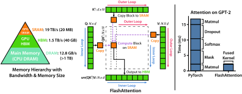
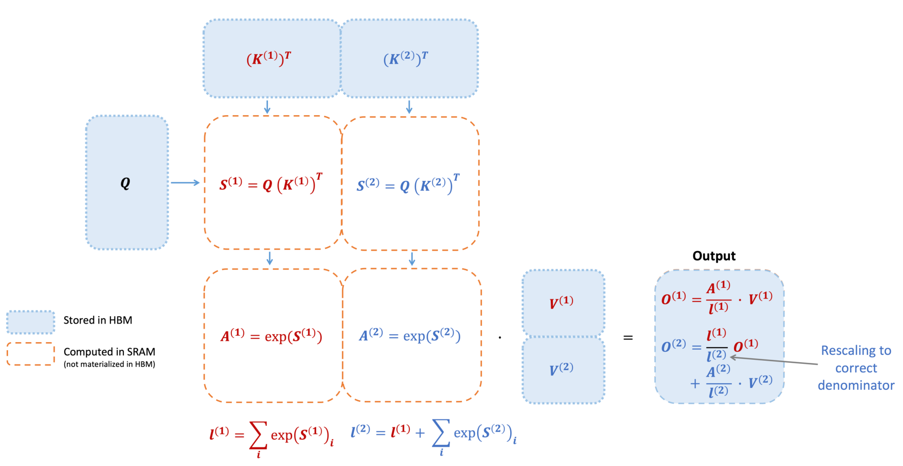
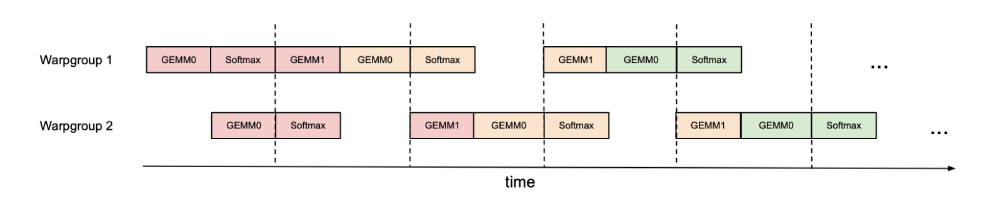
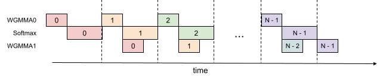
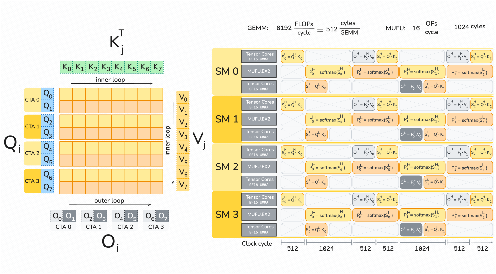
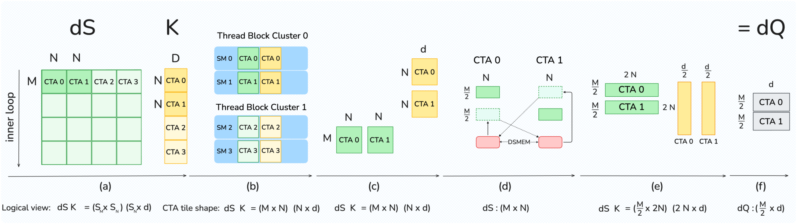

> 工欲善其事，必先利其器。  
> ——《论语·卫灵公》

## 1 概述

Transformer 架构自提出以来已成为大语言模型的基础骨架，而自注意力机制是其中计算与显存开销的主要来源。标准注意力需构造并存储 $N\times N$ 的注意力分数矩阵与概率矩阵，其计算量与显存占用均随序列长度 $N$ 二次增长。与此同时，现代 GPU 的算力（FLOPs）增长速度显著快于高带宽显存（HBM）带宽及专用功能单元（如指数运算单元）的提升速度，形成所谓"内存墙"（memory wall）。在这一背景下，算法必须同时优化数据在存储层级之间的搬运和计算单元之间的差异。FlashAttention 系列正是这一思路的代表，在保持注意力数学形式不变的前提下，通过分块计算、在线 softmax 以及对硬件特性的深度适配，逐代降低内存访问开销并提升算力利用率。

FlashAttention 系列算法将注意力计算与 GPU 硬件特性协同设计，在保持数值精确的前提下显著降低显存访问开销，已成为大模型训练与推理的标准实现。本文系统梳理 FlashAttention-1 至 FlashAttention-4 的算法演进：
* FlashAttention-1 提出基于分块与在线 softmax 的 IO 感知精确注意力；
* FlashAttention-2 通过改进并行度与工作划分提升 GPU 利用率；
* FlashAttention-3 面向 Hopper 架构引入异步执行、warp 专用化与 FP8 低精度计算；
* FlashAttention-4 面向 Blackwell 架构，利用全异步矩阵乘、双 CTA 协作、指数函数的多项式逼近与条件 softmax 重缩放进一步提升算力利用率。

四代工作共同展示了算法和硬件是如何协同并互相影响的，软件算法在现有硬件的约束下进行优化，同时硬件根据软件算法的反馈的瓶颈进行提升，从而达到性能的螺旋式增长。本文按代际梳理 FlashAttention-1 至 FlashAttention-4 的算法设计，分析其与 Ampere、Hopper、Blackwell 三代 GPU 架构的协同关系。第 2 节给出注意力计算的标准形式及其 IO 瓶颈；第 3 至 6 节依次讨论四代算法；第 7 节总结软硬件协同的演进规律并展望后续方向。

## 2 注意力计算与内存瓶颈

### 2.1 注意力的标准形式

设查询、键、值矩阵分别为 $Q,K,V\in\mathbb{R}^{N\times d}$，其中 $N$ 为序列长度，$d$ 为头维度。缩放点积注意力定义为

$$\operatorname{Attention}(Q,K,V)=\operatorname{softmax}\!\left(\frac{QK^{\top}}{\sqrt{d}}\right)V, \tag{1}$$

其中注意力分数矩阵 $S=QK^{\top}\in\mathbb{R}^{N\times N}$，注意力概率矩阵 $P=\operatorname{softmax}(S)\in\mathbb{R}^{N\times N}$。两者规模均随 $N$ 二次增长，构成显存读写的主要来源。

为保证数值稳定性，softmax 通常采用"减最大值"的安全形式，先计算行最大值 $m$，再归一化，即

$$m=\operatorname{rowmax}(S),\qquad \ell=\operatorname{rowsum}\!\big(\exp(S-m)\big),\qquad P=\frac{\exp(S-m)}{\ell}. \tag{2}$$

### 2.2 标准实现的 IO 瓶颈

标准实现依次执行 QK 矩阵乘、softmax 与 PV 矩阵乘三步，中间结果 $S$、$P$ 均需写回 HBM 后再读回。以下 PyTorch 参考实现对应式(1)，其中 `S` 与 `P` 均以完整中间张量的形式生成，直观展示了标准实现的数据通路。

```python
import torch
import torch.nn.functional as F


def standard_attention(Q: torch.Tensor, K: torch.Tensor, V: torch.Tensor) -> torch.Tensor:
    """标准缩放点积注意力；Q、K、V 的形状为 (..., N, d)。"""
    d = Q.size(-1)
    S = torch.matmul(Q, K.transpose(-2, -1)) / (d ** 0.5)
    P = F.softmax(S, dim=-1)
    O = torch.matmul(P, V)
    return O
```

上述实现对应的显存读写与性能瓶颈如表 1 所示。

表 1　标准注意力实现的显存读写与瓶颈分析

| 步骤 | 操作 | HBM 读取 | 核心计算 | HBM 写入 | 矩阵规模 | 性能瓶颈 |
|---|---|---|---|---|---|---|
| 1 | QK GEMM | $Q,K$ | $S=QK^{\top}$ | $S$ | $N\times N$ | 计算受限（算术强度较高） |
| 2 | Softmax | $S$ | $P=\operatorname{softmax}(S)$ | $P$ | $N\times N$ | 内存受限（算术强度极低） |
| 3 | PV GEMM | $P,V$ | $O=PV$ | $O$ | $P$ 为 $N\times N$ | 计算受限（算术强度较高） |

由此，标准实现的 HBM 访问量为 $\Theta(N^{2}+Nd)$，其中二次项源于 $N\times N$ 中间矩阵的写出与读回。由于 softmax 步骤的算术强度极低，其执行时间主要受显存带宽而非算力约束，这正是后续算法优化的切入点。

## 3 FlashAttention-1：IO 感知的精确注意力

FlashAttention-1[1] 利用 GPU 的存储层级结构，片上 SRAM 带宽高而容量小，HBM 容量大而带宽低。其核心思想是将 $S$、$P$ 的计算限制在 SRAM 内的分块上，避免中间矩阵写回 HBM，从而在不改变注意力数学形式的前提下降低显存访问开销。图 1 给出了其总体设计。



> 图 1　FlashAttention 总体设计。左：GPU 存储层级（SRAM 快而小，HBM 大而慢）；右：通过分块（tiling）与在线 softmax 避免将 $N\times N$ 注意力矩阵写入 HBM（引自文献[1]图 1）。

该算法将 HBM 访问量由 $\Theta(N^{2}+Nd)$ 降至 $\Theta(N^{2}d^{2}/M)$（$M$ 为 SRAM 容量），在典型设置下可显著减少显存读写。其关键技术包括四点：

（1）**分块计算（tiling）**。沿查询与键/值方向分别按 $B_r$、$B_c$ 分块，将两次矩阵乘与一次 softmax 融合为单一核函数，使中间结果 $S$、$P$ 仅驻留于 SRAM。
（2）**在线 softmax（online softmax）**。由于 softmax 含行最大值与行求和两个全局归约，分块后仅能得到局部结果。在线 softmax 在扫描各块时增量维护运行最大值 $m$ 与运行和 $\ell$，并在出现更大最大值时对既有累加结果重缩放（rescale），所得结果与全局 softmax 严格等价。重缩放引入了额外计算，该开销在 FlashAttention-4 中通过条件重缩放进一步抑制。
（3）**反向重计算（recomputation）**。训练阶段为求梯度需要 $S$、$P$，算法选择在前向不保存二者，而在反向时依据缓存的统计量重新计算，以额外算力换取显存占用的降低。
（4）**归约复用**。前向输出的 $m$、$\ell$ 直接供反向复用，避免重复归约及其校正计算。

### 3.1 前向算法

前向将 $Q$ 按行划分为 $T_r=N/B_r$ 块、$K,V$ 划分为 $T_c=N/B_c$ 块，外层遍历查询块、内层遍历键/值块，见算法 1。

算法 1　FlashAttention 前向计算

```c
输入：Q, K, V ∈ R^{N×d}；块大小 Br, Bc
输出：O ∈ R^{N×d}
1  将 Q 分为 Q1..Q_Tr，K 分为 K1..K_Tc，V 分为 V1..V_Tc
2  将 O 分为 O1..O_Tr，m、ℓ 分为 Tr 个向量；分块载入 SRAM
3  for i = 1 .. Tr do
4      载入 Qi；初始化 Oi = 0，ℓi = 0，mi = -∞
5      for j = 1 .. Tc do
6          载入 Kj, Vj；计算 Sij = Qi Kjᵀ
7          mij = rowmax(Sij)；mi_new = max(mi, mij)
8          P̃ij = exp(Sij - mi_new)                // 用更新后的最大值保证数值稳定
9          ℓi_new = e^{mi - mi_new}·ℓi + rowsum(P̃ij)
10         Oi ← Oi·e^{mi - mi_new} + P̃ij Vj        // 先重缩放旧累加，再累加新块
11         mi ← mi_new；ℓi ← ℓi_new
12     end for
13     Oi ← Oi / ℓi；写回 HBM
14 end for
15 return O
```

### 3.2 反向算法

反向不保存 $S$、$P$，而是利用前向缓存的 $m$、$\ell$ 与输出 $O$ 重新计算二者，见算法 2。其中 $D_i=\operatorname{rowsum}(dO_i\odot O_i)$ 为 softmax 反向所需的行和，$dS_{ij}=P_{ij}\odot(dP_{ij}-D_i)$ 给出分数矩阵的梯度。

算法 2　FlashAttention 反向计算

```c
输入：Q, K, V, O, dO 及前向缓存的 m、ℓ
输出：dQ, dK, dV
1  将 Q、dQ 分为 Tr 块，K、V、dK、dV 分为 Tc 块
2  对每个 Qi 块：重算 Sij = Qi Kjᵀ、Pij = softmax(Sij)，并计算 Di = rowsum(dOi ⊙ Oi)
3  for j = 1 .. Tc do
4      载入 Kj, Vj；重算 Sij, Pij
5      dVj ← dVj + Pijᵀ dOi
6      dPij = dOi Vjᵀ；dSij = Pij ⊙ (dPij - Di)
7      dQi ← dQi + dSij Kj；dKj ← dKj + dSijᵀ Qi
8  end for
9  将 dQ、dK、dV 写回 HBM
```

## 4 FlashAttention-2：改进的并行度与工作划分

FlashAttention-2[2] 在保持 IO 复杂度不变的前提下，针对 GPU 占用率不足的问题提出三项改进：

（1）**沿序列长度维度并行**。前向改为查询块外层、键/值块内层的循环结构，使线程块可同时在 batch、注意力头与序列长度三个维度并行，负载更均衡，并减少 $O$、$m$、$\ell$ 的重复读写；反向仍保持键/值块外层，以减少梯度累加引起的重复访存。
（2）**减少非矩阵乘运算**。将 $O/\ell$ 归一化延迟至内层循环之外，避免在线 softmax 更新中的反复除法。
（3）**采用对数和指数（log-sum-exp, LSE）**。以 $L=m+\log\ell$ 合并存储 $m$ 与 $\ell$，将反向 softmax 中的 $\exp(x-\max)/\mathrm{sum}$ 简化为 $\exp(x-L)$，同时降低存储与计算开销。

图 2 与图 3 分别给出前向分块与前/反向的并行划分；图 4 对比了两代算法在 warp 间的工作划分。


> 图 2　FlashAttention-2 前向分块示意：键、值矩阵被划分为若干块（引自文献[2]图 1）。



> 图 3　前向（左）与反向（右）沿注意力矩阵行方向的并行划分（引自文献[2]图 2）。


> 图 4　前向计算中 warp 间的工作划分：(a) FlashAttention；(b) FlashAttention-2（引自文献[2]图 3）。

在 A100 GPU 上，FlashAttention-2 达到约 225 TFLOPs/s（约 72% 的模型 FLOP 利用率），较 FlashAttention-1 提升约两倍。

## 5 FlashAttention-3：面向 Hopper 的异步执行与低精度

FlashAttention-3[3] 面向 Hopper H100 架构，将内存搬运与 Tensor Core 计算并行化，主要技术包括：

（1）**基于 warp 专用化的生产者-消费者模式**。利用 Tensor Core 的异步性与张量内存加速器（TMA），使数据搬运与计算重叠执行。
（2）**Pingpong 调度**。在两个 warpgroup 之间交替调度矩阵乘与 softmax，缓解特殊功能单元（SFU）瓶颈。
（3）**FP8 块量化与 FP32 累加**。利用硬件对 FP8 低精度的支持提升有效算力。

Hopper 引入的关键硬件特性包括，TMA（在全局内存与共享内存间进行硬件加速的数据搬运）、线程块集群与 WGMMA（支持生产者-消费者异步执行）以及分布式共享内存（DSMEM）。由于 H100 的 FP16 算力已提升至约 1 PFLOPS，内存瓶颈更为突出。论文报告，借助 TMA、WGMMA 与 FP8，FlashAttention-3 在 H100 上达到约 75% 的算力利用率，而 FlashAttention-2 仅约 35%。需要指出，此阶段 Tensor Core 与 CUDA Core 尚未完全并行，仍依赖 warp 调度，直至 Blackwell 架构才实现完全并行。



> 图 5　Pingpong 调度：两个 warpgroup 交替执行 softmax 与矩阵乘以相互重叠（引自文献[3]图 1）。



> 图 6　两级 WGMMA-softmax 流水线（引自文献[3]图 2）。


> 图 7　三级流水线（引自文献[3]图 8）。

## 6 FlashAttention-4：面向 Blackwell 的流水线协同设计

FlashAttention-4[4] 面向 Blackwell 架构。相较 Hopper，Blackwell 的 Tensor Core 算力约翻倍（FP16 约 2.2 PFLOPS），而共享内存带宽与指数运算单元几乎不变，导致非矩阵乘单元成为新的瓶颈。算法据此提出四项技术：

（1）**全异步矩阵乘（MMA）**。使 Tensor Core、softmax 与内存操作完全重叠，形成三级流水线。
（2）**反向双 CTA（2-CTA）MMA 模式**。通过两个 CTA 协作，每个 CTA 仅加载一半数据，从而减少共享内存带宽占用，并将 $dQ$ 的原子操作减半。
（3）**指数函数的多项式逼近**。以低阶多项式在小区间上逼近 $2^{x}$，结合区间规约，将指数运算转化为以乘加（FMA）为主的序列，提高指数计算吞吐。
（4）**条件 softmax 重缩放**。仅当运行最大值更新幅度较大时才对累加结果重缩放，跳过不必要的重缩放以减少 FMA 操作。

Blackwell 的关键硬件特性包括，更大的 MMA 分块（由 $64\times128$ 增至 $128\times128$）、256 KB 张量内存（TMEM）、完全异步的 Tensor Core，以及基于 DSMEM 与 mbarrier 同步的 2-CTA 模式。上述设计的共同目标，是尽可能重叠内存、FMA 与 MMA 操作，将 Tensor Core 算力发挥至更高水平。



> 图 8　FlashAttention-4 前向流水线。上标 H/L 分别对应"高/低"查询分块，每个查询分块对应 128 个查询 token（引自文献[4]图 1）。


> 图 9　FlashAttention-4 反向计算图（含 5 次 MMA 与 2 次逐元素运算），展示 1-CTA MMA 模式的软件流水线顺序（引自文献[4]图 2）。



> 图 10　2-CTA 反向 $dQ$ 步骤：CTA 对通过 DSMEM 交换半个 $dS$ 分块（引自文献[4]图 3）。

### 6.1 指数函数的多项式逼近

在硬件层面高效计算 $e^{x}$ 时，通常不采用级数展开，而采用**区间规约（range reduction）** 结合 **极小极大多项式逼近（minimax approximation）** 的方法。

首先利用换底公式将输入映射至固定小区间。由 $e^{x}=2^{x\log_{2}e}$，令

$$y=x\cdot\log_{2}e, \tag{3}$$

并将其拆分为整数部分 $n$ 与小数部分 $f$：

$$y=n+f,\qquad n=\lfloor y\rfloor,\qquad f=y-n\in[0,1), \tag{4}$$

于是原式转化为

$$e^{x}=2^{y}=2^{n}\cdot 2^{f}. \tag{5}$$

其中，$2^{n}$ 对 IEEE 754 浮点数而言仅需将整数 $n$ 加至指数位，属低延迟位操作；$2^{f}$ 因 $f$ 被限制于 $[0,1)$、函数曲线平缓，可用低阶多项式高精度逼近，例如二次逼近

$$2^{f}\approx c_{0}+c_{1}f+c_{2}f^{2}, \tag{6}$$

系数 $c_0,c_1,c_2$ 由极小极大准则预先确定，使区间内最大误差最小。整个计算仅需一次乘法、一次取整拆分、一次多项式求值与一次指数位加法，几乎全部由 FMA 完成，从而显著提升指数运算吞吐。

## 7 总结与展望

四代 FlashAttention 的演进呈现清晰主线，FlashAttention-1 确立"减少显存访问"的算法范式，FlashAttention-2 优化并行度与工作划分，FlashAttention-3、FlashAttention-4 分别针对 Hopper 与 Blackwell 的新硬件特性，以更彻底的异步与流水线设计提升算力利用率。表 2 汇总了四代工作的对比。

表 2　FlashAttention-1 至 FlashAttention-4 的演进对比

| 版本 | 目标硬件 | 核心优化 | 算力利用率 / 性能 |
|---|---|---|---|
| FlashAttention-1 | Ampere（A100） | 分块、在线 softmax、反向重计算 | HBM 访问量降至 $\Theta(N^{2}d^{2}/M)$ |
| FlashAttention-2 | Ampere（A100） | 序列长度并行、减少非矩阵乘、LSE | 约 225 TFLOPs/s（约 72%） |
| FlashAttention-3 | Hopper（H100） | TMA/WGMMA、warp 专用化、FP8 | 约 740 TFLOPs/s（75%）；FP8 近 1.2 PFLOPS |
| FlashAttention-4 | Blackwell（B200） | 全异步 MMA、2-CTA、多项式指数、条件重缩放 | 约 1613 TFLOPs/s（71%） |

从 Ampere 到 Blackwell，Tensor Core 的 FP16 算力由 A100 的约 312 TFLOPS 提升至 H100 的约 1 PFLOPS、再到 B200 的约 2.25 PFLOPS，而共享内存带宽与指数运算单元的提升远不及此。正因如此，算法关注点由"减少显存写入"逐步转向"将非矩阵乘与内存操作隐藏于矩阵乘流水线之中"。每一代算法的进步均是对当时硬件瓶颈的回应，而硬件瓶颈的转移又催生下一轮算法迭代。可以预期，只要算力与内存带宽的增长速度持续失衡，这种"算法贴合硬件"的协同演进逻辑仍将延续。

## 参考文献

[1] Dao T, Fu D Y, Ermon S, et al. FlashAttention: Fast and memory-efficient exact attention with IO-awareness. Advances in Neural Information Processing Systems 35 (NeurIPS), 2022. arXiv:2205.14135.

[2] Dao T. FlashAttention-2: Faster attention with better parallelism and work partitioning. arXiv preprint arXiv:2307.08691, 2023.

[3] Shah J, Bikshandi G, Zhang Y, et al. FlashAttention-3: Fast and accurate attention with asynchrony and low-precision. Advances in Neural Information Processing Systems 37 (NeurIPS), 2024. arXiv:2407.08608.

[4] Zadouri T, Hoehnerbach M, Shah J, et al. FlashAttention-4: Algorithm and kernel pipelining co-design for asymmetric hardware scaling. Proceedings of Machine Learning and Systems (MLSys), 2026. arXiv:2603.05451.
