> 春江水暖鸭先知。
>
> ——苏轼《惠崇春江晚景二首》其一

# 1 概述

自回归语言模型每生成一个词元，都要把全部权重从显存搬进计算单元一次。批大小为 1 时，矩阵乘法稀疏，算术强度（arithmetic intensity）极低，算力大半空置，解码速度几乎由显存带宽决定。既然一次前向足以同时校验多个候选位置，逐词元各做一次前向便成了浪费。投机解码由此而来：先由轻量草稿模型（draft model）提出若干候选词元，再由目标模型（target model）在单次前向中并行验证，只保留通过验证的最长前缀。解码由串行变为逐块并行，输出分布却不改变；一个解码轮次示于图 1。

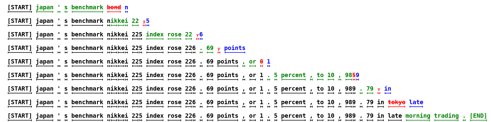
*图 1　投机解码的草稿与验证流程（引自 Leviathan et al., 2022, Fig. 1）。绿色为草稿提出的候选词元，红色为验证失败后由目标分布改写的词元。*

## 1.1 问题定义与计算瓶颈

给定上下文 $x_{<t} = (x_1, \dots, x_{t-1})$，标准解码每一步按式 (1) 从目标模型 $p_\theta$ 的输出分布中采样一个词元，追加至上下文后重复此过程：

$$x_t \sim p_\theta(\cdot \mid x_{<t}) \tag{1}$$

瓶颈即在“重复”：每生成一个词元，都要完整执行一次前向传播。批大小为 1 时，GPU 大部分时间用于权重搬运而非矩阵运算，解码吞吐的上限由显存带宽给出，单步延迟近似等于权重自显存读入计算单元所需的时间。反过来看，一次前向中多验证 $k$ 个词元的额外开销几可忽略，而每轮的有效产出可由 1 个词元提高到 $\mathbb{E}[\tau] > 1$ 个，$\tau$ 为接受长度（acceptance length）。投机解码的收益正出于此。

## 1.2 基本流程

记草稿模块为 $q_\phi$，它可以是独立的小型语言模型，也可以是附着于目标模型的轻量草稿头。每轮解码分三步：草稿模块先以较低开销提出候选序列 $y_{1:k}$；目标模型随即以 $(x_{<t}, y_{1:k})$ 为输入执行一次前向，同时得到各位置的条件分布 $p_\theta(\cdot \mid x_{<t}, y_{<i})$；验证自左向右逐位进行，接受与目标分布一致的最长前缀，在首个被拒位置由 $p_\theta$ 采样一个修正词元作为该位置的输出，并以该位置为下一轮的起点。

## 1.3 无损性与加速比

验证采用拒绝采样（rejection sampling）。候选词元 $y_i$ 以式 (2) 的概率被接受，被拒时从 $p_\theta$ 的截断分布中重采样：

$$\min\left\{1,\ \frac{p_\theta(y_i \mid x_{<t}, y_{<i})}{q_\phi(y_i \mid x_{<t}, y_{<i})}\right\} \tag{2}$$

Leviathan 等（2022）与 Chen 等（2023）证明，该机制使输出序列的边缘分布与目标模型独立解码严格一致，加速不以牺牲生成质量为代价。温度取 0 的贪心解码下，验证退化为逐位比对最大概率词元。

设草稿耗时为 $t_d$、验证耗时为 $t_v$、目标模型单步解码耗时为 $t_0 \approx t_v$，则加速比为

$$S = \frac{\mathbb{E}[\tau] \cdot t_0}{t_d + t_v}, \qquad \tau \in \{1, \dots, k+1\} \tag{3}$$

由式 (3) 可见，各类方法所求不外三事：压低 $t_d$，提高草稿质量以增大 $\mathbb{E}[\tau]$，以及不把验证预算耗在高拒绝风险的候选位置上。

## 1.4 技术路线演进

按草稿器的组织方式，已有工作大致分为四类，见表 1。

*表 1　投机解码的四条技术路线*

| 技术路线 | 代表方法 | 核心机制 |
|------|------|------|
| 独立草稿模型 | Leviathan（2022）、Chen（2023） | 独立小模型自回归生成草稿，目标模型并行验证 |
| 多头并行预测 | Medusa | 目标模型挂载多个独立预测头，一次前向产出多个候选 |
| 自回归草稿头 | MTP、EAGLE | 复用目标模型的特征与输出权重，训练轻量草稿头作自回归外推 |
| 并行与半自回归草稿 | DFlash、DSpark | 以块扩散或半自回归结构在单次前向中产出整块草稿 |

# 2 Draft

加速比式 (3) 的分子与分母同时系于草稿一端：草稿质量决定接受长度，草稿开销落进分母。两者相互牵制，草稿器设计的取舍大体尽于此。附着于主干的草稿头，以 Medusa 的多个并行解码头最为直观（图 2）。

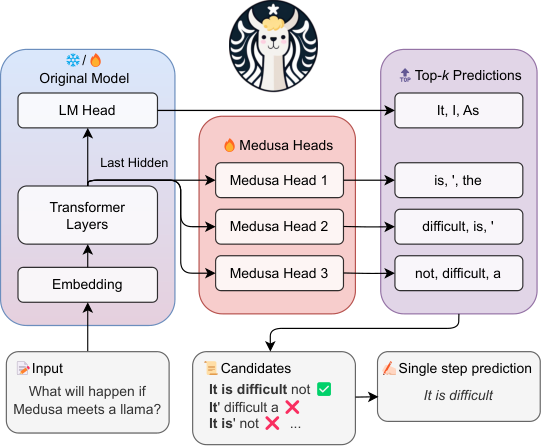
*图 2　Medusa 的多头草稿结构（引自 Cai et al., 2024, Fig. 1）。主干最后一层隐藏状态上并行挂载若干解码头，各预测一个未来位置的候选，经树式验证后提交最长正确前缀。*

## 2.1 草稿器的形式化角色

位置 $i$ 的条件接受率定义为：前缀全部通过验证时，$y_i$ 亦通过验证的概率，即

$$a_i = \Pr\big(y_i \text{ 通过验证} \mid y_{<i} \text{ 全部通过验证}\big) \tag{4}$$

链式草稿每轮提交 $\tau = N + 1$ 个词元，$N$ 为通过验证的草稿词元数，末一个为首个被拒位置处由目标模型给出的修正词元，故

$$\mathbb{E}[\tau] = 1 + \sum_{i=1}^{k} \prod_{j=1}^{i} a_j \tag{5}$$

$a_i$ 通常随位置递增而衰减，称后缀衰减（suffix decay）。由式 (5) 可知，单纯加长草稿的边际收益递减。更深一层的牵制在于精度与开销：自回归草稿接受率高，开销却随长度线性增长，$t_d = O(k)$；完全并行的草稿把开销压到 $O(1)$，各位置的预测却彼此独立，块内依赖无从建模，后缀衰减反而更重。

## 2.2 设计空间

独立草稿模型由序列级蒸馏自目标模型得来，图 1 即属此类。它与目标模型解耦、便于替换，代价是两个分布存在错位，压低 $a_i$，且须额外承担显存与部署开销。共享主干的草稿头则把轻量模块附着于目标模型，复用主干特征或输出权重；Medusa 的并行独立头、MTP 的联合训练辅助头（第 3 章）与 EAGLE 的特征层自回归头（第 4 章）皆属此类，无须另备模型，草稿分布也更接近目标分布。

若要使草稿开销与长度解耦，可用块扩散（DFlash，第 5 章）或半自回归结构（DSpark，第 6 章）在单次前向中产出整块候选，此时难点转为抑制后缀衰减。此外还有一类免训练草稿源，如 Lookahead 与 Jacobi 解码、$n$-gram 匹配、提示查找、检索与缓存复用。它们无须训练，接受率却依赖生成内容的重复结构，只适用于特定场景。

## 2.3 链与树

链式草稿每轮只提出一条候选序列。树式草稿则在每个节点扩展若干分支，并以树形注意力掩码在单次前向中验证整棵候选树。若把节点权重取为根至该节点各边条件接受率之积，则在同等验证预算下命中概率提高，$\mathbb{E}[\tau]$ 随之上升。SpecInfer 的词元树与树验证（Miao et al., 2024）即图 3 所示；同循此路径的还有 Medusa 的树注意力并发验证（Cai et al., 2024）、EAGLE-2 的置信度驱动动态树（4.2 节）以及面向块扩散草稿的 DDTree（5.3 节）。

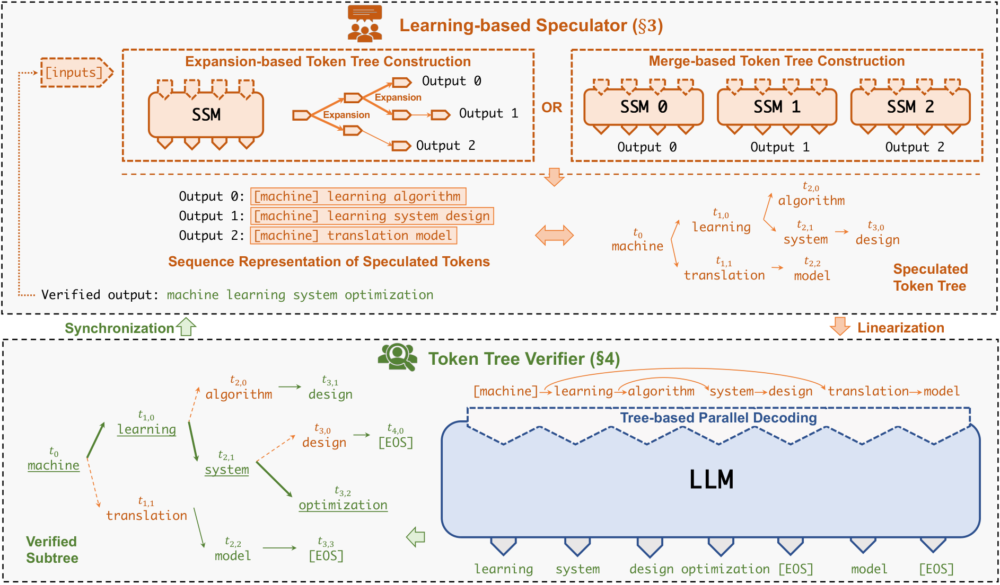
*图 3　SpecInfer 的树式草稿与树验证（引自 Miao et al., 2024, Fig. 3）。草稿端构造词元树，验证端将树线性化后并行解码，同步通过验证的子树。*

## 2.4 草稿长度与验证预算

草稿长度 $k$ 的取舍是明确的：增大 $k$ 抬高潜在的 $\mathbb{E}[\tau]$，却也推高自回归草稿的 $t_d$，或使并行草稿中高拒绝风险的候选占去批处理容量。Leviathan 等（2022）给出最优草稿长度 $\gamma^*$ 关于接受率 $\alpha$ 与草稿、验证代价比的闭式分析。工程上多依负载自适应：低负载时延长草稿以用尽空闲带宽，高负载时缩短草稿以减少无效验证。DSpark 的置信度调度验证（6.1 节）即为这一思路的生产实现。

# 3 MTP

多词元预测（Multi-Token Prediction, MTP）把训练目标由单一的下一词元预测扩展为对未来 $D$ 个词元的联合预测。辅助预测头在推理阶段可直接充当草稿模块，无须另行部署草稿模型，这一用法称自投机解码。

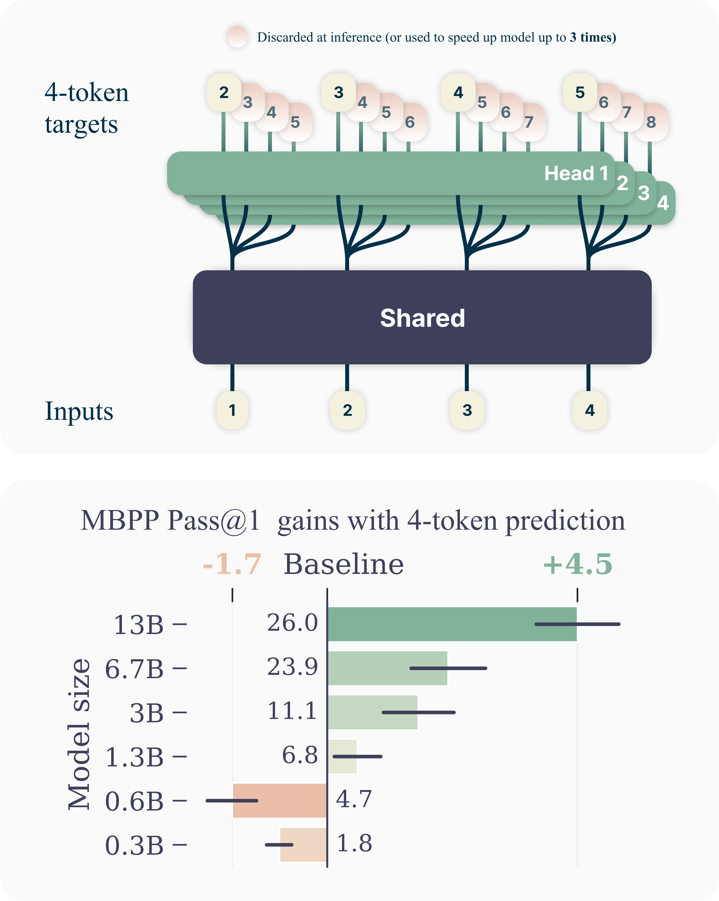
*图 4　多词元预测的结构（引自 Gloeckle et al., 2024, Fig. 1）。共享主干与 $D=4$ 个输出头，训练时每个位置同时预测四个未来词元；推理时辅助头可弃用，亦可留作投机解码。*

## 3.1 训练目标

记预测深度为 $D$，常取 1～4；图 4 所示为 $D=4$ 的情形。MTP 在每个位置除主损失外附加 $D$ 个辅助损失，总目标为

$$\mathcal{L}_{\mathrm{MTP}} = \frac{\lambda}{D} \sum_{k=1}^{D} \mathcal{L}_{\mathrm{MTP}}^{k}, \qquad \mathcal{L}_{\mathrm{MTP}}^{k} = -\log p_\theta^{(k)}(x_{i+k} \mid x_{\le i}) \tag{6}$$

式中 $\lambda$ 控制辅助目标的份额：过大干扰主目标收敛，过小则辅助头精度不足，须经超参搜索确定。按辅助头的条件化方式，实现分为两类。Gloeckle 等（2024）令 $D$ 个输出头共享主干而彼此独立，各深度的监督信号同时稠密化，样本效率与表征质量随之改善。DeepSeek-AI（2024）则令各深度保持完整因果链 $p_\theta^{(d)}(x_{i+d} \mid x_{\le i},\, \hat x_{i+1:i+d-1})$，深层预测以浅层预测为条件，草稿质量更高而难以并行；图 5 即其实现，DeepSeek-V3 取 $D=1$，MTP 模块约增 14B 参数。

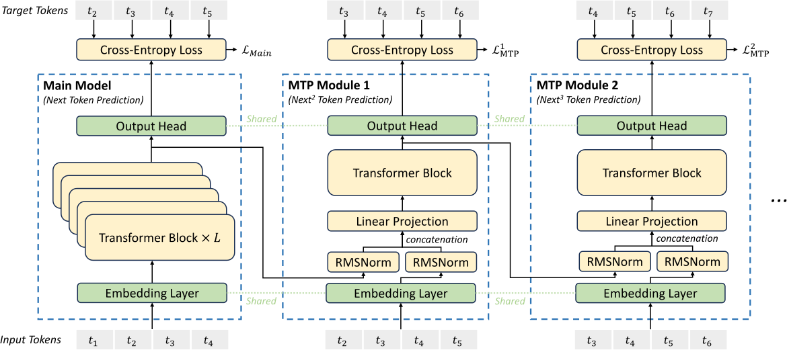
*图 5　DeepSeek-V3 的顺序式 MTP（引自 DeepSeek-AI, 2024, Fig. 3）。各深度保持完整因果链，模块输出即草稿词元。*

## 3.2 推理机制

推理时，MTP 模块以主干隐藏状态为输入生成草稿序列，目标模型随后以单次前向并行验证，接受最长正确前缀，并在首个错误位置回退至主模型采样。草稿头与主模型联合训练，二者分布相近，第二个词元的接受率可达 85%～90%。

## 3.3 实验结果与讨论

DeepSeek-V3 报告的吞吐约为基线的 1.8 倍；代码、结构化文本等低熵场景中接受率更高，加速比随之增大。MTP 目标兼有正则与表征增强之效，通常带来 0.5～1.5 个基准点的质量提升，收敛也更快。输出分布由验证机制保证不变。局限同样明确：辅助头须在预训练阶段引入并联合训练，已有权重无法事后加装，未经训练的辅助头输出近乎随机；推理引擎对自投机的支持仍在陆续完善，vLLM、SGLang、llama.cpp 等各有进度。

# 4 EAGLE

EAGLE（Extrapolation Algorithm for Greater Language-model Efficiency）是部署较广的无损投机解码方法族。其出发点是一个关于特征的假设：记 $\mathbf{f}_t$ 为目标模型倒数第二层的隐藏特征，特征序列 $\{\mathbf{f}_t\}$ 的条件演化比词元序列平滑，更易为轻量模型所拟合。草稿建模遂由词元空间移到特征空间，在特征层作自回归外推，其计算流程与对应的草稿树生成过程见图 6。

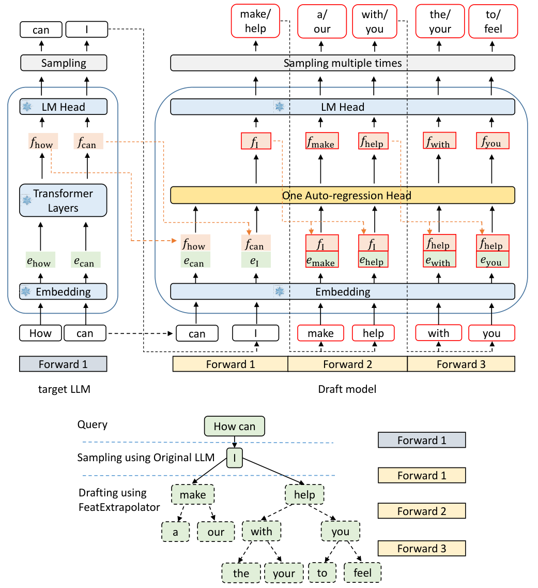
*图 6　EAGLE 的计算流程与草稿树（引自 Li et al., 2024, Fig. 6）。草稿模型以特征与移位词元嵌入为输入，经单一自回归头外推后续特征，再由共享输出头采样。*

## 4.1 EAGLE-1：特征层自回归

EAGLE-1 发表于 ICML 2024。草稿头由一个线性投影 $W_c$ 与一个 Transformer 解码层构成，共享目标模型的词元嵌入矩阵与输出头，新增参数约占目标模型的 2%～5%，如 LLaMA-3.1-8B 上约 0.24B。单步外推形如式 (7)：

$$\mathbf{h}_{t+1} = \mathrm{DecLayer}\big(W_c\,[\mathbf{f}_t\,;\,\mathbf{e}_{t+1}]\big), \qquad \hat{x}_{t+2} \sim \mathrm{softmax}\big(\mathrm{LMHead}(\mathbf{h}_{t+1})\big) \tag{7}$$

式中 $\mathbf{e}_{t+1}$ 为已采样词元的嵌入。拼接离散词元信息用以锚定预测，连续特征的平滑性则降低不确定性；滚动 $\gamma$ 步即得长度为 $\gamma$ 的草稿链。训练时冻结目标模型全部参数，仅以真实特征为回归目标训练草稿头，数万条对话样本、单卡数小时即可完成。为缓解曝光偏差（exposure bias，即训练输入真实特征而推理输入自身预测特征所致的分布漂移），训练时对输入特征注入噪声。验证仍用标准拒绝采样，MT-bench 上约 3 倍加速，曾列 Spec-Bench 无损方法首位。

## 4.2 EAGLE-2：动态草稿树

EAGLE-2 发表于 EMNLP 2024，以动态草稿树替代静态树。节点权重取根至该节点路径上草稿置信度之积，作为整段前缀被接受概率的估计；每步只扩展权重最高的叶节点，并对展开结果重排。较 EAGLE-1 提速 20%～40%。

## 4.3 EAGLE-3：训练时测试

EAGLE-3 发表于 NeurIPS 2025，放弃显式特征回归而直接预测词元，以三层特征融合聚合目标模型的多层表示；并引入训练时测试（Training-Time Test, TTT），在训练阶段即令草稿头自由滚动生成、以最终接受长度为优化目标，使曝光偏差从训练之初便被消除。加速比达 3～6.5 倍，约为 EAGLE-2 的 1.4 倍。该系列已集成于 vLLM、SGLang、TensorRT-LLM 等推理框架，Google Vertex AI 报告在 Llama 70B 上取得 2～3 倍的生产环境加速。

# 5 DFlash

DFlash（Block Diffusion for Flash Speculative Decoding）由加州大学圣迭戈分校 Z Lab 提出，见于 ICML 2026。它以块扩散模型替换自回归草稿器，草稿生成由逐词元串行改为整块并行去噪，草稿深度 $k$ 与草稿耗时 $t_d$ 之间的线性耦合由此解除，推理时的结构见图 7。

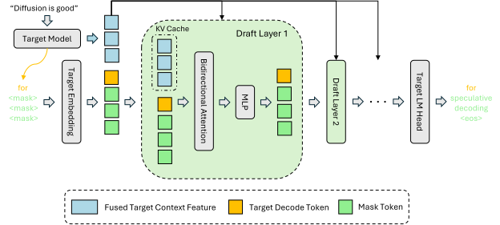
*图 7　DFlash 的推理设计（引自 Chen et al., 2026, Fig. 2）。块扩散草稿器自全 [MASK] 块一次去噪出整块候选，目标模型的隐藏特征经 KV 注入写入草稿器各层。*

## 5.1 动机

自回归草稿器（MTP、EAGLE）的成本随 $k$ 线性增长，草稿深度因而受限；完全并行的多头草稿（如 Medusa）虽使 $t_d = O(1)$，各位置预测却相互独立，接受率随位置迅速衰减。DFlash 所求，是在 $t_d$ 对 $k$ 近似不敏感的前提下，仍生成高质量的长草稿。

## 5.2 方法

草稿器以长度 $k$ 的全 [MASK] 序列为起点，在单次前向中联合去噪全部位置，草稿词元数遂与前向次数解耦。它又以目标模型抽取的上下文隐藏特征为条件，继承目标模型对上下文的表征；这些表示经 KV 注入直接写入草稿模型各层的键值缓存，草稿器无须重新编码上下文即可利用目标模型特征，接受率得以维持。验证仍由目标模型执行，输出分布不变。

## 5.3 实验结果

在多模型多任务上，DFlash 取得 5～6 倍无损加速；经 DDTree 优化后 HumanEval 上最高 8.22 倍，较同期最优的自回归方法 EAGLE-3 最多高出 2.5 倍。NVIDIA Blackwell Ultra 上，gpt-oss-120b 在同等交互性约束下吞吐最高达 15 倍，Llama 3.1 8B 的交互性接近 EAGLE-3 的 2 倍。接受长度随草稿预算 $k$ 增大而持续增长，MTP 类草稿在预算超过 8 后即趋于饱和。该方法与权重量化正交：目标模型采用 MXFP4 量化可降低验证开销而不损接受率，另有 10%～20% 的吞吐增益。目前已集成于 SGLang、vLLM、TensorRT-LLM 与 MLX，官方发布 20 个草稿权重，覆盖 Qwen、Kimi K2.6、Llama、Gemma、gpt-oss 等模型族。

# 6 DSpark

DSpark（Confidence-Scheduled Speculative Decoding with Semi-Autoregressive Generation）由 DeepSeek 与北京大学于 2026 年 6 月提出，面向高并发生产服务，同时优化草稿质量与验证效率，现已部署于 DeepSeek-V4 在线服务系统（V4-Pro 与 V4-Flash）。一个解码循环示于图 8。

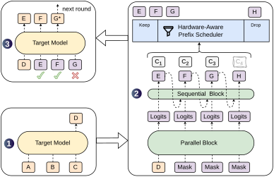
*图 8　DSpark 的架构与解码循环（引自 Cheng et al., 2026, Fig. 1）。目标模型先给出锚点词元，半自回归草稿器并行产出候选块，置信度头裁去低置信后缀后由目标模型验证。*

## 6.1 方法

半自回归草稿器以并行主干在单次前向中产出整块候选，再由轻量串行模块（Markov 头）按位置顺序条件化重写，以接近自回归的精度建模块内依赖。设位置 $i$ 的条件接受率为 $a_i$，该结构缓解后缀衰减，使平均接受长度 $\mathbb{E}[\tau]$ 优于纯自回归与纯并行草稿基线。置信度调度验证由置信度头估计各位置的前缀生存概率 $s_i = \prod_{j \le i} \hat{a}_j$，低于阈值的后缀在验证前即被裁去，草稿退回较短长度；结合推理引擎的吞吐特性曲线，为每条请求动态确定验证长度 $k^\*$，使验证预算落在期望收益最高的候选上，批处理容量不致被高拒绝风险的词元占去。硬件感知调度则依实时 GPU 负载调整草稿长度：低负载时延长草稿以用尽空闲带宽，高负载时缩短草稿以减少无效验证，使系统在交互性约束下维持较高吞吐。

## 6.2 实验结果与生态

DeepSeek-V4 真实用户流量下的线上结果表明，同吞吐水平相比 MTP-1 基线，单用户生成速度提升 60%～85%（V4-Flash）与 57%～78%（V4-Pro）；在 120 tok/s 的延迟下限处，总吞吐最高约为基线的 6.6 倍。拒绝采样保证输出与目标模型一致，目标模型参数不更新，仅训练草稿头。DSpark 与配套训练评测库 DeepSpec 以 MIT 协议开源，官方发布了面向 Qwen、Gemma 等模型的草稿权重并公开训练配方，可为任意目标模型训练草稿器。2026 年 8 月，Liquid AI 与 Hugging Face 发布了基于 DSpark 的 LFM2.5 系列草稿权重。

# 7 投机推理中 KV Cache 与 Linear Attention State 的处理

投机解码的正确性不止于草稿与验证算法本身，还取决于推理引擎对缓存状态的管理。验证前向会为目标模型写入全部 $k$ 个候选位置的键值对（树式验证时为全部 $|V_{\text{tree}}|$ 个节点），其中只有接受前缀对应的部分是真实的；被拒位置的缓存条目必须在下一轮之前回收或覆盖，否则模型将注意到从未提交过的词元，输出悄然失真。线性注意力与状态空间模型（SSM）的状态以递归方式原位更新，如 $S_t = S_{t-1} + v_t k_t^\top$，无法按位置截断，问题更为根本。图 9 给出树式验证下的缓存布局。

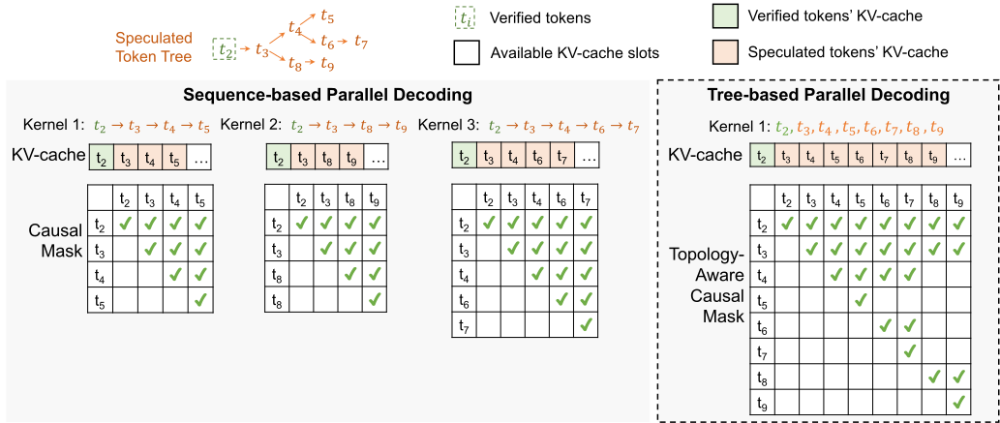
*图 9　树式并行解码的缓存布局（引自 Miao et al., 2024, Fig. 4）。候选树全部节点线性化写入缓存，仅接受路径对应的条目被提交，其余槽位于验证后回收。*

## 7.1 目标模型 KV Cache 的提交与回滚

验证阶段为每个候选位置计算并写入键值张量，接受判定后，缓存管理器以逻辑接受长度为准执行提交与回滚。链式草稿的 KV 缓存是追加结构，回退只需把长度计数器截断至前缀加接受数 $a$，被拒位置之后的写入在下一轮被覆盖，几乎不费成本。树式草稿的接受路径散布于展平序列的多个槽位，需按层归集并压缩为连续位置；在 PagedAttention 体系下，这表现为块表改写与小规模槽位拷贝。

草稿器自身的缓存同样需要回滚，且回滚点是接受长度，而非草稿停止生成的位置。此处出错会使草稿以已丢弃的词元为条件，症状是接受率缓慢下降而非立即崩溃，属隐蔽的正确性缺陷。此外，每条投机中的序列须为 $k+1$ 个位置预留槽位，多数最终被丢弃，直接压缩最大并发批容量；连续批处理中各请求接受长度不一，批内还需做压缩或掩码对齐。

主流引擎取乐观分配、验证后回收之策：vLLM 以 PagedAttention 页表回收未提交的物理页，SGLang 以 RadixAttention 的树结构维护引用计数。高并发下，每步的元数据开销与临时预留会先于算力成为约束，投机收益因而被并发挤占，参见 8.8 节。

## 7.2 树式验证与注意力掩码

树式验证以树形注意力掩码在单次前向中为多条假设同时打分：把候选树的 $M$ 个节点展平为一条序列，节点的位置编号取其深度，注意力只允许节点关注自身及祖先，兄弟分支互不可见。每条根到叶的路径于是被独立评分，等价于并行验证多条链式草稿。FlashAttention、FlashInfer 等定制计算核直接在掩码约束下执行注意力，不物化 $M \times M$ 稠密掩码矩阵。

例外出现在 MoE 目标模型：普通解码一步只激活路由到的专家，而 $k+1$ 个位置的验证会激活专家的并集，读取的专家权重多于单词元解码，验证近似免费的假设在稀疏模型上要打折扣，须以实测为准。

## 7.3 Linear Attention / SSM 状态的处理

注意力模型的状态是逐位置累积的 $K_{1:t}, V_{1:t}$，截断即可回滚；线性注意力与 SSM（Mamba、GLA、RWKV、GDN 等）的状态则是固定大小的递归量 $h_t$ 或 $S_t$，原位更新，无法按位截断。若为回滚而缓存全部历史状态 $h_{1:t}$，开销与序列长度成正比，恰抵消其常数状态之长。标准投机解码与之冲突有二：被拒位置无法撤销状态更新，树式掩码与递归更新方式不相容。现有工程方案有三条。

其一是逐位置状态快照。验证前向中，递归计算核在处理每个候选词元后把该时刻状态 $S_t$ 写入独立槽位；下一轮按接受词元数选取初态槽，拒绝只意味着选更早的槽位，无须任何撤销操作。vLLM 对 GDN 型线性注意力（Qwen3-Next 一类）的实现即采用 `spec_state_indices` 槽数组，每请求 $k+1$ 个槽，卷积状态同理按接受数选取。

其二是为草稿词元分配独立状态槽，见于 SGLang 的混合模型方案。每个草稿词元获一个私有 SSM 状态槽，接受后将最后一个接受槽提升为主状态；树式草稿下按预计算的父指针递推 $S_{\text{new}} = S_{\text{parent}} + v_{\text{new}} k_{\text{new}}^\top$，各分支自父节点状态独立演化。

其三是多步递归核。硬件感知的多步计算核在一次调用中产出区间 $y_{j:k}$ 并同时返回中间状态 $h_j$ 与末状态 $h_k$，验证落点位于二者之间时按需取用，避免物化全部中间状态（Wang et al., 2024）；状态的惰性推进见图 10。

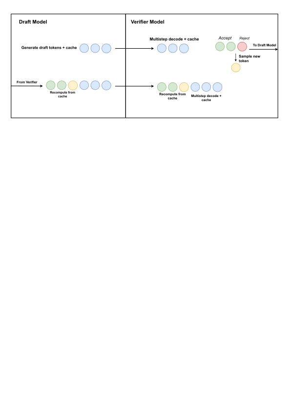
*图 10　RNN/SSM 的多步投机解码（引自 Wang et al., 2024, Fig. 2）。末位草稿被拒时以真值替换，隐藏状态推进至替换点（黄色）而非草稿终点，下一轮自该状态继续。*

Mamba 用作外部草稿器（Choi et al., 2025）则取递归状态的另一面：树分叉只需复制固定大小的状态即可批量演化，无须 Transformer 式的树注意力与 KV 复制，长上下文下草稿的内存与延迟保持常数，且可直接用于不同的目标模型。

混合架构（注意力层与线性层并存，如 Nemotron-H、Qwen3-Next、Jamba 类）通常维护双池：注意力层走分页 KV 池，线性层走状态池，投机解码需同时处理两种状态的提交与回滚。前缀缓存需混合索引，如 SGLang 的 MambaRadixCache 把 KV 与状态分池、各自按最近最少使用淘汰，命中时拷贝状态继续预填；预填充与解码分离（PD disaggregation）部署时，KV 页可流式传输，SSM 状态须整块原子传输至解码实例的预分配槽位。

# 8 不同模型的投机推理方案

各模型的投机方案有两个来源。原生方案在预训练阶段即附带草稿模块，多为 MTP，随权重一同发布，加载即可自投机；生态方案由社区或框架方在既有权重上事后训练外挂草稿，如 EAGLE 系、DFlash 与 DSpark。前者的草稿模块可参与预训练目标与后训练协同，草稿分布与目标分布接近；后者受限于可获得的中间特征，且与具体权重版本绑定。同一投机框架用于不同规模模型档位的实测曲线见图 11。

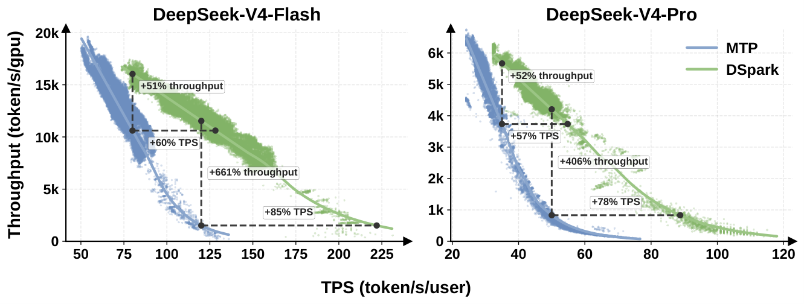
*图 11　DeepSeek-V4 两个模型档位的吞吐与单用户速度曲线（引自 Cheng et al., 2026, Fig. 7）。同一 DSpark 框架下，V4-Flash 与 V4-Pro 的 Pareto 前沿均较 MTP-1 基线外移。*

## 8.1 DeepSeek 系列

DeepSeek-V3 技术报告（DeepSeek-AI, 2024, §2.2）给出顺序式 MTP 的完整形式：$D$ 个模块串行堆叠，第 $k$ 个由共享词元嵌入、投影矩阵 $M_k$、Transformer 块 $\mathrm{TRM}_k$ 与共享输出头组成，第 $k$ 深度的预测以第 $k-1$ 深度表示与真实词元嵌入的拼接为条件，因果链保持完整；训练目标即式 (6) 的等权平均形式。报告指出，其首要目的是稠密化训练信号、提升主模型性能，推理时可直接丢弃 MTP 模块，亦可留作投机草稿。实际部署取 $D=1$，MTP 模块约 14B 参数，其中 11.5B 独立，嵌入与输出头与主模型共享；实测吞吐约为基线的 1.8 倍，见第 3 章。V3.2 引入稀疏注意力（DSA）后保留 MTP 接口。至 DeepSeek-V4，生产系统改以 DSpark 半自回归草稿替代 MTP-1 基线（第 6 章），在线服务上单用户速度提升 57%～85%；该系列的投机路径遂由训练期辅助头的复用，扩为辅助头与生产级草稿框架并行。

## 8.2 Qwen 系列

Qwen 系列的原生 MTP 由训练增强逐步转为推理组件。Qwen3-Next 技术报告提出原生 MTP 机制，既产出高接受率的 MTP 模块用于投机解码，也提升模型整体性能；其新意在多步训练，即训练阶段便模拟多步草稿滚动，使训练与推理行为一致，从而在真实场景提高接受率。这与 4.3 节 EAGLE-3 的 TTT 同理，都在训练阶段暴露推理时的自回归误差。Qwen3-Next 采用 GDN 线性注意力混合架构，投机推理须同时处理注意力 KV 与递归状态，见 7.3 节。Qwen3.5 延续原生 MTP 头，以 `mtp_num_hidden_layers` 配置，融合主模型表示与词元嵌入后经独立 Transformer 层预测后续词元；社区在 llama.cpp 与 Unsloth GGUF 量化生态下的实测显示，Qwen3-27B 吞吐约提升 2.5 倍。Qwen3 系列（稠密与 MoE）未附原生头，依赖生态方案，EAGLE-3、DFlash、DSpark 与 DFly 均有公开草稿权重，如 Qwen3-8B 的 DFly 草稿平均加速比约 5.4 倍。Qwen4 据公开的推理内核适配信息延续 MTP 路线，QSA 稀疏注意力与 MTP 的组合尚在适配之中。

## 8.3 GLM-4.5 系列

GLM-4.5 技术报告（Zhipu AI, 2025）把 MTP 列为架构的标准组件：MTP 层中直接嵌入 MoE 结构，全模型含 89 个 MoE 层、3 个稠密层与 1 个 MTP 层，与主干共用无损平衡路由和 sigmoid 门控，专用于推理阶段的推测式解码。MTP 层取与主干同构的 MoE 而非轻量多层感知机，草稿分布与目标分布因而更近，代价是草稿开销 $t_d$ 偏大；其以深度换宽度的构型（隐藏维度与路由专家更少、层数更多）正缓解了这一开销。GLM-4.5-Air（106B 总参数、12B 激活）沿用同一方案。

## 8.4 MiniMax-M2 系列

MiniMax-M2 技术报告（MiniMax, 2026）给出 MTP 自预训练至强化学习的完整工程方案。预训练阶段只用单个 MTP 模块（$K=1$，损失权重由 0.3 退火至 0.1）；持续预训练的衰减阶段扩展至 $K=3$，以支持多步投机。扩展时以主模型权重复制初始化，而非随机初始化：复制初始化收敛更快，随机初始化会带来较高损失并短暂干扰主模型；扩展后先冻结主模型、单独训练 MTP 模块至损失稳定，再联合训练。Forge 系统中强化学习采样期间策略持续更新，草稿若不随之适配，接受率便衰减，故 M2 以 top-$K$ KL 散度损失令 MTP 模块与策略协同训练。

架构上，消融表明混合滑窗注意力（SWA）在 32K 以内基准尚可持平，128K 检索与长上下文翻译上则明显退化，M2 遂全层保留全注意力（GQA），MTP 草稿路径在 192K 原生上下文下仍可用。推理时 3 个 MTP 模块先提出候选，主模型一次前向验证。消融显示 MTP 对 MATH、HumanEval 等推理类任务有稳定增益。

## 8.5 Kimi K 系列

Kimi K2 技术报告聚焦 MuonClip 优化器与智能体后训练，未附原生草稿模块，投机路径依赖生态方案，DFlash 官方草稿权重覆盖 K2.6，见 5.3 节。至 Kimi K3（2026），Moonshot 与 vLLM 合作实现发布首日即支持的 DSpark，草稿器随目标架构定制。草稿模型 5 层、约 5B 参数，每轮提出 8 个词元，镜像 K3 自身的 MLA 注意力，与目标共享同一 KV 布局（每词元 576 维隐向量），KV 页表因而统一，可直接复用 KV 卸载与预填充、解码分离。草稿经 TorchSpec 从 vLLM 实测的 K3 隐状态流式蒸馏训练，草稿推理与训练的数值保持一致。SPEED Bench 单用户加速 3.14 倍，由 118 提至 370 tok/s；低熵任务（代码等）平均接受约 4.73 词元每步，创意写作等高熵任务约 2.61；378K 长上下文（LongBench-v2）下每步仍接受约 5.31 词元。并发由 1 增至 16 时，聚合吞吐自 177 升至 683 tok/s，首词元延迟（TTFT）中位数仅由 379 ms 增至 479 ms。

## 8.6 Nemotron 系列

Nemotron-H（NVIDIA, 2025）为混合 Mamba-Transformer 架构，约 92% 的层为 Mamba-2、8% 为自注意力，权重中内置 MTP 模块（`num_nextn_predict_layers` 取 1，MTP 层块由注意力与 MoE 组成，权重以 `mtp.` 前缀独立存放），与主干共享权重设计，推理时作原生投机解码用，官方 vLLM 示例启用 5 个投机词元。其特殊处在混合缓存：投机验证须同时管理注意力层的 KV 缓存与 Mamba 层的卷积、SSM 状态，即 7.3 节的双池方案。Nemotron 3.5 Super 与 Lightning 进一步把原生投机解码产品化：训练以 100B 词元的 MTP 热身阶段开始，后训练中经 MTP boosting 针对深层草稿位置优化接受率，贪心解码下平均接受长度由 4.287 升至 4.718，概率草稿采样下由 3.787 升至 4.612；BF16 与 NVFP4 权重一并附独立草稿器。

## 8.7 gpt-oss 与 Llama 系列

gpt-oss（OpenAI, 2025）与 Llama 3.x/4 均未内置原生草稿模块，投机推理全赖生态方案。gpt-oss 以 EAGLE-3 为主，NVIDIA 发布 `gpt-oss-120b-Eagle3-v2/v3` 草稿头，基于目标隐状态训练，与特定权重版本绑定。vLLM 上的系统评测显示，EAGLE-3 取 3 个草稿词元时，在 ShareGPT、MLPerf、SWE-bench 三类真实负载上峰值吞吐提升 24%～27%，每百万输出词元成本下降 19.4%，收益延续至 200 并发。这与投机只宜低并发的早期经验不同：MoE 目标模型验证时虽激活专家并集（参见 7.2 节），强草稿头配高带宽硬件仍可维持收益。DFlash 亦提供 gpt-oss 优化草稿权重，Blackwell 上吞吐达 15 倍，见 5.3 节。

Llama 3.x/4 以 EAGLE-3 社区头（如 EAGLE3-LLaMA3.1 系列）与 DFlash 草稿权重为主，TensorRT-LLM、vLLM、SGLang 均有成熟支持；无原生头意味着须外挂草稿权重与缓存，但生态最成熟、替换最灵活。两类模型还可用免训练方案作备选：TensorRT-LLM 内置的 $n$-gram 投机与提示查找，对翻译、摘要、代码续写等输入输出高度重叠的任务仍有效。

## 8.8 方案对照与工程实践

各方案的对照汇总于表 2。

*表 2　各模型投机推理方案对照*

| 模型族 | 架构特点 | 原生草稿 | 生态与第三方方案 | 主要引擎支持 |
|------|------|------|------|------|
| DeepSeek-V3 / V3.2 / V4 | MoE + MLA | MTP（$D=1$） | DSpark（DeepSpec） | TRT-LLM（MTP）、vLLM、SGLang |
| Qwen3-MoE | MoE | — | EAGLE-3、DFlash、DSpark | TRT-LLM（EAGLE-3）、vLLM、SGLang |
| Qwen3-Next | GDN 线性注意力混合 | 原生 MTP（多步一致性训练） | 状态快照机制（7.3 节） | 尚在适配 |
| Qwen3.5 / Qwen4 | MoE | MTP | DFlash、DSpark | TRT-LLM（MTP） |
| Llama 3.x / 4 | 稠密 / MoE | — | EAGLE-3 社区头、DFlash | TRT-LLM（EAGLE-3）、vLLM、SGLang |
| gpt-oss | MoE | — | EAGLE-3、DFlash | TRT-LLM（EAGLE-3 / DFlash） |
| Kimi K2.6 / K3 | MoE（K3 为 MLA） | K3 原生 DSpark（MLA 草稿） | DFlash、DSpark | TRT-LLM / vLLM（DSpark） |
| Gemma 4 | 稠密 / MoE | MTP | DFlash、DSpark（LFM2.5） | TRT-LLM（MTP） |
| GLM-4.5 系列 | MoE（深层） | MTP（内嵌 MoE 层） | — | TRT-LLM（MTP） |
| MiniMax M2 系列 | 稀疏 MoE | MTP（$K=3$，权重复制扩展与强化学习协同） | EAGLE-3 | TRT-LLM（MTP） |
| Nemotron-H / 3.5 | 注意力与 SSM 混合 | MTP 与 MTP boosting | 混合状态管理（7.3 节） | TRT-LLM（MTP） |
| 任意模型 | — | — | 独立小草稿、Medusa、$n$-gram、Mamba Drafter | 各主流引擎 |

*注：TRT-LLM 即 TensorRT-LLM。引擎支持随版本演进，以各引擎文档为准；同一模型常可叠加多种方案，如 gpt-oss 可选 EAGLE-3 或 DFlash 草稿。*

工程上有数处共同约束。低并发且延迟敏感的场景（批大小不超过 4、智能体单会话、本地部署）收益最大；高并发下验证计算挤占真实请求算力，总吞吐可能反降 15%～40%，宜按队列深度动态调整 $k$ 或关闭投机，DSpark 的调度器即为这一策略的自动化实现。不过 gpt-oss 的评测表明强草稿头下收益可延伸至高并发，仍须以实测为准。草稿阶段串行执行，首词元延迟可能不降反升；词元以每轮 1 至 $k+1$ 个的突发形式到达，平均词元间延迟下降而方差上升，p99 延迟指标需单独压测。

无损性的前提是拒绝采样比对中的 $p_\theta$ 与 $q_\phi$ 为实际采样分布，即温度、top-$k$、top-$p$、重复惩罚与语法掩码施加之后的结果；比对未变换的原始 softmax 会破坏分布等价。显存方面，开启投机需为草稿权重、草稿 KV 或状态以及每序列 $k+1$ 个候选槽位预留空间，首个词元生成前即抬升占用、压低最大并发。还须区分分布等价与逐样本一致：开启投机后同一随机种子的输出与不开投机时不同，基于标准输出的回归测试应按分布而非逐字比对。

# 9 参考文献

1. Leviathan Y, Kalman M, Matias Y. Fast Inference from Transformers via Speculative Decoding[C]//ICML. 2023. arXiv:2211.17192.
2. Chen C, et al. Accelerating Large Language Model Decoding with Speculative Sampling[R]. DeepMind, 2023. arXiv:2302.01318.
3. Cai T, et al. Medusa: Simple LLM Inference Acceleration Framework with Multiple Decoding Heads[C]//ICML. 2024. arXiv:2401.10774.
4. Miao X, et al. SpecInfer: Accelerating Generative Large Language Model Serving with Tree-based Speculative Inference and Verification[C]//OSDI. 2024. arXiv:2305.09781.
5. Gloeckle F, et al. Better & Faster Large Language Models via Multi-token Prediction[C]//NeurIPS. 2024. arXiv:2404.19737.
6. DeepSeek-AI. DeepSeek-V3 Technical Report[R]. 2024. arXiv:2412.19437.
7. Li Y, Wei F, Zhang C, Zhang H. EAGLE: Speculative Sampling Requires Rethinking Feature Uncertainty[C]//ICML. 2024. arXiv:2401.15077.
8. Li Y, et al. EAGLE-2: Faster Inference of Language Models with Dynamic Draft Trees[C]//EMNLP. 2024. arXiv:2406.16858.
9. Li Y, et al. EAGLE-3: Scaling up Inference Acceleration of Large Language Models via Training-Time Test[C]//NeurIPS. 2025. arXiv:2503.01840.
10. Chen J, Liang Y, Liu Z. DFlash: Block Diffusion for Flash Speculative Decoding[C]//ICML. 2026. arXiv:2602.06036.
11. Cheng X, et al. DSpark: Confidence-Scheduled Speculative Decoding with Semi-Autoregressive Generation[R]. DeepSeek, Peking University, 2026. arXiv:2607.05147.
12. Wang J, Paliotta D, May A, Rush A M, Dao T. The Mamba in the Llama: Distilling and Accelerating Hybrid Models[R]. 2024. arXiv:2408.15237.
13. Choi D, Oh S, Dingliwal S, et al. Mamba Drafters for Speculative Decoding[R]. KAIST, Amazon AGI, 2025. arXiv:2506.01206.
14. MiniMax. The MiniMax-M2 Series: Mini Activations Unleashing Max Real-World Intelligence[R]. 2026. arXiv:2605.26494.
15. GLM Team. GLM-4.5: Agentic, Reasoning, and Coding Foundation Models[R]. 2025. arXiv:2508.06471.
16. NVIDIA. Nemotron-H: A Family of Accurate, Efficient Hybrid Mamba-Transformer Models[R]. 2025. arXiv:2504.03624.
17. Qwen Team. Qwen3-Next Technical Report[EB/OL]. 2025.
18. Kimi Team. Kimi K2: Open Agentic Intelligence[R]. 2025.
19. vLLM Team. Kimi K3 Is Here: Efficient Day-0 Support on vLLM[EB/OL]. 2026.
