> 旧书不厌百回读，熟读深思子自知。  
> ——〔宋〕苏轼《送安惇秀才失解西归》

## 1 概述

标准 Transformer 的深度，被它"存储了多少层不同的参数"所硬性限定。四十八层，就意味着四十八组互不相同的权重，每一组在一次前向传播中只被访问一次。Loop Transformer 只改变一件事，**让某一组共享权重的层循环执行多次**，每一轮都在上一轮隐状态的基础上继续推演。于是，深度从"参数量决定的一个常数"，变成"运行时可以调节的一个变量"，在不增加参数的条件下，用更多的计算量换取更深的等效网络，进而换取更强的推理能力。

若把自注意力机制类比为"对数据库建立索引"，把前馈层（MLP）类比为"被压缩进权重的数据库"，那么 Loop Transformer 便可以理解为，在索引的指引下，于同一份数据库上反复查询、逐次逼近答案。一轮走不通，就带着这一轮的中间结果再走一遍；难的问题多绕几圈，简单的问题早早收敛。

特别是当 MLP 层是 MoE 结构时，可以把每一个专家看作人学习记忆的不同知识点，每一次注意力计算则是在分析、索引这些知识。对普通 Transformer 而言，随着参数量的增加，模型如同人从小学生、初中生、高中生一路到大学生，记忆的知识越来越多，能解决的问题也与日俱增。然而，当问题进入需要创造性关联、融合多个知识点的"博士阶段"，或外部知识已无法继续支撑参数增长时，模型该如何应对？Loop Transformer 正是这一阶段的回答，像博士一样，在已有的知识点中反复融合贯通以创造解决方案，对已记忆的知识反复查询以获取新知，这也可以理解为模型内部的思考链。

现代大语言模型的能力提升，长期遵循一条被反复验证的 Scaling Law，模型规模、训练数据与算力三者近似同步扩张。然而，参数规模的扩张带来成比例增长的显存占用、部署成本与推理延迟。一个自然的问题由此浮现，能否在不增加参数的前提下，让模型"想得更深"？

要回答这一问题，首先需要厘清"深度"究竟由什么决定。在一个标准的 $L$ 层 Transformer 中，输入序列的隐状态 $\mathbf{h} \in \mathbb{R}^{n \times d}$ 依次经过 $L$ 个互不相同的层：

$$
\mathbf{h}^{(l+1)} = \mathrm{Block}_l(\mathbf{h}^{(l)}), \quad l = 0, 1, \dots, L-1 .
$$

每一层 $\mathrm{Block}_l$ 都持有一份独立参数 $\theta_l$，"深度"因此由存储的参数份数决定，可称之为存储的深度（depth in parameters）。

Loop Transformer 引入了另一种深度的度量。它让同一组参数 $\theta$ 循环执行 $T$ 次：

$$
\mathbf{h}^{(t+1)} = \mathrm{Block}_\theta(\mathbf{h}^{(t)}, t), \quad t = 0, 1, \dots, T-1 .
$$

此时参数仍只有一份，但层计算被执行了 $T$ 次，等效深度从 $L$ 变为 $T$，可称之为**计算的深度**（depth in computation）。存储与计算这两种资源，在循环结构中被显式解耦。

图 1 以一个抽象对比说明了这一区别，标准 Transformer 的每一层被访问一次（左），Loop Transformer 让共享的层栈被重复访问（右）。需要强调的是，循环节省的是存储参数的内存，而非计算量，前向传播仍需完整执行 $T$ 次层计算，训练时梯度也需在共享栈中多次回传。这是理解本文全部内容的出发点。

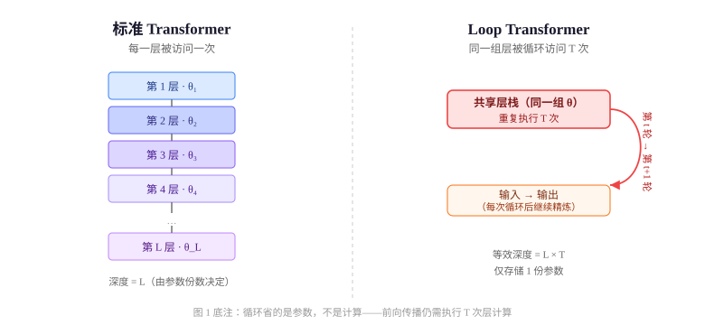

这一思想并非新创。早在 2018 年，DeepMind 的 Universal Transformer 便以"共享转移函数 + 循环深度 + 动态停止"的完整形式奠定了理论基础，并证明了循环结构在特定条件下具有图灵完备的表达力。此后数年，这一路线一度沉寂，原因很直接，在相同的预训练算力下，从头训练一个共享权重的循环模型，往往不及每层各用一套参数的标准模型，省了参数，却损失了效果。

转机出现在 2025 年前后。以 Huginn、Ouro 为代表的一系列工作证明，只要训练方式得当，循环带来的测试时计算能换来真实的性能增益；Nanbeige、商汤、智谱等团队则在 2026 年将这一结构推向 3B、9B 乃至 750B 的旗舰规模。Loop Transformer 由此从理论构想进入可部署、可复用的工程实践。

本文沿时间的线索展开。第二章从 Universal Transformer 的理论起源讲起，第三章介绍"循环 Transformer 作为可编程计算机"的表达力证明，第四章至第八章依次剖析 Huginn 3.5B、Ouro、Nanbeige 4.2、SenseNova Loop 与 GLM-5.4 五个工程实例的架构取舍、训练方法与实测得失，第九章讨论其代价、边界与对硬件设计的启示。

## 2 Universal Transformer：循环深度的理论起源

### 2.1 Transformer 缺失的归纳偏置

Transformer 依靠自注意力机制并行地处理序列，为每个位置建立全局感受野，因而天然适合并行化训练。但标准 Transformer 有一个隐含的短板，它放弃了循环神经网络（RNN）所具备的迭代式、递归式变换的归纳偏置。实验表明，标准 Transformer 在许多简单的算法任务上难以泛化，当需要复制的字符串长度超过训练时见过的长度，或逻辑推理的公式深度超出训练范围时，它便无能为力。

从理论角度看，这并非偶然。标准 Transformer 的深度是固定的，且各层参数互不相同，因此它并不是计算上通用的（not computationally universal）。Dehghani 等人（2019）提出的 Universal Transformer（UT），正是为了同时弥补这一实践短板与理论缺陷，它把循环重新引入深度维度，让模型反复修正对序列中所有符号的表示。

### 2.2 共享的转移函数

UT 的核心是一个在所有循环步骤间共享参数的转移函数。设初始表示 $\mathbf{H}^{(0)}$ 由词嵌入与位置编码相加得到，则在第 $t$ 步：

$$
\mathbf{H}^{(t+1)} = T_\theta\Big(\mathbf{H}^{(t)}, t\Big) ,
$$

其中 $\theta$ 在每一步都复用同一组参数。转移函数 $T_\theta$ 的内部，交替地执行多头自注意力与逐位置的前馈网络，并辅以残差连接与层归一化：

$$
\mathbf{A}^{(t)} = \mathrm{MHA}_\theta(\mathbf{H}^{(t)}), \qquad
\mathbf{U}^{(t)} = \mathrm{Norm}(\mathbf{H}^{(t)} + \mathbf{A}^{(t)}), \qquad
\mathbf{H}^{(t+1)} = \mathrm{Norm}(\mathbf{U}^{(t)} + \mathrm{FFN}_\theta(\mathbf{U}^{(t)})) .
$$

UT 并没有移除注意力，而是保留了它带来的全局感受野，同时叠加一层逐次精炼的循环偏置。图 2 展示了这一过程，同一组操作在多个循环时间步上反复作用，每个位置的表示 $h_i^t$ 被逐步修正。

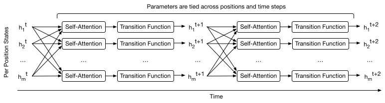

由于共享块被多次复用，模型需要一种区分当前步数的信号。UT 在每个时间步向隐状态注入一个时间步表示 $R_t$，使共享块获得"计算时间"的概念。这与位置编码是两回事，位置编码回答"这个 token 在序列的哪里"，时间步编码回答"现在执行到第几次精炼"。

### 2.3 动态停止（Adaptive Computation Time）

循环结构带来一个问题，每个位置该循环多少次？UT 借用了 Graves（2016）的 Adaptive Computation Time（ACT）机制，为每个位置分别学习一个停止概率。在每个时间步，模型输出一个标量 $p^t_i$，据此累积停止概率，直到某个位置的累积概率越过阈值，该位置便停止更新，不再参与后续精炼，其余位置继续循环。最终，不同位置可以拥有不同的循环步数 $T_i$。

这一机制带来双重收益。简单的位置可以提前停止，节省计算；更重要的是，动态停止本身提升了精度，模型学会了按需分配计算，把额外的循环留给真正困难的位置。

### 2.4 图灵完备性

UT 的理论意义在于，它证明了循环能够弥补标准 Transformer 的表达力缺口。在足够的内存假设下，UT 的循环结构使其在计算上通用（Turing-complete）。这一结论为后来"循环 Transformer 作为可编程计算机"的工作埋下了伏笔，也把"用循环换深度"从工程技巧提升为有理论保证的技术路线。

### 2.5 实验结果

UT 在一系列算法任务与大规模语言理解任务上，一致地超越了同等参数量的标准 Transformer，在 LAMBADA 语言建模任务上取得当时的最优结果，在 WMT14 En-De 机器翻译上比标准 Transformer 提升了 0.9 BLEU。这些结果表明，在参数量不变的条件下，循环深度带来的归纳偏置可以转化为真实的能力提升。然而，受限于当时的规模与训练条件，UT 的循环深度并未在数十亿参数的尺度上得到验证，这一思想随之进入了一段漫长的沉寂期。

## 3 Looped Transformer as Programmable Computers：表达力的构造性证明

### 3.1 Transformer 能否作为通用计算机？

如果说 UT 从归纳偏置的视角为循环深度提供了经验证据，那么 Giannou 等人（2024）的工作则从表达力的视角给出了一个构造性的、近乎理论极限的答案。他们提出的问题很直接，能否通过显式地设置权重，把 Transformer 当作一台可编程的通用计算机？答案是肯定的，一个仅有 13 层的循环 Transformer 就足以胜任。

### 3.2 输入序列

这一框架的起点，是对输入序列的重新组织。作者把输入序列 $\mathbf{X}$ 划分为三个功能分区（图 3）：

$$
\mathbf{X} = [\;\underbrace{\mathbf{S}}_{\text{scratchpad}}\;|\;\underbrace{\mathbf{M}}_{\text{memory}}\;|\;\underbrace{\mathbf{C}}_{\text{commands}}\;] .
$$

- **Scratchpad（草稿区）**：所有计算的临时工作区，相当于 CPU 的缓存。数据从内存拷贝到此处、被变换与处理，完成后再写回内存。
- **Memory（内存）**：存储标量、向量与矩阵等数据的持久区域，是所有计算读写的中央仓库。
- **Commands（指令区）**：承载"程序"，即用户下达的指令序列。

这一结构被形象地比作一张打孔卡（punchcard），指令与数据都编码在同一张"卡片"上，循环 Transformer 像 CPU 的取指-执行周期那样，一遍又一遍地读取指令、搬运数据、执行计算，再把结果写回。

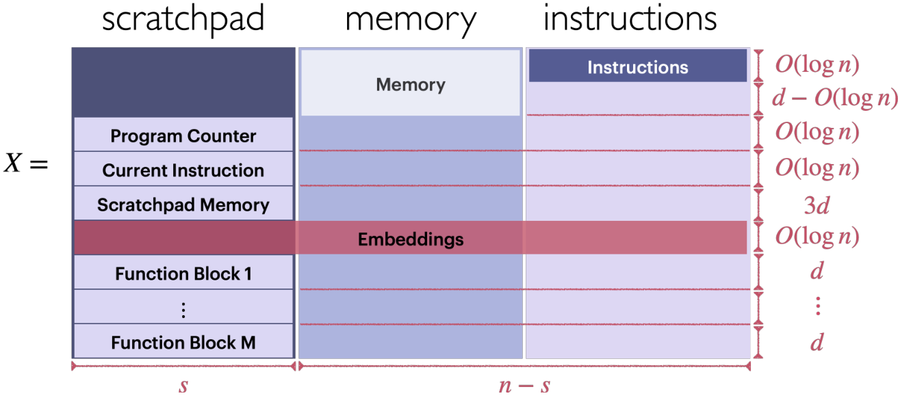

### 3.3 计算块与指令集

作者进一步证明，常数个编码器层即可模拟若干基本"计算块"，嵌入编辑操作、非线性函数、函数调用、程序计数器与条件分支。利用二进制位置编码充当指针，注意力机制被精确地改造成一个数据总线，在指定内存地址间搬运数据。

在这些积木之上，作者构造了两套指令集：

- **SUBLEQ**：一种"单指令计算机"（OISC）。因为 SUBLEQ 是图灵完备的，循环 Transformer 便从理论上获得了执行任意计算的能力，一个 9 层的循环 Transformer 即可模拟。
- **FLEQ（灵活指令集）**：进一步把矩阵乘法、非线性激活等复杂"函数块"直接硬编码进权重，使模型能够调用更高级的操作原语。

图 4 展示了这些可复用的计算块如何被组合起来，从而在循环中装配出完整的算法。

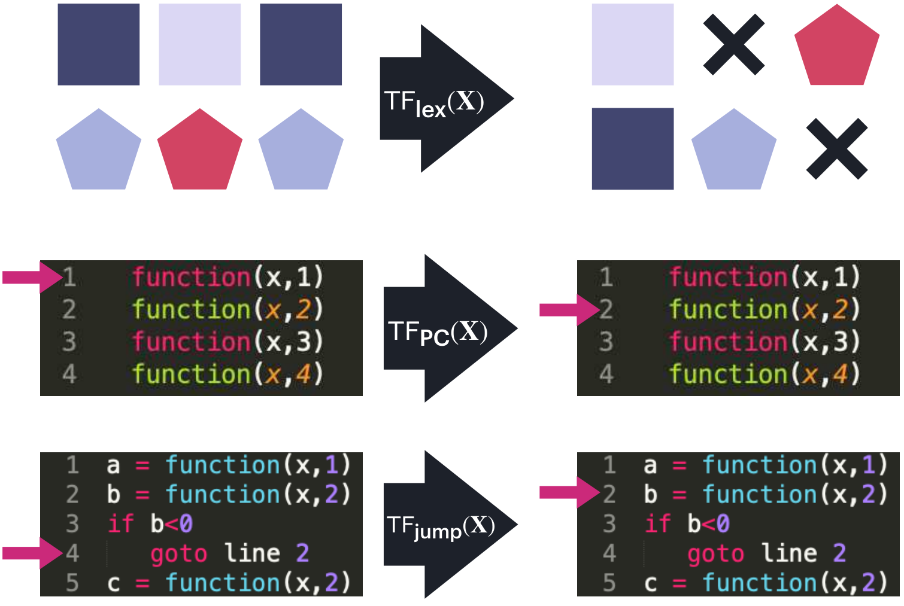

### 3.4 结果与意义

一个 13 层的循环 Transformer，在被"编程"后能够执行三类算法：

| 程序 | 层数 | 注意力头 | 描述 |
|---|---|---|---|
| SUBLEQ（OISC） | 9 | 2 | 通用计算的模拟 |
| 基础计算器 | 13 | 1 | 加减乘除与开方 |
| 线性代数库 | 13 | 1 | 矩阵求逆（牛顿法）、幂迭代 |
| 学习算法 | 13 | 1 | 执行反向传播与 SGD，训练内部网络 |

其中最后一行最值得注意，一个 13 层的 Transformer 足以执行训练 Transformer 本身所用的反向传播与 SGD 算法，这意味着一个模型在理论上可以优化自身的内部逻辑。

当然，这一工作的边界同样明确，论文中的权重是数学推导得到的、冻结的，而非通过梯度下降学习而来。标准训练能否自然收敛到这类高度结构化的算法权重，仍是一个悬而未决的问题。但它的理论价值在于，为循环深度提供了最严格的表述，只要给予足够的循环步数，一个浅层模型可以执行深层模型所能执行的一切计算。

## 4 Huginn 3.5B：把"思考"隐入循环深度

### 4.1 从显式思维链到隐式循环

思维链（Chain-of-Thought）通过生成中间的文本 token 来分步思考，但它把推理的每一小步都写成了人可读的文字，代价是冗长的输出与高昂的推理成本。Geiping 等人（2025）的 Huginn（正式名 Huginn-0125，源自北欧神话中象征"思想"的渡鸦）提出了一个正交的替代方案，让推理发生在隐空间，而非文本空间，模型不写出草稿，而是把同一个核心层块循环执行多次，在向量中反复推演。

### 4.2 Prelude–Core–Coda 架构

Huginn 是一个 3.5B 参数的潜在循环深度模型，其结构清晰地划分为三段：

| 组件 | 层数 | 角色 |
|---|---|---|
| Prelude（前奏） | 2 层 | 把输入嵌入为潜在表示 $\mathbf{e}$ |
| Core（核心） | 4 层 | 被循环执行的推理引擎（深度的旋钮） |
| Coda（尾声） | 2 层 | 把最终潜在状态解码为下一个 token 的分布 |

参数的大致分配是，前奏与头部约 1.5B、嵌入约 0.5B、循环核心约 1.5B。由于只有 4 层的核心被重复执行，把核心循环 32 次，等效深度便达到 $2 + 4 \times 32 + 2 = 132$ 层，而显存占用仍只有约 7.13 GB。

一个关键的机制是输入锚点（input anchor），在每一次循环中，一个适配器把当前状态与初始嵌入 $\mathbf{e}$ 拼接并投影回原宽度，使模型在深层循环中始终保留最初输入的信息。消融实验显示了这一锚点的重要性，若在第一次循环后移除被重新注入的嵌入，正确答案的置信度会从 92.89% 骤降到 0.02%。

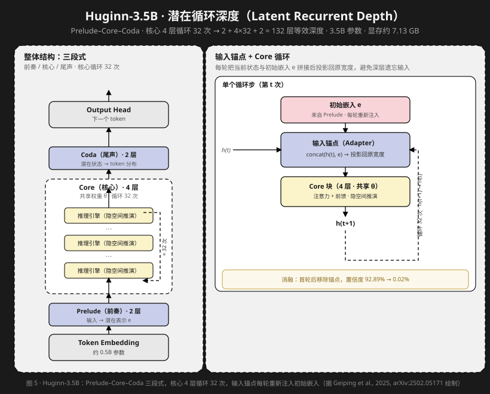

### 4.3 随机循环深度与截断反传

让模型在推理时能够使用不同循环次数，靠的是一个训练设计，每次前向传播中，核心的循环次数从一个期望约 32 的对数正态-泊松分布中随机采样，且带有重尾，使模型偶尔在极高的循环次数下接受训练。为了控制显存，梯度仅通过最后 8 次循环反传（对循环的截断反传）。正是这种随机、可变步数的训练，让模型在测试时能泛化到训练中罕见的高循环次数。

### 4.4 涌现行为

Huginn 最有启发性的贡献，或许不在于基准分数，而在于作者对隐状态轨迹的观察（图 6）。随着循环次数增加，隐状态在潜空间中呈现出几种可辨识的动力学模式：

- **收敛（convergence）**：许多 token 的隐状态迅速逼近一个近似不动点，简单问题早早"想完"。
- **轨道（orbiting）**：需要计算的 token（如数字与某些动作动词）的隐状态会沿圆形轨迹绕行，而非塌缩到一个点。
- **滑尺（sliders）**：潜空间的某些方向呈现稳定的线性漂移，可能编码了"进度"或"循环计数"。
- **路径无关性（path independence）**：从不同随机初始状态出发，模型趋向于相似轨迹与相似结果，表明其学习的动力学是稳定的而非混沌的。

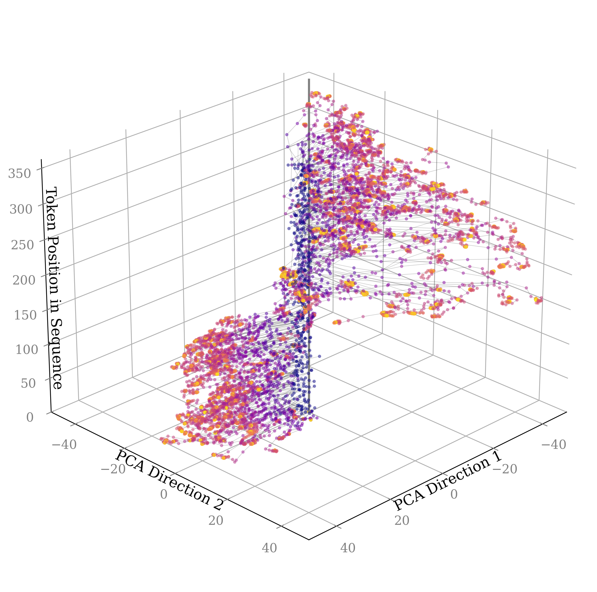

这些观察带来两个直接的推论。其一，不同的 token 消耗不同的计算量，隐状态变化幅度的衰减提供了一个自然的停止准则，当变化足够小时即可提前退出，实测可跳过约 34% 的核心计算。其二，隐空间思考承载的信息密度远高于文本思考，每个 5280 维的状态携带约 84,480 bit 信息，而一个采样 token 仅约 16 bit。在匹配计算量的条件下，隐式循环相对思维链的加速比约为 1.27 倍，提升幅度有限，但它展示了在向量中思考这一方向的潜力。

## 5 Ouro：把推理建入预训练

### 5.1 预训练阶段的"思考"

现代 LLM 主要通过显式文本生成（如思维链）来思考，这把推理的训练推迟到了后训练阶段，而未充分利用海量预训练数据中蕴含的推理信号。字节跳动 Seed 团队联合多家机构提出的 Ouro，以自我吞噬的衔尾蛇 Ouroboros 命名，是在预训练阶段就内建推理能力的循环语言模型（LoopLM）。

### 5.2 架构与退出门控

Ouro 反复应用同一组共享的解码器层栈，而非为每一层各存一份参数。已发布的 Ouro 1.4B 与 2.6B 均为隐藏维度 2048、最大循环步数 $T_{\max}=4$ 的模型（后者由 24 层栈加倍并继续训练而来）。在每个循环步 $t$，一个线性退出门控产生停止概率：

$$
\lambda_t(x) = \sigma\Big(\mathrm{Linear}_\phi\big(h^{(t)}\big)\Big) ,
$$

由此诱导出一个关于退出深度 $\{1,\dots,T_{\max}\}$ 的离散分布 $p_\phi(t \mid x)$，使模型能够按输入难度自适应地分配计算深度，简单输入提前退出，复杂输入跑满全部循环。

### 5.3 两阶段门控训练

门控的训练分两个阶段。第一阶段，门控与主干联合优化一个熵正则化的目标：

$$
\mathcal{L} = \sum_{t=1}^{T_{\max}} p_\phi(t\mid x)\,\mathcal{L}^{(t)} - \beta\, H\big(p_\phi(\cdot\mid x)\big) ,
$$

其中熵项相当于对均匀先验的 KL 惩罚，避免门控在尚未学会"深度-难度"对应关系之前就过早偏好某一深度。第二阶段冻结主干，仅微调门控，用相邻步之间的损失改进量 $\max(0, \mathcal{L}^{(t-1)}_{\text{stop}} - \mathcal{L}^{(t)}_{\text{stop}})$ 作为"继续/退出"的软标签，通过二分类交叉熵来训练。

### 5.4 结果与"过度思考"

Ouro 的 1.4B 与 2.6B 模型在广泛基准上达到乃至超越 12B 参数级别的最先进模型，实现了约 2–3 倍的参数效率，图 7 左侧的雷达图直观地展示了这一差距的消弭。更重要的是，作者通过对照实验证明，这些增益来自更强的知识操控（knowledge manipulation）能力，而非更大的知识容量（knowledge capacity）。

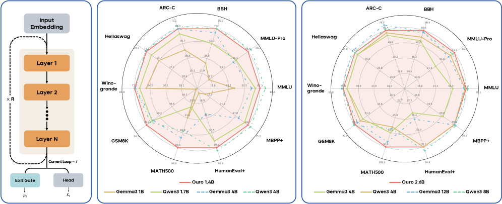

然而，Ouro 也揭示了一个反直觉的边界，**循环并非越多越好**。以 1.4B 的 Ouro-Thinking 为例，它在 AIME 2024 上的成绩从第 1 轮的 0 分逐步上升，在第 4 轮达到 65 分，继续转到第 8 轮，成绩反而跌落到 38.67 分。作者还报告，对 Ouro 的 RLVR 后训练收效有限，部分原因正是可变深度的门控执行路径与快速固定深度的推理框架（如 vLLM、SGLang）之间的错配。这说明，深度分配与稳定性是循环模型必须同时解决的两个问题。

## 6 Nanbeige 4.2：朴素循环的工程示范

### 6.1 Nanbeige 4.2 架构

如果说前面的工作都在循环次数上做精巧的文章，那么 2026 年 7 月由南北阁实验室开源的 Nanbeige4.2-3B 则提供了一个朴素而清晰的范例，它把 22 层的层栈原封不动地走两遍。隐藏状态完成一次自底向上的完整遍历后，被重新喂回同一层栈的起点，再遍历一遍。由于两次遍历复用同一组权重，模型等效拥有 44 层的深度，却只存储 22 层的参数。

Nanbeige4.2-3B 是一个 3B 非嵌入参数的紧凑通用 Agent 模型，22 层、隐藏维度 3072、分组查询注意力（48 个查询头、8 个键值头、头维 128）、SiLU 前馈层（中间维 10752）、词表 166144，并通过 $\theta=7\times10^7$ 的 RoPE 支持最长 262144 的上下文。

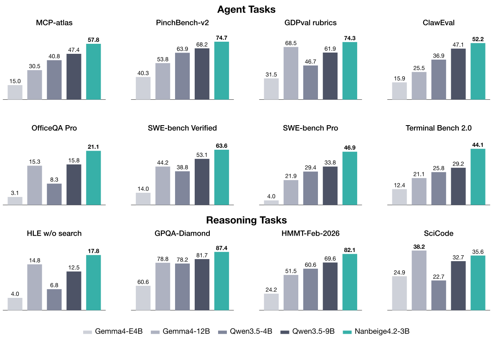

### 6.2 从头训练优于改造

Nanbeige 团队在 28 万亿 token 上从头预训练了这一循环架构，而非像部分做法那样把现成的标准 Transformer 改造（upcycling）成循环结构。他们发现，当模型从预训练一开始就适配"被处理两遍"的表示时，各层的表示会自发地学会从第二遍遍历中获取额外价值；反之，事后改造的标准模型效果明显更差。这一发现与 GLM-5.4 的后训练改造路线形成了对照，二者的取舍将在第八章深入讨论。

### 6.3 工程权衡

关于为什么是两遍，Nanbeige 给出了量化答案，两遍是性价比最高的拐点，继续增加循环次数虽然仍能带来微弱的性能提升，却使训练显著变慢、代价上升。团队还报告了一个工程结论，他们曾尝试让两遍遍历共享 KV 缓存，缓存虽省了一半，但性能受损，因此最终发布的版本为两遍各自保留独立的 KV 缓存。这再次印证了贯穿全文的要点，循环省的是参数，而非计算与缓存。

## 7 SenseNova Loop：流形约束与混合注意力

### 7.1 SenseNova Loop 架构

2026 年 11 月，商汤开源了 SenseNova Loop-9B，一个 9B 参数、面向复杂推理、代码、工具调用与多模态任务的循环 Transformer。它以 32 层多模态解码器为基座，保留首尾各 4 层（第 0–3 层与第 28–31 层）作为一次性层，把中间的 24 层（第 4–27 层）改造成共享权重的循环模块并执行两次。于是，一次前向传播完成了 $4 + 24 \times 2 + 4 = 56$ 次解码器层计算，却只需存储 32 层的权重。若记循环模块为 $B$、其输入为 $h$，则循环计算可简洁地写为 $B(B(h))$。

得益于循环共享结构，模型 4bit 量化后权重仅约 4.9 GB，部署显存需求可低至 10 GB 以内，使低显存芯片运行接近 27B 级别模型性能的系统成为可能。

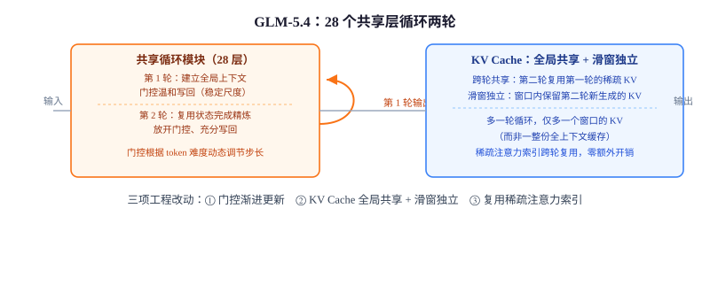

### 7.2 双流流形约束超连接（mHC）

为了在两次循环之间建立更充分的信息交互，Loop-9B 引入了双流流形约束超连接（two-stream manifold-constrained hyper-connections, mHC），循环模块用两条残差流并行传递信息，一个可学习映射决定每层如何从残差流读取信息、如何混合两条流的信息、以及如何把层输出写回。流间混合映射通过 Sinkhorn 归一化（约 20 次行、列交替归一化）加以约束，从而稳定信号传播。这第二条流的用意，是给循环块更多空间来融合两次遍历的信息，避免两次遍历退化为简单的重复计算。

### 7.3 混合注意力

Loop-9B 的注意力并非均匀分布，解码器以四层为一组，采用"三层线性注意力 + 一层全注意力"的混合配置，而循环模块的边界恰好落在完整的四层组上，使两次遍历保持一致的注意力排列。线性注意力降低了长序列的注意力成本，使 512K 的超长上下文成为可能。

### 7.4 Loop Scaling：循环深度的收益曲线

商汤给出的 Loop Scaling 实验，为循环换深度提供了直接的一手证据（图 11）。在保持训练数据等配置不变的条件下，随着训练与推理循环次数从 1 增至 4，模型在四项核心任务上的表现均呈上升趋势，代码生成（LiveCodeBench V6）与数据可视化（AIDAbench-data_visualization）分别再提升约 1.04 与 1.35 个百分点。同时，不同任务对循环深度的需求存在显著差异，部分任务在 loop=3 即达峰值，之后回落。这一观察直接催生了商汤的下一步计划，Dynamic Loop，让模型根据输入复杂度自适应匹配循环次数。

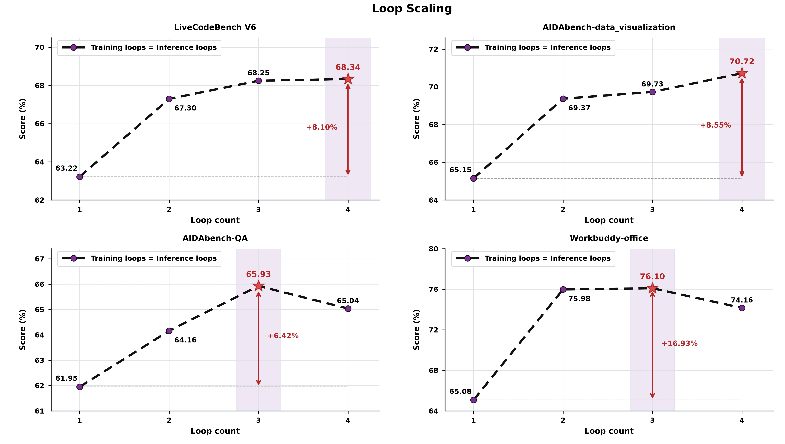

## 8 GLM-5.4：把旗舰模型改造成 Loop Transformer

### 8.1 后训练改造，而非从头训练

2026 年 11 月 23 日，智谱发布了 GLM-5.4，其首代采用 Loop Transformer 架构的旗舰模型，在约 750B 参数量下达到了 2–3T 级别模型的效果。与 Ouro、Nanbeige 的从头训练不同，智谱选择了一条务实的路线，不从头预训练，而是把一个已完成预训练的基座（GLM-5）通过继续训练改造成 Loop Transformer。

这条路线背后的判断，回应了 Universal Transformer 沉寂多年的原因，权重共享虽然提高了参数效率，但在同等预训练计算量下，共享权重的循环模型仍不如每层各用一套参数的标准模型。与其从零开始验证循环的预训练收益，不如保留预训练积累的海量知识，只在后训练阶段引入循环，以较小的算力开销换取智能上限的提升。

### 8.2 三项工程改动

GLM-5.4 对基座中的 28 层做两轮循环。为了让循环在 750B 规模上稳定运行，团队做了三项关键工程改动。

**门控渐进更新（Gated Progressive Updates）。** 把已有模型的中间层改为多轮循环时，若每轮输出直接覆盖隐状态，激活范数会随循环轮数过度膨胀，后续层收到的表示会偏离原模型熟悉的尺度与分布。GLM-5.4 为每一轮设置独立的逐 token 门控，按比例把该轮的候选变化写回残差流。训练后的门控呈现出明确的分工，第一轮侧重建立全局上下文状态，对多数位置以较小门值温和写回以稳住尺度，第二轮复用该状态完成精炼，并放开门控充分写回。门控还会根据 token 的预测难度动态调节步长，在更难预测的位置，首轮写入会适度加大。

**KV Cache 全局共享与滑窗独立。** 朴素做法是为每一轮循环保留一整份 KV 缓存，显存随循环轮数成倍增长。GLM-5.4 在跨轮共享 KV 的基础上，用滑动窗口补充新一轮的局部信息，第二轮复用第一轮选出的稀疏 KV，同时保留滑动窗口内由第二轮新生成的 KV。两路 KV 可覆盖同一位置，使模型既能读取第一轮的上下文表示，又能利用第二轮更新后的局部表示。多一轮循环的额外代价，仅是一个窗口的 KV，而非一整份全上下文缓存，在 1M 长上下文下，这使部署成本增幅保持可控。

**复用稀疏注意力索引。** GLM-5.4 的基座采用稀疏注意力，第二轮循环直接复用第一轮索引器生成的索引，不增加任何索引器开销，实验表明，其效果与每轮重新计算索引几乎相当。

### 8.3 Scaling Correctness：规模放大后的严格检验

任何架构创新都必须在规模放大后依然成立，这是智谱所谓 Scaling Correctness 的检验。在把旗舰押注于 Loop 之前，团队在 1B、4B、30B 直到 750B 基座上逐级做了验证。在与 750B 基座架构完全相同的 30B 模型上，他们做了同参数量的对照实验，参数量完全相同、整体训练计算量仅增加约 10%，循环版本相对基线有明显提升，AIME25 从 19.17 提升至 30.42，GPQA-Diamond 从 47.58 提升至 56.26，MMLU-Pro 从 71.65 提升至 75.05。同时，输出长度在 GPQA、MMLU-Pro 等基准上平均下降 10%–14%，缩减主要来自思维链，部分推理从 token 流转移到了循环带来的额外计算深度中，模型用更少的 token 完成了思考。

图 12 给出了 GLM-5.4 的官方架构图。整个基座共 78 层物理权重，前段（Prelude，第 1–26 层）与尾段（Coda，第 55–78 层）各执行一次，中间的 28 层（第 27–54 层）共享权重循环两轮，等效 106 次层计算；两次循环之间以逐 token 门控按比例写回候选变化，稀疏注意力的 top-k 索引跨轮复用，配合"全局共享 + 滑窗独立"的 KV 缓存策略。

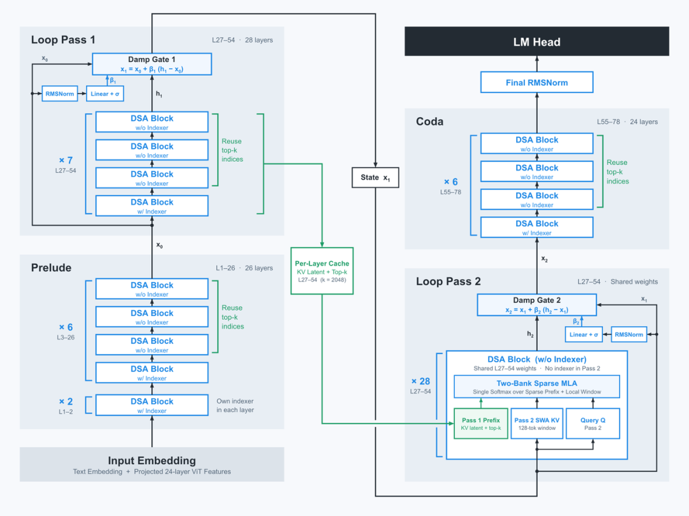

## 9 循环的收益、代价与未来

### 9.1 省的是参数，不是计算

纵观从 Universal Transformer 到 GLM-5.4 的整条脉络，一条贯穿始终的结论清晰浮现，**循环深度解耦的是存储与计算，它压缩的是参数，而非算力**。前向传播仍需执行 $T$ 次层计算，训练时梯度也需在共享栈中多次回传，KV 缓存亦难以跨轮共享，Nanbeige 的实验表明共享缓存会损害性能。因此，Loop Transformer 更准确的价值定位是，用与大模型相当的计算量，换取只有一半的权重参数。它真正的用武之地，是在参数规模受限（内存受限、部署受限）而算力相对宽裕的场景下，把有限的参数量转化为更强的能力。

### 9.2 稳定性与"过度思考"

循环模型的弱点同样不容回避。反复调用同一组层会导致误差累积与范数漂移，Ouro 早期曾尝试 8 轮循环，很快出现损失尖峰与梯度振荡，最终把主训练阶段降至 4 轮；Ouro-Thinking 在 AIME 2024 上从第 4 轮的 65 分跌落到第 8 轮的 38.67 分，直观展示了过度循环的负面影响。GLM-5.4 的门控渐进更新，本质上是针对范数膨胀的稳定性工程。此外，可变深度的执行路径与现有快速推理框架（vLLM、SGLang 等）之间的错配，仍是循环模型落地的一大障碍。理论上能算已不再是难题，训练时能学会与推理时能稳定地算下去，才是当前需要解决的问题。

### 9.3 对硬件设计的启示：未雨绸缪

站在硬件设计的视角，Loop Transformer 释放了一个明确的信号，未来的计算系统需要在存储与计算之间提供更灵活的权衡。当模型可以把深度当作运行时调节的变量，硬件若能支持重复调用同一组权重的快速循环执行，例如让权重常驻片上高速存储、避免每次循环都从主存重复搬运参数，便能显著降低循环的计算成本，把以算易参的收益进一步放大。反过来，若硬件仍按每层各一份权重、顺序流水的传统假设设计，循环模型的优势将被反复的数据搬运所抵消。

这正应了题头诗所言，旧书不厌百回读，熟读深思子自知。循环深度之路，正像反复研读一部旧书，不再寄望于无休止地扩充参数，而是把已经记忆的知识反复咀嚼、融会贯通，在有限的参量之中温故而知新。理解这一原理与边界，正是为下一代算力与硬件架构的布局提前落子。

## 参考文献

1. Vaswani, A., Shazeer, N., Parmar, N., et al. (2017). *Attention Is All You Need.* NeurIPS 2017.
2. Dehghani, M., Gouws, S., Vinyals, O., Uszkoreit, J., & Kaiser, Ł. (2019). *Universal Transformers.* ICLR 2019. arXiv:1807.03819.
3. Graves, A. (2016). *Adaptive Computation Time for Recurrent Neural Networks.* arXiv:1603.08983.
4. Pérez, J., Barceló, P., & Marinkovic, J. (2021). *Attention is Turing-Complete.* JMLR 22(75).
5. Giannou, A., Rajput, S., Sohn, J., Lee, K., Lee, J. D., & Papailiopoulos, D. (2024). *Looped Transformers as Programmable Computers.* ICML 2024. arXiv:2301.13196.
6. Geiping, J., et al. (2025). *Scaling up Test-Time Compute with Latent Reasoning: A Recurrent Depth Approach.* arXiv:2502.05171.
7. Zhu, R.-J., Wang, Z., Hua, K., et al. (2025). *Scaling Latent Reasoning via Looped Language Models.* arXiv:2510.25741.
8. Nanbeige Lab (Yang, C., Huang, C., Lan, F., et al.) (2026). *Nanbeige4.2-3B: Unlocking Agentic Capabilities in a Compact Model.* arXiv:2607.22083.
9. SenseTime (2026). *SenseNova Loop-9B 技术博客.* 商汤科技.
10. 智谱 AI (2026). *GLM-5.4: Toward Generalized Coding with Our First Loop Transformer.* 智谱 AI 技术博客.
11. Wei, J., Wang, X., Schuurmans, D., et al. (2022). *Chain-of-Thought Prompting Elicits Reasoning in Large Language Models.* NeurIPS 2022.
