# 一. 概述

**Mamba** 是一种基于选择性状态空间模型（Selective State Space Model, SSM）的序列建模架构，其目的是挑战 Transformer 的地位，同时避免 Transformer 注意力机制的计算瓶颈。

自 2017 年 "Attention Is All You Need" 问世以来，Transformer 几乎垄断了深度学习各大模态的基础模型：无论是语言、图像还是音频，其核心几乎都建立在自注意力（self-attention）模块之上。然而，注意力机制存在一个众所周知的计算瓶颈——对长度为 $L$ 的序列，它的计算复杂度与内存占用都随 $L$ **平方增长**（即 $O(L^2)$），这使得 Transformer 在长序列与大规模推理场景下成本高昂。

围绕这一瓶颈，学界提出了大量"次二次方"（subquadratic）架构，包括线性注意力、门控卷积与循环模型、以及结构化状态空间模型（SSM）。这些模型理论上都能以线性复杂度处理长序列，但在语言等对"内容感知推理"要求极高的模态上，长期难以匹敌注意力机制的表现。

Mamba 的核心贡献在于找到了这一差距的根源——**缺乏基于内容的推理能力**——并给出了一套完整的解决方案：

1. **选择机制（selection mechanism）**：让 SSM 的核心参数（$\Delta, B, C$）成为输入的函数，从而能根据当前 token 有选择地"记忆"或"遗忘"信息；
2. **硬件感知算法（hardware-aware algorithm）**：由于选择性破坏了 SSM 原有的卷积形式，Mamba 在循环模式下设计了一套 GPU 友好的并行扫描算法（类似 FlashAttention 的核融合与重算策略）；
3. **极简的端到端架构**：去掉注意力、甚至去掉 MLP 块，用统一重复的 Mamba 块堆叠成完整网络。

Mamba 在推理吞吐上比同尺寸 Transformer 快约 **5 倍**，序列长度呈**线性扩展**，并在语言、音频、基因组等多个模态上取得当时的最优表现。此后，这一谱系持续演进：

| 版本 | 论文 | 核心思想 |
|------|------|----------|
| Mamba-1 | Gu & Dao, 2023, [arXiv:2312.00752](https://arxiv.org/abs/2312.00752) | 选择性 SSM + 硬件感知扫描 |
| Mamba-2 | Dao & Gu, 2024, [arXiv:2405.21060](https://arxiv.org/abs/2405.21060) | 状态空间对偶性（SSD），SSM 与注意力统一于半可分矩阵 |
| Mamba-3 | Lahoti et al., 2026, [arXiv:2603.15569](https://arxiv.org/abs/2603.15569) | 推理优先设计：梯形离散化、复数状态、MIMO |

本文将沿"Transformer 与 RNN 的对比 → SSM 的基础 → Mamba-1/2/3 三代演进"这条主线，逐步拆解 Mamba 如何一步步逼近、甚至部分超越 Transformer，并回答一个开放性问题：**Mamba 会是 Transformer 真正的挑战者吗？**

# 二. Transformer 和 RNN

要理解 Mamba 的价值，首先需要理解它试图弥合的两大经典范式——**Transformer** 与 **RNN**——各自的优势与短板。

## 2.1 Transformer：并行但平方复杂

Transformer 的核心是**缩放点积注意力**（Scaled Dot-Product Attention）：

$$\text{Attention}(Q, K, V) = \mathrm{softmax}\!\left(\frac{QK^{\top}}{\sqrt{d_k}}\right) V$$

其中查询 $Q$、键 $K$、值 $V$ 均来自输入的线性投影，$d_k$ 为键的维度。注意力矩阵 $QK^{\top}$ 显式地计算了序列中**任意两两位置**之间的相似度，因此：

- **优点**：任意两个 token 之间的路径长度恒为 $O(1)$，梯度传播直接，长程依赖建模能力极强；整个序列可**完全并行**计算。
- **缺点**：$QK^{\top}$ 是 $L \times L$ 的矩阵，计算与存储均为 $O(L^2)$；推理时 KV cache 随序列长度**线性增长**，导致内存压力。


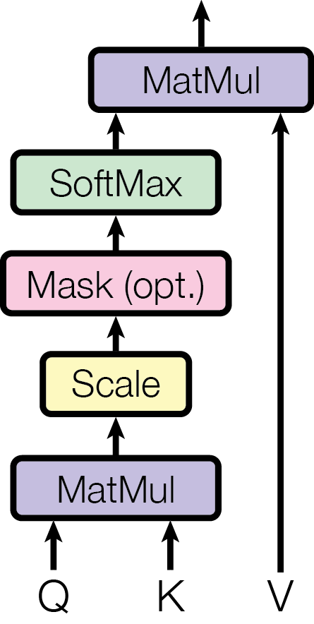

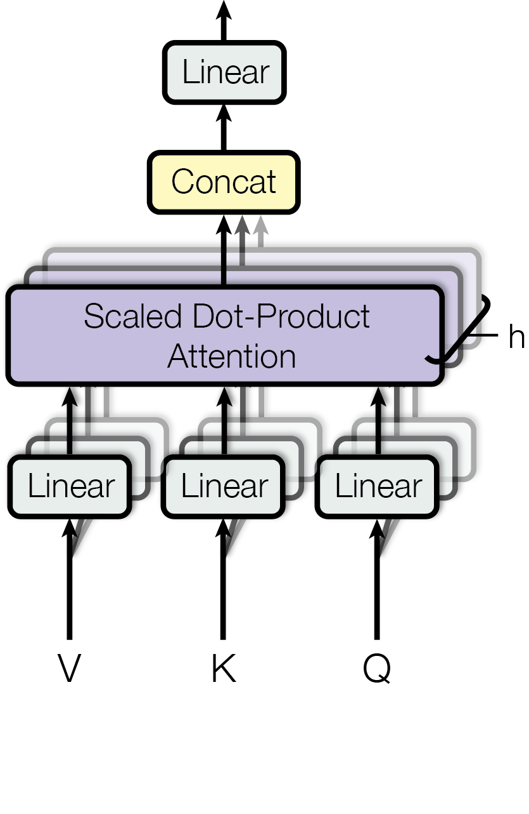

## 2.2 RNN：线性但串行

循环神经网络（RNN）则以一种完全相反的方式处理序列——通过一个固定大小的隐状态 $h_t$ 在时间上递推：

$$h_t = f\left(W_h h_{t-1} + W_x x_t + b\right), \quad y_t = g(W_y h_t)$$

- **优点**：每个时间步只处理当前 token 与上一时刻的隐状态，计算为 $O(L)$，内存为 $O(1)$（只保留一个隐状态，与序列长度无关）。
- **缺点**：推理是**严格串行**的，无法在训练时并行展开；固定维度的隐状态是"瓶颈"，长程信息会随递推被稀释，且存在梯度消失/爆炸问题。

下表总结了不同层类型的复杂度（$n$ 为序列长度，$d$ 为表示维度），正是这张表定义了整个后续研究的问题空间：

| 层类型 | 每层复杂度 | 序列操作数 | 最大路径长度 |
|--------|-----------|-----------|-------------|
| 自注意力 | $O(n^2 \cdot d)$ | $O(1)$ | $O(1)$ |
| 循环（RNN） | $O(n \cdot d^2)$ | $O(n)$ | $O(n)$ |
| 卷积 | $O(k \cdot n \cdot d^2)$ | $O(1)$ | $O(\log_k n)$ |
| **SSM / Mamba** | $O(n \cdot d)$ | $O(1)$（并行扫描） | $O(n)$ |

> 来源：Vaswani et al., 2017，表 1（前两行）；SSM/Mamba 行为本文补充。

**关键张力**由此清晰：Transformer 用 $O(L^2)$ 换来了并行性与强长程建模；RNN 用串行换来了 $O(L)$ 与 $O(1)$ 内存。能否有一种架构，**同时**拿到 RNN 的线性复杂度/常量内存，与 Transformer 的并行训练能力？这正是状态空间模型（SSM）——以及其上的 Mamba——所要回答的问题。

# 三. SSM

状态空间模型（State Space Model, SSM）源自控制理论，是描述线性时不变（Linear Time-Invariant, LTI）动力系统的一类经典模型。Mamba 正是建立在这一谱系（尤其是 S4）之上。

## 3.1 连续形式：一个线性动力系统

SSM 把输入信号 $x(t)$ 映射到输出 $y(t)$，中间经由一个隐状态 $h(t)$：

$$
\begin{aligned}
h'(t) &= \mathbf{A}\, h(t) + \mathbf{B}\, x(t), \\
y(t) &= \mathbf{C}\, h(t) + \mathbf{D}\, x(t).
\end{aligned}
$$

其中 $\mathbf{A} \in \mathbb{R}^{N \times N}$ 是状态转移矩阵，$\mathbf{B} \in \mathbb{R}^{N \times 1}$ 与 $\mathbf{C} \in \mathbb{R}^{1 \times N}$ 分别是输入、输出投影矩阵，$\mathbf{D}$ 是直连项（通常可省略）。直观上：$\mathbf{B}$ 决定输入如何"写入"状态，$\mathbf{A}$ 决定状态如何"演化"，$\mathbf{C}$ 决定状态如何"读出"为输出。

## 3.2 离散化：从连续到递推

真实数据（如文本 token）是离散的，因此需要把连续系统离散化。最常见的做法是**零阶保持**（Zero-Order Hold, ZOH）与双线性（bilinear）方法，二者都通过一个可学习的步长 $\Delta$ 把连续参数转化为离散参数 $\bar{\mathbf{A}}, \bar{\mathbf{B}}$：

$$\bar{\mathbf{A}} = e^{\Delta \mathbf{A}}, \qquad \bar{\mathbf{B}} = (\Delta \mathbf{A})^{-1}\left(e^{\Delta \mathbf{A}} - I\right) \cdot \Delta \mathbf{B},$$

离散化后的递推形式为：

$$h_t = \bar{\mathbf{A}}\, h_{t-1} + \bar{\mathbf{B}}\, x_t, \qquad y_t = \mathbf{C}\, h_t.$$

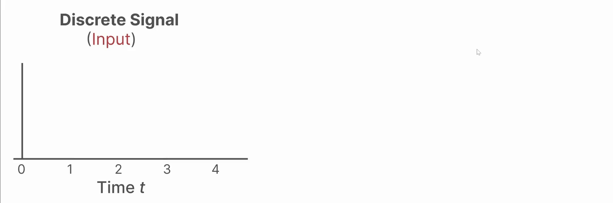

这一递推揭示了 SSM 与 RNN 的深刻联系：二者都是"维护一个隐状态、逐时间步更新"的线性递推。区别在于，SSM 的状态转移由 $\bar{\mathbf{A}}$ 决定，且有严格的数学结构。

## 3.3 卷积形式：并行训练的钥匙

对**线性时不变**系统，递推可以被展开为一个卷积。令核：

$$\bar{\mathbf{K}} = \left(\mathbf{C}\bar{\mathbf{B}},\ \mathbf{C}\bar{\mathbf{A}}\bar{\mathbf{B}},\ \ldots,\ \mathbf{C}\bar{\mathbf{A}}^{L-1}\bar{\mathbf{B}}\right),$$

则整段输出可直接写为 $y = x \circledast \bar{\mathbf{K}}$。

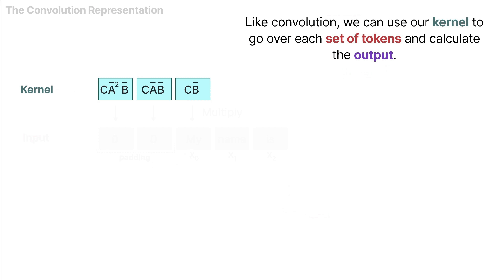

这带来了 SSM 最优雅的"三重视角"：

| 视角 | 形式 | 复杂度 | 用途 |
|------|------|--------|------|
| 连续 | $h'(t) = \mathbf{A}h + \mathbf{B}x$ | — | 理论建模 |
| 递推 | $h_t = \bar{\mathbf{A}}h_{t-1} + \bar{\mathbf{B}}x_t$ | $O(L)$ 推理 | 自回归生成 |
| 卷积 | $y = \bar{\mathbf{K}} \circledast x$ | $O(L \log L)$ 训练 | 并行训练 |

**训练时用卷积（并行），推理时切换回递推（线性 + 常量内存）**——这正是 SSM 试图调和 Transformer 与 RNN 矛盾的核心机制。

## 3.4 S4：让 SSM 真正可用的关键一步

原始的朴素 SSM 在长序列上难以训练：$\bar{\mathbf{A}}$ 的高次幂会导致数值不稳定，且朴素实现复杂度过高。**S4**（Structured State Spaces, Gu et al., 2021, [arXiv:2111.00396](https://arxiv.org/abs/2111.00396)）通过两个关键设计解决了这一问题：

1. **HiPPO 初始化**：用特定数学结构（Legendre/Laguerre 多项式投影）初始化 $\mathbf{A}$，使状态能够"记住"尽可能长的历史，奠定长程记忆的理论基础；
2. **结构化参数化 + 高效算法**：将 $\mathbf{A}$ 对角化或规范化为可高效计算的形态，配合 FFT 等算法把计算复杂度降下来。

S4 在 Long Range Arena（LRA）等长序列基准上首次以线性复杂度追平甚至超越 Transformer，开启了"结构化 SSM"的研究浪潮。然而，S4 及其后续（S5、H3、SaShiMi 等）都有一个共同的本质限制——它们是**线性时不变**的：$\mathbf{A}, \mathbf{B}, \mathbf{C}, \Delta$ 对所有 token 都是固定的常数。这意味着，无论输入什么内容，模型的"记忆规则"都一成不变。这一限制，恰恰是 Mamba 要打破的。

# 四. Mamba-1

## 4.1 问题：时不变系统无法"选择性"记忆

Mamba 论文开篇指出了一个致命弱点：**时不变模型无法进行基于内容的推理**。这一弱点在两类合成任务上暴露得淋漓尽致：

- **选择性复制（Selective Copying）**：要求模型从输入中挑出被标记的 token 并复制。由于标记位置随机、间距不定，时不变系统（线性递推、全局卷积）无法"根据内容"决定该记住什么、该忽略什么；
- **归纳头（Induction Heads）**：大语言模型的一项关键能力——在序列中遇到"…A…B"后，能预测下一个也是 A。这要求模型**基于内容**在上下文中检索并关联，同样需要时变能力。


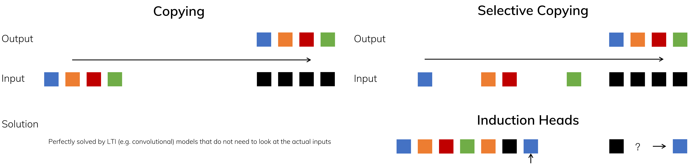

## 4.2 选择机制：让参数成为输入的函数

Mamba 的解决方案出奇简洁——**把 SSM 的参数做成输入的函数**，从而把 LTI 系统升级为"选择性"系统：

$$
\begin{aligned}
B_t &= s_B(x_t), \\
C_t &= s_C(x_t), \\
\Delta_t &= \tau_\Delta\!\left(\text{Parameter} + s_\Delta(x_t)\right),
\end{aligned}
$$

其中 $s_B, s_C, s_\Delta$ 是（通常是线性的）投影，$\tau_\Delta$ 常取 softplus。这样一来：

- $\Delta_t$（步长）成为"选择性的旋钮"：它决定当前 token 是"多关注当前输入"还是"多保持历史状态"，是选择机制中最重要的参数；
- $B_t, C_t$ 决定信息如何被"写入"与"读出"，随输入动态变化；
- 最终效果：模型能根据当前 token 的**内容**，决定把什么写进状态、把什么遗忘掉。

下图是 Mamba 论文中最核心的一幅图，对比了时不变的 S4 与选择性的 S6：

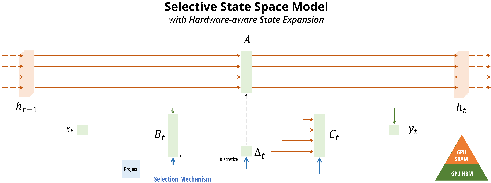

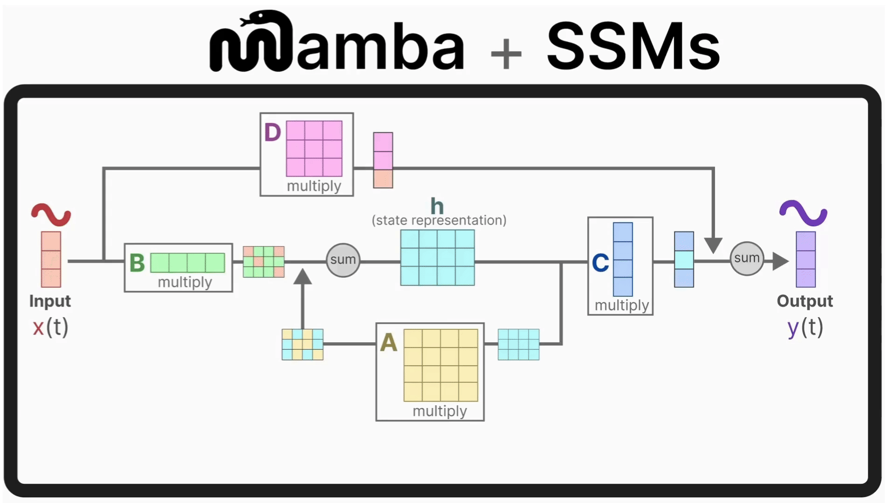

## 4.3 硬件感知算法：选择性的代价与解法

选择机制带来能力的同时，也付出了代价：$\bar{\mathbf{A}}, \bar{\mathbf{B}}, \bar{\mathbf{C}}$ 不再是时不变的，**卷积视角失效了**，模型被迫退回递推模式。但朴素递推是串行的，在 GPU 上效率极低。

Mamba 的应对是**硬件感知算法**，其思想与 FlashAttention 一脉相承——**不要在 GPU 的高带宽内存（HBM）中物化大中间状态**：

1. **并行扫描（parallel scan）**：线性递推 $h_t = \bar{\mathbf{A}}_t h_{t-1} + \bar{\mathbf{B}}_t x_t$ 可以经由并行前缀和（scan）算法并行化，尽管每个位置的计算依赖前一个位置；
2. **核融合（kernel fusion）**：把离散化、递推、输出投影等步骤融合进单个 CUDA kernel；
3. **在 SRAM 中重算**：离散化后的 $\bar{\mathbf{A}}, \bar{\mathbf{B}}$ 比输入的维度大得多（状态扩展因子 $N$ 通常为 16），与其从 HBM 反复读写，不如在片上的 SRAM 中"用时现算"。

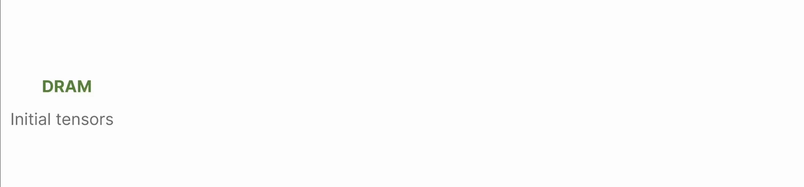

伪代码如下（即论文的 Algorithm 2，S6 选择性扫描）：

```text
Algorithm 2: SSM + Selection (S6)
Input : x : (B, L, D)
Output: y : (B, L, D)

1:  A : (D, N)  ← Parameter              ▷ 结构化 N×N 矩阵
2:  B : (B, L, N) ← s_B(x)
3:  C : (B, L, N) ← s_C(x)
4:  Δ : (B, L, D) ← τ_Δ(Parameter + s_Δ(x))
5:  Ā, B̄ : (B, L, D, N) ← discretize(Δ, A, B)
6:  y ← SSM(Ā, B̄, C)(x)                  ▷ 时变：仅递推（扫描）
7:  return y
```

## 4.4 Mamba 块：极简的端到端架构

在块结构上，Mamba 进一步做了"减法"。论文指出，Mamba 块可以看作 **H3 块**（当时多数 SSM 架构的基础）与 **门控 MLP 块**（现代网络无处不在）的统一：

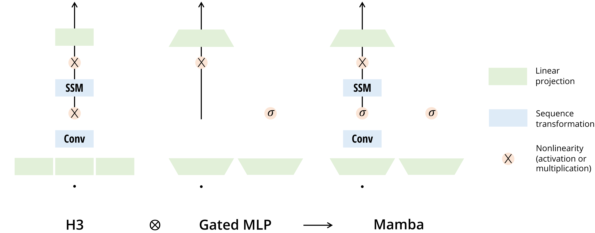

最终，Mamba 架构**既没有注意力，也没有 MLP 块**，只是一层层重复同构的 Mamba 块，叠加上如 GPT 的序列主干与语言模型头。整条数据通路从输入线性投影 → 1D 因果卷积 → 选择式 SSM → 门控 → 输出投影，一气呵成。

## 4.5 结果：线性复杂度下的新高度

Mamba 在多个维度上验证了自身的竞争力：

- **效率**：作为循环模型，推理吞吐比同尺寸 Transformer 快约 **5 倍**；其高效扫描实现比标准实现快约 40 倍。

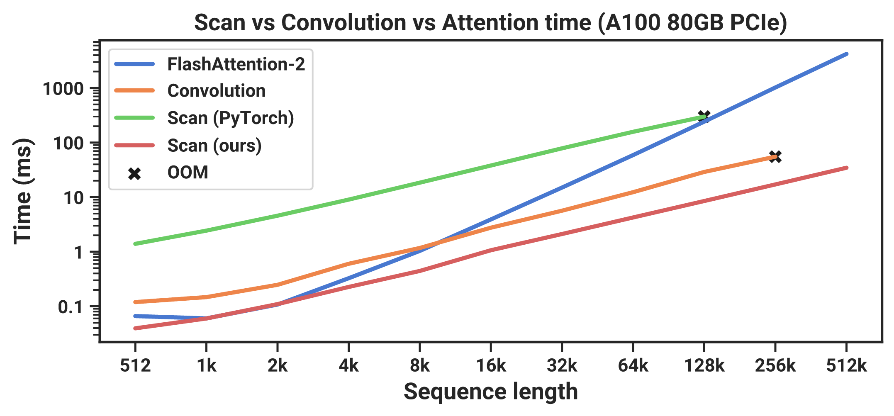

- **扩展性**：在 125M–1.3B 规模上，Mamba 的扩展曲线优于所有无注意力模型，并首次追平了强力的 "Transformer++" 配方，且序列越长优势越明显。

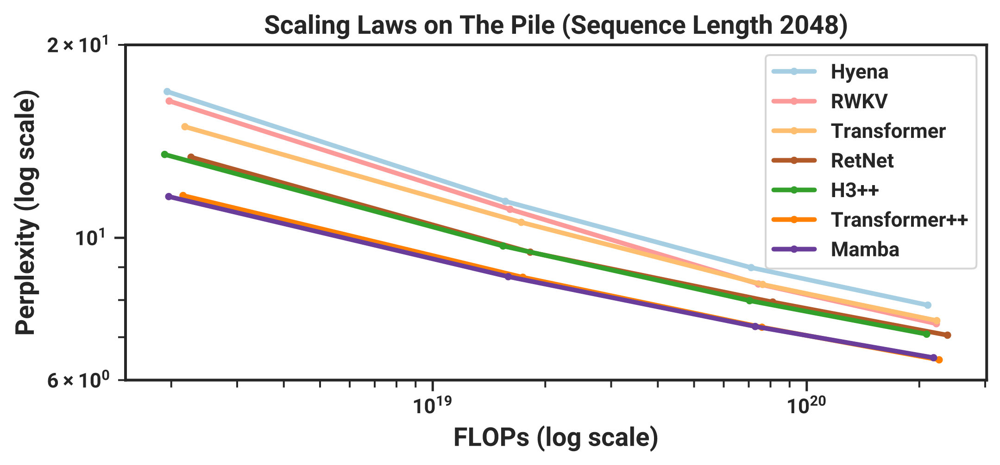

- **合成任务**：在归纳头任务上，Mamba 能从训练长度 256 一路外推到 100 万长度，验证了选择机制带来的上下文关联能力。

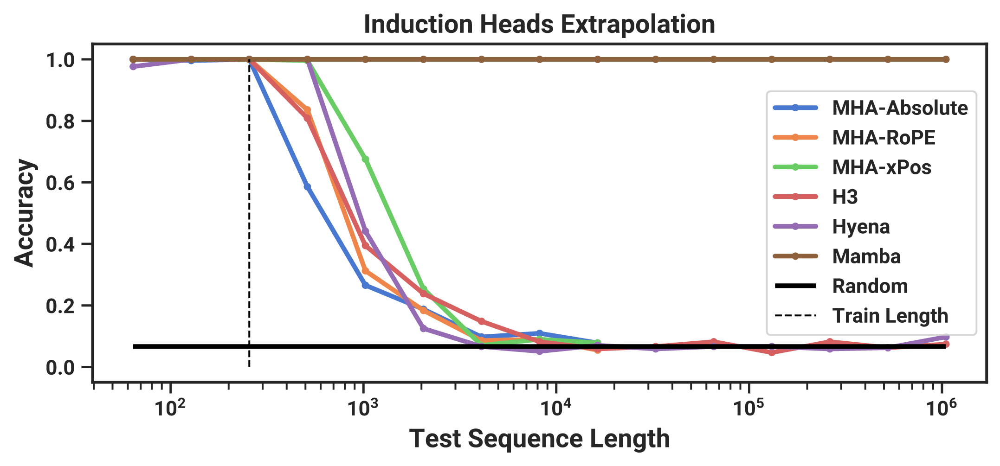

- **多模态**：语言（3B 模型优于同尺寸 Transformer、追平两倍尺寸）、音频（自回归建模优于 Sashimi）、基因组（DNA 分类）均取得当时最优。

Mamba-1 的意义在于：它证明了**线性时间模型首次真正站上了与 Transformer 同台竞技的舞台**，而不仅仅是在长序列玩具任务上"曲线好看"。

# 五. Mamba-2

如果说 Mamba-1 是"工程直觉"的胜利，那么 Mamba-2 则补上了**理论拼图**——它揭示出 SSM 与注意力机制本质上是"同一枚硬币的两面"，并据此设计出更快的新层。

## 5.1 状态空间对偶性：SSM 与注意力在矩阵视角下相遇

Mamba-2 的切入点是一个被长期忽略的事实：把 SSM 看作**序列变换**时，它等价于一个特定的**矩阵乘法** $y = \mathbf{M} x$，其中变换矩阵 $\mathbf{M}$ 是**半可分矩阵**（semiseparable matrix）——一类"每个子矩阵都是低秩"的秩结构矩阵。而注意力机制 $\mathrm{softmax}(QK^{\top})V$ 同样是一个矩阵变换，其权重由 $Q, K$ 动态构造。

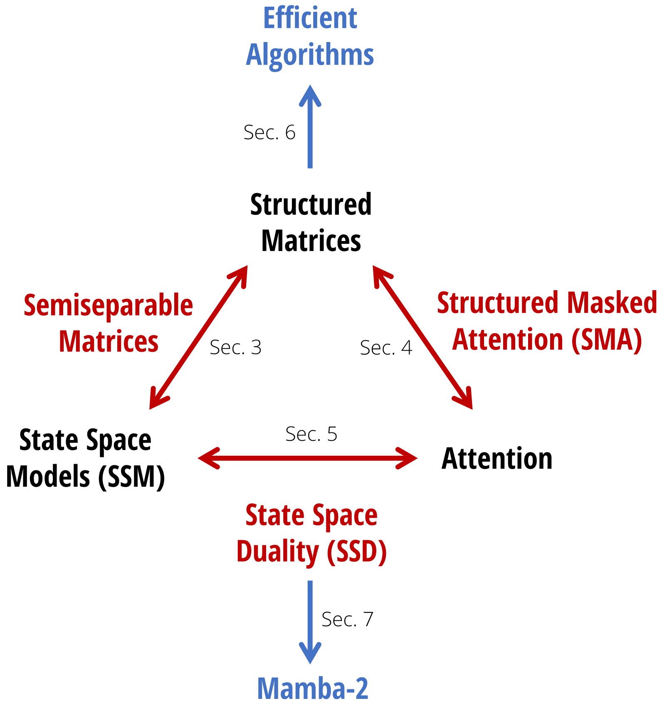

这一框架（**State Space Duality, SSD**）的核心结论是：

- SSM 的递推视角 $\leftrightarrow$ 矩阵的"块分解"视角，二者可相互转换；
- 注意力是 SSD 在"标量结构化"下的一个特例（或者说，SSD 是带衰减的线性注意力的一种结构化推广）。

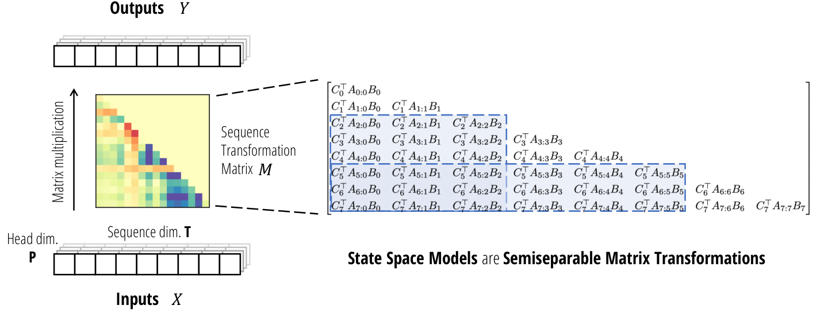

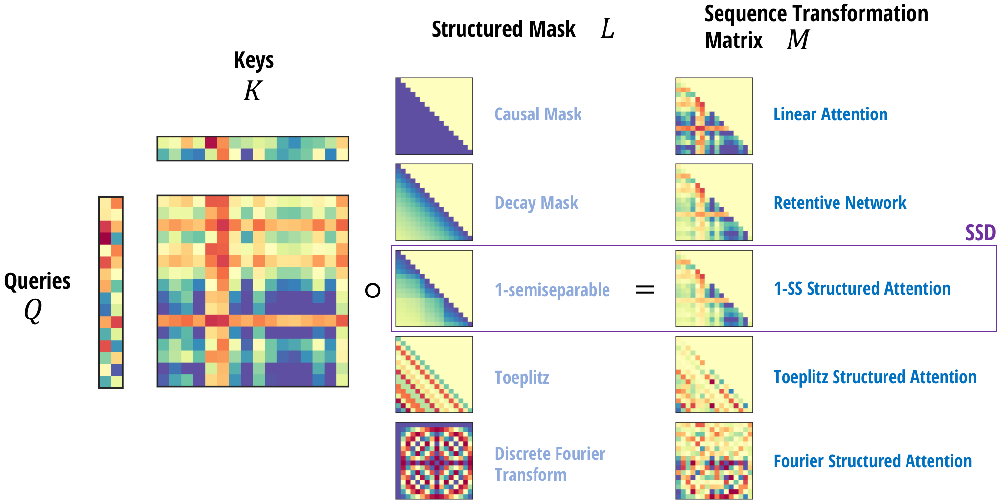

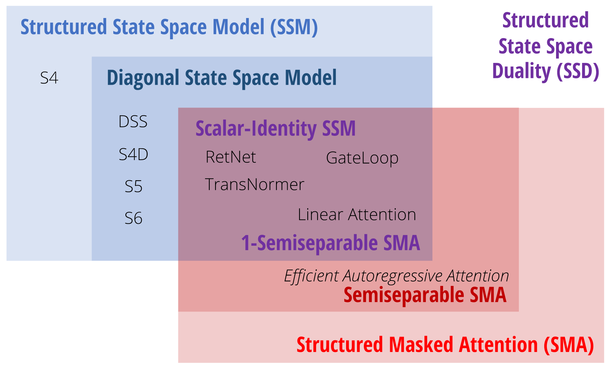

## 5.2 SSD 层：更快的选择式 SSM

基于这一理论，Mamba-2 把 Mamba 的选择式 SSM 精炼为 SSD 层。其核心改动是**标量化 + 块分解**：状态方程退化为逐通道的标量递推

$$h_t = a_t\, h_{t-1} + b_t\, x_t, \qquad y_t = c_t^{\top} h_t,$$

并通过**分块矩阵乘法**在硬件上高效实现（块内对角 + 块间低秩分解）。论文给出的最小实现（Listing 1）仅约 20 行核心代码：

```python
# 最小 SSD 实现（Mamba-2 论文 Listing 1，经简化）
def segsum(x):
    """稳定的分段和（segment sum）计算"""
    T = x.size(-1)
    x = repeat(x, "... d -> ... d e", e=T)
    mask = torch.tril(torch.ones(T, T, device=x.device, dtype=bool), diagonal=-1)
    x = x.masked_fill(~mask, 0)
    x_segsum = torch.cumsum(x, dim=-2)
    mask = torch.tril(torch.ones(T, T, device=x.device, dtype=bool), diagonal=0)
    return x_segsum.masked_fill(~mask, -torch.inf)

def ssd_minimal_discrete(X, A, B, C, block_len, initial_states=None):
    # 1. 块内（对角块）输出
    L = torch.exp(segsum(A))
    Y_diag = torch.einsum("bclhn,bcshn,bhcls,bcshp->bclhp", C, B, L, X)
    # 2. 块内状态（低秩分解的右项）
    decay_states = torch.exp((A_cumsum[..., -1:] - A_cumsum))
    states = torch.einsum("bclhn,bhcl,bclhp->bchpn", B, decay_states, X)
    # 3. 块间 SSM 递推（低秩分解的中间项）
    states = torch.cat([initial_states, states], dim=1)
    new_states = torch.einsum("bhzc,bchpn->bzhpn", decay_chunk, states)
    # 4. 状态 -> 输出（低秩分解的左项）
    Y_off = torch.einsum("bclhn,bchpn,bhcl->bclhp", C, states, state_decay_out)
    return rearrange(Y_diag + Y_off, "b c l h p -> b (c l) h p"), final_state
```

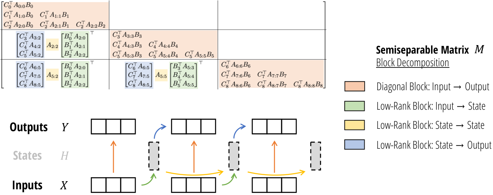

## 5.3 Mamba-2 块与结果

Mamba-2 进一步简化了块结构：去掉顺序的线性投影，把 SSM 参数 $A,B,C$ 在块开头一次性生成；引入 NormFormer 式的额外归一化提升稳定性；并采用**多头**结构（$B,C$ 投影仅共享单个头）。

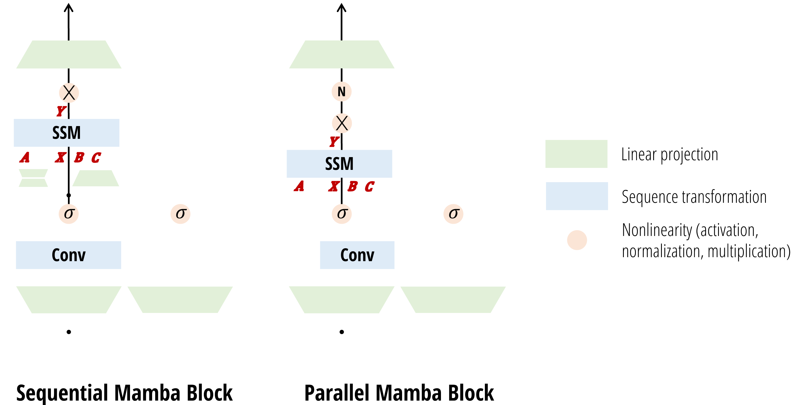

结果上，SSD 核心层比 Mamba 的融合扫描快 **2–8 倍**，在 2k 及以上的序列长度上比 FlashAttention-2 更快，且在语言建模上持续与 Transformer 竞争。

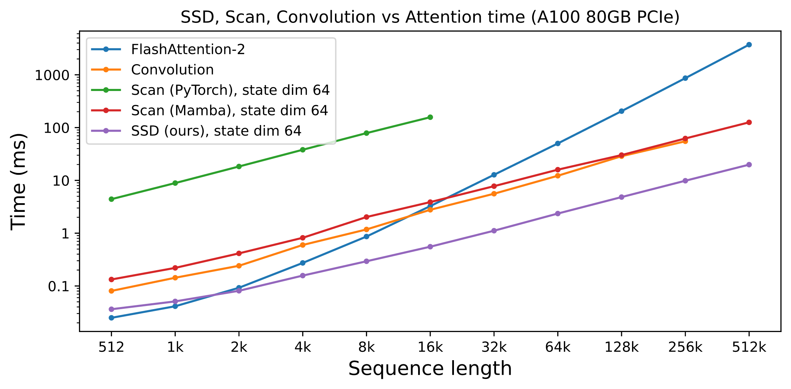

Mamba-2 的价值不止于速度：它第一次在**数学上**把 SSM 与注意力放进了同一框架，为"线性模型能否取代注意力"提供了理论坐标，也直接启发了后续把 SSD 与注意力混合的架构（如各类 hybrid 模型）。

# 六. Mamba-3

Mamba-3 带来一次**设计哲学**的转向：从"训练效率优先"转向"**推理优先**（inference-first）"。随着推理时计算（test-time compute）成为 LLM 性能的关键驱动，解码阶段的效率变得与模型质量同等重要。作者指出，许多线性模型"理论线性、硬件低效"，在状态追踪等任务上仍不及 Transformer。为此，Mamba-3 提出三项核心改进。

## 6.1 梯形离散化：更富表达力的递推

Mamba-2 的离散化等价于**指数欧拉（exponential-Euler）**方法——它只使用区间**起点**的信息来更新状态。Mamba-3 升级为**指数梯形（exponential-trapezoidal）**规则——同时结合区间**起点与终点**：

$$\text{Euler: 端点保持} \quad \longleftrightarrow \quad \text{Trapezoidal: 端点取平均}$$

由此得到的递推形式是 Mamba-2 递推的**严格超集**，且可以被视为一种卷积。配合作用于 $B,C$ 的偏置项，它在经验上甚至可以**取代**语言建模中无处不在的短因果卷积。

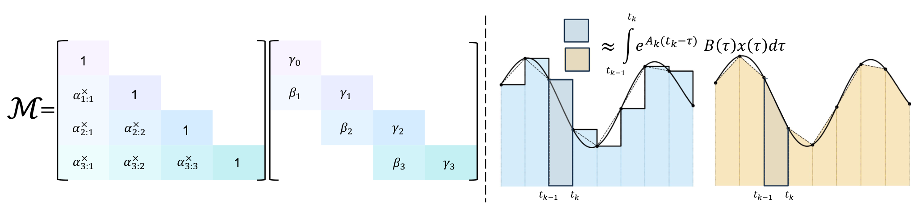

## 6.2 复数状态：数据依赖的旋转位置编码

Mamba-3 把底层 SSM 视为**复值结构**，得到比 Mamba-2 更富表达力的状态更新规则。其精妙之处在于：这种复数更新在数学上**等价于一种数据依赖的旋转位置编码（RoPE）**，因此可以高效计算，同时克服了多数线性模型在**状态追踪**能力上的不足——而状态追踪正是 Transformer 相对线性模型的传统优势所在。

## 6.3 MIMO：在不拖慢解码的前提下提升利用效率

传统 SSM 是**单输入单输出**（SISO）：每个状态通道独立处理一个输入。Mamba-3 引入**多输入多输出**（MIMO）形式，以秩 $R$ 的投影让多个输入/输出共享状态，在**不增加解码延迟**的前提下提升算术强度与硬件利用率（解码等内存受限阶段的算术强度随 $R$ 线性提升）。

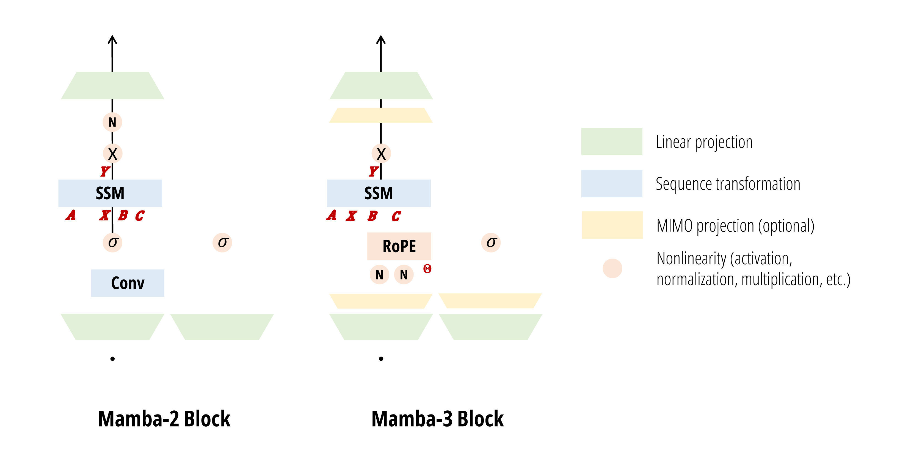

## 6.4 结果：推理效率与质量的前沿

- 在 1.5B 规模，Mamba-3 的平均下游准确率比次优模型（Gated DeltaNet）高 **0.6 个百分点**；其 MIMO 变体再提升 **1.2 个百分点**，合计领先 **1.8 个百分点**；
- 在状态规模实验中，Mamba-3 **只用 Mamba-2 一半的状态大小**即达到相当的困惑度；
- 长序列上，Mamba-3 的端到端延迟约为 Transformer 的 **七分之一**。

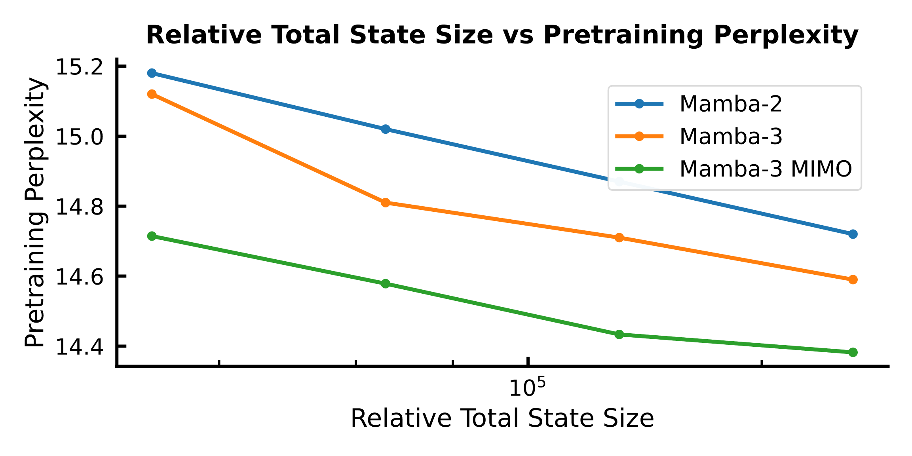

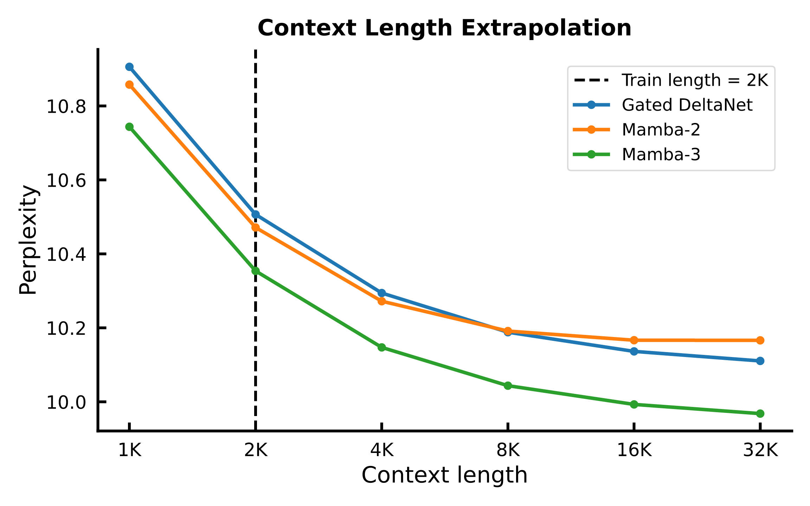

# 七. 结语：Mamba 会是 Transformer 的挑战者吗？

回到标题的问题。经过三代演进，答案正在从"否"走向"有条件的肯定"：

- **在效率维度**，Mamba 已然胜出：线性复杂度、常量内存、5 倍乃至 7 倍的推理吞吐，使其在长序列与大规模推理场景下是 Transformer 的有力替代；
- **在理论维度**，Mamba-2 揭示的 SSM–注意力对偶性表明，二者并非对立，而是同一"结构化矩阵"谱系的两端，未来更可能是**混合**而非取代；
- **在能力维度**，Mamba-3 补上了状态追踪、长度外推等线性模型的传统短板，并在 1.5B 规模追平甚至反超强基线。

但要真正"挑战" Transformer 的统治地位，Mamba 仍需跨越训练生态（kernel、并行、混合精度稳定性）与大规模验证（数百亿乃至千亿参数）的门槛。当前工业界的主流实践（如 Kimi K2、Hunyuan、GPT-Hybrid 等）已把 SSD/线性注意力作为 hybrid 架构的一部分融入 Transformer——这或许才是"挑战"最真实的形态：**Mamba 未必取代 Transformer，但它正在重新定义序列建模的边界，并成为下一代高效基础模型不可或缺的一块拼图。**

# 参考文献

1. [Mamba: Linear-Time Sequence Modeling with Selective State Spaces](https://arxiv.org/abs/2312.00752) — Gu, A. & Dao, T., 2023, arXiv:2312.00752.
2. [Transformers are SSMs: Generalized Models and Efficient Algorithms Through Structured State Space Duality](https://arxiv.org/abs/2405.21060) — Dao, T. & Gu, A., 2024, ICML 2024, arXiv:2405.21060.
3. [Mamba-3: Improved Sequence Modeling using State Space Principles](https://arxiv.org/abs/2603.15569) — Lahoti, A., Li, K. Y., Chen, B., Wang, C., Bick, A., Kolter, J. Z., Dao, T. & Gu, A., 2026, arXiv:2603.15569.
4. [Attention Is All You Need](https://arxiv.org/abs/1706.03762) — Vaswani, A. et al., 2017, NeurIPS 2017, arXiv:1706.03762.
5. [Efficiently Modeling Long Sequences with Structured State Spaces](https://arxiv.org/abs/2111.00396) — Gu, A., Goel, K. & Ré, C., 2021, ICLR 2022, arXiv:2111.00396.
6. [A Visual Guide to Mamba and State Space Models](https://newsletter.maartengrootendorst.com/p/a-visual-guide-to-mamba-and-state) — Grootendorst, M., 2024.
