> **海纳百川，有容乃大。**
>  —— 林则徐
>
# 1 概述

大语言模型（Large Language Model, LLM）的推理服务日益受到内存容量的制约。一方面，模型参数规模持续遵循缩放定律（scaling law）增长，数百亿乃至数千亿参数的稠密模型与混合专家（Mixture-of-Experts, MoE）模型已成为主流；另一方面，长上下文、多轮对话与智能体（agent）工作负载的普及，使键值缓存（Key-Value Cache, KV Cache）的占用同步飙升。二者叠加，使得 GPU 板载高带宽内存（High Bandwidth Memory, HBM）的容量增长速度远远落后于模型与缓存对容量的需求，形成了 AI 推理时代最突出的"内存墙"（memory wall）问题。图 1 给出了模型规模与 GPU 内存容量之间的演进趋势，稠密模型与 MoE 模型的参数规模已跨越千亿门槛，而单卡 HBM 容量的增长却相对平缓。

图 1　模型规模与 GPU 内存容量的演进趋势（来源：FlashAccel [6]，图 1）

高带宽闪存（High Bandwidth Flash, HBF）正是针对这一矛盾而出现的新型存储介质。它以 3D NAND 闪存为基础，通过硅通孔（Through-Silicon Via, TSV）垂直堆叠与先进封装，在接近 HBM 的读取带宽下提供 8 至 16 倍的容量，因而被业界视为"NAND 版的 HBM"。HBF 以大容量、大带宽著称，同时又有较大的读延时和写寿命限制，因此成为大模型推理系统的热门研究方向。自 SanDisk 于 2025 年 2 月首次公开提出 HBF 概念以来，SK 海力士与闪迪（SanDisk）于 2025 年 8 月签署谅解备忘录，并于 2026 年 2 月在开放计算项目（Open Compute Project, OCP）框架下成立 HBF 工作组，Google 与 Tenstorrent 亦加入该联盟；2026 年 8 月，双方联合发布了首份《High Bandwidth Flash (HBF) High-Level Base Die Specification》v0.7.0 规范 [5]，标志着 HBF 从概念走向标准化。本章旨在系统梳理 HBF 的器件特性，以及它在 LLM 推理系统中承载模型参数与 KV Cache 的作用机制。

本文的论述遵循"背景—器件—负载—系统应用—控制器"的递进逻辑，余下章节安排如下。第 2 章从器件层面给出 HBF 的精确定义，剖析其 Base Die、NAND Core Die 与 TSV 通道的物理组织，并借助与 HBM、SSD 的横向比较界定其能力边界与适用条件。第 3 章分析 LLM 推理的工作负载特征，区分总参数量与激活参数量，阐明 prefill 与 decode 两阶段、Attention 与 FFN/MoE 两类算子在计算密集度与访存模式上的差异，为后续"何种数据适合驻留 HBF"提供依据。第 4 章转向系统层面，4.1 节比较 HBF 与 GPU、HBM 的集成方式；4.2 节分析 HBF 同时承载权重与 KV Cache 的机制；4.3 节考察 HBF 作为大规模权重（尤其是 MoE 专家权重）存储载体的作用。第 5 章讨论 HBF 控制器的设计要点，围绕读粒度、读延迟与写寿命三大挑战，梳理工业界与学术界提出的地址映射、预取缓冲、写回调度与寿命管理技术。各章所引文献列于文末，供读者循迹查阅。

# 2 什么是HBF

在进入推理系统层面的讨论之前，我们首先给出 HBF 的精确定义。OCP 规范将 HBF 定义为一种"非一致性的、以内存为中心的闪存设备"（a non-coherent, memory-centric flash device），它紧邻 GPU、TPU 或其他加速器（xPU）放置，通过 UCIe 这类 die-to-die 接口与计算芯片直连，目标是以 TB/s 级的聚合读取带宽提供远超 HBM 的附加容量 [5]。简而言之，HBF 把 NAND 闪存裸片以类似 HBM 的方式垂直堆叠在加速器旁，从而在 HBM 与 SSD 之间插入一个新的存储层级。

从器件结构上看，一个 HBF 器件由 Base Die（基片裸片）、若干 NAND Core Die 堆叠，以及连接二者的 TSV 通道构成。图 2 给出了 HBF 的概念组织，多层 Flash die 通过微凸点（µbump）堆叠在逻辑 die 之上，逻辑 die 通过 PHY 与硅中介层（interposer）相连，最终与计算芯片（compute die）共封装在封装基板（package substrate）上。值得注意的是，Base Die 并非无源互连层——它承担 UCIe 协议处理、主机接口与 NAND die 之间的数据搬运调度、ECC 与错误报告等职能，这与 HBM 的 Base Die 角色相似 [5]。

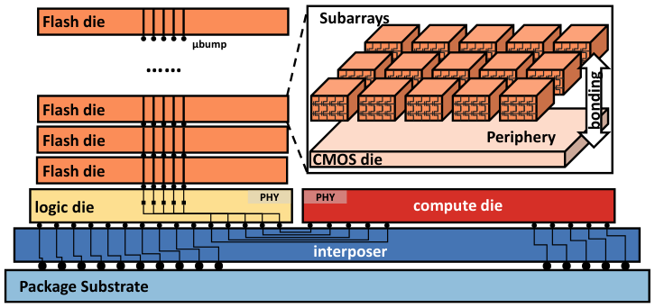

图 2　HBF 的概念组织：以堆叠 NAND 闪存裸片、逻辑 die 与垂直互连构成，紧邻计算芯片封装（来源：阿里云 DAMO 团队 [2]，图 1）

图 3 从器件供应商的视角刻画了 HBF 与 HBM 同构的封装范式，多层 NAND Flash 核心裸片（Core Die）经 TSV 垂直堆叠在基底裸片（Base Die）之上，整体坐落在中介层上、与 GPU 并排封装。与 HBM 的唯一本质区别在于存储介质——DRAM 依赖电容存储电荷，NAND 依赖浮栅/电荷俘获存储，后者单比特成本低一个量级、密度高得多（3D NAND 已做到 200+ 层）[1]。

图 3　HBF 的概念：垂直堆叠的 NAND 闪存裸片经 TSV 与基底裸片互连，整体与 HBM 同构（来源：SK 海力士 H³ [1]，图 2）

图 4 进一步展示了 HBF 封装的物理组织。堆叠的 3D NAND Flash die 通过电源与信号 TSV 与 Base Die 相连，Base Die 一侧经存储器控制器（MC）与 GPU Die 交互，整体坐落在中介层与 GPU PCB 之上。这一组织结构决定了 HBF 在封装形态上与 HBM 高度相似，但内部运行的是 NAND 闪存的存取逻辑 [7]。

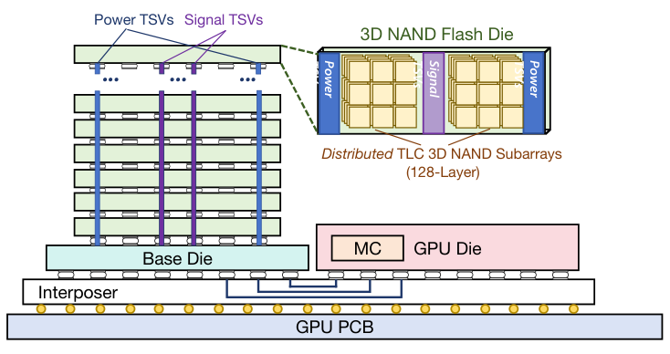

图 4　HBF 封装的物理组织（来源：PKU 全栈表征研究 [7]，图 2）

图 5 则从平面视角给出了 HBF 堆栈的内部组成，16 个（16×）HBF Die 通过 TSV 互连堆叠，每个 die 划分为若干 Plane，Plane 之间为外围电路（Peri.）区域。HBF 之所以能获得接近 HBM 的聚合带宽，本质上依赖海量 Plane、Bank 与阵列的并行汇聚，而非单个 NAND 通道的速度。

图 5　HBF 堆栈的预期组织：16 个 die、TSV 与 Plane 结构（来源：POSTECH/ETH 研究 [9]，图 2）

表 1 归纳了 HBF 与 HBM、SSD 在介质、容量、带宽、延迟、耐久性与成本等维度的定位差异。HBM 基于 DRAM，属于易失性存储器，需周期性刷新，但支持细粒度、低延迟的随机访问；HBF 与 SSD 均基于 NAND 闪存，具有非易失性与高密度，但 HBF 通过先进封装与 UCIe 互连，将带宽提升到 HBM 量级，同时保留了 NAND 固有的高读延迟与有限擦写寿命。HBF 的单栈容量最高可达 512 GB，为 HBM4 的 8 至 16 倍；带宽按规范划分为 Grade 1–3 三个等级，覆盖约 0.4 TB/s 至 3.0 TB/s，其中 Grade 3 已接近 HBM3E 的主流水平 [5]。单位容量成本方面，第一代 HBF 的 $/GB 仅约为 HBM3E 的十分之一 [5]。

| 维度 | HBM | HBF | SSD |
| --- | --- | --- | --- |
| 基础介质 | DRAM（易失性） | 3D NAND Flash（非易失性） | 3D NAND Flash（非易失性） |
| 系统位置 | 紧邻加速器 | 靠近计算的容量层 | PCIe/NVMe 存储层 |
| 单栈/单盘容量 | 24–48 GB（HBM3E/HBM4） | 最高 512 GB | TB 级 |
| 带宽 | 1.2–2.8 TB/s | 0.4–3.0 TB/s（Grade 1–3） | 数 GB/s 至数十 GB/s |
| 访问延迟 | 数十 ns | 数 µs（高于 DRAM 数十倍） | 数十至数百 µs |
| 访问方式 | 字节级随机寻址 | DMA 大块对齐 | 块设备 |
| 写入耐久性 | 几乎无限次 | 约 10 万次擦写 | 数千至数万次 |
| 单位容量成本 | 高 | 约为 HBM 的 1/5–1/10 | 低 |

表 1　HBM、HBF 与 SSD 的定位差异（综合 OCP 规范 [5] 与相关文献整理）

正是上述"高容量、高带宽、高读延迟、低写耐久"的器件特性组合，决定了 HBF 在大语言模型推理中的适用边界，它天然适合承载"读多写少"（read-mostly）的大规模数据，而不适合承载频繁更新、延迟敏感的动态状态。这一分工逻辑构成了后续各节讨论的基础。

# 3 LLM 推理的工作负载特征

要判断 HBF 适合承载什么数据，须先理解 LLM 推理本身的访存结构。本节从三个层面刻画这一负载，模型参数总量的增长趋势与"激活参数"概念、prefill 与 decode 两阶段的计算特性差异，以及 Attention 与 FFN（稠密/MoE）两类算子的访存行为。相关论述与图主要取自阿里云 DAMO 团队的 HBF 服务系统研究 [2]、KAIST 的 DASH [8]、POSTECH/ETH 的探索性研究 [9] 与中科院 FlashAccel [6]。

## 3.1 总参数量与激活参数量

模型规模的增长是容量压力的第一来源。图 6 汇集了 Llama、Qwen、DeepSeek 三个代表性服务端模型家族的演进；纵轴为总参数量（对数刻度），实心点表示稠密（Dense）模型，空心点表示 MoE 模型。可以看到，2023 年主流模型尚在百亿量级，至 2026 年已推进到 DeepSeek-V4-Pro 的 1.6 万亿（1.6T）参数，三年间跨越两个数量级；且近两年的新增模型几乎均为 MoE。

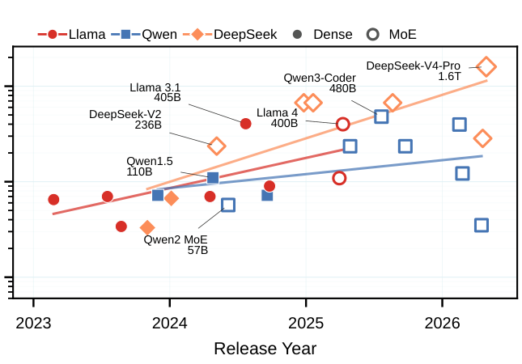

图 6　代表性服务端 LLM 变体的总参数量演进（来源：阿里云 DAMO 团队 [2]，图 2）

这里必须区分**总参数量**（total parameters）与**激活参数量**（activated parameters per token）。稠密模型中二者相等——每个 token 都经过全部参数；MoE 模型则通过多个专家 FFN 与路由机制，只把每个 token 送给少数被选中的专家（top-$k$），因此总参数量可以远大于单 token 的激活参数量。例如 DeepSeek-V3 共有 671B 参数，每 token 仅激活 37B；DeepSeek-V4-Pro 总参数量达 1.6T，每 token 仅激活 49B [2]。这一"大总量、小激活"的不对称，正是 MoE 能够扩大模型容量而不同比例增加单 token 计算量的原因，却也意味着**全部专家权重必须常驻于显存**，因为在输入到来之前无法预知哪些专家会被选中。DASH [8] 对八个主流 MoE 模型的统计进一步显示（图 7a），其权重占用从 281 GB 到 1.5 TB 不等，其中专家权重占总权重的 94.1%–98.8%；仅权重一项就已超出单块 NVIDIA H100 的 80 GB HBM 容量。图 7b 则表明，模型支持的最大上下文窗口已从 8K 迅速扩展到百万级 token，进一步放大了 KV Cache 的容量需求。

图 7　(a) MoE 模型权重规模与专家权重占比；(b) 最大上下文窗口的演进（来源：KAIST DASH [8]，图 1）

## 3.2 prefill 与 decode 两阶段的计算特性

LLM 推理包含两个阶段，二者在计算密集度上截然不同（图 8a）。**prefill 阶段**并行处理输入的全部 $L_{\text{IN}}$ 个 token，矩阵规模大、算子算术强度（arithmetic intensity）高，属于**计算受限**（compute-bound），HBF 的大容量在此阶段收益有限 [9]。**decode 阶段**则自回归地逐个生成 token：每生成一个 token，都要重新读取一遍模型权重，并读取不断增长的 KV Cache，计算量小而访存量大，属于**带宽受限**（memory-bound）[6]。HBF 的价值主要落在 decode 阶段——它缓解的正是"权重与 KV 装不下、装得下又开不大 batch"的容量瓶颈。

## 3.3 Attention 与 FFN/MoE 的访存差异

每个 decoder block 由 Attention 与 FFN 两个子层构成（图 8b）。Attention 层将输入投影为 Query、Key、Value 张量，经多头注意力（MHA）或其变体（GQA、MLA）聚合信息；为避免 decode 阶段重复计算，历史 K 与 V 被缓存为 KV Cache。其访存特征是**随上下文与 batch 线性增长的大块流式读取**，且访问位置在运算开始前即可确定。FFN 层则对每个 token 独立施加逐位置非线性变换，稠密模型中是单一大 FFN，MoE 模型中则是多个小专家 FFN，由路由器按 token 选择（图 8c）。Dense FFN 在 batch 增大时会转向计算受限的 GEMM；而 MoE 的专家选择是**输入相关且较晚才确定**的，要求完整专家集合常驻、并在每一步把选中权重及时送到 GPU [8]。

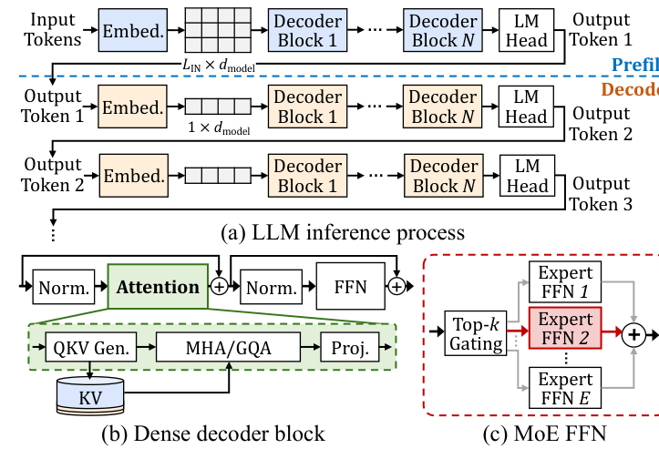

图 8　LLM 推理流程与架构：(a) prefill/decode 两阶段；(b) 稠密 decoder block；(c) MoE FFN（来源：POSTECH/ETH [9]，图 1）

图 9 从 MoE Transformer 层的完整结构展示了上述分化，Attention Block 的 QKV 投影、MQA/GQA 与输出投影，对应可预取的规则访存；MoE Block 的 Router、Top-k 选择与多个专家 FFN，则对应稀疏、延迟确定的权重访问。综合起来，LLM 推理对存储系统提出两类截然不同的需求，**大块、只读、可预取**的权重与共享前缀，以及**细粒度、持续增长、写后即读**的动态 KV。前者恰是 HBF 的用武之地，后者则须谨慎放置——这正是第 5 章控制器设计与第 4 章数据放置策略要解决的起点。

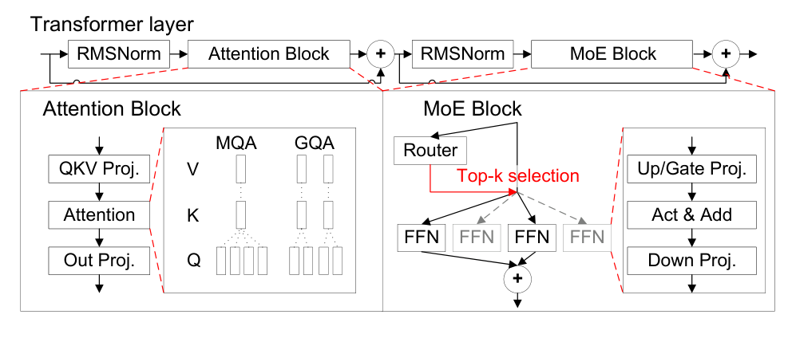

图 9　MoE Transformer 层结构：Attention Block 与 MoE Block（来源：KAIST DASH [8]，图 3）

最后，容量瓶颈如何直接约束吞吐，可由 FlashAccel 的两组实验说明（图 10）。在 H100 的 80 GB HBM 上运行 Qwen3-32B，权重约占 64 GB，留给 KV Cache 的仅 16 GB；8K 上下文下每请求约需 2 GB KV，batch 上限仅为 8。图 10a 显示，小 batch 使 GPU 利用率低下、吞吐受限，而增大 batch 几乎不增加延迟却能显著提升吞吐——因为更大的 batch 提高了权重相关操作的算术强度。图 10b 则展示了多轮对话中 KV Cache 复用的收益，若能把历史轮次的 KV 留在内存中，prefill 阶段可避免重算，但复用需要容量支撑，高复用效率可能要求多达 4 倍的 KV 容量 [6]。这两点共同表明**提升每 GPU 的容量（同时保持带宽），是把 batch 做大、把 KV 留住的直接途径。**

图 10　(a) 批处理收益；(b) 多轮交互中的 KV Cache 复用收益（来源：中科院 FlashAccel [6]，图 2）

# 4 HBF在大语言模型推理的作用

从数据访问模式的角度看，LLM 推理所涉及的数据可大致划分为两类。一类是定义模型的权重（参数），它们在推理期间基本保持不变，属于只读数据；另一类是模型输入与各层产生的中间结果，即激活值，它们是动态更新的。此外，KV Cache 作为对历史 token 键值向量的缓存，其"预计算共享前缀"部分在多次请求间只读复用，而"生成期 KV"部分则随解码过程动态写入。当上下文长度从 64K token 增长到 1000 万 token 时，KV Cache 的容量需求从百 GB 量级跳升至 TB 量级；以 Llama 3.1 405B 为例，1M 与 10M 长度的共享预计算 KV Cache 分别需要约 540 GB 与 5.4 TB，仅存放这些数据就需要数十块 GPU [1]。这一背景界定了 HBF 在推理系统中的角色，**作为大容量、近计算的容量层，承接模型权重与 前缀KV Cache 等大规模只读数据，从而把宝贵的 HBM 容量让渡给延迟敏感的激活值与动态 KV Cache**。

## 4.1 HBF在系统上的集成方式

HBF 在系统层面具有多种集成形态，它可以与计算芯片直连，也可以与 HBM 连接，或者堆叠在计算芯片或 DRAM 之上。阿里云 DAMO 团队系统比较了四种代表性的 GPU 内存子系统集成方案 [2]，如图 11 所示：

- **（a）全 HBF 堆栈（All HBF stacks）**：完全用 HBF 取代 HBM。由于 HBF 粗粒度访问与 GPU 内核细粒度内存访问模式不匹配，会导致较低的通道内带宽利用率（$U_{\text{intra}}$）。
- **（b）HBM/HBF 并排堆栈（Side-by-side stacks）**：HBM 与 HBF 作为独立的异构堆栈并排连接。两种介质截然不同的性能特性使得难以同时使两者饱和，降低了通道间带宽利用率（$U_{\text{inter}}$）。
- **（c）菊花链式 HBF 扩展（Daisy-chained HBF extension）**：通过 HBM 逻辑芯片上的多路复用器连接 HBF 堆栈，共享 I/O 资源，可能使 HBF 流量干扰关键的 HBM 路径。
- **（d）集成式 HBM/HBF 堆栈（Integrated HBM/HBF stack）**：HBM 与 HBF 层集成在同一堆栈中，共享垂直互连。

图 11　面向 GPU 内存子系统的四种代表性 HBF 集成方案（来源：阿里云 DAMO 团队 [2]，图 4）

上述研究认为，集成式 HBM/HBF 堆栈是最为有效的方式，HBM 处理细粒度、延迟敏感的操作，HBF 为粗粒度的模型权重提供大容量存储；借助页粒度布局与预取，系统可以隐藏 HBF 更高的访问延迟，同时保持高计算侧带宽 [2]。该结论可用有效带宽公式概括：

$$B_{\text{avail}} = B_{\text{phy}} \times U_{\text{intra}} \times U_{\text{inter}}$$

即有效带宽取决于物理峰值带宽 $B_{\text{phy}}$ 与通道内、通道间利用率之积。集成方案的核心，正是同时维持较高的 $U_{\text{intra}}$ 与 $U_{\text{inter}}$。

业界最具代表性的混合架构实例，是 SK 海力士提出的 H³（Hybrid HBM+HBF Architecture）[1]。H³ 在物理布局上选择了菊花链（daisy-chain）方案，GPU 仅直接连接 HBM，HBF 挂在 HBM 之后、通过 HBM 基底裸片中继访问，从而完全不挤占 GPU 宝贵的引脚区（pin field）。图 12 给出了 H³ 的架构总览，三个子图分别回答三个关键问题：

- **（a）物理连接**：自上而下为 GPU → 硅中介层 → HBM 基底裸片（含 HBM 堆叠）→ 硅中介层 → HBF 基底裸片（含 HBF 堆叠），HBF 不直接连 GPU，而是"挂在 HBM 后面"。论文假设 GPU 与 HBM 基底裸片之间、HBM 基底裸片与 HBF 基底裸片之间均采用 die-to-die（D2D）接口，带宽与基底裸片—核心裸片之间相当，因此中继路径不构成瓶颈。
- **（b）访问分流**：HBM 基底裸片内部集成地址解码器（address decoder）与路由器（router），GPU 发来的访存请求先到 HBM 基底裸片，解码器根据地址判断目标是 HBM 还是 HBF，路由器将请求送往对应路径。图中 HBM 基底裸片内还有一块延迟隐藏缓冲（LHB），是第 5.2 节所述延迟隐藏手段的落地。
- **（c）统一地址空间**：对 GPU 与主机而言，HBM 与 HBF 是同一统一地址空间中的两个内存区域（如 HBM #0–#7 与 HBF #0–#7 连续编址），主机无需感知物理差异，只需决定数据放置到哪个区域。

图 12　H³ 架构总览：(a) GPU 经中介层连 HBM 基底裸片，HBM 基底裸片再连 HBF 基底裸片形成菊花链；(b) HBM 基底裸片内的地址解码器、路由器与延迟隐藏缓冲（LHB）对访存分流；(c) HBM 与 HBF 共享统一地址空间（来源：SK 海力士 H³ [1]，图 3）

选择菊花链而非并排方案有三个工程理由，不牺牲 HBM 数量（并排方案会挤占引脚区，是"用带宽换容量"的零和博弈）；利用推理"带宽受限而非延迟受限"的特征——访存是持续流水线式的，菊花链增加的是跳延迟（hop latency）而非带宽损失，可被流水线掩盖；复用成熟 HBM 基础设施——HBM 基底裸片在 HBM4 之后本就集成逻辑（控制器、缓存），把 LHB 与路由器做进去是顺水推舟 [1]。

图 13 展示了 HBFlex 提出的另一组集成架构（全 HBF、级联 HBM&HBF、共置 HBM&HBF、集成 HBM&HBF 堆栈），其分类思想与前述方案一脉相承 [4]。

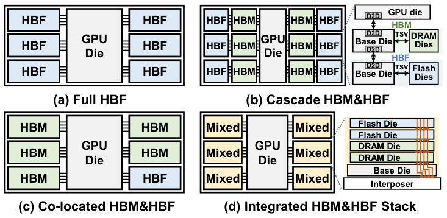

图 13　HBFlex 归纳的 HBF 集成架构（来源：北大/阿里 HBFlex [4]，图 4）

## 4.2 HBF作为模型参数和KV存储

将 HBF 同时用于承载模型参数与 KV Cache，是混合架构的核心思路。其基本假设是LLM 推理中占容量主体的数据——模型权重与共享预计算 KV Cache——在整个推理期间只读不变，恰好避开 HBF 写耐久性差的短板，同时发挥其大容量、高读取带宽的优势。

H³ 架构即是这一思想的典型体现。它将只读的模型权重与共享预计算 KV Cache 存放于 HBF，将写入频繁的动态生成 KV Cache 与中间激活存放于低延迟的 HBM，并通过 LHB 预取隐藏 HBF 的 µs 级延迟。图 14 给出了 H³ 在含海量共享预计算 KV Cache 的 LLM 推理中的访问方式：上层 HBM 与下层 HBF 各司其职，HBF 负责"喂"权重与共享 KV 这两条大流，HBM 负责快进快出的动态 KV 与中间数据。论文指出，访问 HBF 时增加的跳延迟之所以可接受，是因为 LLM 推理受内存带宽限制——数据持续排队流入，偶尔的跳延迟被队列吸收，不会暴露为气泡；而 HBF 的只读负载意味着垃圾回收（GC）与磨损均衡（wear-leveling）几乎不触发，这两个 SSD 延迟抖动的最大来源在只读场景下开销趋近于零 [1]。

图 14　H³ 在含共享预计算 KV Cache 的 LLM 推理中的数据放置与访问方式：权重与共享 KV 自 HBF 读出，动态 KV 与中间数据在 HBM 流转（来源：SK 海力士 H³ [1]，图 4）

在仿真评估中，H³ 采用 B200 + 8 个 HBM3E（合计 192 GB、8 TB/s）+ 8 个 HBF 堆栈（合计 3 TB、8 TB/s）的配置，以 Llama 3.1 405B（FP8）为工作负载，输入/输出序列长度各为 1K token，剩余上下文空间全部由共享预计算 KV Cache 占据（1M 场景约占系统总容量 35%，10M 场景约占 84%），分别评估 1M 与 10M token 上下文场景。图 15 给出了不同 GPU 数量下可处理的最大批大小：纯 HBM 方案在容量不足时直接无法运行（图中以 × 表示），1M 场景至少需 8 块 GPU、10M 场景至少需 32 块 GPU；而 H³ 用 1 块 GPU 即可运行 1M 场景、2 块即可运行 10M 场景，10M 场景的最大批大小达到纯 HBM 方案的 18.8 倍、1M 场景为 2.6 倍。

图 15　不同 GPU 数量下可处理的最大批大小（× 表示容量不足无法运行）：10M 场景 H³ 批大小最高为纯 HBM 方案的 18.8 倍（来源：SK 海力士 H³ [1]，图 5）

更大的批大小直接转化为吞吐提升。图 16 显示，以每秒生成 token 数（TPS）为指标，H³ 在 1M 场景为纯 HBM 方案的 1.25 倍、10M 场景为 6.14 倍；即使 HBF 带宽减半（4 TB/s），1M 场景吞吐仍优于纯 HBM 方案。将吞吐除以系统总功耗（GPU 680 W 加各内存器件功耗）后，H³ 的单位功耗吞吐量（TPS/W）最高达纯 HBM 方案的 2.69 倍，HBF 带宽减半时 10M 场景仍保持 2.09 倍——其账是这样算的：10M 场景吞吐提升 6.14 倍，而 GPU 数量从 32 块降到 2 块使 GPU 功耗大幅下降，吞吐增幅远超功耗增幅。更深层的原因在于，H³ 并未将所有数据都放入 HBF（动态 KV 与中间数据仍在 HBM），因此整体性能不会随 HBF 带宽成比例下降，混合架构自带"带宽降级韧性" [1]。

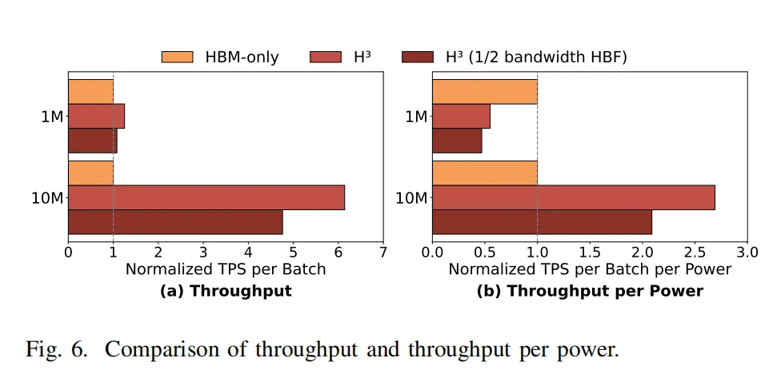

图 16　吞吐量与单位功耗吞吐量对比：(a) TPS 在 10M 场景为纯 HBM 方案的 6.14 倍；(b) TPS/W 最高为 2.69 倍（来源：SK 海力士 H³ [1]，图 6）

这一系列结果验证了混合架构在"海量只读数据"推理场景下的成本效益。图 17 对比了混合架构（HBM & HBF）与全 HBF 架构的演进路线。混合架构中，权重驻留于 HBF、KV 驻留于 HBM，各自发挥所长；HBFlex 则进一步主张，在固定封装面积预算下，任何分配给 HBM 的面积都会挤占 HBF 的平面数量，从而限制容量与峰值带宽，因此提出了去除 HBM 的全闪存（full-HBF）方案 [4]。

图 17　从混合 HBM/HBF 到全 HBF 的架构演进（来源：北大/阿里 HBFlex [4]，图 1）

图 18 展示了 HBFlex 的全闪存系统架构：GPU 计算裸片经 D2D 接口连接 HBF Base Die，运行时栈包含分页逻辑 KV 管理器、位置感知读调度器与写/擦除感知控制器——这正是第 5 章所述三类控制器机制的软件落点 [4]。得益于这些机制，HBFlex 在评测中相较 FlashAccel 与 H³ 分别取得最高 1.58 倍与 3.30 倍的平均吞吐加速。

图 18　HBFlex 全闪存内存系统架构（来源：北大/阿里 HBFlex [4]，图 11）

FlashAccel 则从工程实现的角度，给出了在混合系统中同时承载权重与 KV Cache 的完整架构（图 19）。它识别出直接应用 HBF 的三大挑战：其一，闪存访问延迟比 HBM 高约 40 倍；其二，HBF 峰值带宽依赖极高并行度，不合理的数据布局会大幅降低带宽利用率；其三，HBF、HBM、GPU 的异构内存资源缺乏成熟的管理方案。为此，FlashAccel 提出了面向权重的 megapage 对齐布局与面向 KV Cache 的分组对象构建与映射，并设计了预取机制以掩盖访问延迟 [6]。

图 19　FlashAccel 架构：HBF 集成方式、HBF 堆栈结构与 die 内部设计（来源：FlashAccel [6]，图 5）

然而，并非所有将 KV Cache 卸载到 HBF 的做法都能获益。PKU 的全栈表征研究 [7] 给出了一个反直觉的结论：若直接沿用面向 SSD 的 KV 卸载栈、仅把底层设备替换为 HBF，平均端到端延迟反而上升 2–5.5 倍。其根本原因在于，瞬时 KV Cache 同时违反了 HBF 获利的三个前提——读 I/O 是瓶颈、读多于写、交付带宽可持续。图 20 的放置图谱总结了该研究的核心发现：模型权重与共享前缀（shared prefix）位于"强 HBF 区域"，适合驻留 HBF；而会话 KV（session KV）与私有 KV（private KV）则落入"不适配"或"路径受限"区域，应保留在 HBM。这一结果强调，HBF 的收益高度依赖"重用感知的放置策略"，而非简单的即插即用 [7]。

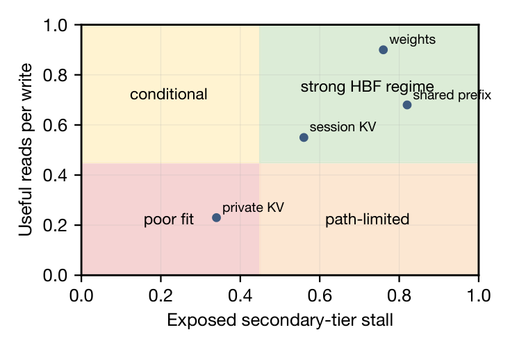

图 20　由全栈表征得出的放置图谱：以暴露停滞与每次写入的有效读取刻画各数据类型的适配性（来源：PKU 全栈表征研究 [7]，图 12）

## 4.3 HBF作为模型参数存储

当模型的参数规模超出单卡 HBM 容量时，将全部权重驻留于 HBM 不再经济，HBF 于是承担起更大规模的近计算权重容量。这一作用在 MoE 模型上体现得尤为突出：MoE 模型拥有庞大的专家参数集合，但每个 token 仅激活少数专家，绝大部分专家权重在任意时刻处于"冷"状态，天然适合存放在高容量介质中按需换入换出。

Hot Chips 2026 的工业界教程 [3] 以 vLLM 为参照，给出了三类关键设计：其一，将 MoE 各专家权重存储于 HBF，推理时根据路由结果，通过 DMA 将当前激活的专家权重动态加载到 HBM 参与计算；其二，利用 HBF 的超大容量，在不同 GPU 的 HBF 中完整复制更多模型权重，从而把昂贵的跨设备 Scatter/Gather 通信转化为相对廉价的本地 HBF→HBM 的 DMA 搬运；其三，将庞大 KV Cache 存入 HBF（需配合稀疏注意力）。该教程同时警示，HBF 是"容量点"而非"更便宜的 HBM"，其经济性仅在负载未触及带宽上限时成立；一旦工作负载变为带宽受限，HBF 的单位带宽成本劣势便会主导。

阿里云 DAMO 团队则从"容量—驻留"（capacity-residency）模型出发，将新增容量建模为对只读模型状态对象驻留集的扩展（图 21）：给定硬件单元集合 $U$ 与模型状态对象集合 $O$，容量决定了每个对象可驻留的单元集合 $A_o$ 的大小 [2]。在这一视角下，HBF 的价值体现为两条具体路径——MoE 场景下支持更多专家副本以降低远程通信，以及多模型服务场景下减少模型加载并支持热模型复制。

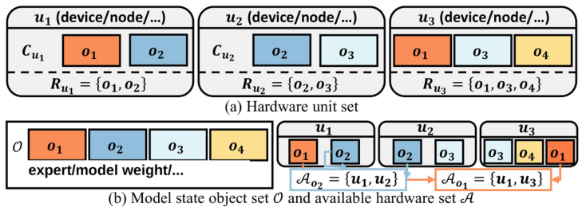

图 21　容量—驻留模型：以驻留集刻画新增容量带来的局部性与负载均衡收益（来源：阿里云 DAMO 团队 [2]，图 5）

图 22 进一步说明了专家复制如何减少 MoE 推理中的跨节点通信：在（a）大专家并行下，token 必须通过网络链路路由到远端专家；而（b）利用 HBF 的容量复制专家后，远端通信被转化为本地访问 [2]。

图 22　额外容量通过专家复制减少 MoE 推理中的远程专家通信（来源：阿里云 DAMO 团队 [2]，图 6）

在专家权重传送的微观机制上，KAIST 提出的 DASH [8] 探索了一种同时利用两条独立路径的 HBF 组织方式：一条直连路径将专家权重从 HBF 直接传送至 GPU，另一条中继路径则经由 HBM Base Die 转送至 GPU（图 23）。完整的专家被分配到两条路径之一，两条路径上的传输并发进行，从而在不复制专家权重、不引入共享中继瓶颈的前提下提升专家传送的总带宽。DASH 还通过"提前专家决策"在常规执行时点之前识别即将使用的专家，使 HBF 读取延迟与前序计算重叠；并分别管理不可变的专家权重与可变的 KV Cache，减少两类流量的相互干扰。

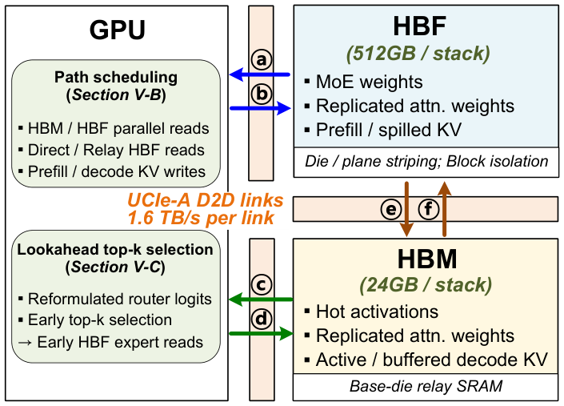

图 23　DASH 总览：专家权重经 HBF 直连与 HBM 中继两条路径并发传送（来源：KAIST DASH [8]，图 2）

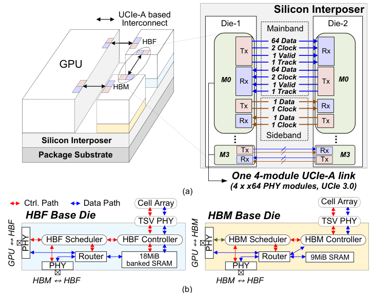

图 24　DASH 架构与 HBF/HBM Base Die 微架构（来源：KAIST DASH [8]，图 4）

仿真结果表明，在代表性 MoE 工作负载中，同时利用两条路径较仅经 HBM 中继的基准设计可实现 1.94 倍吞吐量提升与 1.90 倍端到端加速 [8]。值得注意的是，无论是 H³、阿里云的容量—驻留方案，还是 DASH、FlashAccel、HBFlex，其共同前提都是保持 HBM 驻留的执行路径，仅以 HBF 扩展权重（乃至 KV Cache）的驻留集；一旦脱离这一前提，HBF 的高延迟与低写耐久便会反噬整体性能。这也正是 HBF 走向大规模商用之前，仍需在介质、封装、互连与软件栈四个层面协同攻坚的关键所在。

# 5 HBF 控制器的设计

HBF 虽在容量与带宽上接近 HBM 的目标，但其 NAND 内核的固有属性——页粒度访问、微秒级读延迟、块擦除与有限擦写寿命——使得直接套用 DRAM 控制器无法奏效。本章围绕三个核心挑战展开：**读粒度**（粗粒度页访问与细粒度请求的错配）、**读延迟**（µs 级 NAND 感知延迟如何隐藏）、**写寿命**（增量写与擦除放大如何管理），并梳理相应的控制器设计。素材以工业界与产业联合工作为主：SK 海力士的 H³ [1]、北大与阿里的 HBFlex [4]、OCP HBF 规范 [5]，辅以中科院 FlashAccel [6] 与 KAIST DASH [8] 的工程细节。

## 5.1 读粒度：层级组织与地址映射

HBF 遵循"堆栈—裸片—平面—块—页"（stack–die–plane–block–page）的层级组织（图 25）。阵列级的读与编程以 **4 KiB 物理页**为单位，擦除以块为单位；主机接口可只返回页缓冲中的所需片段 [4]。这意味着一次 NAND 读必然取回整页，若上层请求远小于页，就会造成带宽浪费。HBF 的高聚合带宽依赖大量 Plane 上的并发操作：把页条带化（striping）到不同 Plane 与主机通道可以暴露并行度，但维持峰值带宽需要充足的请求并发与均衡的 Plane 负载——同一 Plane 上的访问会串行化，最忙的 Plane 决定整体完成时间，其余 Plane 则空闲 [4]。

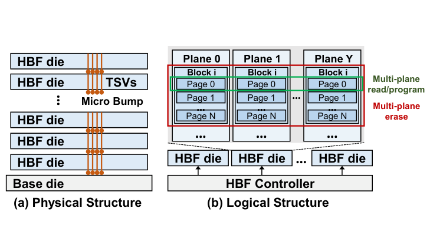

图 25　HBF 组织结构：(a) 堆叠 NAND dies 与 base die；(b) die–plane–block–page 层级（来源：北大/阿里 HBFlex [4]，图 2）

为此，控制器需要在地址映射上做文章。FlashAccel [6] 提出面向权重的 **megapage 对齐布局**，把权重按大页边界组织，使一次读取覆盖尽可能多的有效数据，逼近峰值带宽；面向 KV Cache 则采用分组对象构建与映射。阿里云 DAMO 团队 [2] 同样指出，页粒度布局与预取是集成式 HBM/HBF 堆栈维持高有效带宽的前提。工业界的 OCP 规范 [5] 则从接口层定义了 Base Die 的职责，包括 UCIe 协议处理、主机请求到 NAND die 的数据搬运调度与 ECC，为上层地址映射提供标准基础。

## 5.2 读延迟：预取与延迟隐藏缓冲

NAND 的页感知延迟 $t_R$ 约为 1–30 µs，比 HBM 的数十 ns 高两到三个数量级 [8]。HBF 控制器的核心任务之一，是把这段延迟隐藏在计算之后。其可行性来自 LLM 推理的**确定性访问模式**：第 $i$ 层只用第 $i$ 层的权重与 KV，张量的读取时机可被精确预测，从而可提前发起预取。

工业界最具代表性的方案是 SK 海力士 H³ [1] 的**延迟隐藏缓冲**（Latency Hiding Buffer, LHB）：在 HBM Base Die 内集成约 40 MB 的 SRAM，配合地址解码器与路由器，把即将被用到的权重与共享 KV 预取入缓冲，使 GPU 的访存命中 LHB 而不必等待 NAND 读。HBFlex [4] 进一步分析了 Base Die 上 SRAM 的容量需求，给出峰值占用模型：

$$C_{\text{SRAM}}^{\text{req}} = \max_t \left[ C_{\text{WPF}}(t) + C_{\text{KV}}(t) + C_{\text{aux}}(t) \right],$$

其中 $C_{\text{WPF}}(t)$ 为活跃的权重预取占用，$C_{\text{KV}}(t)$ 为缓冲的 decode KV 状态，$C_{\text{aux}}(t)$ 为热 Plane 卸载与 GC 迁移的临时占用。HBFlex 每栈配置 40 MB（六栈共 240 MB），当共享占用接近上限时强制写回。POSTECH/ETH [9] 亦假设每个 HBF 栈用 3.13 MB 的 SRAM 暂存缓冲做预取与双缓冲，以削弱 µs 级读延迟的影响。KAIST 的 DASH [8] 则另辟蹊径，通过"提前专家决策"在执行时点之前识别即将使用的专家，使 HBF 读延迟与前序计算重叠。

## 5.3 写寿命：写读干扰、写回调度与擦除放大

写寿命是 HBF 控制器最棘手的挑战。NAND 的编程延迟 $t_{\text{PROG}}$ 可达数十至数百微秒（典型约 75 µs），且一次编程会独占目标 Plane、不可抢占，因而增量 KV 更新会干扰前台读；块级擦除又要求在回收前迁移仍有效的页，引发写放大。HBFlex [4] 把这些问题归纳为三项挑战并逐一给出机制：

**其一，细粒度 KV 导致读不均衡。** 请求完成与重新激活会改变活跃 KV 工作集，打破原有均衡；即使放置均衡，一次注意力调用只读 KV 的一个子集，若这些页集中在少数 Plane 上就会碰撞、需要额外的读轮次。HBFlex 的对策是**页条带化 + 跨层块打包**（图 26a）：用较小的逻辑 KV 页维持细粒度复用，同时把相邻物理页分散到不同 Plane；并**复制共享前缀**到多个位置，运行时依据访问热度把读分流到低负载副本（图 26b），无需移动原始数据即可缓解热 Plane [4]。

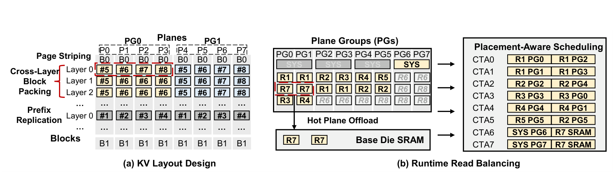

图 26　HBFlex 的 KV 布局设计与运行时读均衡：(a) 页条带化、跨层块打包与前缀复制；(b) 放置感知调度（来源：北大/阿里 HBFlex [4]，图 26）

**其二，增量写造成写读干扰。** 单纯聚合写虽能提高并行度，却无法避免长编程占用 Plane。HBFlex 提出**窗口感知 KV 写回**（图 27）：利用权重读可与线性算子交错、而 prefill 阶段的矩阵运算会形成较长"无 HBF 读窗口"的特点，把 decode 阶段新生成的 KV 暂存在 Base Die SRAM 中，待到 prefill 窗口再成批写回；同时把连续 Q/K/V 投影的权重读打包成低秩组，在组间插入编程，从而在不干扰读的前提下扩大写窗口、提升 Plane 利用率 [4]。

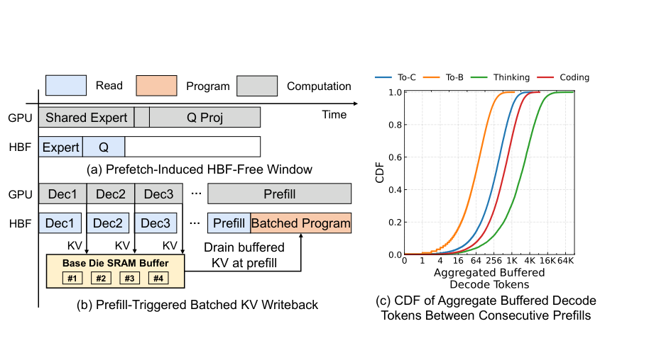

图 27　窗口感知 KV 写回：(a) 预取形成的无 HBF 读窗口；(b) prefill 触发的批量写回；(c) 相邻 prefill 间缓冲 decode token 的 CDF（来源：北大/阿里 HBFlex [4]，图 27）

**其三，交错寿命导致擦除放大。** 当不同生命周期的 KV 页共处一个块时，回收需迁移仍有效的页。HBFlex 采用**寿命引导的块打包与延迟回收**：按请求起始时间估计跨请求的寿命相似度，把寿命相近的 TE 页打包进同一块，并推迟回收，让更多页先失效，从而减少有效页迁移与擦除放大 [4]。在负载假设下，原始 KV 写仍在耐久预算内，真正的风险来自 GC——其写 amplification 对 DeepSeek-V4-Pro 可达约 30 倍。POSTECH/ETH [9] 则指出，若把中间数据写入 HBF，每解码迭代的写流量可激增达 100 倍，因此其方案保留一个 HBM 栈或用 SRAM 承接中间数据，把 NAND 写限定在只读权重与读主导的 KV 上。

综上，HBF 控制器的设计可归纳为一条主线：**以页粒度对齐与条带化换取读带宽，以大容量 SRAM 缓冲与预取隐藏读延迟，以写读分离与寿命分组保护写寿命**。三条主线彼此耦合——更大的 SRAM 既能多预取，也能多缓冲写；更均衡的读又为更长的写窗口创造条件。这也是为何 H³、HBFlex 等方案都把 Base Die 上的控制器逻辑与缓冲置于架构核心。第 4 章讨论的系统集成与数据放置策略，正是建立在这些控制器能力之上。

# 参考文献

[1] Minho Ha, Eui-Chan Kim, Hoshik Kim. H3: Hybrid Architecture Using High Bandwidth Memory and High Bandwidth Flash for Cost-Efficient LLM Inference [J]. IEEE Computer Architecture Letters, 2026, 25(1): 49–52. DOI: 10.1109/LCA.2026.3660969. (SK hynix)

[2] Yihan Yin, Yilun Zhao, Zhixin Yun, Guanying Wu, Feng Zhu, Kai Tao, Shu Li, Fei Huang, Zhe Zhang, Shuangchen Li, Hongzhong Zheng. Potential Applications of HBF in LLM Serving Systems [EB/OL]. arXiv:2608.13127, 2026. (Alibaba DAMO Academy / Alibaba Cloud)

[3] Anurag Agarwal, Radhakrishna Giduthuri. Applying High Bandwidth Flash (HBF) [C]// Hot Chips 2026 Tutorial. 2026. (Oxmiq Labs / AMD)

[4] Shuzhang Zhong, Weikai Xu, Yifan Zhou, et al. HBFlex: A Flexible Memory System for Bridging Fine-Grained LLM States and Coarse-Grained HBF Parallel Execution [EB/OL]. arXiv:2609.18675, 2026. (Peking University / Alibaba Group)

[5] SK hynix, SanDisk. High Bandwidth Flash (HBF) High-Level Base Die Specification, Version 0.7.0 [S]. Open Compute Project, 2026.

[6] Xinyu Wang, Yalong Xue, Xiaotian Sun, et al. FlashAccel: Leveraging High-Bandwidth Flash (HBF) for High-Throughput LLM Inference [EB/OL]. arXiv:2607.10186, 2026.

[7] Zhuoran Li, Zhuohang Bian, Xin Huang, Yibo Zhao, Guangyu Sun, Youwei Zhuo. HBF Sucks? A Full-Stack Characterization of High-Bandwidth Flash for KV-Centric LLM Serving [EB/OL]. arXiv:2608.11668, 2026.

[8] Seeyeon Kim, Juhyeong Jin, Joo-Young Kim. Beyond Capacity: Scalable MoE LLM Inference via High-Bandwidth Flash with Direct GPU and HBM Paths [EB/OL]. arXiv:2608.14333, 2026.

[9] Dowon Son, Yonggon Park, Hyunuk Cho, et al. Exploring High-Bandwidth Flash for Modern LLM Inference: Opportunities and Challenges [EB/OL]. arXiv:2608.13868, 2026.
