# Ngram探秘

> 问渠那得清如许？为有源头活水来。
>
> —— 宋·朱熹《观书有感·其一》

# 1 概述

大语言模型（Large Language Model, LLM）的强大能力，在很大程度上源于其庞大参数规模所蕴含的知识与记忆。一个自然而关键的问题是：这些知识究竟存储在哪里？长期以来，研究者普遍认为 Transformer 架构中的前馈网络（Feed-Forward Network, FFN）层以压缩的形式存储了模型习得的知识与记忆；从「知识神经元」（Knowledge Neurons）到「键值记忆」（Key-Value Memories），一系列研究不断深化并验证了这一认识。

然而，FFN 并非模型记忆的唯一通道。N-gram——这一源自经典统计语言模型的古老概念——为模型提供了另一条记忆通道：通过将局部上下文中连续 token 组成的序列映射为可检索的向量表示，模型能够以极低的计算开销直接「查表」获取高频、稳定的局部模式，而无需在每一次前向传播中重新「计算」这些知识。近年来，随着算力与存储成本结构的变化，这条通道在大语言模型中重新获得了关注，并催生了一批具有代表性的工程实践。

本文从模型知识与记忆的背景出发，首先回顾 FFN 层作为知识存储器的研究脉络（第 2 章）；随后梳理 N-gram 记忆从经典统计语言模型到现代大语言模型的发展历史（第 3 章）；接着以三个具有代表性的实际模型——美团 LongCat-Flash、DeepSeek Engram 与阿里 Qwen3.8-Flash-Next——为例，考察 N-gram 记忆在大语言模型中的落地实践（第 4 章）；最后在第 5 章给出总结与展望。

# 2 模型记忆

大语言模型需要处理两类截然不同的信息。一类是稳定、高频的事实性知识，例如实体、专有名词、固定短语、拼写规则与代码片段，它们可以被「记忆」下来并反复调用；另一类则是随上下文动态变化、需要逐步推理才能得到的临时信息，它们更多地依赖模型的计算能力而非记忆。理解这两类信息在模型中的存储与调用方式，是理解 N-gram 记忆价值的前提。

## 2.1 前馈网络作为知识存储器

Roberts 等人 [1] 较早系统性地考察了语言模型参数中究竟「装下」了多少知识：他们发现，即使不经过任何微调，预训练语言模型也能通过提示的方式提取出大量事实性知识，说明这些知识确实以某种形式被编码进了参数之中。

在此基础上，Geva 等人 [2] 提出了一个富有影响力的观点：Transformer 的前馈网络层可以被理解为一种「键值记忆」（Key-Value Memory）。具体而言，FFN 的第一层线性变换扮演「键」的角色，用于识别输入中蕴含的模式；第二层线性变换则扮演「值」的角色，将识别出的模式映射为可累加到残差流中的输出向量。这一视角将 FFN 从「非线性变换」重新诠释为「模式检索」，为理解知识在模型中的存储位置提供了清晰的框架（如图 2.1 所示）。

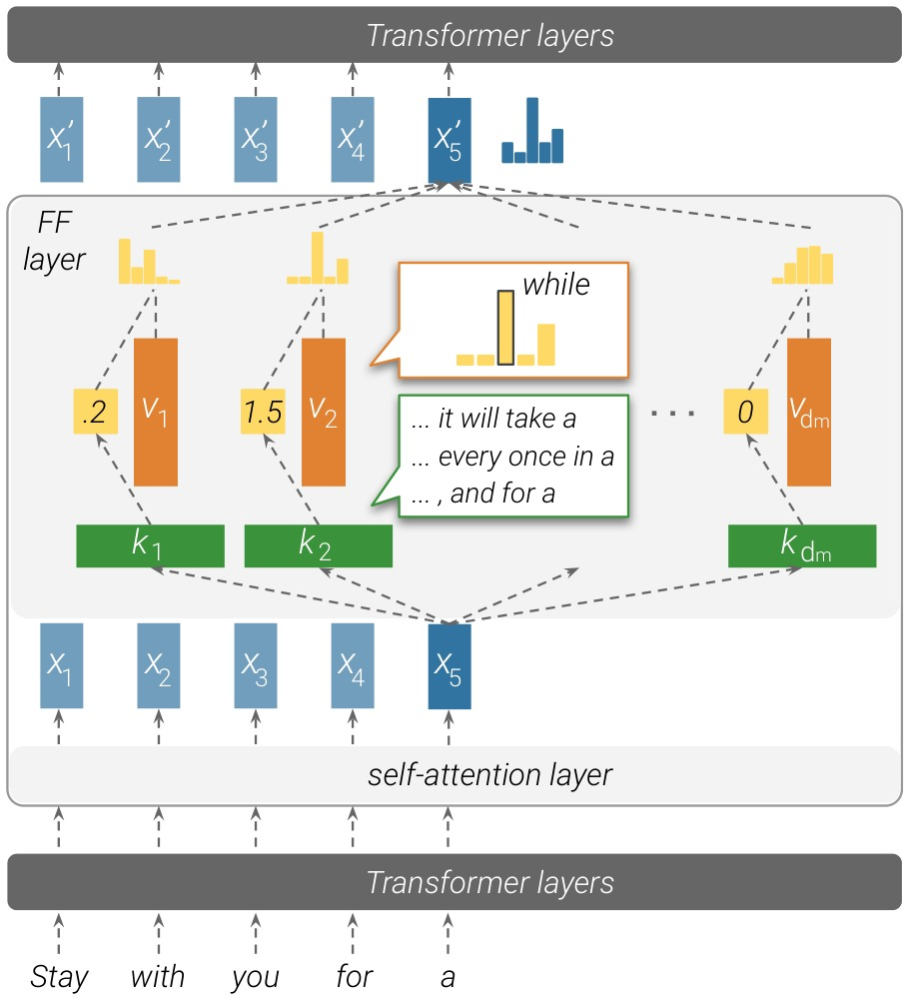

**图 2.1** 前馈网络层作为键值记忆的示意（来源：[2]）：第一层线性变换扮演「键」（绿色 $k_1,\dots,k_{d_m}$），识别输入中的模式；第二层扮演「值」（橙色 $v_1,\dots,v_{d_m}$），输出知识向量并累加回残差流。

Dai 等人 [3] 进一步从神经元粒度揭示了这一现象：他们发现预训练 Transformer 中存在所谓的「知识神经元」（Knowledge Neurons），这些神经元显著地存储并表达了事实性知识；通过抑制或放大这些神经元，可以相应地削弱或增强模型对相关知识的表达能力。Jin 等人 [4] 则沿着层级维度展开研究，探讨了大语言模型在不同层上获取知识与概念的方式，以及相应的「概念深度」（Concept Depth）分布。

这些工作共同勾勒出一幅图景：FFN 层通过其稠密计算，在每一个 token 上以「重计算」的方式复现其所存储的压缩知识。这种方式的优点是表达能力强大、泛化性好，但代价是——即使是完全静态、每次都相同的知识，也必须消耗相同的浮点运算（FLOPs）来「重新计算」，这在算力成本日益成为瓶颈的背景下，构成了一种结构性的浪费。

## 2.2 显式记忆与检索增强

与依赖 FFN 的「隐式」记忆相对，另一条研究脉络致力于为模型引入「显式」的外部记忆，将参数的「容量」与每次推理的「计算量」解耦。

Lample 等人 [5] 提出了基于乘积键（Product Keys）的大型记忆层：通过将键空间分解为两个较小的子空间，可以在几乎不增加计算量的前提下支持规模巨大的记忆表。后续的 Memory Layers at Scale [6] 进一步将这一思路扩展到现代规模，验证了稀疏记忆层在十亿级参数模型上的有效性。Baykal 等人 [8] 则系统性地比较了外部记忆表的多种查找函数（Token-ID 查找、局部敏感哈希、可学习 softmax 路由）与多种内容消费方式，并提出了交替更新（Alternating Updates, AltUp）方法，展示了「以存储换容量」的可行性。乘积键的查找机制如图 2.2 所示。

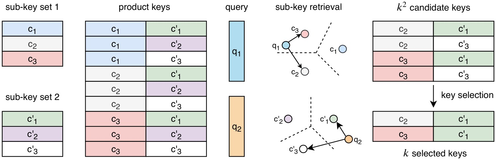

**图 2.2** 乘积键的查找机制（来源：[5]）：键空间分解为两个子键集，查询 $q$ 分别检索每个子键集，再将候选键组合为乘积键并取 Top-k 得分键。

在检索增强（Retrieval-Augmented）方向上，Borgeaud 等人 [7] 提出的 RETRO 模型从一个包含数万亿 token 的外部语料库中检索相关片段，并以交叉注意力方式融合检索结果。实验表明，RETRO 的性能可以匹配甚至超越参数量远大于它的稠密模型，证明了「从外部检索」同样是一条高效的知识获取通道。与之相关地，Shazeer [10] 探讨了如何通过分解等手段扩展语言模型的嵌入层，以更经济的参数规模覆盖更大的词汇表。RETRO 的架构如图 2.3 所示。

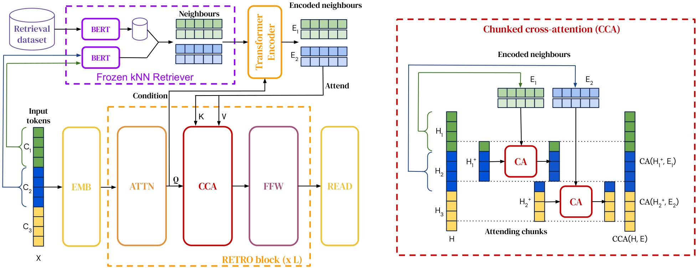

**图 2.3** RETRO 架构（来源：[7]）：左为简化视图，输入序列切分为多个块，经冻结 BERT 检索器从语料库取回近邻并编码，再以分块交叉注意力（CCA）融入主干；右为 CCA 算子的细节。

这些工作共同确立了一个核心思想：模型的「记忆容量」与「计算开销」不必严格绑定。通过将知识存储在可稀疏访问的参数表中，可以以较小的推理成本换取更大的知识容量——这正是 N-gram 记忆得以复兴的理论土壤。

## 2.3 参数、计算与存储的三重权衡

综合上述两条脉络，我们可以从三个维度刻画一个大语言模型的「成本—能力」结构：参数规模（容量）、每次推理的激活计算量（算力）与可卸载存储（带宽/成本）。传统稠密模型将三者严格绑定；MoE 架构通过「条件计算」在参数与计算之间撕开了一道口子；而显式记忆与 N-gram 记忆则进一步引入了「条件存储」的维度——将大部分参数放置在无需参与逐 token 稠密计算的静态表中，按需检索、按需融合。这一「三重权衡」的视角，构成了理解第 4 章各实际模型设计的统一框架，如图 2.4 所示。

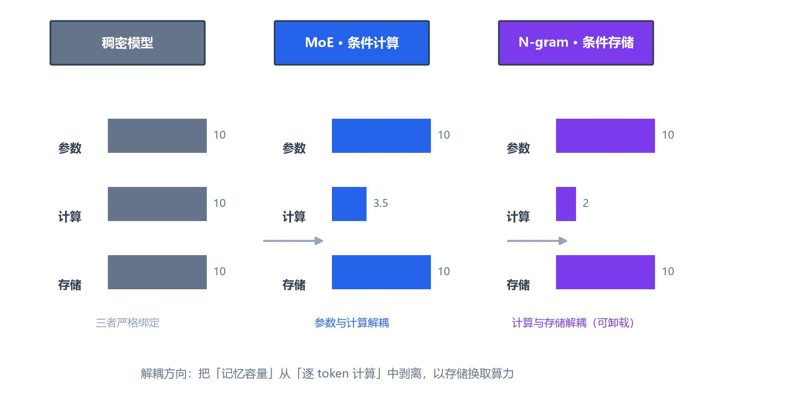

**图 2.4** 参数、计算与存储的三重权衡：从稠密模型到 MoE（条件计算）再到 N-gram 记忆（条件存储），「记忆容量」逐步从「逐 token 计算」中剥离。

# 3 N-gram 记忆的发展脉络

N-gram 是语言建模中最古老也最朴素的思想之一。理解它从统计时代的兴起到神经网络时代的式微，再到如今在大模型中的复兴，有助于我们把握其作为「记忆通道」的本质。

## 3.1 经典统计语言模型中的 N-gram

经典统计语言模型的核心任务，是估计一个词序列的概率。直接估计 $P(w_1, w_2, \dots, w_T)$ 面临着参数空间随序列长度指数爆炸的问题。N-gram 模型通过引入 $(n-1)$ 阶马尔可夫假设（Markov Assumption）来化解这一困难：

$$P(w_t \mid w_1, \dots, w_{t-1}) \approx P(w_t \mid w_{t-n+1}, \dots, w_{t-1}) = \frac{\text{count}(w_{t-n+1}, \dots, w_t)}{\text{count}(w_{t-n+1}, \dots, w_{t-1})}.$$

这一假设的本质是：当前词的预测只依赖于最近 $n-1$ 个词。借助最大似然估计与各种平滑技术（如回退（backoff）与 Kneser-Ney 平滑），N-gram 模型在统计机器翻译与早期语音识别中曾长期占据主导地位。它以一种完全「查表」的方式工作——词频计数表就是它的全部「记忆」，几乎不涉及任何参数化的计算（如图 3.1 所示）。

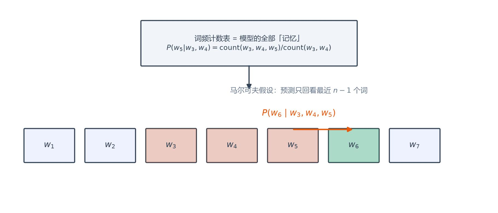

**图 3.1** N-gram 模型的马尔可夫窗口：预测 $w_6$ 时只回看最近 $n-1$ 个词（$w_3,w_4,w_5$），词频计数表即模型的全部「记忆」。

## 3.2 神经网络的兴起与 N-gram 的式微

随着神经网络语言模型的兴起，N-gram 逐渐退出了主流。神经语言模型用可微分的词嵌入取代了离散的查表，随后的循环神经网络（RNN）、长短期记忆网络（LSTM）与 Transformer 则进一步摆脱了马尔可夫假设的限制，能够对任意长的上下文进行建模。神经网络的优势在于其强大的泛化能力与连续表示，而 N-gram 的离散计数方法受限于数据稀疏、难以泛化到未见过的组合，因而一度被视为一种「过时」的技术。

然而，神经网络的成功也带来了新的代价：无论一段知识是新颖还是陈旧、是高频还是罕见，模型都必须通过同样的稠密计算来「重新推导」它。这一代价，为 N-gram 思想的回归埋下了伏笔。

## 3.3 潜在 N-gram 的复兴：N-grammer

Roy 等人 [9] 提出的 N-grammer 是 N-gram 思想在 Transformer 时代复兴的先声。N-grammer 借鉴经典统计语言建模的直觉，在 Transformer 中引入了一个由离散潜在表示构造的 N-gram 层：首先通过乘积量化（Product Quantization）将 token 嵌入映射到学习得到的码本（codebook）中的离散 ID，再将这些 ID 组成的 bi-gram 哈希到一个可训练的小型嵌入表中进行查找，最后将检索到的 bi-gram 嵌入与原嵌入拼接后送入 Transformer 的其余部分，其流程如图 3.2 所示。

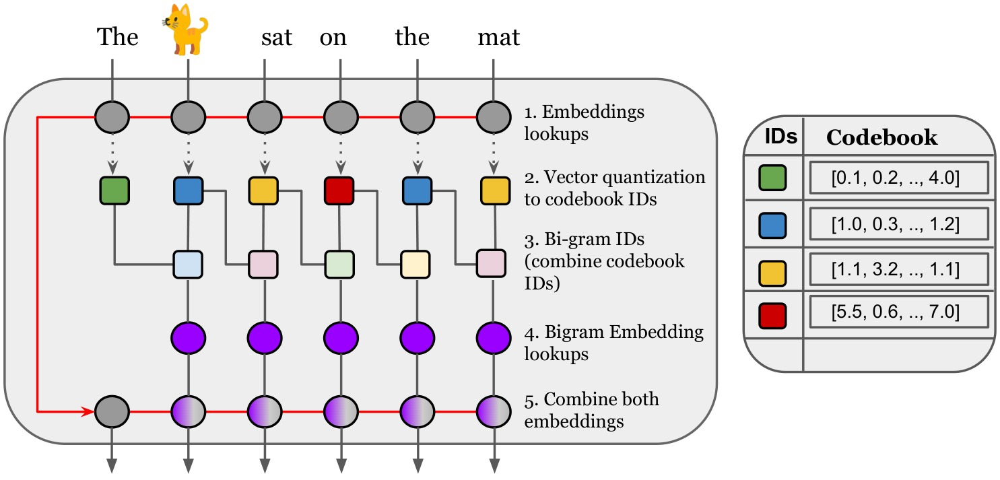

**图 3.2** N-grammer 层的处理流程（来源：[9]）：uni-gram 嵌入经向量量化聚类为离散码本 ID，组合成 bi-gram ID 后查表得到 bi-gram 嵌入，再与输入嵌入结合输出。

N-grammer 的关键洞见在于：它不直接对原始词对建表，而是对「潜在表示」的词对建表，从而在保留 N-gram 直觉的同时大幅压缩了表的规模。实验表明，带有 N-grammer 层的 Transformer 可以在更少的计算量下匹敌更大的稠密模型，印证了「以稀疏查表换计算量」的可行性。这一思想，与第 2.2 节的外部记忆研究形成了呼应。

## 3.4 从「条件计算」到「条件记忆」

N-grammer 之后，随着 MoE 架构将「条件计算」确立为大模型扩展的主流范式，研究者的注意力逐渐转向一个对称的问题：既然计算可以被条件化（每个 token 只激活部分专家），存储是否同样可以被条件化（每个 token 只检索部分记忆表）？二者的对称关系如图 3.3 所示。

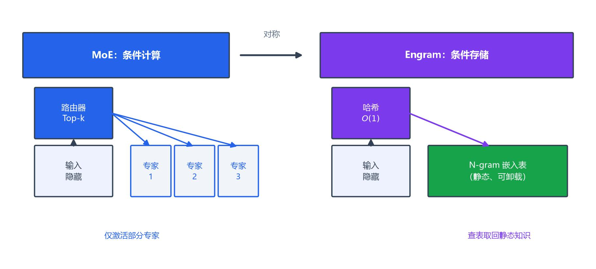

**图 3.3** 从「条件计算」到「条件记忆」：MoE 以路由器按需激活部分专家，Engram 则以哈希按需查表取回静态知识，二者形成对称。

DeepSeek 与北京大学联合提出的「条件记忆」（Conditional Memory）[11] 正式将这一问题凝练为一个新维度。研究者指出，当前的 MoE 架构虽然通过条件计算扩展了模型容量，却缺乏原生的知识检索机制，导致模型不得不消耗宝贵的算力来「重建」静态知识。为此，他们提出将经典的哈希 N-gram 思想现代化，构建了可扩展的查找记忆模块 Engram。这一工作标志着 N-gram 记忆从一个「效率技巧」上升为一种可与条件计算并列的、新的稀疏性维度，第 4.2 节将详细展开。

# 4 大语言模型中的应用

进入 2025 至 2026 年，N-gram 记忆在大语言模型中迎来了密集的工程落地。本章以三个代表性模型为例，考察其具体设计与实践。

## 4.1 LongCat-Flash：嵌入扩展与零计算专家

美团的 LongCat 团队在其 LongCat-Flash 技术报告 [12] 中提出了「零计算专家」与 shortcut-connected MoE 架构，并在后续的 LongCat-Flash-Lite [14] 中发现：在同等预算下，「嵌入扩展」（embedding scaling）相比「专家扩展」（expert scaling）能够获得更优的帕累托前沿。

### 4.1.1 N-gram 嵌入的设计

LongCat-Flash-Lite 引入了一个 N-gram 嵌入层，其核心作用在于增强模型对局部上下文语义的捕获能力。它通过哈希函数，将当前 token 及其前序 $N-1$ 个 token 所构成的序列映射为一个整体的 N-gram 嵌入向量，并与该 token 的基础嵌入向量融合。例如，当模型看到「打开终端输入命令」时，N-gram 嵌入能帮助其精准锁定「编程」这一场景，而非误读为日常的「打开文件」。该嵌入层的结构如图 4.1 所示。

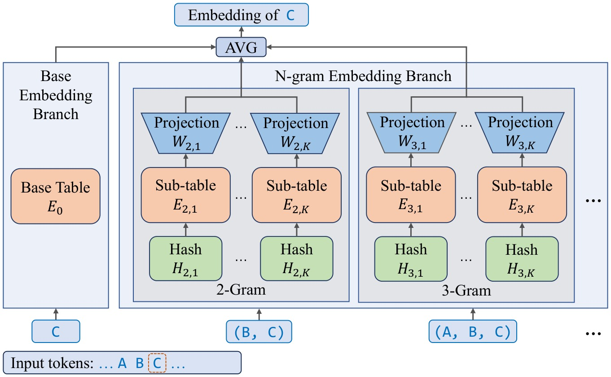

**图 4.1** LongCat-Flash-Lite 的 N-gram 嵌入层架构（来源：[14]）：基础嵌入分支与 N-gram 嵌入分支（2-gram/3-gram 经哈希、子表与投影）融合得到最终嵌入。

为避免哈希冲突（即不同的 N-gram 序列被映射到同一向量），LongCat 团队采用了两个关键设计：一是**子表分解与线性投影**，将大型 N-gram 嵌入表拆分为多个子表并分别进行线性投影变换，以大幅降低碰撞概率；二是**词汇表规模与嵌入放大的谨慎设计**，通过仔细设定嵌入表规模，并引入缩放因子或层归一化等嵌入放大技术，确保嵌入层提供的语义信号在深层网络的残差连接中不会被注意力模块的输出所淹没。

### 4.1.2 LongCat-Flash-Lite 的实践

LongCat-Flash-Lite 是这一思路从理论走向实践的案例：该模型总参数量为 685 亿，每次推理仅激活 29 亿至 45 亿参数。其中 N-gram 嵌入参数高达 314 亿，占总参数量的约 46%。在 14 个 shortcut 层中，每个 MoE 模块由 256 个 FFN 专家与 128 个「零计算专家」（Zero-computation Experts）组成，每个 token 选择 12 个专家。通过与一个「将所有 N-gram 嵌入参数转换为额外专家」的对照模型进行公平对比，LongCat-Flash-Lite 在训练全程保持了更低的损失，直接验证了「嵌入扩展优于专家扩展」的结论。此外，借助 YARN 技术，该模型可支持最长 256K 的上下文，并在典型负载下提供 500–700 token/s 的生成速度。

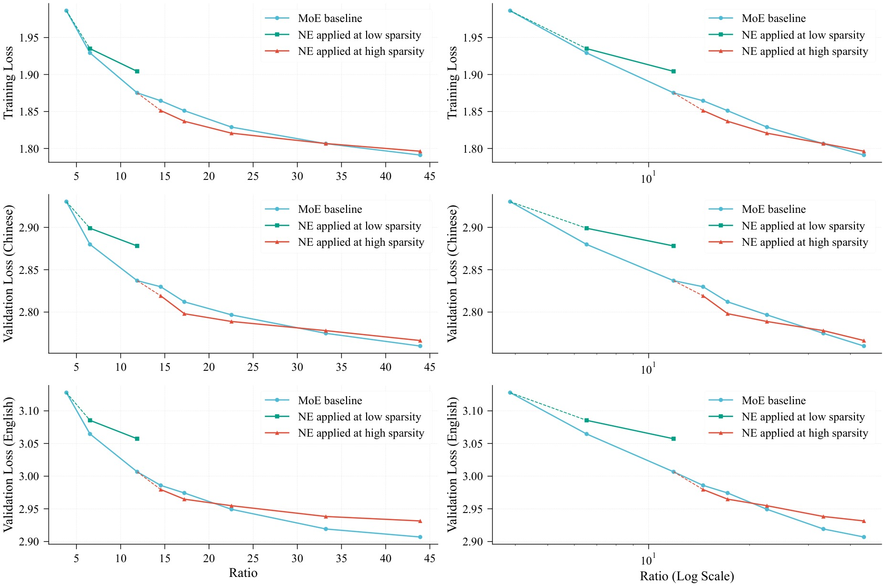

**图 4.2** 嵌入扩展与专家扩展的扩展曲线对比（来源：[14]）：N-gram 嵌入模型（NE）在相同或更小的参数比例下取得更低的训练与验证损失。

## 4.2 DeepSeek Engram：条件记忆

DeepSeek 与北京大学联合提出的 Engram（直译为「记忆痕迹」）[11] 是目前对 N-gram 记忆阐述得最为系统的一项工作，其核心是把大模型的能力拆解为三个维度：模型深度、以 MoE 为代表的**计算稀疏性**，以及 Engram 引入的**存储稀疏性**。

### 4.2.1 动机与设计思想

Engram 的出发点是将语言建模任务拆解为两大分支：**静态模式检索**负责实体、固定短语等确定性知识的快速调取；**动态组合推理**则交由 Transformer 主干专注完成复杂的逻辑运算。Engram 是一个可微分、可训练、原生嵌入模型结构的组件，其设计核心是将记忆性负载从主干计算中剥离，通过高速检索模块直接调用稳定存在、高频出现的知识。这一设计可以类比为「海马体」与「前额叶皮层」的分工：Engram 负责知识存储与快速检索，而 Transformer/MoE 主干专注复杂推理。

### 4.2.2 核心机制

Engram 通过哈希映射从静态嵌入表中检索向量，并使用轻量化的门控机制判断记忆的语境适用性。具体地，针对 2-gram/3-gram 局部上下文，Engram 采用多套独立的哈希规则将其映射到固定大小的嵌入表，通过**多头哈希检索**（多个哈希头结果的拼接）提升检索准确性，同时避免存储爆炸——无论 N-gram 组合数量如何增长，嵌入表大小保持恒定，从而实现查找速度与数据量无关，达到 $O(1)$ 的检索复杂度。为了适配动态上下文、避免多义性歧义（例如「Apple」既可指水果又可指科技公司），Engram 引入了**上下文感知门控机制**，并配合深度因果卷积与 SiLU 激活函数，经由残差连接将门控后的记忆向量注入 Transformer 的特定层。Engram 的完整架构如图 4.3 所示，其「查表取回」的动态流程如图 4.4 所示。

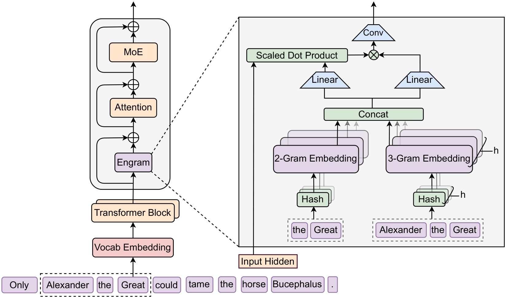

**图 4.3** Engram 架构（来源：[11]）：主干中的 Engram 模块以哈希检索 2-gram/3-gram 静态嵌入，经拼接、线性变换与门控后注入残差流。

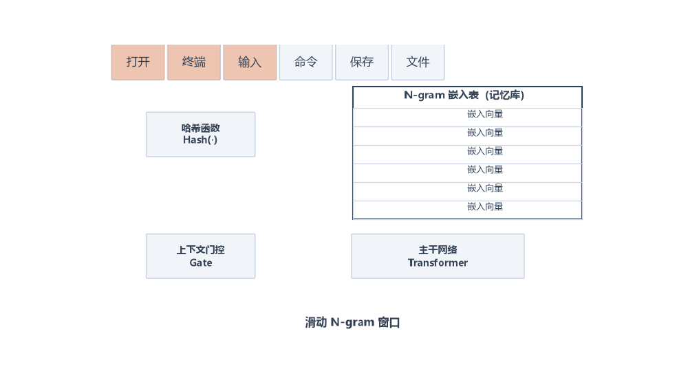

**图 4.4** N-gram 查表取回的动态流程：滑动窗口 → 哈希映射 → 嵌入表检索 → 门控筛选 → 注入主干，全程无需稠密计算。

### 4.2.3 实验结果与系统优化

在总参数量与计算量完全相同的对照实验中，集成 Engram 的 27B 模型（Engram-27B）与纯 MoE 基线（MoE-27B）相比，在几乎全部基准上取得了提升：MMLU 从 57.4 提升至 60.4，BBH 从 50.9 提升至 55.9，ARC-Challenge 从 70.1 提升至 73.8，HumanEval 从 37.8 提升至 40.8，MATH 从 28.3 提升至 30.7；在多查询「大海捞针」测试（RULER）中，等损失检查点的准确率从 84.2 大幅提升至 97.0。研究者还发现，神经计算与静态记忆之间存在一个 U 型的权衡曲线：在总参数与算力预算固定的情况下，将约 20%–25% 的稀疏参数分配给 Engram 模块能达到最优性能，如图 4.5 所示。

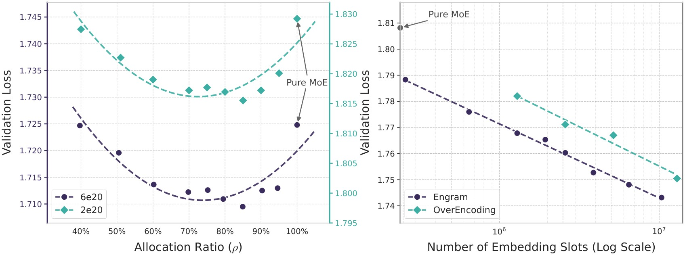

**图 4.5** 稀疏度分配与 Engram 扩展（来源：[11]）：左图为验证损失随分配比例 $\rho$ 的 U 型曲线；右图为验证损失随嵌入槽数目的对数线性下降趋势。

在系统层面，Engram 的确定性寻址特性带来了「查算分离」的显著优势：千亿参数规模的 Engram 嵌入表可直接存放于廉价的 CPU 内存（DRAM）而非昂贵的 GPU 显存（HBM）；GPU 执行主干计算的同时，CPU 可通过 PCIe 通道异步预取后续层所需的记忆向量，实现通信与计算的完全重叠。据称，即使挂载规模高达千亿参数的记忆库，推理吞吐损失也能控制在 3% 以内。这一「查算分离」范式，在提升性能的同时也显著降低了大模型的部署门槛，其系统实现如图 4.6 所示。

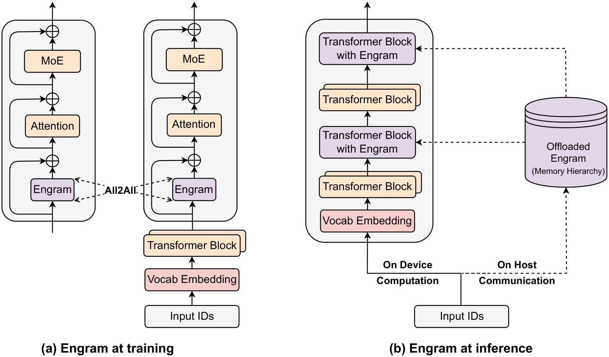

**图 4.6** Engram 的系统实现（来源：[11]）：训练阶段嵌入表经 All2All 分布于各 GPU；推理阶段嵌入表卸载至主机内存并通过异步预取与计算重叠。

## 4.3 Qwen3.8-Flash-Next：N-gram 记忆

阿里 Qwen 团队开源的 Qwen3.8-Flash-Next [13] 被定位为 Qwen4 架构的先导预览模型，其围绕注意力、残差、嵌入与优化四个方面进行了系统升级，其中 N-gram 嵌入（官方称为 N-gram Embedding）是「嵌入」维度的核心。

### 4.3.1 架构概览

Qwen3.8-Flash-Next 的主模型为 125B 参数的稀疏 MoE，每次前向传播仅激活约 6B 参数（512 个专家中每 token 激活 10 个路由专家与 1 个共享专家）；此外，模型额外配备了一个 51B 参数的 N-gram 嵌入表（位于第 2 层）与 4B 的多 token 预测（MTP）模块。这一设计使总参数与激活参数之比高达约 20:1，在保持低激活计算量的同时大幅扩展了记忆容量，其整体架构如图 4.7 所示。

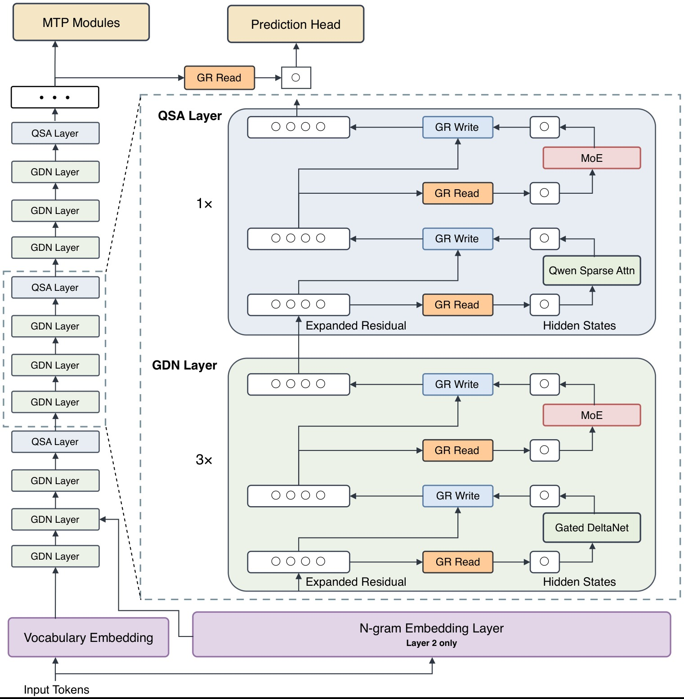

**图 4.7** Qwen3.8-Flash-Next 架构（来源：[13]）：第 2 层集成 N-gram 嵌入层（Layer 2 only），与 GDN/QSA 注意力、Gated Residual、MoE 等组件协同。

### 4.3.2 N-gram 嵌入表的设计

该 N-gram 嵌入表是一个将 2-gram/3-gram（二元/三元词组）映射为 160 维向量的查找字典，包含约 2000 万条目。其工作原理与 Engram 类似：以最近的 2 到 3 个 token 组成键，通过 $O(1)$ 复杂度的查表直接提取训练时记忆的静态多 token 模式，如拼写、固定短语、专有名词与格式化样板；至于该模式在当前语境下是否重要，则由主模型的门控与上下文机制负责筛选。值得注意的是，51B 参数是「存储」在嵌入层中、可被检索引用的 N-gram 短语向量，6B 才是真正承担推理算力的部分——这一区分澄清了社区中「6B 激活参数即模型规模」的常见误解。

### 4.3.3 系统层面的卸载与预取

Qwen 团队明确指出：嵌入层提供了一条独特的参数扩展轴，其所需计算更少、更易于卸载，优于 MoE；通过以短 N-gram 索引，这一方法使参数扩展对内存受限的加速器而言变得高效，且不牺牲质量。由于查表只是一次寻址，51B 参数的嵌入表可以放置在系统内存甚至 SSD 上，按需分页调入，并通过异步预取与模型计算重叠。这一「把文件柜放在隔壁房间」的比喻，形象地揭示了 N-gram 记忆在成本结构上的根本优势。

## 4.4 三者的对比与共同趋势

上述三个模型在细节上各有侧重，但共同勾勒出一条清晰的技术趋势，如表 1 所示。

| 维度 | LongCat-Flash-Lite | DeepSeek Engram | Qwen3.8-Flash-Next |
| :--- | :--- | :--- | :--- |
| N-gram 记忆参数 | 314 亿（占总参约 46%） | 最优占比 20%–25%（27B 实验中） | 510 亿（约 2000 万条目，第 2 层） |
| 查找方式 | 子表分解 + 哈希 | 多头哈希 + 上下文门控 | 哈希查表 + 门控筛选 |
| 记忆接入方式 | 与基础嵌入融合 | 特定层注入（残差 + 因果卷积） | 第 2 层嵌入表 |
| 系统优化 | 嵌入放大、YARN 长上下文 | DRAM 存储 + PCIe 异步预取 | 系统内存/SSD 卸载 + 异步预取 |

**表 1** 三个代表性模型中 N-gram 记忆设计的对比。

三者的一致性体现在三个层面。其一，**查算分离**：都将「记忆」从「计算」中剥离，以接近 $O(1)$ 的查表取代稠密计算来调用静态知识。其二，**以存储换算力**：都意识到在「加速器受限于内存而非算力」的当下，最廉价的参数增量来自可卸载到慢速存储的部分。其三，**语境门控**：都通过门控或融合机制，让主模型决定检索到的记忆在当前语境下的适用性，从而避免多义性歧义。这些共识表明，N-gram 记忆已从孤立的技术尝试，演进为下一代大模型架构设计中的一个结构化组件。

# 5 总结与展望

本文从大语言模型的知识与记忆出发，梳理了 FFN 层作为知识存储器的研究脉络，回顾了 N-gram 记忆从经典统计模型到现代大模型的复兴历程，并以 LongCat-Flash、DeepSeek Engram 与 Qwen3.8-Flash-Next 为例，考察了其在工程实践中的落地。

纵观这一脉络，可以得出几点认识。第一，模型的记忆通道并非唯一：FFN 提供的是「重计算」的隐式记忆，而 N-gram 提供的是「查表」的显式记忆，二者各有适用的知识类型。第二，条件记忆作为继条件计算之后的新稀疏性维度，正在使「参数、计算、存储」的三重权衡成为大模型架构设计的显式优化对象。第三，N-gram 记忆的价值主要在于以极低的算力与带宽成本覆盖高频、稳定的局部模式，它既不能替代 RAG 所带来的外部新鲜知识，也不能替代 Transformer 主干的深度推理能力，而应被理解为对现有记忆体系的一项有效补充。

展望未来，N-gram 记忆仍有若干开放问题值得关注：哈希冲突对长尾知识的影响如何进一步缓解；如何在高阶 N-gram（$n > 3$）与存储成本之间取得平衡；以及在指令微调与强化学习阶段，静态记忆与动态能力的协同优化方式。可以预见，随着算力成本结构的持续演变，N-gram 所代表的「条件存储」思想，将在大模型架构的演进中扮演愈发重要的角色。

# 参考文献

[1] Adam Roberts, Colin Raffel, and Noam Shazeer. How Much Knowledge Can You Pack into the Parameters of a Language Model? In *Proceedings of EMNLP*, 2020.

[2] Mor Geva, Roei Schuster, Jonathan Berant, and Omer Levy. Transformer Feed-Forward Layers Are Key-Value Memories. In *Proceedings of EMNLP*, 2021.

[3] Damai Dai, Li Dong, Yaru Hao, Zhifang Sui, Baobao Chang, and Furu Wei. Knowledge Neurons in Pretrained Transformers. In *Proceedings of ACL*, 2022.

[4] Mingyu Jin, Qinkai Yu, Jingyuan Huang, et al. Exploring Concept Depth: How Large Language Models Acquire Knowledge and Concepts at Different Layers? In *Proceedings of ACL*, 2024.

[5] Guillaume Lample, Alexandre Sablayrolles, Marc'Aurelio Ranzato, Ludovic Denoyer, and Hervé Jégou. Large Memory Layers with Product Keys. In *Advances in Neural Information Processing Systems (NeurIPS)*, 2019.

[6] Meta. Memory Layers at Scale. 2025.

[7] Sebastian Borgeaud, Arthur Mensch, Jordan Hoffmann, et al. Improving Language Models by Retrieving from Trillions of Tokens. In *Proceedings of ICML*, 2022.

[8] Cenk Baykal, Dylan J. Cutler, Nishanth Dikkala, Nikhil Ghosh, Rina Panigrahy, and Xin Wang. The Power of External Memory in Increasing Predictive Model Capacity. arXiv:2302.00003, 2023.

[9] Aurko Roy, Rohan Anil, Guangda Lai, et al. N-grammer: Augmenting Transformers with Latent N-grams. In *Proceedings of ICML*, 2022.

[10] Noam Shazeer. Scaling Embedding Layers in Language Models. arXiv:2101.05176, 2020.

[11] DeepSeek-AI and Peking University. Conditional Memory via Scalable Lookup: A New Axis of Sparsity for Large Language Models. arXiv:2601.07372, 2026.

[12] Meituan LongCat Team. LongCat-Flash Technical Report. arXiv:2509.01322, 2025.

[13] Qwen Team. On the Design of Qwen3.8-Next Architecture: Evaluation, Efficiency, and Training Stability. arXiv:2608.30320, 2026.

[14] Meituan LongCat Team. Scaling Embeddings Outperforms Scaling Experts in Language Models (LongCat-Flash-Lite). arXiv:2601.21204, 2026.
