
操千曲而后晓声，观千剑而后识器。

——刘勰《文心雕龙·知音》

# 第 1 章　概述

Transformer 提出至今十年，其结构流变已有若干综述，此处不再重述。以下各章以当前主流的大语言模型（LLM）为对象，逐一拆解其网络结构。把结构单独提出来讨论，是因为各家模型的改动看似分散，落到硬件上却都指向同一组约束：算力、访存与通信。总参数由数百 B 增至数 T，激活参数长期停在数十 B；上下文由 128K 扩到 1M，KV Cache 反被反复压缩；专家数由 256 增至 896，路由粒度却越来越细。理出这些取舍之间的递推关系，才能判断下一代模型会把压力加到哪里，也才能为加速器的规划留出余量。

本文中B 与 T 分别表示十亿与万亿参数，全书以 token 统一计量，不加复数后缀。全书凡十三章，第 2 章至第 13 章依次讨论 DeepSeek、Qwen、Kimi、MiMo、LongCat、GLM、MiniMax、Hunyuan、StepFun、Mistral、Meta Muse 与 Ling 十二个系列，共二十三节。各节次序大体相同：先交代规模与层配置，再依次讨论注意力、专家混合与数值格式，末了落到该模型给硬件带来的具体约束。附图取厂方公布的原始架构图；厂方未公开的，依其技术规格绘制示意图，并在图注中注明。各节之末另附一幅算子级分解图，按注意力与前馈两条通路逐段列出算子、公式与张量维度，并在图脚给出缓存、算力与权重体积的核算。关键超参数列于表内，文献以方括号编号，统一著录于书末。

# 第 2 章　DeepSeek 系列

DeepSeek 各代均附有技术报告，结构改动均有明确交代，便于按时间顺序观察同一套基线的演化。V3 确立 MLA、细粒度 MoE 与 MTP 三项基线，V3.2 在基线上加稀疏注意力，V4 把注意力栈改为压缩与稀疏混合，V4.1-Flash 则把网络拆成非对称的编码器与解码器。

## 2.1　DeepSeek-V3

DeepSeek-V3 于 2024 年 12 月发布，总参数 671B、每 token 激活 37B，上下文 128K，以 14.8T token 语料、FP8 混合精度完成预训练[1]。它确立的三项结构基线为潜注意力 MLA、细粒度专家 DeepSeekMoE 与多 token 预测 MTP，此后各代 DeepSeek 模型均沿用。

如图 2-1 所示，V3 主体为 61 层 Transformer，前 3 层采用稠密前馈网络，后 58 层为 MoE 层。注意力部分即 MLA（Multi-head Latent Attention）：键值对压缩到低秩潜向量（kv 秩 512，另加 64 维 RoPE 分量），推理时只缓存该潜向量，KV Cache 的显存与带宽占用因此降到传统多头注意力的几十分之一；查询侧同样作低秩投影（秩 1536），全模型 128 个注意力头。专家混合部分为 DeepSeekMoE：每层 256 个路由专家（每 token 激活 8 个）与 1 个共享专家，专家中间维 2048；路由采用无辅助损失（auxiliary-loss-free）的 sigmoid 偏置方案，配合组限制路由（8 组中取 4 组）压低专家并行的通信开销，缩放系数 2.5。另有 1 层 MTP 模块用于投机解码，词表 128K。

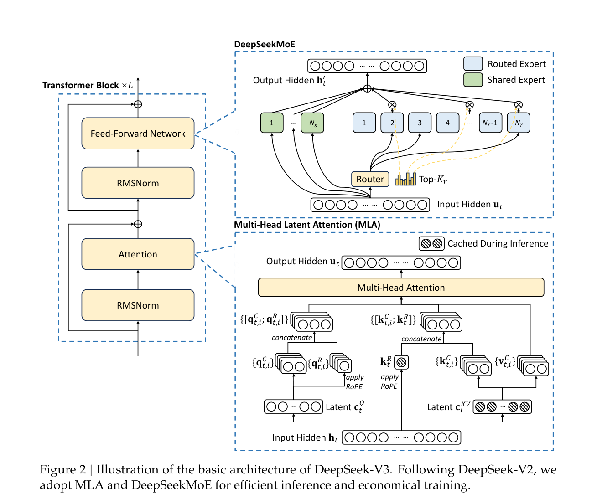

<b>图 2-1</b>　DeepSeek-V3 的基本架构。左侧为带残差的 Transformer 块，右侧分别展开 DeepSeekMoE（上）与 MLA（下）两个核心模块。图源：DeepSeek-V3 技术报告 Figure 2 [1]

三项基线分别压在三种资源上：MLA 把长上下文的瓶颈由注意力计算移到潜向量的读写，细粒度 MoE 以约 5.5% 的激活比换容量，MTP 用一个轻量模块换解码吞吐。访存、容量与串行延迟这三组约束，在此后各代模型中会以不同形式反复出现。

若按算子展开，V3 的一次前向可拆为 Q 低秩投影、KV 压缩、打分聚合与专家聚合四段，各步的公式与张量维度见图 2-2。

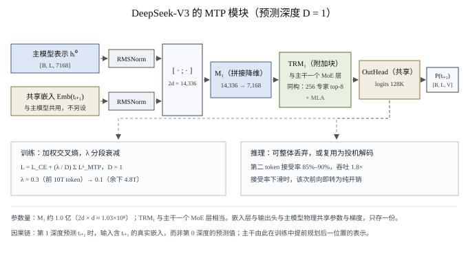

<b>图 2-2</b>　DeepSeek-V3 的算子级分解：MLA 的 Q 低秩投影、KV 压缩、打分聚合，与 DeepSeekMoE 的路由、专家 SwiGLU、加权合并逐段展开，框内标注公式与张量维度；底部给出每 token 的 KV Cache、算力与权重体积。图源：据官方技术报告与 config.json 绘制 [1]

## 2.2　DeepSeek-V3.2

DeepSeek-V3.2 于 2025 年 12 月发布。与 V3.1-Terminus 相比，架构上唯一的改动是经继续训练引入 DeepSeek 稀疏注意力（DSA）；MoE 的层数、专家数量与大小、路由拓扑均保持不变，总参数仍为 671B、激活 37B，上下文 128K（V3.2-Exp 因新增 DSA 组件，总参约 685B）[2][3]。表 2-1 并列 V3 与 V3.2 的主要超参数。

<b>表 2-1</b>　DeepSeek-V3 与 V3.2 的主要超参数

| 项目 | DeepSeek-V3 | DeepSeek-V3.2 |
|---|---|---|
| 总参数/激活参数 | 671B/37B | 671B/37B |
| 层数 | 61（前 3 层稠密 + 58 MoE） | 同 V3 |
| 注意力 | MLA（128 头，kv 潜秩 512 + RoPE 64） | MLA + DSA 稀疏选择 |
| 路由专家（激活） | 256（top-8）+ 1 共享 | 同 V3 |
| 上下文 | 128K | 128K |
| 其他 | MTP 1 层；FP8 训练 | 索引器 top-k 2048；FP8 分块权重 |

DSA 是一个先选择、后注意的两阶段流水线，结构如图 2-3 所示。第一阶段为 Lightning Indexer：一个轻量打分器（64 个头、头维 128、FP8 精度，参数与主干分离）对全部前序 token 计算相关性标量分。第二阶段为 Token Selector：每个查询只取分数最高的 k = 2048 个历史 token 进入主 MLA 路径作全精度计算。在 128K 上下文下，每个查询所见的键约占 1.6%，注意力计算量由 O(L²) 降为 O(L·k)，约为稠密注意力的 1/62。DSA 实例化于 MLA 的 MQA 模式之上，官方随 FlashMLA 库发布了配套的稀疏 kernel，有分页与非分页两种。

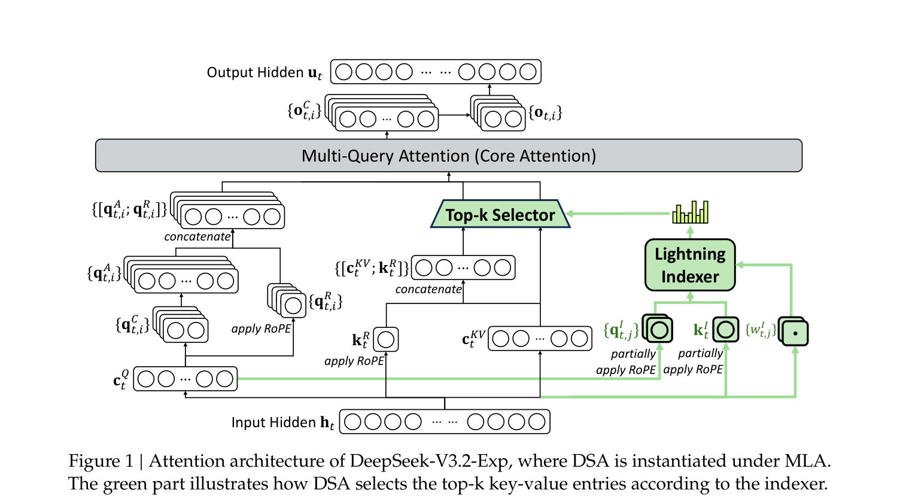

<b>图 2-3</b>　DeepSeek-V3.2 的注意力架构：DSA 稀疏注意力实例化于 MLA 之下。图源：DeepSeek-V3.2 技术报告 Figure 1 [3]

V3.2 并非从头训练，而是在 V3.1-Terminus 检查点上作两阶段继续训练：先以 2.1B token 稠密热身，令索引器模仿稠密注意力的分布，再切换到稀疏模式。发布权重采用 128×128 分块 FP8（ue8m0 缩放）。

DSA 把索引器确立为一个新的计算与访存单元，其开销须被摊薄。V4.1 之前，索引器仍是每层的全量开销；GLM-5.2 的 IndexShare 正是对这一点的回应（见 7.2 节）。稠密热身加稀疏切换的继续训练配方，也降低了在同一底座上改动结构的门槛。

稀疏化在算子上只增加两段，即索引器打分与 top-k 选择，其位置与维度见图 2-4。

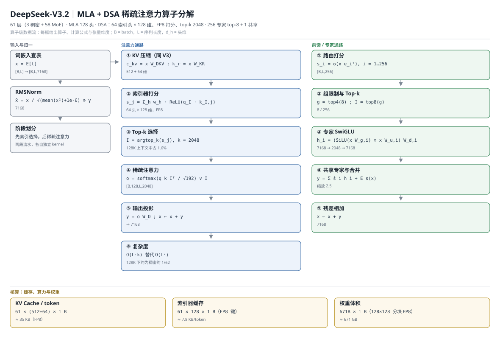

<b>图 2-4</b>　DeepSeek-V3.2 的算子级分解：在 V3 的 MLA 链路上增加索引器打分与 top-k 选择两段，注意力复杂度由 O(L²) 降为 O(L·k)，索引器自身另生一份缓存。图源：据官方技术报告与 config.json 绘制 [3]

## 2.3　DeepSeek-V4

DeepSeek-V4 于 2026 年 4 月发布，分 Pro 与 Flash 两个规格，保留 DeepSeekMoE 与 MTP，把上下文扩到 1M token，并在注意力、残差与优化器三处作了改动：混合注意力（CSA + HCA）、流形约束超连接（mHC）与 Muon 优化器[4][5]。整体架构见图 2-5，两个规格的规模对比见表 2-2。

<b>表 2-2</b>　DeepSeek-V4 系列规格

| 项目 | V4-Pro | V4-Flash |
|---|---|---|
| 总参数/激活参数 | 1.6T/49B | 285B/13B |
| 层数 | 61 | 43 |
| 隐藏维 | 7168 | 4096 |
| 路由专家（激活） | 384（top-6 + 1 共享） | 256（top-6 + 1 共享） |
| 预训练 | 33T token | 32T token |
| 上下文 | 1M | 1M |

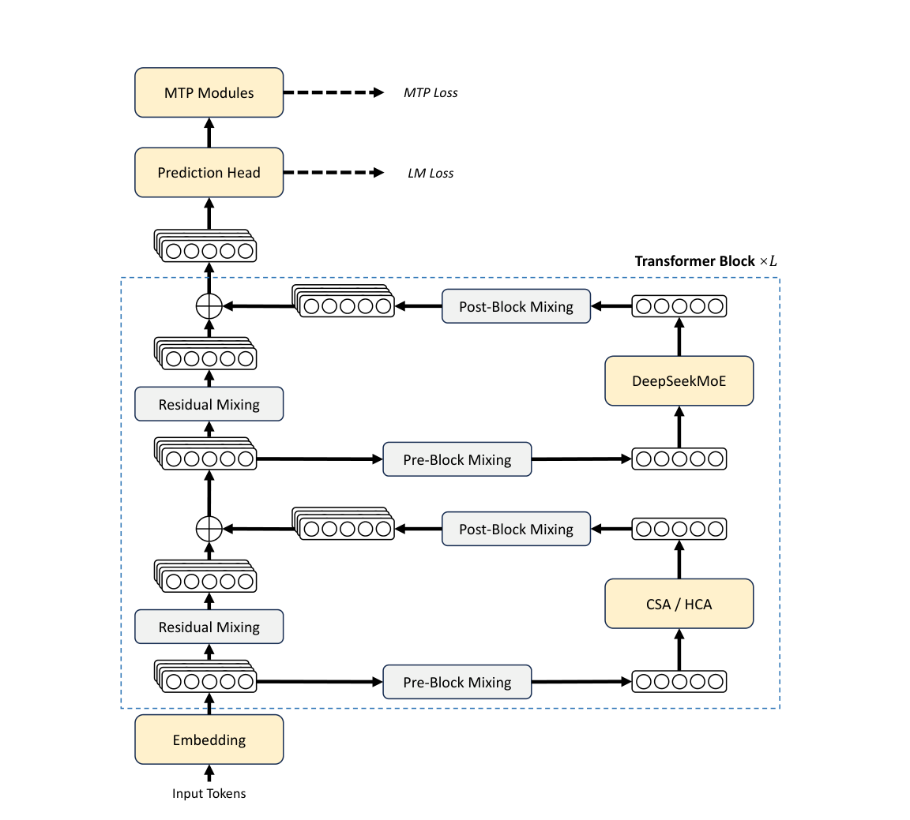

<b>图 2-5</b>　DeepSeek-V4 系列的整体架构：Transformer 块内以 CSA 或 HCA 作注意力、DeepSeekMoE 作前馈，残差由 mHC 的块前、残差与块后三组混合矩阵加强，顶端另接预测头与 MTP 模块。图源：DeepSeek-V4 技术报告 Figure 2 [5]

V4 的核心变化在注意力栈。两类层共用一套共享键值多查询注意力：把选中或全部的压缩 KV 条目与一组未压缩的滑窗条目拼接，作一次注意力计算。CSA（Compressed Sparse Attention）以压缩率 4 压缩 KV Cache，压缩器采用可学习的门控池化，相邻压缩条目的源窗口相互重叠；再由 Lightning Indexer 打分、Top-k Selector 选出最相关的条目（Pro 取 top-1024，Flash 取 top-512），结构见图 2-6。HCA（Heavily Compressed Attention）以压缩率 128 把条目压得更少，不作稀疏选择，对全部已完成的压缩条目执行稠密注意力，结构见图 2-7。两者都附加 128 token 的滑动窗口，以补回压缩损失的局部细粒度依赖。两类层在网络中交替编排：Flash 的前 2 层为纯滑窗注意力，Pro 则以 HCA 层开局。此外，mHC 把残差映射约束到 Birkhoff 多面体（双随机矩阵流形），以改善深层信号传播的稳定性；专家权重以 FP4 存储，较 FP8 再省一半显存，其余权重为 FP8；前 3 层 MoE 采用哈希路由，其余为学习路由。

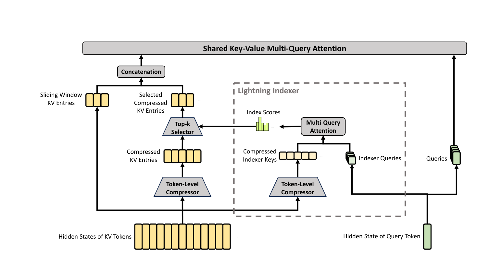

<b>图 2-6</b>　CSA 的核心结构：历史 KV 经 token 级压缩器生成压缩条目，Lightning Indexer 打分后由 Top-k Selector 选出部分条目，与滑窗条目拼接进入共享键值多查询注意力。图源：DeepSeek-V4 技术报告 Figure 3 [5]

<b>图 2-7</b>　HCA 的核心结构：以更大的压缩率生成少量重度压缩条目，不经稀疏选择，全部与滑窗条目拼接后进入稠密注意力。图源：DeepSeek-V4 技术报告 Figure 4 [5]

三类改动对加速器提出的要求并不相同。混合注意力要求同一芯片上同时高效支持压缩加稀疏选择、深度压缩加稠密两类 kernel；FP4 权重存储把低精度数值格式再向下推一档；mHC 与 Muon 则表明结构、参数化与优化器已进入协同设计的阶段。

把两类压缩器与稀疏选择并入同一条数据流后，算子序列见图 2-8。

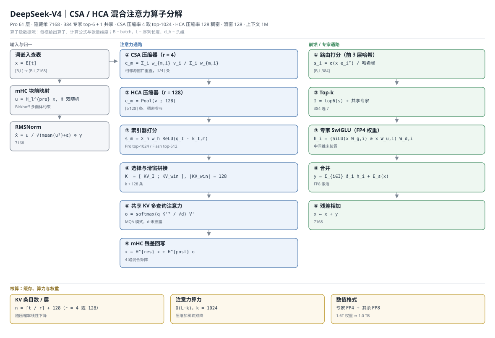

<b>图 2-8</b>　DeepSeek-V4 的算子级分解：CSA 与 HCA 两条压缩路径、索引器打分、top-k 与滑窗拼接、共享 KV 注意力，以及 mHC 的残差回写；底部为条目数、算力与数值格式的核算。图源：据官方技术报告与模型卡绘制 [5]

## 2.4　DeepSeek-V4.1-Flash

DeepSeek-V4.1-Flash 于 2026 年 9 月发布，是全新结构系列中尺寸最小的一版，以小激活换取长上下文，并进一步压缩 KV Cache，原生支持视觉理解[6][7]。整体架构见图 2-9。

该模型为 552B 参数的 MoE，采用 CED（Causal Encoder-Decoder）非对称结构：40 层网络拆为 20 层因果编码器与 20 层解码器，输入侧（预填充）每 token 仅激活约 8B 参数，输出侧（解码）激活约 16B。预填充主要执行前 20 层编码器，计算量接近减半；生成解码则跑满全部 40 层。缓存方面综合使用 CSA2（第二代压缩稀疏注意力）、FP4 量化与 SWA Bounded Replay（滑动窗口注意力加有界重放）：全局 KV Cache 的 HBM 需求降至上一代的 1/4，落盘 SSD 需求降至 1/8；若以 V3 初代为基准，KV Cache 已累计缩小 437 倍。

<b>图 2-9</b>　DeepSeek-V4.1-Flash 的整体架构：40 层网络分为 20 层因果编码器与 20 层解码器，前馈层均为 DeepSeekMoE。图源：DeepSeek-V4.1-Flash 技术报告 Figure 3 [6]

CSA2 是 CSA 的演进，改动落在压缩器、索引器与跨层复用三处。压缩器去掉了 CSA 的重叠源窗口与绝对位置编码，索引器键改由主 KV 条目投影得到，不再另走一条从隐藏状态出发的压缩路径；压缩率取 1 时退化为不压缩主 KV。每个 CSA2 层静态指定三种模式之一，结构差别见图 2-10：Full 模式在本层计算主 KV、索引器键与 Top-k 索引；Reindex 模式复用前层的主 KV 与索引器键，只重新打分生成新的 Top-k 索引；Reuse 模式连 Top-k 索引一并复用，不再计算索引器查询与打分。解码器另用分层稀疏索引器，由首个 Full 模式层按 Top-512 选出条目并构造共享候选池，后续 Reindex 模式层只在该池内打分。与 CED 结合时，被指定为 Full 模式的解码器层从因果编码器最后一层的隐藏状态计算全局 KV，其余模式不变。

<b>图 2-10</b>　CSA2 的三种工作模式：Full、Reindex 与 Reuse 的差别在于主 KV、索引器键与 Top-k 索引由本层计算还是从前层复用。图源：DeepSeek-V4.1-Flash 技术报告 Figure 4 [6]

V4.1-Flash 在多项基准上超过 V4-Pro，官方已将 V4-Pro 的流量逐步路由至该模型。编码器与解码器的不对称激活，把预填充与解码两种负载在结构层面分开：前者层数少、吞吐大、序列长，后者层数多、批量小、延迟敏感，加速器需在两种画像下都保持效率。CSA2 把主 KV 与索引由逐层计算改为按层组共享，缓存条目的生命周期与片上缓冲的分配也须按层组安排。KV Cache 在 HBM、主机内存与 SSD 之间的分层管理，同样不再只是推理系统的实现细节，而进入结构设计的范围。

三种模式的差别落在是否重算主 KV 与索引，逐算子展开见图 2-11。

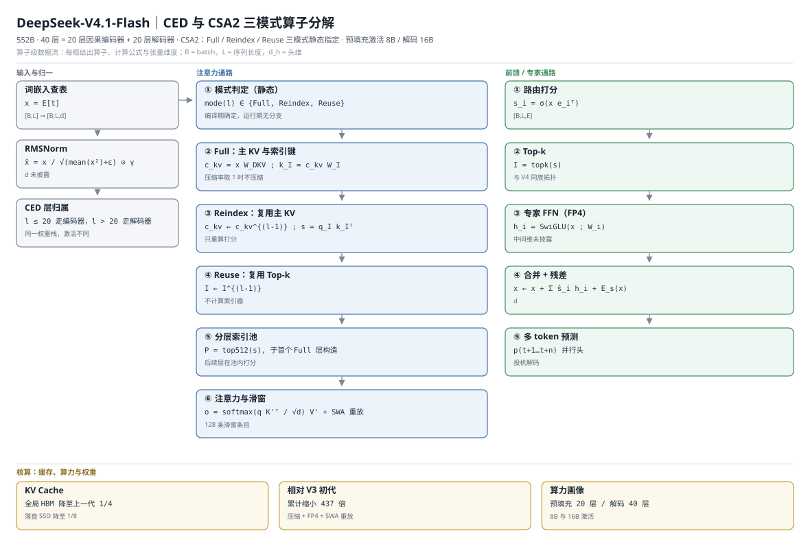

<b>图 2-11</b>　DeepSeek-V4.1-Flash 的算子级分解：CSA2 的 Full、Reindex、Reuse 三种模式与分层索引池，配 20 层编码器与 20 层解码器的层归属，右侧为专家与前馈通路。图源：据官方技术报告绘制 [6]

# 第 3 章　Qwen 系列

Qwen 一系以线性注意力与全注意力的混合为骨架，各代分头试验不同的稀疏化路径：Qwen3.5 与 3.8-Max 走三比一的门控线性注意力配门控全注意力，Qwen3.8-Flash-Next 则改用 QSA 微块稀疏，并另挂 N-gram 查表把参数扩容与计算扩容分开。这不同于 DeepSeek 单纯依靠 top-k 稀疏选择的做法，是长上下文的另一条路径。

## 3.1　Qwen3.5

Qwen3.5 于 2026 年 2 月发布，总参数 397B、每 token 激活 17B，是千问的原生多模态基座[8][9]。官方未单独刊出该模型的结构图，其语言主干沿用 Qwen3-Next 的混合架构[10]，图 3-1 即 Qwen 官方给出的 Qwen3-Next 架构图。主体 60 层，按 15 ×（3 ×（Gated DeltaNet → MoE）→ 1 ×（门控注意力 → MoE））的循环块组织，线性注意力层与全注意力层约成 3:1。

门控 DeltaNet（Gated DeltaNet，GDN）是线性注意力的一种，设 64 个 V 头、16 个 QK 头、头维 128，以固定大小的循环状态压缩长程历史，使 262K 上下文保持稳定；每隔三层插入的门控注意力层设 32 个 Q 头、2 个 KV 头、头维 256（RoPE 64 维），并结合 NeurIPS 2025 最佳论文的注意力门控机制，在注意力输出端抑制无关信息，使 1M token 上下文下的长程检索仍保有精度。MoE 部分为 512 个专家、top-10 路由加 1 个共享专家，专家中间维 1024，激活占比不足总参的 5%。多模态采用早融合路线：文本与视觉 token 自预训练第一天起即在同一序列流中联合训练，视觉前端为 ViT + PatchMerger（224×224 至 1024×1024 多尺度输入）；模型原生支持多 token 联合预测（MTP）与 201 种语言。在 32K 上下文下，吞吐达 Qwen3-Max 的 8.6 倍（最高约 19 倍），部署成本下降约 60%。

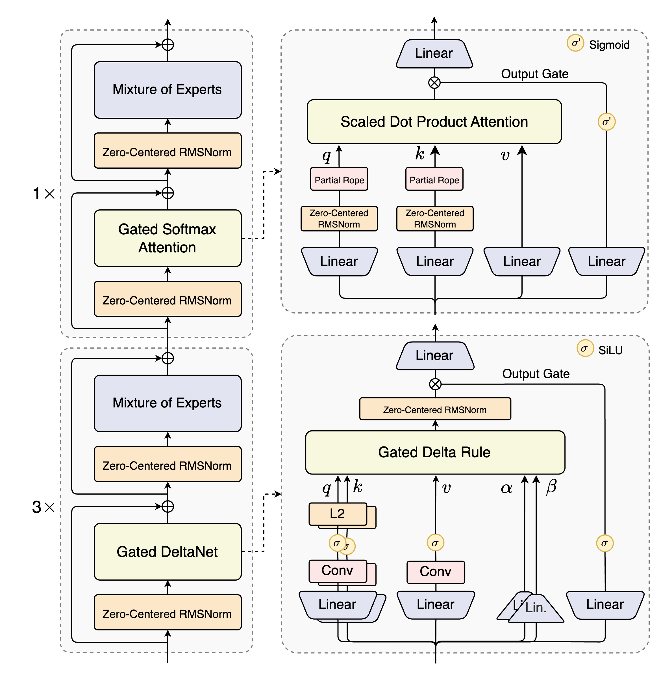

<b>图 3-1</b>　Qwen3-Next 混合架构：3 个 Gated DeltaNet 块接 1 个门控 Softmax 注意力块构成循环单元，每块后接 MoE 前馈；右侧分别展开两类注意力块的内部结构，含 Partial RoPE、零中心 RMSNorm 与输出门。Qwen3.5 沿用此结构，循环单元由 12 组扩展至 15 组。图源：Qwen 官方 Qwen3-Next 模型卡架构图 [10]

3:1 的混合比例决定了缓存压力的来源：长上下文的 KV Cache 只来自少数全注意力层，容量与带宽压力随之减轻；线性注意力的循环状态更新则是另一种访存模式，属于有状态递推，与传统注意力 kernel 的优化路径不同。阿里另以平头哥真武 810 芯片对该混合结构作了专项优化。

线性注意力与全注意力在算子上是两套不同的递推与打分，二者的位置见图 3-2。

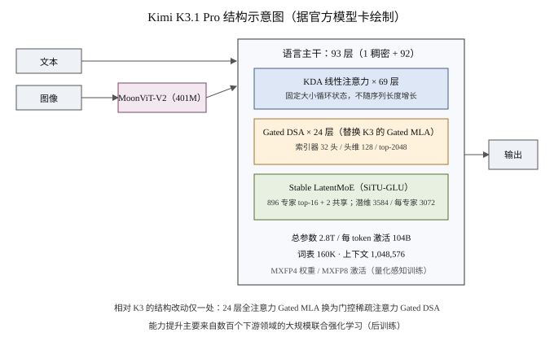

<b>图 3-2</b>　Qwen3.5 的算子级分解：Gated DeltaNet 的门控与 delta 递推、定长状态读出，以及每四层一次的门控全注意力，底部对比两类通路的缓存形态。图源：据官方模型卡与技术规格绘制 [10]

## 3.2　Qwen3.8-Max

Qwen3.8-Max 于 2026 年 8 月发布，总参数 2.4T，每 token 激活约 95B，上下文 1M token，是原生多模态基座[11]。官方通稿对结构的交代只有一句：以 Qwen3.5 为基础，采用稀疏 MoE 结合混合注意力；层数、专家数、头配置与权重格式均未公开。结构示意见图 3-3。

混合注意力的配方官方未逐项列出。既以 Qwen3.5 为基座，其注意力栈应即 3.1 节的三比一结构：三份 Gated DeltaNet 配一份门控全注意力，前者以定长循环状态压缩历史，后者承担精确检索，KV Cache 因而只由后一类层产生。这一点与本系列的另一支不同。3.3 节的 Qwen3.8-Flash-Next 采用 QSA 微块稀疏注意力，并另挂 51B 的 N-gram 查表参数，那是 Qwen4 架构预览的组成部分；2.4T 这一档两者皆无，既没有 N-gram 嵌入查表，也没有 QSA 稀疏选择，注意力只在线性递推与全注意力之间轮转。

容量与激活的比值是本节最该留意的数字。2.4T 总参对应 95B 激活，激活比约 4%，比 397B/17B 的 Qwen3.5（约 4.3%）还略稀。稀疏度提高，容量缺口便全由权重承载：以 FP8 计约 2.4TB，单机八卡的显存远不能容纳，必须跨节点分片。专家并行的规模由总参而非激活参决定，这是万亿级与百 B 级模型在部署上的分水岭。

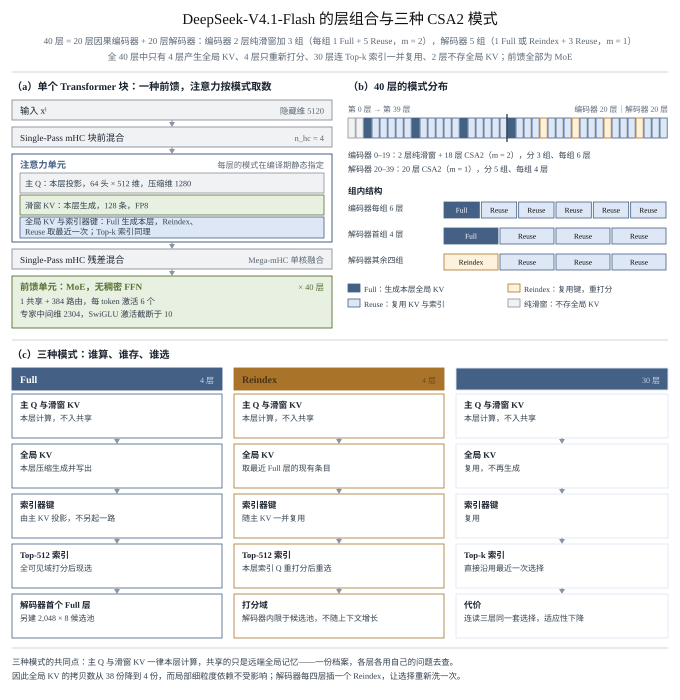

<b>图 3-3</b>　Qwen3.8-Max 结构示意：以 Qwen3.5 为基座的稀疏 MoE 与三比一混合注意力，2.4T 总参、约 95B 激活、上下文 1M；层数、专家数与头配置官方未披露，图中以符号记。图源：据阿里巴巴官方发布通稿绘制 [11]

推理时的两侧压力因此分开。算力侧每 token 只走约 95B 激活，与百 B 量级稠密模型相当；容量侧要装下 2.4T 权重，跨节点读权重成为延迟与带宽的主项，权重流的组织比算力调度更关键。KV Cache 只在四分之一的全注意力层上随序列增长，1M 上下文的缓存预算才得以成立；线性注意力层的定长状态与之无关，属常驻开销。

其算子级位置见图 3-4。

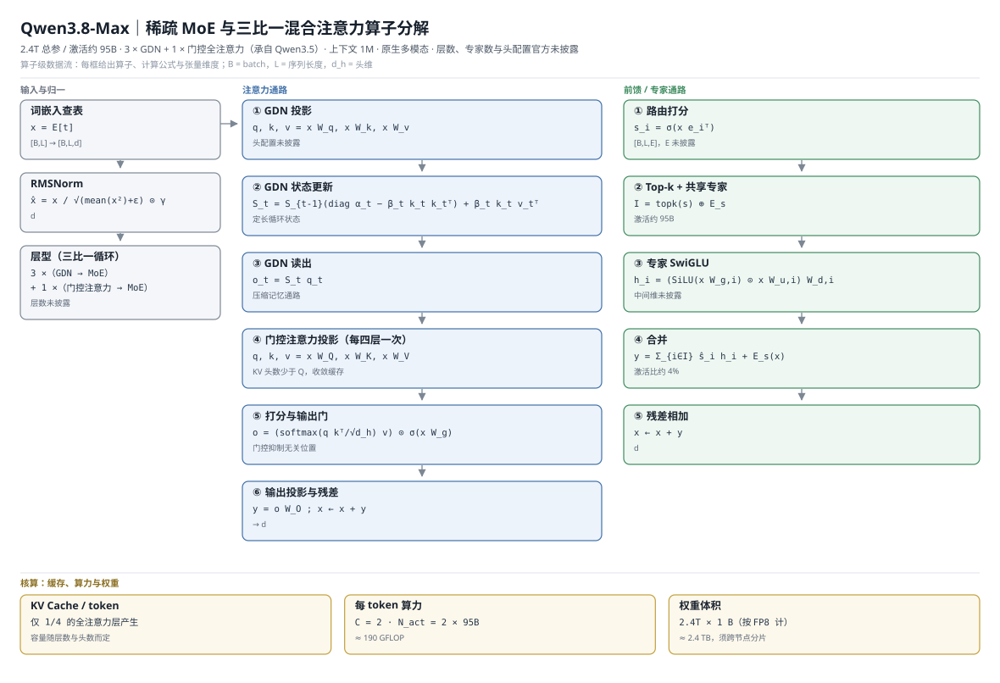

<b>图 3-4</b>　Qwen3.8-Max 的算子级分解：GDN 的递推与读出、每四层一次的门控全注意力，专家侧为 2.4T/95B 的稀疏路由；底部按 95B 激活核算算力与权重体积。图源：据官方发布通稿绘制 [11]

## 3.3　Qwen3.8-Flash-Next

Qwen3.8-Flash-Next 于 2026 年 8 月发布，是 Qwen4 架构的开源预览：125B MoE 主体（激活 6B）+ 51B N-gram 嵌入 + 4B MTP 层（BF16 合计约 180B），48 层，原生上下文 262K（经 YaRN 可扩至 1M），支持图文视频输入[12]。官方架构图见图 3-5，关键超参数见表 3-1。

<b>表 3-1</b>　Qwen3.8-Flash-Next 主要超参数

| 项目 | 配置 |
|---|---|
| 总参数 | 125B 主体（激活 6B）+ 51B N-gram 嵌入 + 4B MTP |
| 层布局 | 12 ×（3 ×（GDN → MoE）→ 1 ×（QSA → MoE）），共 48 层 |
| GDN | 48 个 V 头/16 个 QK 头，头维 128 |
| QSA | 24 个 Q 头/2 个 KV 头，头维 256；索引器 MQA（4 Q + 1 共享 K，头维 128），预算 512 块（约 2048 token） |
| MoE | 512 专家，top-10 + 1 共享，专家中间维 640 |
| 门控残差 | 4 分支，瓶颈维 320 |
| 上下文 | 262,144 原生（YaRN 扩至 1,000,000） |

QSA 的稀疏化发生在微块而非单 token 粒度，索引器以 4 个 query 头共享 1 个 key 头的极轻配置运行；MTP 为 1 层、多步训练，草稿 token 直接来自模型自身，构成内置的投机解码。训练采用 Muon + AdamW 混合配方，去掉 batch warmup，直接以目标 batch size 起步。

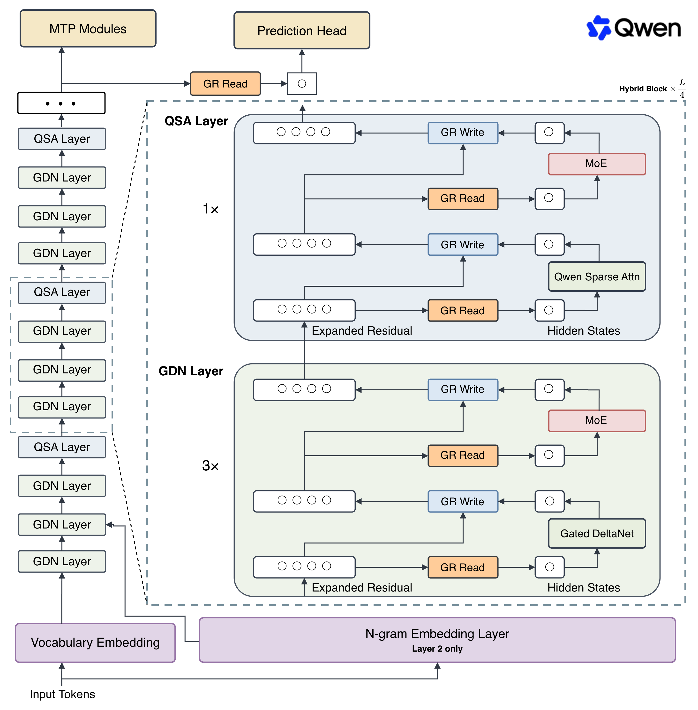

<b>图 3-5</b>　Qwen3.8-Flash-Next 的官方架构图。图源：Qwen3.8-Flash-Next 模型卡 [12]

稀疏注意力微块化、残差门控化、参数扩容查表化、投机解码内置化，四个方向在同一模型上同时出现。对显存受限的加速器，这一组合比较有利：大查表可卸载，激活计算极小，稀疏 kernel 的块粒度访存连续。

48 层按三比一循环后，每层的算子序列与维数见图 3-6。

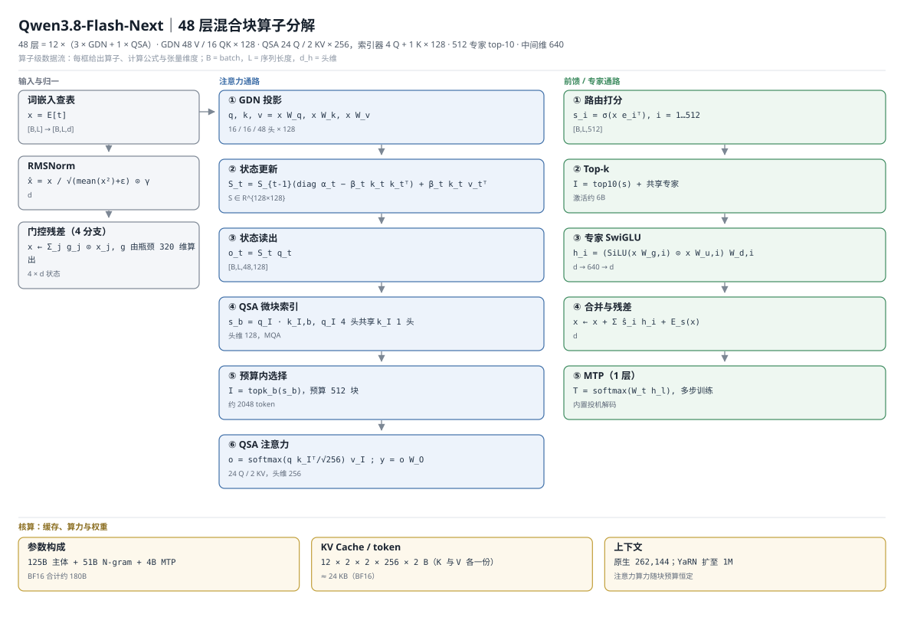

<b>图 3-6</b>　Qwen3.8-Flash-Next 的算子级分解：48 层按 3 比 1 循环的 GDN 与 QSA、512 块预算的微块选择、640 维专家与 4 分支门控残差。图源：据官方模型卡与 config.json 绘制 [12]

# 第 4 章　Kimi 系列

Kimi 一系自 K2 起即以 MLA 配稀疏 MoE。K2.5 在此基础上作原生多模态继续预训练；K3 换用线性注意力、跨层注意力残差与更稀疏的 MoE，激活率降到约 1.8%；K3.1 Pro 沿用 K3 底座，只把 24 层全注意力换成稀疏注意力，能力提升主要来自后训练。

## 4.1　Kimi K2.5

Kimi K2.5 于 2026 年 1 月发布，是在 Kimi-K2-Base 上以约 15T 视觉与文本 token 继续预训练得到的原生多模态智能体模型[13]。结构示意见图 4-1：总参数 1T、激活 32B；主体 61 层（1 层稠密 + 60 层 MoE），隐藏维 7168，注意力 64 头、机制为 MLA；MoE 含 384 个路由专家（top-8）与 1 个共享专家，专家中间维 2048，激活函数 SwiGLU；词表 160K，上下文 256K；视觉前端为 MoonViT（400M）。模型支持思考与非思考双模式，以及 Agent Swarm（将复杂任务分解为并行子任务，由动态实例化的领域智能体协同执行），并采用原生 INT4 量化以适配 vLLM、SGLang、KTransformers 等推理引擎。

<b>图 4-1</b>　Kimi K2.5 结构示意图：MLA 注意力、384 专家的 MoE 与 MoonViT 视觉编码器。图源：据官方模型卡绘制（官方未公开原始架构图）

同一套 MLA 加细粒度 MoE 出现在两个厂商的万亿模型上，说明这已是可复用的公共基线。INT4 在训练阶段即作为目标格式，也反映出部署数值格式正被提前纳入训练设计。

MLA 与细粒度 MoE 各自的算子序列见图 4-2。

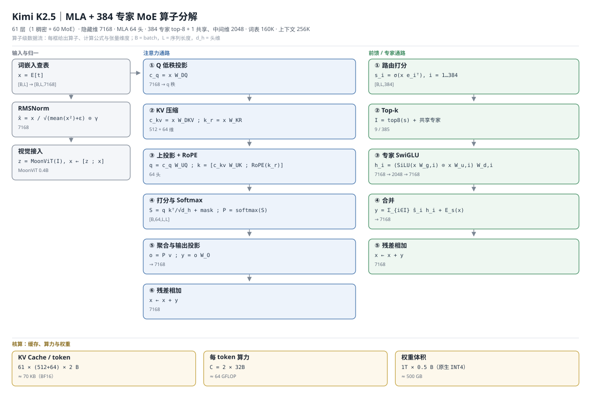

<b>图 4-2</b>　Kimi K2.5 的算子级分解：MLA 的低秩投影与 384 专家 MoE 的 top-8 路由，视觉前端在嵌入侧接入，底部为 BF16 与 INT4 两种格式下的容量核算。图源：据官方模型卡绘制 [13]

## 4.2　Kimi K3

Kimi K3 于 2026 年 7 月在 WAIC 发布，总参数 2.8T，896 个路由专家中每 token 激活 16 个（另加 2 个共享专家），激活约 104B；主体 93 层（69 层 KDA + 24 层 Gated MLA），上下文 1M token，原生视觉[14]。官方架构图见图 4-3。

<b>图 4-3</b>　Kimi K3 的整体架构：以 token、通道、层三个维度组织信息流，输入侧带原生视觉通路。每个块由 3 层 KDA + 1 层 Gated MLA 组成，注意力层后接 Stable LatentMoE；AttnRes 以可学习伪查询对嵌入与各前置块输出作选择性检索。图源：Kimi K3 技术报告 Figure 2 [14]

KDA（Kimi Delta Attention）是带逐通道遗忘门的 delta 规则递推：以固定大小的循环状态替代随长度增长的 KV Cache，关键位置再插入稀疏全注意力的增量通道；1M 上下文下解码提速 6.3 倍。AttnRes（Attention Residuals）允许每层选择性检索此前所有层的表征，而非沿残差链均匀累积，以不到 2% 的额外计算换来约 25% 的训练效率提升。Stable LatentMoE 把稀疏度推至 896 选 16（激活率约 1.8%），并以 Quantile Balancing（按路由分位数直接分配专家）与 Per-Head Muon（逐注意力头优化器）实现不依赖 MuonClip 的稳定训练；SiTU 激活与 Gated MLA 分别改善激活控制与注意力选择性。视觉侧的 MoonViT-V2（约 400M）从头以下一 token 预测训练。数值上，模型自 SFT 起作量化感知训练，MXFP4 权重配 MXFP8 激活；训练采用全均衡专家并行（静态形状，关键路径无主机同步），官方推荐 64 卡以上超节点部署；KDA 还为 vLLM 贡献了新的前缀缓存实现。

K3 给硬件带来的压力集中在两处。约 56 倍的稀疏度使专家并行的负载均衡与通信成为一阶问题；KDA 的固定大小状态把 KV Cache 带宽解放了一个数量级，却要求缓存与前缀机制按递推状态重新设计。

KDA 的递推、Gated MLA 的增量通道与 AttnRes 的跨层检索，三者在层内的次序见图 4-4。

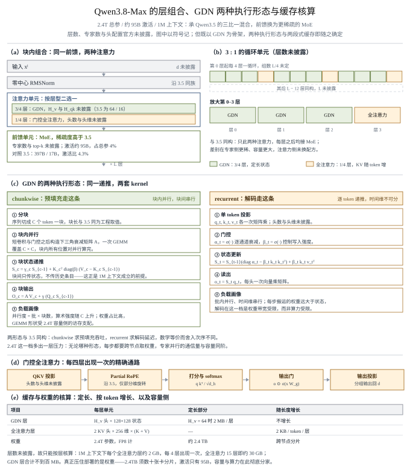

<b>图 4-4</b>　Kimi K3 的算子级分解：KDA 的逐通道遗忘与 delta 递推、Gated MLA 的增量通道、896 选 16 的潜空间专家，以及 AttnRes 的跨层检索。图源：据官方技术报告与模型卡绘制 [14]

## 4.3　Kimi K3.1 Pro

Kimi K3.1 Pro 于 2026 年 10 月 24 日先行公布评测与 API 定价，11 月 5 日开放完整权重，是 K3.1 系列的首款模型[15][16]。它在 K3 底座上作后训练，未重建预训练网络，能力提升主要来自覆盖数百个下游领域的大规模联合强化学习；同期发布的模型卡给出结构参数、六模型对标结果与自拟许可证全文。结构示意见图 4-5，与 K3 的对照见表 4-1。

主干与 K3 一致：总参数 2.8T、每 token 激活 104B，93 层中 1 层稠密，注意力隐藏维 7168、96 个头，词表 160K，上下文 1,048,576。MoE 仍为 896 个路由专家（top-16）加 2 个共享专家，潜维 3584、每专家中间维 3072，激活函数 SiTU-GLU；视觉前端 MoonViT-V2 为 401M。数值沿用 MXFP4 权重配 MXFP8 激活的量化感知训练，权重文件合计约 1.56TB。

唯一的结构改动在注意力栈：K3 的 24 层全注意力 Gated MLA 换成 24 层 Gated DSA，与 69 层 KDA 共同组成 93 层。Gated DSA 由 32 个索引头（头维 128）对历史位置打分，每个查询取 top-2048 个键参与计算，1M 上下文下把长序列解码的 KV 读取量压到与选中规模相当。专家拓扑、层数、数值格式与推理框架均与 K3 兼容，已部署 K3 的团队迁移时无须改动权重格式或工具链。

<b>表 4-1</b>　Kimi K3 与 K3.1 Pro 的结构对照

| 项目 | Kimi K3 | Kimi K3.1 Pro |
|---|---|---|
| 总参数/激活参数 | 2.8T/104B | 2.8T/104B |
| 层数 | 93（1 稠密） | 93（1 稠密） |
| 注意力层组合 | 69 KDA + 24 Gated MLA | 69 KDA + 24 Gated DSA |
| 索引器 | 无 | 32 头、头维 128、top-2048 |
| 路由专家（激活） | 896（top-16）+ 2 共享 | 同 K3 |
| 上下文 | 1M | 1,048,576 |
| 视觉编码器 | MoonViT-V2（约 400M） | MoonViT-V2（401M） |
| 数值 | MXFP4/MXFP8（QAT） | 同 K3 |
| 权重体积 | 未公开 | 约 1.56TB |

<b>图 4-5</b>　Kimi K3.1 Pro 结构示意图：69 层 KDA 与 24 层 Gated DSA 配 Stable LatentMoE，视觉前端为 MoonViT-V2。图源：据官方模型卡绘制（官方未公开原始架构图）

两代共用一个底座，差别集中在 24 层：原先承担全局建模的全注意力层改为稀疏选择，索引器因而成为这 24 层的固定开销。加速器须为索引器预留算力与访存预算，同时保留 MLA 路径的 KV Cache 带宽。1.56TB 的 MXFP4 权重按单卡 141GB 显存估算，仅加载就至少需 12 张加速卡，尚不含 KV Cache 与中间计算；容量门槛已取代算力，成为这一档模型私有化部署的首要约束。

与 K3 相比，算子序列只在 24 层的注意力段发生变化，改动位置见图 4-6。

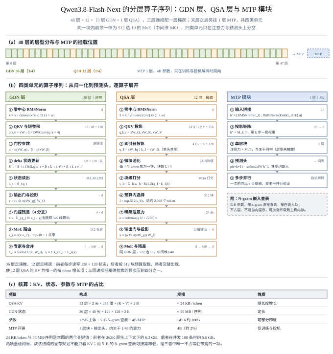

<b>图 4-6</b>　Kimi K3.1 Pro 的算子级分解：69 层 KDA 与 24 层 Gated DSA 并列，索引器 32 头对 top-2048 打分，专家侧为 3584 维潜空间的 896 选 16。图源：据官方模型卡绘制 [15][16]

# 第 5 章　MiMo 系列

MiMo 一系以滑动窗口注意力（SWA）配少量全局注意力层（GA）为骨架。V2.5 完成原生全模态化，V2.6 把重心移到规模化 Agentic 强化学习；两者的结构选择都偏向压低单 token 计算量，因为 RL rollout 的算力开销随轨迹长度与条数成倍放大。

## 5.1　MiMo-V2.5

MiMo-V2.5 系列（2026 年）包含 Pro 与标准版两款，均支持 1M token 上下文，语言主干继承 MiMo-V2-Flash 的混合滑动窗口注意力（SWA）与全局注意力（GA）设计[17]。官方架构图见图 5-1，主要超参数见表 5-1。

<b>表 5-1</b>　MiMo-V2.5 系列主要超参数

| 项目 | V2.5-Pro | V2.5 |
|---|---|---|
| 总参数/激活参数 | 1.02T/42B | 310B/15B |
| 层数（1 稠密 + 其余 MoE） | 70 | 48 |
| GA/SWA 层 | 10/60 | 9/39 |
| 隐藏维 | 6144 | 4096 |
| 头数（Q/KV） | 128/8 | 64/8（GA）、4（SWA） |
| 头维（QK/V） | 192/128 | 192/128 |
| 路由专家（激活） | 384（top-8） | 256（top-8） |
| 预训练 | 27T token | 48T token |
| MTP | 3 层 | 3 层 |

SWA 与 GA 约按 5:1 至 6:1 交错，滑窗仅 128 token，配合可学习的 attention sink bias，KV Cache 存储降低近 6 倍。MoE 为细粒度路由专家（top-8，无共享专家），第 0 层为稠密 FFN（中间维 16384）以稳定早期表征。MTP 采用 3 层轻量模块（密集 FFN）。标准版为原生全模态：729M 视觉编码器（28 层：24 SWA + 4 全注意力，行/列窗口交替）与 261M 音频编码器（初始化自 MiMo-Audio）。训练以 FP8 混合精度完成，经五阶段流程（文本预训练、投影层预热、多模态预训练、SFT 与上下文 32K→256K→1M 逐步扩容、RL 与 MOPD 多教师蒸馏）。

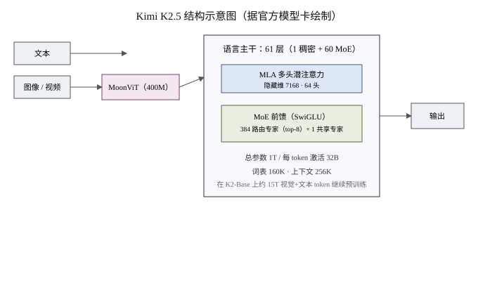

<b>图 5-1</b>　MiMo-V2.5 架构图。图源：小米 MiMo 官方发布页 [17]

与结构配套的推理优化包括 KV Cache 双池与 SWA-aware 前缀树、GCache 分级缓存（GPU 闲余内存 + NVMe SSD，RDMA 读 170 GB/s）、KV Cache 亲和调度，使单机吞吐提升约 30%。滑窗 128 配少量全局层的做法，把 1M 上下文的 KV Cache 压到可管理的范围；与此同时，缓存分层与调度亲和性已不再是纯粹的系统问题，而要与模型结构一并考虑。

滑窗与全局两套掩码共用同一次打分，其算子级安排见图 5-2。

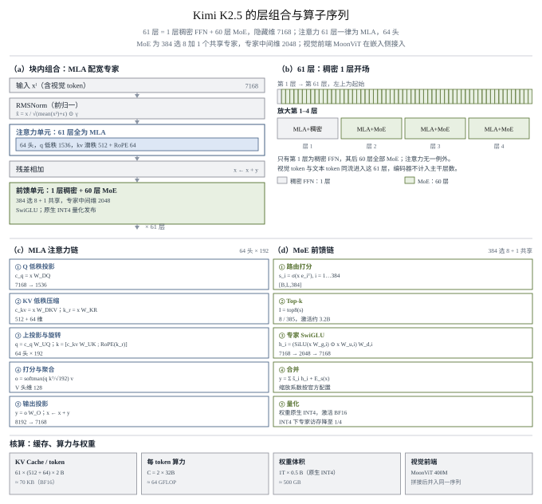

<b>图 5-2</b>　MiMo-V2.5 的算子级分解：滑窗与全局两套掩码共用一次打分，sink 偏置并入注意力，MoE 为 384 选 8 且无共享专家，第 0 层为稠密前馈。图源：据官方发布页与模型卡绘制 [17]

## 5.2　MiMo-V2.6

MiMo-V2.6 于 2026 年 9 月发布（MIT 协议开源），在 V2.5 结构上升级为原生全模态（文本、图像、音频、视频），并把重心放在规模化 Agentic 强化学习上[18]。官方架构图见图 5-3。

规格上，Pro 为 1.02T/42B（70 层 = 60 SWA + 10 GA），Flash 为 309B/15B（48 层 = 39 SWA + 9 GA，256 专家 top-8），滑窗 128，上下文 1M。全模态前端包括 MiMo-ViT（681M，28 层 = 24 SWA + 4 GA，sink-augmented 滑窗，行/列主序逐层交替，以 4T 图像 token 从头训练）；音频通路由 308M 音频 tokenizer（20 层残差向量量化，25 Hz 帧映射为 20 个离散 token）与 127M patch 编码器（4 帧/patch，把进入主干的速率降到 6.25 Hz）串联。投机解码采用 5 层 DFlash block-diffusion 模块（滑窗 1024），一次前向预测 7 个后续 token 并行验证；RL 阶段改用 rollout 日志微调的 block-6 DFlash drafter，平均接受长度提高 31.3%。

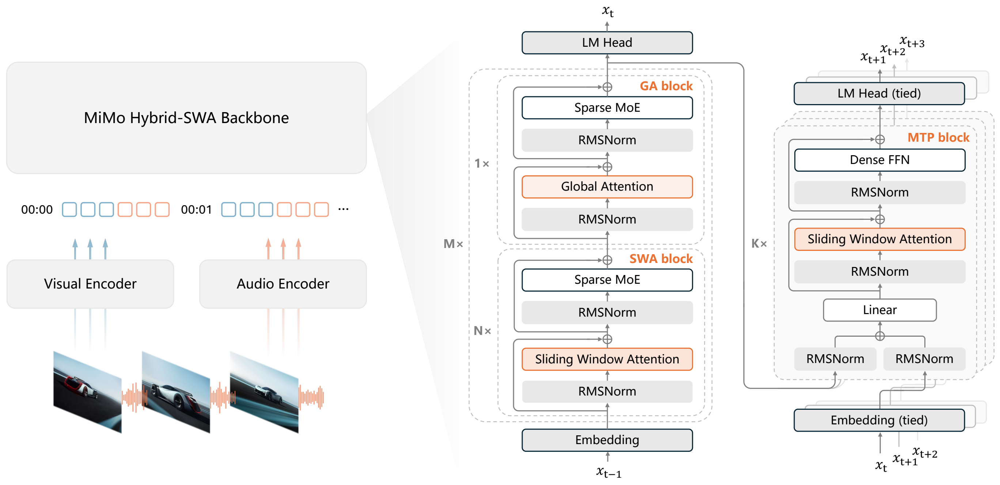

<b>图 5-3</b>　MiMo-V2.6 架构：全模态编码器、SWA/GA 混合主干与 MTP 模块。图源：MiMo-V2.6 技术报告 Figure 1 [18]

V2.6 的规模压力主要来自 RL：单个 RL step 采样 1568 个 prompt、每个 16 条 rollout，合计约 2.5 万条 Agent 轨迹、27～37 亿 token，单条轨迹平均 11～15 万 token，训练上下文最高 1M；Rollout、Grading、Training 三段算力解耦，各自独立扩展。rollout 一旦成为主要算力负载，单 token 计算量、轨迹长度与轨迹数三者的乘积便直接决定总开销，SWA 主导的轻量注意力、内置投机解码与算力解耦因此都成为必要选择，推理硬件与训练硬件的分工也由此更清楚。

全模态接入与草稿块在算子层面各占一段，位置见图 5-4。

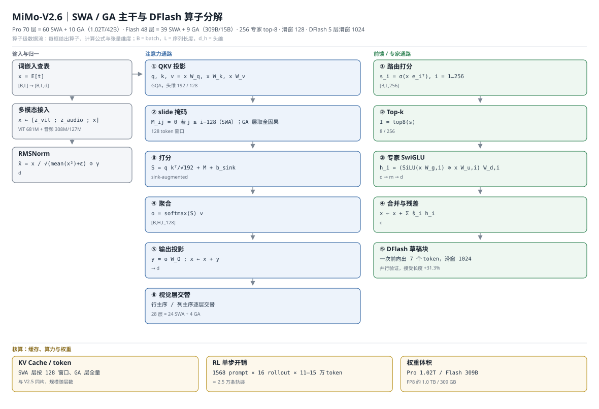

<b>图 5-4</b>　MiMo-V2.6 的算子级分解：SWA 与 GA 的掩码分支、全模态编码器的接入顺序，以及 DFlash 草稿块一次前向验证多 token 的流程。图源：据官方技术报告绘制 [18]

# 第 6 章　LongCat 系列

LongCat-2.0 是美团 2026 年发布的万亿参数模型，特殊之处在全流程使用国产算力集群，并以零计算专家实现 token 级动态激活。本章只讨论这一版。

## 6.1　LongCat-2.0

LongCat-2.0 于 2026 年 6 月 30 日发布，7 月 6 日开源（MIT），总参数 1.6T，每 token 平均激活约 48B（动态区间 33B～56B），上下文 1M token，预训练超过 30T token，稀疏度约 97%；是首个在五万卡国产算力集群上完成从预训练到推理全流程的万亿模型[19][20]。

结构上引入三项设计。注意力部分为 LSA（LongCat Sparse Attention），在 DSA 的轻量索引器上作三项正交改造：流感知索引（SI）把碎片化的显存访问改为硬件对齐的连续读取，跨层索引（CLI）让相邻若干层共用一次索引结果，层级化索引（HI）先作块级粗召回，再在候选内作 token 级细选。三项可独立开启或关闭，整体结构见图 6-1。跨层索引同样用于 3 步 MTP 投机解码：目标模型每两层共用一次索引，草稿模型的三个步次共用第一步生成的索引集。推理侧另有 absorb 计算模式、索引器与 MLA prolog 并行、KVP 切分 KV Cache 等配套，使 1M 上下文下仍能保持信息定位。

<b>图 6-1</b>　LongCat-2.0 的稀疏注意力架构：左侧索引生成层由块索引器与 token 索引器分两级打分，Top-k Selector 把 KV 分为非连续与连续两类预算；右侧复用层直接沿用前一层的索引结果。图源：LongCat 官方发布博客「LongCat 稀疏注意力设计总览」[19]

N-gram Embedding 从 LongCat-Flash-Lite 继承，n-gram size 取 5，含 135B 参数，在与 MoE 正交的稀疏维度上扩容；推理时把参数从专家移到嵌入表，可降低大 batch 解码的显存 I/O。零计算专家加 ScMoE 实现 token 级动态激活：简单 token 不消耗专家算力，复杂 token 自动获得更多计算资源；路由到零专家的 token 跳过传输与计算，Dense 与 MoE 分支借国产芯片的控核能力作物理核心级并行。

后训练以 MOPD 多专家融合组织：Agent、Reasoning、Interaction 三组专家分别专攻工具调用与自主纠错、数学与 STEM 推理、指令遵循与交互体验，经多教师同策略蒸馏融为统一模型，结构见图 6-2。

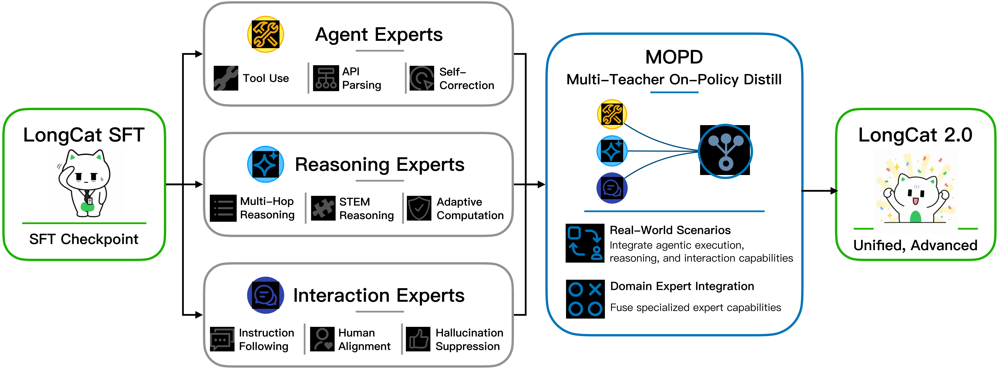

<b>图 6-2</b>　MOPD 多专家后训练架构：三组领域专家经多教师同策略蒸馏融为统一模型。图源：LongCat 官方发布博客「基于 MOPD 的多专家后训练架构总览」[19]

国产算力路径是这一版最直接的约束：针对显存与带宽受限的国产芯片，团队以 Super Kernel 减算子、权重预取隐藏 I/O、PD 分离、异步 EP 负载均衡等手段，把万亿模型跑进存量卡。此外，动态激活区间 33B～56B 意味着每 token 的计算量本身成为变量，负载不均从批间问题变成 token 间问题，调度器与互联都要按此设计。

三级索引与零计算专家在同一层内串联，算子级走向见图 6-3。

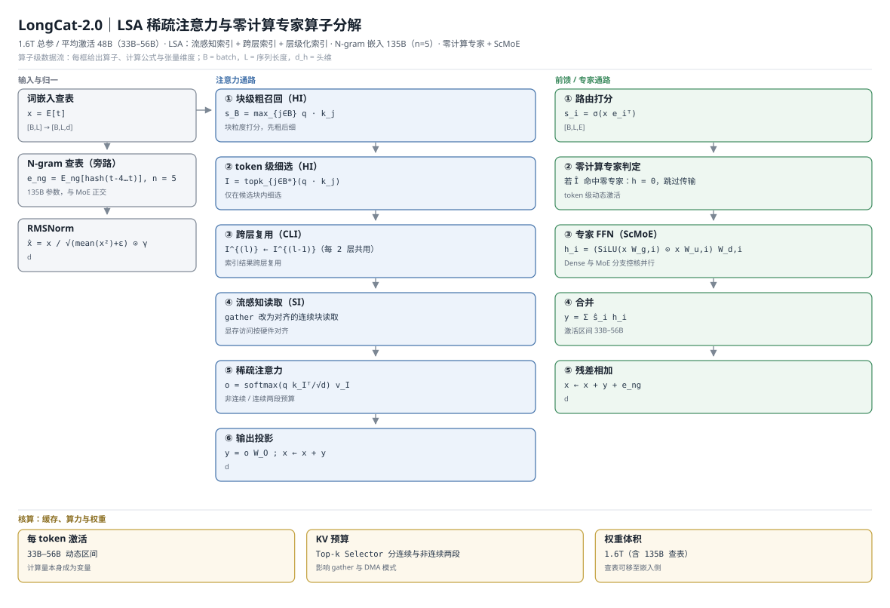

<b>图 6-3</b>　LongCat-2.0 的算子级分解：LSA 的块级粗召回与 token 级细选两级索引、跨层复用与流感知读取，配零计算专家与 N-gram 旁路；底部为激活区间与 KV 预算的核算。图源：据官方发布博客与技术说明绘制 [19]

# 第 7 章　GLM 系列

GLM 的 5、5.2 与 5.3 三代连续沿用 DSA 稀疏注意力，规模同为 744B/40B。前两代的差别在上下文长度与索引器复用：5.2 以 IndexShare 把索引器开销摊到多层，并把上下文扩到 1M。5.3 的结构与 5.2 完全相同，增量全部来自后训练。

## 7.1　GLM-5

GLM-5 于 2026 年 2 月发布（MIT 协议），把 GLM-4.5 的 355B/32B 扩展到 744B 总参、40B 激活，预训练数据由 23T 增至 28.5T token，面向复杂系统工程与长程 Agent 任务[21]。结构示意见图 7-1。

GLM-5 采用更深更窄的 MoE 布局（约 80 层、256 个专家），并在注意力中直接引入 DeepSeek 的 DSA 稀疏注意力，在保留长上下文能力的同时压低部署成本；这是第三方旗舰首次整体采纳 2.2 节所述的稀疏注意力路线。训练侧另有两项改动：Muon Split 使 MLA 达到 GQA-8 的性能水平（以 20B token 追平 DeepSeek 943.7B token 的对照效果），可见注意力结构与优化器的耦合在加深；slime 异步 RL 基础设施支撑了细粒度的后训练迭代。上下文为 202K。

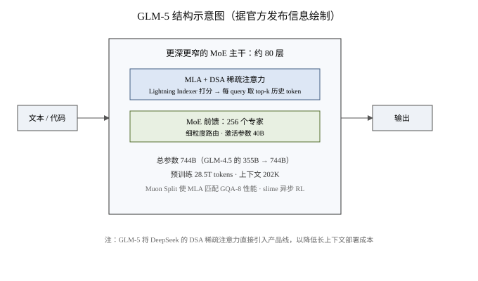

<b>图 7-1</b>　GLM-5 结构示意图：更深更窄的 MoE 主干与 DSA 稀疏注意力。图源：据官方发布信息绘制（官方未公开原始架构图）

与前代 355B/32B 相比，容量增长主要由专家数承担，激活参数只增加 8B；DSA 的引入则把索引器开销带进了原本没有这一部件的注意力栈。

索引器在算子层是新加的一段，其位置见图 7-2。

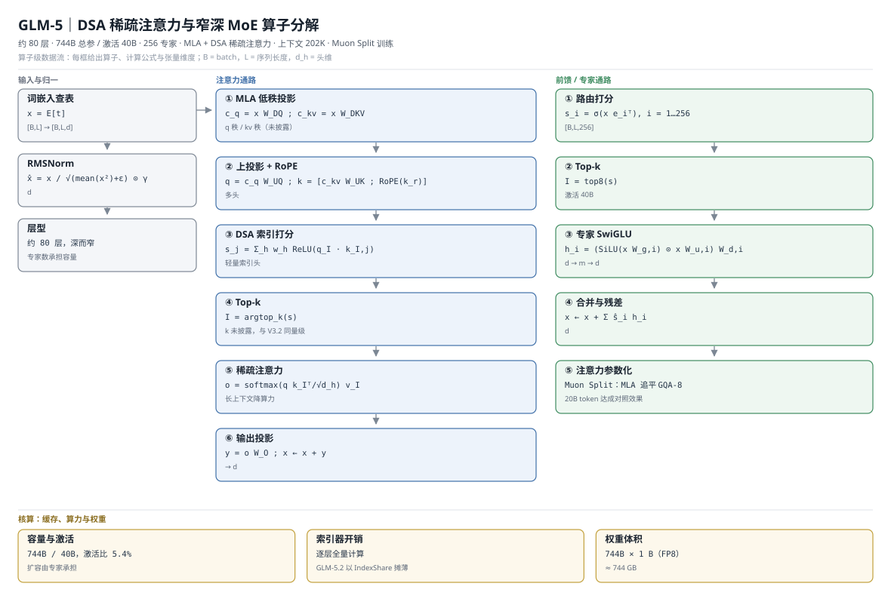

<b>图 7-2</b>　GLM-5 的算子级分解：MLA 投影后接 DSA 的索引打分与 top-k，专家侧为 256 选 8 的窄深布局。图源：据官方发布信息绘制 [21]

## 7.2　GLM-5.2

GLM-5.2 于 2026 年 6 月发布（MIT），在 744B/40B 的规模上把上下文做到 1M token，并公开了较完整的结构细节[22]。官方架构图见图 7-3。

主体为 78 层（前 3 层稠密 MLP、中间维 12288，其余 75 层 MoE），隐藏维 6144，词表 154,880；MoE 为 256 个路由专家（top-8）加 1 个共享专家，专家中间维 2048，采用 sigmoid 无辅助损失偏置路由（noaux_tc bias）、归一化 top-k，路由缩放 2.5，不使用组限制路由。注意力为 MLA + DSA + IndexShare：MLA 参数为 q 低秩 2048、kv 低秩 512、64 头（无 GQA），qk 无位置 192 + RoPE 64（qk 头维 256）、v 头维 256；Lightning Indexer（32 头、头维 128、FP8）对原始位置打分，取 top-2048 因果 key。IndexShare 的关键在索引器分层复用：仅 21 个 full 层（前 3 层与此后每 4 层）持有索引器，其余 57 个 shared 层直接复用前一 full 层的 top-k 索引，索引器计算降至逐层配置的 27%，1M 上下文下每 token 的索引相关 FLOPs 相应下降；模型自中期训练（128K 序列长度）起即带着 IndexShare 训练，而非事后附加。位置编码方面，RoPE θ 提高到 8×10⁶，最大位置 1,048,576，无需 YaRN 外推。MTP 为 1 层，同样应用 IndexShare 与 KVShare 以消除多步草稿的训练与推理不一致，配合拒绝采样与端到端 TV 损失，平均接受长度由 4.56 提升至 5.47（+20%）。

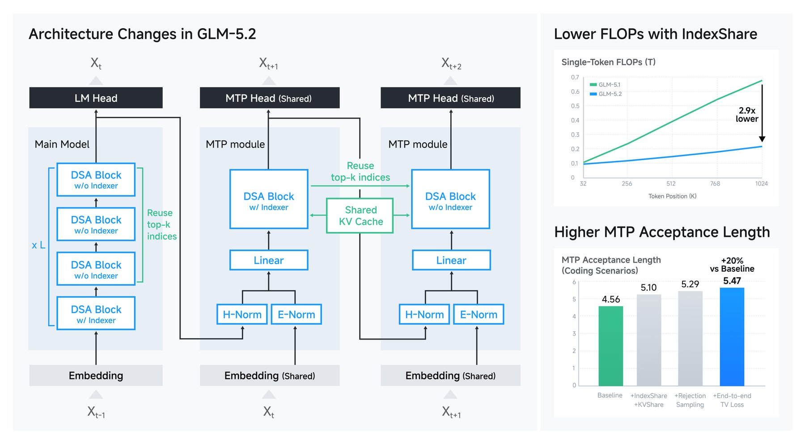

<b>图 7-3</b>　GLM-5.2 的 IndexShare 架构：每 4 个稀疏注意力层共享 1 个索引器，其 top-k 索引复用于后续 3 层。图源：智谱官方博客架构图 [22]

IndexShare 针对的是稀疏注意力的一项实际代价：索引器若仍是每层全量开销，稀疏化的收益便被抵消；算一次、用四层，是把收益兑现出来的工程做法。1M 上下文下，推理瓶颈也由计算移到 KV Cache 容量与长上下文 kernel 开销。

索引器复用之后，层与层之间多出一条索引传递边，算子级结构见图 7-4。

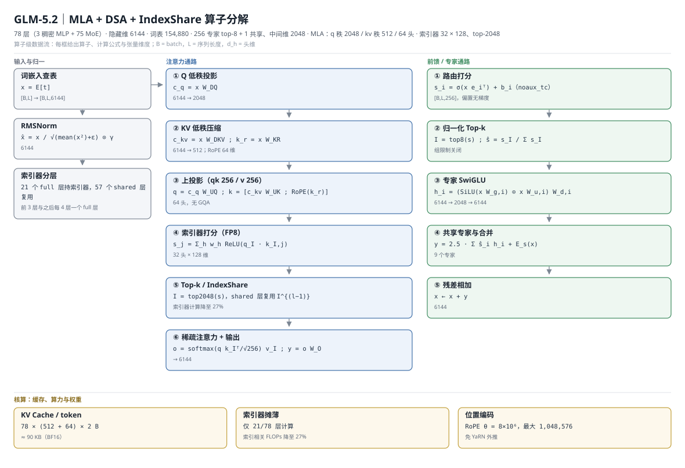

<b>图 7-4</b>　GLM-5.2 的算子级分解：21 个 full 层持索引器、其余 shared 层复用 top-k，MLA 的 q 秩 2048 与 kv 秩 512 分列，专家为 256 选 8 加共享专家。图源：据官方博客与模型卡绘制 [22]

## 7.3　GLM-5.3

GLM-5.3 于 2026 年 8 月发布，权重在发布两周后开放[34]。官方的表述极为直接：基座与 GLM-5.2 相同，全部提升来自后训练 Scaling[34]。这一点可在权重配置上逐项复核——zai-org/GLM-5.3 的 config.json 与 5.2 相比，除新增的量化配置与框架版本号外，78 层、隐藏维 6144、64 头 MLA、256 专家 top-8 加 1 共享、索引器 21 full 与 57 shared、1M 上下文、MTP 1 层，逐项一致[35]。就地结构而言，7.2 节所述即 5.3 所述，本节不再重复，只讨论两件事：后训练如何在同一基座上换取能力，以及 FP8 发布形态的结构含义。

支撑后训练的是三件已有工作（图 7-5）。IndexShare 提供低成本的长上下文预填充，使 1M 序列的 rollout 不至于被索引器开销拖垮；SAO 即单条 rollout 异步优化（Single-rollout Asynchronous Optimization），以单条 rollout 取代组采样，配严格的双侧 token 级裁剪，使异步更新下的 off-policy 偏差可控，据其报告可稳定训练千步以上，并已用于 GLM-5.2 的训练流程[36]；slime 以 Megatron 训练、SGLang 采样共用一条数据流，训练与推理路径的 logprob 对齐到 1e-7 量级。三者叠加，长程任务的强化学习才具备工程可行性：环境数与训练时长可以继续加，而不必重建训练栈。

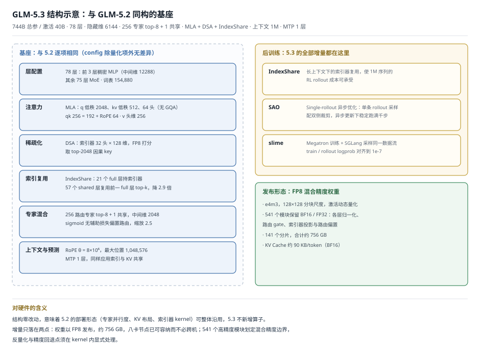

<b>图 7-5</b>　GLM-5.3 结构示意：基座与 GLM-5.2 逐项相同，78 层、256 专家、MLA + DSA + IndexShare 与 1M 上下文均未改动；增量集中在 IndexShare、SAO 与 slime 构成的后训练栈，权重以 FP8 混合精度发布。图源：据官方 config.json 与官方博客绘制 [34][35]

这一组事实的硬件含义比数字本身更值得记：后训练 Scaling 消耗的是采样与训练的算力，与推理部署无关；5.3 既未改动结构，服务端的并行切分、KV 布局与索引器 kernel 均可从 5.2 直接沿用，升级不产生新算子，也不产生新的通信模式。模型能力的代际提升与部署形态脱钩，升级只需替换权重。

唯一的新增变量是权重发布形态。5.3 以 FP8（e4m3）发布，128×128 分块尺度、激活动态量化，共 141 个分片、合计约 756 GB；541 个模块保留 BF16 或 FP32，包括各层归一化、路由 gate 及其偏置、索引器投影[35]。高精度模块的分布说明了取舍：凡参与归一化缩放、路由决策与索引打分的参数都不量化，因为这些位置的误差会经由 top-k 的离散选择被放大，而专家与投影矩阵的块内误差只表现为连续的数值扰动。

对加速器而言，这条边界需要显式支持：分块反量化在矩阵乘之前完成，尺度张量按 128×128 块索引，属访存而非算力开销；混合精度意味着同一层内并存两种权重格式，调度器不能按整层统一设定数据类型。至于容量，756 GB 摊到八卡需每卡 96 GB 以上，单机部署由此成立，跨机通信由必需降为可选；上一代以 BF16 发布时约 1.5 TB，八卡节点装不下，这一条并不成立。

其算子级位置见图 7-6。

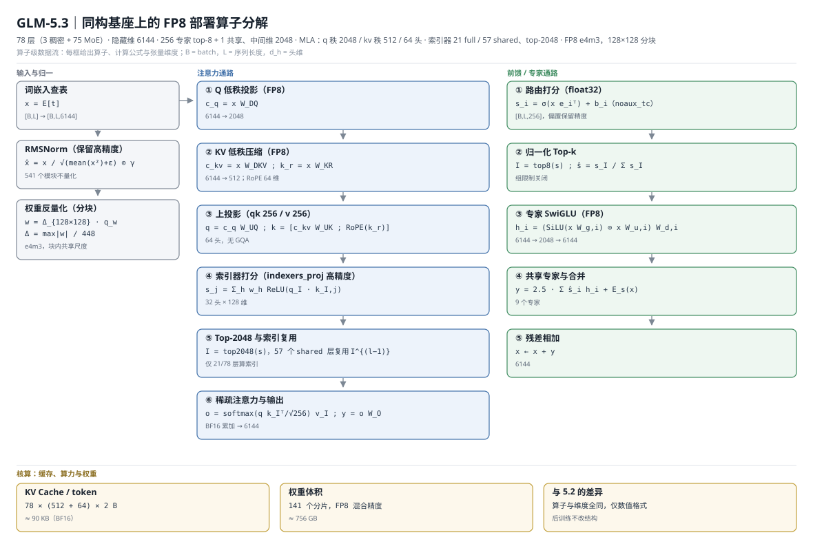

<b>图 7-6</b>　GLM-5.3 的算子级分解：与 5.2 同构的 MLA、DSA 与 top-8 专家通路，FP8 分块反量化插在权重读取与矩阵乘之间，归一化、路由 gate 与索引器投影留在高精度。图源：据官方 config.json 绘制 [35]

# 第 8 章　MiniMax 系列

MiniMax M3 与 M3.1 Flash 共用 428B/23B 的主干，差别在稀疏注意力的覆盖层数、数值格式与投机解码模块。两版均以 MSA（MiniMax Sparse Attention）为核心。

## 8.1　MiniMax M3 与 M3.1 Flash

M3 于 2026 年 6 月 1 日发布，M3.1 Flash 于同年 10 月 19 日发布，两者同为 428B 总参、23B 激活，上下文 1M token，原生多模态（文本、图像、视频输入）[23][24]。MSA 的官方架构图见图 8-1，两版的结构对比见表 8-1。

<b>表 8-1</b>　MiniMax M3 与 M3.1 Flash 的结构对比

| 项目 | M3 | M3.1 Flash |
|---|---|---|
| 总参数/激活参数 | 428B/23B | 428B/23B |
| 主体 | 60 层（3 稠密 + 57 MoE），隐藏维 6144 | 同 M3 |
| MoE | 128 路由专家（top-4，sigmoid + 偏置）+ 1 共享专家 | 同 M3 |
| 注意力 | GQA 64 Q/4 KV，头维 128；MSA（前 3 层为全注意力） | MSA 全层化 |
| 稀疏配置 | 索引器 4 头对 128 行块打分，每 KV 头取 top-16 块 | 同 M3 |
| 数值 | BF16 | QAT：NVFP4 专家权重 + MXFP8 动态激活 |
| 投机解码 | EAGLE 式 MTP | DSpark 草稿头 |

MSA 的选择粒度落在块上：索引器（4 个索引头，与 4 个 KV 头对齐）对 128 token 的行块打分，每个 KV 头取 top-16 块（自身块必含），位置 2048 以内退化为精确稠密注意力。算子形态为 KV outer gather Q，以 KV 块为外层循环聚合命中的查询，每块只读一次、访存连续，比开源 Flash-Sparse-Attention、flash-moba 快 4 倍以上。由此，1M 上下文下每 token 计算量降至上一代的 1/20，预填充提速 9 倍以上、解码 15 倍以上，多组消融显示能力与全注意力基本持平。M3.1 Flash 在此基础上作了三处改动：MSA 全层化（前 3 个全注意力层也换成稀疏）、量化感知训练（NVFP4 打包专家权重 + MXFP8 动态激活）、以 DSpark 投机解码草稿头取代 MTP；线上推理达 200+ TPS，成本较 M3 下降约 70%。视觉侧为 CLIP 式视觉塔（32 层，patch 14，3D-RoPE，动态分辨率 + patch-merge 压缩）。

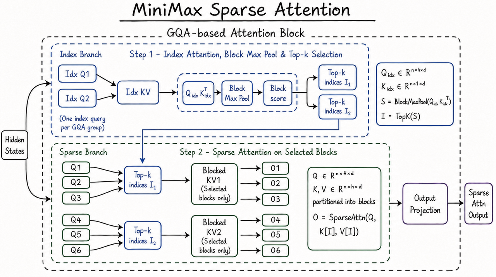

<b>图 8-1</b>　MiniMax M3 的 MSA（MiniMax Sparse Attention）架构。图源：MiniMax 官方博客 [23]

MSA 的稀疏化收益能否兑现，取决于 kernel 的算术强度与访存连续性，而不单在选择了多少 token。M3.1 Flash 的 QAT 加 NVFP4 则表明，训练阶段即按部署数值格式设计已渐成常法。

块级稀疏把聚合顺序倒置为以 KV 块为外层，算子级流程见图 8-2。

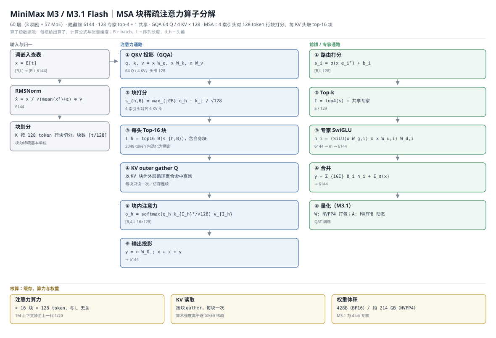

<b>图 8-2</b>　MiniMax M3 的算子级分解：MSA 的行块打分、每 KV 头 top-16 块与 KV outer gather Q 的聚合顺序，专家为 128 选 4 加共享专家；底部为块稀疏的算力核算。图源：据官方博客与模型卡绘制 [23]

# 第 9 章　Hunyuan 系列

腾讯混元的 Hy 系列在 Hy4 上更换了主干结构。上一代 Hy3 仍用 GQA 全注意力配常规残差，Hy4 改用稀疏注意力、跨层索引复用与多路残差，并把上下文从 256K 提到 1M。本章讨论 Hy4 的 preview 与正式版，结构规格以官方模型卡为准。

## 9.1　Hy4

Hy4 preview 于 2026 年 8 月底以 Apache 2.0 协议开源，总参数 770B、每 token 激活 49B，原生上下文 1M；11 月 4 日发布的正式版沿用同一主干，首次加入视觉理解与 Computer Use（命令行与图形界面操作），并同步提供模型系统卡片[25][26]。结构示意见图 9-1，与 Hy3 的对照见表 9-1。

主干 78 层，隐藏维 6144，词表 120,832。第 1 层为稠密 FFN（中间维 18432），其余 77 层为 MoE：每层 256 个路由专家（top-8）加 1 个共享专家，专家中间维 2048。注意力为 Gated DSA，64 个头，查询压缩维 2048、键值压缩维 512，索引器 32 头、头维 128、每个查询取 top-2048；配套的 IndexCache 允许部分层复用邻近层已算出的稀疏索引，省去逐层重复筛选。残差通路采用 iHC（identity Hyper-Connections），把单一残差流扩为 4 条，层间混合矩阵固定为单位矩阵。主干之外另置 1 层原生 MTP（10B 总参、0.7B 激活）用于投机解码。权重提供 BF16 与 FP8 两种格式，文件合计约 1.56TB。

<b>表 9-1</b>　Hy3 与 Hy4 preview 的规格对照

| 项目 | Hy3 | Hy4 preview |
|---|---|---|
| 总参数/激活参数 | 295B/21B | 770B/49B |
| 层数 | 80 | 78（1 稠密 + 77 MoE） |
| 隐藏维 | 4096 | 6144 |
| 注意力 | GQA 全注意力 | Gated DSA + IndexCache |
| 路由专家 | 192 | 256（top-8）+ 1 共享 |
| 残差 | 常规单流 | 4 路 iHC |
| MTP | 3.8B | 1 层，10B/0.7B 激活 |
| 词表 | 未公开 | 120,832 |
| 上下文 | 256K | 1M（1,048,576） |
| 数值 | 未公开 | BF16/FP8 |

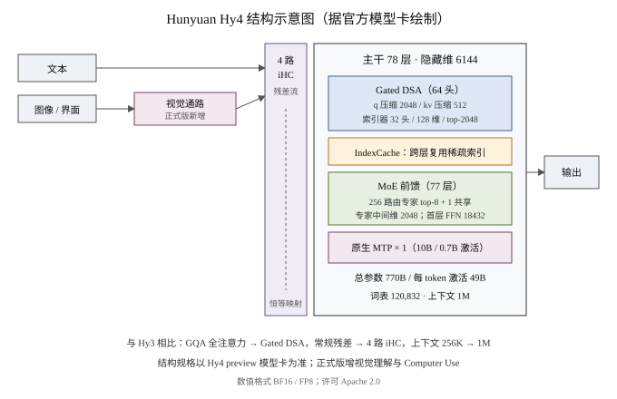

<b>图 9-1</b>　Hunyuan Hy4 结构示意图：4 路 iHC 残差、Gated DSA 配 IndexCache、77 层 MoE 与原生 MTP 层。图源：据官方模型卡绘制（官方未公开原始架构图）

与 Hy3 相比，Hy4 的层数反而少两层，扩容主要来自隐藏维与专家数的增加，以及注意力、残差两处结构的更换。官方给出的部署要求为 vLLM 0.29.0 以上或源码构建的 SGLang，配 FLASHMLA_SPARSE 后端与专用解析器，自部署参考配置为 8×B300。正式版新增的视觉通路与工具调用未改动主干规格，但把长任务中的多轮交互、界面状态与截图一并纳入输入序列。

这一版给硬件的约束分两层。索引器与 IndexCache 把稀疏注意力的开销从每层各算一次改为若干层复用一次，加速器需支持索引结果的跨层缓存与生命周期管理，而不单是优化单次 kernel；4 路 iHC 把残差状态扩为四份完整副本，层间读写量与片上缓冲随之增加。770B 权重配 1M 上下文，容量与带宽仍是主要瓶颈，FP8 检查点与原生 MTP 分别从权重体积和解码串行度两侧压低部署代价。

四路残差与索引缓存都要在算子层面各占一步，结构见图 9-2。

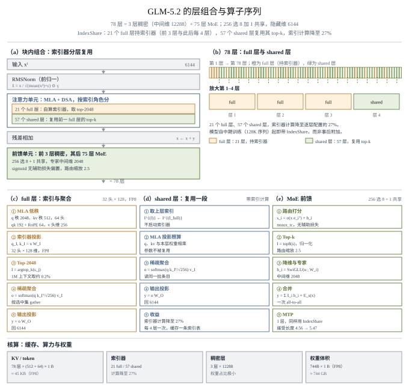

<b>图 9-2</b>　Hunyuan Hy4 的算子级分解：Gated DSA 的 q 与 kv 压缩、IndexCache 复用、iHC 四路残差的展开与回写，专家为 256 选 8 加共享专家。图源：据官方模型系统卡片绘制 [25]

# 第 10 章　StepFun 系列

阶跃星辰的 Step 系列此前以 Step-3.5-Flash 与 Step-3.7-Flash 等中等规模模型为主，Step 5 直接进入 600B 级稀疏 MoE。这一代的改动集中在两处：主干取窄深配置以拉长信息传播路径，注意力则以滑窗与稀疏全局层的分工换取百万上下文。

## 10.1　Step 5 Preview

Step 5 Preview 于 2026 年 9 月 20 日发布并开放 API，10 月 15 日开放权重，总参数 600B、每 token 激活 27B，原生支持文本、图像与视频输入，上下文 1M token，按 StepFun Model License 1.0 发布[27][28]。结构示意见图 10-1，主要规格见表 10-1。

主干 92 层，隐藏维 4096，FFN 中间维 13824，词表 128,896。层型按三层滑窗接一层全局的节奏排布：69 层为窗口 512 的滑动窗口注意力，23 层为全局注意力。两类层同为 GQA，64 个查询头、4 个键值组、头维 192，并在注意力输出端加逐头门控。全局层另接稀疏索引，以 16 个索引头、proxy 维 256、RoPE 32 维对历史块打分，按 top-512 选出相关块，块压缩粒度为 8；索引器对查询用 RMSNorm、对键用 LayerNorm，打分函数为 ssmax。滑窗层不设索引器，只覆盖 512 token 的窗口。位置编码上，滑窗层用 10,000 的 RoPE 底数，全局层提高至一千万，并把部分旋转维度压到三分之一，位置范围按 Llama 3 式频率缩放设为 1M。

前 3 层与末层为稠密 FFN，第 3 至 90 层为 MoE（88 层）：每层 352 个路由专家，top-8 路由加 1 个共享专家，专家中间维 1536，路由带偏置项与 3.0 的缩放系数。主干末端接 3 层多 token 预测模块，供投机解码使用。视觉前端为 47 层感知编码器，输入 728×728、patch 14、宽 1536、16 头，经 stride 2 的投影器把单图压到 169 个 token；视频按自适应帧率采样，经时间注意力编码后与文本 token 同流进入主干。

<b>表 10-1</b>　Step 5 Preview 主要规格

| 项目 | 规格 |
|---|---|
| 总参数/激活参数 | 600B/27B |
| 层数 | 92（88 层 MoE，其余 4 层稠密 FFN） |
| 隐藏维/FFN 中间维 | 4096/13824 |
| 注意力 | GQA 64 Q/4 KV，头维 192，逐头门控 |
| 层型 | 69 层滑窗（512）+ 23 层全局 |
| 稀疏索引 | 16 头，top-512，块 8，proxy 维 256 |
| 路由专家 | 352（top-8）+ 1 共享，中间维 1536 |
| MTP | 3 层 |
| 词表 | 128,896 |
| 上下文 | 1M（1,048,576） |
| 视觉编码器 | 47 层，728²，patch 14，宽 1536 |
| 数值 | BF16（约 1.2TB）/FP8（约 600GB） |

<b>图 10-1</b>　Step 5 Preview 结构示意图：多模态编码器接 92 层窄深主干，注意力按 69 层滑窗与 23 层全局稀疏分工，MoE 取 352 专家 top-8，末端接 3 层 MTP。图源：据官方 config.json 与模型卡绘制（官方未公开原始架构图）

百万上下文下的访存结构由层型分工决定。69 层滑窗只需保留 512 token 的键值，可按环形缓冲滚动覆盖，缓存容量与序列长度无关；真正随上下文增长的是 23 层全局注意力的缓存，其规模约为同等层数全注意力模型的三分之一。索引器把全局层的选块成本压到稠密基线的八分之一左右，但索引打分、top-k 选择与块合并是独立于注意力的三段计算，加速器需为其保留单独的 kernel 与中间缓冲。残差流以 FP32 保存，层间读写量约为 BF16 残差的两倍。352 个专家、top-8 的路由使专家并行的通信量随卡数上升，官方部署配置以 TEP 与 DEP 两种切分为主，在 B300 上启用 MegaMoE 后端，H200 上回落到默认 MoE 后端。

权重方面，BF16 检查点约 1.2TB，FP8 约 600GB（e4m3、128×128 分块、动态激活）。按 80GB 显存计，FP8 需单机 8 卡并置，BF16 则要跨两节点 16 卡；1M 上下文的 KV Cache 与运行时缓冲还须另行预留。92 层窄深结构是这一代最直接的硬件约束：单 token 解码要串行穿过 92 层，层间同步与流水气泡的代价高于同参数量的宽浅模型；预填充阶段因层数多、每层计算量小，更适合以较大的批内 token 数摊薄调度开销。3 层 MTP 则在解码并行度上作出补偿。

滑窗层与全局层的算子序列在索引一段分岔，见图 10-2。

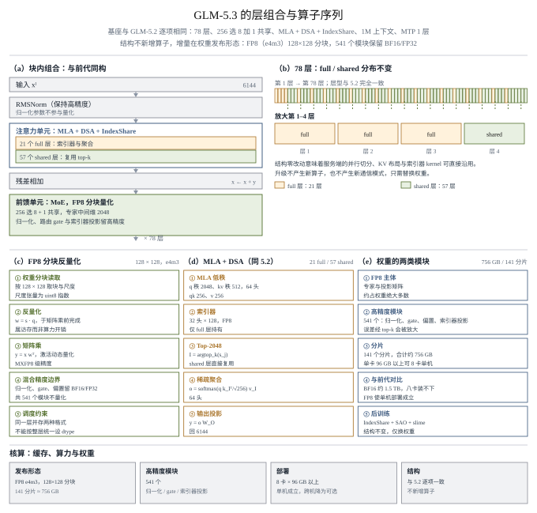

<b>图 10-2</b>　Step 5 Preview 的算子级分解：69 层滑窗与 23 层全局的分工、全局层的块索引与 top-512 选择、逐头输出门控，以及 352 选 8 的专家路由；底部为两类层型各自的缓存量。图源：据官方 config.json 与模型卡绘制 [27]

# 第 11 章　Mistral 系列

Mistral 的 Large 系列两代相隔约一年，规模由 675B/41B 增至约 1T/49B，注意力由常规稀疏 MoE 转为 MLA 配索引器稀疏。两代都随权重提供量化检查点。

## 11.1　Mistral Large 3

Mistral Large 3 于 2025 年 12 月 2 日发布（Apache 2.0），是 Mistral 自 Mixtral 以来的首个 MoE 旗舰：总参数 675B、激活 41B，上下文 256K，支持文本与图像输入，在 3000 张 NVIDIA H200 上从零训练[29]。结构示意见图 11-1。

作为稀疏 MoE，Large 3 单次前向仅激活 41B，同能力下每 token 成本约为同规模稠密模型的一半（官方 API 定价约为 GPT-5.1 的一半）。模型具备图像理解与多语言能力，同时发布 base 与 instruct 版本。发布物中包含 NVFP4 检查点（由 llm-compressor 构建），单节点 8×A100/H100 即可经 vLLM 运行；NVIDIA 协同提供 Blackwell 注意力与 MoE kernel、预填充/解码分离与投机解码支持。

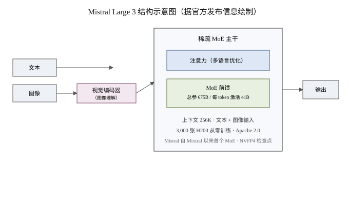

<b>图 11-1</b>　Mistral Large 3 结构示意图：675B/41B 稀疏 MoE 与图像输入通路。图源：据官方发布信息绘制（官方未公开原始架构图）

675B 级 MoE 可在单节点 8 卡部署，把旗舰模型的硬件门槛降到这一档；量化检查点随权重一同发布，也不再是事后的补充。

官方未披露层数与专家拓扑，算子骨架只能按可核实项列出，见图 11-2。

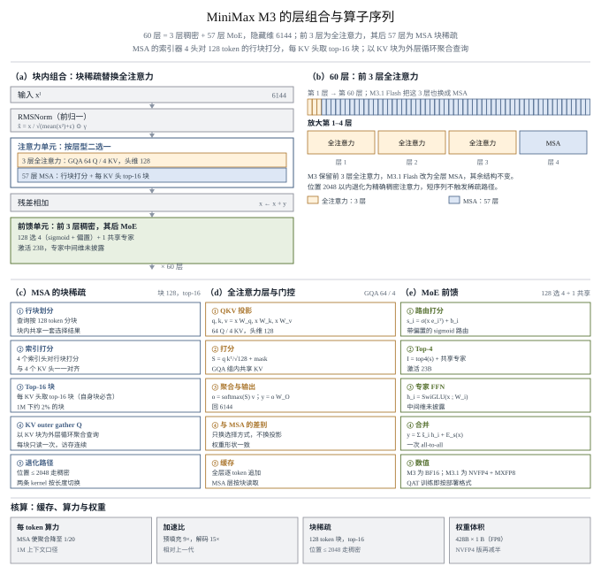

<b>图 11-2</b>　Mistral Large 3 的算子级分解：官方未披露层数与专家拓扑，图中以符号记维度，仅保留可核实的激活比、数值格式与部署配置。图源：据官方发布信息绘制 [29]

## 11.2　Mistral Large 4

Mistral Large 4（代号 Le Chonk）于 2026 年 10 月 6 日预览、10 月 29 日开放权重，总参数约 1T（文档作 1.05T）、每 token 激活 49B（含嵌入与输出层为 52B），上下文 1M token，在 Mistral 欧洲自建数据中心以 3800 张 NVIDIA Grace Blackwell 从零训练，是西方首个万亿级开源权重模型[30]。表 11-1 对比两代 Large 的主要规格，图 11-3 给出技术报告中的注意力结构图。

<b>表 11-1</b>　Mistral Large 3 与 Large 4 主要规格对比

| 项目 | Large 3 | Large 4 |
|---|---|---|
| 总参数/激活参数 | 675B/41B | 约 1T（1.05T）/49B |
| 主体 | 稀疏 MoE | 72 层（1 稠密 + 71 MoE） |
| 路由专家（激活） | 未公开 | 128（top-4）+ 1 共享 |
| 注意力 | 未公开 | MLA + 稀疏索引（32 索引头、头维 128、top-k 2048） |
| 上下文 | 256K | 1M（RoPE + YaRN） |
| 视觉 | 图像理解 | Pixtral 视觉编码器（1.6B，30 层，14px patch） |
| 数值 | NVFP4 检查点 | FP8（动态激活）/NVFP4 |
| 投机解码 | NVIDIA 协同支持 | DSpark 草稿头内置（3 层稠密 MLA，3-token 块，吞吐最高 1.9 倍） |

与 DeepSeek V4.1 的 CED、Kimi K3 的 KDA 不同，Large 4 沿用 MLA 加索引器稀疏的路线，并把 DSpark 投机解码草稿头随权重一并发布，投机解码由此从推理框架的特性变为模型自带的能力。部署方面，FP8 官方配方为 8×H200（服务至 131K 上下文），NVFP4 为 4×B200/B300，AMD MI350 重量化后 4 卡可跑；模型原生支持 160 余种语言，覆盖欧盟全部官方语言。

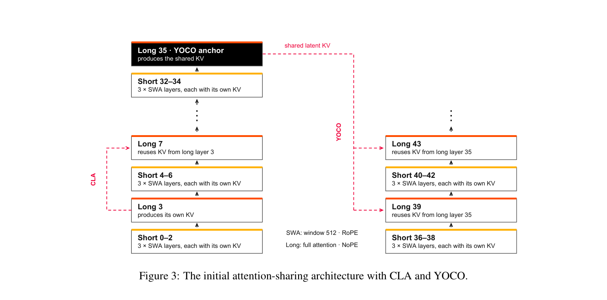

<b>图 11-3</b>　Mistral Large 4 技术报告中的注意力结构图：CLA 与 YOCO 的注意力共享架构探索。图源：Mistral Large 4 技术报告 Figure 3 [30]

这套结构对加速器的要求更接近既有 MLA 实现，主要增量在索引器与 DSpark 草稿头的调度，而非另起一套注意力 kernel。

MLA 与索引器、DSpark 草稿头三段并置后的结构见图 11-4。

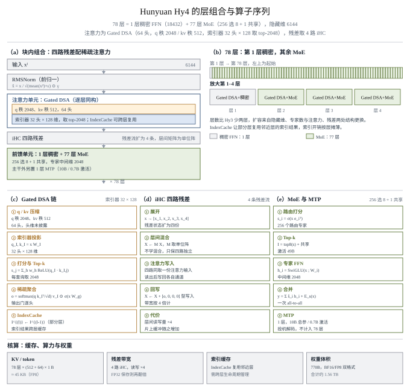

<b>图 11-4</b>　Mistral Large 4 的算子级分解：72 层中 71 层 MoE、MLA 加索引器稀疏、DSpark 三层草稿头并行验证；底部为 FP8 与 NVFP4 两种部署配方的容量核算。图源：据官方技术报告与模型卡绘制 [30]

# 第 12 章　Meta Muse 系列

本章讨论 Meta Muse 系列中公开权重的 Muse Spark Open。与前述各系不同，其语言主干不作注意力稀疏化，改动集中在归一化、残差与专家结构。

## 12.1　Muse Spark Open

该模型于 2026 年 10 月 15 日发布，原生多模态（文本、图像、音频、视频输入），面向 Agentic Coding，官方称其为迄今最强的美国开源权重模型[31]。官方架构图见图 12-1，主要规格见表 12-1。

<b>表 12-1</b>　Muse Spark Open 主要规格

| 项目 | 配置 |
|---|---|
| 总参数/激活参数 | 816B/42B |
| 语言主干 | 62 层，隐藏维 8192；词表 202,048（输入/输出嵌入解耦，各约 1.66B） |
| 注意力 | GQA 128 Q/16 KV，头维 64；门控注意力（输出门 + 输出归一化 + QK-norm） |
| 残差 | 可学习残差门融合输入输出（非简单相加） |
| MoE | 每层 256 专家、top-8；专家 FFN 8192→4096→8192 + 逐专家 RMSNorm；pooler/unpooler 降/升维 |
| 感知编码器 | 1.8B（50 层，隐藏维 1536，16 头，14×14 patch，输出 4096 维；每 4 层 + 末层全注意力，其余稀疏） |
| 音频 | tokenizer 每 80 ms 出 1 个 token（12.5 token/s） |
| 上下文 | 1M |
| 数值 | BF16（约 1.5TB）与 NVFP4（约 493GB，面向 Blackwell） |

语言主干的注意力不作稀疏化（仅感知编码器稀疏），而以 GQA 128 Q/16 KV、头维 64 的小 KV 头组控制缓存；官方文档另披露 62 层中 46 层为 2048 token 滑窗注意力、16 层为全注意力，1M 上下文的实际 KV Cache 约为全注意力方案的四分之一。归一化采用三明治式布局，每个 block 前后各一次（x + post_norm(F(norm(x)))）。专家部分设逐专家 RMSNorm 与 pooler/unpooler：先降维（8192→4096）再进专家，专家输出各自归一化后按路由权重求和，最后升维，顺序不可调换。残差融合同样经可学习残差门，而非直接相加。专家占总参约 97%，全部 256 个专家须驻留显存，因此部署按 816B 模型的内存需求准备，单 token 计算量却只相当于 42B 模型。模型提供 BF16 与 NVFP4 双格式，NVFP4 版可单节点 B200 运行，也可在两台 M5 Ultra Mac Studio（各 512GB 统一内存、1.2 TB/s 带宽）上以 MLX 分布式运行，是首个把万亿档模型带到桌面级内存配置的实例；另附可自动调优的 Helion GPU kernel。

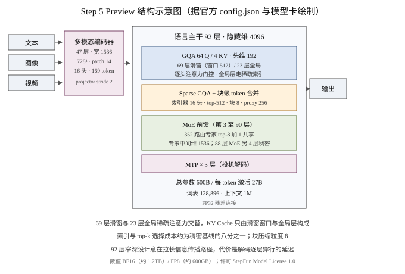

<b>图 12-1</b>　Muse Spark Open 架构：文本、图像/视频、音频各有编码通路，统一进入 62 层 MoE 语言主干。图源：Meta 与 Hugging Face 发布博客架构图 [31]

不追求注意力稀疏化，而以门控注意力、残差门、逐专家归一化等微结构提升稳定性，是与国产路线并行的另一种取舍。Apple Silicon 的统一内存能跑 816B 模型，也说明容量问题不必只靠显存解决：高带宽、大容量的内存池是另一条出路。

门控注意力与池化专家的算子序列见图 12-2，其中 pooler 与 unpooler 的顺序不可调换。

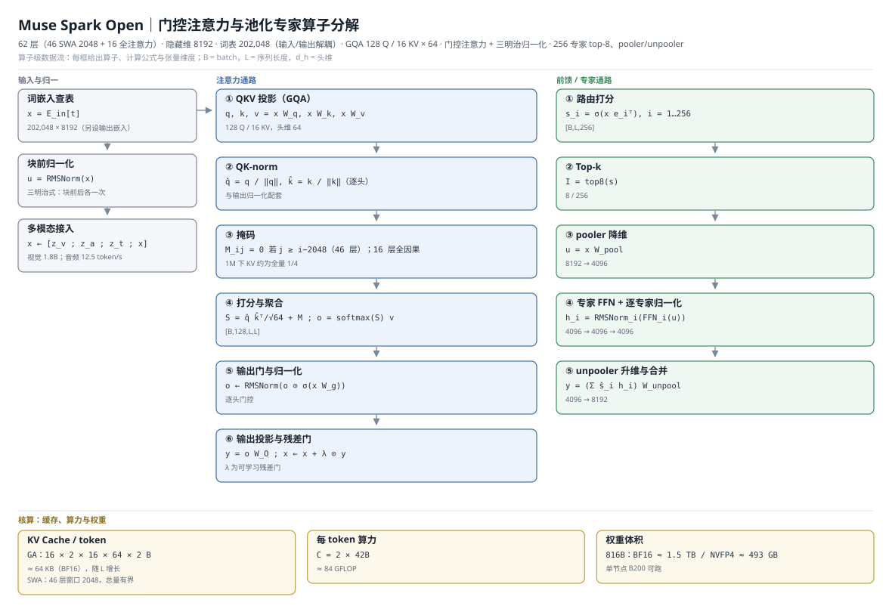

<b>图 12-2</b>　Muse Spark Open 的算子级分解：GQA 与 QK-norm、三明治归一化与输出门、pooler 降维后的逐专家归一化与 unpooler 升维。图源：据官方模型卡与发布博客绘制 [31]

# 第 13 章　Ling 系列

Ling 一系出自蚂蚁集团百灵团队。自 Ling 2.0 起，这一系把「高稀疏、细粒度」作为唯一骨架：同一套 256 个路由专家配 1 个共享专家的结构，从 16B 一路铺到 1T，形状由缩放定律先行确定，而非逐级试错。与前述各家以注意力稀疏换取长上下文不同，其改动集中在专家粒度与路由，注意力仍取标准 GQA。

## 13.1　Ling 2.0

Ling 2.0 系列自 2025 年 9 月起陆续开源，含 Ling-mini-2.0、Ling-flash-2.0 与 Ling-1T 三个规格，总参数由 16B 至 1T，每 token 激活 1.4B、6.1B 与 51B，激活比统一在 3.5% 左右，即 1/32[32][33]。三个规格同在 20T 以上 token 上预训练，结构取值另有出处：Ling Scaling Laws 以固定数据与路由规则的小规模实验拟合幂律，据此确定 256 个路由专家、每次激活 8 个、另加 1 个共享专家这一组配置，再向万亿规模外推。整体结构见图 13-1，三个规格的主要参数见表 13-1。

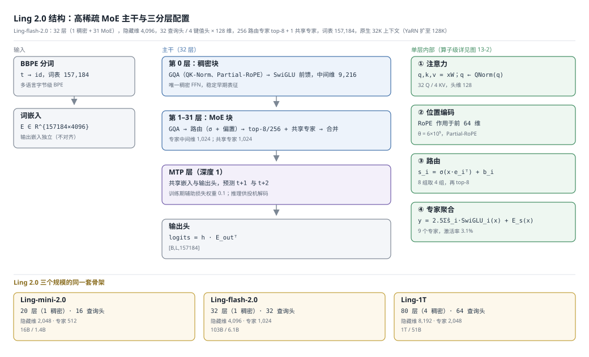

<b>图 13-1</b>　Ling 2.0 的整体结构：自左至右为 BBPE 分词与词嵌入、32 层主干（1 层稠密块 + 31 层 MoE 块 + 1 层 MTP）与独立输出头；右侧为单层内部的注意力、位置编码、路由与专家聚合四段；下方列出三个规格共用的骨架。图源：据官方技术报告表 1 与开源权重 config.json 绘制（官方未公开原始架构图）[32][33]

<b>表 13-1</b>　Ling 2.0 三个规格的主要结构参数

| 项目 | Ling-mini-2.0 | Ling-flash-2.0 | Ling-1T |
|---|---|---|---|
| 总参数/激活参数 | 16B/1.4B | 103B/6.1B | 1T/51B |
| 层数（稠密层） | 20（1） | 32（1） | 80（4） |
| 隐藏维 | 2048 | 4096 | 8192 |
| FFN 中间维 | 5120 | 9216 | 18,432 |
| 查询头/键值头 | 16/4 | 32/4 | 64/32 |
| 头维 | 128 | 128 | 128 |
| 路由专家（激活） | 256（top-8）+ 1 共享 | 同左 | 同左 |
| 专家中间维 | 512 | 1024 | 2048 |
| 词表 | 157,184 | 157,184 | 157,184 |
| 上下文 | 32K（YaRN 扩至 128K） | 同左 | 同左 |
| MTP | 1 层 | 1 层 | 1 层 |

以 Ling-flash-2.0 为例，其 6.1B 激活参数中非嵌入部分为 4.8B。主干 32 层，隐藏维 4096，第 0 层为稠密 SwiGLU 前馈（中间维 9216），其余 31 层为 MoE。注意力取标准 GQA，32 个查询头、4 个键值头、头维 128，键值头比即 8 比 1；查询与键在打分前各作一次 QK-Norm，位置编码只作用于头维的前 64 维，即 Partial-RoPE，θ 取 6×10⁵。这两处一并用于低精度训练的稳定性与长度外推能力，报告称 QK-Norm 在低精度下对训练稳定性的改善尤为明显。MoE 部分每层 256 个路由专家、激活 top-8，路由专家与共享专家的中间维均为 1024；路由以 sigmoid 打分再加逐专家偏置实现无辅助损失的负载均衡，选择时先按 8 组取 4 组、再在入选组内取 top-8，合并时乘 2.5 的缩放系数。词表 157,184，采用字节级 BPE，自 Ling 1.5 的 128K 扩至 156K；输入与输出嵌入不共享权重。主干末端接 1 层 MTP，训练时作辅助预测头，损失权重 0.1。原生上下文 32K，经 YaRN 外推至 128K。

需要说明一处口径差异：技术报告表 1 将 flash 的键值头记为 16，而开源权重的 config.json 为 4，本节从权重配置，表 13-1 同此。

算子级的分解见图 13-2，注意力与专家两段并列展开，投影、归一、打分、路由与合并各步的公式与张量维度均标注于框内。

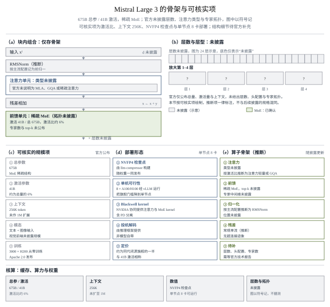

<b>图 13-2</b>　Ling-flash-2.0 的算子级分解：左列为词嵌入、RMSNorm 与层型划分，中列为 GQA 的投影、QK-Norm、Partial-RoPE、打分、聚合与输出投影，右列为路由打分、组限制 top-k、共享专家、专家 SwiGLU 与加权合并；底部给出每 token 的 KV Cache、算力与权重体积。图源：据官方 config.json 与模型卡绘制 [33]

1/32 的激活比把每 token 的计算量与权重读取量一并压到最小档：6.1B 激活对应约 12 GFLOP 的乘加，按 FP8 计每 token 需读取约 6.1GB 权重。KV Cache 只由 32 层、每层 4 个键值头、头维 128 构成，键与值各一份，FP16 下每 token 约 64KB，128K 序列约 8.4GB，与万亿级全注意力模型相差一个数量级以上。专家并行是这一系的主要通信负担：31 层各 256 个专家，top-8 加共享专家的路由使每层需要一次 all-to-all，组限制路由的两级选择又在层内多出一次跨组归约。QK-Norm 与 Partial-RoPE 属逐元素算子，每层新增的归一化量级为 2×32×128，数值上需以 FP32 累加，否则 FP8 下的归一化方差会失真。1 层 MTP 在推理端提供单步投机，其收益取决于草稿接受率，故训练时的 MTP 权重与后训练策略需一并设计。官方给出的效率口径是相对同等稠密结构约 7 倍的杠杆，H20 上 Ling-flash-2.0 的解码速度超过 200 token/s。

# 参考文献
[1] DeepSeek-AI. DeepSeek-V3 Technical Report. arXiv:2412.19437, 2024.

[2] DeepSeek-AI. DeepSeek-V3.2 模型卡. https://fe-static.deepseek.com/chat/transparency/deepseek-v3.2-model-card-0414-CN.pdf

[3] DeepSeek-AI. DeepSeek-V3.2 Technical Report（DSA 架构）. https://github.com/deepseek-ai/DeepSeek-V3.2-Exp

[4] DeepSeek-AI. DeepSeek V4 模型卡. https://fe-static.deepseek.com/chat/transparency/deepseek-V4-model-card-CN_3c2bd9.pdf

[5] DeepSeek-AI. DeepSeek-V4: Towards Highly Efficient Million-Token Context Intelligence（技术报告）. arXiv:2606.19348, 2026.

[6] DeepSeek-AI. DeepSeek-V4.1-Flash Technical Report. https://huggingface.co/deepseek-ai/DeepSeek-V4.1-Flash

[7] DeepSeek-AI. DeepSeek V4.1 Flash 发布页. https://www.deepseek.com/zh/news/deepseek-v4-1-flash/

[8] Qwen 团队. Qwen3.5-397B-A17B Model Card. Hugging Face. https://huggingface.co/Qwen/Qwen3.5-397B-A17B

[9] Qwen 团队. Qwen3.5 官方发布博客. https://qwen.ai/blog?id=qwen3.5

[10] Qwen 团队. Qwen3-Next-80B-A3B-Instruct Model Card（含官方模型架构图）. Hugging Face. https://huggingface.co/Qwen/Qwen3-Next-80B-A3B-Instruct

[11] 阿里巴巴集团. 阿里巴巴发布 Qwen3.8-Max. https://www.alibabagroup.com/document-2021044032125272064

[12] Qwen 团队. Qwen3.8-Flash-Next Model Card 与官方架构图. Hugging Face. https://huggingface.co/Qwen/Qwen3.8-Flash-Next

[13] Moonshot AI. Kimi-K2.5 Model Card. https://huggingface.co/moonshotai/Kimi-K2.5

[14] Moonshot AI. Kimi K3: Open Frontier Intelligence（技术报告）. https://www.kimi.ai/en/blog/kimi-k3

[15] Moonshot AI. Kimi-K3.1-Pro Model Card. ModelScope 与 Hugging Face. https://www.modelscope.cn/models/moonshotai/Kimi-K3.1-Pro

[16] Moonshot AI. Kimi K3.1 官方发布博客. https://www.kimi.ai/blog/kimi-k3-1-pro

[17] Xiaomi MiMo. MiMo-V2.5 Model Card. https://huggingface.co/XiaomiMiMo/MiMo-V2.5

[18] Xiaomi MiMo. MiMo-V2.6: Scaling Reinforcement Learning Towards Self-Improvement（技术报告）. 2026.

[19] Meituan LongCat Team. Introducing LongCat-2.0（官方发布博客，含架构图）. https://longcat.ai/blog/longcat-2.0

[20] 美团. 美团 LongCat-2.0 开源. https://about.meituan.com/news/NN260706216009547

[21] Z.ai. GLM-5: From Vibe Coding to Agentic Engineering. https://z.ai/blog/glm-5

[22] Z.ai. GLM-5.2: Built for Long-Horizon Tasks. https://z.ai/blog/glm-5.2

[23] MiniMax. MiniMax M3: Frontier Coding, 1M Context, Native Multimodality. https://www.minimax.io/blog/minimax-m3

[24] MiniMax. MiniMax-M3.1-Flash Model Card. Hugging Face. https://huggingface.co/MiniMaxAI/MiniMax-M3.1-Flash

[25] Tencent-Hunyuan. Hy4-preview README 与模型系统卡片. GitHub. https://github.com/Tencent-Hunyuan/Hy4-preview

[26] 腾讯云开发者社区. 腾讯混元 Hy4 正式版发布. https://cloud.tencent.com/developer/article/2776227

[27] StepFun. Step 5 Preview Model Card 与 config.json. Hugging Face. https://huggingface.co/stepfun-ai/Step-5-Preview

[28] StepFun. Step 5 Preview 官方发布页. https://www.stepfun.com/step-5-preview

[29] Mistral AI. Introducing Mistral 3. https://mistral.ai/news/mistral-3/

[30] Mistral AI. Mistral Large 4 Technical Report. Hugging Face: mistralai/Mistral-Large-4-1T-A52B.

[31] Meta 与 Hugging Face. Welcome Muse Spark Open. https://huggingface.co/blog/meta-muse-spark-open

[32] Ling Team, Ant Group. Ling 2.0 Technical Report: Every Activation Boosted — Scaling General Reasoner to 1 Trillion Open Language Foundation. arXiv:2510.22115, 2025.

[33] inclusionAI. Ling-flash-2.0 Model Card 与 config.json. Hugging Face. https://huggingface.co/inclusionAI/Ling-flash-2.0

[34] Z.ai. GLM-5.3: Frontier Coding with Emergent Cyber Capabilities. https://z.ai/blog/glm-5.3

[35] Z.ai. GLM-5.3 Model Card 与 config.json. Hugging Face. https://huggingface.co/zai-org/GLM-5.3

[36] Hou Z., Li Y., Tang J., Dong Y. Single-Rollout Asynchronous Optimization for Agentic Reinforcement Learning. arXiv:2607.07508, 2026.
