
操千曲而后晓声，观千剑而后识器。

——刘勰《文心雕龙·知音》

# 第 1 章　概述

Transformer 提出至今十年，其结构流变已有若干综述，此处不再重述。以下各章以当前主流的大语言模型（LLM）为对象，逐一拆解其网络结构。把结构单独提出来讨论，是因为各家模型的改动看似分散，但是在硬件上却都指向同一组约束：算力、访存与通信。总参数由数百 B 增至数 T，而激活参数却长期停在数十 B；上下文由 128K 扩到 1M，但KV Cache 反被反复压缩；专家数由 256 增至 896，路由粒度却越来越细。梳理这些取舍之间的关系，可以判断下一代模型的发展的趋势，指导加速器的规划。

本书中 B 与 T 分别表示十亿与万亿参数，全书以 token 统一计量，不加复数后缀。全书凡十三章，第 2 章至第 13 章依次讨论 DeepSeek、Qwen、Kimi、MiMo、LongCat、GLM、MiniMax、Hunyuan、StepFun、Mistral、Meta Muse 与 Ling 十二个系列，共二十七节。各节次序大体相同，先交代模型规模与层配置，再依次讨论注意力、专家混合与数值格式，最后讨论该模型对硬件的具体约束。附图取模型公布的原始架构图；模型未公开的，依其技术规格绘制示意图，并在图注中注明。各节之末另附一幅算子级分解图，按注意力与前馈两条通路逐段列出算子、公式与张量维度，并在图脚给出缓存、算力与权重体积的核算。关键超参数列于表内，文献以方括号编号，统一著录于书末。

各模型的差异集中在四个方面，层序安排、注意力稀疏化、专家路由与残差混合。表 1-1 把全书二十七节的主规格并列一处，供横向对照。同一节含多个规格者，取其中最大或最先发布的一档列于行内，其余以括注标明；模型未公布的项目记以「—」，不作推断。

<b>表 1-1</b>　各模型结构参数汇总

| 模型（节） | 总参 / 激活 | 层数与层布局 | 注意力 | 专家（路由）与中间维 | 专家激活 | 残差 | 上下文 |
|---|---|---|---|---|---|---|---|
| DeepSeek-V3（2.1） | 671B / 37B | 61：3 稠密 + 58 MoE | MLA，128 头，q 秩 1536、kv 秩 512 + RoPE 64 | 256 选 8 + 1 共享，2048 | SwiGLU | 标准 | 128K |
| DeepSeek-V3.2（2.2） | 671B / 37B | 61：同 V3 | MLA + DSA，索引 64 头 × 128，top-2048 | 同 V3 | SwiGLU | 标准 | 128K |
| DeepSeek-V4-Pro（2.3） | 1.6T / 49B | 61：2 HCA 开局，后 30 CSA + 29 HCA | CSA（压缩 4）与 HCA（压缩 128）混合 | 384 选 6 + 1 共享，3072 | SwiGLU | mHC 四路 | 1M |
| DeepSeek-V4-Flash（2.3） | 284B / 13B | 43：2 纯滑窗 + 21 CSA + 20 HCA | 同上 | 256 选 6 + 1 共享，2048 | SwiGLU | mHC 四路 | 1M |
| DeepSeek-V4.1-Flash（2.4） | 552B / 8B 预填 · 16B 解码 | 40：20 编码 + 20 解码；4 Full / 4 Reindex / 30 Reuse / 2 滑窗 | CSA2 + 滑窗 128，主 KV 512 维 FP4 | 384 选 6 + 1 共享，2304 | SwiGLU | Single-Pass mHC | 1M |
| Qwen3.5（3.1） | 397B / 17B | 60：15 ×（3 GDN + 1 门控注意力） | GDN 64 V / 16 QK × 128；门控注意力 32 Q / 2 KV × 256，RoPE 64 | 512 选 10 + 1 共享，1024 | SwiGLU | 标准 | 262K → 1M |
| Qwen3.8-Max（3.2） | 2.4T / 95B | 92：23 ×（3 GDN + 1 门控注意力） | GDN 128 V / 16 QK × 128；门控注意力 64 Q / 4 KV × 256，RoPE 64 | 512 选 10 + 1 共享，2048 | SwiGLU | 标准 | 262K → 1.01M |
| Qwen3.8-Flash-Next（3.3） | 180B（125B 主体 + 51B 查表 + 4B MTP）/ 6B | 48：12 ×（3 GDN + 1 QSA） | GDN 48 V / 16 QK × 128；QSA 24 Q / 2 KV × 256，索引 4 Q + 1 K × 128，512 块 | 512 选 10 + 1 共享，640 | SwiGLU | 门控残差 4 分支，瓶颈 320 | 262K → 1M |
| Kimi K2.5（4.1） | 1T / 32B | 61：1 稠密 + 60 MoE | MLA 64 头，q 1536 / kv 512，qk 128 + RoPE 64，v 128 | 384 选 8 + 1 共享，2048 | SwiGLU | 标准 | 256K |
| Kimi K3（4.2） | 2.8T / 104B | 93：69 KDA + 24 Gated MLA | KDA 96 头 × 128；Gated MLA 不用位置编码 | 896 选 16 + 2 共享，3072（潜维 3584） | SiTU-GLU | AttnRes 跨层检索 | 1M |
| Kimi K3.1 Pro（4.3） | 2.8T / 104B | 93：69 KDA + 24 Gated DSA | KDA；Gated DSA 32 索引头 × 128，top-2048 | 896 选 16 + 2 共享，3072 | SiTU-GLU | AttnRes | 1,048,576 |
| MiMo-V2.5-Pro（5.1） | 1.02T / 42B | 70：1 稠密 + 69 MoE；60 SWA + 10 GA | 滑窗 128；GA 128 Q / 8 KV，头维 192 / 128 | 384 选 8，无共享 | SwiGLU | 标准 | 1M |
| MiMo-V2.5（5.1） | 310B / 15B | 48：39 SWA + 9 GA | GA 64 Q / 4 KV、滑窗层 8 个 KV 头，头维 192 / 128 | 256 选 8，无共享 | SwiGLU | 标准 | 1M |
| MiMo-V2.6（5.2） | 1.02T / 42B（Flash 309B / 15B） | 70：60 SWA + 10 GA（Flash 48：39 + 9） | 同 5.1 | 384 选 8（Flash 256 选 8） | SwiGLU | 标准 | 1M |
| LongCat-Flash（6.1） | 560B / 27B（18.6–31.3B 动态） | 28 段 × 2 单元 = 56 个注意力块，稠密 FFN 56 处 | MLA 64 头，q 1536 / kv 512，qk 128 + RoPE 64，v 128 | 512 选 12 + 256 零计算专家，2048 | SwiGLU | 标准 | 128K |
| LongCat-2.0（6.2） | 1.6T / 48B（33–56B 动态） | 38：19 索引层 + 19 复用层，CLI 每 2 层共用一次索引 | MLA 64 头，q 秩 1536 / kv 秩 512；LSA 索引 32 × 128，top-2048 | 768 选 12 + 128 零计算专家 + 135B N-gram 查表，2048 | SwiGLU | 标准 | 1M |
| GLM-5（7.1） | 744B / 40B | 78：3 稠密 + 75 MoE | MLA 64 头，q 2048 / kv 512，qk 192 + RoPE 64，v 256；DSA 32 × 128，top-2048 | 256 选 8 + 1 共享，2048 | SwiGLU | 标准 | 202,752 |
| GLM-5.2（7.2） | 744B / 40B | 78：21 full + 57 shared，IndexShare | 同 7.1，另有 1 层 MTP | 256 选 8 + 1 共享，2048 | SwiGLU | 标准 | 1M |
| GLM-5.3（7.3） | 744B / 40B | 78：同 5.2 | 同 5.2 | 256 选 8 + 1 共享，2048 | SwiGLU | 标准 | 1M |
| GLM-5.3-Flash（7.4） | 320B / 18B | 45：3 稠密 + 42 MoE；34 KDA + 11 DSA | KDA 64 头 × 128，短卷积核 4；MLA 64 头，q 1536 / kv 512，qk 256 无位置编码；索引 32 × 128，IndexPool 4 合 1 | 288 选 8 + 1 共享，2048 | SwiGLU，截断 ±10 | mHC 四路 | 1M |
| GLM-5.4（7.5） | 744B / 40B（官方作 750B，层执行 106 次） | 78：3 稠密 + 75 MoE；中段 28 层循环 2 轮 | MLA 同 7.1；DSA 32 × 128，top-2048，索引跨轮复用；KV 窗口外跨轮共享 | 256 选 8 + 1 共享，2048 | SwiGLU | 标准，逐轮门控写回 | 1M |
| MiniMax M3 / M3.1（8.1） | 428B / 23B | 60：3 稠密 + 57 MoE，前 3 层全注意力 | GQA 64 Q / 4 KV × 128；MSA 4 索引头，每 KV 头 top-16 块 | 128 选 4 + 1 共享，3072 | SwiGLU | 标准 | 1M |
| Hunyuan Hy4（9.1） | 770B / 49B | 78：1 稠密 + 77 MoE | Gated DSA 64 头，q 2048 / kv 512；索引 32 × 128，top-2048 | 256 选 8 + 1 共享，2048 | SwiGLU | iHC 四路，层间混合取单位矩阵 | 1M |
| Step 5 Preview（10.1） | 600B / 27B | 92：4 稠密 + 88 MoE；69 SWA + 23 GA | GQA 64 Q / 4 KV × 192；全局层块索引 16 头，top-512 块 | 352 选 8 + 1 共享，1536 | SwiGLU | 标准，残差存 FP32 | 1M |
| Mistral Large 3（11.1） | 675B / 41B | 61：3 稠密 + 58 MoE | MLA 128 头，q 1536 / kv 512，qk 128 + RoPE 64，v 128 | 128 选 4 + 1 共享，4096 | SwiGLU | 标准 | 294,912 |
| Mistral Large 4（11.2） | 1.05T / 49B | 72：1 稠密 + 71 MoE | MLA 64 头，q 不压缩、kv 512；DSA 32 × 128，top-2048；18 层 NoPE、9 层共用 KV | 128 选 4 + 1 共享，6144 | SwiGLU | 标准 | 1M |
| Muse Spark Open（12.1） | 816B / 42B | 62：46 滑窗 + 16 全注意力 | GQA 128 Q / 16 KV × 64，输出门与 QK-norm | 256 选 8，pooler 降维后进专家 | SwiGLU | 可学习门融合，非直接相加 | 1M |
| Ling 2.0（13.1） | 16B–1T / 1.4–51B | 20 / 32 / 80：各含 1–4 层稠密，余为 MoE，另接 1 层 MTP | GQA 16/4、32/4、64/8 × 128，Partial-RoPE 64 | 256 选 8 + 1 共享，512 / 1024 / 2048 | SwiGLU | 标准 | 32K → 128K |
| Ling 2.6（13.2） | 1025.41B / 约 51B（flash 104B / 7.4B） | 80：4 稠密 + 76 MoE；70 Lightning + 10 MLA | Lightning:MLA = 7:1；MLA 64 Q / 8 KV × 128，Partial-RoPE 64，无 QK-Norm | 256 选 8 + 1 共享，2048 | SwiGLU | 标准 | 262,144 |

横向比较可见三条趋势。注意力由 MLA 与 GQA 两家并立，转为「稀疏选择 + 全注意力」的混合，DSA 一系以索引器选 token，Qwen 一系以线性递推替代缓存，MiMo 与 Step 则以滑窗加少量全局层分摊；GLM-5.3-Flash 把两条路径并置在同一模型内，按 3 层线性递推配 1 层稀疏选择，Ling 2.6 亦转入线性递推，比例取 7 比 1。GLM-5.4 另开一维，注意力与专家一律不动，改的是层执行几遍，28 层共享权重循环两轮。专家数由 256 增至 896，中间维反而普遍收窄到 640 至 3072，稀疏度的提高靠加专家而非加宽度实现。残差连接长期沿用标准形式，近年则相继出现门控、多路与跨层检索三种改法。

表 1-1 也可观察到激活与容量的错位。激活参数多集中在 15B 至 50B，总参却横跨 284B 到 2.8T，两者相差可达六十倍；部署时显存按总参配置，算力与带宽按激活配置，两者并不重合，专家并行与注意力并行需求出现较大分歧。

# 第 2 章　DeepSeek 系列

DeepSeek 各代均附有技术报告，结构改动均有明确交代，便于按时间顺序观察同一套基线的演化。V3 确立 MLA、细粒度 MoE 与 MTP 三项基线，V3.2 在基线上加稀疏注意力，V4 把注意力栈改为压缩与稀疏混合，V4.1-Flash 则把网络拆成非对称的编码器与解码器。

## 2.1　DeepSeek-V3

DeepSeek-V3 于 2024 年 12 月发布，总参数 671B、每 token 激活 37B，上下文 128K，以 14.8T token 语料、FP8 混合精度完成预训练[1]。它确立的三项结构基线为潜注意力 MLA、细粒度专家 DeepSeekMoE 与多 token 预测 MTP，此后各代 DeepSeek 模型均沿用。

如图 2-1 所示，V3 主体为 61 层 Transformer，前 3 层采用稠密前馈网络，后 58 层为 MoE 层。注意力部分即 MLA（Multi-head Latent Attention），将键值对压缩到低秩潜向量（kv 秩 512，另加 64 维 RoPE 分量），推理时只缓存该潜向量，KV Cache 的显存与带宽占用因此降到传统多头注意力的几十分之一；查询侧同样作低秩投影（秩 1536），全模型 128 个注意力头。专家混合部分为 DeepSeekMoE，每层 256 个路由专家（每 token 激活 8 个）与 1 个共享专家，专家中间维 2048；路由采用无辅助损失（auxiliary-loss-free）的 sigmoid 偏置方案，配合组限制路由（8 组中取 4 组）压低专家并行的通信开销，缩放系数 2.5。词表一共 128K。

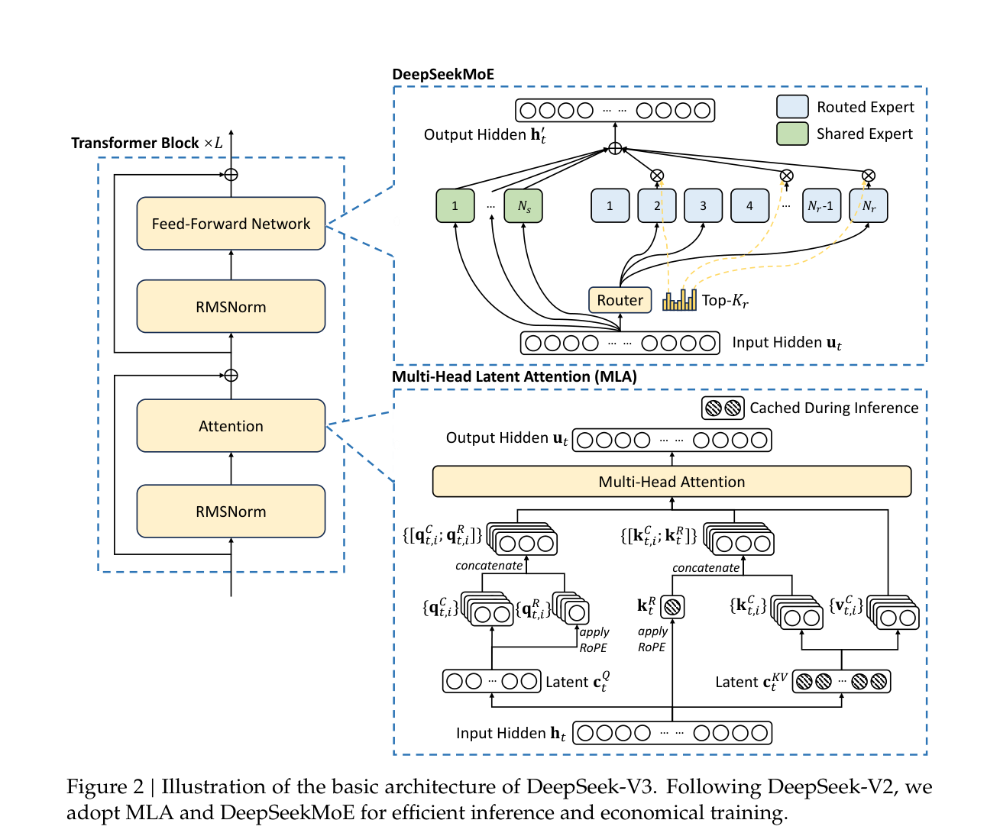

<b>图 2-1</b>　DeepSeek-V3 的基本架构。左侧为带残差的 Transformer 块，右侧分别展开 DeepSeekMoE（上）与 MLA（下）两个核心模块。图源：DeepSeek-V3 技术报告 Figure 2 [1]

MTP 是三项基线中唯一不改变主干前向的部件，它接在输出端，改的是训练目标与解码方式。V3 取预测深度 D = 1，即在下一个 token 之外再预测一个位置；实现上为一个附加的 Transformer 块 TRM₁、一个 d × 2d 的投影矩阵 M₁ 与两个 RMSNorm，嵌入层与输出头都与主模型共用，因此不新增词表参数。结构见图 2-2。

设主模型在位置 i 的表示为 hᵢ⁰，第 k 个深度的输入由上一深度的表示与第 i + k 个 token 的嵌入各自归一化、拼接后降维得到，即 h′ᵢᵏ = M_k[RMSNorm(hᵢᵏ⁻¹); RMSNorm(Emb(tᵢ₊ₖ))]。拼接后的维度为 2d，经 M_k 回到 d 维，再送入本深度的 Transformer 块，得 hᵢᵏ = TRM_k(h′ᵢᵏ)，最后经输出头映射到词表，给出对第 i + k + 1 个 token 的分布。因果链在此保留，第 k 个深度预测时，输入里含第 i + k 个 token 的真实嵌入，而非上一深度的预测值；若改用并行的独立输出头，这条链即被切断，V3 未取此法。

训练时各深度分别计算交叉熵，按深度平均后乘以权重 λ，与主任务的交叉熵相加。V3 取 λ = 0.3 用于前 10T token，余下 4.8T token 降为 0.1。权重下调而不置零，是因为 MTP 的用意在于加密训练信号、迫使表示提前为后一位置作规划，并不承担主任务的预测职责。

推理时 MTP 模块可以整体丢弃，主模型单独运行不受影响；也可以留作投机解码的草稿，主模型给出第 i + 1 个 token 后，MTP 块以一次前向给出第 i + 2 个候选，两者并行验证，一致则一并接受。官方实测第二个 token 的接受率在 85% 至 90% 之间，解码吞吐为原来的 1.8 倍。

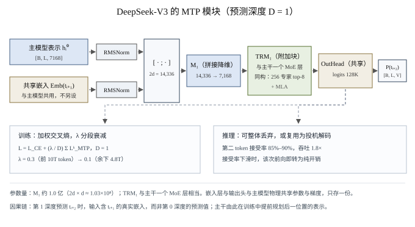

<b>图 2-2</b>　DeepSeek-V3 的 MTP 模块：主模型表示与第 i + 1 个 token 的嵌入各自归一化、拼接后经 M₁ 降到 d 维，送入附加块 TRM₁，再由与主模型共享的输出头给出第 i + 2 个 token 的分布；下方为训练与推理两条用法。图源：文献 [1]

MLA 把长上下文的瓶颈由注意力计算移到潜向量的读写，细粒度 MoE 以约 5.5% 的激活比换容量，MTP 以一层附加块换解码的串行步数。

若按算子展开，V3 的一次前向可拆为 Q 低秩投影、KV 压缩、打分聚合与专家聚合四段，各步的公式与张量维度见图 2-3。

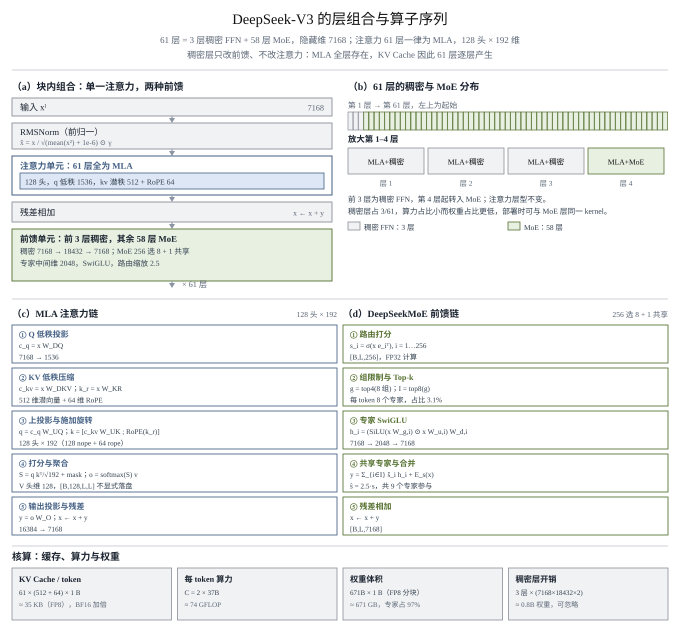

<b>图 2-3</b>　DeepSeek-V3 的层组合与算子序列：（a）块内组合，61 层注意力一律为 MLA，只有前馈分稠密与 MoE 两档；（b）61 层的稠密与 MoE 分布，前 3 层稠密、其后 58 层 MoE；（c）MLA 的 Q 低秩投影、潜在 KV 压缩、上投影与打分聚合；（d）256 选 8 加 1 个共享专家的路由、SwiGLU 与合并；底部为 KV、算力与权重的核算。图源：文献 [1]

## 2.2　DeepSeek-V3.2

DeepSeek-V3.2 于 2025 年 12 月发布。与 V3.1-Terminus 相比，架构上唯一的改动是经继续训练引入 DeepSeek 稀疏注意力（DSA）；MoE 的层数、专家数量与大小、路由拓扑均保持不变，总参数仍为 671B、激活 37B，上下文 128K（V3.2-Exp 因新增 DSA 组件，总参约 685B）[2][3]。表 2-1 并列 V3 与 V3.2 的主要超参数。

<b>表 2-1</b>　DeepSeek-V3 与 V3.2 的主要超参数

| 项目 | DeepSeek-V3 | DeepSeek-V3.2 |
|---|---|---|
| 总参数/激活参数 | 671B/37B | 671B/37B |
| 层数 | 61（前 3 层稠密 + 58 MoE） | 同 V3 |
| 注意力 | MLA（128 头，kv 潜秩 512 + RoPE 64） | MLA + DSA 稀疏选择 |
| 路由专家（激活） | 256（top-8）+ 1 共享 | 同 V3 |
| 上下文 | 128K | 128K |
| 其他 | MTP 1 层；FP8 训练 | 索引器 top-k 2048；FP8 分块权重；KV 656 B 与索引键 132 B 各存一份（每 token 每层） |

DSA 是一个先选择、后注意的两阶段流水线，结构如图 2-4 所示。第一阶段为 Lightning Indexer，一个轻量打分器（64 个头、头维 128、FP8 精度，参数与主干分离）对全部前序 token 计算相关性标量分。第二阶段为 Token Selector，每个查询只取分数最高的 k = 2048 个历史 token 进入主 MLA 路径作全精度计算。在 128K 上下文下，每个查询所见的键约占 1.6%，注意力计算量由 O(L²) 降为 O(L·k)，约为稠密注意力的 1/62。DSA 实例化于 MLA 的 MQA 模式之上，官方随 FlashMLA 库发布了配套的稀疏 kernel，有分页与非分页两种。

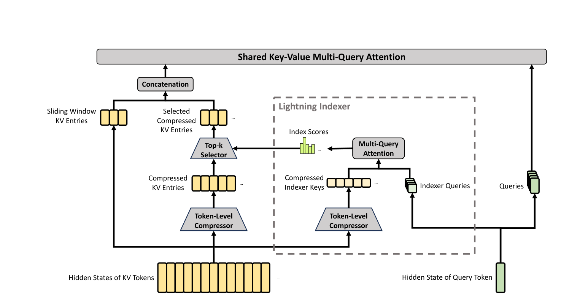

<b>图 2-4</b>　DeepSeek-V3.2 的注意力架构：DSA 稀疏注意力实例化于 MLA 之下。图源：DeepSeek-V3.2 技术报告 Figure 1 [3]

V3.2 并非从头训练，而是在 V3.1-Terminus 检查点上作两阶段继续训练，先以 2.1B token 稠密热身，令索引器模仿稠密注意力的分布，再切换到稀疏模式。发布权重采用 128×128 分块 FP8（ue8m0 缩放）。

DSA 新增索引器这一计算与访存单元，训练配方与权重格式须相应调整。稠密热身加稀疏切换的两段式路径，使结构改动可在既有检查点上以继续训练完成。

DSA 不改 MLA 的缓存格式，而是增加了第二份缓存，两者的字段构成见图 2-5。KV Cache 仍是每 token 每层一个 576 维潜向量，512 维压缩键值与 64 维 RoPE 分量，键与值共用同一份，不随 128 个头增长。V3 以 BF16 存为 1,152 字节；推理实现改用 FP8 潜向量，按 128 通道配一个 FP32 缩放，RoPE 分量因承载位置相位仍留 BF16，合计 656 字节，省去约 43%。索引器的键则不同，64 个头共享同一组键，故每 token 每层只存 128 维，FP8 加一个逐 token 的 FP32 缩放，共 132 字节，约为 KV 记录的五分之一。

两份缓存都随序列长度线性增长。61 层叠加后，KV 为每 token 40 KB，索引键为 8 KB；128K 上下文下单条序列分别约 5.2 GB 与 1.1 GB。两项合计每 token 48 KB，较 V3 全 BF16 的 70 KB 反少三成：索引器多出一份，低精度 KV 省下的更多。DSA 并未提高显存需求，降低的是每步的字节读取量。

两者的寻址方式相反，缓存因此须分开管理。索引器须对全部历史打分，每一步都要把索引键顺序读一遍；KV 只被选中的 2,048 条命中，是不连续的 gather，单条 656 字节。前者是长顺序流，单位成本低而总量随 L 增长；后者是短随机事务，命中数固定而单笔成本高。若合并为一份缓存，两者就得共用页表，而索引键按 64 token 一页组织、KV 的稀疏算子按单 token 寻址，两套粒度无法统一；实际实现因此各配一套页表，并要求索引键的页与 KV 的页对齐到同一 token 区间，以便命中后直接换算地址，页内的 64 条命中也可合并为一次读。

按解码一步核算字节数，结论与直觉相反。KV 的读取由稠密的 9.2 GB 降到 82 MB，降了两个数量级；但索引键的全量读在 128K 下达 1.0 GB，反超 KV 本身，两项合计仍有 1.1 GB，相对 V3 的 BF16 稠密读法只降约 8 倍，即便以 FP8 稠密读法（5.2 GB）为基准也只降 4.6 倍。解码的带宽瓶颈由此从键值转到索引，此后两代对索引器的改动即由此而来，GLM-5.2 的 IndexShare 让相邻层共用一份索引（见 7.2 节），LongCat-2.0 的跨层索引出于同一目的（见 6.2 节）。

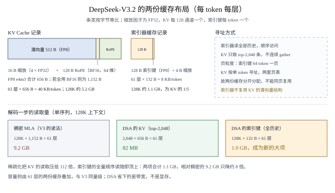

<b>图 2-5</b>　DeepSeek-V3.2 的两份缓存：上为每 token 每层的字节布局，KV 记录为 512 维潜向量（FP8）加缩放与 64 维 RoPE（BF16），索引器记录为 128 维键（FP8）加缩放；下为解码一步的读取量对比。图源：文献 [3]

稀疏化在算子上只增加两段，即索引器打分与 top-k 选择，其位置与维度见图 2-6。

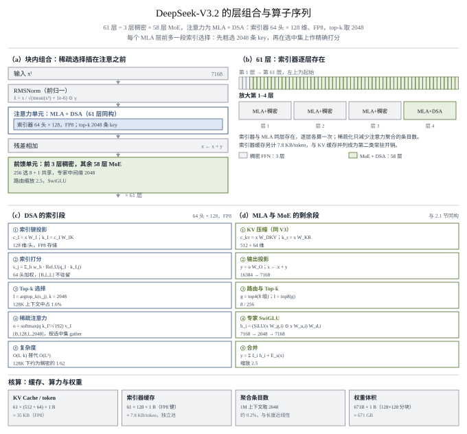

<b>图 2-6</b>　DeepSeek-V3.2 的层组合与算子序列：（a）块内组合，稀疏选择插在注意力之前，逐层各算一次索引；（b）61 层的层型分布，索引器与 MLA 同层存在；（c）DSA 的索引段：索引键投影、64 头打分、top-2048 与选中集上的精确聚合；（d）MLA 的剩余段与 MoE 前馈；底部为 KV、索引器缓存与聚合条目的核算。图源：文献 [3]

## 2.3　DeepSeek-V4

DeepSeek-V4 于 2026 年 4 月发布，分 Pro 与 Flash 两个规格，保留 DeepSeekMoE 与 MTP，把上下文扩到 1M token，并在注意力、残差与优化器三处作了改动，混合注意力（CSA + HCA）、流形约束超连接（mHC）与 Muon 优化器[4][5]。整体架构见图 2-7，两个规格的规模对比见表 2-2。

<b>表 2-2</b>　DeepSeek-V4 系列规格

| 项目 | V4-Pro | V4-Flash |
|---|---|---|
| 总参数/激活参数 | 1.6T/49B | 284B/13B |
| 层数 | 61 | 43 |
| 注意力层型 | 2 层 HCA 开局，其后 30 层 CSA 与 29 层 HCA 交替 | 2 层纯滑窗开局，其后 21 层 CSA 与 20 层 HCA 交替 |
| 隐藏维 | 7168 | 4096 |
| 路由专家（激活） | 384（top-6 + 1 共享） | 256（top-6 + 1 共享） |
| 专家中间维 | 3072 | 2048 |
| 预训练 | 33T token | 32T token |
| 上下文 | 1M | 1M |

<b>图 2-7</b>　DeepSeek-V4 系列的整体架构：Transformer 块内以 CSA 或 HCA 作注意力、DeepSeekMoE 作前馈，残差由 mHC 的块前、残差与块后三组混合矩阵加强，顶端另接预测头与 MTP 模块。图源：DeepSeek-V4 技术报告 Figure 2 [5]

Pro 的 61 层以 2 层 HCA 开局，其后 30 层 CSA 与 29 层 HCA 交替；Flash 的 43 层先以 2 层纯滑窗起步，再进入 21 层 CSA 与 20 层 HCA 的交替。所有块的前馈一律为 MoE，前 3 层的路由改为哈希。因此，整网的块内组合只剩四种单元，CSA、HCA 与纯滑窗三种注意力，加 MoE 一种前馈。前馈的专家中间维 Pro 取 3072、Flash 取 2048，路由缩放相应取 2.5 与 1.5，两者都偏小，专家数便成了扩容的主要手段。官方整体图把两类压缩注意力合画作一个框，其逐层分布与内部差别在此展开，见图 2-8。

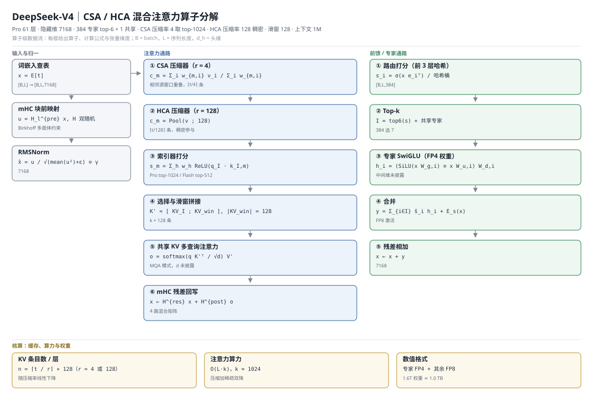

<b>图 2-8</b>　DeepSeek-V4 的层组合：（a）单个块内为 mHC 混合的残差、滑窗与压缩两路并行的注意力单元、MoE 前馈；（b）两个规格的逐层层序，色块取自 compress_ratios，放大处可见 Pro 以两层 HCA 开局后转入交替；（c）CSA 与 HCA 两条压缩通路在入口、选择与出口上的分工。图源：文献 [5]

V4 的核心变化在注意力栈。两类层共用一套共享键值多查询注意力，把选中或全部的压缩 KV 条目与一组未压缩的滑窗条目拼接，作一次注意力计算。CSA（Compressed Sparse Attention）以压缩率 4 压缩 KV Cache，压缩器采用可学习的门控池化，相邻压缩条目的源窗口相互重叠；再由 Lightning Indexer 打分、Top-k Selector 选出最相关的条目（Pro 取 top-1024，Flash 取 top-512），结构见图 2-9。HCA（Heavily Compressed Attention）以压缩率 128 把条目压得更少，不作稀疏选择，对全部已完成的压缩条目执行稠密注意力，结构见图 2-10。两者都附加 128 token 的滑动窗口，以补回压缩损失的局部细粒度依赖。此外，mHC 把残差映射约束到 Birkhoff 多面体（双随机矩阵流形），以改善深层信号传播的稳定性；专家权重以 FP4 存储，较 FP8 再省一半显存，其余权重为 FP8。

<b>图 2-9</b>　CSA 的核心结构：历史 KV 经 token 级压缩器生成压缩条目，Lightning Indexer 打分后由 Top-k Selector 选出部分条目，与滑窗条目拼接进入共享键值多查询注意力。图源：DeepSeek-V4 技术报告 Figure 3 [5]

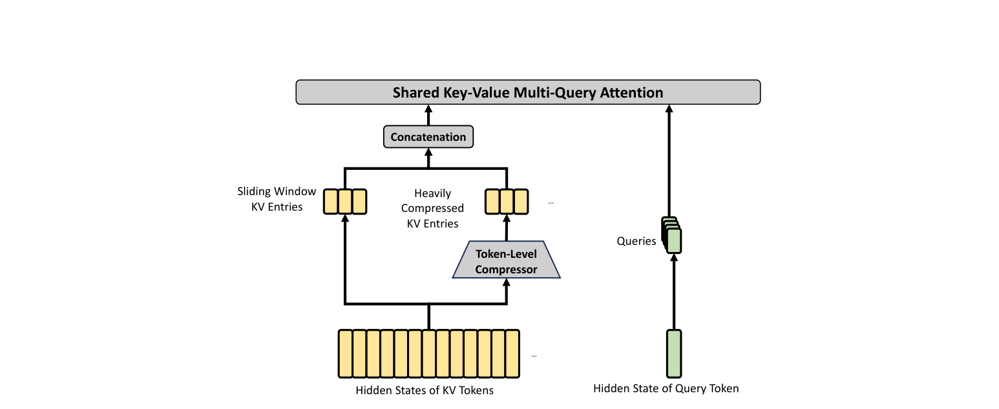

<b>图 2-10</b>　HCA 的核心结构：以更大的压缩率生成少量重度压缩条目，不经稀疏选择，全部与滑窗条目拼接后进入稠密注意力。图源：DeepSeek-V4 技术报告 Figure 4 [5]

混合注意力把缓存拆成几段长度不一的记录，布局见图 2-11。压缩分支每 m 个 token 才产出一条 512 维条目，CSA 的 m 为 4、HCA 的 m′ 为 128，同一份序列在两类层上的条目数相差 32 倍；索引器另需一份 128 维的键缓存，按同样的 4 倍粒度生成；两类注意力又都附加 128 token 的滑窗分支，这段不予压缩、每层都有、每步整体替换。按混合精度折算，一条 512 维记录为 576 字节，RoPE 作用于条目向量的最后 64 维，这 64 维以 BF16 存，其余 448 维以 FP8 存，合计 448 + 128 字节。

官方实现因此把缓存分作两处管理。State Cache 是一块固定容量的池，按请求动态分配，滑窗的 128 条与尚未凑满一个压缩窗口的尾部 KV、隐状态都放在这里，它们只取决于当前位次，按序列状态管理比按页映射更省。压缩 KV Cache 则按块分配，每块覆盖 lcm(4, 128) = 128 个原始 token，产出 32 条 CSA 条目与 1 条 HCA 条目。块长取两种压缩率的最小公倍数，使同一起始位置在两类层上的分块边界重合，一次地址换算即可供所有层复用；块还须补齐到缓存行的整数倍，稀疏注意力核按每块固定条数取数，对齐之后才不必在核内处理跨块拼接。

不并成一套页表，原因有二。其一是策略不同：滑窗段是定长状态，压缩条目是只增不改的追加段，共用一套映射会让前者背上无谓的映射开销。其二是核的约束：高性能稀疏核以每块 B 条条目为优化单位，对应 B·m 与 B·m′ 个原始 token，两种压缩率只有取公倍数，才能共用同一核而不损失性能。KV缓存方案同样分层，压缩条目整体写出、按前缀复用；滑窗段则在全量缓存、周期检查点与零缓存三者之间取舍，分别以存储、存储与重算的折中、纯重算换取带宽。

把字节数代入 Pro，30 层 CSA 各 177 字节，31 层 HCA 各 4.5 字节，每 token 约 5.3 KB，1M 上下文下单条序列约 5.5 GB；Flash 为 21 层与 20 层，每 token 约 3.7 KB，1M 约 3.8 GB。V3.2 同口径为 48 KB 每 token、1M 约 48 GB，本代约为其 11%，与官方所称的 10% 同量级。滑窗段另计，每层 128 条共 72 KB，与序列长度无关，61 层合计 4.4 MB，长上下文下可忽略，短上下文与高并发下反成主项。

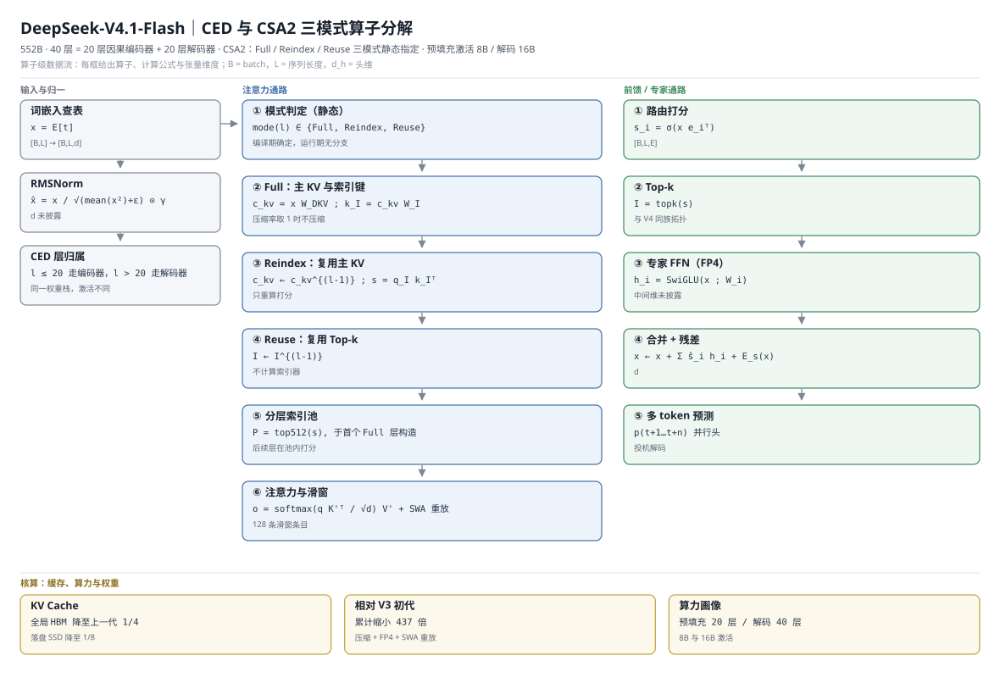

<b>图 2-11</b>　DeepSeek-V4 的三类缓存与块划分：（a）每层四类记录的字节构成，滑窗段为定长，压缩条目按 token 折算；（b）一个 cache block 覆盖 128 个原始 token，产出 32 条 CSA 条目、32 条索引器键与 1 条 HCA 条目；（c）State Cache 与压缩 KV Cache 两处分配器的分工及不合并的理由。图源：文献 [5]

上述改动对加速器提出的要求各不相同。混合注意力要求同一芯片上同时高效支持压缩加稀疏选择、深度压缩加稠密两类 kernel；缓存一侧则要求显存管理容纳长度不等的异构段，同一请求内 31 层 HCA 的条目数只有 30 层 CSA 的 1/32，滑窗段又是定长环形缓冲，三者无法共用一套页表，分配器、前缀复用与保存格式都须按段实现；FP4 权重存储把低精度数值格式再向下推一档。

把两类压缩器与稀疏选择并入同一条数据流后，算子序列见图 2-12。

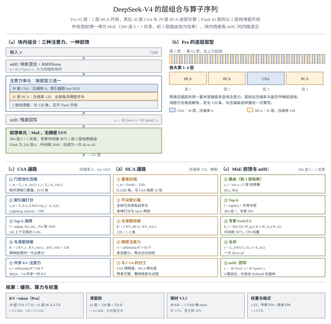

<b>图 2-12</b>　DeepSeek-V4 的层组合与算子序列：（a）块内组合，注意力在 CSA、HCA 与纯滑窗三者间按层型选择，前馈一律为 MoE，残差取 mHC 四路混合；（b）Pro 61 层的逐层层型，以两层 HCA 开局后 CSA 与 HCA 交替；（c）CSA 通路：门控池化压缩、索引打分、top-k 与滑窗拼接；（d）HCA 通路：压缩率 128 的重度压缩与稠密聚合；（e）MoE 与 mHC 的合并回写；底部为每 token 字节、滑窗段与权重的核算。图源：文献 [5]

## 2.4　DeepSeek-V4.1-Flash

DeepSeek-V4.1-Flash 于 2026 年 9 月发布，采用全新结构，并且尺寸最小，以小激活换取长上下文，并进一步压缩 KV Cache，原生支持视觉理解[6][7]。整体架构见图 2-13。

该模型为 552B 参数的 MoE，采用 CED（Causal Encoder-Decoder）非对称结构，40 层网络拆为 20 层因果编码器与 20 层解码器，输入侧（预填充）每 token 仅激活约 8B 参数，输出侧（解码）激活约 16B。预填充主要执行前 20 层编码器，计算量接近减半；生成解码则跑满全部 40 层。缓存方面综合使用 CSA2（第二代压缩稀疏注意力）、FP4 量化与 SWA Bounded Replay（滑动窗口注意力加有界重放），全局 KV Cache 的 HBM 需求降至上一代的 1/4，落盘 SSD 需求降至 1/8；若以 V3 初代为基准，KV Cache 已累计缩小 437 倍。

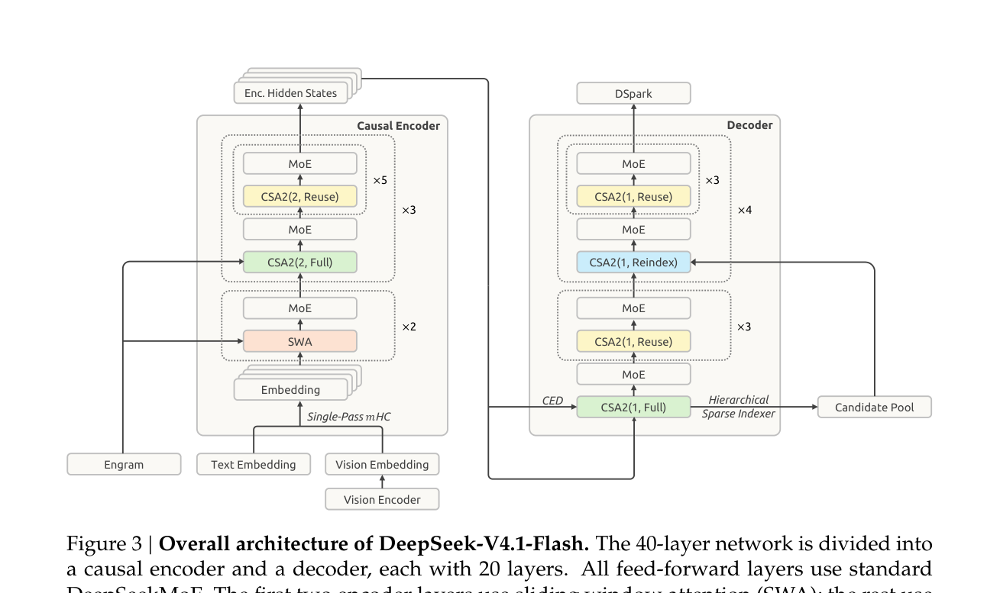

<b>图 2-13</b>　DeepSeek-V4.1-Flash 的整体架构：40 层网络分为 20 层因果编码器与 20 层解码器，前馈层均为 DeepSeekMoE。图源：DeepSeek-V4.1-Flash 技术报告 Figure 3 [6]

编码器 20 层中，前 2 层为纯滑窗、不涉及全局 KV，其余 18 层为压缩率 2 的 CSA2，分 3 组、每组 6 层，组首为 Full 模式、其后 5 层为 Reuse 模式；解码器 20 层改用压缩率 1，分 5 组、每组 4 层，首组组首为 Full，后 4 组组首为 Reindex，其余各层一律 Reuse。因此， 40 层里真正生成并存储全局 KV 的只有 4 层，只重新打分的 4 层，连 Top-k 索引一并复用的 30 层，完全不涉全局 KV 的 2 层。前馈一律为 MoE，每层 1 个共享专家加 384 个路由专家，每 token 激活 6 个，专家中间维 2304，没有稠密 FFN；残差取 Single-Pass mHC，第 1 与第 14 层另接 Engram 条件记忆。整体组合见图 2-14。

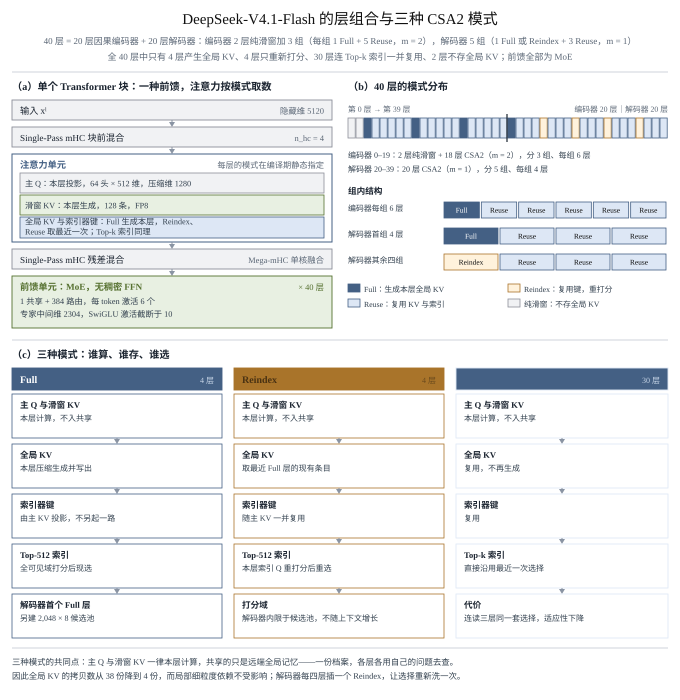

<b>图 2-14</b>　DeepSeek-V4.1-Flash 的层组合：（a）单个块内为 Single-Pass mHC 混合的残差、按模式取数的注意力单元与 MoE 前馈，主 Q 与滑窗 KV 一律本层计算；（b）40 层的模式分布，编码器以两层纯滑窗开局、其后每 6 层一组且组首为 Full，解码器每 4 层一组、首组组首为 Full、其余组首为 Reindex；（c）Full、Reindex、Reuse 三者在主 KV、索引器键与 Top-k 索引上的分工。图源：文献 [6]

CSA2 是 CSA 的演进，改动主要在压缩器、索引器与跨层复用三处。压缩器去掉了 CSA 的重叠源窗口与绝对位置编码，索引器键改由主 KV 条目投影得到，不再另走一条从隐藏状态出发的压缩路径；压缩率取 1 时退化为不压缩主 KV。每个 CSA2 层静态指定三种模式之一，结构差别见图 2-15：Full 模式在本层计算主 KV、索引器键与 Top-k 索引；Reindex 模式复用前层的主 KV 与索引器键，只重新打分生成新的 Top-k 索引；Reuse 模式连 Top-k 索引一并复用，不再计算索引器查询与打分。解码器另用分层稀疏索引器，由首个 Full 模式层按 Top-512 选出条目并构造共享候选池，后续 Reindex 模式层只在该池内打分。与 CED 结合时，被指定为 Full 模式的解码器层从因果编码器最后一层的隐藏状态计算全局 KV，其余模式不变。

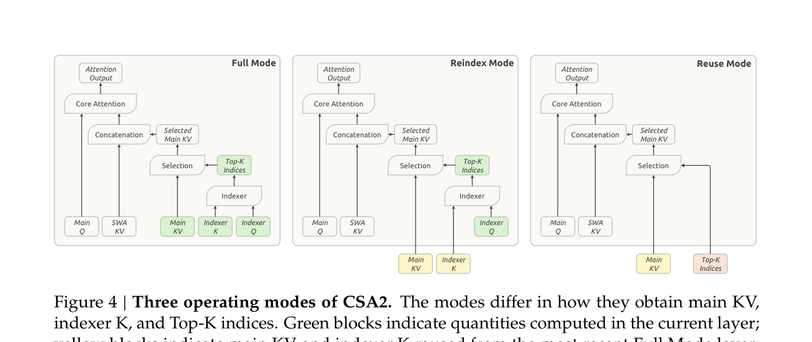

<b>图 2-15</b>　CSA2 的三种工作模式：Full、Reindex 与 Reuse 的差别在于主 KV、索引器键与 Top-k 索引由本层计算还是从前层复用。图源：DeepSeek-V4.1-Flash 技术报告 Figure 4 [6]

缓存因此分成全局与滑窗两段。全局 KV 只在 4 个 Full 层生成，主 KV 一条 512 维，以 FP4（E2M1）存，每 16 通道配一个 E4M3 缩放，合计 288 字节；索引器键由主 KV 投影得到，128 维，同用 FP4，连同 8 个缩放为 72 字节。滑窗 KV 每层 128 条，以 FP8 存，单条约 512 字节，且每层各算一份，不参与跨层共享。按编码器 3 个 Full 层（压缩率 2）与解码器 1 个 Full 层（压缩率 1）折算，每 token 的全局 KV 约 900 字节，官方口径为 890 字节，差额来自分块与头维取整。取 1M 上下文，单条序列的全局 KV 约 890 MB，滑窗段另有 40 层 × 128 条 × 512 字节 ≈ 2.6 MB，与序列长度无关。

Top-k 下标只服务当前查询，同组 Reuse 层共用一份、用完即弃，不写回持久缓存，因此 890 字节的口径只含主 KV 与索引器键。三处存放的存续期又各不相同，全局 KV 常驻 HBM，并沉到 SSD 保留至少 72 小时；滑窗 KV 不再落盘，改存于占各机主机内存一成的分布式池，TTL 以分钟计，未命中时由有界回放重建——只回放最近 128 个 token，而非精确重建所需的 40 × 128 = 5,120 个。布局见图 2-16。

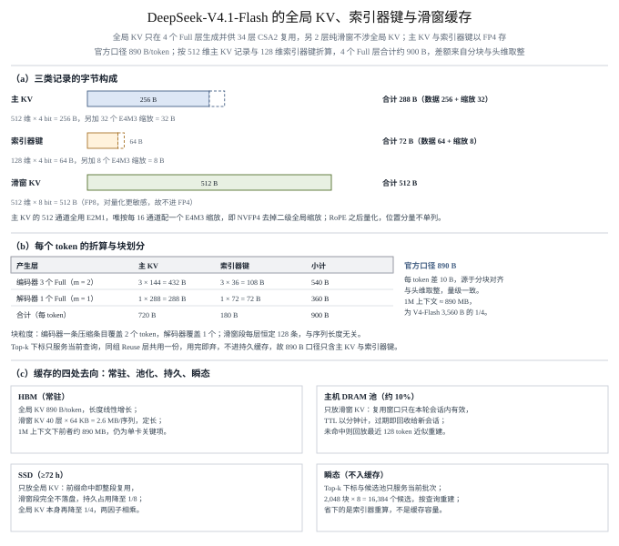

<b>图 2-16</b>　DeepSeek-V4.1-Flash 的缓存布局：（a）主 KV、索引器键与滑窗 KV 三类记录的字节构成；（b）按 4 个 Full 层折算到每 token 的 900 字节，与官方 890 字节口径对照，并给出块粒度；（c）HBM、主机内存池、SSD 与瞬态四处去向的存续期与策略。图源：文献 [6]

编码器与解码器的不对称激活，把预填充与解码两种负载在结构层面分开，前者层数少、吞吐大、序列长，后者层数多、批量小、延迟敏感，加速器需在两种场景下都保持效率。CSA2 把主 KV 与索引由逐层计算改为按层组共享，缓存条目的生命周期与片上缓冲的分配也须按层组安排。KV Cache 在 HBM、主机内存与 SSD 之间的分层管理。

三种模式的差别落在是否重算主 KV 与索引，逐算子展开见图 2-17。

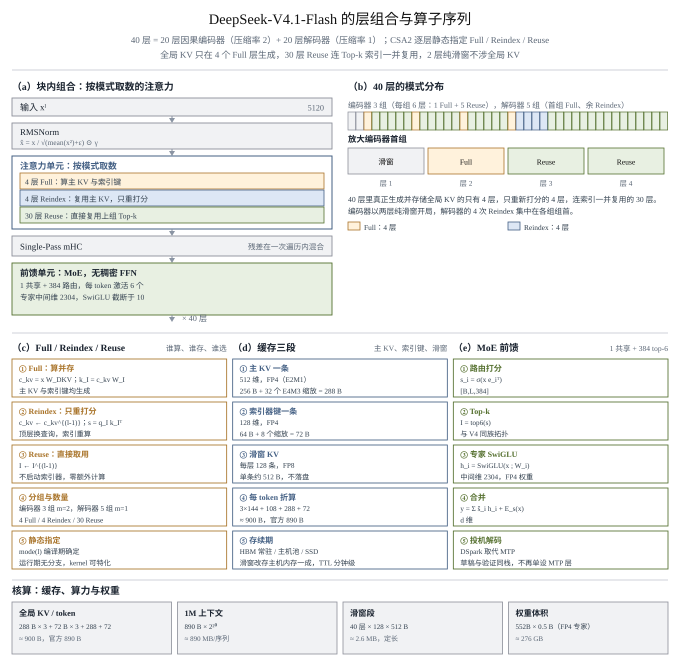

<b>图 2-17</b>　DeepSeek-V4.1-Flash 的层组合与算子序列：（a）块内组合，注意力单元按 Full、Reindex、Reuse 三种模式取数，残差为 Single-Pass mHC；（b）40 层的模式分布，编码器 3 组、解码器 5 组；（c）三种模式在算、存、选上的分工；（d）主 KV、索引器键与滑窗 KV 三类记录的字节构成与存续期；（e）MoE 前馈与 DSpark 投机解码；底部为 890 字节口径与权重体积的核算。图源：文献 [6]

# 第 3 章　Qwen 系列

Qwen 以线性注意力与全注意力的混合为骨架，Qwen3.5 与 3.8-Max 走三比一的门控线性注意力配门控全注意力，Qwen3.8-Flash-Next 则改用 QSA 微块稀疏，并另挂 N-gram 查表把参数扩容与计算扩容分开。

## 3.1　Qwen3.5

Qwen3.5 于 2026 年 2 月发布，总参数 397B、每 token 激活 17B，是千问的原生多模态基座[8][9]，其语言主干沿用 Qwen3-Next 的混合架构[10]，图 3-1 即 Qwen 官方给出的 Qwen3-Next 架构图。主体 60 层，按 15 ×（3 ×（Gated DeltaNet → MoE）→ 1 ×（门控注意力 → MoE））的循环块组织，线性注意力层与全注意力层约成 3:1。

门控 DeltaNet（Gated DeltaNet，GDN）是线性注意力的一种，设 64 个 V 头、16 个 QK 头、头维 128，以固定大小的循环状态压缩长程历史，使 262K 上下文保持稳定；每隔三层插入的门控注意力层设 32 个 Q 头、2 个 KV 头、头维 256（RoPE 64 维），并结合注意力门控机制，在注意力输出端抑制无关信息，使 1M token 上下文下的长程检索仍保有精度。MoE 部分为 512 个专家、top-10 路由加 1 个共享专家，专家中间维 1024，激活占比不足总参的 5%。多模态采用早融合路线，文本与视觉 token 自预训练第一天起即在同一序列流中联合训练，视觉前端为 ViT + PatchMerger（224×224 至 1024×1024 多尺度输入）；模型原生支持多 token 联合预测（MTP）与 201 种语言。

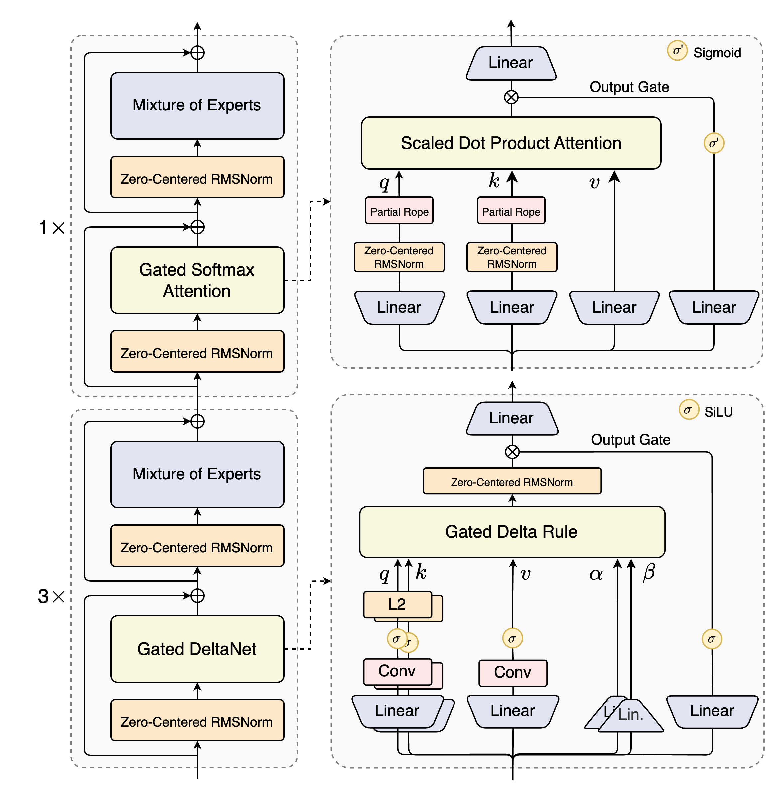

<b>图 3-1</b>　Qwen3-Next 混合架构：3 个 Gated DeltaNet 块接 1 个门控 Softmax 注意力块构成循环单元，每块后接 MoE 前馈；右侧分别展开两类注意力块的内部结构，含 Partial RoPE、零中心 RMSNorm 与输出门。Qwen3.5 沿用此结构，循环单元由 12 组扩展至 15 组。图源：Qwen 官方 Qwen3-Next 模型卡架构图 [10]

3:1 的混合比例决定了缓存压力的来源，长上下文的 KV Cache 只来自少数全注意力层，容量与带宽压力随之减轻；线性注意力的循环状态更新则是另一种访存模式，属于有状态递推，与传统注意力 kernel 的优化路径不同。

两类层的缓存开销不同。全注意力层按 token 追加 KV，15 层合计约 30 KB/token，1M 上下文约 30 GB；GDN 层每层为 64 个头各存一份 128 × 128 状态，45 层合计约 94 MB（BF16，FP32 则 189 MB），与序列长度无关。前者随长度线性增长，后者恒定：长上下文下前者主导，短序列与高并发下后者反成主项。

线性注意力与全注意力在算子上是两套不同的递推与打分。GDN 自身还分两种执行形态，chunkwise 把序列切块，块内并行、块间只传状态，用于预填充；recurrent 逐 token 递推，用于解码。两者数学等价，kernel 却是两套，缓存形态也随之两分。三者的位置与核算见图 3-2。

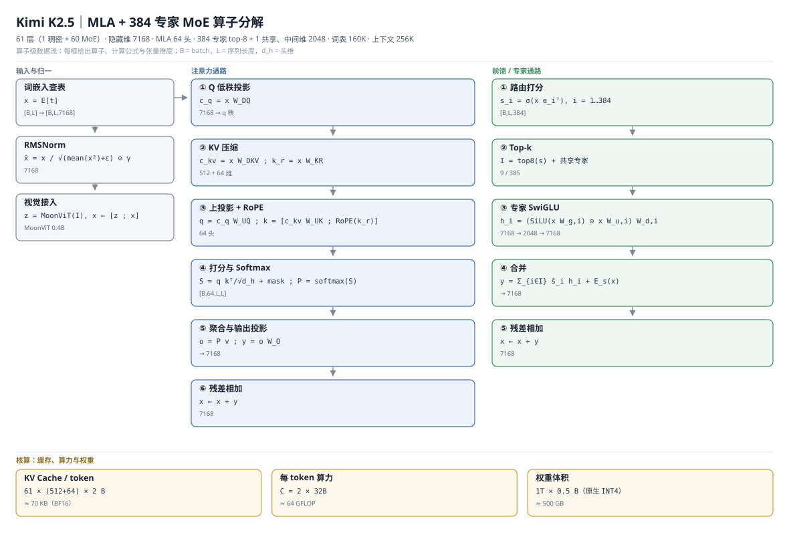

<b>图 3-2</b>　Qwen3.5 的层组合与算子分解：（a）块内组合，同一 MoE 前馈配 GDN 或门控全注意力两种注意力；（b）60 层的循环单元，每 4 层一循环、共 15 组；（c）GDN 的两种执行形态，chunkwise 块内并行、块间传状态，recurrent 逐 token 递推，二者数学等价；（d）门控全注意力每四层出现一次，含 Partial RoPE 与输出门；（e）两类层的缓存形态与核算，全注意力按 token 增长、GDN 状态定长。图源：文献 [10]

## 3.2　Qwen3.8-Max

Qwen3.8-Max 于 2026 年 8 月发布，是 Qwen 首次把 Max 级模型开放权重，开源发布名为 Qwen3.8-2.4T-A95B，总参数 2.4T、每 token 激活 95B。整体示意见图 3-3。

层布局沿用 Qwen3.5 的三比一循环，只是把循环次数与通道数一并放大，92 层，按 23 ×（3 ×（Gated DeltaNet → MoE）→ 1 ×（门控注意力 → MoE））排布，隐藏维 8192，词表 248,320，且 92 层全部接 MoE，无一层稠密前馈。第 1 层即 GDN，门控注意力落在第 4、8、…、92 层。

两套注意力的头配置比 3.5 明显加宽。GDN 设 128 个 V 头与 16 个 QK 头，头维 128，短卷积核取 4，循环状态按 FP32 存放；门控注意力设 64 个 Q 头与 4 个 KV 头，头维 256，其中前 64 维施加旋转位置编码（占四分之一，θ 取 1e7），输出端再乘一道 swish 门。Q 与 KV 的头比仍为 16 : 1，与 3.5 相同，只是两头数各自翻倍，单层 KV 遂由 2 × 256 维升至 4 × 256 维。

专家侧同样加宽，512 个路由专家取 top-10，另设 1 个共享专家，专家中间维 2048，路由不加组限制。参数总量由专家数与每层宽度共同推高，单层路由专家即 512 × 3 × 8192 × 2048 ≈ 25.8B，92 层累计约 2.37T，占总量九成八以上；激活侧每 token 只走 10 个路由专家加 1 个共享，约 46B 加 4.6B。上下文原生 262,144，经 YaRN 可扩至 1,010,000；末层之后另挂 1 层 MTP，多步训练，草稿头复用主干词嵌入。

缓存分为两部分。门控注意力每层每 token 存 K、V 各 4 × 256 个半精度数，即 4 KB；23 层合计 92 KB/token，1M 上下文约 92 GB。GDN 每层为 128 个头各存一份 128 × 128 状态，BF16 下 4 MB，69 层约 289 MB（若按 FP32 存放则 578 MB），与序列长度无关。前者随长度线性增长，后者恒定，长上下文下前者压倒后者。

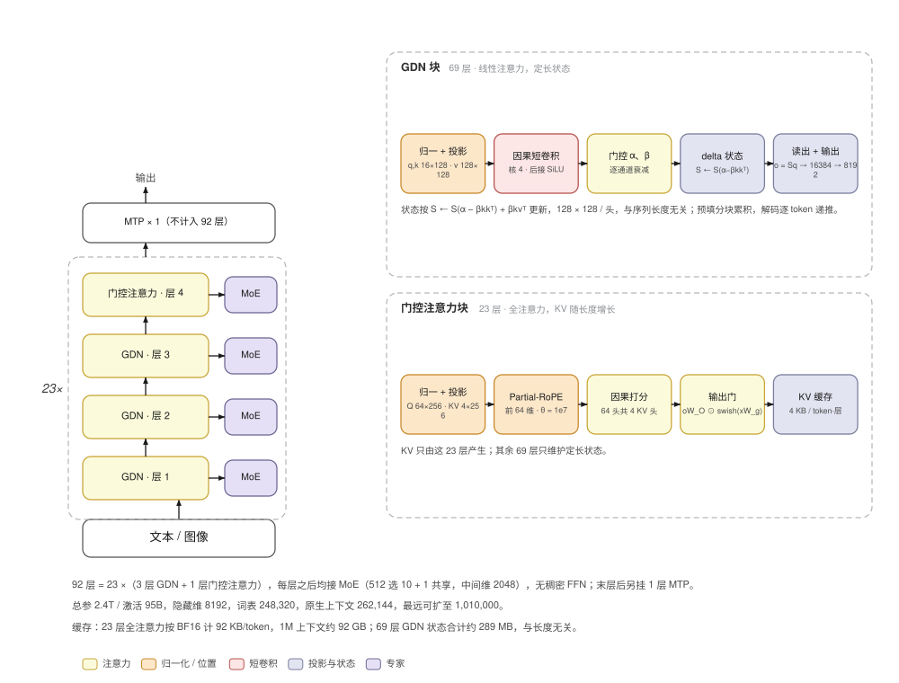

<b>图 3-3</b>　Qwen3.8-2.4T-A95B 的层序与块内结构：（a）92 层按 23 个循环单元排布，每单元 3 层 GDN 接 1 层门控注意力，两类层之后均接 MoE；（b）两类块的内部——GDN 的短卷积、逐通道门控与 128 × 128 delta 状态，门控注意力的 Partial-RoPE、4 个 KV 头与输出门；（c）层型、头配置与专家数。图源：文献 [11]

权重侧的情况相反。2.4T 参数以 FP8 计约 2.4 TB，超出单机八卡容量，必须跨节点作专家并行；每 token 只激活 95B。

算子级走向见图 3-4。

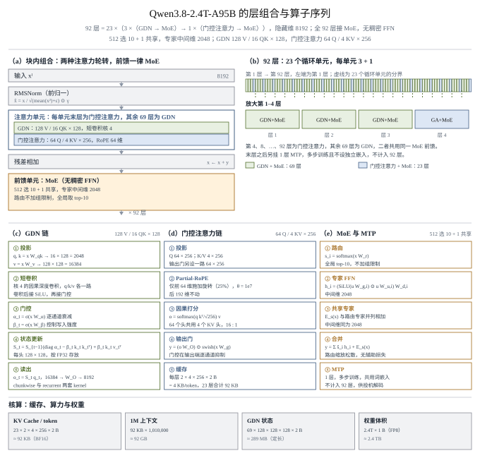

<b>图 3-4</b>　Qwen3.8-2.4T-A95B 的层组合与算子序列：（a）块内组合，注意力在 GDN 与门控注意力之间按层型二选一，前馈一律为 MoE；（b）92 层的层型分布，虚线为 23 个循环单元的分界；（c）GDN 的投影、短卷积、门控与 delta 状态更新；（d）门控注意力的 64 Q / 4 KV 打分、Partial-RoPE 与 swish 输出门；（e）512 选 10 加 1 共享的 MoE 与 1 层 MTP；底部为 KV、状态与权重的核算。图源：文献 [11]

## 3.3　Qwen3.8-Flash-Next

Qwen3.8-Flash-Next 于 2026 年 8 月发布，是 Qwen4 架构的开源预览，125B MoE 主体（激活 6B）+ 51B N-gram 嵌入 + 4B MTP 层（BF16 合计约 180B），48 层，原生上下文 262K（经 YaRN 可扩至 1M），支持图文视频输入[12]。官方架构图见图 3-5，关键超参数见表 3-1。

<b>表 3-1</b>　Qwen3.8-Flash-Next 主要超参数

| 项目 | 配置 |
|---|---|
| 总参数 | 125B 主体（激活 6B）+ 51B N-gram 嵌入 + 4B MTP |
| 层布局 | 12 ×（3 ×（GDN → MoE）→ 1 ×（QSA → MoE）），共 48 层 |
| GDN | 48 个 V 头/16 个 QK 头，头维 128 |
| QSA | 24 个 Q 头/2 个 KV 头，头维 256；索引器 MQA（4 Q + 1 共享 K，头维 128），预算 512 块（约 2048 token） |
| MoE | 512 专家，top-10 + 1 共享，专家中间维 640 |
| 门控残差 | 4 分支，瓶颈维 320 |
| 上下文 | 262,144 原生（YaRN 扩至 1,000,000） |

QSA 的稀疏化发生在微块而非单 token 粒度，索引器以 4 个 query 头共享 1 个 key 头的极轻配置运行；MTP 为 1 层、多步训练，草稿 token 直接来自模型自身，构成内置的投机解码。训练采用 Muon + AdamW 混合配方，去掉 batch warmup，直接以目标 batch size 起步。

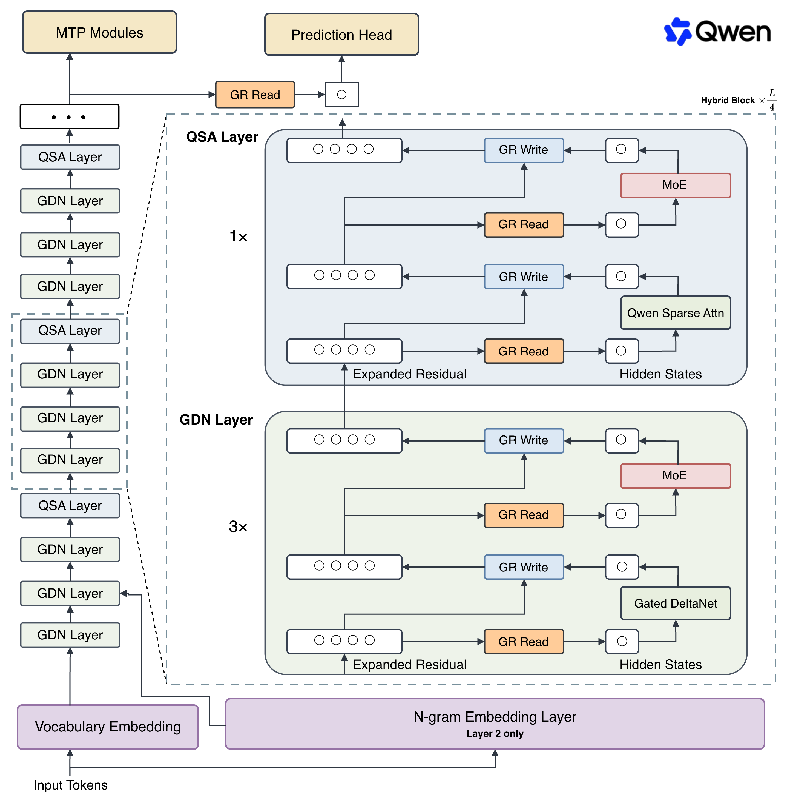

<b>图 3-5</b>　Qwen3.8-Flash-Next 的官方架构图。图源：Qwen3.8-Flash-Next 模型卡 [12]

该模型同时采用微块稀疏注意力、门控残差、查表式参数扩容与内置投机解码。对显存受限的加速器，这一组合较为有利，查表参数可卸载，激活计算量小，稀疏 kernel 的块粒度访存连续。

内置的投机解码由 MTP 模块承担，不另设草稿模型，挂在第 47 层之后，只有一层、约 4B 参数，先把主干末层的隐状态与第 k 步的目标 token 嵌入分别归一化后拼接，经一个随步数而异的投影矩阵 M_k 折回隐藏维，再过一层与主干同构的块（注意力加 MoE），最后由与词嵌入共享的输出头给出第 k+1 步的分布。多步训练使一次前向可产出若干步草稿，再由主干并行验证，省去独立草稿模型的前向与显存。

48 层按三比一循环、再挂一层 MTP 后，四类单元的算子序列与维数见图 3-6。

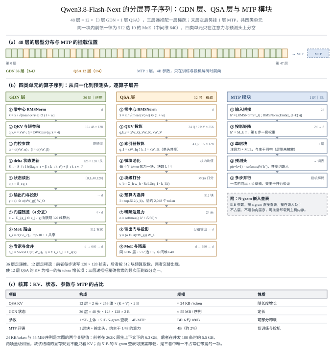

<b>图 3-6</b>　Qwen3.8-Flash-Next 的分层算子序列：（a）48 层的层型分布，每 4 层为 3 层 GDN 加 1 层 QSA，末层之后另挂 1 层 MTP，N-gram 查表只在嵌入处、不占层；（b）GDN 层、QSA 层与 MTP 模块三类单元各自的算子链，自零中心 RMSNorm 至预测头逐算子展开，含短卷积、delta 状态更新、微块打分与 512 块预算；（c）KV、状态、参数与 MTP 开销的核算。图源：文献 [12]

# 第 4 章　Kimi 系列

Kimi 一系自 K2 起即以 MLA 配稀疏 MoE。K2.5 在此基础上作原生多模态继续预训练；K3 换用线性注意力、跨层注意力残差与更稀疏的 MoE，激活率降到约 1.8%；K3.1 Pro 沿用 K3 底座，只把 24 层全注意力换成稀疏注意力，能力提升主要来自后训练。

## 4.1　Kimi K2.5

Kimi K2.5 于 2026 年 1 月发布，是在 Kimi-K2-Base 上以约 15T 视觉与文本 token 继续预训练得到的原生多模态智能体模型[13]。结构示意见图 4-1：总参数 1T、激活 32B；主体 61 层（1 层稠密 + 60 层 MoE），隐藏维 7168，注意力 64 头、机制为 MLA；MoE 含 384 个路由专家（top-8）与 1 个共享专家，专家中间维 2048，激活函数 SwiGLU；词表 160K，上下文 256K；视觉前端为 MoonViT（400M）。模型支持思考与非思考双模式，以及 Agent Swarm（将复杂任务分解为并行子任务，由动态实例化的领域智能体协同执行），并采用原生 INT4 量化以适配 vLLM、SGLang、KTransformers 等推理引擎。

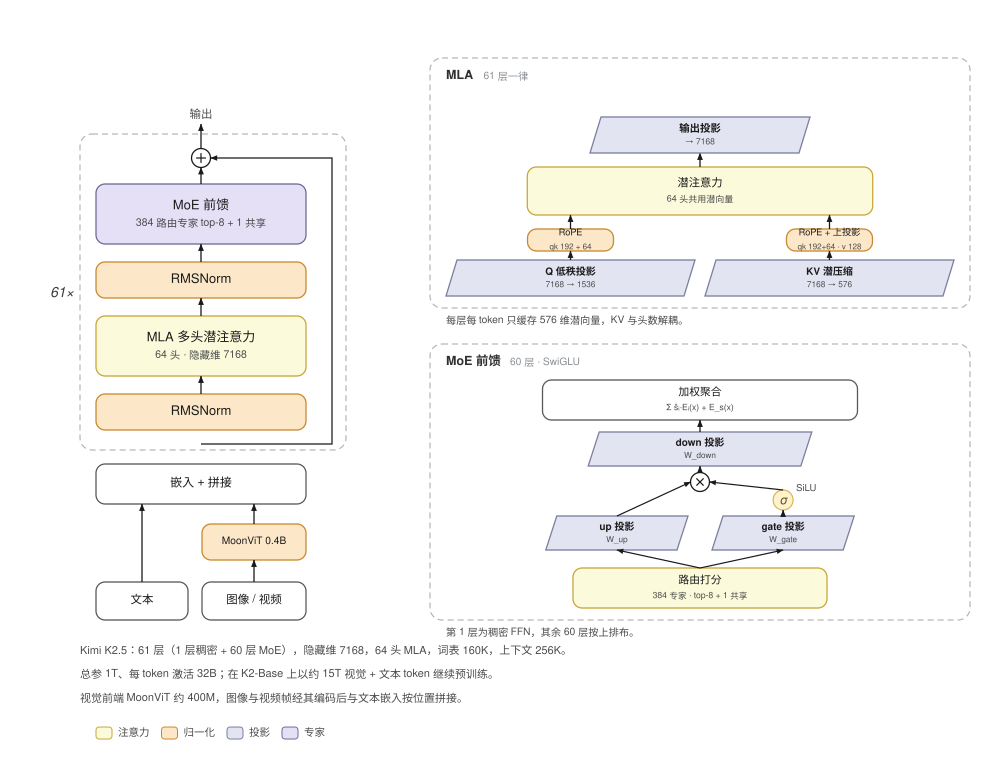

<b>图 4-1</b>　Kimi K2.5 结构示意图：MLA 注意力、384 专家的 MoE 与 MoonViT 视觉编码器。

MLA 与细粒度 MoE 各自的算子序列见图 4-2。

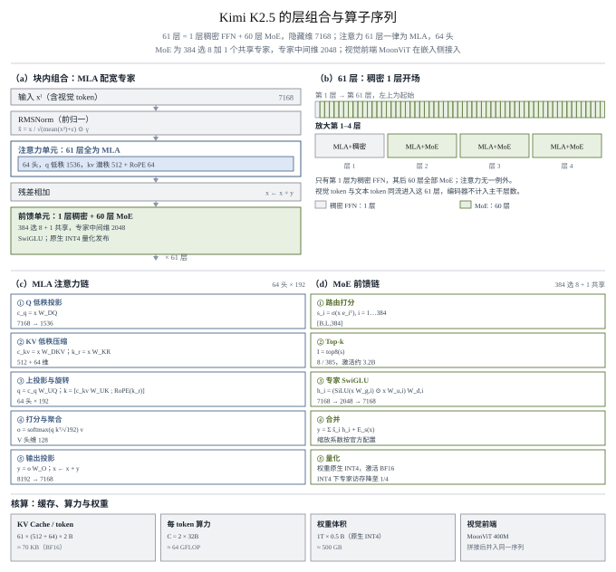

<b>图 4-2</b>　Kimi K2.5 的层组合与算子序列：（a）块内组合，61 层注意力一律为 MLA 64 头，第 1 层为稠密 FFN；（b）61 层的层型分布；（c）MLA 的低秩投影、潜在 KV 与聚合；（d）384 选 8 加 1 共享专家的路由、SwiGLU 与 INT4 量化；底部为 KV、算力与权重的核算。图源：文献 [13]

## 4.2　Kimi K3

Kimi K3 于 2026 年 7 月在 WAIC 发布，总参数 2.8T，896 个路由专家中每 token 激活 16 个（另加 2 个共享专家），激活约 104B；主体 93 层（69 层 KDA + 24 层 Gated MLA），上下文 1M token，原生视觉[14]。官方架构图见图 4-3。

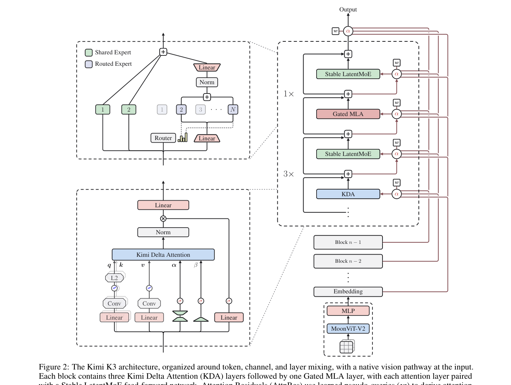

<b>图 4-3</b>　Kimi K3 的整体架构：以 token、通道、层三个维度组织信息流，输入侧带原生视觉通路。每个块由 3 层 KDA + 1 层 Gated MLA 组成，注意力层后接 Stable LatentMoE；AttnRes 以可学习伪查询对嵌入与各前置块输出作选择性检索。图源：Kimi K3 技术报告 Figure 2 [14]

KDA（Kimi Delta Attention）是带逐通道遗忘门的 delta 规则递推，以固定大小的循环状态替代随长度增长的 KV Cache，关键位置再插入稀疏全注意力的增量通道；1M 上下文下解码提速 6.3 倍。AttnRes（Attention Residuals）允许每层选择性检索此前所有层的表征，而非沿残差链均匀累积，以不到 2% 的额外计算换来约 25% 的训练效率提升。Stable LatentMoE 把稀疏度推至 896 选 16（激活率约 1.8%），并以 Quantile Balancing（按路由分位数直接分配专家）与 Per-Head Muon（逐注意力头优化器）实现不依赖 MuonClip 的稳定训练；SiTU 激活与 Gated MLA 分别改善激活控制与注意力选择性。

K3 对硬件的压力集中在两处。约 56 倍的稀疏度使专家并行的负载均衡与通信成为问题；KDA 的固定大小状态把 KV Cache 带宽解放了一个数量级，却要求缓存与前缀机制按递推状态重新设计。

第 4、8、…、92 层与第 93 层为 Gated MLA，其余 69 层为 KDA，即 23 个「3 KDA + 1 Gated MLA」块之后，末两层连续为 Gated MLA；第 1 层为稠密 FFN（中间维 33792），其余 92 层接 Stable LatentMoE。AttnRes 每 12 层把当时的前缀累加值存为一份摘要，库内至多 8 份，加上当前前缀共 9 个候选；每层在注意力与前馈之前各以可学习伪查询对这 9 个候选打一次分、取 softmax 加权，模型末端再检索一次。层型分布、检索机制与两类注意力的算子序列见图 4-4。

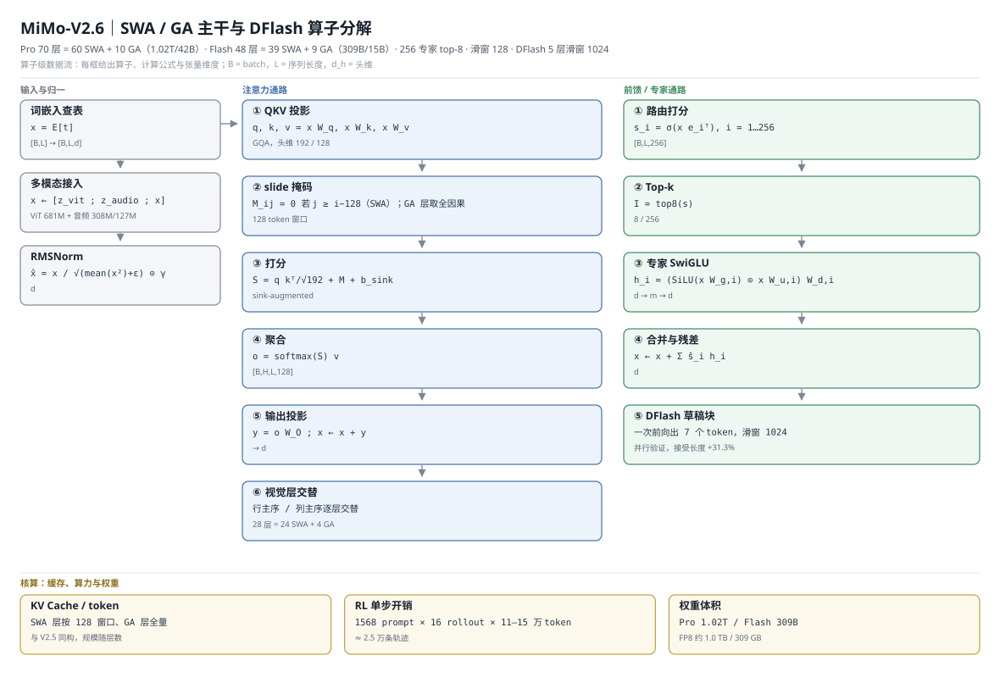

<b>图 4-4</b>　Kimi K3 的层组合与算子序列：（a）块内组合，注意力在 KDA 与 Gated MLA 之间按层型二选一，注意力与前馈之前各做一次 AttnRes 检索，第 1 层为稠密 FFN；（b）93 层的层型分布，第 4、8、…、92 层与第 93 层为 Gated MLA，绿色虚线为每 12 层一格的 AttnRes 摘要边界；（c）AttnRes 的检索：8 份摘要加当前前缀共 9 个候选，经伪查询打分与 softmax 加权后取代逐层累加的残差；（d）KDA 的 chunkwise 与 recurrent 两种执行形态，块内并行与逐 token 递推共用同一递推式；（e）Gated MLA 的低秩投影、NoPE 打分与输出门；（f）缓存、权重与稀疏度的核算。图源：文献 [14]

## 4.3　Kimi K3.1 Pro

Kimi K3.1 Pro 于 2026 年 10 月 24 日先行公布评测与 API 定价，11 月 5 日开放完整权重，是 K3.1 系列的首款模型[15][16]。它在 K3 底座上作后训练，未重建预训练网络，能力提升主要来自覆盖数百个下游领域的大规模联合强化学习；结构示意见图 4-5，与 K3 的对照见表 4-1。

主干与 K3 一致，总参数 2.8T、每 token 激活 104B，93 层中 1 层稠密，注意力隐藏维 7168、96 个头，词表 160K，上下文 1,048,576。MoE 仍为 896 个路由专家（top-16）加 2 个共享专家，潜维 3584、每专家中间维 3072，激活函数 SiTU-GLU；视觉前端 MoonViT-V2 为 401M。数值沿用 MXFP4 权重配 MXFP8 激活的量化感知训练，权重文件合计约 1.56 TB。

唯一的结构改动在注意力栈，K3 的 24 层全注意力 Gated MLA 换成 24 层 Gated DSA，与 69 层 KDA 共同组成 93 层。Gated DSA 由 32 个索引头（头维 128）对历史位置打分，每个查询取 top-2048 个键参与计算，1M 上下文下把长序列解码的 KV 读取量压到与选中规模相当。专家拓扑、层数、数值格式与推理框架均与 K3 兼容，已部署 K3 的团队迁移时无须改动权重格式或工具链。

<b>表 4-1</b>　Kimi K3 与 K3.1 Pro 的结构对照

| 项目 | Kimi K3 | Kimi K3.1 Pro |
|---|---|---|
| 总参数/激活参数 | 2.8T/104B | 2.8T/104B |
| 层数 | 93（1 稠密） | 93（1 稠密） |
| 注意力层组合 | 69 KDA + 24 Gated MLA | 69 KDA + 24 Gated DSA |
| 索引器 | 无 | 32 头、头维 128、top-2048 |
| 路由专家（激活） | 896（top-16）+ 2 共享 | 同 K3 |
| 上下文 | 1M | 1,048,576 |
| 视觉编码器 | MoonViT-V2（约 400M） | MoonViT-V2（401M） |
| 数值 | MXFP4/MXFP8（QAT） | 同 K3 |
| 权重体积 | 未公开 | 约 1.56 TB |

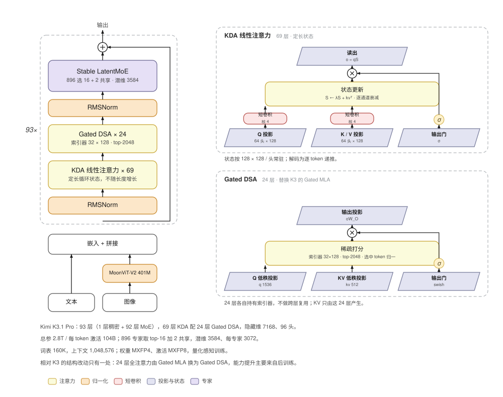

<b>图 4-5</b>　Kimi K3.1 Pro 结构示意图：69 层 KDA 与 24 层 Gated DSA 配 Stable LatentMoE，视觉前端为 MoonViT-V2。

两代共用一个底座，差别集中在 24 层，原先承担全局建模的全注意力层改为稀疏选择，索引器因而成为这 24 层的固定开销。加速器须为索引器预留算力与访存预算，同时保留 MLA 路径的 KV Cache 带宽。1.56 TB 的 MXFP4 权重按单卡 141 GB 显存估算，仅加载就至少需 12 张加速卡，尚不含 KV Cache 与中间计算；容量因此成为这一档模型私有化部署的首要约束。

与 K3 相比，算子序列只在 24 层的注意力段发生变化，改动位置见图 4-6。

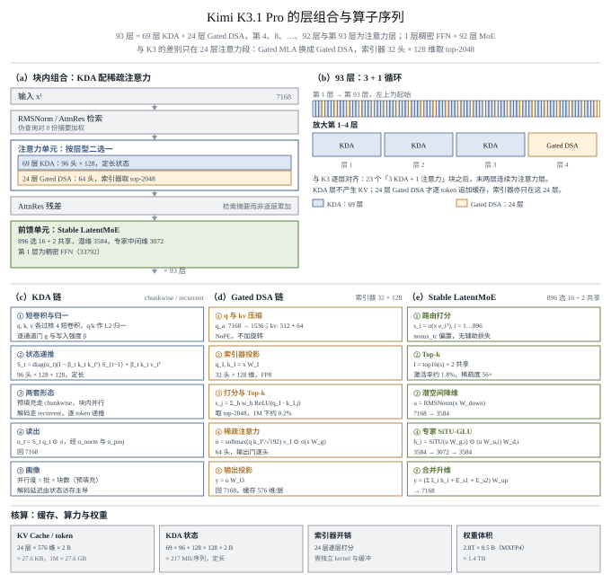

<b>图 4-6</b>　Kimi K3.1 Pro 的层组合与算子序列：（a）块内组合，69 层 KDA 与 24 层 Gated DSA 按层型二选一，注意力与前馈之前各做一次 AttnRes 检索；（b）93 层的层型分布，第 4、8、…、92 层与第 93 层为注意力层；（c）KDA 的短卷积、逐通道门与 delta 递推，预填充走 chunkwise、解码走 recurrent；（d）Gated DSA 的索引器 32 头 × 128 与 top-2048；（e）896 选 16 加 2 共享的潜空间专家；底部为 KV、KDA 状态与权重的核算。图源：文献 [15][16]

# 第 5 章　MiMo 系列

MiMo 以滑动窗口注意力（SWA）配少量全局注意力层（GA）为骨架。V2.5 完成原生全模态化，V2.6 把重心移到规模化 Agentic 强化学习；两者的结构选择都偏向压低单 token 计算量，因为 RL rollout 的算力开销随轨迹长度与条数成倍放大。

## 5.1　MiMo-V2.5

MiMo-V2.5 系列（2026 年）包含 Pro 与标准版两款，均支持 1M token 上下文，语言主干继承 MiMo-V2-Flash 的混合滑动窗口注意力（SWA）与全局注意力（GA）设计[17]。官方架构图见图 5-1，主要超参数见表 5-1。

<b>表 5-1</b>　MiMo-V2.5 系列主要超参数

| 项目 | V2.5-Pro | V2.5 |
|---|---|---|
| 总参数/激活参数 | 1.02T/42B | 310B/15B |
| 层数（1 稠密 + 其余 MoE） | 70 | 48 |
| GA/SWA 层 | 10/60 | 9/39 |
| 隐藏维 | 6144 | 4096 |
| 头数（Q/KV） | 128/8 | 64/4（GA）、64/8（SWA） |
| 头维（QK/V） | 192/128 | 192/128 |
| 路由专家（激活） | 384（top-8） | 256（top-8） |
| 专家中间维 | 2048 | 2048 |
| 预训练 | 27T token | 48T token |
| MTP | 3 层 | 3 层 |

SWA 与 GA 约按 5:1 至 6:1 交错，滑窗仅 128 token，配合可学习的 attention sink bias，KV Cache 存储降低近 6 倍。MoE 为细粒度路由专家（top-8，无共享专家，专家中间维 2048），第 0 层为稠密 FFN（中间维 16384）以稳定早期表征。MTP 采用 3 层轻量模块（密集 FFN）。标准版为原生全模态，729M 视觉编码器（28 层：24 SWA + 4 全注意力，行/列窗口交替）与 261M 音频编码器（初始化自 MiMo-Audio）。训练以 FP8 混合精度完成，经五阶段流程（文本预训练、投影层预热、多模态预训练、SFT 与上下文 32K→256K→1M 逐步扩容、RL 与 MOPD 多教师蒸馏）。

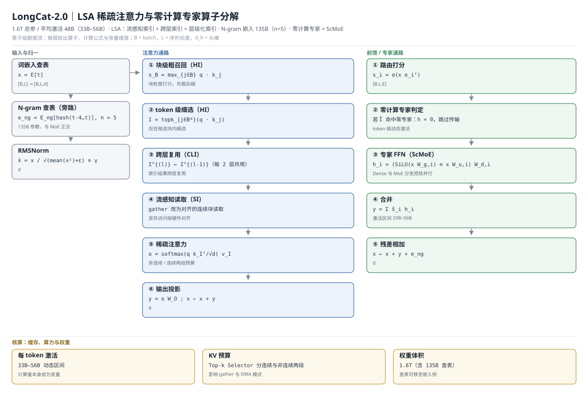

<b>图 5-1</b>　MiMo-V2.5 架构图。图源：小米 MiMo 官方发布页 [17]

与结构配套的推理优化包括 KV Cache 双池与 SWA-aware 前缀树、GCache 分级缓存（GPU 闲余内存 + NVMe SSD，RDMA 读 170 GB/s）、KV Cache 亲和调度，使单机吞吐提升约 30%。滑窗 128 配少量全局层的做法，把 1M 上下文的 KV Cache 压到可管理的范围；缓存分层与调度亲和性也因此不再只是系统问题，需与模型结构一并考虑。

滑窗与全局两套掩码共用同一次打分，其算子级安排见图 5-2。

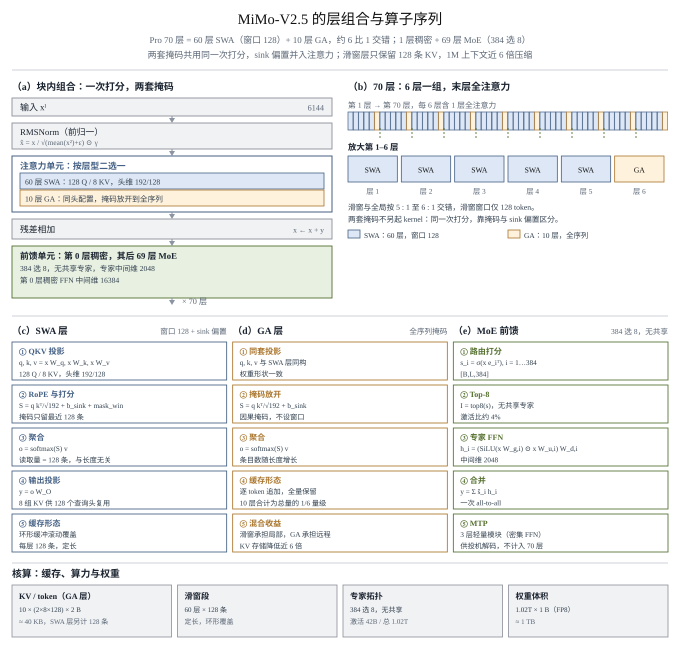

<b>图 5-2</b>　MiMo-V2.5 的层组合与算子序列：（a）块内组合，滑窗与全局两套掩码共用一次打分，sink 偏置并入注意力，第 0 层为稠密 FFN；（b）70 层按 6 层一组排布，每组末层为全注意力；（c）滑窗层：窗口 128 与环形缓冲；（d）全局层：同一套投影、掩码放开到全序列；（e）384 选 8 且无共享专家的 MoE 与 3 层 MTP；底部为两类层的 KV 与权重的核算。图源：文献 [17]

## 5.2　MiMo-V2.6

MiMo-V2.6 于 2026 年 9 月发布（MIT 协议开源），在 V2.5 结构上升级为原生全模态（文本、图像、音频、视频），并把重心放在规模化 Agentic 强化学习上[18]。系列分 Pro 与 Flash 两档，主干沿用 V2.5 的混合排布：首层为全注意力配稠密 FFN，其余层由滑窗注意力与全局注意力交错，两类的 FFN 均为无共享专家的稀疏 MoE。滑窗长度 128，上下文 1M。两档的差别集中在层数、宽度与专家数，超参数对照见表 5-2。

<b>表 5-2</b>　MiMo-V2.6 Pro 与 Flash 主要超参数

| 项目 | V2.6-Pro | V2.6-Flash |
|---|---|---|
| 总参数/激活参数 | 1.02T/42B | 309B/15B |
| 层数（总/SWA/GA） | 70/60/10 | 48/39/9 |
| 隐藏维 | 6144 | 4096 |
| GA 头数（Q/KV） | 128/8 | 64/4 |
| SWA 头数（Q/KV） | 128/8 | 64/8 |
| 头维（QK/V） | 192/128 | 192/128 |
| 滑窗长度 | 128 | 128 |
| 路由专家（总数/激活） | 384/8 | 256/8 |
| 共享专家 | 无 | 无 |
| 专家中间维 | 2048 | 2048 |
| 稠密层中间维 | 16384 | 16384 |
| 词表 | 152,576 | 152,576 |
| 位置编码 | Partial-RoPE 64 维，θ_GA = 1×10⁷、θ_SWA = 1×10⁴ | 同左 |
| 视觉塔（MiMo ViT） | 681M，28 层（24 SWA + 4 GA），宽 1280，输出 6144 | 同左，输出 4096 |
| 音频前端 | 308M tokenizer（24 层，12 SWA + 12 GA，20 码本）+ 127M patch 编码器 | 同左 |
| 投机解码 | 5 层 SWA 草稿块，窗口 1024，一次 7 token | 同左 |
| 权重格式 | FP8（E4M3，128×128 分块，动态缩放） | 同左 |

两档的层型排布方式一致，Pro 的 10 个全注意力层落在第 0、7、15、…、69 层，间隔 7 至 8 层；Flash 的 9 个落在第 0、5、11、…、47 层，间隔 5 至 6 层。两档都以全注意力层开局、也以它收尾。差别在宽度与专家数，隐藏维由 6144 收到 4096，路由专家由 384 降至 256，专家中间维同为 2048、激活同为 top-8 且无共享专家，激活参数因此由 42B 降至 15B。Flash 的主干与 V2.5 标准版同层数、同宽度，总参数由 310B 变为 309B。路由的取法与 V2.5 相同，均为 sigmoid 打分配 noaux_tc 偏置。

全模态前端为两档共用。视觉一侧是 MiMo-ViT（681M，28 层 = 24 SWA + 4 GA，sink-augmented 滑窗，行/列主序逐层交替，以 4T 图像 token 从头训练）；音频一侧由 308M 音频 tokenizer（24 层，12 SWA + 12 GA，20 个码本的残差向量量化，25 Hz 帧映射为 20 个离散 token）与 127M patch 编码器（4 帧/patch，把进入主干的速率降到 6.25 Hz）串联。投机解码采用 5 层 DFlash block-diffusion 模块（滑窗 1024），一次前向预测 7 个后续 token 并行验证；RL 阶段改用 rollout 日志微调的 block-6 DFlash drafter，平均接受长度提高 31.3%。

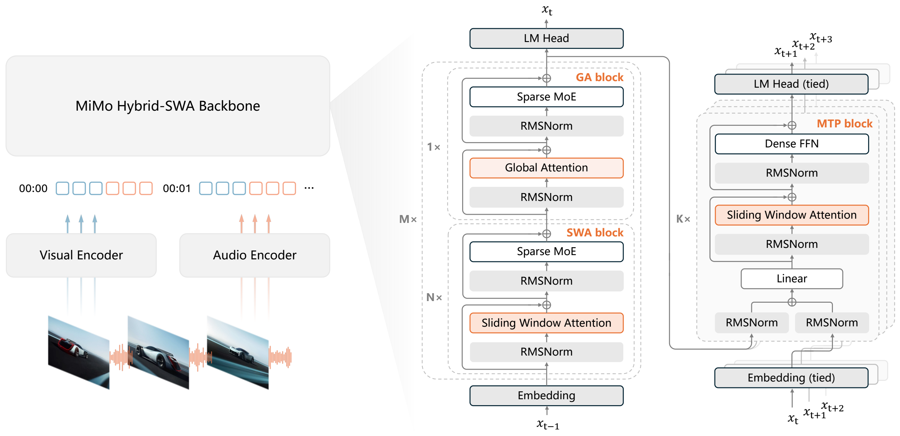

<b>图 5-3</b>　MiMo-V2.6 架构：全模态编码器、SWA/GA 混合主干与 MTP 模块。图源：MiMo-V2.6 技术报告 Figure 1 [18]

全模态接入与草稿块在算子层面各占一段，位置见图 5-4。

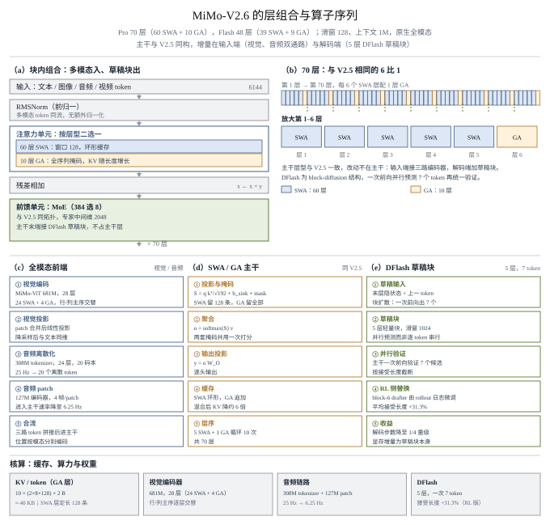

<b>图 5-4</b>　MiMo-V2.6 的层组合与算子序列：（a）块内组合，多模态 token 同流进入 SWA/GA 混合主干；（b）70 层与 V2.5 相同的 6 比 1 排布；（c）全模态前端：视觉编码、投影、音频离散化与 patch 降采样；（d）主干两套掩码的打分与缓存；（e）DFlash 草稿块一次前向预测 7 个 token 的流程；底部为编码器规模、DFlash 与 KV 的核算。图源：文献 [18]

# 第 6 章　LongCat 系列

LongCat-Flash 以 560B 总参与每 token 18.6B～31.3B 的动态激活，采用 ScMoE 与零计算专家两项设计；LongCat-2.0 把规模扩至 1.6T，注意力改为 LSA 稀疏，并在国产算力集群上完成从预训练到推理的全流程。

## 6.1　LongCat-Flash

LongCat-Flash 于 2025 年 8 月开源（MIT），总参数 560B，每 token 激活 18.6B～31.3B、均值约 27B，上下文 128K[19]。其后的 LongCat-2.0 在此之上扩到 1.6T，见 6.2 节；结构示意见图 6-1。

层的组织与常见 MoE 不同。该模型分为 28 段，每段含两个「MLA + 稠密 FFN」单元，合计 56 个注意力块与 56 处稠密前馈，而 MoE 每段只算一次。段内的次序是，单元 1 的注意力与前馈作完，另取单元 1 之后的归一化输入送进 MoE，输出暂存；单元 2 照常走注意力与前馈，段末再把暂存的 MoE 输出一并加回。这条旁路即 Shortcut-connected MoE 的由来——MoE 的 all-to-all 可与单元 2 的整块注意力重叠，通信窗口由一次前馈扩到一次注意力加一次前馈，官方称这是其训练与推理吞吐的主要来源。

56 个注意力块各持一份 576 维 KV（512 维潜向量加 64 维 RoPE），按 BF16 计每 token 63 KB，128K 上下文单条约 8.3 GB；稠密前馈 56 处、中间维 12288，合计约 12.7B 参数，逐 token 全量计算。专家侧 512 个路由专家、中间维 2048，28 处 MoE 合计约 541B，占总量九成六。

零计算专家是这一版的另一处设计。MoE 的候选池是 768 个——512 个真实专家加 256 个 identity 专家；某 token 的 top-12 里命中几个 identity，就少算几个真实专家，命中的那几路按原值直通，既不读权重也不作矩阵乘。激活量因此随 token 而变，官方给出的区间是 18.6B～31.3B；为把均值拉回 27B，路由器带一个由 PID 控制器调整的专家偏置，按各专家的实收 token 数动态加减。代价是负载均衡，同一批内不同 token 的计算量不同，调度与通信要按 token 粒度而非批粒度设计，这与 6.2 节按 token 分配专家数的做法同源，只是那一代把零专家从 256 减到 128、路由专家从 512 增至 768。

注意力的配置与 DeepSeek V3 同源，MLA 64 头，q 低秩 1536、kv 低秩 512，qk 无位置 128 加 RoPE 64，v 头维 128，θ 取 1e7，原生 128K。词表 131,072，隐藏维 6144，路由缩放取 6.0，权重只发 BF16 一版，约 1.12 TB。56 个注意力块各存一份 KV，缓存容量要按块算而非按段估，两者相差一倍；MoE 的通信又被有意拉长到与注意力重叠，互联的调度粒度要细到段内单元。

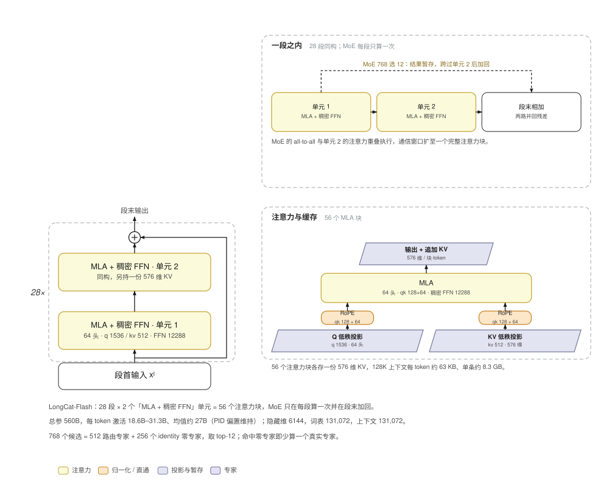

<b>图 6-1</b>　LongCat-Flash 的段内组合与零计算专家：（a）一段之内为两个「MLA + 稠密 FFN」单元，MoE 在单元 1 之后另起一路、跨过单元 2 于段末加回；（b）28 段共 56 个注意力块，段界以虚线标出；（c）768 个候选（512 个路由专家加 256 个 identity）上取 top-12，激活区间 18.6B～31.3B，均值 27B 由 PID 偏置维持；（d）主要配置字段与取值。图源：文献 [19]

段内旁路与零专家直通在算子上各占一段，走向见图 6-2。

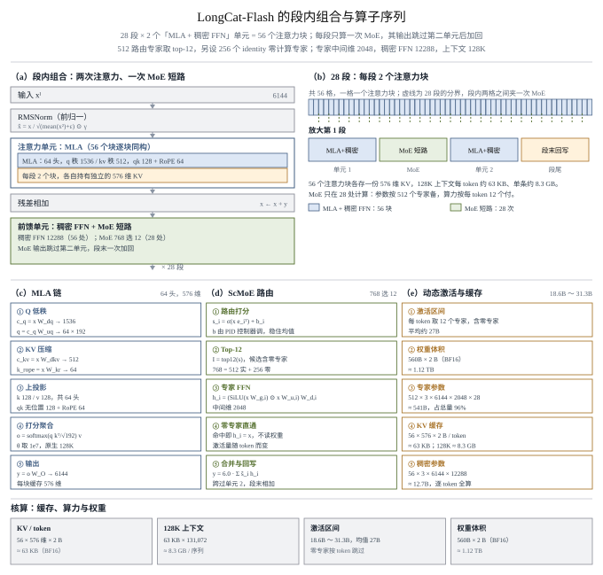

<b>图 6-2</b>　LongCat-Flash 的段内组合与算子序列：（a）块内组合，稠密 FFN 逐单元计算、MoE 每段一次并短路回写；（b）28 段、56 个注意力块；（c）MLA 的 Q 低秩、KV 潜压缩与聚合；（d）768 选 12 的路由、专家 SwiGLU 与零专家直通；（e）激活区间、专家参数与缓存的核算。图源：文献 [19]

## 6.2　LongCat-2.0

LongCat-2.0 于 2026 年 6 月 30 日发布，7 月 6 日开源（MIT），总参数 1.6T，每 token 平均激活约 48B（动态区间 33B～56B），上下文 1M token，预训练超过 30T token，稀疏度约 97%；是首个在五万卡国产算力集群上完成从预训练到推理全流程的万亿模型[20][21]。

该模型共 38 层，隐藏维 8192，词表 163,840；注意力为 64 头 MLA（q 低秩 1536、kv 低秩 512，qk 无位置 128 + RoPE 64，v 头维 128），索引器 32 头 × 128、每查询取 top-2048；前馈为 768 个路由专家取 top-12，另设 128 个零计算专家与 1 个共享专家，专家中间维 2048；主干末端接 3 层 MTP，长上下文靠 deepseek_yarn 自 8192 外推到 262,144。

结构上引入三项设计。注意力部分为 LSA（LongCat Sparse Attention），在 DSA 的轻量索引器上作三项正交改造，流感知索引（SI）把碎片化的显存访问改为硬件对齐的连续读取，跨层索引（CLI）让相邻若干层共用一次索引结果，层级化索引（HI）先作块级粗召回，再在候选内作 token 级细选。三项可独立开启或关闭，整体结构见图 6-3。跨层索引同样用于 3 步 MTP 投机解码：目标模型每两层共用一次索引，草稿模型的三个步次共用第一步生成的索引集。推理侧另有 absorb 计算模式、索引器与 MLA prolog 并行、KVP 切分 KV Cache 等配套，使 1M 上下文下仍能保持信息定位。

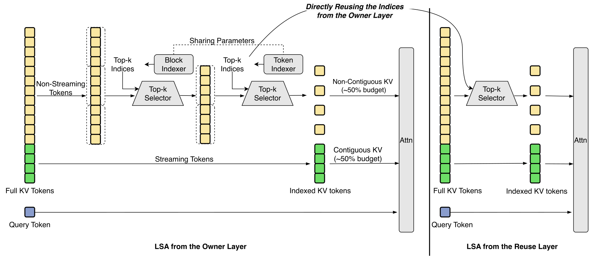

<b>图 6-3</b>　LongCat-2.0 的稀疏注意力架构：左侧索引生成层由块索引器与 token 索引器分两级打分，Top-k Selector 把 KV 分为非连续与连续两类预算；右侧复用层直接沿用前一层的索引结果。图源：LongCat 官方发布博客「LongCat 稀疏注意力设计总览」[20]

N-gram Embedding 从 LongCat-Flash-Lite 继承，n-gram size 取 5，含 135B 参数，在与 MoE 正交的稀疏维度上扩容；推理时把参数从专家移到嵌入表，可降低大 batch 解码的显存 I/O。零计算专家加 ScMoE 实现 token 级动态激活，简单 token 不消耗专家算力，复杂 token 自动获得更多计算资源；路由到零专家的 token 跳过传输与计算，Dense 与 MoE 分支借国产芯片的控核能力作物理核心级并行。

后训练以 MOPD 多专家融合组织，Agent、Reasoning、Interaction 三组专家分别专攻工具调用与自主纠错、数学与 STEM 推理、指令遵循与交互体验，经多教师同策略蒸馏融为统一模型，结构见图 6-4。

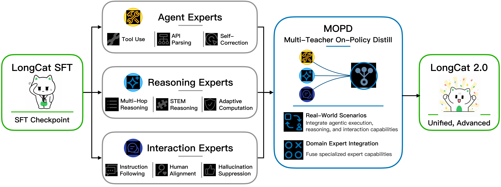

<b>图 6-4</b>　MOPD 多专家后训练架构：三组领域专家经多教师同策略蒸馏融为统一模型。图源：LongCat 官方发布博客「基于 MOPD 的多专家后训练架构总览」[20]

针对显存与带宽受限的国产芯片，团队以 Super Kernel 减算子、权重预取隐藏 I/O、PD 分离、异步 EP 负载均衡等手段，使万亿模型可在存量卡上运行。此外，动态激活区间 33B～56B 意味着每 token 的计算量本身成为变量，负载不均从批间问题变成 token 间问题，调度器与互联都要按此设计。

三级索引与零计算专家在同一层内串联，算子级走向见图 6-5。

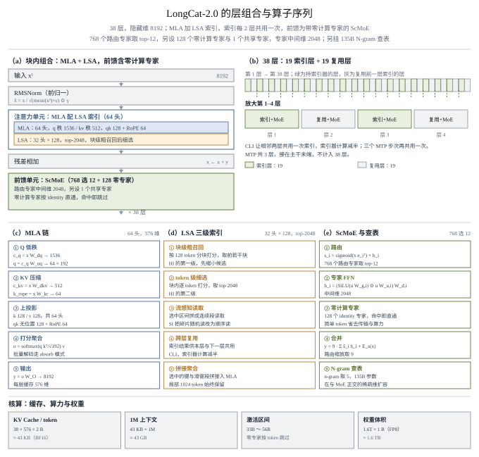

<b>图 6-5</b>　LongCat-2.0 的层组合与算子序列：（a）块内组合，MLA 配 LSA 索引，前馈为带零计算专家的 ScMoE；（b）38 层，19 层持索引器、19 层复用前一层的索引；（c）MLA 的 Q 低秩、KV 潜压缩与读出；（d）LSA 的三级索引：块级粗召回、token 级细选、流感知读取与跨层复用；（e）768 选 12 的 ScMoE、128 个零计算专家与 N-gram 查表；底部为 KV、激活区间与权重的核算。图源：文献 [20]

# 第 7 章　GLM 系列

GLM 的 5、5.2 与 5.3 三代连续沿用 DSA 稀疏注意力，规模同为 744B/40B，差别在上下文长度、索引器复用与后训练：5.2 以 IndexShare 把索引器开销摊到多层，并把上下文扩到 1M；5.3 的结构与 5.2 完全相同，增量全部来自后训练。7.4 节的 GLM-5.3-Flash 是另一条线，底座重新训练，层数减到 45，注意力换成线性递推与稀疏选择的混合，规模降到 320B/18B。7.5 节的 GLM-5.4 回到 744B 基座，注意力与专家一律不动，改的是层被执行几遍：中段 28 层共享权重循环两轮，参数不增而层执行次数由 78 增至 106。

## 7.1　GLM-5

GLM-5 于 2026 年 2 月发布（MIT 协议），把 GLM-4.5 的 355B/32B 扩展到 744B 总参、40B 激活，预训练数据由 23T 增至 28.5T token，面向复杂系统工程与长程 Agent 任务[22]。结构示意见图 7-1。

GLM-5 采用更深更窄的 MoE 布局，78 层，隐藏维 6144，前 3 层为稠密 MLP（中间维 12288），其余 75 层为 MoE，每层 256 个路由专家取 top-8、另加 1 个共享专家，专家中间维 2048。注意力为 64 头 MLA（q 低秩 2048、kv 低秩 512，qk 192 + RoPE 64，v 头维 256），后接 DSA 索引器（32 头 × 128，取 top-2048），并在注意力中直接引入 DeepSeek 的 DSA 稀疏注意力，在保留长上下文能力的同时压低部署成本；这是第三方旗舰首次整体采纳 2.2 节所述的稀疏注意力路线。训练侧另有两项改动，Muon Split 使 MLA 达到 GQA-8 的性能水平（以 20B token 追平 DeepSeek 943.7B token 的对照效果），表明注意力结构与优化器的耦合在加深；slime 异步 RL 基础设施支撑了细粒度的后训练迭代。上下文为 202K。

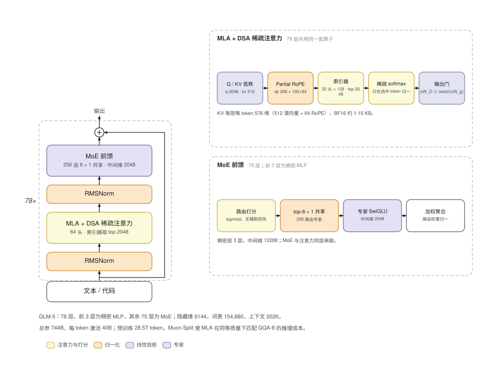

<b>图 7-1</b>　GLM-5 结构示意图：更深更窄的 MoE 主干与 DSA 稀疏注意力。

与前代 355B/32B 相比，容量增长主要由专家数承担，激活参数只增加 8B；DSA 的引入则把索引器开销带进了原本没有这一部件的注意力栈。

索引器在算子层是新加的一段，其位置见图 7-2。

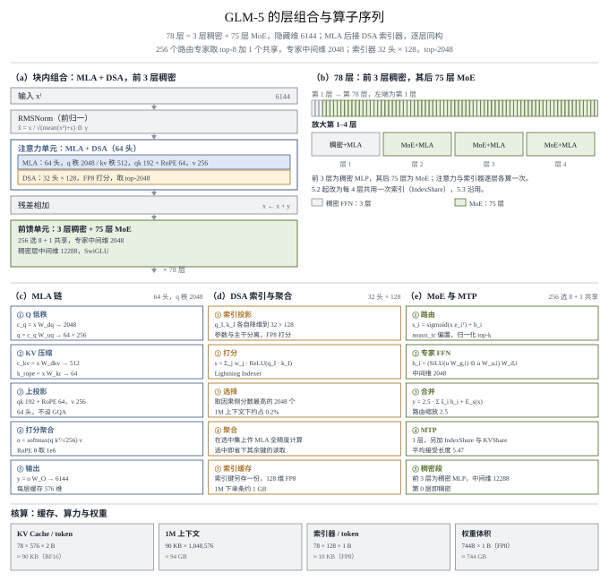

<b>图 7-2</b>　GLM-5 的层组合与算子序列：（a）块内组合，MLA 后接 DSA 索引器，逐层同构，前 3 层为稠密 MLP；（b）78 层的稠密与 MoE 分布；（c）MLA 的低秩投影与潜向量缓存；（d）DSA 索引器的打分与 top-2048 聚合；（e）256 选 8 加 1 共享的 MoE、1 层 MTP 与稠密段；底部为 KV、索引器与权重的核算。图源：文献 [22]

## 7.2　GLM-5.2

GLM-5.2 于 2026 年 6 月发布（MIT），在 744B/40B 的规模上把上下文做到 1M token，并公开了较完整的结构细节[23]。官方架构图见图 7-3。

主体为 78 层（前 3 层稠密 MLP、中间维 12288，其余 75 层 MoE），隐藏维 6144，词表 154,880；MoE 为 256 个路由专家（top-8）加 1 个共享专家，专家中间维 2048，采用 sigmoid 无辅助损失偏置路由（noaux_tc bias）、归一化 top-k，路由缩放 2.5，不使用组限制路由。注意力为 MLA + DSA + IndexShare：MLA 参数为 q 低秩 2048、kv 低秩 512、64 头（无 GQA），qk 无位置 192 + RoPE 64（qk 头维 256）、v 头维 256；Lightning Indexer（32 头、头维 128、FP8）对原始位置打分，取 top-2048 因果 key。IndexShare 的关键在索引器分层复用，仅 21 个 full 层（前 3 层与此后每 4 层）持有索引器，其余 57 个 shared 层直接复用前一 full 层的 top-k 索引，索引器计算降至逐层配置的 27%，1M 上下文下每 token 的索引相关 FLOPs 相应下降；模型自中期训练（128K 序列长度）起即带着 IndexShare 训练，而非事后附加。位置编码方面，RoPE θ 提高到 8×10⁶，最大位置 1,048,576，无需 YaRN 外推。MTP 为 1 层，同样应用 IndexShare 与 KVShare 以消除多步草稿的训练与推理不一致，配合拒绝采样与端到端 TV 损失，平均接受长度由 4.56 提升至 5.47（+20%）。

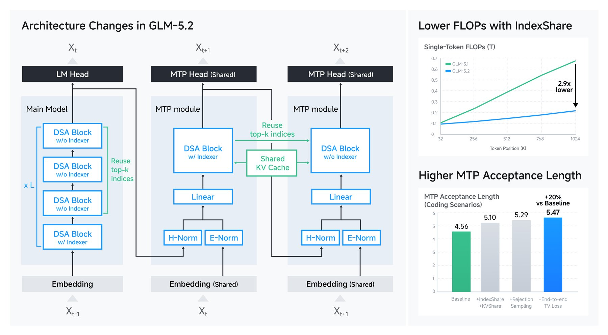

<b>图 7-3</b>　GLM-5.2 的 IndexShare 架构：每 4 个稀疏注意力层共享 1 个索引器，其 top-k 索引复用于后续 3 层。图源：智谱官方博客架构图 [23]

IndexShare 针对的是稀疏注意力的计算瓶颈，索引器若仍是每层全量开销，稀疏化的收益便被抵消；每四层共用一次索引计算，是保留这部分收益的工程做法。1M 上下文下，推理瓶颈也由计算移到 KV Cache 容量与长上下文 kernel 开销。

索引器复用之后，层与层之间多出一条索引传递边，算子级结构见图 7-4。

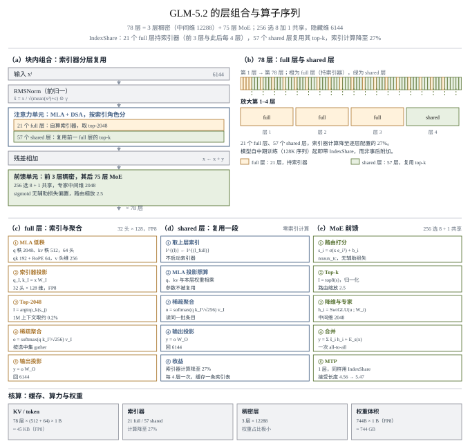

<b>图 7-4</b>　GLM-5.2 的层组合与算子序列：（a）块内组合，21 个 full 层自算索引、57 个 shared 层复用其 top-k；（b）78 层的 full 与 shared 分布；（c）full 层：MLA 低秩（q 秩 2048、kv 秩 512）加索引与聚合；（d）shared 层：不启动索引器，只作投影与聚合；（e）256 选 8 加 1 共享专家的前馈与 1 层 MTP；底部为 KV、索引器与权重的核算。图源：文献 [23]

## 7.3　GLM-5.3

GLM-5.3 于 2026 年 8 月发布，权重在发布两周后开放[35]。官方表述为，基座与 GLM-5.2 相同，全部提升来自后训练 Scaling[35]。与 5.2 相比，除新增的量化配置与框架版本号外，78 层、隐藏维 6144、64 头 MLA、256 专家 top-8 加 1 共享、索引器 21 full 与 57 shared、1M 上下文、MTP 1 层，逐项一致[36]。就结构而言，7.2 节所述即 5.3 ，本节不再重复，只讨论两件事，后训练如何在同一基座上换取能力，以及 FP8 发布形态的结构含义。

支撑后训练的是三件已有工作（图 7-5）。IndexShare 提供低成本的长上下文预填充，使 1M 序列的 rollout 不至于被索引器开销拖垮；SAO 即单条 rollout 异步优化（Single-rollout Asynchronous Optimization），以单条 rollout 取代组采样，配严格的双侧 token 级裁剪，使异步更新下的 off-policy 偏差可控，据其报告可稳定训练千步以上，并已用于 GLM-5.2 的训练流程[37]；slime 以 Megatron 训练、SGLang 采样共用一条数据流，训练与推理路径的 logprob 对齐到 1e-7 量级。三者叠加后，长程任务的强化学习具备工程可行性，环境数与训练时长可继续增加，而不必重建训练栈。

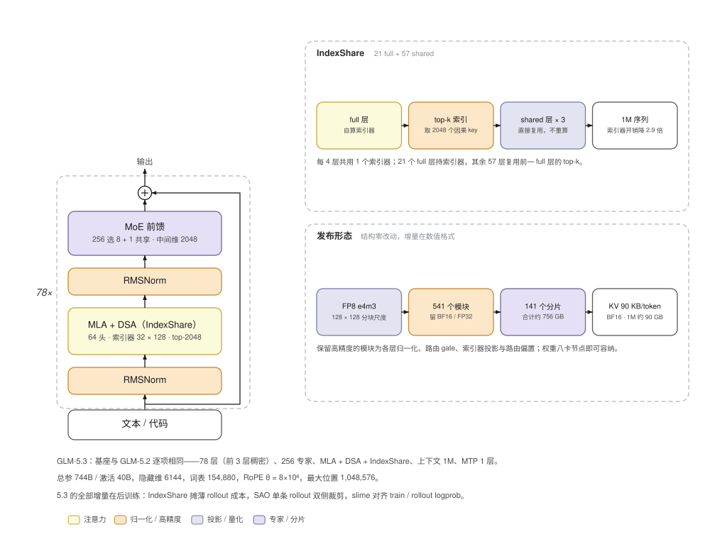

<b>图 7-5</b>　GLM-5.3 结构示意：基座与 GLM-5.2 逐项相同，78 层、256 专家、MLA + DSA + IndexShare 与 1M 上下文均未改动；增量集中在 IndexShare、SAO 与 slime 构成的后训练栈，权重以 FP8 混合精度发布。图源：文献 [35][36]

这意味后训练 Scaling 消耗的是采样与训练的算力，与推理部署无关；5.3 既未改动结构，服务端的并行切分、KV 布局与索引器 kernel 均可从 5.2 直接沿用，升级不产生新算子，也不产生新的通信模式。模型能力的代际提升与部署形态脱钩，升级只需替换权重。

唯一的新增变量是权重发布形态。5.3 以 FP8（e4m3）发布，128×128 分块尺度、激活动态量化，共 141 个分片、合计约 756 GB；541 个模块保留 BF16 或 FP32，包括各层归一化、路由 gate 及其偏置、索引器投影[36]。高精度模块的分布说明凡参与归一化缩放、路由决策与索引打分的参数都不量化，因为这些位置的误差会经由 top-k 的离散选择被放大，而专家与投影矩阵的块内误差只表现为连续的数值扰动。

对加速器而言，这需要显式支持，分块反量化在矩阵乘之前完成，尺度张量按 128×128 块索引，属访存而非算力开销；混合精度意味着同一层内并存两种权重格式，调度器不能按整层统一设定数据类型。至于容量，756 GB 摊到八卡需每卡 96 GB 以上，支持单机部署，跨机通信由必需降为可选；上一代以 BF16 发布时约 1.5 TB，超出八卡节点容量，无法单机部署。

其算子级位置见图 7-6。

<b>图 7-6</b>　GLM-5.3 的层组合与算子序列：（a）块内组合，与 5.2 同构，不新增算子；（b）78 层的 full 与 shared 分布不变；（c）FP8 分块反量化插在权重读取与矩阵乘之间，尺度按 128×128 索引；（d）MLA 与 DSA 通路原样保留；（e）权重的两类模块：FP8 主体与 541 个高精度模块；底部为发布形态、分片与部署的核算。图源：文献 [36]

## 7.4　GLM-5.3-Flash

GLM-5.3-Flash 于 2026 年 8 月 26 日发布，权重同月开放（MIT），是 GLM 系列首个原生多模态模型[38]。总参 320B、每 token 激活 18B，上下文 1M token。它不沿用 5、5.2、5.3 三代的 744B/78 层主干，而是重新训练底座，层数由 78 减到 45，激活由 40B 降到 18B，注意力改为线性递推与稀疏选择的混合，残差改为四路 mHC。官方给出的效率口径为相对 5.3 注意力计算降至 1/3.0、KV Cache 降至 1/4.4[38]。发布前曾以 ox-alpha 匿名上线，服务侧运行在国产芯片集群上。

主干 45 层，隐藏维 4096，词表 154,880；前 3 层为稠密 MLP（中间维 12288），其余 42 层为 MoE，288 个路由专家取 top-8、另加 1 个共享专家，专家中间维 2048，sigmoid 打分配 noaux_tc 偏置、top-k 归一化后缩放 2.5，不使用组限制路由；SwiGLU 的 gate 与 up 两路均截断在 ±10。注意力按「3 层 KDA + 1 层 DSA」排布，第 4、8、…、44 层为稀疏层共 11 层，其余 34 层为 KDA 线性层，即 11 个完整组之后另接末层 1 层 KDA。与 5.3 的对照见表 7-1，整体示意见图 7-7。

<b>表 7-1</b>　GLM-5.3 与 GLM-5.3-Flash 的结构对照

| 项目 | GLM-5.3 | GLM-5.3-Flash |
|---|---|---|
| 总参数/激活参数 | 744B/40B | 320B/18B |
| 层数 | 78（3 稠密） | 45（3 稠密） |
| 注意力层型 | 78 层 DSA，21 full + 57 shared | 11 层 DSA + 34 层 KDA |
| 稀疏层 MLA | q 秩 2048、kv 秩 512，qk 192 + RoPE 64 | q 秩 1536、kv 潜向量 512，qk 256 无位置编码 |
| 索引器 | 32 头 × 128，跨层复用 | 32 头 × 128，IndexPool 4 合 1，逐层持有 |
| 路由专家（激活） | 256（top-8 + 1 共享） | 288（top-8 + 1 共享） |
| 专家中间维 | 2048 | 2048 |
| 残差 | 标准 | mHC 四路 |
| 视觉前端 | 无 | 24 层 ViT，输出 4096 维 |
| 上下文 | 1M | 1M |
| 发布形态 | FP8，约 756 GB | FP8，约 328 GB |

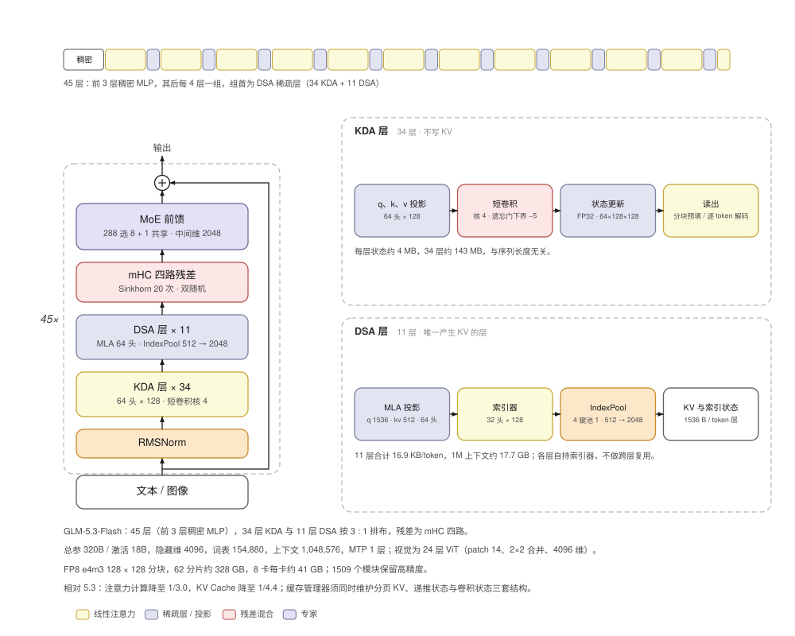

<b>图 7-7</b>　GLM-5.3-Flash 结构示意：45 层按「3 层 KDA + 1 层 DSA」排布，稀疏层用 MLA 与池化索引器，线性层以定长状态替代 KV，残差为 mHC 四路。图源：文献 [38]

KDA 层的算子与 4.2 节所述 Kimi 一系的逐通道衰减 delta 递推同源，q、k、v 各 64 头 × 128 维，三者拼接后过核长 4 的深度短卷积；遗忘门取 g = −5 · σ(exp(A) · (W x + b))，衰减因此落在 (−5, 0)，delta 规则的学习率 β = σ(W_b x) 逐头给出，q、k 在核内作 L2 归一化，输出经门控 RMSNorm 与投影回到 4096。预填与训练走块长 64 的 chunkwise 形式，解码走逐 token 递推，两形态共用同一递推式，状态以 FP32 保存。

稀疏层沿用 MLA，参数为 q 低秩 1536、kv 潜向量 512、qk 头维 256、v 头维 256、64 头；与 7.1 至 7.3 的差别在 qk 的旋转维为 0，45 层主干因此不含任何位置编码，位置信息只由 KDA 的衰减门与因果掩码隐含，RoPE 仅见于视觉塔的二维位置编码。索引器为 32 头 × 128 维，键经 LayerNorm，查询复用 MLA 的 1536 维 q 残差。11 个稀疏层各自持有索引器，不沿用 5.2 的 IndexShare；省下的不是层间冗余，而是键向量的分辨率——IndexPool 按隐藏态给出的门控把相邻 4 个键加权合为 1 个，打分与选择都在池上进行，每查询取 512 个池（对应 top-2048 个 token），选中后展开回原始 token，末位未满的池恒被选中。索引打分的规模因此缩小 4 倍，取数粒度由单 token 变为 4-token 组，kernel 须按组连续读取。

残差改用 mHC（流形约束超连接），与 2.3 节 V4 同源。隐藏态铺成 4 路，进块前由 pre 权折叠为 1 路，出块后由 post 权展开回 4 路，comb 权把 4 路输入混入 4 路输出，并以 20 次 Sinkhorn 迭代约束为双随机矩阵，使混合后的范数不随层数增长。每层的注意力与前馈各持一组 pre/post/comb 参数，这些参数连同归一化、路由 gate 与索引器投影一并留在高精度。与 V4 的差别在末端，Flash 取 4 路的算术平均，V4 用加权合并。视觉前端为 24 层 ViT（1024 维、16 头、patch 14、448 见方、2 × 2 空间合并，输出对齐 4096 维），MTP 为 1 层。

缓存因此分成两类。11 个稀疏层随 token 增长，每 token 存 512 维潜向量（BF16 1 KB）、128 维索引键与 128 维池化门控（各 256 B），合计 1536 B；11 层为 16.9 KB/token（其中主 KV 11.3 KB、索引器状态 5.6 KB），1M 上下文约 17.7 GB。34 个 KDA 层为定长状态，每层 64 × 128 × 128 个元素，FP32 约 4 MB，34 层合计约 143 MB，与序列长度无关。5.3 的主 KV 为 90 KB/token，Flash 同项 11.3 KB、计入索引器后 16.9 KB，带宽降至五分之一以下；官方按每层平均计得 4.4 倍，口径不同而方向一致。

权重以 FP8（e4m3）发布，128 × 128 分块尺度、激活动态量化，共 62 个分片、合计约 328 GB；1509 个模块保留 BF16 或 FP32，除归一化与路由 gate 外，还包括每层的 mHC 参数与索引器投影。8 卡每卡约 41 GB，48 GB 级单机即可容纳。串行侧的压力由线性注意力带来，KDA 的解码路径是逐 token 递推，34 层串成一条链，其延迟不随张量并行的加宽而下降，只能靠在块内并行、跨设备切层分摊。官方在 SGLang 上自建的推理引擎即按此组织——线性注意力与 LM head 走节点内张量并行，状态以 ReplaySSM 重放，权重 W8A8、缓存以 INT8/FP8/BF16 混合量化，层切分用以适配单卡的显存与带宽[38]。

其算子级位置见图 7-8。

<b>图 7-8</b>　GLM-5.3-Flash 的层组合与算子序列：（a）块内组合，注意力按层型在 KDA 与 DSA 间二选一，残差为 mHC 的折叠、混合与展开；（b）45 层的 KDA 与 DSA 分布，11 组「3 + 1」加末层 1 层 KDA；（c）稀疏层：MLA 低秩、索引器、IndexPool 池化、池级 top-512 与稀疏聚合；（d）KDA 层：三路投影、深度短卷积、遗忘门，以及 chunkwise 与 recurrent 两种执行形态；（e）mHC 的折叠与混合、路由、专家、视觉与 MTP；底部为缓存、状态与权重的核算。图源：文献 [38]

## 7.5　GLM-5.4

GLM-5.4 于 2026 年 11 月 23 日上线[40]，总参 744B；原生支持视觉输入，上下文 1M。官方给出的定位是「泛 Coding」，即以代码为通道调用视频引擎、游戏引擎与参数化建模软件；其对内的角色是更大规模训练的验证平台，约 3 万亿参数的下一代已排在其后。与 5、5.2、5.3 三代不同，5.4 的改动既不在注意力、也不在专家与残差，而在层被执行几遍，这是本文首次把循环深度当作结构变量。

基座即 7.1 节所述 GLM-5，78 层（前 3 层稠密 MLP，其余 75 层 MoE）、隐藏维 6144、64 头 MLA（q 秩 2048、kv 秩 512、qk 192 + RoPE 64、v 头维 256）、DSA 索引器 32 头 × 128 取 top-2048、256 个路由专家取 top-8 加 1 个共享、专家中间维 2048。5.4 取其中 28 层做两轮循环，两轮共享同一份权重，参数不增，层执行次数由 78 增至 106，中段 28 层各执行两次。官方称此结构为 Loop Transformer，并特意说明移植路径是从已预训练的基座继续训练，而非从头训练循环模型——后者在同等预训练算力下始终落后于不共享权重的标准模型，2018 年的 Universal Transformer 与后续的循环深度工作都止步于此。整体示意见图 7-9，与前代的对照见表 7-2。

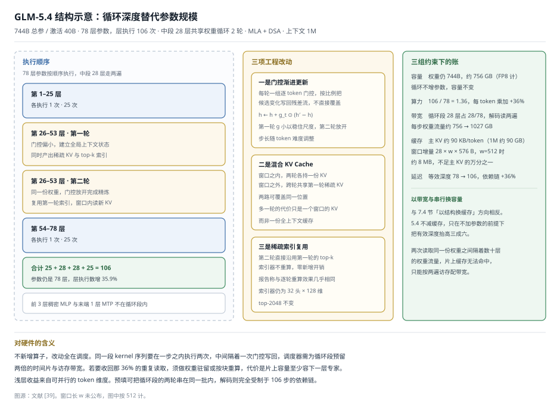

<b>图 7-9</b>　GLM-5.4 的 Loop 结构示意：自左至右为执行顺序、三项工程改动与三组约束的账；执行一侧把 78 层参数排成 25 + 28 + 28 + 25，共 106 次层执行，中段 28 层以同一份权重走两轮；改动为门控渐进更新、混合 KV 与索引复用三项；账目一侧给出容量、算力、带宽、缓存与延迟，结论是以带宽与串行换容量；底部为对硬件的含义。图源：文献 [39]

<b>表 7-2</b>　GLM-5.3 与 GLM-5.4 的结构对照

| 项目 | GLM-5.3 | GLM-5.4 |
|---|---|---|
| 总参数/激活参数 | 744B/40B | 744B/40B（官方作 750B） |
| 层数 | 78（3 稠密） | 78（3 稠密），中段 28 层循环 2 轮 |
| 层执行次数 | 78 | 106（+35.9%） |
| 注意力 | MLA 64 头，q 2048 / kv 512，qk 192 + RoPE 64 | 同左 |
| 稀疏化 | DSA 32 × 128，top-2048，21 full + 57 shared | DSA 同 7.1，索引跨轮复用；层间是否沿用 IndexShare 未披露 |
| 专家（激活） | 256（top-8 + 1 共享），中间维 2048 | 同左 |
| 残差 | 标准 | 标准，另加逐轮门控写回 |
| KV 策略 | 单轮一份 | 窗口外跨轮共享，窗口内每轮独立 |
| 上下文 | 1M | 1M |
| 发布形态 | FP8，约 756 GB | 未公布，权重计划开源 |

循环要真正跑起来，须先解决三件事，5.4 的工程改动都落在这三处。
* 一是门控渐进更新。若每一轮直接覆盖隐状态，激活范数会随轮数膨胀，后续层收到的表示偏离原有尺度；5.4 为每一轮单设一组逐 token 门控，按比例把该轮的候选变化写回残差流。训练之后两组门控出现分工，第一轮门值偏小，侧重建立全局上下文状态；第二轮放开门控，完成精炼。门控步长还随 token 的预测难度调整，较难的位置在首轮写入更多，使复杂预测更充分地受益于第二轮。
* 二是混合 KV Cache。朴素做法为每轮保留一份完整 KV，显存随轮数倍增；5.4 按距离拆分，窗口之内每轮各持一份 KV，因为近处上下文是两轮差异最大的部分，窗口之外所有轮共享第一轮选出的稀疏 KV，两路 KV 允许在同一位置重叠。多一轮的代价因此只是一个窗口的 KV，而不是一份全上下文缓存。
* 三是索引复用，第二轮直接沿用第一轮索引器给出的 top-k，不重算索引，报告称与逐轮重算的效果几乎相同。

这三项改动的效果可以逐条计算。权重仍是 78 层的量，容量不变；若按 5.3 的 FP8 形态计约 756 GB。算力与权重读取则按层执行次数上涨，106 比 78 为 1.36，每 token 乘加与每步权重流量各增约 36%，其中循环段 28 层占总参的 28/78，解码时须读两遍。循环省的是容量，不省带宽，这与 7.4 节以结构换缓存的方向正好相反。缓存一侧，窗口外共享使主 KV 与 5.3 同量级（约 90 KB/token，1M 上下文约 90 GB）；窗口内每轮独立，增量为 28 层 × 窗口长 × 576 B，窗口取 512 时约 8 MB，相对 90 GB 不足万分之一。串行侧，等效深度由 78 增至 106，解码依赖链相应拉长 36%，流水并行的级数随之增加，单级的权重驻留窗口反而变窄。

对加速器而言，5.4 提出的问题不是新算子，而是调度，同一段 kernel 序列要在一步之内执行两次，中间隔着一次门控写回；权重复用只发生在参数层面，不发生在时间局部性层面。循环段的两次读取之间隔着数十层的权重流量，远超片上容量，无法靠缓存命中，只能按两遍访存配置带宽；若要收回这一部分，须在循环段内做权重驻留，把 28 层权重压进邻近 HBM 的高带宽层或按块重算，而这要求片上容量至少容下一层专家的权重。另一方面，思维链内化使多数基准的输出长度缩短 10% 至 14%，但简单任务上仍可能出现马拉松式的自我反思，实际算力并不总随输出 token 数下降，这与 7.3 节「结构不动、算力转向后训练」的路径分属两类。其算子级位置见图 7-10。

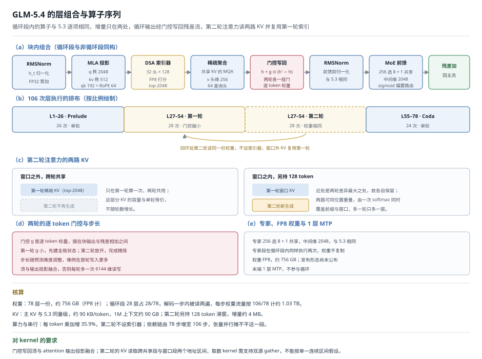

<b>图 7-10</b>　GLM-5.4 的层组合与算子序列：（a）块内组合，MLA 与 DSA 原样保留，循环段的输出经门控写回残差流而非直接覆盖；（b）106 次层执行的排布，中段 28 层出现两次；（c）第二轮的注意力：窗口外复用第一轮的稀疏 KV 与 top-k，窗口内读本轮新生成的 KV；（d）两轮的逐 token 门控与步长调整；（e）专家、FP8 权重与 1 层 MTP 不变；底部为权重、KV 与算力的核算。图源：文献 [39]

# 第 8 章　MiniMax 系列

MiniMax M3 与 M3.1 Flash 共用 428B/23B 的主干，差别在稀疏注意力的覆盖层数、数值格式与投机解码模块。两版均以 MSA（MiniMax Sparse Attention）为核心。

## 8.1　MiniMax M3 与 M3.1 Flash

M3 于 2026 年 6 月 1 日发布，M3.1 Flash 于同年 10 月 19 日发布，两者同为 428B 总参、23B 激活，上下文 1M token，原生多模态（文本、图像、视频输入）[24][25]。专家的中间维为 3072，前 3 层的稠密前馈取 12288。MSA 的官方架构图见图 8-1，两版的结构对比见表 8-1。

<b>表 8-1</b>　MiniMax M3 与 M3.1 Flash 的结构对比

| 项目 | M3 | M3.1 Flash |
|---|---|---|
| 总参数/激活参数 | 428B/23B | 428B/23B |
| 主体 | 60 层（3 稠密 + 57 MoE），隐藏维 6144 | 同 M3 |
| MoE | 128 路由专家（top-4，sigmoid + 偏置）+ 1 共享专家，专家中间维 3072 | 同 M3 |
| 稠密 FFN | 前 3 层，中间维 12288 | 同 M3 |
| 注意力 | GQA 64 Q/4 KV，头维 128；MSA（前 3 层为全注意力） | MSA 全层化 |
| 稀疏配置 | 索引器 4 头对 128 行块打分，每 KV 头取 top-16 块 | 同 M3 |
| 数值 | BF16 | QAT：NVFP4 专家权重 + MXFP8 动态激活 |
| 投机解码 | EAGLE 式 MTP | DSpark 草稿头 |

MSA 的选择粒度落在块上，索引器（4 个索引头，与 4 个 KV 头对齐）对 128 token 的行块打分，每个 KV 头取 top-16 块（自身块必含），位置 2048 以内退化为精确稠密注意力。算子形态为 KV outer gather Q，以 KV 块为外层循环聚合命中的查询，每块只读一次、访存连续，比开源 Flash-Sparse-Attention、flash-moba 快 4 倍以上。由此，1M 上下文下每 token 计算量降至上一代的 1/20，预填充提速 9 倍以上、解码 15 倍以上，多组消融显示能力与全注意力基本持平。M3.1 Flash 在此基础上作了三处改动，MSA 全层化（前 3 个全注意力层也换成稀疏）、量化感知训练（NVFP4 打包专家权重 + MXFP8 动态激活）、以 DSpark 投机解码草稿头取代 MTP；线上推理达 200+ TPS，成本较 M3 下降约 70%。视觉侧为 CLIP 式视觉塔（32 层，patch 14，3D-RoPE，动态分辨率 + patch-merge 压缩）。

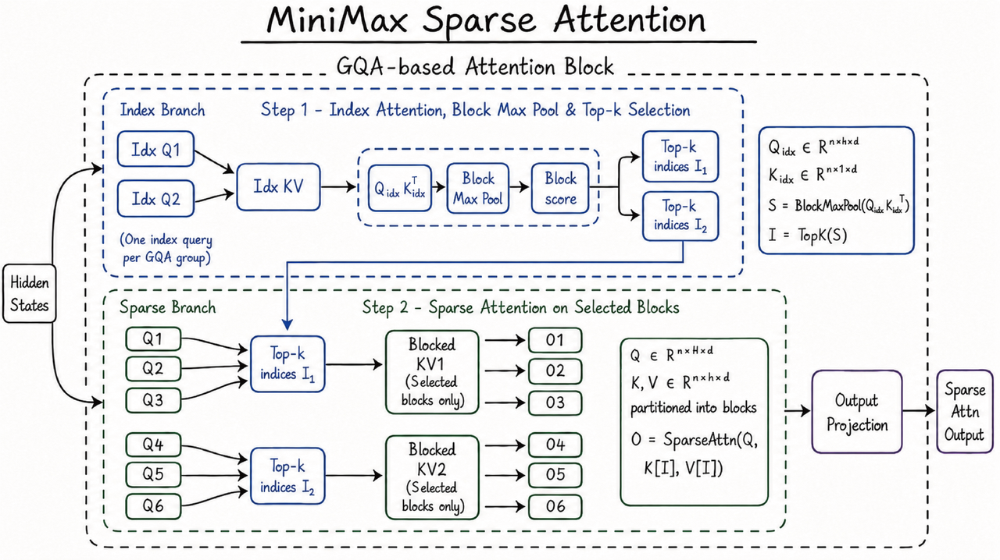

<b>图 8-1</b>　MiniMax M3 的 MSA（MiniMax Sparse Attention）架构。图源：MiniMax 官方博客 [24]

MSA 的稀疏化收益取决于 kernel 的算术强度与访存连续性，而非仅取决于选择的 token 数量。M3.1 Flash 的 QAT 与 NVFP4 则表明，按部署数值格式设计训练已渐成常规做法。

块级稀疏把聚合顺序倒置为以 KV 块为外层，算子级流程见图 8-2。

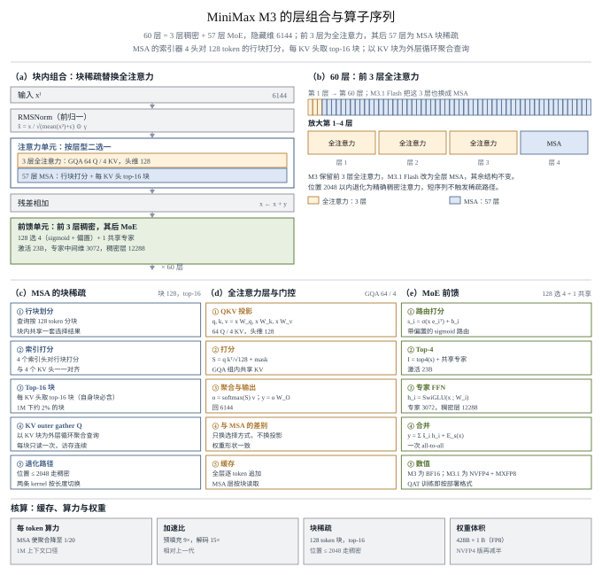

<b>图 8-2</b>　MiniMax M3 的层组合与算子序列：（a）块内组合，前 3 层全注意力、其后 57 层 MSA 块稀疏；（b）60 层的层型分布；（c）MSA：行块划分、4 头索引打分、每 KV 头 top-16 块与 KV outer gather Q；（d）全注意力层的 GQA 通路；（e）128 选 4 加共享专家的前馈与 NVFP4 训练；底部为算力、加速比与权重的核算。图源：文献 [24]

# 第 9 章　Hunyuan 系列

腾讯混元的 Hy 系列在 Hy4 上更换了主干结构。上一代 Hy3 仍用 GQA 全注意力配常规残差，Hy4 改用稀疏注意力、跨层索引复用与多路残差，并把上下文从 256K 提到 1M。本章讨论 Hy4 的 preview 与正式版，结构规格以官方模型卡为准。

## 9.1　Hy4

Hy4 preview 于 2026 年 8 月底以 Apache 2.0 协议开源，总参数 770B、每 token 激活 49B，原生上下文 1M；11 月 4 日发布的正式版沿用同一主干，首次加入视觉理解与 Computer Use（命令行与图形界面操作），并同步提供模型系统卡片[26][27]。结构示意见图 9-1，与 Hy3 的对照见表 9-1。

主干 78 层，隐藏维 6144，词表 120,832。第 1 层为稠密 FFN（中间维 18432），其余 77 层为 MoE，每层 256 个路由专家（top-8）加 1 个共享专家，专家中间维 2048。注意力为 Gated DSA，64 个头，查询压缩维 2048、键值压缩维 512，索引器 32 头、头维 128、每个查询取 top-2048；配套的 IndexCache 允许部分层复用邻近层已算出的稀疏索引，省去逐层重复筛选。残差通路采用 iHC（identity Hyper-Connections），把单一残差流扩为 4 条，层间混合矩阵固定为单位矩阵。主干之外另置 1 层原生 MTP（10B 总参、0.7B 激活）用于投机解码。权重提供 BF16 与 FP8 两种格式，文件合计约 1.56 TB。

<b>表 9-1</b>　Hy3 与 Hy4 preview 的规格对照

| 项目 | Hy3 | Hy4 preview |
|---|---|---|
| 总参数/激活参数 | 295B/21B | 770B/49B |
| 层数 | 80 | 78（1 稠密 + 77 MoE） |
| 隐藏维 | 4096 | 6144 |
| 注意力 | GQA 全注意力 | Gated DSA + IndexCache |
| 路由专家 | 192 | 256（top-8）+ 1 共享 |
| 残差 | 常规单流 | 4 路 iHC |
| MTP | 3.8B | 1 层，10B/0.7B 激活 |
| 词表 | 未公开 | 120,832 |
| 上下文 | 256K | 1M（1,048,576） |
| 数值 | 未公开 | BF16/FP8 |

<b>图 9-1</b>　Hunyuan Hy4 结构示意图：4 路 iHC 残差、Gated DSA 配 IndexCache、77 层 MoE 与原生 MTP 层。

与 Hy3 相比，Hy4 的层数反而少两层，扩容主要来自隐藏维与专家数的增加，以及注意力、残差两处结构的更换。官方给出的部署要求为 vLLM 0.29.0 以上或源码构建的 SGLang，配 FLASHMLA_SPARSE 后端与专用解析器，自部署参考配置为 8×B300。正式版新增的视觉通路与工具调用未改动主干规格，但把长任务中的多轮交互、界面状态与截图一并纳入输入序列。

该版本对硬件的约束分为两层。索引器与 IndexCache 把稀疏注意力的开销从每层各算一次改为若干层复用一次，加速器需支持索引结果的跨层缓存与生命周期管理，而不单是优化单次 kernel；4 路 iHC 把残差状态扩为四份完整副本，层间读写量与片上缓冲随之增加。770B 权重配 1M 上下文，容量与带宽仍是主要瓶颈，FP8 检查点与原生 MTP 分别从权重体积和解码串行度两侧压低部署代价。

四路残差与索引缓存都要在算子层面各占一步，结构见图 9-2。

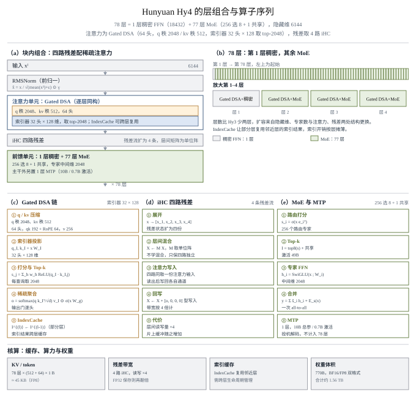

<b>图 9-2</b>　Hunyuan Hy4 的层组合与算子序列：（a）块内组合，Gated DSA 配 4 路 iHC 残差，第 1 层为稠密 FFN；（b）78 层的层型分布；（c）Gated DSA：q 秩 2048、kv 秩 512、索引器 32 头 × 128 与 IndexCache 复用；（d）iHC 四路的展开、混合与回写；（e）256 选 8 加共享专家的前馈与 1 层 MTP；底部为 KV、残差带宽与权重的核算。图源：文献 [26]

# 第 10 章　StepFun 系列

阶跃星辰的 Step 系列此前以 Step-3.5-Flash 与 Step-3.7-Flash 等中等规模模型为主，Step 5 直接进入 600B 级稀疏 MoE。这一代的改动集中在两处，主干取窄深配置以拉长信息传播路径，注意力则以滑窗与稀疏全局层的分工换取百万上下文。

## 10.1　Step 5 Preview

Step 5 Preview 于 2026 年 9 月 20 日发布并开放 API，10 月 15 日开放权重，总参数 600B、每 token 激活 27B，原生支持文本、图像与视频输入，上下文 1M token，按 StepFun Model License 1.0 发布[28][29]。结构示意见图 10-1，主要规格见表 10-1。

主干 92 层，隐藏维 4096，FFN 中间维 13824，词表 128,896。层型按三层滑窗接一层全局的节奏排布，69 层为窗口 512 的滑动窗口注意力，23 层为全局注意力。两类层同为 GQA，64 个查询头、4 个键值组、头维 192，并在注意力输出端加逐头门控。全局层另接稀疏索引，以 16 个索引头、proxy 维 256、RoPE 32 维对历史块打分，按 top-512 选出相关块，块压缩粒度为 8；索引器对查询用 RMSNorm、对键用 LayerNorm，打分函数为 ssmax。滑窗层不设索引器，只覆盖 512 token 的窗口。位置编码上，滑窗层用 10,000 的 RoPE 底数，全局层提高至一千万，并把部分旋转维度压到三分之一，位置范围按 Llama 3 式频率缩放设为 1M。

前 3 层与末层为稠密 FFN，第 3 至 90 层为 MoE（88 层），每层 352 个路由专家，top-8 路由加 1 个共享专家，专家中间维 1536，路由带偏置项与 3.0 的缩放系数。主干末端接 3 层多 token 预测模块，供投机解码使用。视觉前端为 47 层感知编码器，输入 728×728、patch 14、宽 1536、16 头，经 stride 2 的投影器把单图压到 169 个 token；视频按自适应帧率采样，经时间注意力编码后与文本 token 同流进入主干。

<b>表 10-1</b>　Step 5 Preview 主要规格

| 项目 | 规格 |
|---|---|
| 总参数/激活参数 | 600B/27B |
| 层数 | 92（88 层 MoE，其余 4 层稠密 FFN） |
| 隐藏维/FFN 中间维 | 4096/13824 |
| 注意力 | GQA 64 Q/4 KV，头维 192，逐头门控 |
| 层型 | 69 层滑窗（512）+ 23 层全局 |
| 稀疏索引 | 16 头，top-512，块 8，proxy 维 256 |
| 路由专家 | 352（top-8）+ 1 共享，中间维 1536 |
| MTP | 3 层 |
| 词表 | 128,896 |
| 上下文 | 1M（1,048,576） |
| 视觉编码器 | 47 层，728²，patch 14，宽 1536 |
| 数值 | BF16（约 1.2 TB）/FP8（约 600 GB） |

<b>图 10-1</b>　Step 5 Preview 结构示意图：多模态编码器接 92 层窄深主干，注意力按 69 层滑窗与 23 层全局稀疏分工，MoE 取 352 专家 top-8，末端接 3 层 MTP。

百万上下文下的访存结构由层型分工决定。69 层滑窗只需保留 512 token 的键值，可按环形缓冲滚动覆盖，缓存容量与序列长度无关；真正随上下文增长的是 23 层全局注意力的缓存，其规模约为同等层数全注意力模型的三分之一。索引器把全局层的选块成本压到稠密基线的八分之一左右，但索引打分、top-k 选择与块合并是独立于注意力的三段计算，加速器需为其保留单独的 kernel 与中间缓冲。残差流以 FP32 保存，层间读写量约为 BF16 残差的两倍。352 个专家、top-8 的路由使专家并行的通信量随卡数上升，官方部署配置以 TEP 与 DEP 两种切分为主，在 B300 上启用 MegaMoE 后端，H200 上回落到默认 MoE 后端。

权重方面，BF16 检查点约 1.2 TB，FP8 约 600 GB（e4m3、128×128 分块、动态激活）。按 80 GB 显存计，FP8 需单机 8 卡并置，BF16 则要跨两节点 16 卡；1M 上下文的 KV Cache 与运行时缓冲还须另行预留。单 token 解码要串行穿过 92 层，层间同步与流水气泡的代价高于同参数量的宽浅模型；预填充阶段因层数多、每层计算量小，更适合以较大的批内 token 数摊薄调度开销。3 层 MTP 则在解码并行度上作出补偿。

滑窗层与全局层的算子序列在索引一段分岔，见图 10-2。

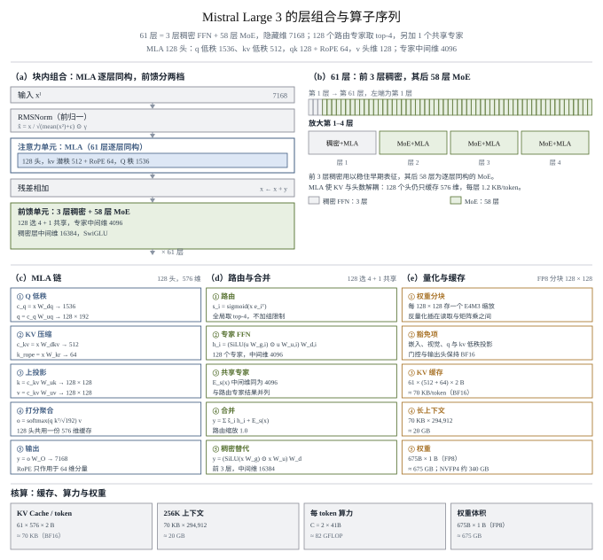

<b>图 10-2</b>　Step 5 Preview 的层组合与算子序列：（a）块内组合，滑窗层与全局层按 3 比 1 分工，残差以 FP32 保存；（b）92 层的层型分布，每 4 层含 1 层全局；（c）滑窗层：窗口 512 的环形缓冲与逐头输出门；（d）全局层：块索引 16 头、top-512 块与三段独立计算；（e）352 选 8 加共享专家的前馈与 3 层 MTP；底部为两类层缓存、残差精度与权重的核算。图源：文献 [28]

# 第 11 章　Mistral 系列

Mistral 的 Large 系列两代相隔约一年，规模由 675B/41B 增至约 1T/49B，注意力由纯 MLA 转为 MLA 配索引器稀疏。两代都随权重提供量化检查点。

## 11.1　Mistral Large 3

Mistral Large 3 于 2025 年 12 月 2 日发布（Apache 2.0），是 Mistral 首个 MoE 旗舰，总参数 675B、激活 41B，其中语言主干 673B、视觉编码器 2.5B，上下文 256K，在 3000 张 H200 上从零训练[30]。整体示意见图 11-1。

主干 61 层，隐藏维 7168，词表 131,072。前 3 层为稠密前馈（中间维 16384），其余 58 层为 MoE，包含 128 个路由专家，取 top-4，另加 1 个共享专家，专家中间维 4096。官方称之为「细粒度 MoE」，粒度取在「专家多而窄」与「专家少而宽」之间——128 个专家比 DeepSeek 的 256 个少一半，中间维却大一倍。41B 激活里，语言主干占 39B，视觉编码器 2.5B。

注意力回到 MLA，128 个注意力头，查询低秩取 1536，键值低秩取 512，qk 无位置维 128、RoPE 维 64（合 192），v 头维 128。KV 只按 512 维潜向量加 64 维 RoPE 分量存储，与 128 个头的名义规模无关；这一点与 DeepSeek V3 同源，而不同于同期多数欧洲模型所取的 GQA。

位置编码以 YaRN 自 8192 外推到 294,912，配 Llama 4 式的缩放（β 取 0.1）。发布形态有 BF16、FP8 与 NVFP4 三种。FP8 检查点用 compressed-tensors 作 128 × 128 分块量化，嵌入、视觉编码器、q 与 kv 的低秩投影、门控以及输出头一律豁免；部署上 FP8 走单节点 B200 或 H200，NVFP4 降到单节点 H100 或 A100。

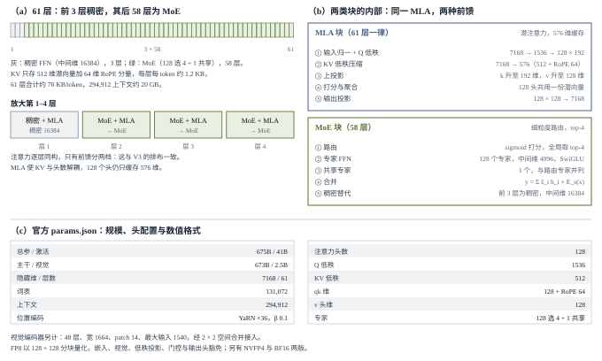

<b>图 11-1</b>　Mistral Large 3 的层序与块内结构：（a）61 层，前 3 层稠密、其余 58 层为 MoE；（b）MLA 的 Q 低秩投影、KV 潜压缩与上投影，以及 128 选 4 加 1 共享的细粒度路由；（c）规模、头配置与数值格式。图源：文献 [30]

675B 级 MoE 可在单节点 8 卡部署。MLA 与分块 FP8 的组合对部署影响，前者把 KV 压到 576 维，后者的缩放粒度取 128 × 128，两者均不依赖新算子，但都会改变访存曲线。

算子级走向见图 11-2。

<b>图 11-2</b>　Mistral Large 3 的层组合与算子序列：（a）块内组合，MLA 逐层同构，前 3 层为稠密前馈；（b）61 层的稠密与 MoE 分布；（c）MLA 的低秩投影、潜向量缓存与聚合；（d）128 选 4 加 1 共享的细粒度路由与 SwiGLU；（e）FP8 分块量化与 128 × 128 缩放的接入位置；底部为 KV、算力与权重的核算。图源：文献 [30]

## 11.2　Mistral Large 4

Mistral Large 4（代号 Le Chonk）于 2026 年 10 月 6 日预览、10 月 29 日开放权重，总参数约 1T（文档作 1.05T）、每 token 激活 49B（含嵌入与输出层为 52B），上下文 1M token，在 Mistral 欧洲自建数据中心以 3800 张 NVIDIA Grace Blackwell 从零训练，是西方首个万亿级开源权重模型[31]。表 11-1 对比两代 Large 的主要规格，图 11-3 给出技术报告中的注意力结构图。

与上一代同源但更宽，72 层，隐藏维 6144，词表 204,800；第 1 层为稠密前馈（中间维 24576），其余 71 层为 MoE，128 个路由专家取 top-4 加 1 个共享专家，专家中间维 6144，路由缩放 1.0。注意力仍是 MLA，但查询不再走低秩，q 直投到 64 个头，键值压到 512 维潜向量，qk 无位置 64 加 RoPE 64，v 头维 128。72 层一律全注意力——早先的滑窗与 CLA 在正式版中被移除，技术报告记载，二者在长程 agent 任务上降低了 SFT 之后的表现，故只保留 YOCO 式的 KV 复用。

两处稀疏在配置里各有一套开关。第 4、8、…、72 层不加旋转，共 18 层 NoPE，其余 54 层用 LeRoPE 学习旋转频率；索引器 44 层自算、28 层共用，自第 18 层起每四层中有两层合用一次，每个查询仍取 top-2048。KV 复用只发生在后半程：第 40、44、…、72 层直接读第 36 层的 KV，不再自建，故 72 层里实存 KV 的是 63 层，每 token 63 × 576 字节 ≈ 35 KB（FP8），1M 上下文单条约 35 GB。DSpark 草稿头 3 层随权重发布，markov rank 取 512。

<b>表 11-1</b>　Mistral Large 3 与 Large 4 主要规格对比

| 项目 | Large 3 | Large 4 |
|---|---|---|
| 总参数/激活参数 | 675B/41B | 约 1T（1.05T）/49B |
| 主体 | 61 层（3 稠密 + 58 MoE），隐藏维 7168 | 72 层（1 稠密 + 71 MoE） |
| 路由专家（激活） | 128（top-4）+ 1 共享，中间维 4096 | 128（top-4）+ 1 共享，中间维 6144 |
| 注意力 | MLA（128 头，q 秩 1536、kv 秩 512，qk 128 + RoPE 64，v 128） | MLA（64 头，q 不压缩、kv 秩 512，qk 64 + RoPE 64，v 128）+ DSA（32 头 × 128，top-2048） |
| 位置编码 | RoPE + YaRN | LeRoPE；第 4、8、…、72 层为 NoPE |
| 跨层复用 | — | 28 层共用索引器，9 层复用第 36 层的 KV |
| 上下文 | 294,912（YaRN 自 8192 外推） | 1M（RoPE + YaRN） |
| 视觉 | 图像理解 | Pixtral 视觉编码器（1.6B，30 层，14px patch） |
| 数值 | FP8 分块 128×128、NVFP4、BF16 三版 | FP8（动态激活）/NVFP4 |
| 投机解码 | NVIDIA 协同支持 | DSpark 草稿头内置（3 层稠密 MLA，3-token 块，吞吐最高 1.9 倍） |

与 DeepSeek V4.1 的 CED、Kimi K3 的 KDA 不同，Large 4 沿用 MLA 加索引器稀疏的路线，并把 DSpark 投机解码草稿头随权重一并发布，投机解码由此从推理框架的特性变为模型自带的能力。部署方面，FP8 官方配方为 8×H200（服务至 131K 上下文），NVFP4 为 4×B200/B300，AMD MI350 重量化后 4 卡可跑；模型原生支持 160 余种语言，覆盖欧盟全部官方语言。

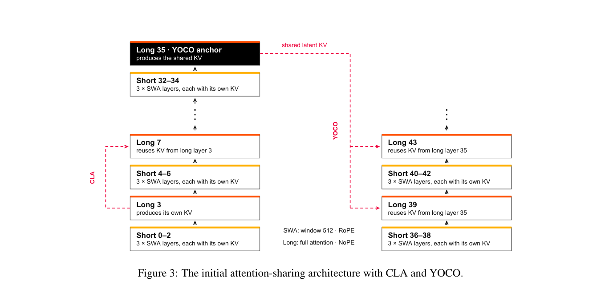

<b>图 11-3</b>　Mistral Large 4 技术报告中的注意力结构图：CLA 与 YOCO 的注意力共享架构探索。图源：Mistral Large 4 技术报告 Figure 3 [31]

这套结构对加速器的要求更接近既有 MLA 实现，主要增量在索引器与 DSpark 草稿头的调度，而非另起一套注意力 kernel。

MLA 与索引器、DSpark 草稿头三段并置后的结构见图 11-4。

<b>图 11-4</b>　Mistral Large 4 的层组合与算子序列：（a）块内组合，MLA 加索引器稀疏，第 1 层为稠密 FFN；（b）72 层的层型分布；（c）MLA 的 KV 潜压缩与读出（q 不压缩）、索引器打分与 top-2048 聚合；（d）128 选 4 加 1 共享专家的前馈与两种发布数值格式；（e）DSpark 草稿头 3 层稠密 MLA、3-token 块的并行验证；底部为 KV、索引器与两种部署配方的核算。图源：文献 [31]

# 第 12 章　Meta Muse 系列

本章讨论 Meta Muse 系列中公开权重的 Muse Spark Open。与前述各系不同，其语言主干不作注意力稀疏化，改动集中在归一化、残差与专家结构。

## 12.1　Muse Spark Open

该模型于 2026 年 10 月 15 日发布，原生多模态（文本、图像、音频、视频输入），面向 Agentic Coding，官方称其为迄今最强的美国开源权重模型[32]。官方架构图见图 12-1，主要规格见表 12-1。

<b>表 12-1</b>　Muse Spark Open 主要规格

| 项目 | 配置 |
|---|---|
| 总参数/激活参数 | 816B/42B |
| 语言主干 | 62 层，隐藏维 8192；词表 202,048（输入/输出嵌入解耦，各约 1.66B） |
| 注意力 | GQA 128 Q/16 KV，头维 64；门控注意力（输出门 + 输出归一化 + QK-norm） |
| 残差 | 可学习残差门融合输入输出（非简单相加） |
| MoE | 每层 256 专家、top-8；专家 FFN 8192→4096→8192 + 逐专家 RMSNorm；pooler/unpooler 降/升维 |
| 感知编码器 | 1.8B（50 层，隐藏维 1536，16 头，14×14 patch，输出 4096 维；每 4 层 + 末层全注意力，其余稀疏） |
| 音频 | tokenizer 每 80 ms 出 1 个 token（12.5 token/s） |
| 上下文 | 1M |
| 数值 | BF16（约 1.5 TB）与 NVFP4（约 493 GB，面向 Blackwell） |

语言主干的注意力不作稀疏化（仅感知编码器稀疏），而以 GQA 128 Q/16 KV、头维 64 的小 KV 头组控制缓存；62 层中 46 层为 2048 token 滑窗注意力、16 层为全注意力，1M 上下文的实际 KV Cache 约为全注意力方案的四分之一。归一化采用三明治式布局，每个 block 前后各一次（x + post_norm(F(norm(x)))）。专家部分设逐专家 RMSNorm 与 pooler/unpooler，先降维（8192→4096）再进专家，专家输出各自归一化后按路由权重求和，最后升维，顺序不可调换。残差融合同样经可学习残差门，而非直接相加。专家占总参约 97%，全部 256 个专家须驻留显存，因此部署按 816B 模型的内存需求准备，单 token 计算量却只相当于 42B 模型。模型提供 BF16 与 NVFP4 双格式，NVFP4 版可单节点 B200 运行，也可在两台 M5 Ultra Mac Studio（各 512 GB 统一内存、1.2 TB/s 带宽）上以 MLX 分布式运行，是首个把万亿档模型带到桌面级内存配置的实例；另附可自动调优的 Helion GPU kernel。

<b>图 12-1</b>　Muse Spark Open 架构：文本、图像/视频、音频各有编码通路，统一进入 62 层 MoE 语言主干。图源：Meta 与 Hugging Face 发布博客架构图 [32]

该模型不作注意力稀疏化，而以门控注意力、残差门与逐专家归一化等微结构提升稳定性，构成另一种取舍。Apple Silicon 的统一内存可运行 816B 模型，说明容量问题并非只能依靠显存解决，高带宽、大容量的内存池同样可行。

门控注意力与池化专家的算子序列见图 12-2，其中 pooler 与 unpooler 的顺序不可调换。

<b>图 12-2</b>　Muse Spark Open 的层组合与算子序列：（a）块内组合，滑窗与全注意力按层型二选一，残差经可学习门融合；（b）62 层的层型分布，滑窗与全注意力约 3 比 1；（c）门控 GQA：QK-norm、128 Q / 16 KV 与逐通道输出门；（d）三明治归一化与残差门的次序；（e）pooler 降维、逐专家归一化与 unpooler 升维，顺序不可调换；底部为 KV、专家与数值格式的核算。图源：文献 [32]

# 第 13 章　Ling 系列

Ling 一系出自蚂蚁集团百灵团队。自 Ling 2.0 起，这一系采用同一套 256 个路由专家配 1 个共享专家的结构，从 16B 扩展至 1T，形状由缩放定律先行确定，而非逐级试错。13.1 节的 Ling 2.0 把改动集中在专家粒度与路由，注意力仍取标准 GQA；13.2 节的 Ling 2.6 反过来，不动专家，把注意力换成 Lightning Attention 与 MLA 的 7:1 混合，并在 2.0 的基座上完成迁移而非从头训练。

## 13.1　Ling 2.0

Ling 2.0 系列自 2025 年 9 月起陆续开源，含 Ling-mini-2.0、Ling-flash-2.0 与 Ling-1T 三个规格，总参数由 16B 至 1T，每 token 激活 1.4B、6.1B 与 51B，激活比统一在 3.5% 左右，即 1/32[33][34]。三个规格同在 20T 以上 token 上预训练，结构取值另有出处，Ling Scaling Laws 以固定数据与路由规则的小规模实验拟合幂律，据此确定 256 个路由专家、每次激活 8 个、另加 1 个共享专家这一组配置，再向万亿规模外推。整体结构见图 13-1，三个规格的主要参数见表 13-1。

<b>图 13-1</b>　Ling 2.0 的整体结构：自左至右为 BBPE 分词与词嵌入、32 层主干（1 层稠密块 + 31 层 MoE 块 + 1 层 MTP）与独立输出头；右侧为单层内部的注意力、位置编码、路由与专家聚合四段；下方列出三个规格共用的骨架。图源：文献 [33][34]

<b>表 13-1</b>　Ling 2.0 三个规格的主要结构参数

| 项目 | Ling-mini-2.0 | Ling-flash-2.0 | Ling-1T |
|---|---|---|---|
| 总参数/激活参数 | 16B/1.4B | 103B/6.1B | 1T/51B |
| 层数（稠密层） | 20（1） | 32（1） | 80（4） |
| 隐藏维 | 2048 | 4096 | 8192 |
| FFN 中间维 | 5120 | 9216 | 18,432 |
| 查询头/键值头 | 16/4 | 32/4 | 64/8 |
| 头维 | 128 | 128 | 128 |
| 路由专家（激活） | 256（top-8）+ 1 共享 | 同左 | 同左 |
| 专家中间维 | 512 | 1024 | 2048 |
| 词表 | 157,184 | 157,184 | 157,184 |
| 上下文 | 32K（YaRN 扩至 128K） | 同左 | 同左 |
| MTP | 1 层 | 1 层 | 1 层 |

以 Ling-flash-2.0 为例，其 6.1B 激活参数中非嵌入部分为 4.8B。主干 32 层，隐藏维 4096，第 0 层为稠密 SwiGLU 前馈（中间维 9216），其余 31 层为 MoE。注意力取标准 GQA，32 个查询头、4 个键值头、头维 128，键值头比即 8 比 1；查询与键在打分前各作一次 QK-Norm，位置编码只作用于头维的前 64 维，即 Partial-RoPE，θ 取 6×10⁵。这两处一并用于低精度训练的稳定性与长度外推能力，报告称 QK-Norm 在低精度下对训练稳定性的改善尤为明显。MoE 部分每层 256 个路由专家、激活 top-8，路由专家与共享专家的中间维均为 1024；路由以 sigmoid 打分再加逐专家偏置实现无辅助损失的负载均衡，选择时先按 8 组取 4 组、再在入选组内取 top-8，合并时乘 2.5 的缩放系数。词表 157,184，采用字节级 BPE，自 Ling 1.5 的 128K 扩至 156K；输入与输出嵌入不共享权重。主干末端接 1 层 MTP，训练时作辅助预测头，损失权重 0.1。原生上下文 32K，经 YaRN 外推至 128K。

算子级的分解见图 13-2，注意力与专家两段并列展开，投影、归一、打分、路由与合并各步的公式与张量维度均标注于框内。

<b>图 13-2</b>　Ling-flash-2.0 的层组合与算子序列：（a）块内组合，GQA 配 256 选 8 的高稀疏专家，第 0 层为稠密 SwiGLU；（b）32 层的层型分布；（c）GQA：投影、QK-Norm、仅前 64 维的 Partial-RoPE 与聚合；（d）组限制路由两级选择与 2.5 倍缩放合并；（e）1 层 MTP 的输入拼接、投影与共享输出头；底部为 KV、算力与权重的核算。图源：文献 [34]

1/32 的激活比同时降低每 token 的计算量与权重读取量，6.1B 激活对应约 12 GFLOP 的乘加，按 FP8 计每 token 需读取约 6.1 GB 权重。KV Cache 只由 32 层、每层 4 个键值头、头维 128 构成，键与值各一份，FP16 下每 token 约 64 KB，128K 序列约 8.4 GB，与万亿级全注意力模型相差一个数量级以上。专家并行是这一系的主要通信负担：31 层各 256 个专家，top-8 加共享专家的路由使每层需要一次 all-to-all，组限制路由的两级选择又在层内多出一次跨组归约。QK-Norm 与 Partial-RoPE 属逐元素算子，每层新增的归一化量级为 2×32×128，数值上需以 FP32 累加，否则 FP8 下的归一化方差会失真。1 层 MTP 在推理端提供单步投机，其收益取决于草稿接受率，故训练时的 MTP 权重与后训练策略需一并设计。官方给出的效率口径为相对同等稠密结构约 7 倍，H20 上 Ling-flash-2.0 的解码速度超过 200 token/s。

## 13.2　Ling 2.6

Ling-2.6-1T 于 2026 年 4 月 24 日发布，总参 1025.41B，每 token 激活约 51B；原生上下文 262,144，由 13.1 节的 128K 扩来。报告把这一代定位为面向真实 Agent 工作流的万亿级模型。结构上沿用 13.1 节的 256 个路由专家取 top-8 加 1 个共享专家，专家一侧不动，改动只在注意力，标准 GQA 换成 Lightning Attention 与 MLA 的混合，比例 7 比 1。与前几代另有一处不同，2.6 不从零训练，而在 Ling 2.0 基座上做架构迁移。万亿规模重训的代价过高，且会丢掉 2.0 已投入的 20T token 的训练成果；迁移阶段仅用约 400B token，便把注意力结构换了过来。

基座即 13.1 节所述 Ling 2.0-1T，80 层（前 4 层稠密 MLP，其余 76 层 MoE）、隐藏维 8192、64 个查询头配 8 个键值头、头维 128、专家中间维 2048、词表 157,184[42]。2.6 把其中 70 层换成 Lightning Attention，只留 10 层 MLA，按 7 比 1 间隔排布，每 8 层中 1 层为 MLA。这一比例并非先验给定，报告给出 1:1、3:1、7:1 与 15:1 四组配比的缩放律对比，7 比 1 在建模质量与推理成本之间取得较优点，遂定为 1T 基座的最终结构[41]。整体示意见图 13-3，与 flash、Ring 两档的对照见表 13-2。

<b>图 13-3</b>　Ling 2.6 的整体结构：左上为 80 层的层型排布，按 7 比 1 排为 70 层 Lightning Attention 与 10 层 MLA，前 4 层为稠密 MLP，末端接 1 层 MTP；右上为两类块的内部，线性块维护定长累积状态，MLA 块保留低秩潜向量缓存；左下为两代 KV 总量对比，128K 的 2.0-1T 约 42 GB、256K 的 2.6-1T 约 10.5 GB；底部为权重、KV 与状态的三项核算。图源：文献 [41]

<b>表 13-2</b>　Ling 2.6 三个规格的主要结构参数

| 项目 | Ling-2.6-flash | Ling-2.6-1T | Ring-2.6-1T |
|---|---|---|---|
| 总参数/激活参数 | 104B/7.4B | 1025.41B/约 51B | 同 Ling-2.6-1T |
| 层数（稠密层） | — | 80（4） | 80（4） |
| 注意力 | Lightning:MLA = 7:1 | 同左，70 层 Lightning + 10 层 MLA | 同左 |
| MLA 头配置 | — | 64 Q / 8 KV × 128 | 同左 |
| 位置编码 | — | Partial-RoPE，θ 6×10⁵ | 同左 |
| 路由专家（激活） | 256（top-8）+ 1 共享 | 同左，中间维 2048 | 同左 |
| 上下文 | 262,144 | 262,144 | 262,144 |
| KV Cache | 仅 MLA 层，40 KB/token | 同左 | 同左 |
| 推理配置 | instant | instant | high / xhigh |
| 发布形态 | MIT，权重开源 | MIT，权重约 1.04 TB | MIT，权重开源 |

迁移分四步，四步的细节值得单列，因为它解释了这套结构从何而来。
* 一是层替换，把部分 GQA 层改造成 Lightning Attention，其余层暂不动。
* 二是 Linear Warmup，对齐新增参数，使改动过的层与原网络重新匹配。
* 三是 MLA 转换，把其余 GQA 层换成 MLA，同时移除 QK-Norm、适配 Partial-RoPE，这是 2.6 与 2.0 最直接的结构差异，迁移后的 MLA 层不再带 QK-Norm，而 2.0 曾以它在低精度下稳定训练。
* 四是 MLA Warmup，把 loss 拉回迁移前水平，至此结构迁移完成。

四步合计约 400B token。此后是 8T token 的 4K 继续预训练，再以 1.2T token 的中期训练把上下文由 4K 经 32K 推到 256K，预训练总量约 9.6T token。

换掉注意力的收益直接落在缓存上。10 层 MLA 每层每 token 存 8 个键值头 × 128 维 × 键值各一份 × 2 字节，即 4 KB，10 层合计 40 KB/token；256K 上下文约 10.5 GB。2.0-1T 的同一项是 80 层 × 4 KB = 320 KB/token，128K 时已需约 42 GB。长度翻倍而缓存降为四分之一，差额全部来自那 70 层不再存 KV。70 层 Lightning Attention 只维护每头 128 × 128 的累积状态，FP32 下每层约 4 MB，70 层合计约 293 MB，与长度无关。两笔相加，长上下文的容量压力由「每 token 40 KB」这一项决定，而不再由上下文长度直接决定——这一点与 3.2 节 Qwen 的取舍同构，只是 Ling 把线性层的比例压到了七分之八。

权重一侧约 1.04 TB，按 1025.41B 参数每元素一字节计，部署需张量并行度不低于 8；flash 规格 104B 总参、7.4B 激活，在 4 卡 H20 上实测 340 token/s，INT4 量化版可单台 DGX Spark 运行。串行侧的压力与 Qwen 一系同类，70 层线性层串成一条递推链，解码延迟不随张量并行加宽而下降，只能靠在块内并行与跨设备切层分摊。系统层面另有两项配套，一是延续 MTP 训练，二是在上下文并行上优化通信，并自建 linghe 融合算子库以减少注意力前后的中间读写。

后训练的目标不是分数，而是 token 效率。报告的做法是以专家化训练取代统一式后训练，先冷启 SFT，再分 reasoning 与 agentic 两个专家方向各自强化，最后把能力蒸馏回单一模型。其中 Evo-CoT 提供推理轨迹的进化式采样，LPO 以语言单元而非 token 为单位做策略优化，双向偏好对齐把正向激励与负向惩罚收进同一个奖励模型，最短正确答案蒸馏则直接从候选中保留最短的正解，并由判定模型剔除「已得正确答案仍继续反思」的片段。RL 阶段另加两项惩罚，一为动态长度惩罚，允许难题充分推理而限制简单任务的冗长，二为语义冗余惩罚，按段落评估推理过程以抑制循环。报告称同等智能水平下输出 token 约为上一代的四分之一，Artificial Analysis 以约 1600 万输出 token 取得 34 分。

对硬件而言，这一取向改变的是批量与序列的配比。解码步数减少，每步仍需读一遍权重，故单位任务的权重流量随输出长度下降，带宽压力向预填与批处理一端移动；而线性层的定长状态使长序列的缓存不再随长度增长，容量规划从「按上下文长度乘」改为「按序列数乘」。Ring-2.6 与 Ling-2.6 结构相同，差别全在后训练，它以 KPop 把 IcePop 的固定比例约束换成二元 KL 散度，配合异步 RL 支撑长程 Agent 任务，并给出 high 与 xhigh 两档推理预算。其算子级位置见图 13-4。

<b>图 13-4</b>　Ling-2.6-1T 的层组合与算子序列：（a）Lightning Attention 块，三路投影、因果衰减累积状态、状态读出与输出门控；（b）MLA 块，q/kv 低秩投影、Partial-RoPE 与全序列聚合，无 QK-Norm；（c）从 2.0 基座迁移的四阶段，合计约 400B token；（d）256 选 8 加 1 共享的专家与 1 层 MTP，专家段沿用 2.0；底部为 KV、状态与权重的核算。图源：文献 [41]

# 参考文献

[1] DeepSeek-AI. DeepSeek-V3 Technical Report. arXiv:2412.19437, 2024.

[2] DeepSeek-AI. DeepSeek-V3.2 模型卡. https://fe-static.deepseek.com/chat/transparency/deepseek-v3.2-model-card-0414-CN.pdf

[3] DeepSeek-AI. DeepSeek-V3.2 Technical Report（DSA 架构）. https://github.com/deepseek-ai/DeepSeek-V3.2-Exp

[4] DeepSeek-AI. DeepSeek V4 模型卡. https://fe-static.deepseek.com/chat/transparency/deepseek-V4-model-card-CN_3c2bd9.pdf

[5] DeepSeek-AI. DeepSeek-V4: Towards Highly Efficient Million-Token Context Intelligence（技术报告）. arXiv:2606.19348, 2026.

[6] DeepSeek-AI. DeepSeek-V4.1-Flash Technical Report. https://huggingface.co/deepseek-ai/DeepSeek-V4.1-Flash

[7] DeepSeek-AI. DeepSeek V4.1 Flash 发布页. https://www.deepseek.com/zh/news/deepseek-v4-1-flash/

[8] Qwen 团队. Qwen3.5-397B-A17B Model Card. Hugging Face. https://huggingface.co/Qwen/Qwen3.5-397B-A17B

[9] Qwen 团队. Qwen3.5 官方发布博客. https://qwen.ai/blog?id=qwen3.5

[10] Qwen 团队. Qwen3-Next-80B-A3B-Instruct Model Card（含官方模型架构图）. Hugging Face. https://huggingface.co/Qwen/Qwen3-Next-80B-A3B-Instruct

[11] Qwen 团队. Qwen3.8-2.4T-A95B Model Card 与 config.json. ModelScope. https://www.modelscope.cn/models/Qwen/Qwen3.8-2.4T-A95B

[12] Qwen 团队. Qwen3.8-Flash-Next Model Card 与官方架构图. Hugging Face. https://huggingface.co/Qwen/Qwen3.8-Flash-Next

[13] Moonshot AI. Kimi-K2.5 Model Card. https://huggingface.co/moonshotai/Kimi-K2.5

[14] Moonshot AI. Kimi K3: Open Frontier Intelligence（技术报告）. https://www.kimi.ai/en/blog/kimi-k3

[15] Moonshot AI. Kimi-K3.1-Pro Model Card. ModelScope 与 Hugging Face. https://www.modelscope.cn/models/moonshotai/Kimi-K3.1-Pro

[16] Moonshot AI. Kimi K3.1 官方发布博客. https://www.kimi.ai/blog/kimi-k3-1-pro

[17] Xiaomi MiMo. MiMo-V2.5 Model Card. https://huggingface.co/XiaomiMiMo/MiMo-V2.5

[18] Xiaomi MiMo. MiMo-V2.6: Scaling Reinforcement Learning Towards Self-Improvement（技术报告）. 2026.

[19] Meituan LongCat Team. LongCat-Flash Technical Report；LongCat-Flash-Chat 的 config.json 与 modeling 代码. https://github.com/meituan-longcat/LongCat-Flash-Chat ；https://www.modelscope.cn/models/meituan-longcat/LongCat-Flash-Chat

[20] Meituan LongCat Team. Introducing LongCat-2.0（官方发布博客，含架构图）. https://longcat.ai/blog/longcat-2.0

[21] 美团 LongCat 团队. LongCat-2.0 开源权重与 config.json. ModelScope. https://www.modelscope.cn/models/meituan-longcat/LongCat-2.0

[22] Z.ai. GLM-5: From Vibe Coding to Agentic Engineering（附开源权重 config.json）. https://z.ai/blog/glm-5 ；https://www.modelscope.cn/models/ZhipuAI/GLM-5

[23] Z.ai. GLM-5.2: Built for Long-Horizon Tasks. https://z.ai/blog/glm-5.2

[24] MiniMax. MiniMax M3: Frontier Coding, 1M Context, Native Multimodality. https://www.minimax.io/blog/minimax-m3

[25] MiniMax. MiniMax-M3.1-Flash Model Card. Hugging Face. https://huggingface.co/MiniMaxAI/MiniMax-M3.1-Flash

[26] Tencent-Hunyuan. Hy4-preview README 与模型系统卡片. GitHub. https://github.com/Tencent-Hunyuan/Hy4-preview

[27] 腾讯云开发者社区. 腾讯混元 Hy4 正式版发布. https://cloud.tencent.com/developer/article/2776227

[28] StepFun. Step 5 Preview Model Card 与 config.json. Hugging Face. https://huggingface.co/stepfun-ai/Step-5-Preview

[29] StepFun. Step 5 Preview 官方发布页. https://www.stepfun.com/step-5-preview

[30] Mistral AI. Introducing Mistral 3；Mistral-Large-3-675B-Instruct-2512 的 params.json. https://mistral.ai/news/mistral-3/ ；https://www.modelscope.cn/models/mistralai/Mistral-Large-3-675B-Instruct-2512

[31] Mistral AI. Mistral Large 4 Technical Report. Hugging Face: mistralai/Mistral-Large-4-1T-A52B.

[32] Meta 与 Hugging Face. Welcome Muse Spark Open. https://huggingface.co/blog/meta-muse-spark-open

[33] Ling Team, Ant Group. Ling 2.0 Technical Report: Every Activation Boosted — Scaling General Reasoner to 1 Trillion Open Language Foundation. arXiv:2510.22115, 2025.

[34] inclusionAI. Ling-flash-2.0 Model Card 与 config.json. Hugging Face. https://huggingface.co/inclusionAI/Ling-flash-2.0

[35] Z.ai. GLM-5.3: Frontier Coding with Emergent Cyber Capabilities. https://z.ai/blog/glm-5.3

[36] Z.ai. GLM-5.3 Model Card 与 config.json. Hugging Face. https://huggingface.co/zai-org/GLM-5.3

[37] Hou Z., Li Y., Tang J., Dong Y. Single-Rollout Asynchronous Optimization for Agentic Reinforcement Learning. arXiv:2607.07508, 2026.

[38] Z.ai. GLM-5.3-Flash: Frontier Intelligence, Flash Cost（官方博客，附开源权重 config.json 与建模代码）. https://z.ai/blog/glm-5.3-flash ；https://huggingface.co/zai-org/GLM-5.3-Flash

[39] Z.ai. GLM-5.4: Toward Generalized Coding with Our First Loop Transformer（官方研究页，含 Loop 架构、门控渐进更新、混合 KV Cache 与索引复用）. https://www.zhipuai.cn/zh/research/164

[40] Z.ai. GLM-5.4 上线 GLM Coding Plan 官方公告. https://z.ai/blog/glm-5.4

[41] InclusionAI（蚂蚁集团百灵团队）. Ling & Ring 2.6 Technical Report：面向真实 Agent 工作流的高效万亿级模型. 2026.

[42] InclusionAI. Ling-2.6-1T Model Card 与 config.json. ModelScope 与 Hugging Face. https://modelscope.cn/models/inclusionAI/Ling-2.6-1T ；https://huggingface.co/inclusionAI/Ling-2.6-1T
